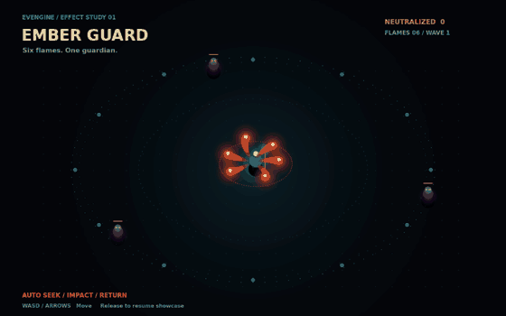
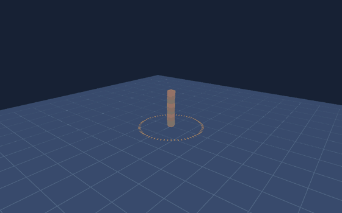
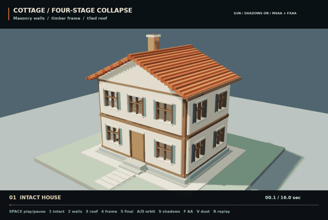
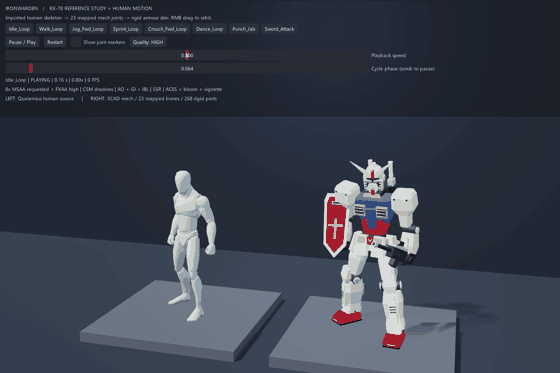

# EVEngine

<table>
  <tr>
    <td width="50%"></td>
    <td width="50%"></td>
  </tr>
  <tr>
    <td width="50%"></td>
    <td width="50%"></td>
  </tr>
</table>

=======================

Evolutionary Vision Engine

[中文版](Readme.md)

## Documentation

### Native Intel macOS x86_64 builds

On an Intel Mac, initialize submodules (`make init/submodules`) and install Xcode
command-line tools, CMake, Ninja, and an x86_64 Vulkan SDK with MoltenVK. Build
the configurations separately:

```sh
make build/macosx-x86_64-debug JOBS=4
make build/macosx-x86_64 JOBS=4
```

These targets explicitly select `CMAKE_OSX_ARCHITECTURES=x86_64` and macOS 13.3 as
the deployment target for floating-point `std::format` support in libc++. They reject
other hosts, targets and compilers. Engine builds use
`build/macosx-x86_64[-debug]`; source dependencies build into
`build/third-party/macosx-x86_64[-debug]` and install into
`build/third-party-binary/macosx-x86_64[-debug]`. Prebuilt dependencies select
`macosx-x86_64-Release`, including for Debug engines. Use
`make deps/macosx-x86_64[-debug]` for dependencies only and
`make test/macosx-x86_64[-debug]` for host tests. The existing `make debug`
default stays unchanged.

CI uses native `macos-15-intel` runners and follows `build_type` for Debug,
Release, or both. Like Windows ARM64, it compiles and links the engine and test
binaries using the matching prebuilt dependencies. These lanes do not run
graphics tests. SDK release jobs additionally validate native plugins and packaged
games on runners matching both architectures.

Build SDKs separately:

```sh
make sdk/macosx-arm64 JOBS=4
make sdk/macosx-x86_64 JOBS=4
```

Debug SDK targets are `sdk/macosx-arm64-debug` and `sdk/macosx-x86_64-debug`.
Release archives are `eve-sdk-macosx-arm64-<version>.zip` and
`eve-sdk-macosx-x86_64-<version>.zip`. Choose the target Mac's CPU architecture.
`TARGET_PLATFORM` remains `macosx`; `TARGET_ARCHITECTURE` records the CPU.

### Native ARM64 builds (Windows and Linux)

Run these commands on an ARM64 host; these configurations reject cross compilation
and non-ARM64 compilers. Initialize submodules first (`make init/submodules`).

| Host | Debug | Release |
| --- | --- | --- |
| Windows ARM64 | `make build/win32-arm64-debug JOBS=8` | `make build/win32-arm64 JOBS=8` |
| Linux ARM64 | `make build/linux-arm64-debug JOBS=4` | `make build/linux-arm64 JOBS=4` |

Windows requires Visual Studio's ARM64 C++ tools (including `vcvarsarm64.bat`),
Windows SDK, Ninja, Git Bash, and Vulkan headers, shader tools and ARM64 loader
libraries. The Makefile invokes `cmake/with-msvc.cmd --arm64` for every configure
and build, selecting the native ARM64 MSVC environment. Linux requires native
GCC/G++, Ninja and the same development packages as the standard Linux build,
installed for aarch64. Also install `lld` (`sudo apt-get install lld`) for the
monolithic OBJECT test executable: it supplies range-extension thunks for the
large ARM64 link. Compilation still uses GCC/G++; the engine executable and
shared/domain test links keep their existing linker. No cross toolchain file is used.

The existing CMake entry point also accepts `-DEVENGINE_NATIVE_ARM64=ON` together
with `-DEVENGINE_BUILD_PLATFORM=win32` or `linux`. On Windows invoke CMake through
`cmake/with-msvc.cmd --arm64`. Use a separate `-B build/<platform>-arm64[-debug]`
directory. Dependencies build into `build/third-party/<platform>-arm64[-debug]`
and install into `build/third-party-binary/<platform>-arm64[-debug]`; never reuse
x64 prebuilt dependencies through `EVENGINE_THIRD_PARTY_BINARY_DIR`.

To build and install only the matching third-party libraries, use
`make deps/win32-arm64-debug`, `make deps/win32-arm64`,
`make deps/linux-arm64-debug`, or `make deps/linux-arm64`.
The `build/` targets run this dependency step automatically. Windows dependencies
inherit the native ARM64 MSVC environment; Linux dependencies receive the parent's
native C/C++ compilers. Both architectures share pinned dependency source code,
while compiled libraries and dependency CMake caches remain separate.

Debug keeps strict warnings and the existing development linkage policy; Release
selects OBJECT linkage. Run a targeted host test with, for example,
`make test/win32-arm64-debug DOMAIN=math` or
`make test/linux-arm64-debug DOMAIN=math` (use an existing test domain).
Linux graphics tests still require a display/Vulkan ICD and audio backend;
use the aarch64 system's installed Lavapipe ICD rather than an x86_64 ICD path.
These explicit targets do not change the existing `make debug` default.

CI builds these targets on native GitHub-hosted `windows-11-arm` and
`ubuntu-24.04-arm` runners. The lanes follow the existing Windows/Linux change
scopes: normal runs build Debug; `build_type=release` builds Release and
`build_type=both` builds both configurations. Each lane compiles and links the
engine and test binaries, requiring the matching ARM64 third-party release
packages (`EVENGINE_THIRD_PARTY_MODE=PREBUILT`). Dependency source fixes and binary
packaging belong to the third-party repository. Missing packages fail explicitly
instead of rebuilding dependencies in these CI lanes. These are build checks;
ARM64 graphics tests and SDK release packaging are not part of these lanes.

English user guides are maintained by hand; Chinese is the authoritative source. Guides not yet translated are marked Chinese in the English handbook.

- Want to see what the engine renders before running anything? Browse the [example render gallery](docs/images/examples/README.en.md) — every screenshot is a real presented frame written by the engine itself.
- [Game developer docs](docs/en/usr/README.md): download the engine, create and run a game, debug, and publish; the [module handbook](docs/en/usr/MODULES.md) covers the script APIs and examples one by one.
- [Online API reference (Doxygen)](https://evengine.github.io/EVEngine/): published continuously to GitHub Pages; includes the C++ API and the user manual.
- [Example walkthroughs](examples/README.en.md), [AI and MCP setup](docs/en/usr/AI-MCP.md), and [user FAQ](docs/en/usr/FAQ.md).
- [Engine developer docs](docs/en/dev/README.md): for engine maintainers and contributors — architecture, module design, testing strategy, and implementation notes.

> **For game developers:** you do **not** need to compile EVEngine. Download the prebuilt SDK for your platform from the [official release page](https://github.com/EVEngine/EVEngine/releases), unzip it, and start creating — no Git, CMake, C++ compiler, or Vulkan SDK required. Only developers who want to modify the engine itself need to read "Building from source" below.

## Introduction

Many game engines are slow to iterate, hard to debug, and awkward for rapid prototyping. EVEngine is designed to be a simple, practical engine focused on 2D, third-person 3D, and mixed 2D/3D gameplay components — not a heavyweight 3D scene-management suite.

Design goals:

> Status legend: ✅ shipped · 🟡 partially shipped · 🛠 roadmap (not implemented yet)

1. ✅ A Love2D-style interpretive engine that loads scripts and data directly
2. ✅ Many high-performance C++ modules; you can compile your own C++ libraries as shared libs and interact with them directly (see `examples/native-plugin`)
3. 🟡 A full development stack: your logic can be edited with GUI tools; the editor runtime is the game runtime—only the shipping runtime strips DevTools (or you can keep them for player modding); scripts can build editing GUIs at runtime (see `examples/terrain-editor`)
4. ✅ Built-in asset management and hot reload—no separate pipeline required
5. 🛠 Class scanning with auto-generated editing GUIs (property reflection not landed yet; `editor.Inspector` currently registers fields manually—see roadmap)
6. 🟡 GUIs that create and sync live from scripts (declarative `ui` module + hot reload; reflective two-way binding is on the roadmap)
7. ✅ Pause the game loop for debugging (`eve run --debug`, F-keys / DAP / snapshots, see [DevLab](examples/devlab/README.en.md))
8. 🟡 Independent state-machine models (e.g. animation) exist; systematic "edit code → affected state machines hot-update" support is on the roadmap
9. ✅ Mixed 3D and 2D rendering

> Fastest way to feel goals 3 / 4 / 7: `make devlab` (a developer-experience example that walks you through F4 / F6 / F7 / F9 and hot reload).

Built-in systems:

1. 2D tilemap — with an extensible map editor
2. 2D camera
3. Simple database
4. Box2D / Box3D physics
5. RPG framework
6. Extensible combat model components
7. Dialogs and scripting
8. Layered avatar rendering
9. 2D fluid engine (`Physics.newFluid2D`; also interactive cloth via `newCloth`)
10. Particle system
11. Sprite-stacking pseudo-3D
12. Real 3D model rendering

Build an RPG with minimal ceremony, with fast edit/debug for events, logic, and cutscene scripts — for example, hot-patch a function in a script and re-run it to preview the effect.

## Quick start (game developers: download, no build)

### 1. Download the engine from the official site

Go to the [EVEngine release page](https://github.com/EVEngine/EVEngine/releases), pick the latest stable release, and download the SDK archive for your target platform:

| Target platform | Download | Notes |
|-----------------|----------|-------|
| Windows | `eve-sdk-win32-<version>.zip` | Windows 10/11 x64 |
| Linux | `eve-sdk-linux-<version>.zip` | Ubuntu 20.04+ etc. (requires a Vulkan driver) |
| macOS ARM64 | `eve-sdk-macosx-arm64-<version>.zip` | macOS 13.3+, Apple Silicon |
| macOS x86_64 | `eve-sdk-macosx-x86_64-<version>.zip` | macOS 13.3+, Intel |
| Android | `eve-sdk-android-<version>.zip` | Assemble an arm64 APK on a dev machine |
| iOS | `eve-sdk-ios-<version>.zip` | Assemble an arm64 .app on a macOS dev machine |

Unzipping gives you a self-contained SDK directory — no installation required. Windows example:

```text
eve-sdk-win32/
├── bin/eve.exe          # engine runtime
├── lib/                 # Windows: import lib for plugins; macOS: runtime dylibs
├── include/eve/         # native plugin headers (not needed for script-only games)
├── cmake/               # native plugin CMake support (not needed for script-only games)
├── platform/            # target-platform packaging template (e.g. Android APK project)
└── share/eve/
    ├── VERSION          # engine version
    ├── TARGET_PLATFORM  # target platform marker
    ├── examples/basic/  # runnable reference game
    └── licenses/        # engine and third-party licenses
```

### 2. Run the bundled example to verify

```sh
# Windows
bin\eve.exe run share\eve\examples\basic

# macOS / Linux
bin/eve run share/eve/examples/basic
```

### 3. Create and run your first game

```sh
bin\eve.exe create mygame     # Windows (macOS / Linux: bin/eve create mygame)
bin\eve.exe run mygame
```

`eve create` generates a minimal game template: `config.nut` (window and dev options) and `main.nut` (game logic). Edit `main.nut`, save, and watch the hot reload in action. For game directory layout, lifecycle callbacks (`eve_init` / `eve_update` / `eve_render`), modules, debugging, and publishing, see the [user guide](docs/en/usr/README.md).

### What you can do with the engine

- **Make 2D / third-person 3D / mixed 2D+3D games**: 40+ modules — tilemap, cameras, Box2D/Box3D physics, particles, animation, RPG, inventory, UI, procedural generation, and more — all driven by EveScript (Squirrel-compatible). Start with the [EveScript tutorial](docs/en/usr/EVESCRIPT.md), then use the [module handbook](docs/en/usr/MODULES.md).
- **Hot reload for scripts and assets**: on desktop, edits take effect immediately; on mobile, push changes to the device with the `eve dev` dev server — no reinstall.
- **Debug**: pause the game loop, breakpoints, watches, snapshots; VS Code debug adapter and AI (MCP) assisted development.
- **Package and publish**: `eve zip` compresses a game into a `.eve` archive; `eve package --sdk <sdk>` produces a distributable folder containing the runtime and your game; Android/iOS use the SDK's bundled templates to assemble APK / .app.
- **Native extensions**: when you need C++ performance code, write a plugin dynamic library with the SDK's CMake package (see `examples/native-plugin`) — script-only users never need this.

### What to keep in mind

1. **The runtime needs a Vulkan driver, but not the Vulkan SDK**: rendering is Vulkan-based. Windows GPU drivers usually include the Vulkan runtime; macOS is covered by the bundled MoltenVK; Linux needs `mesa-vulkan-drivers` (AMD/Intel) or the vendor driver (NVIDIA). Installing Git, CMake, a compiler, or the LunarG SDK only matters for building from source.
2. **SDKs are per-platform and versions must match**: each SDK targets exactly one platform; native plugins must match the host platform and SDK version — mixing platforms or versions is not supported.
3. **Stable vs. development**: Releases and the `main` branch are the stable line; to try the latest features or modify the engine, build from source and develop on `dev`.
4. **License**: EVEngine uses a dual license — read the [license](#license) before use; commercial revenue above the free threshold requires a commercial license.

## Building from source (engine developers / contributors)

> The requirements and build steps below are only for developers who need to modify the engine source, contribute to engine development, or build the SDK themselves. Game developers should use the prebuilt version from "Quick start" above.

### Requirements

#### Common dependencies

| Dependency | Version | Notes |
|------------|---------|-------|
| Git | Any recent version | Clone the repo; first configure may download `third-party` |
| CMake | **≥ 3.21** | Primary build system |
| C++ compiler | **C++20** | MSVC / GCC / Clang |
| Vulkan SDK | **≥ 1.2** | Graphics backend; environment variables must be set correctly |

Third-party libraries are independently released by [EVEngine/third-party](https://github.com/EVEngine/third-party/releases).
`cmake/third_party_pin.cmake` fixes both the release tag and its source commit.
Normal supported native builds automatically download and verify that release,
then reuse the installed prefix; EVEngine's release CI builds only the engine and
SDK, without rebuilding these dependency libraries (including Jolt).

```powershell
make build/win32-debug
# Optional: download explicitly before configuring, or prepare an offline prefix.
python scripts/third_party_package.py win32 --configuration Debug
```

Packages cover Windows x64 Release/Debug, Linux x86_64 Release, macOS arm64 and
x86_64 Release, Android arm64-v8a Release, and iOS arm64 device Release.
Non-Windows Debug engines use Release dependency libraries, matching source builds.
Downloads verify SHA256, schema version, release tag, source commit, target platform,
architecture and library configuration. Compatible existing installs are reused;
incompatible directories are rejected and never overwritten. Installation publishes
only after all validation succeeds. AUTO falls back to the pinned source build when downloads are unavailable (missing assets or network failures), with an explicit configure message. Invalid checksums or incompatible packages remain errors. PREBUILT requires a successful download.

To build dependencies locally instead, select `SOURCE`:

```powershell
make build/win32-debug CMAKE_EXTRA_ARGS="-DEVENGINE_THIRD_PARTY_MODE=SOURCE"
```

`AUTO` is the default. It selects source builds for unpackaged targets such as
Emscripten, iOS simulator, other Android ABIs, universal macOS and custom sanitizer/
code-model flags. `PREBUILT` requires a supported package. An explicit
`EVENGINE_THIRD_PARTY_BINARY_DIR` still supports a compatible offline/local prefix.
Changing the dependency release requires updating both pin values after the upstream
release assets have been published. Dependency patches are owned and applied by the
pinned third-party repository; engine-owned `external/ECS.hpp` and `external/zeroerr`
patches remain here.

These are complete library install trees with headers, static/shared libraries,
runtime binaries, metadata and license notices. You still need platform build tools,
Vulkan SDK, system development libraries and engine submodules. CMake fetches pinned
sources for vendored code compiled directly into the engine, such as ImGui.
ABI baselines are MSVC x64 dynamic CRT, Ubuntu 24.04/GCC, macOS 13+ (matching CPU),
NDK 27.3.13750724 / Android API 24 / c++_shared, and iOS 13+ arm64 device SDK.
Use source mode for toolchains incompatible with those baselines.

#### Windows

| Component | Recommended |
|-----------|-------------|
| OS | Windows 10 / 11 (x64) |
| IDE / toolchain | **Visual Studio 2026** (with the “Desktop development with C++” workload) |
| CMake generator | Ninja + MSVC for the root Makefile Windows targets; `Visual Studio 18 2026` for manually configured VS projects |
| Vulkan SDK | Install from [LunarG](https://vulkan.lunarg.com/). Confirm user env `VULKAN_SDK` (e.g. `C:\VulkanSDK\1.4.357.0`) and add `%VULKAN_SDK%\Bin` to `PATH` (includes `glslc`). **Open a new terminal / restart Cursor** before running cmake |
| Optional | Git for Windows; add CMake / Ninja to `PATH` |

> With Visual Studio 2022, Ninja targets locate MSVC through `cmake/with-msvc.cmd`; choose `"Visual Studio 17 2022"` when configuring a VS project manually.

#### Linux

| Component | Recommended |
|-----------|-------------|
| Distro | Ubuntu 20.04+ or equivalent (including WSL2) |
| Compiler | GCC 10+ or Clang 12+ |
| Base packages | `build-essential`, `cmake`, `git`, `ninja-build`, `pkg-config` |
| System libs | X11 / SDL2: `libx11-dev`, `libxext-dev`, `libxxf86vm-dev`, `libxrandr-dev`, `libxcursor-dev`, `libxi-dev`, `libxinerama-dev`, `libxss-dev`; optional Wayland: `libxkbcommon-dev`, `libwayland-dev`; OpenAL/audio: `libasound2-dev`, `libpulse-dev`; image compression: `zlib1g-dev`, `libpng-dev`, `libbz2-dev` |
| Vulkan | `libvulkan-dev` + `glslang-tools` (provides `glslc`), or install the full Vulkan SDK from LunarG |

Ubuntu / WSL example:

```sh
sudo apt update
sudo apt install -y \
    build-essential cmake git ninja-build pkg-config \
    libx11-dev libxext-dev libxxf86vm-dev libxrandr-dev \
    libxcursor-dev libxi-dev libxinerama-dev libxss-dev \
    libxkbcommon-dev libwayland-dev \
    libgl1-mesa-dev libegl1-mesa-dev \
    libasound2-dev libpulse-dev \
    zlib1g-dev libpng-dev libbz2-dev libbrotli-dev \
    libvulkan-dev vulkan-tools glslang-tools \
    python3
# Or install the full Vulkan SDK per LunarG docs (includes validation layers)
```

#### macOS

| Component | Recommended |
|-----------|-------------|
| OS | macOS 13.3+ (Apple Silicon / Intel, matching SDK architecture) |
| Toolchain | **Xcode Command Line Tools** (`xcode-select --install`) |
| CMake | Homebrew: `brew install cmake` (≥ 3.21) |
| Vulkan | Install the **macOS Vulkan SDK** from [LunarG](https://vulkan.lunarg.com/) (includes **MoltenVK**) — build/development only; `dist/eve-sdk/macosx-<arm64|x86_64>` bundles the Vulkan loader + MoltenVK, so player machines do not need the SDK |

Set up the environment (run in each new terminal, or add to `~/.zshrc`):

```sh
# Replace <version> with your local SDK folder name, e.g. 1.4.357.0
source ~/VulkanSDK/<version>/setup-env.sh
# Verify:
echo "$VULKAN_SDK"
ls "$VULKAN_SDK/lib/libvulkan.dylib" "$VULKAN_SDK/lib/libMoltenVK.dylib"
```

`setup-env.sh` sets `VULKAN_SDK`, `VK_ICD_FILENAMES` (MoltenVK ICD), and related vars. On Apple hosts, CMake **requires** a successful `find_package(Vulkan)` and will not fall back to Windows `vulkan-1.lib`.

#### Android (arm64-v8a Debug APK)

| Component | Recommended |
|-----------|-------------|
| Host | macOS / Linux (Makefile paths default to macOS Homebrew) |
| JDK | **OpenJDK 17** (`brew install openjdk@17`) |
| Android SDK | command-line tools + `platform-tools` + `platforms;android-34` + `build-tools;34.0.0` |
| NDK | **27.3.13750724** (`sdkmanager "ndk;27.3.13750724"`) |
| CMake (SDK) | `cmake;3.22.1` (for Gradle; the engine itself cross-compiles with host CMake/Ninja) |
| ABI / minSdk | **arm64-v8a** / **24** |
| Device | Physical device with **Vulkan** (emulator is not a v1 acceptance target) |

Environment variables (add to `~/.zshrc` or export before building):

```sh
export JAVA_HOME="$(brew --prefix openjdk@17)/libexec/openjdk.jdk/Contents/Home"
export ANDROID_HOME="$HOME/Library/Android/sdk"
export ANDROID_NDK="$ANDROID_HOME/ndk/27.3.13750724"
export PATH="$JAVA_HOME/bin:$ANDROID_HOME/cmdline-tools/latest/bin:$ANDROID_HOME/platform-tools:$PATH"
```

Write `platform/android/apk/local.properties` (**do not commit**):

```text
sdk.dir=/Users/<you>/Library/Android/sdk
```

One-shot Debug APK build:

```sh
make build/android-debug
# Output: platform/android/apk/app/build/outputs/apk/debug/app-debug.apk
```

Pipeline: NDK CMake cross-builds third-party + `libmain.so` → `sync/android-libs` → `sync/android-assets` → Gradle `assembleDebug`.

Default `ANDROID_GAME=demo`: syncs `platform/android/game-shell/` (no `main.nut`) into the APK and starts with the embedded `eve.demoScript`. To package an example directory:

```sh
make build/android-debug ANDROID_GAME=example
# Or refresh assets only:
make sync/android-assets ANDROID_GAME=example
```

On launch, the APK copies `assets/game` into the app’s internal storage and enters the existing CLI via `run <internal path>`.

Install / run / logs on device:

```sh
adb devices
make install/android-debug
make run/android-debug
make log/android
```

#### iOS / iPadOS (arm64 device, min 13.0)

| Component | Recommended |
|-----------|-------------|
| Host | macOS + **full Xcode** (Command Line Tools alone are not enough; need `iphoneos` SDK) |
| Deployment target | **iOS / iPadOS 13.0+** |
| Arch / device family | **arm64**; `TARGETED_DEVICE_FAMILY=1,2` (iPhone + iPad) |
| Vulkan | LunarG SDK’s `iOS/lib/MoltenVK.xcframework` |
| Signing | Apple Development; set `IOS_DEVELOPMENT_TEAM=<TeamID>` |
| Acceptance device | Physical **iPad** (iPhone compatible); simulator is not a v1 target |

One-shot Debug `.app` build:

```sh
# Team ID is auto-detected when signed into an Apple ID; or set manually:
#   security find-certificate -a -c "Apple Development" -p | openssl x509 -noout -subject
# Use OU=<TeamID> (the ID in parentheses in the certificate name is not the Team ID)
export IOS_DEVELOPMENT_TEAM=XXXXXXXXXX
make build/ios-debug
```

Pipeline: Xcode generator configures the iOS toolchain → cross-builds third-party (SDL UIKit static libs, etc.) → links/embeds MoltenVK → packs `example/` into `Resources/game` → produces `eve.app`. If launched with no CLI args, injects `run <Resources/game>`.

Install / run / logs on device:

```sh
# Connect iPad over USB; enable Developer Mode and trust this computer
make install/ios-debug
make run/ios-debug
make log/ios
```

Optional vars: `IOS_DEPLOYMENT_TARGET` (default 13.0), `IOS_BUNDLE_ID` (default `com.evengine.example`), `VULKAN_SDK`.

Troubleshooting:

1. **Signing**: Sign in via Xcode → Settings → Accounts with an Apple ID that has an Apple Development certificate; `security find-identity -v -p codesigning` should list it. Without `IOS_DEVELOPMENT_TEAM`, `make build/ios-debug` can still produce an unsigned `.app`, but it will not install on device. `No Account for Team "XXXX"` usually means you used a certificate ID instead of the Team ID (`OU` in the certificate subject).
2. **Device**: USB-connect the iPad, enable Developer Mode, trust the computer; `xcrun devicectl list devices` should show `connected`. If you see `no DDI`, open the device once in Xcode to install the Developer Disk Image.
3. **Dependencies**: Third-party builds use Ninja + `cmake/ios.toolchain.cmake` (SDL UIKit). On failure, clear `build/third-party/ios-debug` and `build/third-party-binary/ios-debug` and retry.
4. **MoltenVK**: Current LunarG xcframeworks may require iOS 14+; the device OS must meet that requirement.
5. v1 does not cover simulator, App Store distribution, or multi-arch fat binaries.

#### WSL (develop Windows and Linux together)

Prefer **WSL2 (Ubuntu)** for Linux targets and Visual Studio on the Windows host for Win32. Keep the source on the Windows filesystem (e.g. `C:\Users\...\EVEngine`) and access it from WSL via `/mnt/c/...`.

Notes:

1. Install VS 2026 + Vulkan SDK on Windows; install the Linux toolchain and Vulkan inside WSL as above.
2. Run `make` from the repo root: Windows targets use `cmake.exe`, Linux targets use WSL `cmake`.
3. Third-party outputs are per-platform (`build/third-party/win32`, `build/third-party/linux-debug`, etc.) and do not overwrite each other.
4. Building under `/mnt/c` can be slow; for speed, clone into the WSL native filesystem (e.g. `~/src/EVEngine`) and keep a separate Windows clone if needed.

### Get the source

```sh
git clone --recurse-submodules https://github.com/EVEngine/EVEngine
cd EVEngine
# If you already cloned without submodules:
# git submodule update --init --recursive
```

The default clone is `main` (latest stable release). Engine development happens on `dev`: `git checkout dev && git pull`.

The first CMake configure pulls `third-party` automatically; if the directory already exists with a `CMakeLists.txt`, the local copy is used. ECS uses submodule [`external/ECS.hpp`](https://github.com/sunxfancy/ECS.hpp); IK uses [`external/ik.hpp`](https://github.com/sunxfancy/ik.hpp).

### Quick build (recommended: root Makefile)

The root `Makefile` wraps Debug / Release configure and build for Windows / Linux / macOS. With `make` available (Git Bash, WSL, Linux, macOS), from the repo root:

```sh
# Host-platform Debug / Release (Darwin → macosx, Linux → linux, Windows → win32)
make debug
make release

# Windows only
make build/win32
make build/win32-debug   # same warning-as-error gate as CI windows debug

# Linux only
make build/linux
make build/linux-debug

# macOS only (source Vulkan SDK setup-env.sh first)
make build/macosx
make build/macosx-debug

# Android arm64 Debug APK (needs ANDROID_HOME / ANDROID_NDK / JAVA_HOME)
make build/android-debug
make install/android-debug
make run/android-debug
make log/android
```

#### Faster local rebuilds

If `sccache` is installed and available on `PATH`, CMake detects it by default
and caches each C/C++ translation unit. Nothing changes when it is unavailable.

Windows worktrees can explicitly opt into ccache hardlinks with
`-DEVENGINE_COMPILER_CACHE=CCACHE_HARDLINK`. This requires a shared cache on the
same volume and debugger source mappings; see the
[Windows worktree setup and verification guide](docs/dev/windows-ccache-hardlinks.md).

Use `sccache --show-stats` to inspect local hits, or configure explicitly with:

```sh
# Require sccache (configuration fails instead of silently falling back)
make build/win32-debug CMAKE_EXTRA_ARGS=-DEVENGINE_COMPILER_CACHE=SCCACHE

# Disable compiler-cache auto-detection
make build/win32-debug CMAKE_EXTRA_ARGS=-DEVENGINE_COMPILER_CACHE=OFF
```

Compiler caching still performs normal dependency evaluation and linking; it
does not restore a CMake/Ninja/Make build tree. For a game that needs fewer
systems, combine it with the existing module profiles so unused modules are not
compiled at all:

```sh
make build/win32-debug \
  CMAKE_EXTRA_ARGS="-DEVENGINE_COMPILER_CACHE=SCCACHE -DEVENGINE_PROFILE=2d"
```

See [module trimming](docs/en/usr/TRIMMING.md) for the `minimal`, `2d`, `3d`,
`full`, and per-module options.

### Match CI locally

CI's **Source quality** job is `make check` (no compiler, a few minutes). It
needs `python3`, `ruff`, `pillow`, and clang-format 18 plus `git clang-format`:

```sh
python3 -m pip install ruff pillow
make check                 # vs origin/dev
make check CI_BASE=<sha>   # vs a specific PR base
```

The Windows/Linux debug compile lane also treats warnings as errors. After
`make check`:

```sh
make build/win32-debug     # /W4 /WX, same as CI windows debug
make test/win32-debug FILTER=<prefix>
```

Inspect object-file growth and expensive public-header fanout after a local
build with:

```sh
make stats/build                              # build/<host>-debug
make stats/build BUILD_STATS_DIR=build/linux # another build tree
```

The report lists the largest `.o`/`.obj` files, high-impact directly included
project headers, and template-bearing headers. It is an explicit target rather
than part of every incremental build, so collecting diagnostics does not slow
normal development builds.

To see *which* `.h` / `.cpp` files include each project header (and which
headers pull the largest include sets into other headers — the usual place to
forward-declare or move includes into a `.cpp`):

```sh
make stats/headers
make stats/headers HEADER_STATS_ARGS='--header graphics/Graphics.h'
python3 scripts/analyze_header_includes.py --json /tmp/headers.json --limit 0
```

`priority` is `header_users * outgoing_project`: headers that both include many
project headers *and* are themselves included by many other headers are the
cheapest wins for shrinking object size and compile time. The summary also
reports `expL` / `incL` / `projL` / `sysL` — unique lines in the transitive
`#include` closure (project **and** resolved system/third-party headers), that
total minus the header itself, and the project/system split. Include roots come
from the host C++ driver, vendored `third-party/` / prebuilt include trees, and
`compile_commands.json` `-I`/`-isystem` when `make stats/headers` finds one.
Sort with `HEADER_STATS_ARGS='--sort expand'` or `--sort impact`.

Output layout:

| Target | Build dir | Notes |
|--------|-----------|-------|
| Win32 Release | `build/win32` | Ninja + MSVC Release binaries |
| Win32 Debug | `build/win32-debug` | Ninja + MSVC Debug binaries |
| Linux Release | `build/linux` | Unix Makefiles |
| Linux Debug | `build/linux-debug` | Unix Makefiles |
| macOS Release | `build/macosx` | Unix Makefiles + MoltenVK |
| macOS Debug | `build/macosx-debug` | Unix Makefiles + MoltenVK |
| Android Debug | `build/android-debug` + Gradle APK | NDK `libmain.so` → `app-debug.apk` |
| iOS Debug | `build/ios-debug` (Xcode) | `eve.app` + embedded MoltenVK for iPad/iPhone |

The main executable is usually `eve` (`eve.exe` on Windows; path depends on VS `Release` / `Debug` config subdirs). On Android, SDLActivity loads `libmain.so` (package `com.evengine.example`).

### Step-by-step build

#### 1. Configure

Equivalent to the Makefile configure steps; you can also run manually.

**Windows (Visual Studio 2026, x64):**

```sh
cmake.exe -G "Visual Studio 18 2026" -A x64 -DCMAKE_BUILD_TYPE=Release -B build/win32 -S .
# Debug:
cmake.exe -G "Visual Studio 18 2026" -A x64 -DCMAKE_BUILD_TYPE=Debug -B build/win32-debug -S .
```

**Linux:**

```sh
cmake -G "Unix Makefiles" -DCMAKE_BUILD_TYPE=Release -B build/linux -S .
# Debug:
cmake -G "Unix Makefiles" -DCMAKE_BUILD_TYPE=Debug -B build/linux-debug -S .
```

**macOS:**

```sh
source ~/VulkanSDK/<version>/setup-env.sh
cmake -G "Unix Makefiles" -DCMAKE_BUILD_TYPE=Release -DBUILD_PLATFORM=macosx -B build/macosx -S .
# Debug:
cmake -G "Unix Makefiles" -DCMAKE_BUILD_TYPE=Debug -DBUILD_PLATFORM=macosx -B build/macosx-debug -S .
```

Optional CMake variables:

| Variable | Default | Notes |
|----------|---------|-------|
| `CMAKE_BUILD_TYPE` | `Debug` (if unset) | `Debug` or `Release`; affects third-party install path suffixes (e.g. `win32-debug`) |
| `EVENGINE_DEBUG_LEVEL` | `normal` | Debug only: `normal` (`-g0 -O2` / MSVC `/O2`, no DWARF) or `detail` (`-g2 -O1` / MSVC `/Zi /O1`). Makefile: `DEBUG_LEVEL=` |
| `BUILD_PLATFORM` | Auto from host | `win32` / `linux` / `macosx`, etc. |
| `BUILD_TESTING` | `ON` | Build unit tests |
| `EVENGINE_COMPILER_CACHE` | `AUTO` | `AUTO` uses `sccache` when found; `SCCACHE` requires it; `CCACHE_HARDLINK` opts into Windows/Ninja/MSVC object sharing; `OFF` disables auto-detection |
| `EVENGINE_SCCACHE_EXECUTABLE` | Auto from `PATH` | Optional explicit path to `sccache` |
| `EVENGINE_CCACHE_EXECUTABLE` | Auto from `PATH` | `ccache` >= 4.14.1, required by `CCACHE_HARDLINK` |
| `EVENGINE_CCACHE_DIR` | `%LOCALAPPDATA%/EVEngine/ccache` | Shared local cache on the same volume as build outputs |
| `EVENGINE_CCACHE_TRIM_FILE_PATHS` | `OFF` | Opt into behavior-probed, undocumented MSVC `/d1trimfile` to share objects containing header `__FILE__` expansions; requires debugger source mappings |

#### 2. Build third-party (deps)

Third-party code builds via custom targets `deps` / `third-party`. After configure:

```sh
# Windows Debug example
cmake.exe --build build/win32-debug --target deps -j 32

# Linux
cmake --build build/linux-debug --target deps -j 32

# macOS
cmake --build build/macosx-debug --target deps -j 32
```

With AUTO/PREBUILT on supported targets, `deps` reuses the downloaded release and does not compile dependencies. The commands below build libraries when SOURCE mode is selected or AUTO falls back after an unavailable download.

The first third-party build takes a while. Outputs land in `build/third-party/<platform>[-debug]/` and `build/third-party-binary/<platform>[-debug]/`. Later incremental builds reuse installed results.

#### 3. Build the engine

```sh
# Windows (multi-config: pass --config)
cmake.exe --build build/win32 --config Release -j 32
cmake.exe --build build/win32-debug --config Debug -j 32

# Linux
cmake --build build/linux -j 32
cmake --build build/linux-debug -j 32

# macOS
cmake --build build/macosx -j 32
cmake --build build/macosx-debug -j 32
```

Or use `make build/win32` / `make build/macosx-debug` etc. to configure and build in one step.

### Unit tests

`BUILD_TESTING` is on by default. After building:

```sh
make test/win32-debug    # runs the configured C++ test suite
make test/win32-debug TEST_LEVEL=unit          # local C++ logic; no rendering setup
make test/win32-debug TEST_LEVEL=integration   # runtime/composition coverage
make test/win32          # Release tests
make test/linux-debug
make test/linux
make test/macosx-debug
make test/macosx
```

Or run `unit_test` / `unit_test.exe` from the corresponding path directly.

### Docker (optional)

The repo includes an Ubuntu 20.04 `Dockerfile` (`build-essential`, `cmake`, `clang-12`, etc.) for an isolated Linux build:

```sh
docker build . --tag evengine
docker run -it --rm --volume="$(pwd):/home/evengine/src" evengine /bin/bash
```

Inside the container, configure and build with the Linux flow. You still need to supply Vulkan runtime/SDK yourself (the image does not ship a full Vulkan SDK).

### FAQ

1. **CMake cannot find Vulkan**  
   Confirm the Vulkan SDK is installed and `VULKAN_SDK` points at the right path; on macOS, `source ~/VulkanSDK/<version>/setup-env.sh` before configure. Open a new terminal, then re-run cmake.

2. **Windows generator name mismatch**  
   The Windows Makefile targets use Ninja. For a manually configured VS project, choose the installed generator (VS 2026 or VS 2022); do not reuse a build directory configured with another generator.

3. **First `deps` is slow or network fails**  
   `third-party` is fetched from GitHub. You can manually `git clone https://github.com/EVEngine/third-party` into the repo-root `third-party/`, then reconfigure.

4. **`CMAKE_BUILD_TYPE` and third-party paths**  
   Debug / Release use different install dirs (with a `-debug` suffix). After switching build type, re-run `deps` in the matching directory.

5. **Parallelism**  
   The Makefile defaults to `-j 32`. On machines with fewer cores, use `-j$(nproc)` (Linux) / `-j$(sysctl -n hw.ncpu)` (macOS) or a smaller number to avoid OOM.

6. **macOS window / rendering fails**  
   If the error is `Installed Vulkan doesn't implement the VK_KHR_surface extension` (SDL's wording), the runnable Vulkan lacks surface support — on macOS that means MoltenVK was not loaded. For **distributed builds**, ship the `lib/` folder from `dist/eve-sdk/macosx-<arm64|x86_64>` (it contains `libvulkan.1.dylib`, `libMoltenVK.dylib` and `MoltenVK_icd.json`); eve points SDL and the loader at these bundled files at startup (`bootstrapBundledVulkan` in `platform/macosx`), so players do not need the SDK. For **dev builds**, confirm `VK_ICD_FILENAMES` points at the MoltenVK ICD (`setup-env.sh` sets this) and the SDK `lib` is on `DYLD_LIBRARY_PATH`. The engine uses SDL2 Vulkan surface + MoltenVK; no separate Metal backend is required.

7. **Android APK / device**  
   Match the NDK version to the Makefile; ensure `local.properties` `sdk.dir` is correct; enable USB debugging and check `adb devices`. v1 expects a Vulkan device; without one, at least verify `make build/android-debug` produces an APK.

8. **iOS / iPadOS device**  
   Full Xcode is required (`xcode-select -p` should point at `Xcode.app/Contents/Developer`, and `xcrun --sdk iphoneos --show-sdk-path` must work). Set `IOS_DEVELOPMENT_TEAM`, connect a trusted iPad/iPhone over USB. MoltenVK comes from the LunarG SDK’s `iOS/lib/MoltenVK.xcframework`.

## Project layout (brief)

```text
EVEngine/
├── CMakeLists.txt      # Root CMake: platform detect, third-party, subdirs
├── Makefile            # Windows / Linux / macOS / Android / iOS shortcuts
├── platform/           # Platform code and packaging (android/apk, ios Info.plist)
├── src/
│   ├── engine/         # Core, DevTools, CLI (Android libmain / iOS eve.app)
│   ├── modules/        # Feature modules
│   └── scripts/        # Script-side integration
├── test/               # Unit tests
├── third-party/        # Auto-downloaded third-party sources (can be pre-placed)
├── cmake/              # Helpers such as source scanning
└── docs/               # User docs (usr) and developer docs (dev)
```

User guides: [`docs/en/usr/`](docs/en/usr/README.md); authoritative Chinese guides: `docs/usr/`. Design notes: `docs/dev/` (Chinese).

## License

EVEngine uses a **dual license**:

| Use | License file | Cost |
|-----|--------------|------|
| Open-source projects; or project Annual Revenue ≤ RMB 100,000 | [LICENSE-OPENSOURCE](LICENSE-OPENSOURCE) | Free |
| Annual Revenue exceeding RMB 100,000 | [LICENSE-COMMERCIAL](LICENSE-COMMERCIAL) | Paid; apply within **1 month** after exceeding the threshold, or you may not continue use |

See [LICENSE](LICENSE) for the overview. Commercial licensing: `sunxfancy@gmail.com`.
