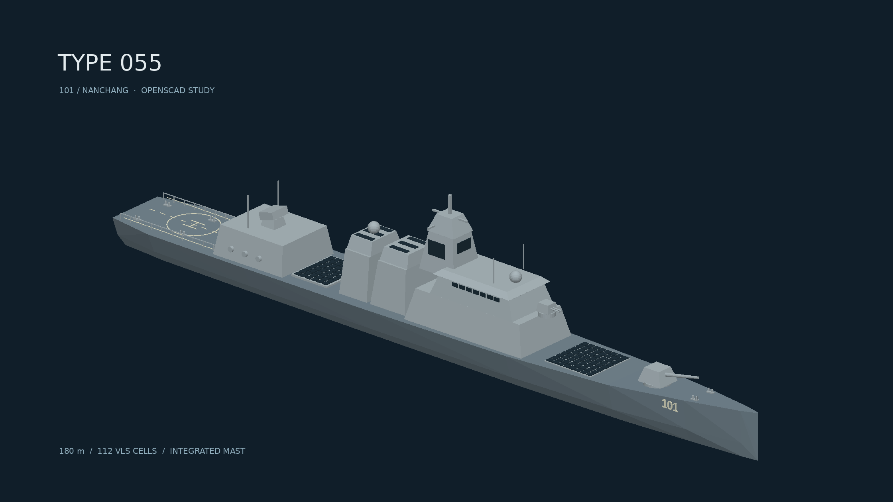

# 055 型驱逐舰展示模型

原创 OpenSCAD 模型，参考 055 型公开外形，舷号 101；比例与细节为展示用途近似。
包括分站放样舰体、隐身舰桥、综合桅杆与雷达面、双烟囱、舰炮、近防装备、
前 64 / 后 48 垂发舱盖、机库门、救生筏、栏杆与直升机甲板标线。



## 文件与重建

- `type055.scad`：可编辑源文件，无外部模型依赖。长 180 mm，1:1000，Z 向上。
- `type055.obj` / `type055.mtl`：分四组材质的运行时交换模型，长 180 m，Y 向上，+X 为舰首。
- `build.py`：调用 OpenSCAD 分组导出 binary STL，然后转换为带材质的 OBJ，生成预览。
- `preview.png`：使用逐像素深度缓冲生成的离线模型预览，不是海洋 example 的引擎截图。

从仓库根目录执行（需要 OpenSCAD、Python、Pillow、numpy）：

```sh
MPLCONFIGDIR=/tmp/type055-mpl python3 assets/models/type055/build.py
```

OpenSCAD 可通过 `part` 选择 `all`、`hull`、`fittings`、`dark`、`markings`。
STL 不保存 `color()`；构建脚本按组保留颜色到 MTL。
独立导出 SCAD 使用引擎原生导入器时会按毫米转米，场景中需缩放 1000 倍才是实际舰长。

## 场景接入状态

尚未接入海洋 example：当前工作区没有独立海洋示例，目标目录或分支待用户提供。
OBJ 已采用真实米制尺寸，设计水线在 Y=0；水面高度为 H 时，将模型原点置于 Y=H。
建议先匹配场景单位与相机，再按已有水面采样接口添加轻微升沉与横摇。
不要对尚未确定的海洋场景写入假设的坐标、相机或水体接口。

验证：OpenSCAD `--hardwarnings` 全模型及四个分组编译成功，整体 CGAL `Simple: yes`；
导出 7884 个三角形，构建脚本校验 binary STL 长度、非空和有限顶点。
本次仅新增模型资源和离线构建脚本，不修改公共 API、ECS 或模块边界。

## 布局校正

后部垂发区位于 X=-38.66 至 -29.34 m，机库前缘为 -40 m，后烟囱后缘为 -25 m，
两端净距分别为 1.34 m、4.34 m（OBJ 实际尺寸）。SCAD 用共享尺寸与断言保持间距至少 1 m。
垂发舱盖位于独立平整基座上，调整后的双烟囱与前部上层建筑不再覆盖后部舱盖。
舰首系缆桩移入甲板范围，系缆桩与舰尾栏杆按舰体甲板高度定位。
`top.png` 为构建脚本生成的俯视布局检查图。
