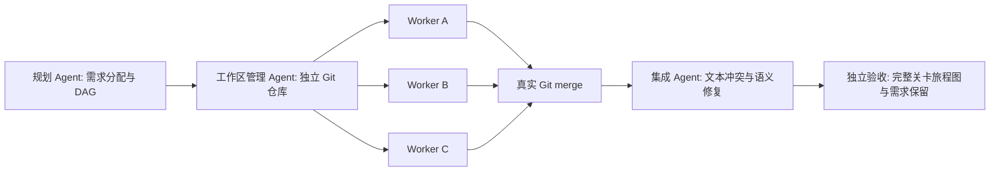

# 多 Agent 合作开发一个项目

这条基准测量同一个项目从**任务拆分 → 工作区创建 → 并行开发 → Git 合并 → 语义集成**的完整过程。
它和原有单 Agent 任务分开报告。首版项目是三个关卡的 JSON 内容包：村庄 → 森林 → 矿洞。
它验证内容、归属、资产注册和连接关系，**没有运行 EVEngine，不提供游戏可玩性、渲染或帧率证据**。
文件采用明确标注的 `eve.benchmark.*` schema，不冒充引擎原生 Scene Document 或资源格式。

## 三个固定场景

| 场景 | 固定起点与目标 | 主要压力 |
| --- | --- | --- |
| independent-levels | 三个独立关卡文件未完成，世界连接与资产注册已存在 | 是否找到并行边界、是否保持隔离 |
| shared-catalog | 关卡未完成，三个 landmark 都要加入同一个 catalog.json | 是否设单一 owner，或正确处理多人共享写入与 Git 冲突 |
| dependency-chain | 三个关卡需要导出新端口，world.json 仍引用旧端口 | 是否表达依赖、传递结果、发现“文件合并成功但接口不匹配” |

`team_project.py` 固定 fixture 生成器、原子需求、目标和验收器；这些源文件的 hash 随实验保存。
seed 改变关卡预算和端口名，是项目输入，不是模型采样 seed。所有任务公开，适合工具回归与消融，
泛化研究应另设不可被开发 Agent 读取的留出项目。

## 不只运行多个进程



每个角色是新的 CLI 会话。Planner 只能写 plan.json，不能提前实现项目。
默认 Workspace Manager 由 Agent 创建工作区；评测器验证创建结果之后才启动 Worker。
各 Worker 有独立仓库、相同基线、单独临时运行目录、日志、时间预算和修改白名单。
依赖就绪后可启动后继，不等待其他无关任务形成整轮屏障；最多 `--workers` 个 Worker 同时运行。

Worker 初始内容始终是同一基线。后继在 `dependencyOutputs` 中获得上游完成文件的文本副本，
不会得到上游活工作区，也不会自动安装上游改动。它需要根据接口/交接信息修改自己负责的内容。
通信使用冻结的请求/输出，不提供任意点对点聊天或无限重试；这项通信策略固定在本套基准中。

每个 Worker 退出后，评测器检查归属范围，在独立、干净的仓库中收集变更并创建 candidate commit，
保留 patch。开发 Agent 对自己 Git 历史的改写不会直接成为可信合并输入。
集成仓库依次执行真正的 `git fetch` / `git merge --no-ff`。冲突文件列表与处理结果被保存。
遇到文本冲突时调用集成 Agent；所有候选合并后仍调用一次集成 Agent，处理干净合并后的语义错误。
顺序按计划中任务的声明顺序固定，记录在 plan.json，不按 Worker 完成先后随机决定合并顺序。

最终成功要求：计划有效、工作区合格、无隔离违规、**每个 Worker 的独立需求验收通过**、最终集成验收通过。
集成 Agent 单独重做整个项目不能掩盖 Worker 没有完成工作的事实。

## 衡量任务拆分难易度

不让模型自己给计划打分，也不把任务数量越多视为越好。按场景分别报告以下证据：

| 指标 | 定义与解读 |
| --- | --- |
| 有效计划率、规划时间 | 满足覆盖、归属、依赖和修改边界的比例；包含失败计划 |
| requirementCoverage | 固定原子需求的归属覆盖；缺失或重复归属都会拒绝执行 |
| missingDependencyEdges | 跨任务依赖没有声明或没有传递路径；循环与未知依赖同样拒绝 |
| writeOverlapPairs | 文件写权限重叠的任务对及文件名；共享文件的确切成本由后续合并验证 |
| declaredFileExposures | 总文件授权次数，暴露“人人都能改所有文件”的宽泛计划 |
| maxRunnableWidth | 依赖层中可同时就绪的任务数，是结构指标，不等于实际吞吐 |
| criticalPathTaskCount | DAG 上最长任务链长度，不是按时长加权的真实关键路径 |
| largestTaskRequirementFraction | 最大任务分到的需求占比，是负载集中度代理，需求并非等难 |
| handoffEdges | 显式任务交接数量；更多交接不自动代表更好 |

可选择“单一 catalog owner”避免共享写，也可让多个 Worker 修改 catalog 后承担合并成本；
只要需求与依赖完整，两种都合法。比较它们的总耗时、Agent 秒数、冲突与保留率，而不是预设一种最佳拆分。
对于 dependency-chain，不能为了假装并行而漏写必需的依赖。

## 衡量工作区隔离能力

默认 `--workspace-mode agent` 要求 Workspace Manager 创建 `<task-id>/workspace`，检查：

- 每个工作区的初始文件内容必须与冻结基线完全一致。
- 每个工作区具有独立的 Git common directory；本 profile 要求独立 clone，不接受共享 common directory 的 worktree。
- 禁止路径符号链接、共享工作文件 inode 和硬链接；源基线不能被改动。
- 各 Worker 只有计划分配的写权限，独有 `.bench-owner.json` 标记不能改变。
- Worker 退出后冻结其结果，后续检查能发现另一个 Worker 再次写入该工作区。

`--workspace-mode harness` 固定由评测器创建独立 clone，用于排除工作区创建这一变量，单独评估拆分/开发/合并。
该模式不宣称测到了 Agent 创建工作区的能力。报告保留 provisioner 的独立结果、时间和失败原因，
再报告 Worker 阶段的隔离违规与按调用区间计算的峰值并发；后者不是内核级进程审计。

这些是**文件完整性与协作边界检查**，不是恶意进程安全证明。一次跨区写入若被对方立即覆盖，最终快照未必可见；
也不提供内核级持续写入审计。正式安全隔离实验应在独立容器/VM 中挂载各自工作区，由宿主收集候选。
进程组终止策略沿用原框架：POSIX 清理整个进程组；Windows taskkill 只能尽力而为。

## 衡量合并能力

独立区分三种情况：

1. **文本冲突**：Git 的 U 状态与实际冲突文件；未消除标记、JSON 无法解析都不能算合并完成。
2. **语义冲突**：每个 Worker 自己的文件合法，Git 也能合并，但 world 引用的端口不等于关卡导出的端口。
3. **变更丢失**：为了消除冲突选择整个 ours/theirs，导致其他 Worker 的 landmark 注册被丢弃。

报告 conflictCount、已接受的冲突解决次数、集成 Agent 时间、集成阶段变更行数、集成前后检查结果、
workerRequirementRetention 和最终项目成功率。变更行数是相对调用前 HEAD 的净增删，包含合并进入的内容，
**不是精确的人工返工行数**。解决了文本冲突仍必须通过完整语义验收。

Worker 的局部验收只证明自己的需求。例如一个 world 文件结构合法、两个连接都有非空端口，
不代表能连接其他 Agent 的关卡；最终 `connected-campaign` 检查负责该事实。
资产检查只验证本基准的注册表与引用，不证明真实 glb 文件已下载、导入或渲染。

## 校准与运行

仓库根目录执行，所有输出目录必须不存在：

```sh
# 正控制：三个场景均应通过，shared-catalog 会发生真实冲突并被解决
python3 benchmarks/agent/team.py run \
  --adapter benchmarks/agent/adapters/team-reference.json \
  --seeds 17 --repeats 1 --calibration \
  --output build/agent-benchmark/team-positive

# 负控制：规划/工作区正确，但 Worker 不实现需求；三个场景均应失败，退出 1
python3 benchmarks/agent/team.py run \
  --adapter benchmarks/agent/adapters/team-noop.json \
  --seeds 17 --repeats 1 --calibration \
  --output build/agent-benchmark/team-negative

# 真实 Agent：默认 3 场景 × 3 seeds × 3 次重复 = 27 个项目试验
python3 benchmarks/agent/team.py run \
  --adapter benchmarks/agent/adapters/codex.json \
  --environment-label workstation-a \
  --output build/agent-benchmark/team-codex
```

CLI 适配器已经支持 planner、workspace-manager、worker、integrator 请求，通过原有 JSONL 协议保留用量。
正式比较必须把 Codex 默认模型改为明确版本，或提供固定 provider/模型/工具的自定义适配器。
DeepSeek 同样使用原有可配置 CLI 适配器，没有假定不存在的通用启动参数。
可以用 `--planner-adapter`、`--workspace-adapter`、`--worker-adapter`、`--integrator-adapter` 分别固定各角色。
适配器接收原有 request schema，增加 role、projectSpec、task、dependencyOutputs、baselinePath、workspaceTargets 字段；
不同角色只收到对应字段。模型请求阶段可以读取 projectSpec 的完整任务定义，未泄露验收结果。

诊断控制配置还包括：

| 控制 | 预期 |
| --- | --- |
| team-bad-plan | 缺失归属，计划拒绝，不启动 Worker |
| team-shared-workspace | 工作文件与基线硬链接，工作区创建验收失败 |
| team-leak | Worker 改写兄弟工作区标记，隔离违规 |
| team-no-merge | shared-catalog 的文本冲突失败；dependency-chain 干净合并但语义失败；independent-levels 可通过 |
| team-drop-change | 集成时丢掉 forest 的注册，最终验收和保留率失败 |

脚本化控制永远不是模型能力分数。它们用于证明验收器能拒绝相应的坏结果。

## 预算与成本

默认 Planner 120 秒、Workspace Manager 120 秒、每个 Worker 240 秒、每次集成调用 120 秒；
计划最多 8 个任务，并发上限 `--workers` 默认 3，可配置 1..8。超时清理沿用单 Agent 框架。
这是每次角色调用的硬预算，不是整个项目统一的硬 deadline；任务数越多会获得更多总 Worker 预算，
因此不能只按成功率奖励过度拆分，必须同时比较 agentSecondsSum、token、总成本和完整墙钟。
没有声称硬性限制 token 或美元花费。

wallSeconds 包含规划、仓库创建、调度、Git 操作、集成和验收；agentSecondsSum 是所有角色调用的墙钟之和，
并行时可超过项目墙钟。workerPhaseWallSeconds 单独记录 Worker 调度与候选收集时间。
未知用量为 null，失败的调用仍纳入成本；原始 CLI 输出与版本随角色日志保留。
各场景的摘要保留有效计划率、隔离结果、冲突、保留率与阶段耗时，不生成任意加权的统一分数。

## 串行对照与工具比较

`--schedule serial` 使用**同样的多个角色和任务 DAG，只让一个 Worker 同时运行**。
它是并行调度消融，不是“一个 Agent 从头完成项目”的基线。报告调用区间重叠峰值，不能把配置的线程数当作实际并发。

```sh
python3 benchmarks/agent/team.py compare \
  build/agent-benchmark/team-a/report.json \
  build/agent-benchmark/team-b/report.json \
  --positive-control build/agent-benchmark/team-positive/report.json \
  --negative-control build/agent-benchmark/team-negative/report.json \
  --output build/agent-benchmark/team-comparison.json
```

比较要求完整、非校准、无基础设施错误的结果，固定输入/验收器源 hash、Git/Python/平台、环境标签、
并发上限、工作区策略、阶段预算、场景、seed 和重复次数；每个角色必须声明模型和工具。
正反控制必须分别使用 team-reference/team-noop，在相同身份下覆盖全部场景/seed。

默认 `--axis tools` 固定调度策略；`--axis scheduler` 允许 serial/parallel 不同，但要求所有角色适配器以及
逐项目的 plan.json hash 一致，否则拒绝把规划差异归因于调度。需要严格消融时，可用固定计划回放的 Planner
适配器，并如实标注它不测量模型的拆分能力。工具消融每次只改一个角色或工具因素。
只有两边项目都成功，才计算该配对的 wallSpeedup；失败项目不能靠提前退出拿到“更快”的成绩。
本套小型公开任务不支持推广到大型游戏开发的显著性结论。

## 输出与测试

每个项目保留 plan、工作区创建请求和检查、各 Worker 的请求/日志/本地验收/冻结候选 commit/patch、
真实 Git merge 事件、集成调用记录与完整项目验收。每次项目结束原子更新 report.json，未完成调度不能比较。
report.json 的 schema 是 `eve.agent-team-report/v1`，与单 Agent 报告区分。

```sh
make check/agent-benchmark
```

测试会启动真实的并行子进程、创建独立 Git 仓库、触发真实 Git 冲突，并验证文本冲突、语义冲突、
硬链接、跨区写入、丢失变更和无效计划等反例；无需模型账号或引擎二进制。
首轮控制结果为三个正控制项目通过、三个 noop 项目失败；真实模型协作能力仍需在可访问 provider 的环境实测。
