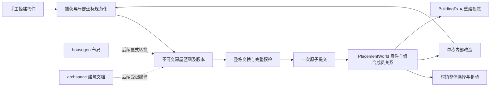

# 房屋蓝图与村镇两级建造：源码调研与初步方案

日期：2026-09-21
状态：设计提案，尚未实现
仓库基线：`434ae72e4`
调研对象：用户提供的 `Easy Grid Builder Pro 2 Modular Building System 2.0.2.unitypackage`

## 1. 结论与边界

建议在现有 `building` 中增加建筑蓝图和建筑组合实例：玩家使用零件搭房，保存为局部坐标蓝图，再把蓝图整体放入村镇；放置后每个零件仍可选择、改造和拆除。

插件提供了四种零件放置、楼层、预览、选择、单体移动、撤销和场景保存的基础，但本次追踪的源码中没有找到完整的“捕获多零件房屋 → 蓝图资产 → 整栋实例化 → 实例覆盖”流程。不能把我们的两级建造需求直接视作插件已有功能。

本次解包检查了源码清单，并追踪关键函数；未在 Unity 内运行插件，未验证其视觉效果、性能或跨运行存档行为。以下“已实现”指源码证据，不等于本次重新运行测试。插件源码和素材仅在临时目录中用于调研，不进入仓库。

第一版范围：同一个 `PlacementWorld`、rectangle/XZ、相同格子尺寸和层高、整数格平移、整栋 90° 旋转、平地或满足容差的统一基底。自由家具保留自身连续坐标和朝向。房屋和村镇是同一数据模型的两种操作尺度，不另建互不一致的占用世界。

## 2. 插件实际如何实现

下表路径相对于包内 `Assets/SoulGames/Easy Grid Builder Pro 2/Scripts/`；函数和行号针对本次包内容。

| 功能 | 源码入口 | 实现方式与结论 |
| --- | --- | --- |
| 对象定义 | `Core Grid Scripts/Grid Scriptable Objects/BuildableObjectSO.cs`；四种派生 SO | 基类保存图标、UI 分类、随机 prefab/ghost、合法/非法材质和操作开关；各域补充旋转、放置模式等配置。适合借鉴资源制作体验，不宜照搬 Unity 类型体系。 |
| 占用 | `Core Grid Scripts/Grid Core/Internal/GridCellData.cs:7` | 格子内按类别保存 cell 对象、四向 edge、四角 corner 字典，另有 free 对象列表和数值 modifier。我们的规范化 edge/corner 地址应保留，不复制它的多方向存储。 |
| 楼层 | `Core Grid Scripts/Grid Core/EasyGridBuilderProXZ.cs:227`，`SetupVerticalGrids/CalculateGridOrigin` | 建立多个 `GridXZ`，第 i 层原点按 `verticalGridHeight * i` 升高；活动楼层决定操作对象。不是独立室内场景或建筑层级资产。 |
| 单体放置 | 同文件 `TryInitializeBuildableGridObjectSinglePlacement:1546`、`InvokeTryPlaceBuildableGridObjectSinglePlacement:1871` | 世界点转换为格地址，按定义和方向展开 footprint；检查边界、同类别占用、区域规则；实例化 prefab 并设置放置数据，成功后发送事件。 |
| 矩形建造 | 同文件 `PlaceBuildableGridBoxPlacementObjects:1647` | 双层循环逐对象执行 command，每个成功对象分别进入历史，可插入协程等待。此路径不是整栋全成或全败的事务。 |
| 选择与移动 | `Core Grid Scripts/Grid Modules/BuildableObjectSelector.cs:512`；`BuildableObjectMover.cs:334` | 支持选择列表；选择移动明确要求列表只有一个对象。移动开始把对象移到远处、调用拆除路径，再进入放置模式；取消则恢复。我们应保留原世界直到提交，不沿用这种临时搬走的方式。 |
| “复制” | `BuildableObjectSelector.cs:824`，`SetInputSelectionCopy` | 取 `selectedObjectsList[0]` 的 SO，切换 BuildMode，并清空选择。它是“取样该建筑类型继续建造”，没有复制选择集合、相对变换或实例属性。 |
| 撤销/重做 | `Core Grid Scripts/Grid Commands/GridCommandInvoker.cs`、`CommandPlaceBuildableGridObject.cs:61` | 双历史容器管理 Execute/Undo/Redo；放置命令记录姿态、变体和对象身份，通过删除/重建恢复。没有在这条路径上提供房屋级原子操作。 |
| 存档 | `Core Grid Scripts/Grid Save And Load/EasyGridBuilderProSaveSystem.cs:27` | `JsonUtility` 编解码网格数据和对象列表，再用 `File` 读写。该封装未提供显式 schema/version/migration 契约。 |
| 恢复 | `GridSaveAndLoadManager.cs:142`，`HandleLoadBuiltObjectsData` | 先清除场景对象，再逐项找网格、按四种域重新放置并恢复字段；找不到网格或创建失败时继续。不是失败保留旧世界的 staging 恢复。 |
| 自由物体样条 | `Core Grid Scripts/Grid Modules/BuildableFreeObjectGhost.cs:305` | Unity Spline 计算总长，以 `spacing / length` 作为参数 t 的步长生成多个 ghost，可按切线朝向。等参数采样不保证严格等弧长；我们不能直接把它当等距算法。 |
| 自由吸附 | `Free Object Supporter Scripts/BuildableFreeObjectSnapper.cs` | BoxCollider 和可接受类别配置；实际命中逻辑在包内 `Assets/SoulGames/Utilities/Scripts/MouseInteractionUtilities.cs:98`，射线命中匹配 snapper 时返回它的中心位置。不是通用连接点配对、结构依赖或整栋连接协议。 |
| 影响场 | `Grid Area Controller Scripts/Grid Area Modifiers/GridAreaModifier.cs`；`Grid Heat Map Scripts/GridHeatMap.cs` | 区域 modifier 更新格子数值，可带衰减；heatmap 将数值映射到纹理并支持绘刷。这与放置合法性的红绿预览不同。 |

额外观察：单体 cell 放置校验循环在发现可替换对象时已经调用拆除（`EasyGridBuilderProXZ.cs:1913`），之后仍继续验证其它格子。因此这条源码路径也不能作为强事务保证的依据；本次没有运行失败复现，不作更广泛的缺陷结论。

### 借鉴重点

- 分类与零件制作工具：轴心、尺寸、预览材质、模型变体、可选择/可移动权限。
- 统一手势：单点、拖刷、直线、L 形、矩形边框、楼层切换、取消和可解释的非法预览。
- 选择反馈、房屋整体预览、按楼层隐藏上层，以及一套连贯的示例体验。

## 3. EVEngine 现有能力与真实缺口

| 现有入口 | 可复用能力 | 接入前要解决的问题 |
| --- | --- | --- |
| [PlacementSession](../../src/modules/building/PlacementSession.h) | cell/edge/corner/free、单体移动替换、矩形/笔刷/路径/曲线和统一 pattern | pattern 不是异构房屋；缺少房屋级捕获、选择、事务和持久身份。 |
| [PlacementSystem](../../src/modules/building/PlacementSystem.h) | 占用、表面采样、结构支撑、精确恢复和曲线组 | 原有单对象校验不能自动推导整栋最终状态合法性，尤其内部相互支撑、邻接和整体移动。 |
| [PlacementWorld](../../src/modules/building/PlacementWorld.h) | 实例与各域占用唯一 owner；clone/swap；按层隔离 | 当前没有看到涵盖所有领域修改的 world revision/generation 协议；不能仅用编辑 target revision 证明运行时旧预览仍有效。 |
| [BuildingTarget](../../src/modules/building/editing/BuildingTarget.cpp) | staging、可撤销 area/curve 操作、完整零件快照 | `snapshotValue` schema v8 保存 worldId、实例和曲线组，但不是完整世界存档：未包含网格尺寸/投影、地形规则等。codec 当前在 authoring facet，运行时不得反向依赖它。 |
| [BuildingFx](../../src/modules/building/fx/BuildingFx.h) | 建筑视觉、Ghost、面积预览、楼层显示、边拓扑变体 | 增加异构组合预览和成员拾取映射；渲染仍只作为投影。 |
| [EditingSelection](../../src/modules/editing/EditingSelection.h) | target/item 稳定身份选择快照 | 接建筑组合与成员两种选择粒度；不再另建全局选择管理器。 |
| [ScenePrefabService](../../src/modules/scene/editor/EditorPrefab.h) | 场景子树 capture/instantiate、来源版本、覆盖记录 | 是 scene/editor 的协议，不能替代四种占用域和支撑图，也不能被 building runtime 直接依赖。借鉴语义，保留领域 codec。 |
| [HouseLayout](../../src/modules/housegen/HouseLayout.h) | 生成组件布局、房间标记、JSON；可直接生成 Renderable3D | 直接生成视觉未进入 building 占用。后续提供显式布局→蓝图转换，不让视觉成为建造事实。 |
| [ArchSpaceDocument](../../src/modules/archspace/ArchSpaceDocument.h) | site/building/level/wall/slab/zone/item/opening；房间、墙开洞、网格烘焙 | 几何文档不等于格子蓝图。后续单向编译支持的子集；不维护两个同时可编辑的权威模型。 |

已读测试包含 `building.cornerDomainOwnsVerticesAndSupportsVerticalStructures`、`building.pattern.unifies_edge_area_outline_and_session_commit`、`editor.building.corner_place_move_replace_and_undo_preserve_vertex_domain` 等。因此早期设计文档里“corner 尚无编辑链路”的陈述不能作为现状。

另一个实质缺口：`PlacementSystem.cpp::canPlaceFree` 当前扫描的是同楼层、同通道的 free 实例，再检查结构支撑；它不等同于 free 对家具和 edge 墙体的完整碰撞校验。格子占用允许叠放也不等于物理空间不重叠。

## 4. 目标数据流

村镇模式可按多格步长吸附，但它只是输入策略；内部使用同一细网格。若以后要求每栋房屋使用不同方向、不同格距的独立局部网格，需要另评跨世界空间索引，不能在第一版默默引入。

## 5. 三种对象及唯一权威状态

以下类型名是设计工作名，不是已经存在或承诺稳定的 API。

### BuildingBlueprint：可复用定义

由版本化蓝图库拥有不可变内容，包含：

- 稳定蓝图身份、内容 revision、schema id/version、内容 hash。
- 网格单位、坐标平面、层高、局部原点以及可用整栋变换。
- 每个零件稳定的 `BlueprintPartId`、零件定义引用与固定版本、placement kind、局部姿态、经 schema 声明的建造属性和选定视觉变体。
- 曲线的局部控制点、精确离散成员与稳定局部组身份；不只保存曲线成员的散件。
- 入口等显式语义锚点、基底策略，以及可选的房间注释。第一版房间标签不是自动房间识别或导航连通证明。

cell/edge/corner 使用整数格/顶点地址；free 使用明确单位的局部连续坐标。蓝图不携带原世界 runtime ID、原地形 surfaceId、驻军成员或正在进行的生产任务。

### BuildingAssembly：已放置的一栋建筑

由 `PlacementWorld` 拥有：组合持久身份、当前 runtime handle、来源蓝图及固定 revision、参考坐标框架、成员持久身份与 `BlueprintPartId` 的映射。新增成员也取得独立稳定 part identity；成员不能同时归属于两个房屋组合。

**成员世界姿态仍由现有 placed instance 唯一持有。** 组合框架用于选择、整体变换和导出基准，不再保存一份可独立修改的 local pose 表来驱动成员。局部姿态导出时由世界姿态反算；整体移动通过事务更新全部成员世界姿态和参考框架。

第一版固定来源版本、保存当前完整成员状态。改造只改变当前组合，来源差异按需比较；不同时维护“全量状态”和一套可写 override patch。另存蓝图可以创建新版本；不自动把它传播到已有房屋。

### PlacedBuilding：运行时零件

继续拥有姿态、占用、结构关系与实例属性。组合→成员映射是成员关系的权威来源，成员→组合反向查询是可重建索引。占用、支撑、渲染索引都不能从另一份可变房屋副本反推。

跨帧引用需要复用 common 的 generation handle 机制，明确 world epoch；旧 `int instanceId` 仅在领域边界适配，不能单独承担 restore/撤销后的失效检测。删除再撤销可恢复同一持久身份，但旧 runtime handle 仍失效。世界整体恢复使旧 epoch 的句柄和 prepared token 全部失效。

## 6. 捕获、变换和原子放置

### 捕获一栋房屋

1. 用户显式选择零件或选择已有组合；不根据渲染父子关系或“墙围住了什么”猜成员。
2. 检查选择闭包：曲线组必须完整；遗漏必要内部支撑时返回缺失成员清单。第一版拒绝不完整曲线组，不静默丢弃控制点。
3. 外部支撑只能转为 schema 已声明的基底要求；未知跨对象引用返回诊断。驻军、住户、资源库存、生产队列等运行状态不复制进建造模板。
4. 选格顶点作为蓝图原点，转换局部地址，生成稳定 part ID；内部引用按映射重写。未知属性不做字符串猜测式 ID 替换。
5. 锁定零件定义版本、固定视觉变体并验证模板内部冲突，输出不可变蓝图。

### 正确旋转四种域

不能对所有对象简单执行“旋转 cellX/cellY，再加 90°”：

- cell：旋转实际 footprint 顶点/占用集合，并按现有锚点约定重新求实例 anchor，避免非方形建筑偏移一格。
- edge：旋转边的两个整数端点，再规范化成 horizontal/vertical 地址；不能只改视觉朝向。
- corner：直接变换规范顶点。
- free：变换精确锚点、旋转角与 footprint；不重新吸附到格子。
- level：加整体楼层偏移，保持既定层高；surface frame 必须按目标策略重新获得，不复制原地形附着。
- curve：控制点和精确离散边一起变换，重映射曲线组与成员身份；不依赖再次浮点采样复原同一条墙。

整数域的 90° 变换要求精确可逆。free/表面浮点计算声明容差；保存/重放使用提交后的精确 owning 记录，不能靠重新采样或重新抽随机数还原。

### 预检与提交

推荐只有一条权威流水线：`请求 → prepare → PreparedAssembly token → commit → receipt`。名字最终以实施时接口评审为准。

prepare 返回不可伪造的、独占 owning token；token 可提供只读预览，但 UI 不能把可编辑 preview 当提交凭证。token 绑定 world epoch/revision、定义版本、目标表面 revision、蓝图版本和操作条件；commit 消费 token 并重新确认这些前提。

prepare 必须针对**完整候选终态**检查：

1. 定义/资产契约、地址变换、边界、候选内部与现有占用的冲突。
2. 全部候选先形成只读终态视图，再验证邻接、支撑和跨域几何规则，避免按遍历顺序误报“上层没有地板”或“邻居尚未放置”。
3. 内部结构依赖无环，外部依赖符合基底策略；安装按拓扑顺序，删除按逆序。用户不必手动排序 JSON。
4. prepare 不触发真实 change hook、扣款、GPU 创建或原世界 ID 分配；分配也留在候选中，失败不得泄漏事件和成员。
5. 原子交换候选状态、推进一次 revision、生成 owning receipt，然后统一发布带事务关联的成员变更和组合变更。保证观察者读到完整终态。

整栋移动在候选中排除原组合成员后验证新姿态，原世界中的房屋在提交前保持不动。来源零件支撑了组外建筑时，第一版拒绝整体移动/删除并返回依赖列表；不能顺带拆掉邻居。目标位置的外部支撑重新检查。

纯观察回调可读最终状态；事件派发期间的新 mutation 延迟到本次发布结束，不持锁执行未知回调。可插拔校验必须无副作用；历史 hook 不能被当作可回滚校验器。

### 地形策略

第一版整栋保持水平，以基底采样结果确定统一高度，检查所有承重点的高度差和坡度。不能分别让每面墙、地板和家具贴地倾斜，否则房屋会散开。

上层部件以组合基底 + 局部楼层高度定位，不对每层重新投影到地面。目标 provider 缺失、版本变化或坡度过大时明确拒绝；预览不能继续使用上次有效命中。自动地形平整、台阶基础和地基生成作为后续独立事务参与者。

## 7. 占地、内部碰撞和可进入房屋

组合没有第二张可写的“整栋占用表”。粗包围盒仅加速筛选，最终由成员 cell/edge/corner/free 占用决定。L 形凹口和院落是否可建造，取决于真实成员及显式用地规则，不把包围矩形全部标死。

需要区分三种语义：

- **放置占用**：某格/边/角/自由形状能否再放一个同类对象。
- **空间阻挡**：家具是否穿墙、两个跨通道物件是否相交。
- **通行与用地**：门是否连通、走道是否保留、院落是否禁止外人建造。

第一版必须补充最小跨域空间规则：墙的厚度和家具 footprint 形成逻辑阻挡形状，按声明的交互类别验证；地板与家具允许共存，墙与家具不得穿插。沿用 canonical 几何元数据生成查询投影，不从渲染 Mesh 反算。检查也纳入单体放置与移动，避免只有整栋蓝图受限制。此阶段只承诺平面分层几何，悬挂物/复杂立体交叠另定契约。

建筑选区、用地边界、门前净空和人物导航不混为一张占用表。第一版可保存入口锚点并显示净空；若要宣称“人物可进入”，还需真实碰撞体、门状态和导航 adapter 的组合测试。现有 `archspace::createOpening` 生成洞口的能力并不自动完成这些接线。

## 8. 实例改造、生命周期和持久化

### 实例改造

- 村镇模式点选成员可提升为整栋选择；房屋编辑模式定位到成员。选择是临时 UI 状态，复用 editing selection。
- 在房屋编辑上下文中新增部件，加入当前组合；删除部件时原子更新成员映射、结构链接及派生索引。拆支撑遵守现有保护/显式级联规则。
- 第一版不共享一面墙给两个房屋组合；相邻建筑共墙需求需另定归属。整体选择也不隐式吸纳周围家具。
- `拆散组合` 与 `拆除整栋` 是不同命令：前者只移除成员关系，后者删除成员及组合。普通成员删除不自动解散整栋房屋；删除最后一个成员时同事务删除空组合。
- 来源蓝图撤销注册后，已放置实例保留完整状态且可用；需要原版本的比较/重建操作返回版本缺失。零件定义资源仍须由依赖引用保留或在恢复时显式解析。

### Link 与销毁顺序

世界拥有组合和零件；蓝图库拥有不可变定义；BuildingFx/scene/physics 仅持有可失效映射。组先销毁通过明确命令决定保留还是删除成员；成员先销毁同步修改组映射；世界先销毁使全部 handle/token 失效，外部 adapter 安全清理自己的投影；adapter 先销毁仅移除投影，不删除逻辑建筑。

恢复时先验证所有持久身份和成员映射，再建立新运行时句柄、占用、结构及曲线链接，最后发布新世界；禁止保存裸指针或进程内 generation 值后直接复用。热重载不得修改已固定版本蓝图；会改变 footprint 的定义版本迁移需要显式整组预检。

### 两种文件，复用一个零件 codec

| 数据 | 保存内容 | 恢复语义 |
| --- | --- | --- |
| 房屋蓝图资产 | 局部结构、定义版本、变体、建造属性、入口、基底契约 | 每次放置创建新的组合/成员持久身份，并重映射所有内部引用 |
| 村镇世界存档 | 世界网格/层高/地形来源与版本、完整成员状态、组合映射、曲线组、所需定义版本 | 保留持久身份；重建 runtime handle 和派生关系；失败保留原世界 |

蓝图 schema 与 world schema 分开命名和版本化，共享 runtime-neutral part codec。将 `BuildingTarget.cpp` 现有零件/曲线快照转换收敛到 building 领域 codec，再让 editing 适配；不能把 authoring-only 快照代码复制为另一套 runtime 序列化。旧编辑操作的迁移/兼容投影仍指向同一个 canonical codec。

格式策略：已知字段严格校验；未声明的核心字段拒绝；允许的扩展只在明确 `extensions` 容器内保留；未知必需扩展拒绝。未知新版本拒绝，支持当前和上一已发布版本的显式迁移。v1 没有虚构的旧版本迁移。输入限制成员数、深度、坐标范围、重复 ID 和引用环。

保存用临时文件写入、完整校验后替换目标文件；加载先 parse/validate/resolve/stage，再一次提交。JSON/脚本/编辑器复用同一 codec。没有目标 provider 或资源时按契约拒绝或报告可观察的视觉缺失，不静默跳过建筑。

## 9. 模块落点和成本

| 落点 | 职责 |
| --- | --- |
| `src/modules/building/` 新独立 TU | blueprint 值类型与 codec、组合成员关系、变换、终态校验、prepare/commit、世界持久化数据；逻辑不依赖 editor/graphics/housegen/archspace |
| `src/modules/building/editing/` | 组合操作转换为 DomainOperation；复用 runtime commit 和 owning receipt 生成 inverse，一次手势一次撤销 |
| `src/modules/building/editor/` | 建造面板、组合/成员选择、视口手势、楼层显示和资源配置工具 |
| `src/modules/building/fx/` | 组合 ghost、拾取映射、变更后的局部视觉更新；缓存按 world/definition revision 失效 |
| 游戏 composition root | 装配资源读取、表面与可选物理/导航 adapter；协调经济或施工流程 |
| 后续 housegen/archspace 转换侧 | 显式 producer→蓝图适配；受限形状无法表示时返回 Unsupported，不默默四舍五入或只导出 Mesh |

不为目录组织新增顶层模块。只有产生真实独立裁剪需求才增加宿主下卫星，并通过 manifest 入口所维护的清单声明。已有 `housegen` 依赖 graphics/model3d，不能把它作为 building 的必需依赖。

当前 `PlacementSystem.cpp` 3373 行、`BuildingTarget.cpp` 1602 行、`BuildingFx.cpp` 1553 行。实施前按现有职责纯移动拆 TU，不继续往这些文件追加组合功能。

四轴选型：持久的组合成员关系用强类型身份与索引；低频多步放置用 prepare/commit；状态变化且观察者未知用提交后事件；每帧单提供方在 composition root 解析一次后持有受生命周期约束的引用。第一版组合本身是普通领域数据，不新增无实际 View consumer 的 ECS 根或 System。

prepare 比单体操作昂贵，必须有 `@cost` 和单独 token 步骤。现有整世界 clone 可作首次提交验证的正确性基线，但其内存/复制成本随世界规模增长，不能每次鼠标移动都 clone 整村。输入改变时用只读基础世界 + 本次候选 overlay/reservation 生成预览，复用同一终态校验器；实际提交再建立候选。只读预览不是另一条可绕过 token 的提交路径。

预编译蓝图可缓存四个朝向的相对地址和粗包围，缓存只读且版本限定；检查邻接和支撑仍针对目标世界。第一版允许提交时 O(world) staging，并把大型村镇的性能改进建立在实测之上。逐帧不解析 JSON、不查找字符串 provider、不重建静态模型。

## 10. 分阶段交付与验收

| 阶段 | 交付内容 | 必须通过的验收 |
| --- | --- | --- |
| A：组合基础 | 拆 TU；收敛 codec；世界 revision/epoch 和身份；异构候选终态验证；组合原子放置/移动/删除 | cell+edge+corner+free 混合；L 形与多格非方形四向旋转；内部支撑；外部依赖拒绝；最后一个成员失败时世界/事件/分配器不变 |
| B：蓝图闭环 | 捕获、蓝图 schema、持久身份重映射、整体预览、来源版本固定、单栋改造、世界存读档 | 同一蓝图放三栋后只改第二栋；保存重启后仍保持差异；旧句柄失效；缺定义/坏文件/未知版本不污染原世界 |
| C：可用建造体验 | 分类零件面板、墙线/地板手势、楼层切换、组合/成员选择、最小墙体与家具空间规则、一次手势一次撤销 | 用真实零件搭两层房子，含门窗柱及家具；原位改造/移动/撤销/重做；UI 干扰或射线 miss 不误提交 |
| D：扩展制作能力 | 自由连接点、等弧长散布、housegen/archspace 受限导入、影响场、复杂基础、可选碰撞/导航 | 每项单独拥有真实 producer/consumer、缺席行为与测试，不把所有能力捆成第一版 |

第一条正式示例建议为 `examples/building-village`：先在建造区搭一栋两层木屋，保存蓝图，在村镇放三栋，进入第二栋加厨房，再存读档并撤销一次整栋移动。它同时检验两级工作流、内部结构和实例独立性；不能只用三个预制整屋模型代替验收。

优先采用无 GPU 的领域测试，再接编辑器和视觉组合测试。候选新增测试文件：`test/building_blueprint.cpp`、`test/building_assembly.cpp`、`test/building_persistence.cpp`、`test/editor_building_assembly.cpp`；不扩大共享测试 main。

实施测试矩阵还必须包含：

- 预览后普通运行时 mutation、地形变更或定义重载导致 token Conflict；不能只测编辑器内部 revision。
- source/target 双向销毁、成员移除、组拆散、曲线闭包、撤销 ID 冲突、恢复期间失败注入。
- 自定义校验拒绝、内存/资源准备失败、可选提供者 absent；不得只测 happy path。
- 保存顺序确定、重复导入不复用 runtime 身份、固定变体重放；跨平台浮点按契约比较，不宣称无证据的 bit-exact。
- 无 editor/graphics 的 runtime 路径，图形/表面 provider present/absent；L2 链接裁剪和 L4 缺席行为分别给证据。
- `make check`、宿主 `make build/macosx-debug`、相关 `make test/macosx-debug FILTER=...`，新增示例按仓库规范跑 smoke；视觉证据使用引擎截图接口。

## 11. 规范适用与本次验证

本提案按仓库六份强制架构文档约束设计。实施时适用 Result/nodiscard、唯一 owner、强类型持久身份与 runtime handle、Link 双向生命周期、schema/migration、确定性与显式 RNG、回调重入、失败注入和可选 provider 契约。

具体接口规则：`R-BOUND-1..4` 要求新链接依赖与裁剪实测；`R-COHESION-3/5/6` 要求复用注册机制、优先数据 Link 和 consumer-owned 接口；`R-FACE-1..5` 要求六面及 `module-interface` catalogue；`R-MECH-1..6` 要求四轴推导及热路径声明；`R-COST-1..5` 要求昂贵操作步骤与成本说明。新 ECS System 若在后续实际出现，先登记 View/read/write/phase，不用当前提案替代该审查。

最初的源码研究仅覆盖插件与仓库静态实现。用户随后要求完整打通流程，下面记录实际实现边界；上文的扩展设计不等同于已经交付的功能。

## 12. 两级流程实现（2026-09-22）

已经实现的闭环是：在工作间搭建地板/墙/柱/家具 → 捕获自包含蓝图并原子写盘 → 重新读盘 → 在村镇中旋转放置多个独立实例 → 只改造选中的房屋 → 世界保存/恢复 → 整栋移动/删除与撤销/重做。

- `AssemblyService` 是唯一的运行时组合入口。`PlacementWorld` 拥有成员、组合关系与编号计数器；蓝图只保存局部配方，实例不通过改写蓝图共享可变状态。
- cell、edge、corner、free 及离散楼层沿用各自的占地地址。刚体四分之一旋转覆盖不对称 mask 和整段平面曲线；曲线控制点与成员关系一同保存。
- PreparedAssembly 独立拥有候选世界，失败或丢弃不会更改源世界。提交检查世界内容、派生占地/支撑索引、定义快照及 owner epoch，然后再校验终态，交换后只发布一次 reset。
- `AssemblyId` 与蓝图 AssetGuid 分离。部件局部键单调增加；删除后不复用。恢复/提交更换 runtime epoch，旧 handle 失效。旧单体 API 的整数编号仍是世界内记录键，不用于跨世界身份。
- blueprint/world 都是明确的 v1 schema，未知核心字段、未知版本、重复身份、损坏成员和定义不一致都会拒绝。恢复在隔离候选中完成；没有伪造旧版本迁移。
- `BuildingAssemblyTarget` 把整栋操作接到现有编辑事务与撤销系统。`eve.buildingHouseRequest` 供游戏脚本使用，原生核心不依赖 editing；协议在发布前检查完整回执能否投影到脚本，超出容量时原子拒绝。
- 新的墙厚度/家具阻挡配置同时进入单体与整栋校验；默认关闭以兼容原定义。没有新增可选渲染、地形或导航 provider。

当前示例是可操作的俯视平面工作间，不是 3D 建筑美术展示。没有宣称人物已能进屋，也没有接入导航、门状态、资源施工、联网、地形整平或分区流式加载。复制要求方形矩形网格、相同格距/层高和四分之一旋转；不允许复制部分曲线，表面附着曲线需在目标 provider 上重新采样。捕获会去掉驻军引用及任意实例属性，世界存档则保留这些数据。

为了先完成正确性闭环，本版预览只在目标格子/朝向变化时重算，仍采用完整世界候选，复杂度随世界增长；不声称已实现上文的稀疏 reservation 预览。协议回执限定 100000 个 Value 节点和 64 层嵌套，超出时保留原世界并返回错误；原生 API 的容量另由持久格式约束。

验证入口：`test/building_assembly.cpp`、`test/editor_building_assembly.cpp`、`building_workflow_test` 和 `examples/building_village`。真实 UI 的 **Run complete workflow demo** 执行磁盘往返并比较另一栋房屋与最终世界快照，成功后才输出 `building_village.workflow PASS`。

架构上适用了 Result/nodiscard、唯一权威 owner、强类型身份/失效检测、原子恢复、版本化持久格式、成本分级、六面 catalogue 与模块依赖检查。没有新增 ECS System、上层反向 include、独立时钟或 RNG。所有世界/注册表操作限 owner thread，校验回调必须只读；观察者可以读取完整终态，后续写入由宿主排队。未申请或使用规范例外。

验收记录：macOS Debug 引擎和原生测试目标已构建；新增 8 项流程测试共 145 个断言全部通过且无警告。旧 building/editor 测试另用 HEAD `434ae72e4` 的原始源码重编译对照，原有 9 个用例中的 17 条断言警告在基线中同样出现（包括会重复求值的 `CHECK_EQ` 副作用），未计为本次新增测试通过证据。CTest 的成功退出不能掩盖这部分旧警告。

裁剪证据为 `runtime-3d` + `EVENGINE_MODULE_BUILDING=ON` + `EVENGINE_BUILD_DEMO=OFF`，`building_workflow_test` 的实际链接输入不含 EVBuilding_editing、EVBuilding_editor、EVBuildingFx、EVEditing 或 EVEditor；同一组原生 house 流程在该配置中运行。这是 L2 的指定模块缺席证据，宿主仍包含 graphics，不声称 renderer-free 或任意 profile 的完整裁剪。

视觉验收还发现并修复了 Vulkan UI resolve 将物理纹理宽高再次当作逻辑坐标合成的问题：`queueUiResolve()` 的 quad 现在使用逻辑 width/height，避免 Retina 下侧栏二次放大。通过引擎自身 `eve_screenshot` 验证侧栏及两栋独立房屋；建造流程通过 UI 点击触发，调试表达式仅用于隐藏开发面板，不承担 gameplay。

最终运行验收：66 个相关 CTest 用例成功退出；新增 8 个用例的 145 个断言无警告；裁剪配置的 7 个原生用例、128 个断言无警告。示例通过 10 秒 smoke。真实 UI 额外逐项执行 loadBlueprint、move、undo、redo、remove、undo、save、load；最终磁盘存档有 2 栋、54 个成员，仅一件家具具有改造的 blue 属性。旧断言警告仍按上述基线单独记录，不把它们表述为无警告通过。

最终源质量门禁 `TMPDIR=/private/tmp make check` 通过（base=origin/dev），包括 179 项脚本测试。显式使用物理临时目录路径以避免 macOS `/tmp` → `/private/tmp` 符号链接触发既有 glTF sidecar 路径测试；未改动该无关转换器或其测试。

## 13. 2026-10-23：3D 展示接入

`examples/building_village/view3d.nut` 将现有权威快照投影为地板、墙、柱、家具的基础几何体。
默认 3D，可切回平面；墙支持剖切/全高切换，选中地板着色，室内改造时相机聚焦选中房屋。
3D 鼠标使用 Camera3D 射线与地面求交，侧栏区域不参与建造；选件仍按地面网格锚点。
整栋预览使用协议返回的候选零件，提交、撤销、重做、读档后重建视图。
共用一个立方体 mesh，复用实体池；池和相机由引擎场景持有至进程结束，示例禁用热重载。
仅数据变化时刷新实体变换，预览仍只在吸附位置变化时请求，渲染帧不读取磁盘或克隆世界。

此投影专用于示例的四类单位格定义，不是通用 BuildingFx 替代品，也未接入屋顶、美术模型、人物或导航。
未改公共 API、ECS System、模块边界及持久格式；适用单一数据源、结果检查和生命周期原则，无规范例外。
真实 UI 已验证完整流程 PASS，以及 3D/平面切换、墙高切换、室内近景、移动/删除、撤销/重做和存档恢复；
引擎截图确认独立家具颜色与旋转。最终脚本通过 5 秒 macOS 图形 smoke；鼠标逐格交互尚未做自动化实点验收。

本次默认 `make check` 的基线 `origin/dev` 已前进到 `0dade008d`，比工作树起点 `434ae72e4` 多 591 个提交，
直接比较将上游变动混入报告。没有添加 baseline/allowlist；对未提交改动使用明确的实际起点
`TMPDIR=/private/tmp make check CI_BASE=434ae72e4` 验证。最新 dev 的集成验证仍需在后续同步分支后执行。

上述实际起点门禁已通过：架构 catalogue 无新违规，179 项脚本测试通过；未豁免任何规则。

## 14. 屋顶零件、模型与多格支撑修复

示例新增 `village.roof`：4×3 格、level 1、`cell_below` + `supportTag=support`。
屋顶是普通蓝图成员，参与四向旋转、单栋改造、撤销和世界存档；并非根据包围盒临时生成的装饰。
切到村镇显示完整外观，切到工坊/室内隐藏屋顶并降低墙高，隐藏不改变逻辑状态。
Roof 工具按覆盖范围选取屋顶，其他工具忽略隐藏屋顶。其支撑语义是完整地板占地，未模拟墙体承重。

新增原创 CC0 OBJ：带窗墙、柱、椅子、双坡屋顶，附生成器和模型坐标契约。
示例启动时通过已有 model3d 接口加载，共享 mesh 并复用渲染实体；资源错误显式终止初始化。
定义与存档仍由 building 唯一拥有，没有新增公共 API、持久格式、ECS System 或模块边界。
`model3d` 是示例显式必需模块，不声称可缺席；无规范例外。

完整流程暴露了多格支撑校验的既有缺陷：`foreachFootprintCell` 会继续访问后续格子，
后续带 support 标签的地板把先前的 false 覆盖为 true。`PlacementValidation.cpp` 改为保持失败状态。
`test/building_roof_support.cpp` 的两个回归用例在修复前均失败，修复后通过，覆盖四种旋转、
12 个缺失位置/错误标签、改造失败原子性及恢复后的支撑链接。

验收：10 项 house/roof/editor 流程测试共 1623 个断言通过且无警告；13 项相关 CTest 成功退出
（既有测试的断言警告不作为新增无警告证据）。真实 UI 完整流程包含屋顶支撑拒绝、单栋拆顶、
撤销恢复和世界磁盘往返，并输出 PASS；额外验证视图切换、整栋移动/删除、撤销/重做、保存/载入。
最终存档为 2 栋、56 个零件、2 个 level 1 屋顶。引擎截图确认外观和室内模型。
`make check CI_BASE=434ae72e4` 通过，含 179 项脚本测试；未集成最新 dev，基线限制同上一节。
模型三角形索引、归一化范围及确定性再生成检查通过。当前仅支持示例固定尺寸屋顶，
尚未扩展成任意轮廓屋顶生成器，也未接人物、寻路或物理碰撞。

## 15. 村镇到房屋内部的连续行走

新增示例组合 `navigation.nut`、`navigation_view.nut`、`navigation_checks.nut`，复用 Map
的原生 A*。Building 独占建筑几何和门状态；导航网格、房屋地板归属、路线、观测与渲染均为派生数据。
门是 `village.door` edge 成员，`properties.closed` 使用既有字符串属性（缺省开放），不新增持久 schema。
原有世界存档保留门状态，蓝图捕获清除实例属性，生成新房时默认开门。

编辑提交、撤销/重做及载入后，从快照生成候选网格，再替换当前派生状态并重算路线；构造失败则
停止导航并显示原因，不能沿用过期路线。房屋目标只存持久 assembly ID，每次重算解析；删除目标
清空目标，移动目标重新求路。人物不持有原生建筑指针或跨帧临时引用。人物先消失无需修改建筑；
建筑先删除由刷新边界使目标失效。示例关闭热重载；重新启动重新初始化人物和派生网格。

限于 26×20、XZ、1 m 格子的平地首层，细分为 0.25 m 四邻接网格。障碍采用旋转矩形，保守扩张
人物半径 0.16 m 与导航格半宽，禁止切角。屋顶和高层不作为首层障碍；首层非零 elevation 显式拒绝。
人物固定 60 Hz、2 m/s、每帧最多追赶 0.1 s，无 RNG；固定路线和相同步数的数值容差为 1e-5，
不承诺不同墙钟帧序列的到达时刻一致，也不宣称联网/跨后端确定性。工坊暂停人物。

主脚本帧阶段先处理输入和建筑提交，再推进人物，最后同步显示和只读观测；全在脚本主线程，
没有新增 ECS System、公共 C++ API 或跨模块接口。昂贵的网格重建/目标扫描/A* 仅在操作边界执行，
每帧运动不读取 Building、不做字符串服务查询。Map 为显式必需模块，不声称 provider 可缺席。
适用单一事实所有者、显式结果处理、生命周期与成本分离原则，无规范例外。

当前是导航驱动的示例人物，不是物理角色控制器；不支持楼梯、动态人群避让、人物存档或任意户型
必然可达。玩家把墙放到人物位置时显式停止，需撤销或手动 Reset，不悄悄传送。只有进入房屋时
自动剖切当前房屋；逻辑几何与门状态不受剖切影响。

验收：用户按钮触发四向移动/旋转、家具阻挡、删除目标、门关闭/恢复与快照一致性检查，通过后
人物实际走入目标房屋并输出 navigation PASS。通过真实 UI + Play Host 只读观测验证：行走中
关门立即停止且位置保持，开门继续；目标移动后到达新位置；目标删除取消路线、撤销后再次进入。
引擎截图确认人物和按当前房屋剖切。最终脚本五秒 macOS 图形 smoke 通过；
`make check CI_BASE=434ae72e4` 通过，包含 179 项脚本测试。没有新增原生代码，未重复原生编译；
最新 dev 集成限制同第 13 节。Play Host 验收请求必须带 evengine.play-request / version 1，
缺少 schema 的调试请求触发了既有 Result 检查错误；使用完整请求和显式观测根后正常。
实际磁盘门状态往返也已通过：关门→保存→开门→载入→出口不可达，重新开门后走到村外；最终保存为开门状态。

## 16. 平面胶囊碰撞与手动行走

沿用 Physics 的 World3D.moveCapsule 绑定，不新增原生 API/模块/持久格式/ECS System。
`navBlockBox` 生成同一障碍投影供网格和物理消费，Building 仍独占几何及门状态。碰撞不读取渲染
网格，不受剖切影响；窗口墙和家具用保守实心盒，尚不模拟窗口穿越。新增 physics 必需依赖，不
声称缺席降级。运动线程为脚本主线程，固定 60 Hz；物理世界静态且无刚体仿真步进。

`collision.nut` 独占当前 World3D，脚本位置为人物唯一权威。创建体/形状的代理仅在函数内使用，
不跨帧保留。建筑改动后先生成导航候选和物理候选，同步发布二者，再显式销毁旧物理世界。
候选构造异常清理候选，刷新失败停止人物并释放过期碰撞世界。建筑先销毁则下一次同步重建消除
对应碰撞；投影先销毁不删除建筑；载入、撤销、重做重建两者；热重载关闭，进程重启重新初始化。
这是示例脚本组合，没有增加跨域 Link/裸指针缓存，也不向 building 添加 physics 依赖。

自动路线与 WASD/方向按钮都调用同一个胶囊移动函数；只有求解后的位移更新人物位置，不直接
吸附到路径节点。阻挡或异常使路线停止并显示原因；手动运动取消自动目标，可沿墙滑动。
胶囊半径 0.16 m、纵向范围固定 0.1–1.3 m，只约束平面位移；地板高度为视觉偏移，未实现重力、
台阶、跳跃、楼梯、多层和动态刚体推挤。Box3D 既有线性 slop 为 0.005 m，验收另留 0.0001 m
浮点误差，不承诺跨后端逐比特一致性。每帧只执行现成胶囊查询，不重建物理体、不查字符串服务。

适用单一权威所有者、显式销毁与失败清理、固定仿真时间、派生投影成本在提交边界的规则。
公共机制及裁剪边界未变，不新增可选 provider；无规范例外。

手动贴墙后可能处于导航网格保守膨胀范围内。重新请求自动路线时，先用略减去静止 slop 的胶囊
重叠查询区分真实侵入，再在邻近格中选择经过真实扫掠验证的连接段；连接段仍逐帧通过移动器，
不直接改变位置。每次实际移动前也检查真实重叠，避免建筑编辑后依靠 depenetration 悄悄传送。

已通过真实 Physics 扫掠：所有样例墙、开/闭门、四种整栋旋转、旋转家具、沿边界滑动、20 m
扫掠与无效形状候选的失败清理；通过后人物实际入屋。正常 UI 验证手动连续撞墙位置保持
（z=6.215，符合墙面 6.06 + 半径 0.16 - slop 0.005），切换剖切后仍阻挡，再自动寻路成功。
同一进程重复通过关门停步、开门继续、行走中移动目标、删除目标失效和撤销后再次进入。
物理体数量随关闭门由 38→37（两门柱改为闭门障碍），删除一栋由 38→21，撤销恢复。
物理版实际磁盘往返已通过：闭门保存、开门、载入后仍不可达；再次开门后走出，最终保存开放状态。最终脚本五秒图形 smoke 通过。
最终版本再次通过真实胶囊入屋、手动撞墙及引擎截图验收；`make check CI_BASE=434ae72e4` 通过，179 项脚本测试通过。当前阶段仅改示例脚本和文档，未重复原生编译；最新 dev 集成限制沿用第 13 节。

## 17. 重力、楼梯与多层行走

继续采用示例组合，不新增引擎公共 API、ECS System、模块边界或持久 schema。楼梯作为
`village.stairs` 的 2×4 cell 成员，保存 level 和四向旋转；升高一层为 3 m，15 级、每级 0.2 m。
`villageStair` 同时生成渲染台阶、静态碰撞盒和上下层门户，Building 仍独占所有持久事实。
支持 level 0..3，显式拒绝其他层和非零 elevation；楼板、墙、门、家具按层进入物理投影。
地面为物理支撑，移除高层楼板后保留人物位置，由重力落下，不再以房屋归属指定人物高度。

每层沿用 Map 的四邻接 A*。高层只有完整支撑区域可行走，边沿按人物半径保守收缩。
提交边界以 Dijkstra 组合楼梯门户和同层路径，阶梯路径不是高度修改指令，只是待抵达的三维点。
门户要求上下落脚点有效且楼梯路径有身体净空。楼梯拆除/改层/旋转与存档恢复后重建派生图，
目标仍使用 assembly 持久 ID + level。没有逐帧建图或字符串服务查询。

人物位置、竖直速度和接地状态由脚本唯一拥有；固定 60 Hz、重力 -9.8 m/s²、终端下降速度
20 m/s。胶囊高度 1.3 m、半径 0.16 m。每步执行原生胶囊移动；步高上限 0.24 m，以向上扫掠、
向前扫掠、向下首次接触 cast 组合跨台阶。胶囊在台阶边缘的接触法线是圆角法线，落脚使用
正向上分量而不是把它误判为整块台阶斜率。更大的落差不吸附，交给重力。没有位置传送。
编辑重建后重新探测接地，落地时重新规划未完成目标；重叠错误停止运动并提示撤销/Reset。

原生查询结果立即复制为脚本 owning 数值，不保存 shape/body 借用。构造失败清理候选并停止
导航；先发布完整导航/碰撞候选，再销毁旧世界。所有操作在脚本主线程，没有新增回调或锁。
热重载仍关闭。沿用 Box3D 5 mm 接触 slop；固定步输入有容差保证，不宣称跨后端逐比特一致。
本阶段适用单一事实所有者、生命周期、固定时间、失败显式化、成本在操作边界的规则，无例外。

三层实走验收已通过：经两段楼梯上到 level 2，物理脚底高度 6.095 m，再返回室外 -0.005 m；
累计竖直路程约 12.225 m（包含入口门槛及接触容差）。楼板删除测试从 6.095 m 自由下落到
下方第一段楼梯的 1.695 m，观察到负竖直速度；撤销没有把人物送回楼上，从中段重新规划可达
level 1。楼梯删除使碰撞体数 201→171 并返回 NoRoute；实际磁盘载入恢复为 201，人物继续下楼。
独立建筑世界通过四向旋转路径、楼梯缺失、低净空与 encode/decode/restore 检查；不是只看渲染。

最终源码门禁 `make check CI_BASE=434ae72e4` 通过（含 179 项脚本测试），134 个示例布局
检查通过；`MIN_RUN_SECONDS=2 RUN_SECONDS=5 bash scripts/smoke_examples.sh building_village`
通过。最终脚本重跑单层碰撞检查与真实入屋成功。本阶段未修改 C++，沿用已有 macOS Debug
二进制；门禁对照当前工作起点，尚未验证与已前进的最新 origin/dev 集成。

最终版本再次完成三层上楼、下楼到室外往返；随后通过正式 UI 将整栋旋转 90°，人物从
室外依次走到 level 1（3.095 m）和 level 2（6.095 m），碰撞体保持 201，累计台阶跨越
计数从 155 增至 310。引擎自身截图 `building-village-multilevel.png` 已核对：人物位于
最高楼层，楼层剖切与全部新操作按钮显示正常。四向导航检查和一次旋转后物理实走分别取证，
不把前者等同于四向完整物理验收。

## 18. 工坊续编与完整流程检查（2026-10-23）

本轮沿正常操作路径发现并修复三处闭环缺口：启动自动保存默认蓝图会覆盖已有文件；载入
蓝图只更新摆放模板，工坊无法续编；部件目录取自当前蓝图，导致无楼梯蓝图不能添加楼梯。
启动现在只创建内存默认模板。显式载入恢复可编辑散件并选择摆放模板；显式 Capture 才发布
修改并写文件。七种部件模板从原生实例初始化，捕获和载入不再裁掉目录。

工坊新增独立 snapshot receipt 历史，Z/Y 随工作区路由；工坊导入同样可撤销。Undo 只改变
草稿，不隐式改写已发布模板或文件。村镇历史不被工坊编辑清空。记录为 owning 数据快照，
不保存 native body/instance 指针，沿用 applyReceipt 的预期状态校验。

导入复用一个 builder 拥有的 staging world，原生 place 校验蓝图后取得快照，在快照中解除
assembly membership，再由原生 restore 原子恢复散件。发布前统一调用行走范围校验，拒绝
不支持的高度和层数。失败不改变工坊、当前模板、村镇或文件。原有 schema/version/未知
字段策略继续由 Building codec 执行，不增加持久协议、公共 API、ECS System、模块边界或
跨域 Link。全部在主线程同步执行；staging 与 builder 同寿命，不按导入次数新增 world。
适用唯一权威数据、显式结果检查、原子恢复、所有权及成本置于操作边界的规范，无例外。

`Test resume` 通过正式编辑、保存/载入、摆放与行走函数验收：修改、工坊撤销/重做、独立
测试文件往返、坏 JSON/版本/越界/不支持层数的原子拒绝、再次编辑、两栋独立实例、添加
模板中不存在的楼梯后撤销、村镇文件恢复、人物真实胶囊入屋。测试文件使用
`workshop-check*.json`，不覆盖用户 blueprint/world 文件。实际重启前后已有蓝图的
SHA-256 完全一致，确认启动不再覆盖存档。

剩余产品缺口明确保留：整栋移动仍是固定演示落点，尚无鼠标拖放移动；蓝图库只有一个
保存槽；未保存草稿和 undo 历史不跨进程恢复。之前限制（固定网格、固定层高、无动态刚体
和跳跃）仍成立。本轮不把演示按钮通过宣称为这些功能也已实现。

最终验收：正式 UI 载入蓝图、工坊 Undo/Redo、回村镇 Redo/Undo，证明两套历史隔离；
楼梯恢复使碰撞体增加 15，撤销恢复为 65，人物继续到达目标屋内。`make check
CI_BASE=434ae72e4` 通过，含 179 项脚本测试；134 个示例布局检查通过；五秒图形 smoke
通过；引擎截图 `building-village-resume.png` 已核对界面与人物入屋画面。本轮无 C++
修改，未重复原生编译。仍使用本分支起点作为门禁基准，未验证最新 origin/dev 集成。
