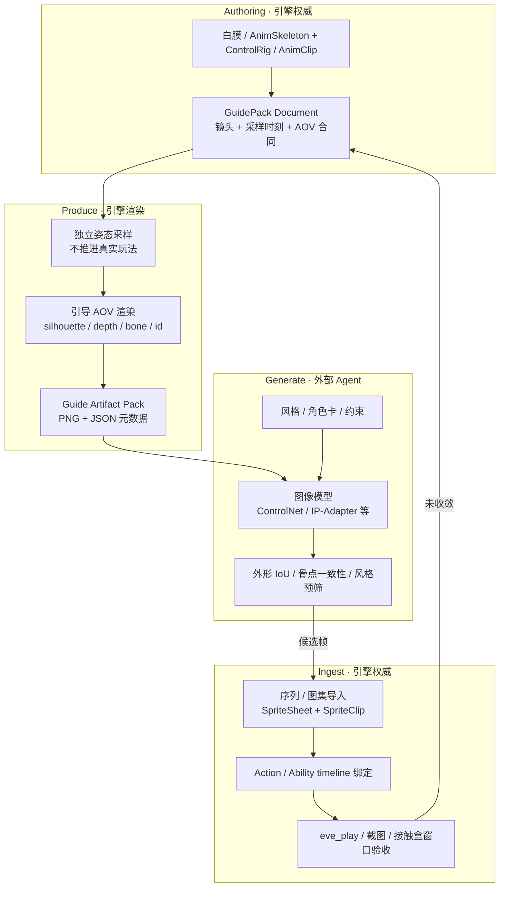

# 2D 动作缺资源时的「白膜引导 → AI 成图 → 入库」管线

日期：2026-11-03  
状态：设计 + **P0–P2 已落地**（文档编解码、landmarks、MCP capture/export、Vulkan 离屏
`IActionGuideCapture` silhouette/depth + CPU bone AOV）。clip 姿态采样与 ingest/verify 仍待后续切片。
对齐现有 Agent-Native / MCP / FrameCapture / Action / Sprite 能力。

关联：

- [Agent-Native 引擎架构](2026-08-29-agent-native-engine-architecture.md)
- [Agent 游戏开发范式](Agent游戏开发范式.md)
- [AI 与 MCP 支持](AI与MCP支持.md)
- [AI 场景导演](AI场景导演.md) / [AI 场景搭建](2026-10-11-ai-scene-authoring.md)
- [MCP 同帧附件调试](mcp-frame-capture.md) /
  [实体四视图与动画采样](superpowers/specs/2026-10-25-entity-animation-inspection.md)
- [animation 用户手册](../usr/modules/animation.md)（`SpriteSheet` / Spine region）
- [action 用户手册](../usr/modules/action.md)
- 外部编排参考：[`tools/asset-pipeline-agent/`](../../tools/asset-pipeline-agent/)、
  [`tools/story-scene-agent/`](../../tools/story-scene-agent/)

---

## 1. 问题与目标

制作 2D 动作游戏时常缺动画帧 / 角色贴图。可行捷径：

1. 在引擎里用**白膜 / 人偶**摆出动作与机位；
2. 导出**轮廓图、深度图、骨骼图**（及可选法线 / ID 蒙版）作为条件引导；
3. 外部 AI 图像模型按引导生成风格化帧；
4. 生成结果**自动入库**为 `SpriteSheet` / clip，并挂到 `Action` / Ability timeline 上可玩。

本文回答两件事：

1. **EVEngine 在这条链路里该做什么、不该做什么**；
2. **应暴露哪些稳定接口**（文档 schema、MCP、脚本、编辑命令），才能让 Agent / 外部管线闭环，
   且不引入第二份权威状态或「万能 GameObject」。

非目标：引擎内嵌云端扩散模型、替代 Spine/Aseprite 全功能编辑器、宣称跨模型像素字节一致。

---

## 2. 一句话定位

> EVEngine 是这条管线的 **姿态与几何权威、引导 AOV 生产者、2D 资源与动作绑定权威、以及可玩验证宿主**；  
> AI 成图与模型选型属于 **引擎外 Agent**（对标 `asset-pipeline-agent`），经 MCP / 文件系统交接。

引擎不拥有「像素长什么样」的创意权威；引擎拥有「这一帧身体在哪、镜头是什么、深度/骨骼条件是什么、
入库后动作 phase 如何驱动、游玩是否验收通过」。

---

## 3. 端到端流程与所有权



| 阶段 | 权威所有者 | 派生 / 不拥有 |
|------|------------|----------------|
| 白膜姿态、骨骼、clip 时间 | `animation`（`AnimSkeleton` / `AnimClip` / `AnimPose`）+ 可选 `ControlRig` | 游戏实体最终混合姿态（除非显式采样「运行时 pose」，见 §6.2） |
| 镜头、分辨率、投影、AOV 集合 | `GuidePack` 文档（拟议） | 最终游戏摄像机（检查任务用离屏相机） |
| 引导图像素与数值 | `IRenderFrameCapture` 同帧快照 + 导出 | 外部 AI 输出 |
| AI 提示词、模型、种子、候选筛选 | 外部 Agent 与其报告 | 引擎不持久化模型密钥 |
| 2D 图集 / clip / 元数据 | `animation` Sprite 面 + 项目资产文件 | 临时生成缓存目录 |
| Ability / Action phase、命中窗 | `action` + combat timeline 资产 | 精灵播放器本地时间（须对齐或显式映射） |
| 验收证据 | Agent Development Session ledger + 引擎截图 / 运行时观察 | 口头「看起来行」 |

规则（与既有架构一致）：

- **一份事实一个主人**。引导图元数据引用 `GuidePack` revision 与采样姿态 revision；AI 输出只携带
  `sourceGuideRevision`，入库时校验匹配，过期拒绝。
- **UI / Agent / 脚本走同一领域命令**，不各自改 Renderable 矩阵或偷偷写纹理。
- **昂贵操作两步**：`request → token → status → image/export`，带 `@cost`，失败原子，不返回半成功拼图。
- **不新增通用 GameObject**；目标用既有 domain id + generation（同 `eve_entity_views` 设计）。

---

## 4. EVEngine 应扮演的五个角色

### 4.1 姿态与白膜工作室（Pose Studio）

- 加载 / 摆放白膜（低模人偶或程序胶囊人）；绑定 `AnimSkeleton`。
- 用 `AnimClip` 或 ControlRig / IK 采样关键帧；支持 **in-place** 与 **world-root** 两种根位移模式
  （语义对齐实体动画检查设计）。
- 声明动作语义标签（`idle` / `run` / `attack.light` / `hurt`），供后续 Ability 映射，而不是把文件名当协议。

**已有可复用面：** `animation` 模块、ControlRig、`AnimInspection` 采样、Scene Authoring 摆物、
白盒 `eve_scene_*` / `eve_whitebox_playtest`。

**缺口：** 「面向 2D 出图」的专用 GuidePack 文档与「只出引导 AOV、不进最终合成」的离屏通道。

### 4.2 引导 AOV 生产者（Guide Producer）

在固定相机与冻结姿态下，产出条件图，而不是只靠最终色彩截图：

| AOV | 用途 | 现有基础 | 拟议补齐 |
|-----|------|----------|----------|
| `guide.silhouette` | 外形 / 遮罩条件 | final alpha 或 scene-qc mask 启发式 | 专用 ID/遮罩 pass，背景恒定、无抗锯齿渗色合同 |
| `guide.depth` | 前后层次 | `gbuffer.hwDepth` + `linearDepth` 视图 | 正交/透视合同写入 GuidePack；导出 16-bit / 归一化灰度 |
| `guide.normal` | 形体起伏 | `gbuffer.normal` | 可选；2D 像素风常可关 |
| `guide.bone` | 骨骼线 / 关节圆 / OpenPose 风格 | 调试绘制 / Canvas 图元 | **新增**骨骼投影 AOV：关节 2D、父子连线、稳定 boneId 调色板 |
| `guide.partId` | 分部位重绘 | objectId 数据尚存 | 可选：头/躯干/武器等语义 ID 色块 |
| `final`（参考） | 白膜着色参考，非条件硬约束 | `eve_screenshot` / frame capture final | 保留，但元数据标记 `conditioning=false` |

捕获必须可追溯：实体 / clip / 时间 / 相机 / projection / AOV 集合 / backend。禁止用桌面或 Xvfb
framebuffer 当证据（见 AGENTS.md）。

### 4.3 引导包与交接契约（Guide Pack Exchange）

引擎写出机器可读包，外部 Agent 只消费契约，不猜文件夹约定：

```text
guide-pack/
  manifest.json          # schemaId + version + revision
  shots/0001/
    meta.json            # pose, camera, bone landmarks, units
    silhouette.png
    depth.png
    bone.png
    partId.png?          # optional
    whitebox_final.png?  # reference only
```

外部 Agent 回写候选：

```text
candidates/0001/
  meta.json              # sourceGuideRevision, model, seed, promptHash
  frame.png
  qc.json?               # 可选本地预筛结果
```

### 4.4 2D 入库与动作绑定权威（Ingest + Bind）

- 校验候选与 GuidePack revision、分辨率、透明边缘合同。
- 导入为 `SpriteSheet`（序列或图集）+ `SpriteClip`；保留 trim/offset，避免裁边抖动
  （已有 `newSpriteSheetFromSequence` / atlas JSON 路径）。
- 将 clip 挂到 `eve.action.ability` / timeline：phase、root-motion 近似（若有）、命中 / 无敌窗相对时间。
- 可选：从 `guide.bone` 关节 2D 点生成 **2D IK / 简易挂点** 元数据（武器、特效附着），不强制上 Spine。

引擎**不**在入库时调用图像模型；只接受已落地的候选文件 + 元数据。

### 4.5 可玩验证宿主（Verify Host）

沿用 Agent 范式 `Discover → Modify → Run → Observe → Verify`：

- 运行时播放 clip / 激活 Ability；
- 引擎截图 + 可选与 silhouette 的 IoU（对标 scene-qc 参考反馈）；
- `eve_play` / Development Session evidence 门禁；
- 失败回写 GuidePack（改姿态或镜头）或要求 Agent 重生成，而不是静默接受。

---

## 5. 明确不做 / 外置的部分

| 能力 | 归属 | 原因 |
|------|------|------|
| 扩散 / 视频模型推理、LoRA 训练 | 外部 Agent / 用户 GPU 服务 | 运行时裁剪、密钥、依赖与游戏帧循环正交 |
| 商用素材检索与 Blender 标准化 | 已有 `asset-pipeline-agent` | 本管线消费的是「引导条件图」，不是 CC0 网格库；可并行存在 |
| 最终美术风格审美终审 | 人类或带证据的 VLM 质检 Agent | 引擎只提供几何一致与可玩证据 |
| 把 AI 帧直接写成「运行时权威姿态」 | 禁止 | 姿态权威仍在骨骼 / clip；图只是外观 |

---

## 6. 拟议接口

接口按「六个面」声明；实现时以源码 / `EVE_MCP_TOOL_FAMILY` 为真源，不另建平行 JSON catalogue。

### 6.1 文档面 · `eve.action.guide-pack`（拟议 schema v1）

权威文档字段（概念）：

| 字段 | 含义 |
|------|------|
| `schema` / `schemaVersion` | `eve.action.guide-pack` / `1`（线格式与 `eve.action.ability` 一致，不用 `schemaId`） |
| `revision` | 单调文档修订 |
| `subject` | domain + id + generation（白膜实体或独立预览目标） |
| `skeletonRef` / `clipRef` | 骨骼与 clip 身份；未知字段拒绝 |
| `rootMode` | `inPlace` \| `worldRoot` |
| `canvas` | 宽高、像素每单位、背景色、是否透明 |
| `camera` | 正交/透视、fov/orthoSize、近远裁、look-at 约定（与实体四视图轴约定对齐） |
| `shots[]` | `shotId`、`timeSeconds` 或 `sampleIndex`、`view`、`aovs[]`、`tags[]` |
| `actionBinding` | 目标 `abilityId` / `clipName`、fps、loop、phase 标记点 |
| `qc` | silhouette IoU 阈值、关节最大像素误差、允许重试次数 |

持久化规则：不存原生指针、ECS slot、GPU token。大图在 artifact 目录，JSON 只存相对路径与 hash。
未知版本拒绝；破坏性变更走显式迁移。

领域命令（与 Editor / Agent 共用）：

- `action.guide-pack.create.v1`
- `action.guide-pack.shot.upsert.v1`
- `action.guide-pack.camera.set.v1`
- `action.guide-pack.bind.v1`
- `action.guide-pack.capture.request.v1`（只入队，不在命令栈阻塞 GPU）
- `action.guide-pack.ingest.candidate.v1`
- `action.guide-pack.verify.request.v1`

返回结构化 `Result`（`Applied` / `Rejected` / `Conflict` / `Unsupported`…），禁止含糊 `bool`。

### 6.2 MCP 面（拟议工具族 `ActionGuide`）

复用 FrameCapture 的 request/status/release 与内存预算模型；命名草案：

| 工具 | 作用 | 成本形态 |
|------|------|----------|
| `eve_action_guide_pack_get` / `_set` | 读写 GuidePack 文档投影 | 文档 IO；冲突带 `expectedRevision` |
| `eve_action_guide_capture` | 按 pack 或临时 shot 描述请求 AOV 包 | **昂贵**：返回 `jobToken` |
| `eve_action_guide_status` | queued / sampling / rendering / ready / failed… | 查询 |
| `eve_action_guide_export` | 写出 manifest + PNG/二进制到项目相对路径 | **昂贵**：worker |
| `eve_action_guide_landmarks` | 仅返回投影后的 2D 关节 / 连线 JSON（无图） | 中等；可缓存于同次采样 |
| `eve_action_guide_ingest` | 校验候选并导入 SpriteSheet/Clip，写绑定草稿 | 事务；失败不改正式 ability |
| `eve_action_guide_verify` | 播放 + 截图 + 与 silhouette/骨点阈值比较 | **昂贵**；产出 evidence 摘要 |

与已有工具关系：

- `eve_frame_capture*`：底层同帧附件；Guide 工具是**带姿态采样与骨骼 AOV 合同**的领域外观，
  不复制第二套 PNG 编码器。
- `eve_entity_views` / `eve_animation_samples`（设计中）：共享离屏相机与独立姿态采样；
  Guide 管线在其上增加 AOV 集合与 2D 入库绑定。
- `eve_screenshot` / `eve_render_describe`：人工/VLM 参考，不作几何条件真源。
- `eve_whitebox_playtest`：入库后的可玩冒烟，不替代 Guide 捕获。

姿态采样模式必须在参数里显式二选一：

1. `poseSource=clip`：独立 clip 采样（推荐默认；不触发玩法事件）；
2. `poseSource=runtime`：读取实体当前最终姿态（明确可能含 IK/物理；用于「对齐现有 3D 演示」）。

不可用路径返回 `Unsupported`，禁止静默退化成推进真实游戏再截屏。

### 6.3 脚本面（运行时 / 工具脚本）

保持薄封装，权威仍在文档与 C++：

```squirrel
// 概念 API —— 实施时以 Binding Contracts 为准
local guide = eve.ActionGuide(); // 或挂在 animation/editing 卫星模块
local pack = guide.loadPack("assets/guides/hero_attack.json");
local job = guide.requestCapture(pack, { shotIds = ["s01","s02"] });
// eve_update / MCP poll 查询 job；禁止在脚本里 busy-wait GPU

local imported = guide.ingestSequence(pack, "candidates/hero_attack", {
    clipName = "attack.light",
    fps = 12
});
assert(imported.ok);
```

2D 播放继续用既有：

- `anim.newSpriteSheetFromSequence` / `newSpriteClip` / `newSpriteAnim`
- `action.registerAbilityJson` / timeline 注册

新增脚本 API 不得绕过 GuidePack revision 校验直接「把文件夹当成图集」。

### 6.4 资源与导入面

| 产物 | 格式 | 说明 |
|------|------|------|
| Guide artifact | PNG + `meta.json` | depth 可用 16-bit PNG 或 `nativeBinary`+json（对齐 frame export） |
| 入库图集 | 序列 PNG 或 TexturePacker JSON Hash | 复用现有导入；旋转帧合同不变 |
| 绑定资产 | `eve.action.ability` v2 片段或并入现有 timeline | 只引用 clip 名与时间，不内嵌大图 |
| 溯源旁路文件 | `*.attribution.json` / `*.gen.json` | 模型名、种子、prompt hash、许可；对标 asset-pipeline 版权留存 |

### 6.5 Capability / 裁剪面

| Capability | 提供方 | 缺失时 |
|------------|--------|--------|
| `IActionGuideCapture` | graphics + animation 组合（DevTools / editing 配置） | MCP 返回 `ProviderAbsent` |
| `IRenderFrameCapture` | 已有 | Guide 捕获不可用 |
| Sprite 导入 | `animation` | 仅能导出引导，不能 ingest |
| Action 绑定 | `action` | 可入库 clip，绑定命令 `Unsupported` |

运行时正式包默认**不**链入 Guide 捕获（L2/L3 裁剪）；作者 / Debug / Agent profile 打开。
禁止 runtime 模块 `getModInst` 字符串取编辑器单例。

### 6.6 外部 Agent 面（引擎外，契约内）

建议新增（或扩展）`tools/action-guide-agent/`，对标 `asset-pipeline-agent`：

```text
解析 GuidePack 导出 → 调用图像 API（带 silhouette/depth/bone 条件）→
写 candidates + meta → MCP eve_action_guide_ingest →
eve_action_guide_verify → 不达标则回退下一候选 / 请求改拍
```

引擎仓库只规定交接 schema 与 MCP；模型厂商 SDK 留在 tools/，不进 `src/engine`。

---

## 7. 骨骼图合同（`guide.bone`）

2D 动作生成对「关节位置」往往比照片级光照更敏感。建议第一版合同：

1. **稳定 boneId → 色相** 调色板（文档写死表；未知骨灰色）；
2. 关节为固定半径圆，骨骼为等宽线段；线宽按 canvas 比例，写入 meta；
3. 同时输出 `landmarks[]`：`{ boneId, name, x, y, depth, parentId? }`，坐标与 PNG 像素对齐，原点左上；
4. 不绘制网格纹理、不叠加最终色彩；背景纯黑或透明（pack 内统一）；
5. 与 OpenPose 18 点的映射作为**可选导出视图** `view=openpose18`，默认仍用引擎骨骼名，避免丢失手指/武器骨。

质检：候选帧上的关节点（若 Agent 回传或二次估计）与 landmarks 的像素 L2；超过 `qc.maxJointErrorPx`
则拒收。

---

## 8. 与「纯 2D 手绘 / Spine」路径的关系

| 路径 | 何时用 | 引擎角色 |
|------|--------|----------|
| A. 白膜引导 AI 序列帧（本文） | 缺帧、要快速可玩、风格靠生成模型 | GuidePack + Sprite 入库 |
| B. Aseprite / TP 手绘 | 已有像素稿 | 现有 atlas JSON 导入 |
| C. Spine region | 已有骨骼动画资源 | 现有 Spine 子集；Guide 骨点可作辅助，不强制 |

三条路径最终都应能挂到同一 `Action` / Ability 时间轴；外观后端可替换，phase 语义不替换。

---

## 9. 实施分期（建议）

不按日历估期，按可独立合并的竖切：

| 切片 | 交付 | 验收证据 |
|------|------|----------|
| **P0 · 合同** | `eve.action.guide-pack` schema + 样例 JSON + 本文接口冻结 | **已落地**：`ActionGuidePack` 编解码单测；未知字段拒绝；`docs/dev/fixtures/eve.action.guide-pack.v1.example.json` |
| **P1 · 捕获** | landmarks + MCP validate/set/get/capture/status/export；artifact 目录布局 | **已落地** |
| **P2 · bone AOV + GPU（本竖切）** | Vulkan 离屏 silhouette/depth + CPU `bone` AOV | **已落地**：`GraphicsGuideCapture`；render-pipeline 测相机独立；骨点来自皮肤 palette（无 clip 时黑图） |
| **P3 · 入库** | `ingest` → SpriteSheet/Clip + ability 草稿绑定 | 序列播放；revision 冲突；失败原子性 |
| **P4 · 验证** | IoU / 关节误差 + `eve_play` evidence | 故意错位候选被拒；正例可玩冒烟 |
| **P5 · Agent** | `tools/action-guide-agent` dry-run + 一路真实模型可选 | dry-run 闭环；有密钥时再开真实路径 |

每一切片单独 PR；禁止与无关编辑器大扫荡混提。

---

## 10. 架构规则适用记录（交付自检）

| 规则域 | 本文如何遵守 |
|--------|----------------|
| 短根 / 无万能 Actor | 主体引用既有 domain handle；GuidePack 是文档短根，不是 GameplayActor |
| Result / nodiscard | 命令与 MCP 结构化状态；禁止 `bool` 吞失败 |
| 所有权 / Link | 捕获 token、CPU lease、文档 revision；候选入库事务 |
| 时间与确定性 | clip 采样用 `start + i/fps`；验证注入 tick/dt；不读墙钟驱动 phase |
| 可选依赖 | provider 缺席显式 `Unsupported`；runtime 可裁剪 Guide |
| 机制选型 | 低频显式 Agent 请求 → capability + 不可变快照；不每帧字符串查找 |
| 成本可见 | 捕获/导出/验证两步 token；`@cost` 相对量级 + 摊销维度（分辨率 × 镜头数 × AOV 数） |
| 持久化 | schemaId/version、未知字段拒绝、迁移入口；大图外置 |
| 测试 | 合同单测 + 合成人偶捕获 + ingest 事务 + provider 缺席；视觉用引擎 readback |

无规则豁免。若未来要在引擎进程内嵌推理运行时，须另开提案并获明确批准。

---

## 11. 结论

EVEngine 在「缺 2D 动画资源」场景中，应做成 **可驱动的 Pose → Guide AOV → Ingest → PlayVerify 宿主**，
而不是生成模型宿主。优先复用 FrameCapture、动画采样、Sprite 序列导入与 Action 协议；补齐的是
**GuidePack 文档、骨骼/轮廓引导合同、入库事务与验证门禁**。外部 Agent 负责成图，引擎负责几何真值与可玩闭环。
