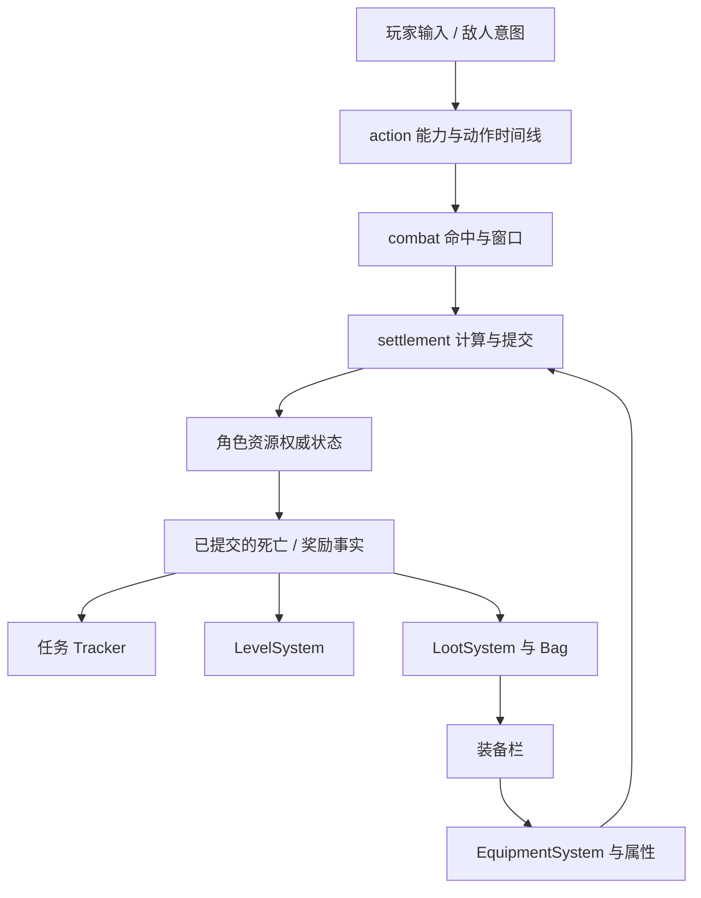

# EVEngine ARPG 框架设计

更新：2026-10-28。基线：`origin/dev` 的 `900ee612c`。

状态：已有通用能力与战斗基础；ARPG 跨模块游戏闭环待集成验收。本文描述合并后的模块归属和后续设计，不代表完整游戏已经运行通过。

## 合并决策

合并前原型保存在 `a3be8a862`。dev 已实现同名任务系统，并将属性、效果、动作、结算、存档拆为独立领域，因此采用 dev 的实现和测试，移除原型的重复运行时。原型提交仅用于设计追溯，不应直接恢复到当前构建。

| 原型入口 | 合并后采用的实现 | 迁移注意 |
| --- | --- | --- |
| `CombatSystem::dealDamage` | `combat` + `settlement`；RPG 使用 `RPGSettlementAdapter` | 命中检测、数值计算、资源提交分别负责，不能靠直接修改基础生命值实现伤害 |
| `ProgressionSystem` | `rpg::LevelSystem` | 使用 level/xp/xpToNext；原型最大等级和分配点不是现有保证 |
| `QuestSystem` / `Tracker` | dev 同名实现 | 保留 dev 的校验、事件与奖励接口 |
| `LootRegistry` / `LootRoll` | `rpg::LootSystem` | 注入随机流、逐条概率掉落并入 Bag；不等同于原型权重抽取、luck 和唯一抽取 |
| `EquipmentSet::synchronizeAttributes` | `rpg::EquipmentSystem::syncEquipModifiers` | 按物品注册加成、按槽位管理 modifier source；inventory 不反向依赖 rpg |
| `StateCodec` | `RPGSaveSession` / `RPGGameSaveParticipant` | 使用既有准备与提交边界，不恢复原型破坏式读档 |
| `UtilityBrain` | `CombatEnemyIntentSource` 作为现有简单敌人入口 | 现有距离分段、预警、恢复行为不等同于通用 Utility AI |

原型示例与七项测试依赖已撤下的 API；此次采用 dev 的 `examples/rpg` 与领域测试，不能把原型的历史测试结果视为本次合并验证。

## 模块与状态所有权

| 模块 | 权威状态 / 职责 | ARPG 组合方式 |
| --- | --- | --- |
| `attributes` / `effects` | 属性计算、效果容器 | RPGActor 适配已有容器，避免额外缓存成为第二份权威状态 |
| `action` | 动作定义、执行阶段、能力请求、时间线 | 玩家与 AI 都提交能力意图；技能配置映射到动作定义 |
| `combat` | 角色运动、近战命中、锁定、防御窗口、连招与打击反馈 | 宿主接线 `CombatLoop`，把命中事实交给选定的结算适配器 |
| `settlement` | 统一结算协议及流水线 | 同一目标资源只走一个正式提交路径 |
| `rpg` | Vitals、成长、职业、任务、装备属性适配、RPG 存档 | 维护长期角色进度；实时战斗与回合制 Battle 不并行扣同一份血 |
| `inventory` | Bag、装备栏、物品数量与实例 | 负责物品所有权，RPG 负责其属性含义 |
| 场景、物理、动画与表现 | 空间查询、碰撞、姿态、音画 | 通过已有接口组合，不把表现依赖塞进 action 核心 |

图中跨域箭头是待明确验收的组合契约，不表示这些系统已经自动连通。

## 经典设计的取舍

以“战斗—奖励—装备—更强挑战”为产品循环，定义与实例分离，动作时序与数值结算分离。沿用仓库的能力、标签、效果和动作时间线设计；背景与细节见 [战斗系统与动作编辑器](战斗系统与动作编辑器.md)。不以另一套 ARPG 总管替代已有领域。

随机数由宿主拥有并按用途分流；可设种子不等于跨平台确定性回放。任务观察提交后的事实，不负责推断命中；AI 输出意图，不直接扣血。游戏内容可以选择不同伤害公式，框架不在通用入口硬编码某款游戏的数值。

## 宿主集成契约（待实现与验证）

1. 为场景实体、战斗主体和 RPGActor 建立可校验的身份映射；销毁或读档后旧 generation 不可继续生效。
2. 每个模拟步收集玩家/AI 意图，推进能力、动作时间线与命中窗口。由宿主定义明确时序，不重复推进同一 runtime。
3. 命中携带 execution、来源、目标、伤害描述进入结算；命中去重范围应区分单次挥击、多段技和持续区域。
4. 结算成功后提交当前资源。生命上限来自属性，当前生命属于 Vitals 或明确选定的战斗状态；禁止两份状态各自修改后互相覆盖。
5. 死亡转换只发一次奖励事实。经验、任务进度、掉落入包分别消费，并记录可重试边界。满包、来源销毁和重复事件必须有明确结果。
6. 换装成功后同步属性；处理生命上限下降、效果到期与死亡状态之间的规则。
7. 表现消费提交后的结果。受击停顿、伤害数字、音效失败不回滚已完成的游戏结算。
8. 在安全点保存；先校验并准备所有参与者，再统一提交。静态内容版本、随机流、奖励去重记录与对象绑定均需明确覆盖范围。

禁止用第二次 `rpg.update(0)` 作为通用事件刷新方式：事件消费和模拟推进应有明确所有者，避免重复处理或清空其他系统的事件。

## 后续交付顺序与验收

2026-10-28 增量：已将现有 `LootSystem::roll` 的逐项入包改为库存批量事务。
满包、无效原生定义、未知命中物品不修改背包、随机流或事件；成功后钩子可安全重载掉落表。
该修复只解决奖励的入包原子性，不表示战斗桥接、击杀去重、经验与任务联合提交已完成。

本次边界审查（存量实现修复）：R-BOUND-2 复用 manifest 已声明的 rpg→inventory 硬依赖；
R-MECH-1 的四轴为单 Bag、每次发奖、已知库存 owner、要求全成全败，故复用 prepare/commit。
R-FACE-1 涉及库存事件 E4 和原有脚本入口 E5，未增加 capability、ECS/Link 或工具协议；
R-COST-5 已记录整表遍历与背包复制成本。兼容计数入口统一进入内部 Result 路径，未新增平行状态。
不涉及新持久格式、跨帧借用或可选 provider；不据此次检查宣称整个 rpg 模块达到 L2–L4 裁剪验收。

增量验证：4 项 RPG→Inventory 组合回归测试、39 条断言通过（独立无图形测试程序）；
完整 `make check` 通过；标准 `make debug JOBS=4` 中 `EVRPG` 编译通过。
third-party 已同步到固定版本，整引擎构建随后在 `graphics/vulkan/ComputePass.h` 因缺少
`vkbuilder.hpp` 失败，尚未完成整引擎链接或可玩示例验收。未以改写依赖头文件绕过问题。

| 阶段 | 工作 | 完成条件 |
| --- | --- | --- |
| 1：状态与结算桥接 | 确认 combat 与 RPG 资源权威、身份映射、结算适配 | 一次攻击只扣一次血；旧身份、失败提交不改变目标 |
| 2：奖励闭环 | 死亡→经验/任务/掉落→装备属性 | 重复死亡不重复发奖；满包行为明确；穿脱不残留 modifier |
| 3：可玩切片 | 移动、普攻、技能、闪避、敌人预警/恢复、拾取、UI | 可实际操作完成一次战斗与成长循环，打断后窗口和表现资源清理 |
| 4：保存恢复 | 复用 SaveSession 参与者、版本与迁移策略 | 错误存档无半恢复；恢复后属性、装备、任务、资源一致 |
| 5：扩展 | 随机词缀、复杂 AI、Boss、多段技 | 在前四阶段测试基础上增加，不引入第二套领域状态 |

通用 Utility AI、权重/唯一掉落、点数分配、完整网络预测和跨平台回放均为可选扩展，当前不承诺已实现。

## 验证与阅读入口

源代码检查使用根 Makefile：`make check/test-manifest check/module-layers check/examples`；完整源检查为 `make check`。构建使用 `make debug JOBS=4`。按宿主与配置选择领域测试，遵循根 AGENTS.md，避免启动本地全量图形测试。

现有测试入口：`test/unit/rpg/rpg_tests.cpp`、`test/unit/combat/combat_tests.cpp`、`test/unit/action/action_tests.cpp` 与 `test/integration/combat-presentation/`。它们覆盖各自领域，ARPG 奖励与恢复的跨域验收仍需补充。

本次合并验证：测试清单、模块分层、示例布局检查通过；`git diff --check` 通过。`make debug JOBS=4` 在配置阶段被本地 third-party 版本不匹配阻断（现有 `54725d0a`，要求 `e7e0a476`），未执行编译与运行测试。后续需同步固定依赖并重建；不能据此宣称运行验收通过。

- [RPG 系统设计](RPG系统设计.md)：RPG 数值与兼容门面；其中早期组件示意需结合当前头文件阅读。
- [任务系统设计](RPG任务系统设计.md)：Tracker 与任务事件。
- [战斗系统与动作编辑器](战斗系统与动作编辑器.md)：能力、动作与表现生命周期。
- [战斗载体与投射物行为组合框架](战斗载体与投射物行为组合框架.md)：投射物组合边界。
- [结算与伤害数字](combat-settlement-damage-numbers.md)：战斗提交与表现连接。
