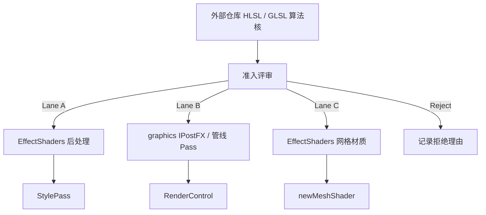

# Shader / Post-Effect Port Program（UE·Unity → EVEngine）

> 状态：方案定稿，待按波次实现。  
> 日期：2026-11-03（Asia/Shanghai）  
> 关联：[`风格化渲染模块设计.md`](../../风格化渲染模块设计.md)、[`模块设计.md`](../../模块设计.md) §15c、
> `src/modules/stylize/EffectShaders.*`、`src/modules/graphics/{IPostFX,PostEffect}.h`

## 0. 一句话

把外部引擎（优先 Unity HLSL 全屏后处理）的**可抽取算法**，按统一准入、三通道落点、机械接线清单和验收门禁，系统化迁入 EVEngine；**不**新建平行模块，**不**重做已有 photoreal 管线。

## 1. 目标 / 非目标

### 目标

1. 补齐 stylize / 表现向后处理缺口（glitch、画家风滤波、霓虹描边、运动模糊、扫描 SDF、胶片调色等）。
2. 所有迁入效果走同一套契约：`StyleDefinition` + 参数表 + GLSL frag + SPIR-V +（按需）WGSL + 测试。
3. 源仓库可追溯：许可证、原文件路径、剥离了什么引擎壳、保留了什么数学。
4. 波次可并行：一效果一 PR；共享基础设施单独 PR。

### 非目标

- 移植 UE Master Material / Material Function / `.uasset` 节点图。
- 重写或替换现有 graphics 管线效果：Bloom、SSAO/HBAO/GTAO、FXAA/SMAA/TAA、DOF、Exposure、SSR、SSGI、Outline、Volumetric、Tonemap。
- 为每个效果新建顶层模块或第二套注册通道。
- 默认要求所有效果同时具备 CPU `processImage` 回退（仅 NPR 主风格保留）。

## 2. 现有锚点（必须复用）

| 锚点 | 作用 |
|------|------|
| `stylize/EffectShaders.{h,cpp}` | **已声明**的 Unity/Godot 移植通道（`vignette` / `chromatic` / `grain` + mesh 特效） |
| `stylize/StyleShaders.cpp` `kStyles` | 一期 NPR 主风格（`cartoon` / `watercolor` / `ink` / `pixel` …） |
| `StylePass` / `StyleChain` | 单 Pass / ping-pong 多 Pass；脚本 `eve.Stylize` |
| `graphics::PostEffectDesc` + `PostEffectStage` | `AfterOpaque` / `BeforeTransparent` / `BeforeTonemap` / `AfterTonemap` |
| `graphics::PostEffectInput` | Color / Depth / Normal / Motion / ObjectId |
| `graphics::IPostFX` | 管线级工厂（AO / AA / Outline / GI / SSR …）——仅 Lane B 使用 |
| `scripts/compile_stylize_shaders.py` | GLSL → SPIR-V `.inc` |
| `chromatic_post.frag` 等 | 接线模板：`#version 450` + `sampler2D MainTex` + `push_constant float data[32]` |



## 3. 三通道（Lane）

### Lane A — Stylize 全屏后处理（默认首选）

- **落点**：`kPostEffects` + `src/modules/stylize/shaders/<id>_post.frag`
- **适用**：只依赖 scene color（偶发 depth），表现 / UI / 技能冲击 / NPR 增强
- **阶段**：多数 `AfterTonemap`；需要 HDR 信息的（如部分 lens flare）用 `BeforeTonemap`
- **调用**：`stylize.newPass(gfx, "<id>")` 或并入 `StyleChain`
- **示例缺口**：glitch、kuwahara、neon edge、scan、sharpen、film looks、pixelize 形状变体

### Lane B — Graphics 管线后处理（慎用）

- **落点**：`src/modules/graphics/shaders/` + `IPostFX` / 现有类扩展
- **适用**：必须吃 motion / 多分辨率金字塔 / 与 AA·Bloom·Exposure 同级调度
- **门槛**：先证明 Lane A 不够用（例如 motion blur 需要稳定 `PostInputMotion` 与历史缓冲）
- **示例**：KinoMotion 类运动模糊、anamorphic bloom 附加层（若要并入现有 Bloom 而不是 stylize）

### Lane C — 网格 / 物体空间材质

- **落点**：`kMeshEffects` + `*_mesh.frag`（复用 `mesh3d_toon.vert` 或 stylize 自有 vert）
- **适用**：dissolve / rim / hologram 同类；不走全屏
- **本计划次要**：后处理波次优先；mesh 仅在技能表现明确需要时开单

## 4. 准入评审（Intake Rubric）

每个候选源效果填一张卡片（可放在本文件附录或 PR 描述），全部勾选才开工：

| # | 检查项 | 通过条件 |
|---|--------|----------|
| 1 | 许可证 | MIT / Unlicense / CC0 / Apache-2.0 等允许嵌入；保留版权头。UE Fab 仅引擎内授权 → **拒绝整包再分发** |
| 2 | 可抽取性 | 核心是 fullscreen（或单材质）数学；不依赖 Unity Volume / RendererFeature / URP include 才能理解 |
| 3 | 输入契约 | 所需输入 ⊆ `{color, depth, normal, motion}`；ObjectId 暂不新增 |
| 4 | 与存量关系 | 不是 Bloom/SSAO/FXAA/DOF/… 的重复实现；若增强则说明 delta（如 anamorphic dirt） |
| 5 | 成本可陈述 | 能写 `@cost` 量级（全屏采样次数 / 是否多 Pass / 分辨率缩放） |
| 6 | 后端范围 | Vulkan 必做；WGSL 同波次或明确「WebGPU 后续」并在定义里可查询 |
| 7 | 命名 | 新 style id 用短小写英文；避免与 `kStyles` / `kPostEffects` / `kMeshEffects` 冲突 |

**评分建议（可选）**：可抽取性 0–3 + 缺口价值 0–3 + 接线成本反向 0–3；总分 ≥ 6 进波次队列。

### 默认拒绝清单

- UE Essential / Master / VFX Master Material（节点资产）
- 仅 Shader Graph 无手写 HLSL 的包（除非作者另附 `.hlsl`）
- 依赖 HDRP-only / DXR / 专用插件 API 且无参考实现的效果
- GPL/LGPL/CC-BY-SA 与 UE EULA 冲突且本引擎发行场景不容纳的（按项目发行策略裁定）

## 5. 机械接线清单（Port Recipe）

对 **Lane A** 每个效果按序执行（Lane C 对称；Lane B 另附 graphics 清单）：

1. **剥离**：从源仓库只摘 fragment 数学与噪声函数；删除 `Blit`、C# Volume、URP macros。
2. **改写 GLSL**：以 `chromatic_post.frag` 为模板  
   - `#version 450`  
   - `layout(binding = 0) uniform sampler2D MainTex;`  
   - depth 需要时用引擎约定 binding（与现有 depth-aware pass 对齐，不私创）  
   - `layout(push_constant) uniform Externals { float data[32]; } u;`  
   - 参数按下标顺序与 `StyleParameterDesc` 数组一致。
3. **元数据**：在 `EffectShaders.cpp` 追加  
   - `kPostEffects[]` 一行（`id, post=true, mesh=false, cpu=false, depth?, normal?, stage, priority`）  
   - `kXxxParams[]`（`id, default, min, max`）  
   - `postParamCount` / `postParamAt` / `createEffectPostShader` 分支。
4. **编译**：`FRAGS` 列入 `scripts/compile_stylize_shaders.py` → 生成 `*_frag_spv.inc`。
5. **WGSL（若本波次要求）**：`StylizeWgsl.h` 或 effect 专用段；`supports` 不撒谎。
6. **时间参数**：动画类效果提供 `time` float；`StylePass::setTime` 可驱动。
7. **多 Pass**：可分离模糊 / Kuwahara 结构核 → 拆成多个 style id 或一个 `StyleChain` 配方，不在单 frag 里硬塞无法 ping-pong 的依赖。
8. **文档**：`docs/usr/modules/stylize.md` 增一行；本 spec 附录勾选「已落地」。
9. **溯源注释**：frag 文件头写 `// Ported from <repo>@<commit> <path> (<license>)`。

### 共享基础设施（单独 PR，先于或并行于波次 1）

| 组件 | 用途 | 落点建议 |
|------|------|----------|
| `stylize/shaders/noise.glsl` | simplex / hash（XPL `XNoiseLibrary` 精简） | `#include` 进 glitch 等 |
| `stylize/shaders/post_common.glsl` | `texelSize`、safe UV clamp、luma | 减少复制 |
| （可选）`EffectPortCatalog.md` 片段 | 源→id 对照表 | 本文件附录维护即可 |

禁止把共享噪声库散落复制进每个 frag 后又改出分叉。

## 6. 候选编目与波次

### 已有（勿再移植）

**Graphics：** bloom、ao_*、aa_*、dof、exposure_*、ssr、ssgi、outline、volumetric_*、tonemap  
**Stylize 主风格：** cartoon / watercolor / ink / pixel / anime / …  
**Effect 已移植：** vignette / chromatic / grain + rim / dissolve / hologram / snow / slash / ember / aura

### 波次 1 — 冲击与故障美学（Lane A）

| style id | 主源 | 输入 | stage | 备注 |
|----------|------|------|-------|------|
| `glitchAnalog` | [keijiro/KinoGlitch](https://github.com/keijiro/KinoGlitch) | color | AfterTonemap | scanline / jump / shake / color drift；可先一个 id 多 param |
| `glitchBlock` | 同上 Digital | color | AfterTonemap | 需要噪声纹理或程序噪声 |
| `glitchWave` | [QianMo/X-PostProcessing-Library](https://github.com/QianMo/X-PostProcessing-Library) `GlitchWaveJitter` | color | AfterTonemap | 依赖 noise.glsl |

### 波次 2 — NPR 增强（Lane A，可与 watercolor/ink 链式）

| style id | 主源 | 输入 | stage | 备注 |
|----------|------|------|-------|------|
| `kuwahara` | [GarrettGunnell/Post-Processing](https://github.com/GarrettGunnell/Post-Processing) | color | AfterTonemap | Basic 先于 Anisotropic |
| `kuwaharaAniso` | Acerola / [Josephy5/PostProcessing-URP](https://github.com/josephy5/postprocessing-urp/) | color | AfterTonemap | 可能需 `StyleChain` |
| `neonEdge` | XPL `EdgeDetection*Neon*` | color (+depth 可选) | BeforeTonemap | 与 `cartoon` outline 互补，不替换 |
| `dog` | Acerola Difference of Gaussians | color | AfterTonemap | 漫画线稿 |

### 波次 3 — 镜头与运动（Lane A 或 B）

| style id | 主源 | 输入 | Lane | 备注 |
|----------|------|------|------|------|
| `sharpen` | XPL SharpenV1–V3 / Acerola CAS | color | A | AfterTonemap |
| `motionBlur` | [keijiro/KinoMotion](https://github.com/keijiro/KinoMotion) | color+motion | **B 优先评估** | 无 motion 则降级拒绝或仅相机向量近似（须标明） |
| `scanPulse` | [MirzaBeig/Post-Processing-Scan](https://github.com/MirzaBeig/Post-Processing-Scan) | color+depth | A | 技能/探索 |
| `lensDirt` | AmplifyBloom **仅 dirt/starburst 思路** | color | A 或并入 bloom | 禁止重做整棵 bloom |

### 波次 4 — 调色与像素变体（Lane A，低优先级）

| style id | 主源 | 备注 |
|----------|------|------|
| `bleachBypass` / `technicolor` | XPL ColorAdjustment* | 与 Exposure 分工：stylize 表现向 LUT 感 |
| `pixelizeHex` / `pixelizeLed` … | XPL Pixelize* | 扩展现有 `pixel`，勿打散主风格语义 |

### 明确延后

- FFT Convolution Bloom（重、与现有 bloom 重叠）
- UE Niagara / 材质库资产
- 完整 CRT 模拟（除非产品明确要复古显示器）

## 7. PR 粒度与协作

1. **Infra PR**：`noise.glsl` / `post_common.glsl` + 本 spec（可与本文合并）。
2. **每效果一 PR**：只改该 style 的 frag、EffectShaders 表项、compile 列表、单测、用户文档一行。
3. **禁止**：顺手改 `kStyles` 主风格算法；禁止顺手做全库 clang-format；禁止 Lane B 与 Lane A 混在同一 PR。
4. 分支前缀：`cursor/` 或 `codex/`；合入目标 `dev`。
5. 源码质量门：`make check`；涉及 GPU：`FILTER=stylize` 相关 integration（见下）。

## 8. 验收门禁（Definition of Done）

每个效果 PR 必须：

1. **注册可见**：`stylize.hasStyle("<id>") == true`，`supports("<id>", "post")` 正确；depth/normal 声明与 shader 一致。
2. **参数表闭合**：`getStyleParamCount` 与 frag 使用的 `u.data[i]` 一一对应；越界有 clamp。
3. **编译产物**：`.frag` 与 `*_frag_spv.inc` 同步提交；本地 `python3 scripts/compile_stylize_shaders.py` 可复现。
4. **GPU 冒烟**：在现有 stylize presentation / gallery 测试路径增加该 id（或专用 `TEST_CASE`），offscreen 一帧无 device lost；允许用像素哈希 / 非全黑断言，不强制黄金图。
5. **零输入安全**：`strength==0`（或等价总开关）时应接近恒等（文档写明容差）。
6. **许可证**：文件头溯源 + 第三方 NOTICE 若许可证要求。
7. **成本**：公共 API / 用户文档一句相对量级（例如「全屏 6–12 tap，可与 grain 同级」）。
8. **架构**：不新增向上 `#include`；不引入 `getModInst` 到 runtime；不丢弃关键 `Result`。

## 9. 架构规则对照（handoff）

| 规范 | 本方案如何满足 |
|------|----------------|
| 模块边界 / 单清单 | 不新开模块；效果进 `stylize` EffectShaders 或 `graphics` 既有 IPostFX |
| 接口契约 | 继续 string style id + `supports` + 参数 introspect；不引入平行枚举 |
| Result / nodiscard | 工厂与 apply 路径保持现有异常/Result 约定；新代码不引入可丢弃 bool |
| 成本 | 每效果文档 `@cost` 相对量级 |
| 测试 | per-module / 扩展现有 stylize integration，不堆共享 main |
| 跨模块 | stylize → graphics 单向；不把 UE/Unity 类型泄漏进 common |

## 10. 建议落地顺序（执行视图）

```text
[0] 合并本 spec
[1] Infra: noise.glsl + post_common.glsl
[2] 波次1: glitchAnalog → glitchBlock → glitchWave
[3] 波次2: kuwahara → neonEdge → (kuwaharaAniso | dog)
[4] 评估 motionBlur 是否升 Lane B；同时做 scanPulse / sharpen
[5] 波次4 按产品审美需要拣选
```

每完成一波，更新下方附录状态列；不另建第二份真相源。

## 附录 A — 状态板

| id | 波次 | Lane | 状态 |
|----|------|------|------|
| （infra）noise/post_common | 0 | — | 已落地 |
| glitchAnalog | 1 | A | 已落地 |
| glitchBlock | 1 | A | 已落地 |
| glitchWave | 1 | A | 已落地 |
| kuwahara | 2 | A | 已落地 |
| kuwaharaAniso | 2 | A | 已落地（融合单 Pass；完整 TFM 多纹理待后续） |
| neonEdge | 2 | A | 已落地 |
| dog | 2 | A | 已落地（融合 2D DoG；可分两 Pass 优化待后续） |
| sharpen | 3 | A | 待做 |
| motionBlur | 3 | B? | 待评估 |
| scanPulse | 3 | A | 待做 |
| lensDirt | 3 | A | 待做 |
| bleachBypass | 4 | A | 待做 |
| technicolor | 4 | A | 待做 |
| pixelize* | 4 | A | 待做 |

## 附录 B — Intake 卡片模板

```markdown
### Port card: <styleId>
- Source: <url> @ <commit> (<path>)
- License: <spdx>
- Lane: A | B | C
- Inputs: color [, depth] [, normal] [, motion]
- Stage: BeforeTonemap | AfterTonemap | …
- Passes: 1 | chain(<ids>)
- Cost: <relative>
- Backends: vulkan | vulkan+webgpu
- Overlap check: not duplicating <existing>
- Rejected alternatives: …
```
