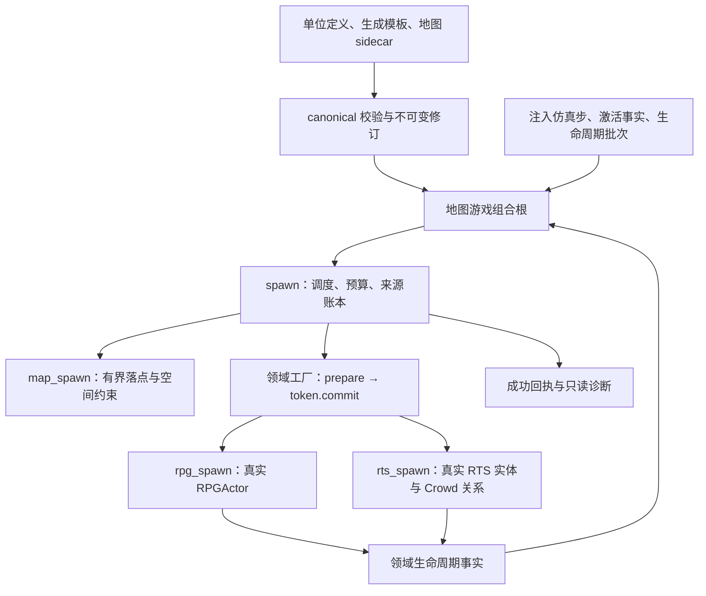
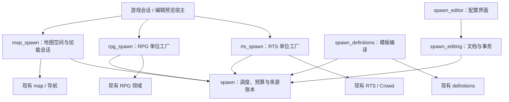
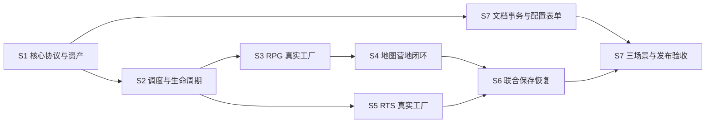

# 地图单位生成系统：架构、配置与第一版实施设计

日期：2026-11-06

更新：2026-11-11

范围：RPG/ARPG 地图营地、有限波次遭遇、RTS 地图增援。Spawn 指单位生成，“孵化”作为玩法表现。

本设计采用“通用调度核心 + 地图空间适配 + 领域单位工厂 + 游戏会话组合”的结构。配置沿用“单位定义 → 生成模板 → 地图实例”的引用链，运行状态独立保存。第一版支持一次、周期、维持数量和有限波次；单位 AI、战斗、掉落及建筑生产继续由现有领域模块负责。

本文同时包含设计与既有实施追踪：§1–11 是设计和验收要求，§12 是逐批证据。当前工作树已有大量实施代码，不能将目录或接口存在视为验收完成；裁剪与平台验证仍待收口。本次整理只核对文档、manifest 和关键头文件，不修改运行时代码，不新增构建或测试通过的声明。

### 第一版模块归属

| 模块 | 代码位置 | 第一版责任与复用边界 |
| --- | --- | --- |
| spawn | `src/modules/spawn/` | 调度、预算、命名随机流、来源账本、生命周期和运行检查点；只依赖 common，不依赖地图或领域 |
| spawn_definitions | `src/modules/spawn/definitions/` | 复用 definitions 的资产与修订，编译不可变生成模板；不建立第二个可变单位定义库 |
| map_spawn | `src/modules/map/spawn/` | 复用 map/Pathfinder，提供显式坐标转换、区域、空间约束和分阶段地图装载 |
| rpg_spawn | `src/modules/rpg/spawn/` | 复用 RPG 初始化与稳定身份，提供整批 actor 创建、删除和死亡适配；不依赖 map |
| rts_spawn | `src/modules/rts/spawn/` | 复用 RTS 批量创建、阵营、命令与 Crowd；联合处理实体及后端关系，建筑生产不迁入 |
| map_rpg_spawn / map_rts_spawn | `src/modules/map/rpg_spawn/`、`src/modules/map/rts_spawn/` | 游戏组合根拥有地图与领域会话，协调推进、事件交接、关闭及整体保存恢复 |
| spawn_editing / spawn_editor | `src/modules/map/spawn/editing/`、`editor/` | 复用 editing 文档事务与 editor/UI，提供配置编辑、区域工具、撤销及只读诊断 |
| map_rpg_spawn_editor | `src/modules/map/rpg_spawn/editor/` | RPG 内容适配与正式编辑宿主，不进入通用运行核心 |

归属已对照 `cmake/module_manifest/modules/{spawn,map,rpg,rts}.cmake`；详细层级与直接依赖见 §4.1。map 当前依赖 graphics，不能把“无编辑器地图运行”称为纯 headless 核心。

### 配置形式与状态所有权

| 数据 | 形式与权威所有者 | 关键约束 |
| --- | --- | --- |
| 单位定义 | RPG/RTS 自有定义资产 | 生命、属性、技能和武器仍归领域；模板只引用定义 |
| 生成模板 | JSON，`schema: eve.spawn-template`、`version: 1` | 定义内容选择、调度、数量限制及落点策略；发布为不可变修订 |
| 地图实例 | 独立 sidecar JSON，`eve.map-spawns` v1 | 稳定实例 ID、模板引用、World2D 区域、激活条件、共享预算和受限覆盖 |
| 加载描述 | JSON，`eve.map-spawn-binding` v1 | 显式关联地图 URI、sidecar URI、坐标变换及导航层；Tiled 不双写配置 |
| 运行存档 | 独立版本化检查点与整体文件协议 | SpawnWorld 拥有计时、波次、RNG 与来源账本；领域拥有实体事实，组合根协调同 epoch 恢复 |

完整 JSON 和四种调度分支见 §5；字段、引用、覆盖、未知版本和缺失能力均在发布前校验。配置保存不回填活单位、冷却或随机流；运行加载与编辑文档协议分别处理。

### 第一版接口与调用顺序

| 阶段 | 对照现有声明 | 必须兑现的契约 |
| --- | --- | --- |
| 编译与装载 | compileTemplate / compileMap；`PreparedMapSpawn::prepare` → `commit` | 校验引用、修订、空间和能力；完整候选接纳后安装会话，失败保留原地图 |
| 仿真驱动 | `MapSpawnSession::advance` → `SpawnWorld::advance` | 注入仿真步、激活帧和同批生命周期事实；交接重试不重复推进领域 |
| 空间与创建 | `ISpawnPlacement::validate/plan`；`ISpawnFactory::prepare` → `IPreparedSpawn::commit` | 有界落点、最终空间复核、领域整批发布；受阻不计成功，失败无实体/agent/预算残留 |
| 观察与关闭 | inspect / subscribe；`MapSpawnSession::close` | 诊断拥有只读数据，控制排队；显式清理失败保留重试责任，先停驱动再释放 provider |
| 保存与恢复 | 各领域 canonical codec 与地图 owning runtime 的 prepared restore | 完整内容闭包、稳定身份与同 epoch 接纳；候选世界准备后一次替换 owner，失败不部分覆盖旧世界 |

这是责任摘要；真实参数与返回类型以 §6.1 及所属头文件为准。尤其 commit 在工厂返回的 token 上，地图挂载当前接收整个 CompiledMap，不按语义示意另造一套接口。所有操作遵循 Result、类型化身份、owner/lifetime、仿真线程和回调重入约定。

### 实施步骤与交付判据

| 顺序 | 实施批次 | 本批完成条件 |
| --- | --- | --- |
| 1 | S1 核心协议与资产 | schema、强类型数据、唯一 codec、不可变修订；合法/非法配置与公共头验证 |
| 2 | S2 调度与生命周期 | 四种调度、预算、暂停/重试、去重和诊断；固定 seed 重放与纯核心裁剪 |
| 3 | S3 RPG 工厂 → S4 地图营地 | 真实 actor 原子创建、死亡补充、区域及玩家激活；真实地图运行与双向销毁顺序验证 |
| 4 | S5 RTS 工厂与地图增援 | 阵营、命令、Crowd 联合发布；阻塞重试、无邻居隐式位移及共享工厂契约 |
| 5 | S6 联合保存恢复 | 核心、地图、领域及待交接事件同边界保存；销毁源世界后真实续步，逐阶段失败保持旧 owner |
| 6 | S7 配置工具与正式验收 | 编辑/撤销/保存往返；营地、三波、增援完整场景；provider 缺失、裁剪、平台及 SDK 验收 |

依赖和逐批工作见 §10。文档模型可从 S1 后开始，正式运行预览及保存加载依赖地图与领域闭环。每批同时交付接口、实现、全部消费者和契约证据，不留下破坏构建的中间接口。

对于当前已有实现，执行顺序是先核实基线与支持范围，再补齐证据和缺口；不重复建设上述模块。当前收口清单见 §10.1.4，历史证据见 §12。第一版完成以 S1–S7 整体验收为准，单项测试或示例存活不能代替完整交付。

## 1. 目标与第一版范围

提供可配置、可保存、可解释的地图单位生成机制：在指定区域，按条件与调度规则，受预算约束地创建领域单位。单位的战斗、AI、掉落、任务结算与建筑生产仍由各自领域拥有。

第一版交付：

- 独立核心；一次、周期、维持数量、有限波次四类调度。
- 固定成员与按权重逐单位抽取；怪群整批提交。
- World2D 点集、圆、简单多边形区域；地图坐标通过显式变换接入。
- 地图加载、外部事件、玩家接近三类激活；暂停与恢复。
- 每实例存活上限、累计成功配额、地图作用域共享存活预算。
- 有界落点尝试、受阻重试、预算预留、失败回滚。
- 版本化模板、地图实例、运行快照；恢复与生命周期关联。
- 地图配置表单、区域预览、撤销重做、只读运行诊断。
- 三条真实组合路径：RPG 营地、RPG 波次、RTS 地图增援。

后续扩展：World3D 地形投影、水陆空分层、路径入口、无限波次、导演系统、任意脚本策略、跨地图全局预算。第一版遇到这些配置返回 Unsupported，不接受后静默降级。

建筑生产队列不迁入 Spawn；第一版不要求建筑生产切换接口。需要共享落点实现时，在 RTS 内提取一个 canonical helper，更新原消费者，禁止复制第二套实现。

## 2. 现有代码证据与接入差距

以下路径相对仓库根目录，描述的是当前代码，不代表能力已经满足本设计。

| 现有位置 | 已有能力 | 接入差距与处理 |
| --- | --- | --- |
| `cmake/module_manifest/core_foundation.cmake` | rpg 为 L1；definitions、production 为 L0 | 核心不能反向依赖 L4 map；通过独立 spawn L0 接入 |
| `cmake/module_manifest/modules/map.cmake` | map L4，依赖 data/filesystem/graphics/grid | 地图接入独立卫星；不能以裁掉编辑器推导出 headless map |
| `src/modules/map/MapObject.h` | Tiled 矩形对象、像素坐标、文本属性 | 没有稳定实例身份与生成 schema；导入时转换，运行时不逐帧解析 properties |
| `src/modules/map/level/editing/LevelFormat.h` | eve.level/v1、Tiled 导入导出；保留未建模字段 | 保留字段不等于验证生成配置；第一版使用显式关联的 sidecar 资产 |
| `src/modules/map/editing/MapDocument.h` | 地图文档、可逆 DomainOperation、staging | 增加生成文档 target；不把运行状态写入 MapDocument |
| `src/modules/definitions/Definitions.h` | 版本化定义、generation、快照、订阅 | 可提供模板资产来源；强类型编译产物不是第二个可变定义库 |
| `src/modules/rpg/EncounterCatalogue.{h,cpp}` | 成员、属性、奖励、任务通知、创建 actor | 不是通用单位定义服务；现有 raw pointer/null 创建接口不能直接成为新公共契约 |
| `src/modules/rts/RTSBuildingProduction.cpp` | 脱离 View 后结算、Blocked/Created、生产去重 | 工厂要求 Building/ProductionTask，不能直接服务地图增援 |
| `src/modules/rts/RTSProductionSpawn.cpp` | RTS 落点与 Crowd 投影 | 部分路径会推开邻居；Spawn 默认不得隐式移动已有单位，需要显式策略 |
| `src/modules/crowd/Crowd.h` | 原子 SpawnBatch、SpawnPolicy、生成回执 | 可作为 RTS 空间实现；仍需覆盖领域实体与 Crowd 联合发布的失败路径 |
| `src/engine/common/{Condition,Time,SubjectRef,RuntimeHandle,Snapshot,Capability}.h` | 条件、仿真步、身份、句柄、持久化、能力基础 | 复用基础协议；SubjectRef 是持久身份，不等同于 generation ECS handle |

尤其是 RPG 的空间落地、死亡通知和持久身份需要在适配批次内实现，不能以“actor 已创建”宣称地图营地已完成。

## 3. 数据与权威所有者

| 数据 | 权威所有者 | 其他位置的表示 |
| --- | --- | --- |
| 单位定义、战斗属性、生命状态 | RPG/RTS 等领域 | Spawn 持有 DefinitionRef 与领域事件，不复制生命值 |
| 生成模板源 | 定义资产 | 编译为不可变修订；编辑候选与已发布修订分开 |
| 地图生成实例 | 地图 spawn sidecar 资产 | 编辑器文档是未发布候选；发布后生成不可变实例描述 |
| 计时、波次、随机流、生成账本 | SpawnWorld | 编辑器/脚本只读快照 |
| RPG actor 稳定主键 | RPG ActorIdentity 组件 | 协调器提供并保存记录键；SpawnedActorState 不再重复持有身份，正文恢复不改名 |
| RPG actor 阶段顺序 | RPG ActorExecutionOrder 组件 | 工厂给新单位初值；actor v5 保存事实，协调器验证完整性和唯一性 |
| 单位实体、物理/Crowd 投影 | 领域 world 与对应后端 | Spawn 持有持久来源关系，适配器持有可校验的运行时绑定 |
| 共享生成预算 | 地图作用域 SpawnWorld | 实例引用预算 ID；领域人口上限继续由领域负责 |

四类数据必须分开：单位定义、生成模板、地图实例、运行状态。模板不保存活单位；地图实例不保存剩余冷却。模板修订编译后不可变，现有实例持有 owning 修订引用；definitions generation 变化使查询句柄失效，但不能销毁仍被实例引用的编译内容。

## 4. 模块归属与依赖

### 4.1 第一版目标结构

| 模块 | 路径 | 层级与直接依赖 | 职责 |
| --- | --- | --- | --- |
| spawn | `src/modules/spawn/` | L0；仅 common 基础协议 | 强类型规则、调度、预算、句柄、生命周期账本、codec、运行快照 |
| spawn_definitions | `src/modules/spawn/definitions/` | L0；spawn、definitions | 模板订阅、验证、编译、不可变修订发布 |
| rpg_spawn | `src/modules/rpg/spawn/` | L1；rpg、spawn、definitions | RPG 单位工厂、身份/死亡适配、领域初始化；空间通过注入接口 |
| map_spawn | `src/modules/map/spawn/` | L4；map、spawn | 像素/地图坐标变换、区域导入、地图加载/卸载接入 |
| map_rpg_spawn | `src/modules/map/rpg_spawn/` | L4；map_spawn、rpg、rpg_spawn、spawn_definitions、graphics | 游戏侧 RPG/地图呈现组合，读取实际领域状态并调用既有绘制边界 |
| rts_spawn | `src/modules/rts/spawn/` | L6；rts、spawn、definitions、weapon | RTS 地图增援工厂、阵营与命令初始化、已有 Crowd 实现接入及真实武器状态参与者 |
| map_rts_spawn | `src/modules/map/rts_spawn/` | L6；map、map_spawn、rts_spawn、rts、spawn、spawn_definitions、definitions、crowd、action、combat、sensing | 原生地图接纳与 RTS 生命周期批次协调；RTSMapRuntime 为可选拥有式游戏组合根，MapRTSSpawn 提供脚本入口 |
| spawn_editing | `src/modules/map/spawn/editing/` | L4；editing、spawn | UI 无关的生成配置文档、校验、DomainOperation |
| spawn_editor | `src/modules/map/spawn/editor/` | L7；editing、editor、property_access、map、map_spawn、spawn、spawn_editing、ui、filesystem、graphics | owning 表单、World2D 区域工具、地图视口适配及只读运行诊断；游戏宿主负责实际挂载与地图绘制 |

正式配置编辑入口增加 `map_rpg_spawn_editor`（`src/modules/map/rpg_spawn/editor/`，L7，SCRIPT RPGSpawnEditor / SLOT rpgSpawnEditor）。它直接依赖 spawn_editor、spawn、spawn_definitions、definitions、rpg、rpg_spawn、map、map_spawn、map_rpg_spawn、editor、property_access、ui、graphics、filesystem、window 与 platform_event；RPG 内容适配留在该卫星，不进入通用编辑应用或运行核心。当前入口使用固定布局并加载真实技能/单位/模板依赖；open 打开地图 sidecar，openTemplate 打开独立模板资产，均复用现有表单、保存与导出。地图模式另有独立手动步进的真实 RPG/map 预览；它不接管正式游戏仿真，详见 §9。

依赖表示实现实际使用；增加直接 include 时同步更新 manifest，不能依赖传递链接。上表为目标，具体合入时由 depgraph 和链接验证核定层级。

spawn 是跨领域新宿主，不是 map 的卫星；其余均嵌套于宿主目录。新建 `cmake/module_manifest/modules/spawn.cmake` 并在 hub 有序 include；其他声明归各自宿主 fragment。禁止手写第二套 boot/link 清单。

rpg_spawn 不依赖 map_spawn；组合根同时安装二者。map_spawn 不创建 RPGActor。固定数量的空间/工厂 provider 在 attach 时绑定可校验 lease/handle；热循环不通过字符串查询 capability。

### 4.2 组合关系

下面表示调用与数据流，不额外声明模块依赖；实际编译依赖以 §4.1 和宿主 manifest 为准。



组合根持有 provider 和领域 owner，确保其寿命覆盖会话与未完成事务。核心只接收类型化事实和接口，不直接访问地图或领域 ECS。领域创建整批提交后，核心才发布成功账本；领域推进与生成交接是不同责任，交接失败重试不能再次推进同一仿真步。保存恢复由同一个组合根协调全部参与者，叶子模块的检查点不能独自替换游戏世界。

下图箭头表示调用或依赖方向；具体直接依赖以宿主 manifest 为准。游戏会话是组合根，不增加统一 Actor 基类。



运行组合不依赖编辑器。RPG 正式地图入口归 map_rpg_spawn，配置编辑入口归 map_rpg_spawn_editor；二者分别拥有会话，配置编辑不会隐式修改正在运行的世界。RTS 地图组合由游戏宿主同时注入 map_spawn 与 rts_spawn，不让 rts_spawn 反向持有地图加载器。

### 4.3 六面边界

- Capability 输入：空间候选/占用查询、领域批量创建、玩家位置/外部条件上下文。输出：运行状态查询与控制。接口由 spawn 声明，提供者注册实现。
- ECS/Link：核心使用紧凑 registry，不创建 SpawnEntity 大根类；适配器用实体 handle 建立来源关联。
- 事件：激活输入、领域死亡/移除输入；生成提交、受阻/恢复、波次完成与实例完成输出，均为类型化 envelope。
- 脚本：同一 codec/Result 投影；控制操作与只读快照。首版不开放每 tick 任意脚本条件。
- 工具：首版不新增 MCP family；编辑器通过编辑 target 和状态接口接入。后续工具由 spawn provider 自己声明 family。
- 持久化：模板、地图实例、运行快照分别版本化；单位本体由领域存档拥有。

未来实现必须在实际代码声明 module-interface 六面证据，热路径文件声明 `// eve-hot-path` 或本地 `.eve-hot-path`。本节是设计边界，不新建 JSON 契约目录。

## 5. 配置形式与完整示例

使用 JSON 资产；JSON、脚本、编辑器共用唯一 codec，编译后使用 enum/variant 与强类型 ID。引用统一使用现有 DefinitionRef 的 type/id 语义，不自创 `rpg:xxx` 字符串解析器。

第一版配置交付采用以下四种资产；路径由项目约定，schema 与引用关系由协议约束。

| 资产 | 内容与编辑责任 | 运行消费方式 |
| --- | --- | --- |
| 单位定义 | RPG/RTS 自有单位、技能、武器等领域字段 | 领域 resolver 解析精确修订，Spawn 不复制领域定义 |
| 生成模板 JSON | 内容成员、调度、激活、预算及落点策略 | spawn_definitions 编译为不可变修订 |
| 地图 sidecar JSON | 地图 ID、共享预算、稳定实例 ID、模板引用、区域与允许的覆盖 | map_spawn 与核心编译器共同接纳 |
| 加载描述 JSON | 地图 URI、sidecar URI、像素到世界变换、导航层 | 地图组合根通过 canonical 绑定解析器加载 |

运行快照与编辑文档保存格式另有 schema；运行加载器只消费上述配置资产。编辑资产保存保留编辑协议，导出生成可被运行加载器接纳的模板或 sidecar。任何导出候选均须重新完整校验，不能用文本写入成功替代语义接纳。

### 5.1 狼群模板

```json
{
  "schema": "eve.spawn-template",
  "version": 1,
  "id": "forest.wolves",
  "content": {
    "kind": "weighted",
    "selection": "per_unit",
    "entries": [
      { "unit": { "type": "rpg.unit", "id": "gray_wolf" }, "weight": 80 },
      { "unit": { "type": "rpg.unit", "id": "alpha_wolf" }, "weight": 20 }
    ]
  },
  "schedule": {
    "kind": "maintain_population",
    "target_alive": 4,
    "initial_population": 4,
    "replacement": { "after": "death", "delay_seconds": [20, 35] }
  },
  "limits": {
    "alive": 4,
    "total": { "kind": "unlimited" },
    "budget_group": "forest.hostiles"
  },
  "placement": {
    "kind": "random_in_region",
    "constraints": [
      { "kind": "walkable" },
      { "kind": "clearance", "radius": 0.6 },
      { "kind": "distance_from_players", "min": 12 }
    ],
    "attempts_per_unit": 12
  },
  "batch_policy": "atomic",
  "failure": {
    "placement_blocked": { "kind": "retry", "delay_seconds": 2 }
  }
}
```

### 5.2 地图实例资产

```json
{
  "schema": "eve.map-spawns",
  "version": 1,
  "map": "forest",
  "budgets": [{ "id": "forest.hostiles", "alive_limit": 40 }],
  "instances": [
    {
      "id": "forest.north_wolf_camp",
      "template": { "type": "spawn.template", "id": "forest.wolves" },
      "region": {
        "kind": "circle",
        "space": "world2d",
        "center": [120, 80],
        "radius": 18
      },
      "activation": {
        "kind": "player_proximity",
        "enter_distance": 60,
        "exit_distance": 80
      },
      "inactive_policy": "pause",
      "unload_policy": "persist",
      "overrides": {
        "population": {
          "target_alive": 3,
          "initial_population": 3,
          "alive_limit": 3
        }
      }
    }
  ]
}
```

world2d 的单位由地图接入显式声明为世界单位；像素转世界坐标使用地图导入参数，不从 tile size 猜测。player_proximity 以玩家到区域的最短距离判断；多玩家取满足条件者；退出阈值必须大于进入阈值。玩家位置是注入的只读快照。

第一版 sidecar 用地图资产加载描述中的显式引用绑定；这是需要新增的接入字段，不宣称现有 eve.level/v1 已支持。Tiled 对象可通过一个引用属性指向 sidecar 实例；资产中的稳定实例 ID 是真源，不能使用对象数组下标或易变 name 代替。配置不双写进 properties。

### 5.2.1 显式加载描述

`map_spawn::PreparedMapSpawn::prepare` 接受独立加载描述，不向 Tiled properties 双写生成配置：

```json
{
  "schema": "eve.map-spawn-binding",
  "version": 1,
  "map_id": "forest",
  "map_uri": "project://maps/forest.json",
  "spawns_uri": "project://maps/forest.spawns.json",
  "pixel_to_world": { "origin": [0, 0], "scale": 0.03125 }
}
```

首版加载引用支持显式 project URI，拒绝 query、fragment、其他 scheme 和未知字段。map_id 必须与 sidecar 的 map 相等；像素变换为显式平移加正的统一缩放，sidecar region 仍以 world2d 存储，不再二次变换。未来 schema 版本拒绝，不进行猜测迁移。

prepare 接收目标 Map、对象契约与 SpawnDomainServices（领域工厂、可选占用源、可选初始玩家帧），通过 canonical IFileSystem 完成根地图、sidecar 及相对 tileset 的读取。地图先在隔离 ECS 表中解析和验证，导航快照及显式网格几何从同一候选图层派生；只有空间能力验证通过后才挂载隐藏 SpawnWorld。可选 navigation_layer 选择候选 tile 层，默认 0；它不作为怪物实例身份。

commit 只接收 prepare 时的同一个 Map，不再接收文件服务或对象契约；根地图和依赖不在提交阶段重读。候选组件全部接纳成功后才统一切换 Map 元数据，再交出 owning MapSpawnSession。任何前置失败或取消都不创建正式领域单位、不改变当前地图。会话 close 显式执行来源清理，失败保留剩余责任；析构只释放本地资源。联合保存与 persist 卸载协调仍属于 S6。


### 5.3 其他调度分支

以下是完整模板中 schedule/content 字段的替换片段，不是可独立加载的资产。

```json
{
  "content": {
    "kind": "fixed",
    "members": [
      { "id": "guard", "unit": { "type": "rpg.unit", "id": "goblin" }, "count": 3 }
    ]
  },
  "schedule": { "kind": "once" }
}
```

```json
{
  "schedule": {
    "kind": "interval",
    "period_seconds": 30,
    "initial_delay_seconds": 0,
    "count_per_batch": 4,
    "on_missed": "skip"
  }
}
```

周期的首版 missed 仅支持 skip：预算或落点阻塞的该次批次不补发，发布受阻诊断；下一周期重新计划。retry 配置仅用于 once、maintain_population 和 waves，interval 配置 retry 校验失败，避免叠加两种时钟。

```json
{
  "schedule": {
    "kind": "waves",
    "waves": [
      {
        "id": "guards",
        "delay_seconds": 0,
        "members": [
          { "id": "guard", "unit": { "type": "rpg.unit", "id": "goblin" }, "count": 3 }
        ],
        "complete_when": "all_members_dead"
      },
      {
        "id": "captain",
        "delay_seconds": 5,
        "members": [
          { "id": "captain", "unit": { "type": "rpg.unit", "id": "goblin_captain" }, "count": 1 }
        ],
        "complete_when": "all_members_dead"
      }
    ]
  }
}
```

waves 以各 wave.members 为内容，禁止再配置顶层 content；后续波次 delay 从前一波成功完成开始计。once/waves 使用固定成员，interval/maintain_population 使用 weighted；首版以这些组合限制降低歧义。权重抽样不保证精英数量上限，固定怪群需要显式成员。

### 5.4 校验规则

- 地图 `instances` 允许空数组，表示合法的零生成器地图；仍须提供有效地图 ID 与非空预算声明。模板成员、波次与点集的非空约束不变。
- schema/version 必填；拒绝未知核心字段。仅显式 extensions 命名空间允许保留未知扩展，不能影响调度。
- 按 kind 校验互斥字段；拒绝负数、非有限数、重复 ID、全零权重、自交多边形与不可解析引用。
- initial_population ≤ target_alive ≤ alive；波次/固定批次必须能装入实例及共享预算上限，避免永远不可提交。
- overrides 仅允许声明过的强类型覆盖组；合并后重新完整校验。禁止任意 JSON 深合并。
- 秒转换为整数纳秒 Duration，向最近纳秒舍入；以注入 SimulationStep 累加时间，在第一个到期 tick 执行。负 delta 或溢出报错。
- 第一版模板为 v1，无历史迁移；后续发布遵循仓库 N/N-1 逐版本迁移策略，未知未来版本拒绝。

## 6. 接口契约与现有声明映射

以下是语义签名，非可直接编译的头文件。实现时补充完整 Doxygen、导出宏与 move-only 不完整类型的 out-of-line 特殊成员。

| 接口 | 拟定操作及结果 | 契约 |
| --- | --- | --- |
| SpawnCompiler | `compile(Value, CompileContext) -> Result<CompiledSpawnRevision>` | 解析/引用验证在边界完成；失败不发布；结果拥有数据 |
| SpawnWorld | `attach(CompiledInstance, Providers) -> Result<SpawnerHandle>` | 实例 handle 带 generation/owner epoch；缺失必需能力时失败 |
| SpawnWorld | `advance(SimulationStep, InputBatch) -> Result<AdvanceReport>` | 仿真线程；输入仅在调用期间借用，返回报告拥有数据；不遍历外部 ECS；按批次提交，不承诺整个 tick 回滚 |
| SpawnWorld | `setActivation(SpawnerHandle, ActivationState) -> Result<Change>` | 真假查询可以 bool，操作结果用强类型 Change |
| SpawnWorld | `inspect(SpawnerHandle) -> Result<SpawnerSnapshot>` | 返回 owning 只读快照；无隐式创建/推进 |
| SpawnWorld | `detach(SpawnerHandle, DetachPolicy) -> Result<DetachReceipt>` | 显式执行保留/清理；失败保留可重试责任，析构不提交业务操作 |
| ISpawnPlacement | `plan(PlacementRequest) -> Result<PlacementOutcome>` | owning 有界批量候选；Ready/Blocked；缺少约束能力是错误 |
| ISpawnFactory | `prepare(BatchRequest, …) -> Result<PrepareOutcome>` | Ready 分支持有 IPreparedSpawn token；拥有未发布资源、预留身份和最终位置验证；完整参数以 §6.1 的头文件为准 |
| IPreparedSpawn | `commit() -> Result<CommitOutcome>` | 在 prepare 返回的 token 上提交；整批可见或完全不可见，失败撤销未发布实体/后端预留；不另建工厂 commit 入口 |
| ISpawnFactory | `remove(RemovalBatch) -> Result<RemovalReceipt>` | 按单位记录结果；重要清理失败可观测且可重试 |
| SpawnPersistence | `prepareRestore(envelope, context) -> Result<PreparedRestore>` | 完整解析、迁移、引用重建，尚不发布 |
| SpawnPersistence | `commitRestore(PreparedRestore&&) -> Result<RestoreReceipt>` | 与领域恢复协调，一次切换；失败原状态保持 |

所有可能失败、产生身份或责任的返回值都必须 [[nodiscard]]。compile、plan、prepare、snapshot/restore 按批次或资产规模成本说明 @cost；inspect 不触发编译。候选规划只是建议，最终空间有效性在工厂提交前再次校验。

工厂 prepare 必须拥有领域初始化事实、空间约束及回执准备责任，但不提前发布活实体。commit 可以分配独立的尝试批次；这些分配失败时必须保持未发布，领域创建中途失败时必须完整撤销前缀，并允许使用同一 token 重试。不能把 prepare 成功解释为 commit 不再分配或必然成功。若现有后端无法保证无失败发布或完整撤销，不得宣称原子提交；对应适配批次必须补齐 canonical 后端事务接口及所有消费者。这是交付条件，不是允许半提交的兼容模式。

provider 在绑定时校验类型与能力；每次使用校验 lease/epoch。所有操作默认仿真线程同步执行，禁止 advance 重入；不得持锁调用外部回调。事件在批次提交完成后发布，监听者的修改命令进入下一阶段队列。token 析构只做 noexcept 本地取消/释放；需要调用者处理的清理走显式 Result API。

### 6.1 工作树接口对照与组合根责任

上表描述目标语义；当前 C++ 声明以 `src/modules/spawn/SpawnWorld.h` 为准，避免实施时再建一套同义接口：

| 边界 | 当前接口 | 后续接入责任 |
| --- | --- | --- |
| 地图编译后挂载 | `SpawnWorld::attach(CompiledMap, shared_ptr<SpawnProviders>)` | map_spawn 先完成 sidecar/变换/能力校验；目前挂载整个地图，不是逐个 CompiledInstance |
| 激活与控制 | `setActive`、`enqueue(ControlCommand)` | 地图驱动解释接近/外部事件；观察者只排队，不在回调中同步推进 |
| 空间 | `ISpawnPlacement::validate/plan` | map_spawn 的具体实现承担区域采样与地图约束；工厂承担最终提交有效性，不能只信候选 |
| 创建 | `ISpawnFactory::prepare` → `IPreparedSpawn::commit` | commit 在 token 上，当前返回 `Result<CommitOutcome>`（Committed/PlacementBlocked）；不额外新增同义 factory.commit 入口 |
| 激活事实 | `MapSpawnSession::advance(Map&, SimulationStep, lifecycle, ActivationFrame)` | 会话统一同步玩家空间投影与核心激活事实；缺省保留上一帧，显式空帧清空；事件先完整校验再推进 |
| 导航更新 | `navigationNeedsRefresh` → `prepareNavigationRefresh` → `PreparedMapNavigation::commit` | 查询只检查元数据；昂贵网格捕获通过 owning token 显式执行；过期快照拒绝发布，未刷新时禁止推进 |
| 地图导航 provider 原生参与者 | `Pathfinder::captureState` → `PathfinderState` → `Pathfinder::prepareRestored` | 纯捕获缓存/内容修订与待同步图层事实；候选显式接纳恢复图层，不调用会重置水位的 bindLayer。RTSRuntimeCheckpoint::navigationProvider 观察同一 RTSNavigationCapture 的 provider；表面跟踪由该参与者接纳；PathfinderState 值协议见 §8.24，RTS 跟踪参与者持久封装见 §8.25 |
| RTS 表面跟踪原生参与者 | `RTS::captureNavigation` → `RTSNavigationCapture`；`RTS::restoreNavigation` | 联合冻结实际 provider 与期望几何、上次发布/捕获/变化水位及待重绑关系；直接接纳精确准备的 provider，不清除 Unit 交通恢复或重发表面。RTSRuntimeCheckpoint::navigation 持有唯一参与者；自定义导航回调未有实现身份协议时明确拒绝捕获；持久封装见 §8.25 |
| RTS 地图恢复 CPU 接纳 | `RTSMapRestoreState::prepare(checkpoint, hash)` | 无目标世界地封装/验证核心、精确未来配方、原生根与两阶段事件关系；只拥有冻结数据，摘要回调不被保留。同一接纳结果可用于独立候选尝试 |
| RTS 原生游戏 owner 恢复 | `PreparedRTSRuntimeRestore::prepare(checkpoint, hash)` → `commit(owner)` | CPU 接纳后在隐藏世界联合物化已有参与者，再发布监听者并替换 owner；捕获时冻结实际服务上下文的接纳结论，外部回调等未支持状态明确拒绝。源退休、移动续步与运行中替换已有真实测试；整体分配失败及真实 SpawnPending 恢复已有逐点验证；文件读取由 §8.36 接回同一条接纳/发布路径 |
| RTS 地图来源/会话恢复 | `PreparedRTSMapSession::prepareRestored(target, admitted, domain, players)` → `commit` | 接收已验证的 CPU token，复用通用 PreparedMapSpawn 恢复内核与 RTSSpawnFactory.restoreSources，保留两阶段输入、原修订及新 incarnation；物化和提交不调用摘要或外部文件服务。调用方预先准备隔离领域根和 provider，仍非完整游戏 owner 切换 |
| 会话观察与关闭 | const `world()` / `space()`、`enqueue`、`subscribe`、`close` | 外部只读诊断，控制经会话排队；关闭失败进入 Closing，保留清理责任并停止新推进 |
| 生命周期 | `RPGSpawnFactory::collectLifecycle(span<VitalsEvent>)` → `advance` | 组合根分发同一领域事件批次；不得二次 poll 抢走任务/战斗消费者的数据 |
| 查询与清理 | `inspect`、`subscribe`、`detach` | UI 获取 owning 数据；显式清理成功后才能撤销来源 |
| 绑定 | `ISpawnProviderSource::acquire` / `bindSpawnProviders` | 组合入口一次绑定；宿主持有 session，SpawnWorld 弱观察；卸载前停止驱动并显式清理 |
| 候选世界的监听者发布 | `cap::ListenerStaging::begin` → `pause` / `publish` | 同步 owning builder 暂存显式声明的世界监听者；文件等外部回调暂停暂存，其自身注册保持正常可见。发布先复制活动表再一次无失败交换；失败不暴露候选，取消不解引用未发布地址。不是跨帧事务，不暂存 service 或撤销现有世界的操作；完整 owner 恢复仍需组合协调 |
| RPG 初始化准备 | `PreparedMemberActor::prepare` / `restoreCheckpoint` → `clone` → `create`；候选图使用 `restoredCastTarget` / `publishTo` | prepare/restore 保留 detached 状态；普通创建使用 create，含其他目标的恢复先分配全部根再 publishTo，目标绑定失败不改 actor/候选；批次失败撤销前缀并保留原归档；不重新查询最新单位修订 |
| RTS 配方准备 | `PreparedUnitArchetype::prepare` → `apply`；`WeaponDefinitionRuntime::prepareCaptured` → `applyTo` | 拥有单位字段和精确单位/武器记录；不保留 registry；rts_spawn 继续接批量事务和 Crowd |
| RTS world 生命周期 | `RTS(shared_ptr<ecs::Table>)`、`ownedWorld()`、`lifetimeWitness()` | 显式保有真实领域 Table；token 需同时持有 Table 与弱观察 facade，不能把默认 Table 包装为虚假所有权 |
| RTS 原生批量事务 | `RTS::prepareUnitBatch` → `PreparedUnitBatch::commit` | owning recipe/weapon runtime；单位、阵营、武器和 RejectOverlap Crowd 联合提交；rts_spawn 继续接来源/预算/幂等和命令 |
| RTS 原生 Crowd 关系 | `RTS::captureCrowd` → `RTSCrowdCapture`；`PreparedRTSCrowdRestore::prepare` → `RTS::restoreCrowd` | 冻结 actual owning Table 全部 Unit 的逻辑键、半径/朝向、位置/容纳身份及 backend 行关联；保留待 detach/rebind 的实际关系。目标要求已重建根、空 Crowd 与未认领绑定；全部预检后发布 backend 和新 owner/generation 引用。RTSRuntimeCheckpoint::crowd 直接拥有该参与者，frame 仅为同源观察；Crowd 自有 registry 自动参与并提供候选 remap，RTS 共享流场作业、配额、组投影与延迟清理已随该参与者恢复；地图 provider 跟踪与持久封装仍须协调 |
| Crowd 原生快照 | `Crowd::captureSnapshot` → `prepareRestore` → `commitRestore` | 复用现有 opaque 内存快照，保留实际运动、场、命名身份、时钟与内部流场选择；快照和恢复各自重建 agent/cache pin 图，共享不可变场但不共享源世界租约责任。Crowd 自有 registry 的请求/进度/租约及 generation 随 native 快照接纳，候选显式 remap；独立外部 plan/lease 可通过同一 Snapshot::captureNavigation / RestorePlan::prepareNavigation 接纳；RTS 共享流场作业已接入该原生协议，持久 codec 与地图 provider 跟踪仍由游戏组合接纳 |
| 感知原生参与者 | `SensingWorld::capture` → `SensingCapture`；`PreparedSensingRestore::prepare` → `SensingWorld::restore` | 独立冻结实际 subjects 的完整字段和索引策略/尺寸；通过 canonical rebuildIndex 准备派生索引，和旧 JSON 导入共用发布入口；SensingCapture.seal/parse 提供 sensing:world-runtime v1（§8.8）。查询/debug 暂存不成为仿真权威 |
| 伤害结算原生参与者 | `DamageRuntime::capture` → `DamageCapture`；`DamageRuntime::prepareRestored` | 冻结实际命中反应策略和 canonical settlement.rules 文本，不保留执行回调、provider 或目标状态；按现有编译/安装内核构建独立候选；DamageCapture.seal/parse 提供 combat:damage-runtime v1 参与者协议（§8.7）。规则与派生管线属于同一不可变配置 owner，配置替换失败保持原状态；外部 IDamageRule 未有实现身份接纳时明确拒绝 |
| 结算语义审计接纳 | `settlementResultCanonicalJson` / `settlementResultFromJson` | 同一 settlement.result v1 的编码和强类型读取；复用请求/身份/枚举校验，不执行结算。传输事件 ID/sequence 不在语义格式中，完整帧保存须另行封装（§8.9） |
| 可执行结算请求持久协议 | `settlementRequestCanonicalJson` / `settlementRequestFromJson` | settlement.request v1 直接复用 replay 请求字段；编码和读取均通过同一接纳，不执行或补造链，不虚构规则摘要（§8.10） |
| RTS 帧持久参与者 | `RTSFrameArchive::capture` → `seal` / `parse`；`state()` → `PreparedRTSFrameRestore` | 完整审计、事件传输身份、四队列和水位；字段及 canonical 序号校验后复用原生发布，不重放事件；联合边界仍由游戏协调（§8.11） |
| RTS 战斗归属持久参与者 | `RTSCombatArchive::capture` → `seal` / `parse`；`state()` → `PreparedRTSCombatRestore` | 只保存镜像与 FireBlocked 归属；共用原生状态校验，感知/根/provider 关系仍经现有联合内核接纳（§8.12） |
| 属性权威值持久格式 | `AttributeSet::encodeState` / `prepareState` | attributes.set v1 复用原 canonical 存储与操作校验，保留 modifier 与分配水位，返回不注册能力的候选；投影/领域元数据和实现绑定仍归上层（§8.13） |
| 属性投影持久值格式 | `AttributeProjectionCapture::encodeState` / `prepareState` | attributes.projection v1 显式保存 initialized/revision，复用 attributes.set；原生 prepared/restore 继续负责 owner/subject/View 与一次发布，不自动推进修订（§8.14） |
| RTS Unit 属性持久参与者 | `RTSUnitAttributeCapture::seal` / `parse` → `PreparedRTSUnitAttributeRestore` | rts:unit-attributes v1 保存完整有序成员与投影；结构接纳不替代原生完整拓扑与物理 owner 校验（§8.15） |
| 共享弹药池持久值格式 | `CapturedAmmoPool::encodeState` / `prepareState` → 原生池/武器图恢复 | weapon.ammo-pool v1 精确保留池事实与 archiveId；名称不代表别名，lifetime 由原生恢复重建；外层武器图见 §8.18（池格式见 §8.16） |
| 完整武器持久值格式 | `WeaponCapture::encodeState` / `prepareState` → 原生单武器/图恢复 | weapon.capture v1 包含实际完整定义、阶段/请求/瞄准、完整属性与池事实；复用 runtime codec，外层图和实现授权仍归协调层（§8.17） |
| RTS 身体/武器/池持久参与者 | `RTSWeaponCapture::seal` / `parse` → `PreparedRTSWeaponRestore` | rts:body-weapons v1 保存唯一武器节点与完整身体族别/别名，检查共享池事实一致性；目标及物理发布仍由原生联合恢复核对（§8.18） |
| RTS 原修订单位配方值格式 | `PreparedUnitArchetype::encodeState` / `prepareState` | rts.unit-archetype v1 保留 unit/weapon 原始源和精确 generation；与 registry prepare 共用 canonical 内核，不造临时库或 ECS（§8.19） |
| RTS 来源持久参与者 | `RTSSpawnCapture::seal` / `parse` → `RTSSpawnFactory::prepareRestored` / `restoreSources` | rts:spawn-state v1 保存原修订配方、观察来源、命令和回执；不保存 incarnation/租约，真实 core 重新发行权限并核对历史（§8.20） |
| RTS 实际伤害权威 | `RTS::captureDamage(expectedService)`；`RTSRuntimeCheckpoint::damage()` | 核对实际 owning Table 静止且 RTS 绑定给定的游戏伤害服务，再随游戏同边界捕获；不以新建默认 DamageRuntime 代替已配置的真实规则和策略 |
| 战斗镜像参与者 | `RTS::captureCombatState` → `RTSCombatSnapshot`；`PreparedRTSCombatRestore::prepare` → `RTS::restoreCombat` | 冻结实际 mirroredSubjects/blockedSubjects；联合准备独立感知事实/索引及目标 Unit/Building 身份，发布前复核实际 Table、实体 generation、物理 facade/provider 凭据，再一次替换整个感知作用域和镜像/受阻集合。不调用感知查询或射线服务。仍须由游戏协调器接纳同边界根、时钟、队列及外部服务实现身份 |
| RTS 显式删除 | `RTS::prepareUnitRemoval` → `PreparedUnitRemoval::commit` | 捕获 owned Unit incarnation；缺失视为完成，新替身拒绝；复用 canonical 原子清理，不逐个调用 gameplay remove |
| RTS 生成适配 | `RTSSpawnFactory::validate/prepare/remove/inspect/collectLifecycle` | 共享工厂协议、真实 RTS/Crowd 事务、固定领域/阵营与初始命令、来源租约与有界最新回执；位置/生命读取实际组件 |
| 定义库原生参与者 | `DefinitionRegistry::capture` → `DefinitionRegistryCapture`；`DefinitionRegistry::prepareRestored` | 冻结 typed CPU 状态、generation/墓碑、事件与序列，以及库的 instance/revision/tick；parse 与 restoreJson 共用 CPU 接纳内核，新库复用 canonical storage 发布并恢复原元数据，不复制订阅。seal 与既有 snapshot 共用 definitions.registry / definitions:registry v1，保留 v0→v1 迁移，未新增格式 |
| RTS 实际内容权威 | `RTS::captureDefinitions(expectedRegistry)`；`RTSRuntimeCheckpoint::definitions()` | 核对实际 owning Table 静止且 RTS 真正绑定给定的游戏库，再加入同边界捕获；包括未被 Spawn 配方引用的现存定义。只持有独立原生事实，完整内容引用/实现身份接纳与 owner 切换仍须协调 |
| RTS 完整单位属性参与者 | `RTS::captureUnitAttributes(saveEpoch)` → `RTSUnitAttributeCapture`；`PreparedRTSUnitAttributeRestore::prepare` → `RTS::restoreUnitAttributes` | 不经过四项战斗字段投影，复用 AttributeProjectionCapture/PreparedAttributeProjection 保存全部原生值、修订/初始化和内部水位。按完整 Unit 身份/拓扑接纳并预检全部目标，之后零分配发布；缺组件不修复，目标替身拒绝。RTSRuntimeCheckpoint::unitAttributes 接入同边界捕获；内容/策略实现、时钟和其他领域参与者仍须联合协调 |
| RTS 身体武器图物化 | `PreparedRTSWeaponRestore::prepare` → `RTS::restoreWeapons` → `RestoredRTSWeaponPools` | 为已有且未装备的完整 Unit/Building 原生根准备 CPU 候选；重建实际枪/引用池，经 canonical WeaponGraphRestore 接纳后一次发布身体 Link 和 RTS 的枪 owner 索引。枪归 RTS，返回的池 owner 归游戏组合根，弱观察真实 Table；保留别名/无武器/原阶段/属性/请求目标，失败撤销全部新实体与能力并可重试。仍非完整游戏恢复 |
| RTS 全身体武器关系 | `RTS::captureWeapons(saveEpoch)` → `RTSWeaponCapture`；`RTSRuntimeCheckpoint::weapons()` | 从 actual owning Table 和 RTS 自有 Unit/Building 读取完整关系，包括非生成身体、明确无武器和多身体别名；每个实际武器只冻结一次，目标仅映射实际拥有的 RTS 根。图持有原生 WeaponCapture（含引用池），不持有 Table/运行句柄；不代替领域内容闭包、未引用库存或联合恢复授权 |
| RTS 原生根冻结及文件协议 | `RTS::snapshotState` / `RTSUnitAttributeAdapter::snapshot`；`RTSStateSnapshot::encodeState/prepareState` | 只读取既有 canonical 根组件与已初始化属性；实际拥有式 Table 不受当前 Scope 影响；缺失状态明确拒绝且不修复。native v3 保存玩家控制水位，rts.roots v1 完整传递六类根及移动组/投射物；完整属性、武器/Crowd/action 和来源/事件/核心仍由组合根联合接纳，见 §8.35 |
| RTS 原生队列参与者 | `RTS::captureFrameState` → `RTSFrameState`；`PreparedRTSFrameRestore::prepare` → `RTS::restoreFrameState` | 复制既有 damage/combat/lifecycle 与 gameplay 队列、实际序列水位和下一帧保留标记，不 poll、不推断游标。候选独立拥有历史 payload，校验各流顺序、跨流唯一性和水位；发布不重放事件或认领历史身体，不替代同边界时钟、仿真缓存和消费者确认 |
| RTS 原生来源恢复 | `RTSSpawnFactory::prepareRestored(domain, capture)` → `restoreSources(core, pending, damage)` | 共享精确未来配方，不保留/回退到 live registry；候选工厂先参与核心定义接纳，再核对实际执行工厂、同 saveEpoch 与完整成员/两个交接阶段，重建真实来源租约、存活/缺失/保留成员索引、最新成功回执和恢复时的退役 ordinal 下界，返回 remap 后的 lifecycle。所有分配在索引发布前；不创建身体或推进时钟，不是整个游戏恢复 |
| RTS 生成来源冻结 | `RTSSpawnFactory::capture(saveEpoch, futureRefs)` → `RTSSpawnCapture` | 冻结原始创建配方、未来单位精确修订、来源、最新回执、生命周期序列与无 ECS 句柄的初始命令；独立 owning 数据，不推进/消费事件；存活成员现带实际 WeaponCapture，仍不是完整 RTS/Crowd/action 联合检查点，尚无完整持久封装/游戏恢复；原生来源恢复见上行 |
| 武器原生参与者 | `WeaponCapture::capture(weapon, saveEpoch, targets, pools)` → `WeaponCapture`；`PreparedWeaponRestore::prepare` → `commit` | weapon 从已有组件冻结定义、真实状态、阶段请求、瞄准、完整原生属性投影（含内部序号水位，另保留选定字段只读摘要）与共享池值；目标由上层提供权威稳定身份；rts_spawn 在来源冻结中接入，不用定义 adapter 状态替代实际 ECS 状态；池关系使用 WeaponPoolBindings 接纳的检查点内引用；单武器恢复核对已恢复池事实并重绑 Link，不改池值；共享池发布由下述原生武器图恢复接口协调；持久封装和其他库存关系的联合接纳仍待实施 |
| 武器共享池冻结图 | `WeaponPoolBindings::capture(Table&, saveEpoch)` → `WeaponCapture::capture` | 遍历实际 Table 内已绑定的武器，按真实池 type/id/generation 分组，从各组最低稳定武器实例 ID 与 epoch 派生 archiveId；只保有弱 AmmoPoolLink，不按名称合并，不把运行时 handle 写入冻结结果。无引用池和其他库存关系由其参与者另行接纳 |
| 原生武器图恢复 | `PreparedAmmoPoolRestore::prepare/commit`；`PreparedWeaponGraphRestore::prepare/commit` | 单池准备新生命周期，发布时旧 Link 失效；图协调器复用单武器/单池 kernel，预检所有成员并 journal 化 optional Attributes 构造，随后无失败地一起发布池事实/生命周期及武器事实/Link。回执给出新弱池引用；领域根、索引、时钟与持久 artifact 仍由游戏协调器接纳 |
| 属性投影原生参与者 | `AttributeProjection::capture` → `AttributeProjectionCapture`；`PreparedAttributeProjection::prepare` → `AttributeProjection::restore(token, owner)` | 使用 canonical detached AttributeSet 捕获/克隆完整值与计数器，精确保留 revision/initialized；发布校验实际 owner incarnation、View 和 subject，沿 commitPrepared 替换，不递增 revision、不重排 modifiers、不注册候选能力。外部策略实现身份仍由游戏协调器接纳 |
| 动作原生参与者 | `ActionRuntime::capture` → `ActionCapture`；`PreparedActionRestore::prepare` → `ActionRuntime::restore` | 复制实际执行状态并重绑定实体引用，不重新 submit 或执行资源/效果；保留执行 ID 水位与时间线游标。动作持久协议见 §8.22；订单关联、服务实现身份、账本与时钟仍由联合协调器接纳 |
| RTS 订单与动作联合参与者 | `ActionAdapter::capture` → `RTSActionCapture`；`PreparedRTSActionRestore::prepare` → `ActionAdapter::restore` | 同步冻结 native 动作及 generation/order ID/execution ID 关联；准备校验真实 RTS 身份，发布 native 状态和关联后续接原执行；退休来源不认领替身。联合持久封装见 §8.23；仍须由游戏组合根联合订单本体、时钟、Crowd 与帧责任 |
| 武器共享弹药关系 | `AmmoPoolLink::bind` → `resolve/isStale/reset` | weapon 拥有 canonical Result 绑定与池生命周期标记，Weapon State 仅保存弱 Link；RTS 复用它补给和判断装填，不另建关系表；组件发布或池退役后显式重绑，运行句柄不持久化 |
| RTS 服务接纳 | `RTSSpawnFactory::validateDomain` | 检查实际 Table、阵营、Crowd 生命周期与初始命令；准备前、文件回调后和地图发布前重新校验，不创建单位 |
| RTS 实际占用 | `RTSSpawnOccupancy::capture` | 从实际共享 Table 的 Unit 组件捕获 owning 圆盘；包含其他阵营及待清理实体，排除已装载单位；不移动邻居、不维护第二份位置真源 |
| RTS 地图接纳 | `PreparedRTSMapSession::prepare` → `commit(Map&)` | map_rts_spawn 组合 canonical 地图候选、实际工厂和占用服务；提交前缺失 Crowd 或 RTS 已销毁时拒绝发布；准备不生成单位 |
| RTS 地图联合冻结 | `RTSMapSession::capture(Map&, saveEpoch, revision)` → `RTSMapCheckpoint` | 同一静止调用边界冻结核心、来源/精确内容/实际武器、native RTS 根、结构输入、运行网格和两阶段保留事件；校验来源/人口/身体关系，不翻译/消费事件。外部时钟与帧缓存、Crowd/action 和非生成身体的完整内容/武器闭包仍须参与；尚无完整封装/恢复授权 |
| RTS 地图运行 | `RTSMapSession::advance/close`、`navigationNeedsRefresh/prepareNavigationRefresh` | 游戏先且仅推进一次 RTS，再分发同一伤害批次；会话保留已接纳事件供失败重试，不推进 RTS/Crowd、不接管导航挂载；初次复制异常时调用者保留原批次 |
| RTS 拥有式游戏运行 | `RTSMapRuntime::prepare/advance/captureState/close` | 复用原生会话；持有真实 Map、Table、RTS、Crowd、ActionRuntime、感知与伤害服务；地图导航绑定同一发布层；领域只推进一次，核心消费 tick 前的交接失败保留当前帧；领域失败或核心消费后的异常进入 Faulted 后只允许观察和清理 |
| RTS 拥有式联合冻结 | `RTSMapRuntime::captureCheckpoint` → `RTSRuntimeCheckpoint` | 实际组合根统一冻结地图/核心/来源/根、Crowd、动作/订单关联、原生队列及完成 tick/待重试帧；校验 Crowd/core 时钟和身体到 agent incarnation/位置的一一关系。已联合感知事实、战斗镜像/受阻标记、全部 Unit 原生属性和全身体武器关系（包含非生成单位/建筑与明确无武器）；native RTS 根已包含投射物 runtime/payload，不重复建立投射物状态源。仍缺导航任务/外部租约、fog 与外部服务实现身份接纳、完整内容闭包及联合持久封装/恢复，不能作为完整 game-save |
| RTS 脚本组合入口 | `MapRTSSpawn`（SCRIPT / SLOT `mapRtsSpawn`）的 `prepare/commit/advance/captureState/close` | 准备完整隔离运行时，再显式转交 live owner；JSON 只经 canonical 内容/模板/绑定解析；准备阶段一次查询文件能力，帧中不查询模块；不导出可变 Table/Map/领域指针 |
| RPG 地图联合冻结 | `RPGMapSession::capture(Map&, saveEpoch, revision)` → `RPGMapCheckpoint` | 同步冻结核心、领域与 retained lifecycle；验证 membership/source 关联，不消费事件或推进仿真；尚不编码地图资产、其他 gameplay 事件或发布恢复 |
| RPG 效果字段 codec | `validateEffectDefinition` / `encodeEffectDefinition` / `decodeEffectDefinition` | RPG EffectDefinition 的唯一字段校验与 v1 JSON 映射；旧加载和实际 StatusSystem 共用；自定义绑定仍由执行/内容协调器验证，不复制通用 EffectContainer 生命周期 |
| 实际执行项修订 | `AttributeOperationRegistry::registerVersionedOperation/implementationRevision`、`StatusSystem::registerVersionedStackPolicy/stackPolicyRevision` | 回调与发布者声明的稳定修订由同一记录拥有，替换原子；legacy 替换清除身份，缺席或无修订明确失败；归档已保存原始期望修订，实体创建前核对实际注册项；条件绑定由 Actor Skills 的不可变执行 owner 提供；联合发布仍待完成 |
| 条件执行 owner | `SkillConditionBindings::prepare`、`RPGActor::Skills::conditionBindings` | 不可变集合拥有实际函数、修订与声明；正式 canCast/beginCast 经既有 SkillConditionAdapter 读取该 owner；捕获逐 actor 核对，恢复显式共享同修订实现，代码不序列化 |
| 外部实现需求 | `SkillContent::implementationRequirements` / `RPGSpawnRestoreState::implementationRequirements` | 从归档条件 AST 与效果字段派生 owning 需求，按实现类型与名称分组，保留每处参数、路径与脚本声明；不是实现版本身份或可用性证明，联合恢复必须核验实际绑定后才可发布 |
| RPG 归档语义接纳 | `SkillContent::prepareWithEffects` + `RPGSpawnRestoreState::prepare(archive)` | canonical 单位/actor 校验使用归档技能，不访问 live registry；验证保存的外部身份覆盖内容需求，返回 owning 纯 CPU 候选；`validateImplementationBindings` 再核对当前执行项，实际条件 owner 通过 prepare 的 owning 参数提供，core/lifecycle 关联由联合接纳检查，仍需完整未来内容绑定和实际发布，尚不创建或发布联合世界 |
| RPG 参与者持久封装 | `RPGSpawnCapture::seal` → `RPGSpawnArchive::parse` | eve.rpg-spawn-archive/v4；精确单位/技能记录、直接效果字段、actor checkpoint 与 durable origin；结构解析不等于领域语义接纳，不创建实体或发布来源 |
| RPG 领域冻结 | `RPGSpawnCapture::capture(Table&, saveEpoch)` | 遍历全部带 SpawnedActorState 的 RPG 实体，包含工厂索引已释放的尸体/KeepUnits；冻结 canonical actor 检查点、原单位配方、实际技能记录和直接效果字段；持久封装见归档接口，事件协调与联合发布仍待完成 |
| RPG 技能原修订接纳 | `SkillDefinitionRuntime::prepareCaptured(Definition)` | 复用 canonical typed codec；校验 rpg.skill/v1 与归档身份，返回 owning 技能事实，不读取或发布 live registry；效果引用仍待联合内容协调器解析 |
| 完整动作执行持久参与者 | `ActionCapture::seal` / `parse` → `PreparedActionRestore::prepare` | action:runtime v1 保存阶段/游标/目标/历史回执与 id 水位；解析不执行，原生准备重绑并检查服务；游戏资源/RTS 关联仍需联合协调，见 §8.22 |
| 动作定义持久前置 | `ActionDefinition::encodeState` / `prepareState` | action.definition v1；复用 AbilityAsset 唯一 action 字段内核，保留完整选靶/条件/成本/时间线；不提交动作、不授予运行恢复权限；完整执行事实另见 §8.22，定义格式见 §8.21 |
| 核心检查点捕获 | `SpawnWorld::capture(saveEpoch, revision)` → `SpawnCheckpoint::seal(hash)` | 先返回不含运行世界引用的 owning 冻结对象，再显式摘要/封装；尚不是联合保存或恢复 |
| 核心 tick 接纳观察 | `SpawnWorld::lastConsumedTick()` | 无分配读取唯一调度时钟；消费 tick 不代表整帧完成，异常后用于区分接纳前重试与已消费帧，不能据此伪造整帧回滚 |
| 未来单位原修订 | `SpawnCheckpoint::unitReferences` → `RPGSpawnFactory::capture(saveEpoch, refs)` → `RPGSpawnRestoreState::futureUnit` | 核心列出所有保存修订、波次和重试引用；实际工厂冻结当前配方及其技能/效果/策略依赖，v4 显式记录未来绑定；恢复仅查已接纳的绑定，不读取当前 registry |
| 核心/领域/生命周期联合接纳 | `RPGSpawnJointRestore::prepare(core, domain, saveEpoch, hash, pending, conditions)` | 先复制全部输入，再接纳 canonical 参与者，检查 saveEpoch/revision/tick、来源、成员、存活事实及未交接序列；仅返回 opaque CPU 事实，不创建 world 或发布来源；精确未来配方已保留；已有归档运行工厂入口，保存实体物化、其他参与者与联合发布仍需协调器 |
| 联合持久 artifact | `RPGMapCheckpoint::seal` / `RPGSpawnJointRestore::sealBundle` → `prepareBundle` | bundle v1 完整覆盖 core/domain/pending；严格校验摘要、边界与关系，不用外部数组覆盖 pending；不是完整游戏存档或运行发布 |
| 归档运行工厂 | `RPGSpawnFactory::prepareRestored(Table, shared admitted domain)` → `materializeSavedActors(core, joint)` | 显式未来绑定；从同一 joint.domainOwner 原子物化保存 actor/来源索引，重建生命周期水位和退役 ordinal 范围；旧历史 payload 返回 StaleHandle，不伪造 replay receipt；仍需协调器原子发布 |
| 核心运行重建 | `SpawnWorld::restore(admitted, providers)` / `resolveSavedSource` | 验证实际 provider 后创建新 incarnation、marker/lease，保留 canonical 调度数据并重映射 pending/command/event；成功才消费候选，组合根仍须物化领域与原子发布 |
| 地图结构来源 | `MapSpawnSession::assets` / `RPGMapCheckpoint::assets` → `MapSpawnAssets::seal/parse` → `prepareMap` | 实际加载字节与显式变换绑定的 immutable owner；只用捕获闭包重新准备 canonical Map，缺依赖明确失败，不回退当前文件；运行瓦片、图像和最终地图/会话交换仍待参与者协调 |
| 地图整体持久 artifact | `RPGMapCheckpoint::sealMap` → `RPGMapArchive::prepare` → `PreparedRPGMapRestore::prepare/commit` | 三参与者完整摘要、同 epoch/revision/tick、canonical RPG 关联接纳；原生协调器在已支持参与者范围内完成隔离尝试、地图发布和会话 owner 交换 |
| 领域工厂组合身份 | `ISpawnFactory::domainFactory` / `SpatialSpawnFactory::domainFactory` | 叶工厂返回自身，空间装饰器递归借用真正持有的领域工厂；保存实体物化核对该实际工厂，而非拒绝一切装饰器；查询不构成持久接纳或发布授权 |
| 保存空间绑定 | `SpawnRestoreState::placementBindings/owner` → `MapSpawnSpace::prepareRestored` | canonical 接纳产出的只读编译内容按原槽位绑定；退役槽位不压缩，原 owner/epoch/slot/generation 与实例 ID 均核验；导航、玩家、占用仍显式安装 |
| UI 无关 sidecar 文档 | `SpawnDocumentTarget::create/source/compiled/makeReplace` → `IDomainOperationTarget` / staging | 实际共享解析器 owner；canonical compileMap 唯一校验，源配置 CAS 与逆操作、旧编译投影固定；真实 LocalWorldAuthority 负责批次/撤销，未接运行调度 |
| UI 无关模板文档 | `SpawnTemplateDocumentTarget::create/source/compiled/makeReplace` → DomainOperation / staging | 复用 canonical compileTemplate 和 sidecar 共用源事务算法；独立 capability/operation 类型，支持成员、权重、波次候选，不隐式发布运行模板 |
| 结构化属性表单 | 两个文档 target 的 `IPropertyProvider::currentRevision/schema/read/makeSet/makeReset` | 根 Asset selection 校验、owning 属性值、canonical 编译与现有 DomainOperation；`$source` 支持跨字段原子候选，未挂载可视控件 |
| 实际编辑器表单 owner | `SpawnForm::create` → `view` / `undo` / `redo` / `retry` / `discard` | 文档/authority/backend/model 完整 owning 生命周期；真实 IPropertyAccess 写入统一事务；无运行世界变更，尚未挂载控件或 viewport |
| 可挂载生成表单 UI | `createSpawnFormPanel(shared SpawnForm)` → `ui::Component::mountAs/attach` | canonical PropertyView、历史操作、JSON 候选和实际错误文本；树回调 owning 保活与模型 revision 防陈旧覆盖，尚无渲染截图验收 |
| World2D 区域手势工具 | `SpawnRegionTool::create(form, instanceId, shape)` → 既有 EditorSession 指针/键盘/overlay 协议 | owning 手势候选、稳定实例 ID 和基准修订，圆拖拽/点集/多边形提交统一表单事务；宿主显式转换世界坐标，尚无地图 viewport 渲染验收 |
| 地图编辑视口适配 | `SpawnMapViewport::create/selectShape/setFrame/pointerEvent/drawOverlay` | 拷贝显式 PixelTransform/相机平移缩放，拥有会话及三种工具，屏幕与 World2D 共用 map_spawn 坐标函数；保留实际地图绘制/命中测试给宿主 |
| 运行导出控件 | `createSpawnExportPanel(form, AtomicTextWriteLease, initialRelativePath)` | 显式路径、冻结修订、写入与失败重试；源更新标记旧快照，改路径清除候选；不隐式保存编辑资产 |
| 运行配置导出 | `PreparedSpawnExport::prepare(form)` → `write(AtomicTextWriteLease, relativePath)` | owning JSON/源修订快照；使用 canonical writeTextAtomic，不写编辑 envelope、不推进资产 saved 标记；写入失败可显式重试 |
| 配置保存控件 | `createSpawnAssetSavePanel(shared SpawnAssetDocument)` | 原生可挂载保存按钮、未保存状态与错误；订阅真实表单，检查修订和控件身份，组件析构后旧回调不能写 store |
| 配置资产文档 | `SpawnAssetDocument::openSidecar/openTemplate/form/save/dirty` | 真正持有 store 与 DocumentService；从持久内容 canonical 接纳后创建表单，按捕获修订 CAS 保存，保留并发编辑与失败历史；磁盘 store envelope 仍须宿主导出为运行 sidecar |
| 地图背景视口 | `TileRenderSystem::collectViewport`；`SpawnEditorHost::backgroundViewport/renderBackground/renderOverlay` | 显式 layer handles 和同源 frame，canonical 瓦片队列/绘制，离屏目标边界裁剪，不改 layer camera |
| 原生 SDL 输入 | `SpawnEditorHost::processSdlEvent` → 既有 pointer/key/cancelInteraction | SDL mouse/key/focus 转换；UI 占用屏蔽提交，捕获 Escape/失焦取消；应用仍过滤 window id 并执行 native capture hints |
| 原生面板与输入宿主 | `SpawnEditorHost::create/workspace/savePanel/exportPanel/pointerEvent/keyEvent/drawOverlay` | owning UI Table 与四面板挂载；固定画布命中、焦点及跨边界捕获释放；原生地图背景与 OS 事件翻译仍待应用接入 |
| 配置工作区组合 | `SpawnEditorWorkspace::create/controlsPanel/formPanel/setFrame/pointerEvent/keyEvent/drawOverlay` | owning 组合现有表单与视口；按稳定实例 ID 选择，空地图无需占位；宿主负责实际挂载、背景与命中测试，当前不构成完整游戏窗口验收 |
| 只读运行诊断 | `SpawnWorld::captureDiagnostics` → `SpawnDiagnosticsPanel::create/refresh/component` | 直接读取实际预算账本与实例快照，固定内容 owner；UI 接受 owning 结果，过期/外来/失败刷新明确标记，不能写配置或推进仿真 |
| 隔离提交尝试 | `SpawnRestoreState::clone` → `SpawnWorld::restore` | 复制已接纳、无运行授权的 CPU 状态；保留原候选供联合提交重试。复制不重新解码、不签发租约、不复制 observer；每次 bind 产生独立 incarnation 与 marker |
| 核心冻结文件读取 | `SpawnCheckpoint::parse(envelope, epoch, hash, units)` | 复用 SpawnRestoreState::decode，保留全部未来单位引用；membership 为零 incarnation 的 detached 坐标，不创建世界或来源权限 |
| RTS 整体文件协议 | `RTSRuntimeCheckpoint::seal / parse` → 既有 `PreparedRTSRuntimeRestore::prepare / commit` | map:rts-runtime v1 封装 closed-native 参与者与精确交接阶段；统一边界、严格版本/字段、独立内容闭包；解析不发布，候选整体切换 owner（§8.36） |
| 核心快照接纳 | `SpawnRestoreState::decode(envelope, saveEpoch, hash, units)` | 严格校验并拥有模板与调度数据；units 必须解析联合存档中的原始单位修订；不创建实体、provider 或来源租约，不发布 live world |
| 原生 RPG 会话恢复 | `PreparedRPGSpawnSession::prepare(bundle, epoch, hash, placement, conditions)` → `commit(target owner)` | 准备只接纳 CPU 事实并绑定隔离核心；提交才物化保存实体，撤销旧 lease 后一次交换 owner，返回已退役的旧 owner 供显式释放；不代替地图、RTS 或完整 RPG/game-save 参与者 |

第一版组合根放在地图运行接入层，由游戏会话拥有；不把全局 RPG 单例或默认 ECS 表包装成虚假的 owning shared_ptr。它持有地图实例、领域 world 的有效生命周期、provider session、SpawnWorld 与事件订阅。具体 ECS world 所有权必须在接入时核实，不能通过无操作 deleter 掩盖生命周期。

每步顺序为：领域结算并取得事件批次 → 翻译死亡/移除 → 读取玩家位置和外部激活事实 → 在所有 ECS View 结束后推进 SpawnWorld → 将提交结果交给已有领域/呈现流程。卸载顺序为：停止新输入 → 协调保存（persist）或显式 detach → 取消订阅/未提交事务 → 释放 provider → 释放领域及地图。清理或保存失败时保留责任与诊断，不能继续假装卸载成功。

### 6.2 身份、Link 与事件

- 实例：持久 InstanceId 与进程内 SpawnerHandle 分开；句柄同时验证 WorldIncarnation、owner、epoch 和槽位 generation，恢复后旧 handle 失效。incarnation 不序列化、不作为网络身份，也不纳入跨进程 bit-exact 对比；重放按持久实例/operation/subject 身份关联事件。
- 生成操作：稳定 OperationId，成功批次获得 ReceiptId；重放重复提交返回已有回执，不能多创建单位。
- 单位：回执包含 SubjectRef 持久身份与领域标识；适配器内部解析为 generation EntityHandle。不能把 SubjectRef 当作存活证明。
- 生命周期：事件包含唯一序列、操作关联、单位身份和原因；重复事件去重，过期 world epoch 的事件拒绝。
- 单位先销毁：领域发布 Death 或 Removed(reason)，Spawn 更新唯一来源账本；一次死亡最多产生一个补充槽。
- 生成器先销毁：KeepUnits 解除来源管理；RemoveUnits 显式请求领域删除。单位不会因核心析构而隐式执行可能失败的清理。
- provider 先卸载：先停止接收新计划，再处理/取消未提交 token；保留持久账本，状态变为 ProviderUnavailable；禁止解引用旧 provider。
- restore 后先恢复领域实体，再按持久身份准备来源重建，最后统一发布；无法解析的关联是恢复失败，不算死亡。

### 6.3 第一版端到端调用链

以下按一个地图营地说明各接口的调用责任；接口准确拼写以 §6.1 对应头文件为准。

| 阶段 | 调用方与输入 | 执行与发布边界 |
| --- | --- | --- |
| 内容准备 | 游戏宿主提供单位目录、模板来源和文件系统 | 领域目录验证单位；spawn_definitions 编译模板并保留不可变修订，不创建单位 |
| 地图准备 | 地图组合根提供加载描述、对象契约、空间及领域服务 | map_spawn 读取地图与 sidecar，转换为 World2D，验证导航与必需能力；准备失败保留原地图 |
| 会话发布 | 游戏宿主接纳准备成功的地图与会话 owner | 发布地图和来源绑定；RPG 使用 map_rpg_spawn 组合，RTS 宿主组合 map_spawn 与 rts_spawn |
| 仿真输入 | 游戏循环提供 SimulationStep、玩家帧、同批领域生命周期事件及激活事件 | 会话先验证输入，再同步空间投影并推进 SpawnWorld；不另读 wall clock，不抢占领域事件队列 |
| 生成尝试 | SpawnWorld 根据调度、预算与区域请求 placement 和 factory | 有界规划 → 预算预留 → 工厂 prepare → token commit；只有成功回执才能计入成功数量和来源账本 |
| 观察 | 游戏呈现、脚本或编辑预览请求 owning 诊断 | 读取当前阶段、预算、存活数及错误；观察不推进调度，不写回配置 |
| 卸载或恢复 | 游戏会话协调领域与地图参与者 | 先停止新输入，再显式保存/清理；恢复完整准备后发布。清理失败保留可重试 owner，不能直接丢弃责任 |

例如狼群目标存活数为 3 时，死亡事实先由 RPG 结算产生，再由适配器翻译给 Spawn；Spawn 只安排一个补充槽并按延迟重试。落点受阻不增加成功数，也不消费成功配额。玩家退出激活范围后暂停后续生成，已有狼的生命和行为仍归 RPG。编辑器修改模板只形成新配置修订；是否以及何时替换正式会话由游戏宿主显式决定。

## 7. 调度、预算与状态机

每 tick 按以下顺序执行：

1. 接收按 tick/sequence 排序的外部事件；归并死亡/移除，去重。
2. 更新激活状态、剩余仿真时间与波次完成判定。
3. 对到期实例按 priority、上次服务序号、稳定 InstanceId 排序，公平仲裁。
4. 预留实例及共享预算；生成固定内容或使用命名随机流抽样。
5. 执行有界空间计划与领域 prepare；在外部 ECS View 迭代结束后 commit。
6. 将成功回执、账本、预算计数与调度进度一起发布，再派发事件。

首版核心不是 ECS System，不增加统一实体根。领域适配器若新增 ECS System，必须在实现处记录 entity scope、View、读写组件、结构变化、事件、服务与 phase；结构变化在 View 外或经 deferred mutation 执行。

预算只按单位数计量：`alive + reserved ≤ alive_limit`；total 在成功 commit 后累计，失败不消耗。单位离开区域仍占用预算。阵营人口和资源账户属于领域；首版地图增援不扣资源，后续收费生成必须接已有 ResourceAccount/Transaction。

实例状态分为调度相位 Dormant/Running/Completed/Faulted 与独立阻塞原因；等待预算、等待落点不会重置波次。重大创建错误令当前实例 Faulted，其他已提交批次仍有效，AdvanceReport 提供逐实例失败证据；输入批次非法则在执行前整体拒绝。

maintain_population 的死亡补充槽只由 Death 产生。管理员清理、脱离管理、地图卸载与回滚不触发补充；需要补满时发显式 ReconcilePopulation 命令并记录原因。once 在批次成功后完成；waves 的 all_members_dead 要求本波已成功创建且每个成员有 Death 事实，Removed 不代替 Death，异常移除令该波 Faulted，需显式修复/重启。

pause 冻结剩余等待时间，不丢模拟进度；恢复不补发暂停期间的生成。unload=persist 由存档协调器先捕获领域和 Spawn，再卸载；重新加载冻结期间不推进，不用 wall clock 补算。第一版仅支持该卸载策略，其他值拒绝。

每 tick 限制实例访问、规划批次、候选总数与创建单位数；单批请求不得超过上限。超出工作预算延后，不计为生成失败。编译时将名称解析为 typed/index binding，不在热路径调用 getModInst、字符串 capability 查询或 JSON 查字段。

## 8. 随机性、存档与热更新

- 输入 seed；按稳定实例 ID 派生命名 content/placement/cooldown 流，算法与流派生版本写入快照。持久化流状态及已决定的待重试批次，落点重试不能反复重抽怪物。
- 相同编译修订、tick 输入、事件顺序和空间查询结果下，调度、抽样、仲裁与提交序列要求 bit-exact。浮点空间后端不据此承诺跨设备 bit-exact；权威方记录最终落点/回执用于重放。
- `eve.spawn-runtime/v1` 使用现有 SnapshotEnvelope，保存实例身份、模板修订摘要、相位、波次、计时、预算账本、单位持久关联、随机状态、事件游标、输出事件序列、待发布事件、延期控制命令和操作去重状态。观察者 Subscription 属于进程内注册，不序列化，恢复后由组合根重新绑定。未提交 token 不跨存档：在快照边界完成或显式取消，保存可重新规划的意图。
- 单位数据不重复保存进 Spawn。两个参与者使用同一保存 epoch；prepareRestore 验证模板修订与全部关联，失败不局部恢复。
- 现有实例固定在原模板修订，新实例使用新修订。存档需能取得原修订资产；缺失修订时失败，不能自动套用最新配置。显式重启先按策略清理/解除关联，再切换修订。
- 发布新模板对多个实例不做隐式广播重建；编辑器展示“资产新修订/运行旧修订”。

### 8.1 RPG Spawn 参与者归档 v4

该参与者使用 SnapshotEnvelope：type 为 `eve.rpg-spawn-archive`，schema 为 `rpg.spawn:archive`，schemaVersion 为 4；instanceId 是联合 saveEpoch，revision/tick 由协调器显式提供。payload 包含 `units`、`skills`、`effects`、`implementations`、`future_units`、`actors` 六个数组。

- 单位/技能源记录：`type`、`id`、整数 `version`、十进制字符串 `generation`、精确 `json` 文本。单位按 type/id/generation 去重；同一修订有不同源字节时封装失败。技能是捕获时实际玩法投影对应的记录。
- effects：按 ID 排序去重的 canonical RPG EffectDefinition 字段，使用宿主字段 codec v1。效果注册表本身没有 generation，不伪造 generation；完整字段由参与者 envelope 摘要覆盖。
- 实体记录：`subject`、可空 `origin`、World2D `position`、十进制字符串 `unit_revision` 索引、canonical actor `checkpoint` JSON 文本。
- origin 只有 owner、epoch、slot、generation；三个计数均为规范十进制字符串。没有 process incarnation、Table/实体地址、provider、lease 或观察者。
- implementations：从实际执行 owner 捕获的 `kind`、`name`、`revision`；kind 区分 condition_policy / effect_stack_policy / attribute_operation。同名不同类型互不替代；名称与修订必须非空，重复键拒绝。当前从实际版本化 stack/op 注册项与 Actor Skills 的 SkillConditionBindings 捕获身份；缺席或未声明修订会使捕获失败。每处 PolicyCall 的声明必须与实际绑定相符，同名策略在所有相关 actor 上必须使用同一修订。修订是发布者的代码身份声明，不是函数地址或临时 generation。
- future_units：规范十进制字符串形式的 units 索引，显式绑定逻辑单位引用到保存时将用于下一次 prepare 的 generation。一个逻辑引用只能有一个未来绑定；现有实体可以继续引用同 ID 的旧 generation。工厂读取自己的 catalogue 与 condition owner 捕获这些事实，不由调用方拼装替代配方。
- v4 读取 v1/v2/v3/v4；v1/v2/v3 迁移为空 future_units，后续核心恢复所需引用缺失时失败，不从历史实体的唯一/最新记录推断；v1/v2 显式迁移为空 implementations，外部需求缺失身份时接纳失败，不能从 live registry 补齐；v1 显式迁移为空 effects 集合，后续接纳遇到缺失引用会失败，不从 live registry 补齐。未知 archive 版本/字段拒绝，整数溢出、非规范文本、重复身份/修订和悬空 unit 索引拒绝。嵌套 actor v1/v2 与单位/技能内容继续归各自 canonical codec 管理。

封装只读独立冻结对象，摘要 provider 必须注入；重入/回调失败不消费冻结，可再次封装。读取先复制 envelope 再调用摘要回调，之后验证结构和源记录头。`RPGSpawnArchive` 仅证明归档结构与完整性，仍需后续领域接纳验证单位/actor 所有字段、直接技能效果引用及 core/lifecycle 关联；自定义效果实现和条件策略还需宿主契约接纳，才能进入恢复物化。它不读取 live registry，也不以同名最新内容补齐引用；不能直接传给创建或发布 API。

### 8.2 RPG Spawn 联合存档 bundle v1

`eve.rpg-spawn-bundle` / `rpg.spawn:bundle` / schemaVersion 1 使用 SnapshotEnvelope；instanceId 是 saveEpoch，revision/tick 必须与两个嵌套参与者完全一致。payload 严格只有 `core`、`domain`、`pending`：前两项是完整的 canonical SnapshotEnvelope 值，pending 是按原事件序列排列的数组。每项含 subject UUID、规范无符号十进制字符串 sequence、reason（death / administrative / unloaded / detached），以及 source 对象（owner UUID、十进制字符串 epoch/slot/generation）。slot/generation 限 uint32，其余计数限 uint64；不序列化 incarnation、lease、Table 或地址。

整个 payload 连同稳定头受 bundle 摘要覆盖，嵌套参与者仍保留各自摘要；不能在读入时从额外数组覆盖 pending。`sealBundle` 先执行 canonical 联合语义接纳再封装；`prepareBundle` 先复制整个输入、校验外层和嵌套摘要/类型/版本/字段，再执行既有 core/domain/pending 关联校验。未知字段和版本、无效 UUID、非规范或溢出计数拒绝；首版没有更早的 bundle 迁移，不从两个旧参与者猜测丢失事件。摘要算法及安全性由注入 provider 定义，不作自动安全性保证。

`RPGMapCheckpoint::seal` 从实际会话冻结事实直接生成该 bundle，源会话销毁后仍可封装；同 token 重入明确失败，hash/分配失败不消费冻结对象。原 `RPGSpawnJointRestore::prepare` 保留为进程内语义协调阶段；持久文件使用 `prepareBundle` 承接整个 artifact。此 artifact 仅覆盖 Spawn 核心、RPG 已支持的领域状态和生命周期，不代替地图资产原修订/导航参与者、完整活动效果/施法保存或联合运行世界的原子发布。

### 8.3 地图结构资源参与者 v1

`eve.map-spawn-assets` / `map.spawn:assets` / schemaVersion 1 使用 SnapshotEnvelope；instanceId 为保存 epoch，revision/tick 由同一协调器提供，并须在最终联合接纳时与运行参与者比较。payload 严格只有 `binding`、`object_contract`、`files`。binding 保留实际加载的 eve.map-spawn-binding/v1（含显式 pixel_to_world 与 navigation_layer），object_contract 是原契约文本，files 按实际 IFileSystem 请求路径排序，记录非空 path 与规范小写 bytes_hex；不保存原文件服务、Map/实体指针或 watch。

该 owner 来自 PreparedMapSpawn 的实际加载过程：在首个文件回调前复制 binding/contract，通过只读捕获服务读取根地图、sidecar 及 canonical Map parser 请求的依赖；同路径的成功读取复用已捕获字节。会话与 RPGMapCheckpoint 共享同一 immutable owner，不在保存时重新读取当前路径。hex 不改源字节，参与者摘要覆盖所有字段；未知字段/版本、错误 binding、重复路径、非规范字节编码或缺少根地图/sidecar 拒绝。初始 v1 不自动迁移未知旧格式，不回退最新文件。

MapSpawnAssets::parse 仅接纳完整性与结构事实，不授予 live Map 语义。prepareMap 使用封闭只读重放服务和既有 PreparedMapLoad/object-contract codec 重新准备原始地图，缺失依赖在 canonical 语义准备时明确失败，不访问当前项目/原生磁盘；成功后仍由 PreparedMapLoad::commit 发布。该参与者只覆盖经注入读服务取得的结构来源，图像资源、运行时瓦片/导航状态、模板/单位原修订与调度进度仍归各自参与者，不把重放原始地图描述为恢复运行进度。

### 8.4 运行网格参与者 v1

`eve.map-grid-runtime` / `map:grid-runtime` / v1 使用同一保存 epoch/revision/tick。payload 严格只有 layers，按结构图层顺序存储；每层为固定九项数组：来源路径、几何、非零规范十进制 revision、完整 uint32 GID 数组、int32 terrain 数组、导航 profiles、terrain rules、terrain families、custom data。固定长度数组的多余和缺失项均拒绝；未知版本不猜测迁移。

几何顺序为 mapW/mapH/tileW/tileH/gapX/gapY/originX/originY/orientation/staggerAxis/staggerIndex/hexSideLength；枚举使用 TileOrientation.h 的 v1 数值。profile 顺序为 gid/footprintW/footprintH/walkable/opaque/cost/enterMask/exitMask/semanticFlags；rule 为 gid/terrain/neighborMask/weight；family 为 terrain/kind/seed；custom 为 gid/name/type/value。profile 按 gid 排序，其他元数据保留顺序；重复键、非有限几何、非正尺寸/导航成本、不匹配 cells 拒绝。每层最多 4,194,304 cells、最多 4096 层、每类元数据最多 1,000,000 项；GID 不丢失 Tiled 翻转位。

MapGridState 从实际 Map 复制数据，不保存实体指针；RPGMapCheckpoint 持有 detached immutable owner。解析先复制整个 envelope 再调用摘要服务。PreparedMapLoad::applyGridState 核对图层数量及来源路径，在所有图层的 owning 尝试副本中应用数据并通过 canonical helper 重建 chunks，全部成功后交换候选组件；导航仍通过现有 Pathfinder 从候选生成。最终 live 发布继续走 PreparedMapLoad::commit。该参与者不包含对象运行数据、纹理、atlas、动画或完整地图/领域联合发布，不能据此宣称 S6 已完成。

### 8.5 RPG 地图整体持久 artifact v1

`eve.rpg-map-save` / `map.rpg:save` / schemaVersion 1 使用 SnapshotEnvelope，payload 严格为 runtime/assets/grid 三个完整嵌套 envelope。runtime 使用既有 RPG Spawn bundle（core/domain/pending），assets 使用 §8.3，grid 使用 §8.4。三者的 saveEpoch/revision/tick 必须与外层完全相同；外层摘要覆盖三个参与者及其完整头和摘要，不允许读取后用外部数组替换任何参与者。未知字段和版本拒绝；初始 v1 没有旧 artifact 的推断迁移。

RPGMapCheckpoint::sealMap 从实际冻结参与者封装该 artifact；与既有仅 RPG Spawn 的 seal 共享 canonical runtime 封装实现及同一个重入 guard，不重复持久字段规则。源 Map/会话销毁后仍可封装。sealMap 与 seal 是覆盖范围不同的持久 artifact，不是默认参数选择成本。

RPGMapArchive::prepare 在第一次 hash 回调前复制完整输入，验证外层、嵌套 envelope、同边界与各 canonical 参与者。RPG 关系复用 RPGSpawnJointRestore::prepareBundle，地图资源/网格复用原参与者 parser，不访问 live registry 或项目文件。返回 immutable owner；runtime() 是已验证 bundle 的只读借用，不代表已运行会话或执行项在后续物化时仍可用。

prepareMap 使用归档的封闭文件重放准备原结构，再应用归档网格到隔离候选；来源层数/路径不符或解析失败保留目标 Map。公开 API 不在这个阶段创建 RPG actor 或发布地图。原生 PreparedRPGMapRestore 协调已支持参与者的 Map/RPG world/provider/lease 联合发布，见 §8.6；图像、地图对象/渲染运行变化与完整活动 RPG 状态尚未被该 artifact 覆盖。

### 8.6 原生 RPG 地图恢复协调与 owner 替换

PreparedRPGMapRestore::prepare 接纳完整 map-save、观察目标 Map 的弱 lease，保存 owning 玩家输入和显式 World2D bodyRadius；不保存文件/摘要服务，也不创建 Table、actor 或活空间工厂。玩家帧 absent 与空帧不同；这些外部空间输入必须由游戏组合根显式提供，不从地图尺寸或视觉尺寸猜测。

每次 commit 都从同一 immutable RPGMapArchive 创建完整独立尝试：真实新 RPG Table/归档工厂 → 原结构地图和运行 grid → 保存 placement/provider → core.clone 的新 incarnation → pending 来源重映射 → 保存 actor 物化。所有可失败的分配和创建发生在旧地图/会话发布前；地图提交失败或异常时，本地尝试、实体和注册 owner 一起销毁，原归档不消费，可以用同一 candidate 重试。

地图导航几何、变换、捕获及空间安装由初次加载和恢复共用 canonical helper；通用候选通过 map_spawn 的 `PreparedMapSpawn::prepareRestored` 准备，以 const `world()` 观察尚未发布的核心，RPG/RTS 协调器复用该公共边界，不引入向上的 include、运行查询或第二套解析器。RPG owner 替换所需的旧会话退役协议仍由 MapSpawnSession 的受限协调入口负责。提交要求已有地图层的 Table 为当前且仍存活的 Table；错误的 RPG/Table scope 在创建尝试前拒绝。目标 Map 与候选 lease，以及旧会话所观察的 Map 必须一致；准备期间 owner 被 hash 回调撤销时明确失败。

提交期间，candidate busy guard 与旧会话 busy/accepting guard 拒绝重入推进、保存、替换、排队和新订阅；失败恢复旧 accepting 状态。Map 的 canonical 提交是最后一个可失败步骤。之后没有回调/分配：绑定已发布导航 → 对已被组合根证明 idle 的旧私有 core 执行来源退役 → 交换 unique session owner → 标记 candidate 消费。来源退役失败属于内部编排不变量破坏，不是业务失败分支；不会返回部分发布的成功/可重试结果。

成功返回退役的旧 RPGMapSession owner，供调用者显式处置；旧订阅留在旧 owner，不重放或迁移。外部 shared Table owner 可以继续保有旧实体，但旧 lease 已撤销、旧会话不能继续推进或保存。RPGMapSession::world 返回新会话的真实共享 Table，供既有 RPG gameplay 系统使用。立即重新冻结支持的参与者应产生同样的持久字节；pending 删除仍保留到下一次正常 advance，再驱动保存的补充计时。

本入口不把缺失的图像、对象/渲染运行变化、完整活动 RPG 状态或其他领域参与者视为已恢复。原生结构化地图发布故障与下述两种状态的普通 new/new[] 分配失败枚举均已测试；aligned new/malloc、冷公共注册容量、其他玩法状态和跨平台验证仍未覆盖，S6 不据此整体完成。

### 8.7 伤害运行时参与者 v1

`DamageCapture::seal` / `parse` 使用 SnapshotEnvelope：type `eve.damage-runtime`、schema `combat:damage-runtime`、schemaVersion 1。epoch/revision/tick 来自游戏组合根，epoch 必须非空、revision 必须非零；parse 核对期望 epoch，联合归档仍负责核对参与者 revision/tick。payload 为：

```json
{
  "reaction": { "flinch_damage_threshold": 20.0, "stagger_poise_fraction": 0.9 },
  "rules": { "schema": "settlement.rules", "version": 1, "conditionLanguageVersion": 1, "rules": [] }
}
```

rules 的具体字段与版本以 canonical settlement.rules codec 为唯一真源，外层不另写规则编译器。封装直接读取脱离源服务的冻结值；解析持有输入副本后验证摘要、身份和版本，严格拒绝 payload/reaction 的未知或缺失字段、非法数值与策略，再通过现有 SettlementRuleSet::fromJson、DamageRuntime 配置与 capture 内核接纳。没有旧版推断迁移；未知版本明确拒绝，未来迁移须显式实现。

参与者不保存目标生命值、事件、服务指针、执行回调或外部 IDamageRule 实现。原生捕获对此类外部实现仍明确拒绝。本协议是 RTS 联合持久闭包的一个参与者，尚不能单独作为完整 RTS 游戏存档。

### 8.8 感知世界参与者 v1

`SensingCapture::seal` / `parse` 使用 SnapshotEnvelope：type `eve.sensing-runtime`、schema `sensing:world-runtime`、schemaVersion 1。epoch/revision/tick 由组合根注入，epoch 非空、revision 非零；parse 校验期望 epoch，联合归档负责 revision/tick 一致性。payload 严格为 world/index 两项，index 严格为 kind/cell_size；kind 使用 SpatialIndexKind 的 0–4，cell_size 是正有限 float，None 必须为 1。

world 复用 canonical `eve.sensing.world` 字段编码：当前写出 v2，读取复用既有 restoreJson 的 v1/v2 接纳（v1 的 Z 显式迁移为 0），嵌套旧协议的未知字段继续忽略。外层未知字段、索引未知字段与外层未知版本均拒绝。该差异是明确的层级策略，不能将嵌套旧格式的扩展当作索引或其他仿真事实。

世界 snapshotJson 与 detached capture 使用同一私有字段编码器，以通用 Value JSON 写入器保证字符串控制字符正确转义和 float 数值可往返；不各自维护 Subject 字段。索引策略独立封装，恢复通过 canonical restoreJson/rebuildIndex 创建隔离候选，再捕获独立原生事实，不访问源或目标世界。查询结果、debug 暂存、派生索引 ID 与外部 provider 不入协议。

本参与者可用于联合存档的感知部分；完整 RTS 保存还需其他参与者及同边界关系的持久封装，不能据此宣布 B3 完成。

### 8.9 结算语义审计接纳（既有 settlement.result v1）

`settlementResultFromJson` 是既有 `settlementResultCanonicalJson` 的语义读取入口，不新增持久 schema。它复用同一 canonical replay 文件内的结构、版本、范围、派生请求校验及因果/关联身份解码；StageKind 与 SettlementDisposition 的名字直接来自各自 canonical 枚举名字函数。结果拥有全部数值、阶段说明、派生请求、语义事件字段与规范化 payload，不引用输入字符串或活世界。

未知字段/版本、非法数值、非法身份/schema 与溢出的 uint32 flags 均拒绝。事件 schema 可按既有 legacy 语义为空；非空时必须为有效 LogicalId。声明为事件/命令/关联 ID 的引用必须具有非 nil 的有效身份，不能在构造时静默规范化为空。共享 replay 形状校验也执行这些身份和范围约束。

仿真 tick、schema version 保留 uint64 十进制文本范围；记录随机序号继续遵循既有 validateSettlementRequest 的 int64 编码上限，超界明确拒绝，不为新存档放宽领域契约。读取不执行 policy、派生请求、事件发布或 RNG。事件 eventId/sequence 本来就不在语义 canonical 格式中，因此读取后是 nil/zero；完整 RTS 帧协议须另存这些传输事实，不能用语义往返证明完整事件元数据已保存。

### 8.10 独立可执行结算请求 v1

`settlementRequestCanonicalJson` / `settlementRequestFromJson` 使用 `settlement.request` v1，严格根字段为 schema/version/payload。payload 直接复用既有 replay 的 canonical request 字段编码/接纳，不另列第二份规则。未知字段与版本拒绝；初始 v1 没有旧格式推断迁移。此语义格式不带规则摘要、结果摘要或游戏 epoch，完整帧/游戏归档负责外层完整性和同边界关联，不从当前规则库补造历史规则身份。

编码先让候选 payload 经同一请求解码器接纳，覆盖身份、trace、记录随机决策和派生链的完整约束，再写出规范文本。解析返回独立 owning 可执行请求；不执行、采样、推进时间或发布事件。完整链原样保存，不完整的 emitted template 不自动补造 depth/triggerPath；结果中的声明性 derived template 仍由既有结果 codec 的专用接纳语义处理，两类数据不能互换。

该入口用于完整帧审计中的实际 SettlementRequest，与 §8.9 的 SettlementResult 语义读取配合。它不代替 DamageRequest/Outcome 的其余领域字段、事件传输身份及 RTS 队列/水位的持久封装。

### 8.11 RTS 完整帧队列参与者 v1

`RTSFrameArchive::capture` / `seal` / `parse` 使用 SnapshotEnvelope：type `eve.rts-frame`、schema `rts:frame-state`、schemaVersion 1。epoch/revision/tick 是组合根的联合保存边界；epoch 非空、revision 非零，解析核对期望 epoch，其他同边界关系由联合协调器接纳。保留事件可以早于保存 tick；归档不推进领域时钟或重放历史。

payload 严格为 damage/combat/lifecycle/gameplay/sequence/preserve/next_gameplay 七项。四类队列保持原顺序；计数、tick、action execution 历史序号及事件传输 sequence 使用 canonical uint64 十进制文本，避免有符号/浮点截断。v1 元组长度固定，未知字段/元组项/枚举/版本拒绝，未来变更必须显式版本化与迁移。

| v1 元组 | 按顺序的字段 |
| --- | --- |
| damage（5） | sequence、tick、DamageChannel、request、outcome |
| DamageRequest（11） | source、target、可空 actionExecution、damageType、healthDamage、poiseDamage、incomingDamageMultiplier、availableShield、knockback[x,y,z]、tick、critical |
| DamageOutcome（15） | source、target、previousHealth、health、previousPoise、poise、appliedHealthDamage、appliedPoiseDamage、absorbedShieldDamage、knockback、reaction、ruleSource、settlement.request、settlement.result、可空 eventTransport[eventId,sequence] |
| combat（6） | sequence、tick、kind、source、target、point[x,y] |
| lifecycle（7） | sequence、tick、kind、source、target、detail、value |
| gameplay（7） | sequence、tick、type、subject、causationCommandId、correlationId、opaque JSON payload |

嵌套请求/结果使用 §8.9–8.10 的 canonical codec，事件传输身份单独保存；有语义事件时必须有传输元组，即使其值为 legacy nil/zero，无语义事件时不得伪造传输项。历史 action execution 序号仅为相关数据，不是恢复出的活执行权限；联合保存还需对应动作参与者及命名空间关系。历史主体可已退休，不向 live world 解析。伤害请求、结果及审计的 source/target 必须一致；各自数值/枚举遵守 canonical 领域校验，不通过重算伤害替换审计。

归档字段接纳后复用 PreparedRTSFrameRestore::prepare 的共享 publication sequence 和 gameplay watermark 校验；恢复仍由现有 restoreFrameState 一次发布，不订阅、调用或派发事件。capture 拥有输入副本，seal 在摘要回调前 pin 不可变事实，parse 按值持有输入后才验证摘要；失败不改源/目标或消费队列。gameplay payload 沿现有事件协议作为 JSON 事实保留，必须可序列化。

本参与者覆盖完整领域帧队列，未包含地图层 pending 两阶段输入/消费确认、根/动作/服务等其他参与者，不能单独替代完整 RTS 游戏归档或联合恢复。

### 8.12 RTS 战斗归属参与者 v1

`RTSCombatArchive::capture` / `seal` / `parse` 使用 SnapshotEnvelope：type `eve.rts-combat`、schema `rts:combat-state`、schemaVersion 1。保存非空 epoch、非零 revision 与注入的保存边界 tick；协调器按 Ready/SpawnPending 的实际时钟责任核对各参与者，不能从集合内容推断时间。payload 严格为 mirrored/blocked 两个身份数组，写出按集合顺序稳定排序；拒绝重复身份、非 canonical 或 nil UUID、blocked 不属于 mirrored 的状态、未知字段/版本和错误 epoch，初始 v1 没有隐式迁移。

镜像/受阻事实的校验只有一个 owning 实现，供原生 PreparedRTSCombatRestore 和持久接纳共用。归档不读取或安装感知镜像，不执行 FireLineQuery，不保存 provider 或回调；它只拥有不可变 CPU 集合，源可以退休，摘要前 pin 数据，解析在摘要前持有输入副本。

感知事实仍由 §8.8 独立拥有，根与 provider 身份也不重复进入战斗参与者。游戏归档负责联合 epoch/revision/阶段时钟关系，PreparedRTSCombatRestore 继续核对实际 Unit/Building 身体、感知事实、目标 Table 与物理 provider 寿命，再由现有 restoreCombat 一次发布。单个参与者的结构接纳不是联合恢复授权；有身体或感知缺失时仍由原恢复内核拒绝，不补造镜像或把受阻集合清空作为兼容路径。

### 8.13 完整 AttributeSet 权威值格式 v1

`AttributeSet::encodeState` / `prepareState` 使用 `attributes.set` v1 的 owning Value，严格根字段为 schema/version/subject/next_sequence/next_modifier/values。它是供投影、武器和领域参与者嵌套的值格式，不自带游戏 epoch、投影 revision/initialized 或摘要；这些由所属参与者保存，不能从属性数量或 modifier 水位推断。

values 按属性名词典序写出，每项严格为 `[name, base, modifiers]`。modifier 元组为 `[id, source, operation, value, priority, sequence, policyId]`，所属 attribute 取外层 name，编码前检查两者一致。v1 operation 使用既有 canonical 枚举值：Add=0、AdditivePercent=1、MultiplicativePercent=2、Override=3、ClampMin=4、ClampMax=5、Custom=6；不执行旧 multiply 等别名的二次数值规范化。priority 保持 int32；sequence 与两个分配水位使用非零 canonical uint64 十进制文本。

接纳要求属性名唯一且非空、modifier id 全局唯一且非空、sequence 全局唯一、每个属性内部序列递增并小于 next_sequence、数值有限、操作符合原 isValidOperation（Custom 需要 policyId）；next_modifier 按原值保留，不从显式 id 字符串反推。删除造成的分配间隙和后续自动 id 因此保持不变。未知字段/元组项/版本、重复与非法计数拒绝；初始 v1 不隐式迁移。

解析直接准备 detached canonical storage，不调用会重新分配 id/sequence 的 addModifier；不注册 IStateQuery/IStateMutation、不执行策略或写入任何现有 set。发布仍走 commitPrepared，调用方负责 subject、物理 owner、阶段及自定义实现的完整接纳。Custom policyId 仅为声明，不代表有对应执行实现或修订授权；领域归档仍须携带并核对实际实现修订。

缓存、dirty 和借用式枚举指针是可重建派生数据，不入格式。新候选把缓存置为待计算，只有后续显式查询才按同一 canonical 算法计算；getFinal 传入自定义 registry 时仍由调用方显式执行，加载不评估它。源缓存和能力适配器不变。原生 prepareCopy 继续保留原生缓存事实，两种操作分别是原生复制与持久接纳，不互相伪装。

本格式完成属性权威值/计数部分，后续还需投影初始化/修订、完整 Unit/weapon 关系、同边界参与者及外部策略身份闭包，不能独立作为游戏存档。

### 8.14 完整属性投影值格式 v1

`AttributeProjectionCapture::encodeState` / `prepareState` 使用 `attributes.projection` v1，严格根字段 schema/version/revision/initialized/values；values 原样嵌套 §8.13，投影层不复制属性或 modifier 字段逻辑。revision 为 canonical uint64 十进制文本，initialized 为严格 bool。未初始化状态为零 revision 且无属性事实；已初始化状态 revision 非零，允许已完成空初始化。字段必须显式保存，不能从 modifier 水位或属性数量推断。

编码/接纳都验证投影元数据与下层数据，不重置 revision、不重编号、不执行策略、不注册能力。解析返回独立原生 AttributeProjectionCapture，后续 PreparedAttributeProjection::prepare / restore 继续核对物理 owner、subject、View 与 token 消费状态，成功发布不额外增加 revision。派生缓存仍按 §8.13 等待显式查询，原生 prepareCopy 语义不变。

未知字段/版本、非 canonical 或溢出修订、初始化/修订冲突及下层无效状态拒绝；初始 v1 无隐式迁移。此子值格式不保存 ECS owner、游戏 epoch/摘要或自定义策略实现授权，Unit/weapon/领域归档负责外层关联和实现闭包，不能单独作为游戏存档。

### 8.15 RTS 完整 Unit 属性持久参与者 v1

`RTSUnitAttributeCapture::seal` / `parse` 使用类型 eve.rts-unit-attributes、schema rts:unit-attributes v1。封装携带非空 epoch、非零保存 revision 与调用方注入的 tick；payload 严格只有 members，每项为 `[subject, projection]`，projection 复用 §8.14。成员以 canonical 非空 UUID 严格递增，重复、乱序、未知字段/版本、非法元组及下层投影状态均拒绝；初始 v1 无隐式迁移。

封装在调用摘要服务前复制完整事实；读取拥有输入和解析结果，不持有源世界、实体指针或摘要回调，不执行属性策略或注册能力。源世界退休后仍可读取和重封装。保存 revision 是外层边界标记，与各投影 revision、modifier 分配水位分别保留。

结构读取不授予目标世界恢复权限，也不推断缺失成员。现有 PreparedRTSUnitAttributeRestore 继续核对完整目标拓扑、subject、物理 owner、View 和一次发布条件，任一成员失败保持整批原状态。自定义实现修订、同边界根和其他参与者仍由联合恢复负责；本参与者不能单独作为完整游戏存档。

### 8.16 共享弹药池权威值格式 v1

`CapturedAmmoPool::encodeState` / `prepareState` 使用 weapon.ammo-pool v1，严格字段为 schema/version/archive/name/ammo_type/count/max。archive 是 canonical 非空 UUID，只表示外层检查点中的池图引用；name/ammo_type 是可为空的描述文本，不作为共享关系键。count/max 使用 signed int32 JSON 整数，保留原始事实，包括小于零的无限容量表示，不归一化为 -1，不按容量重算库存；这与原生池恢复的精确保留契约相同。未知字段/版本、浮点或 bool 代替整数、溢出和非法身份拒绝；初始 v1 无隐式迁移。

此格式仅拥有 detached 值，不保留 ECS Handle、源 Table、LifetimeOwner 或执行回调。解析不会创建池、注册能力、重新绑定武器或授予图/epoch 恢复权限。PreparedAmmoPoolRestore 仍核对实际目标和旧 incarnation，在发布时重建 lifetime；PreparedWeaponGraphRestore 继续检查同 epoch 武器、池引用唯一性、冲突池事实及完整对应，并联合发布新链接。图级成员关系与武器事实由 §8.17–8.18 闭合，游戏外层 epoch/tick/phase 仍需联合协调，不能仅以池值格式宣布游戏存档完成。

### 8.17 完整武器权威值格式 v1

`WeaponCapture::encodeState` / `prepareState` 使用 weapon.capture v1，严格根字段 schema/version/epoch/identity/binding/definition/state/request/target/stages/aim/attributes/pool。epoch 非空；binding 为 `[instance UUID, weapon 逻辑引用, generation 文本, reloadPolicy, active]`，实例与 generation 非零，引用为 canonical weapon namespace，定义 id 与 binding 名称必须一致；legacy identity.id/defId 文本原样保存，不作为 typed 模板权威或恢复权限。generation 用 canonical uint64 十进制文本，禁止从最新 registry 补齐。

identity 为 `[id, defId, ownerId]`，request 为 `[targetX,targetY,targetZ,hasTarget,muzzleX,muzzleY,muzzleZ,yaw,pitch,shooterId,arcAngle,aoeRadius,spread,pelletIndex,pelletCount]`；ECS targetHandle 不入格式，稳定 target 单独保存为 nullable UUID。aim 为 `[yaw,pitch,desiredYaw,desiredPitch,turnSpeed]`；stages 为 nullable `[windupTime,activeTime,recoverTime]`，保留实际阶段覆盖值，不重新指向最新模板。

definition 是完整实际原生投影的 44 项固定元组，顺序为 id/kind/logic/damage/penetration/range/falloffStart/minimumDamageFactor/splashMinimumDamageFactor/accuracy/scatterRadius/spread/spreadMin/spreadMax/spreadPerShot/spreadRecover/recoilPitch/recoilYaw/recoilRecover/damageType/element/targetsGround/targetsAir/friendlyFire/blockedByObstacles/requiredTargetTags/excludedTargetTags/preferredTargetTags/preferredTargetBonus/selectableModes/zoomFov/fireMode/cooldown/burstSize/burstInterval/resource/stages/arc/magSize/reserveSize/reloadTime/projectile/effectMuzzle/effectSound。resource 子元组 `[kind,max,regen,cost,infinite]`；projectile 为 `[type,speed,gravity,aoe,pelletCount,pelletSpread]`。字符串数组保留实际顺序，不借助 authoring parser 排序或重新施加默认值。双向字段访问共用一份私有 typed tuple 定义。

state 直接复用 WeaponDefinitionRuntime 既有运行状态 writer/reader，不新增开火/资源字段账本；完整读取额外通过同一 writer 的 canonical JSON 对照，拒绝旧 reader 可忽略的资源未知字段、缺失字段及枚举别名回退。原先局部 runtime snapshot 接口与兼容语义不变。definition/request/aim 等数字有限、整数为 signed int32，非法枚举拒绝。固定 ordinal：WeaponKind Melee/Ranged/Magic/Missile/Custom=0–4，ResourceKind None/Ammo/Mana/Charges/Stamina=0–4，FireMode Single/Burst/Auto=0–2，ReloadPolicy KeepInstanceValues/ReapplyDefaults/RebuildInstance/RejectWhileActive=0–3；编译断言防止无意改动 v1。

attributes 为 nullable §8.14，pool 为 nullable §8.16；属性缺失与存在但未初始化分别保存。公开的 mana/stamina 检查摘要从完整投影派生，不独立导入或作为第二个属性真源。未知字段/版本/元组项、非法身份与下层数据拒绝；初始 v1 无隐式迁移。解析只产生 detached WeaponCapture，不注册能力、执行逻辑/策略或物化实体。目标映射、物理 owner/View、池别名与实际事实仍由 PreparedWeaponRestore/PreparedWeaponGraphRestore 接纳，武器逻辑名称也不等于外部实现修订授权。RTS 身体—武器—池联合封装见 §8.18；游戏同边界持久协调仍待完成。

### 8.18 RTS 身体—武器—共享池联合持久参与者 v1

`RTSWeaponCapture::seal` / `parse` 使用类型 eve.rts-body-weapons、schema rts:body-weapons v1。封装保存非空 epoch、非零保存 revision 与调用方注入的 tick；payload 严格只有 members/weapons。members 按 canonical 非空身体 UUID 严格递增，每项为 `[body UUID, bodyKind, nullable weapon instance UUID]`；bodyKind 固定 Unit=0、Building=1，编译断言保护 wire ordinal。null 明确表示无武器，不能漏掉无武器身体。

weapons 是按稳定实例 UUID 严格递增的 §8.17 完整值数组，每个实例只保存一次。身体引用必须可解析，每个武器节点必须至少被一个身体引用；重复/乱序节点、孤立节点、未知引用、非法 tuple/kind 及不一致 epoch 拒绝。读取为同一实例的所有身体安装同一 shared_ptr<const WeaponCapture>，不会为每个身体分别构造独立 owner。原生 seal 对“不同 capture owner 却使用同一实例 ID”也明确拒绝。

池事实沿用武器值中的 §8.16，不另设可变池表。不同武器引用同一 archiveId 时，其 canonical 池值必须一致，否则联合参与者拒绝；同名不同 archiveId 的池保持独立。名称不参与去重，存档也不携带 LifetimeOwner。武器请求的稳定目标可属于其他 RTS 根族，不要求一定在身体列表内；其完整根关联由原生/游戏联合恢复继续核对。

seal 在摘要回调前完成 owning 值复制；parse 拥有输入，不依赖调用方之后保留 wire 或源 capture。未知字段/版本和非法下层武器值拒绝，初始 v1 无隐式迁移。接纳不创建实体、注册能力、执行逻辑或授权外部实现。PreparedRTSWeaponRestore 仍验证完整目标身体拓扑、族别、物理 incarnation 与 View，再经既有 PreparedWeaponGraphRestore 联合发布武器、池 lifetime 和身体链接。单个结构有效但缺少身体的参与者不能恢复完整目标。游戏同 epoch/tick/phase 的整体持久协调仍是后续交付。

### 8.19 原修订 RTS 单位创建配方值格式 v1

`PreparedUnitArchetype::encodeState` / `prepareState` 使用 rts.unit-archetype v1，严格根字段 schema/version/unit/weapon。unit 是必需源记录，weapon 为 nullable 源记录；每条记录严格为 `[type, id, schemaVersion, generation, json]`。schemaVersion 为正 uint32 整数，generation 为非零 canonical uint64 十进制文本，JSON 作为原样字符串保存，不经解析后重排或替换未知字段；空/溢出/带前导零 generation 拒绝。初始外层 v1 无隐式迁移，未知外层字段/元组项/版本拒绝。

registry prepare 与 prepareState 共用 private prepareSources 内核：校验 unit 逻辑身份、源 generation 与 unit v1，按既有字段算法准备所有单位事实。武器引用非空时必须携带匹配 type/id、非零 generation、支持版本和 canonical WeaponDefinition 内容；无武器引用时拒绝额外武器记录。registry 路径也在实体创建前完成武器内容接纳。单位/武器 JSON 内部的默认值、未知字段及规范化规则仍由原有 reader 决定，不新建字段表；原始 JSON 字节保留在不可变 source 中。

读取不创建临时 registry，不重新分配 generation，不查询最新内容，也不创建 Unit/Weapon/Crowd 或执行武器逻辑。结果是既有不可变配方类型，可直接交给原生 PreparedUnitBatch 或原 apply 事务；后者仍负责目标定义、域所有权、阵营、物理生命周期与 Crowd 联合发布。配方只声明源内容和命名逻辑，不授予外部实现权限。epoch、保存 revision/tick、未来引用集合、来源与操作历史必须由 RTSSpawnCapture 的外层持久参与者继续闭合，不能把配方值单独当作来源/游戏存档。

### 8.20 RTS 来源、未来内容与幂等回执持久参与者 v1

`RTSSpawnCapture::seal` / `parse` 使用类型 eve.rts-spawn、schema rts:spawn-state v1。封装保存非空 save epoch、非零保存 revision 与调用方注入 tick；payload 严格只有 faction/source/sequence/command/units/future/receipts。faction 为 canonical 非空 UUID；source 为 `[nullable owner UUID, epoch 文本]`，未发布工厂明确使用 null/零 epoch 且没有单位、回执或生命周期进展。sequence 和 epoch 使用 canonical uint64 十进制文本。

所有来源引用只保存相对该 owner/epoch 的 `[slot, generation]`：slot 为有效 uint32 index（排除无效 sentinel），generation 为正 uint32。运行 incarnation、SourceLease、ECS Handle 与全局上下文均不入格式；读取把所有 incarnation 清零，只得到 detached 观察事实。恢复必须由实际 SpawnWorld 重新发行租约并重建新 incarnation，旧活世界的租约也不能操作恢复后的工厂。

units 按 subject UUID 严格递增，每项 `[subject, nullable source, present bool, recipe, nullable weapon]`；recipe 复用 §8.19，weapon 复用 §8.17，后者必须有 present 和相同 save epoch。Absent 不被解释为死亡，origin=null 也不制造生命周期事件。future 按 canonical unit DefinitionRef 文本严格递增，每项 `[reference, recipe]`；引用与配方源身份必须匹配，可独立保留与现存单位不同的原修订。接纳不查询 latest、注册临时库或执行命名外部逻辑。

command 为 null，或 `[kind name, target2, definitionId, priority, timeoutSeconds, secondaryTarget2, radius, append, nullable target subject]`。kind 使用既有 canonical orderKindName；数值和元数据经过同一 CommandSpec::validate，目标 ECS handle 排除，恢复时通过实际 RTS 根解析稳定目标。priority 为 signed int32，timeout 保留 finite double，位置/radius 为 native finite float。

receipts 按 source slot/generation 严格递增，每项 `[source, operation UUID, ordinal 文本, units, positions]`；units 项为 `[subject, unit DefinitionRef]`，positions 为 World2D double 对。ordinal 非零，operation 唯一，每条回执 1–1024 个唯一成员且位置一一对应，坐标必须可表示为 native finite float，原 double 值仍完整保留。历史回执可包含已删除成员；不能通过它们重新创建实体。结构读取只校验事实形状，canonical operation/member 身份及已退休水位由真实 core 租约在 restoreSources 中核对，不从 slot 或文本合成活权限。

未知字段/版本/元组项、重复/乱序引用、非法命令/计数/坐标和下层内容拒绝；初始 v1 无隐式迁移。完整 decode 与 native seal 共用事实不变量，跨参与者的 core membership、原生根及原始/已翻译生命周期交接继续经 validateRelations 接纳。seal 在摘要回调前复制全部值；parse 自己拥有输入，回调不被保留。普通读取/候选析构不改变世界。该来源参与者仍须与地图、完整领域、武器图、时钟及服务上下文联合恢复，不能独立称为游戏存档。

### 8.21 完整动作定义持久前置 v1

`ActionDefinition::encodeState` / `prepareState` 使用 action.definition v1，根严格只有 schema/version/definition；初始 v1 不作隐式迁移。definition 复用 AbilityAsset 的唯一 action 字段编解码内核，包含 id、纳秒 timing、condition、targetingMode、nullable targetingSpec、nullable cost、effectIds、activeExecutionRequired、metadata、nullable timeline，不另建动作字段账本。条件、资源成本和时间线分别复用既有 canonical 协议；解析与写出均校验完整定义及 JSON 可表示性。

选靶保存完整 CoordinateSpace、TargetDomain、数量上下限与 CountPolicy、范围、标签、zone、视线及世界/网格区域。无界 maxRange 编为 null；有限 double 溢出 float 时拒绝，不能变成无界。世界区域保留 Cone2D 原方向、halfAngle 与 range，拒绝形状无关的非零坐标/半径、二维非零 z、维度不符及未知枚举。未知 action/targeting/cost/geometry 字段拒绝；嵌套条件和时间线的版本/字段策略由其 canonical codec 决定。

Ability 资产写出版本同步提升为 3，使同一内核保留 CountPolicy 与 Cone2D；读取显式兼容 v1 毫秒和 v2 纳秒。旧版本未保存 CountPolicy，因此按原行为迁移为 FailIfOutOfRange，不能猜测恢复 TruncateToMax；旧格式未保存锥角的形状不能无损补齐。新版本要求完整选靶字段。

此参与者只接纳 owning 定义，不提交动作、不求值条件、不调用 provider、不占用或扣除资源，也不恢复实体绑定。完整 ActionCapture 的执行 phase/elapsed/cursor、请求、已提交回执和 id 分配水位由 §8.22 独立持久闭合；RTS 订单关联和外部实现身份仍由联合参与者负责。本节不能单独作为完整动作或游戏存档完成的证据。

### 8.22 完整动作执行持久参与者 v1

ActionCapture 增加 seal/parse（eve.action-runtime / action:runtime v1），封装带非空 epoch、非零保存 revision 及调用方协调 tick；根严格为 pipeline/next/executions。pipeline 表示未来尚未提交动作的执行端口模式，不倒推历史回执的生产方式。next 是 canonical uint64 十进制文本；execution id 严格递增、非零且小于 next，保留分配空洞。初始 v1 无隐式迁移，未知字段/版本或元组长度拒绝。

每个执行是 16 项固定元组：`[id,definition,request,source,targets,phase,phaseElapsedNs,totalElapsedNs,lastTick,status,resolvedTargets,resourceAudit,transactionAudit,activeExecuted,timelineStarted,sectionOverrides]`。definition 复用 §8.21；request 为 `[actionId,nullableQuery,parameters,transactionId,requestedTick,nullableSourceSubject]`。source 为 nullable `[subject,presence]`，targets 为保序的同形数组，允许同一显式目标重复；presence 保留 Present/Retired，不能将退休目标绑定到同 subject 的替身。归档没有 ECS 地址、generation handle、Table、服务或回调。

query 为 `[origin,originLocation,spec]`，复用同一 action targeting 内核；location 为 `[CoordinateSpace,x,y,z]`，世界值检查 float 范围和有限性，网格值保留 int32 与维度。resolvedTargets 为 `[subjects,nullablePrimary,nullablePoint,nullableAreaProjection]`，subject 唯一、顺序保留、primary 必须为成员；几何仍使用 canonical targeting 内核的纯几何投影，其他选靶字段不得夹带被忽略的策略。解析不重新查询候选。

status 为 `[StatusCode,diagnostics]`；每个 diagnostic 保存 code/severity/message/path/有序 details/source。resourceAudit 为 `[accountNonceText,receiptIdText,reservationIdText,operation,costPairs]`，仅为历史值。ActionExecution 的唯一回执存储改为 ActionResourceReceiptAudit，账户 nonce 为无授权的 uint64；不重建 resource::AccountNonce 或 Reservation，不建立第二个可变资源账本。transactionAudit 保留 canonical identity、旧文本关联、状态与五项参与者计数；两种 audit 不能同时存在，已提交且有成本的动作不能丢失审计。

sectionOverrides 按区段索引严格递增，每项 `[indexText,targetDurationNs,authoredAnchorNs,simulationElapsedNs]`，校验实际 timeline 区段、正目标时长和 anchor 范围。读取拒绝 advance 内同步 Validating 的非静止边界，检查 phase/status、阶段计时、提交标记、查询结果与 timeline 标记的一致性；已开始的正常阶段缺失 timelineStarted 必须拒绝，避免起始通知重放；不通过重新 submit/advance 修复缺失事实。准备恢复继续复用 PreparedActionRestore；发布仍要求实际目标身份、provider、生命周期及联合资源/领域状态正确。外层 tick、provider 实现修订、RTS 订单关联与完整文件协调由组合根接纳，本参与者不单独授予完整游戏恢复权限。

### 8.23 RTS 订单关联与动作联合持久参与者 v1

`RTSActionCapture::seal/parse` 使用 eve.rts-actions / rts:actions v1，根严格只有 actions/pending；初始 v1 不作隐式迁移。actions 是 §8.22 的完整 canonical SnapshotEnvelope 值，外层和内层分别校验摘要；epoch、保存 revision、tick 必须完全一致，不能拼接不同边界的动作与订单关联。

pending 是严格按 execution id 递增的四项元组数组：`[subject,presence,orderId,executionIdText]`。subject 为 canonical 非空 UUID；presence 为 Present/Retired；orderId 是原始 owning 文本，允许不同单位同名或原生空值，不重新解释成单位/动作身份。executionIdText 为 canonical uint64 十进制文本，非零、唯一，必须引用同一 actions 中真实存在的执行及完全一致的 source subject/presence。每个 Present subject 最多有一个待交接订单；同 subject 的 Retired 与新 Present incarnation 可以并存，不认领退休来源。动作集合中不属于 RTS 适配器的执行也原样保留，不把 pending 子集当作全部运行历史。

编码、读取、原生捕获和准备恢复共用同一个 correspondence 校验函数，不另建订单/执行注册表。Completed 动作允许继续关联尚未到达的 Move 订单：运动完成条件仍由真实 RTS motion/订单系统负责，恢复不能重新 submit 来制造一个替代执行。pending 顺序、执行分配空洞及原始 orderId 保留；缺失必需字段、未知字段、重复/错序或来源矛盾均明确失败。编码在第一次摘要回调前冻结全部外层事实，不在回调后重新借用源 capture。

解析只产生 owning 的动作与关联，不创建 Unit，不解析 live ECS handle，不扣费、不执行效果、不推进运动；成功后仍须使用 PreparedRTSActionRestore 核对实际世界身份与 provider 再联合发布。订单本体、领域根、时钟、资源账本、导航及服务实现身份由游戏组合根接纳；该封装是完整游戏文件恢复的参与者，不是独立的 game-save 入口。

### 8.24 地图导航 provider 精确值格式 v1

PathfinderState::encodeState / prepareState 使用 map.pathfinder-state v1，根严格为 schema/version/grid/binding/changes/lastCapture/hasCachedField/cachedGoal/cachedField；初始 v1 不作隐式迁移。该值是 CPU 参与者，外层保存 epoch/revision/tick 由联合存档封装负责，不单独表示完整地图或游戏存档。

grid 为 14 项固定元组：`[width,height,layerRevisionText,topology,topologyManual,diagonal,blockEmpty,staggerAxisY,staggerOdd,dirty,costs,enterMasks,exitMasks,blockedGids]`。binding 为 nullable 同形元组，表示捕获时只在副本中同步得到的当前图层输入，不能覆盖仍未同步的 grid。blockedGids 以 uint32 严格递增唯一保存；每格成本为有限 float，负值原样保留为阻塞，不归一化。掩码逐格保留完整 uint8。尺寸、每个缓冲长度及绑定策略一致性均校验；单维和格子乘积不超过 4*1024*1024，禁止溢出或按新图层修补归档。

changes 是非零 canonical uint64 十进制配置水位。lastCapture 为 nullable `[width,height,revisionText,topology,staggerAxisY,staggerOdd,costs,enterMasks,exitMasks]`，保留最后一次发布的内容与非零修订，而非用当前 grid 或 binding 重算历史；非 Hex 的 stagger 标记按现有 capture 规范要求为 true。max uint64 修订可原样读取，后续发生内容变化时仍按原生契约拒绝继续递增，不回绕或重置。

cachedGoal 为两个 int32；cachedField 为 `[width,height,goalX,goalY,cells]`，cells 按行序保存 `[integrationCost,nextX,nextY]`。正无穷不可达成本编为 null，读取还原 FlowField::kUnreachable；拒绝 NaN、负/溢出积分成本和越界 next。inactive cache 必须是空 field，active cache 的目标需与 cachedGoal 一致；dirty 时允许保留尚未同步的旧尺寸缓存，不在读取时运行寻路或重建流场。

读取不创建 provider、不绑定图层、不恢复旧 provenance 或活 token；输出是 owning immutable PathfinderState。调用方仍须通过 Pathfinder::prepareRestored 将它与实际恢复的图层完整输入及 revision 对照，再由 RTS/map 组合根联合发布。恢复后 isRestoredFrom 只认本次接纳产生的精确 native state，不能用内容相同的其他检查点替代授权；序列化不改变原 provider 的修订或缓存。

### 8.25 RTS 导航 provider 与表面跟踪联合格式 v1

RTSNavigationCapture::seal/parse 使用 eve.rts-navigation / rts:navigation v1，封装携带非空 epoch、非零保存 revision 与调用方协调 tick；根严格只有 provider/desired/tracker，初始 v1 无隐式迁移。provider 复用 §8.24 的完整 map.pathfinder-state 值，不另建缓存或图层字段表。desired 为 `[cellSize,originX,originY]`，有限 float 且 cellSize 为正，不把无效几何归一化为默认值。

tracker 为 nullable 六项元组：`[settings,change,geometry,publication,captureRevisionText,currentProvider]`。settings 为 `[surfaceIdText,movementIdText,movementRevisionText,costModelRevisionText,clearanceRadius,maxInflationChecks]`，身份/修订均非零，半径有限且非负，预算为 0..10000000 的 int64；与 configureCrowdSurfaceTracking 共用唯一设置校验。change 为 `[configurationText,layerRevisionText]`；geometry 为上次发布使用的三项几何；publication 为 `[surfaceIdText,movementIdText,surfaceRevisionText,movementRevisionText,costModelRevisionText,clearanceRadius]`；所有 uint64 使用 canonical 十进制文本。

null tracker 表示不跟踪，非 null 且 captureRevision=0 表示尚未由本配置完成发布。此时 source 关联必须未建立，change 与旧 geometry 保持初始值，但 publication 可以保留重新配置前同 surface 的完整旧水位，不能清空旧发布历史。captureRevision 非零时 change.configuration 非零、publication 完整且与当前 settings 的身份/策略修订/半径一致。publication 只允许完整正身份/修订或全零初始状态，拒绝混合的半套事实。编码、解析和原生捕获/恢复共用跟踪不变量校验。

currentProvider 是“上次同步来源仍为此保存 provider”的冻结事实，不是活 provider handle。false 可以表示已发布但待重绑；desired 与 geometry 也可以不同。读取必须原样保留这些边界，不能触发 synchronizeCrowdSurface、重建流场、发布表面或清除单位 traffic recovery。所有 provider 和外层事实在摘要回调前拥有化；解析返回无来源世界依赖的参与者。

真正发布仍需把已接纳 provider 的精确 state 交给 Pathfinder::prepareRestored，再调用 RTS::restoreNavigation；内容相同的另一检查点不能代替该 provenance。原生恢复不用 setNavigationProvider，因此不清除现有单位交通恢复目标/等待/订单字段。Crowd 后端、共享流场作业、同边界时钟和实际地图仍须由游戏组合根联合接纳；本封装不是独立完整游戏存档。

### 8.26 Crowd 流场与建场存储 canonical 值格式 v1

CrowdField::encodeState / prepareState 使用 crowd.field v1；根严格为 schema/version/algorithm/geometry/rules/revisions/built/flowCursor/buffers。algorithm 必须是当前 flowBuildAlgorithmVersion，未知 schema/version/算法或字段拒绝；初始 v1 无隐式迁移。新 codec 位于 crowd 自有冷路径文件，原 CrowdField 建场/采样内核不变，未来后端和工作参与者复用该唯一字段协议。

geometry 为 `[width,height,cellSize,originX,originY]`，尺寸/乘积不超过 4M 格，几何有限且 cellSize 非负；允许原生未配置状态，不伪造有效网格。rules 为 `[navigationDiagonal,destinationEntryCost]`。revisions 为 canonical uint64 文本 `[revision,builtRevision,inputRevision]`，后两者不得超过 revision；built 和 flowCursor 原样保存。目标、地形或输入变化后，旧积分/方向缓存仍被保留，不能使用公开“当前可采样”查询重建这些原始数组。

buffers 是固定七项：cost/navigationCost/integration/flowX/flowY/goals/buildHeap；每项为 `[capacityText,values]`。goals 保存原顺序的 `(x,y)` 扁平对，必须完整、唯一且在界内；heap 保存原 min-heap 顺序的 `[distance,index]`，允许同一格的过时条目，不排序或重跑 Dijkstra。所有数值有限，成本非负；积分保留 CrowdField::kUnreachable 的有限 sentinel（不是 map FlowField 的 infinity/null 协议），方向分量在 [-1,1]，heap 引用必须在界内。已 built 标记与工作堆/方向游标相符；非空堆时方向游标为零。

容量不是可随意丢弃的优化：现有缓存预算以 retainedFlowBytes 接纳，exhausted heap 即使为空也继续占用容量。解析逐缓冲验证 capacity >= size 及合计不超过已有 8 GiB 缓存上限，分配并要求精确保留容量；后端若不能做到则返回 Unsupported，不默默缩容或改算预算。clear/resize 后的非工作字段可以保留旧的 inert flowCursor 和容量，不把它们重置为新尺寸。实际 Pending plan 还须由外层工作参与者检查 phase、cursor <= 当前格数、输入修订与来源对应，不能仅凭本值格式授予继续/发布权限。

读取不创建 Crowd、owner、lease 或 cache pin，不发布字段、不运行建场或恢复时钟；返回独立 owning CrowdField 值。后端缓存图、请求 registry、外部 FlowBuildPlan/FlowLease 对应与内存账本的 ABI/字节语义仍需其参与者联合接纳。此底层格式不是 Crowd::Snapshot 或完整游戏存档，内置请求 registry 的真实 Pending 持久续步见 §8.27；外部工作仍待其参与者闭合。

### 8.27 Crowd 后端、请求与共享字段图格式 v1

Crowd::Snapshot::encodeState / prepareState 使用 crowd.snapshot v1，根严格为 schema/version/field/surface/settings/clock/registry/agents/cache/nodes/requests；初始 v1 不作隐式迁移。field、nodes 和请求的工作字段均复用 §8.26 的 crowd.field，不另建 terrain/heap/capacity 字段表。owner nonce、地址、cache pin、VM 和 scheduler 不入格式；解析创建新的离线引用作用域，实际发布仍需 prepareRestore/commitRestore 再签发新运行 owner。

settings 是同一 typed tuple ledger 双向投影的 20 项：defaultSpeed/defaultRadius/defaultTurnRate/arriveRadius/sepRadius/perceiveRadius/sepWeight/alignWeight/cohesionWeight/wanderWeight/goalWeight/resolveOverlaps/clampToField/maxAgents/simTime/avoidance.enabled/avoidance.horizon/avoidance.margin/avoidance.maxNeighbors/nextAnonymousTieKey。clock 为 `[tickText,elapsedNs,nullableAuthority]`，保留兼容或外部时钟及 legacy 浮点 simTime 累加事实，不读 wall clock 或重新推导漂移。所有浮点必须有限，设置遵循既有值域。

agents 按 dense 行序保存同一 typed ledger 的 22 项：x/y/heading/vx/vy/speed/radius/maxSpeed/maxAcceleration/turnRate/action/data/avoidancePriority/hasTarget/interaction/movement/flow/targetX/targetY/wanderPhase/stableId/tieKey。interaction 保存独立 avoidance/contact 过滤与 mobility；movement 保留 logical class/revision；tieKey 为 `[anonymous,valueText]`，named key 必须匹配 canonical namedTieValue，匿名非零且低于 next 水位。named lookup maps 只由这些事实重建，不保存第二个名字索引。

registry 为 `[entries,denseToRegistry,freeRegistry]`，entries 为 `[generation,denseIndex]`。它们是快照内部 allocator 对应，绝不附带旧 owner 当作活 AgentRef；检查完整一一映射、空闲顺序与退休最大 generation，恢复后引用换 owner 且未来分配保留原空洞/水位。v1 支持至多 1M agent/registry 行。身份/整数不经 double 读取。

cache 为 `[budgetBytesText,nextGenerationText,accountingLayout,entries]`。entries 按 generation 严格递增，保存 `[nodeRef,surface,inputText,generationText,bytesText,accessTickText,algorithm]`；native 字节账本必须等于目标的 retainedFlowBytes，合计不超过原预算且不超过已有 8 GiB ceiling。accountingLayout 显式记录当前 sizeof(CrowdField/FlowCacheEntry/float/int/heapNode)，不兼容 ABI 返回 Unsupported；不默默换算字节预算。算法与来源 input 必须匹配；缓存目标集复用 canonicalFlowCoordinates 校验，避免接纳排序/去重后的另一种语义。

nodes 以首次引用的顺序拥有至多 100K 个 immutable 字段，引用用检查点内 node index 文本，不编码指针。flow 为 `[nullableNodeRef,sameSnapshotOwner,inputText,generationText,algorithm]`；它是冻结关系，不是 FlowLease 凭据。current 关系必须闭合到同 generation/input/algorithm/同一 node 的 cache entry；解析重建 agent/request 自有 pin 图，不保留源 pin；foreign 关系永不映射为本地权限。相同字段的多个引用保持共享；节点首次使用顺序必须规范，完整 cache key 不得重复，孤立或未解析节点拒绝。

requests 为 nullable registry（存在但空数组与尚未创建区分），最多 64 项，每项 `[generation,occupied,plan,nullableLease]`。plan 为 `[state,sameSnapshotOwner,inputText,nullableField]`，保留 Pending/Ready/Unreachable 的完整私有工作字段，其他终态无字段；已释放项必须是空计划。Pending 的 cursor/heap 不重建，Ready/Unreachable 使用与运行时相同的 goal reachability 分类，stale input 保留并按原生请求查询/推进时机取消，不能在读取时修复。

Snapshot::requestReference(index,generation) 只在已接纳快照作用域解析保存对应，供匹配的 RestorePlan::remapFlowRequest 使用；读取不会复活旧进程 token，未占用或过期 generation 拒绝。调度器、空间索引、邻居/接触/回滚 scratch 和 work report 按原生准备恢复语义重建/重置，不是新的权威状态。外部 NavigationCapture、RTS shared-flow group/work 对应、同 epoch 游戏与地图 pending 帧仍由后续参与者闭合，不能以此后端值格式宣布完整游戏文件恢复完成。

### 8.28 Crowd 外部导航工作持久格式 v1

`NavigationCapture::seal(epoch, revision, tick, hash)` 输出 `eve.crowd-navigation` / `crowd:navigation` v1。payload 严格包含 `backendHash` 和 `work`：前者是同一注入摘要函数对完整 canonical 后端 JSON 的摘要，后者是保持原顺序的 `[plan, lease]` 行，最多 100K 行。初始 v1 不提供旧版本迁移，未知版本、字段和元组长度明确拒绝。

外部 plan 与内置 request 复用同一个阶段/字段 codec，保留 heap、方向游标、容量及所属作用域标记。lease 元数据也共用内核；字段引用为 null、`[0]`（按 generation/input/algorithm 关联后端缓存）或 `[1, crowd.field]`（外来/陈旧观察的独立字段）。当前有效租约必须闭合于后端缓存，不能通过 inline 字段绕过。owner nonce、pin 与活后端指针不入文件；按 generation 建立临时索引，避免逐行遍历整个缓存。

读取必须显式调用配套 `Snapshot::parseNavigation`，校验摘要后把外部数据绑定到该 CPU 快照的精确身份。随后仍由原生 RestorePlan 联合接纳并重建候选 pin；不会向现存后端逐项发布。封装前复制全部 backend/work，读取前保留 owning 后端及 JSON，之后才调用摘要函数，避免回调退役原包装对象导致悬空访问。该参与者不代表 RTS 导航分组与整个游戏文件恢复已经完成。

### 8.29 RTS Crowd 成员与共享导航持久参与者 v1

`RTSCrowdCapture::seal(revision, tick, hash)` / `parse(envelope, epoch, hash)` 使用 `eve.rts-crowd`、`rts:crowd` v1。payload 严格包含 backend、members、clearFlowBindings、navigation；初始 v1 无迁移，未知版本、字段和元组长度均拒绝。完整后端复用 crowd.snapshot v1，外部导航工作复用 crowd:navigation v1；嵌套工作必须同 epoch/revision/tick 且摘要匹配同一个后端。原生 prepare/restore 的事务发布契约不变。

成员元组为 `[subject, container, key, bindingKey, radius, heading, x, y, nullableDenseRow]`。成员按持久 ID 排序，最多 1M；引用行必须唯一、覆盖所有 agent，并通过快照 named-key 查询核对实际行和非容纳状态的位置。frame 不重复存储，直接由接纳后的后端生成，使用新 detached 历史作用域。Crowd 的实时帧和快照帧共用 Impl::fillAgentFrame；历史 scope 只作当前进程内对应，永不写入文件，也不代替 live-membership 校验。

navigation 是严格 15 项元组：settings、enabled、frame、pumped、相对后端 scope 标记、input、nextSequence、workAfter、roundThrough、stats、jobs、goalNodes、groups、notices、work envelope。Job 最多 10000 条，序列唯一、低于 nextSequence，按 canonical goals 排序；每项保存目标集和 used tick，对应外部 work 的原有顺序。新增通用 validateGoalSets 接口将 job 目标与全部已保留 plan/lease 字段联合校验，防止等长但内容不匹配的任务表被接纳。

Group 保留成员、order、共享 goal node、reform、相对 scope 和 input；共享目标节点按首次引用编号，拒绝孤立或非法节点，保留别名关系，避免恢复后错误地触发编队重建。组员最多 64×1024，非空持久成员不可重复。Notice 保持原有交付顺序，分别保存 unit/target 根身份和 owning OrderRecord；订单编解码共用一个 tuple 字段 ledger，targetEntity 只在原生 prepare 时解析为新 handle。根类型的 v1 稳定编号为 Unit=0、Building=1、ResourceNode=2、Player=3、Faction=4、Match=5；运行时 type_index 只用于本进程类型核对，不序列化其名称或 hash。

所有数字范围、有限浮点、配额与工作水位在 CPU 接纳时校验。当前作用域的 job/group 目标还通过 Snapshot::validateGoalSet 按其输入修订检查地图边界；陈旧输入保留原坐标，不套用新网格。共享组目标按节点与 input 修订去重校验，避免为每个成员重复规范化同一目标集。读取不创建 ECS、provider、agent 或候选 live owner；目标拓扑与代际关系仍由原生 PreparedRTSCrowdRestore 核对。封装在第一个摘要回调前准备所有成员和导航元数据，最后才调用已经保证 owning 事实的嵌套 work seal，允许回调退役整个 capture。该协议仍不等于 map_rts_spawn 整体游戏 artifact 已完成。

### 8.30 RTS 地图运行交接边界持久参与者 v1

`RTSRuntimeHandoff::capture(RTSRuntimeCheckpoint)` 仅从实际 owning checkpoint 冻结交接责任，`seal(hash)` / `parse(envelope, epoch, hash)` 使用 `eve.map-rts-handoff` / `map:rts-handoff` v1。payload 严格为 phase、completed、pending、damage、lifecycle。phase 只接受 ready / spawnPending；completed 是已完全交接的 Spawn tick，pending 为 null 或 `[tick, deltaNanoseconds]` 的 canonical 十进制字符串元组。Ready 不允许 pending 或未消费输入；SpawnPending 必须携带正 dt、completed+1 的待交接 step，拒绝计数溢出和超过 int64 的 dt；envelope.tick 必须等于该边界的 domain tick。初始 v1 不提供迁移，未知版本/字段/元组长度均拒绝。

两个输入阶段分别保存原顺序与重复项，每阶段上限 1M。damage 复用 `RTSFrameArchive::encodeDamageInputs/prepareDamageInputs`，是 rts:frame-state v1 的同一 5 项伤害事件与完整 request/outcome/audit 编码；完整帧和待交接输入共用同一个 row 内核，输入角色不套用完整帧的排序/去重约束。交接角色额外拒绝零序列和超过 domain tick 的输入。lifecycle 只保存 SavedLifecycleInput，不保存 WorldIncarnation、live handle、lease 或 provider。

生命周期行编解码提取到 spawn::encodeSavedLifecycleInputs / prepareSavedLifecycleInputs，RPG bundle v1 与本参与者共用。格式仍是 subject、sequence、reason、source，其中 source 是 owner/epoch/slot/generation，计数均为 canonical 字符串；四种 reason 字符串保持 RPG v1 原样。旧 RPG 私有行 codec 与无用计数/身份 reader 已删除，没有第二套字段解释或兼容影子实现。行本身从属父参与者的版本；未来改变行语义必须配合显式 schema 迁移。

本参与者没有新增确认账本：Core 保存已接纳生命周期水位和成员关系，RTS Spawn 来源参与者保存翻译、伤害去重与未来序列事实；后续整体验证仍须将这些事实与两个输入阶段联合接纳，再绑定新的来源。单独 parse 此参与者只证明局部字段与时钟完整，不授权创建单位、确认事件或恢复游戏。封装先 pin owning CPU data，再调用摘要函数，允许回调销毁 archive；读取也不创建 ECS、provider 或服务。

### 8.31 定义库完整内容与元数据的独立文件接纳

`DefinitionRegistryCapture::parse(envelope, hash)` 接纳既有 `definitions.registry` / `definitions:registry` 协议；复用原有 v0→v1 显式迁移、hash 校验、payload 重复元数据校验和 definitions snapshot schema。未知新版本、未知字段、非法 generation、内容与 generation 不一致、重复/乱序事件和非法 nextEventSequence 仍按同一内核拒绝。定义 body 的 opaque JSON 字段仍完整保留，由实际领域编译器另行接纳；读取不从最新内容补全保存事实。

原 restoreJson 的字段与历史读取被提取为 prepareSnapshotState，live restore 和独立读取共用；snapshotJson 与 frozen seal 共用 encodeSnapshotState。捕获现在直接拥有不可变 typed Storage::State，不并存第二份 payload 真源；不复制观察者、订阅、事件 projection cache 或回调。读取只准备 CPU entries/history，调用共用 EventLogValidator 检查水位，不构造 DefinitionRegistry 或注册服务。原生 prepareRestored 复制已接纳状态，通过 canonical storage 事务发布，保留独立观察者作用域，不重新解析 JSON 或回放事件。

库自己的 instance/revision/tick 全部原样保留，不能用 nextEventSequence 推导 revision，也不强制等同于游戏 save epoch/domain tick。既有匿名 nil identity 与零 revision 继续支持。seal 在第一个摘要回调前复制完整 payload 和元数据，之后不再读取捕获成员，允许回调销毁 capture。此参与者只完成内容库文件闭包，RTS 根快照与整张地图游戏 artifact 仍须后续联合接纳。

### 8.32 RTS 投射物池与玩法载荷的完整值协议 v1

`RTSProjectileSystemSnapshot::encodeState/prepareState` 使用 `rts.projectiles` v1；根字段严格为 schema、version、capacity、slots、payloads。初始版本无迁移，未知字段/版本拒绝。slots 保存完整代际历史，每行是 generation 与可空轨迹；轨迹保存 slot、generation、定义 ID、模式、三维位置/速度、重力、转速、年龄与寿命。计数和纳秒为有界 canonical 十进制字符串，浮点必须有限；活轨迹与 payload 必须逐一对应，拒绝重复键、越界和原生 ECS target。

payload 的同一 typed tuple 同时驱动编码与读取，共 18 项。source、faction、玩法 target、observer 与后端 trajectoryTarget 使用稳定身份；source 可以已经退休，恢复不要求射手仍存活。玩法目标和观察者可能在丢失视野时清空，而后端仍继续寻的，因此 trajectoryTarget 独立保存，不能从玩法 target 推导。原生 restore 在调用 resolver 前复制完整输入，分别验证并重绑关系，最后同时发布候选池与载荷；失败保留原系统，同一输入可重试。resolver 调用期间接收系统、实体与 world 必须保持存活且静止，不允许回调重入修改接收系统。

capacity 表示当前可用窗口，slots 保留曾使用槽位的完整历史。缩容再扩容不能丢弃 generation；到达 uint32 最大代际的空槽永久退休，不回绕到 1，避免旧 handle 复活。pool-scoped packed key 只是父 RTS 根内的对应关系，不是全局实体身份或运行权限。纯值读取不创建 ECS 或服务，完整性封装由后续父存档负责；同后端续步验证精确状态，不宣称跨浮点后端位级一致。

这完成了 RTS 根文件协议的投射物前置，并在现有同步投影加入 capacity、observer、trajectoryTarget；同步投影仍不能替代完整 RTS 根持久协议。其他根组件、地图整体 artifact 与完整游戏文件恢复仍需按 B3 接续。

### 8.33 RTS 订单队列、扩展命令与稳定目标的值协议 v1

`RTSOrderState::encodeState/prepareState` 使用 `rts.orders` v1，根严格为 schema、version、queue、commands；初始版本无迁移，未知根字段/版本、命令元组长度或枚举拒绝。queue 嵌入 canonical `orders.command_queue` v1 值，包含完整记录、活动/排队关系、终态历史、保留事件及计数器；其字段策略沿用通用队列自身的读取契约，不另写通用队列解析器。

commands 按命令 ID 严格排序，每行 10 项：ID、kind、target、definitionId、priority、timeoutSeconds、secondaryTarget、radius、append、可空稳定实体目标。命令的 8 个非身份字段由同一 typed tuple 双向映射；formationSlot 等通用投影字段仍由嵌套队列拥有。有限坐标、整数范围、非负半径/超时及合法枚举通过读取和 CommandSpec::validate 接纳；重复/乱序 ID、无对应队列记录、无命令的稳定目标及 nil 目标均拒绝。纯值边界禁止残留原生 EntityHandle 的任何字段。

原 OrderComponent::restoreState 的队列/扩展校验提取到唯一 prepareQueue 内核，文件编码、读取和原生恢复共用。文件读取只构造局部 CPU 队列及 owning 传递值，不创建 ECS 或服务；原生组件继续是运行时订单 owner，RTSOrderState 不引入运行账本。父根协调器负责将稳定目标重绑到候选实体，随后走既有原生恢复；解析单个订单值不授权创建单位或发布世界。普通分配失败传播，候选未发布时原组件保持完整，允许相同输入重试。

本协议完成完整 RTS 根存档的订单前置，尚未完成所有根组件的文件协议及地图整体 artifact。

### 8.34 通用效果容器与 RTS 效果结算的完整值协议 v1

`EffectContainer::encodeState/prepareState` 使用 `effects.container` v1，根严格为 schema、version、nextId、nextSequence、tick、hasTick、instances、events。初始 v1 不提供迁移；未知字段、版本、枚举或元组长度拒绝。显式保存 hasTick，不能从 tick 是否为零推断是否已经消费过该调度步。进程内 handle generation 不进入持久数据；发布使用 native restore，使目标容器原有 handle 失效。

实例行的同一 typed ledger 双向映射全部 18 项：本地 ID、subject、type、source、stackKey、priority、duration、remaining、period、periodElapsed、magnitude、stackCount、payload、tags、policy、UUID identity、definitionIdentity、reloadPolicy。policy 包含全部六个策略维度，definitionIdentity 为 null 或实例 UUID/DefinitionRef/generation 三元组；事件行保留 sequence、kind、effectId、subject、type、source、reason、effectIdentity、tick 九项。计数使用有界 canonical 十进制字符串；payload 保留完整 owning Value 对象，验证递归有限值；标签、身份、水位及周期余量不得在读取时修复或重排。事件保留顺序与清除后留下的序列缺口，不重新 apply 或结算。

文件接纳与原生 restore 共用 validateState，检查重复实例、legacy 本地 ID 与 nextId、UUID/定义身份对应、周期余量、保留事件序列与调度边界等。容器不持有定义库指针；定义修订和未来内容由父存档相应参与者保存。配置了自定义 UUID 熵/时钟回调的容器，因外部实现与状态没有持久身份协议而明确返回 Unsupported；不调用回调，也不将其替换成默认随机源。普通无回调容器及其中已存在的 UUID 实例可独立读取。读取只准备 CPU 状态，不创建 ECS、服务或世界。

持久数据可以合法保存已耗尽的计数器，但后续操作不能回绕。apply 在任何替换/删除前核对所需事件预算及新实例 ID 预算；不产生新身份的 Reuse 仍可在 ID 耗尽后执行。remove 核对一次事件预算；周期触发/到期在 advance 的隔离候选中逐次核对，失败丢弃整步候选。计数耗尽是可观察的结构化错误，不重用身份或序列。

RTS 的 `RTSEffectSnapshot::encodeState/prepareState` 使用 `rts.effects` v1，根严格为 schema、version、container、target。container 复用上述协议；target 保存 morale、suppression、productionLocked、commandInterrupts，读取和 native restore 均使用实际 RTSEffectExecutor 的目标校验。恢复不重放立即生产锁定或周期结算；下一步从保留余量继续。此参与者完成 RTS 根中的效果前置，并不等于 RPG 的领域效果/施法已恢复，也不能代替完整根及地图游戏 artifact。

### 8.35 六类 RTS 根的完整值协议与 native v3

`RTSStateSnapshot::encodeState/prepareState` 使用 `rts.roots` v1，根严格为 schema、version、snapshotVersion、units、buildings、resourceNodes、players、factions、matches、movementGroups、projectiles。snapshotVersion 必须为 native v3；初始 wire v1 无迁移，未知根字段、版本、元组长度、非法枚举/数值与进程 handle 拒绝。`RTSRootStateCodecInternal.h` 是根及组件行的唯一双向类型字段表，不能从同步投影 JSON 补齐字段；既有 canonicalStateJson 继续是同步/诊断投影。

单位行覆盖原生运动/导航、视野、工人、战斗/耐久/护盾、经验、指挥、完整冷却/施法及内嵌技能/效果定义、容纳、补给/车队、士气、炮兵、战术/护送与研究投影；建筑行覆盖布局、建造、完整集结/增援政策、战斗、防空网络、驻军、补给、基础设施与间接火力。资源、玩家选择、阵营策略/工人/生产政策/历史情报/原研究内容、比赛参与者/规则/结果/保留事件均完整传递。数组保留实际顺序，不按身份重排；64 位计数与资源数额使用 canonical 十进制字符串，避免浮点中转。历史情报与护送截击观察、比赛历史事件可以引用已退休对象，不将其解释为当前实体 Link。

订单、效果、投射物复用 §8.32–8.34 的 canonical codec，生产复用 WorkQueue 的版本化读取/写入。嵌套队列的历史版本与未知字段政策沿用各自 owner，不另写队列解析器。根只含已选属性投影；精确 revision、完整属性、modifier 分配水位与执行策略仍由 §8.15 的完整属性参与者拥有。文件读取不从最新 registry 推导缺失事实，不创建 ECS/服务、不执行施法或重放事件。跨参与者的 epoch、时钟、内容及 provider 接纳继续由游戏组合层负责。

CPU 接纳建立六类根身份索引，拒绝重复/nil 根、当前 Link 缺失或类型错误、重复成员、错误耐久 owner、越界导航游标及不匹配的移动组/活动命令；可空关系与历史观察分别处理。原生实体 handle 只允许空值，镜像的 handle 容器必须为空，实际关系由稳定 SubjectRef 另行重绑。派生导航槽位/速度因子/交通恢复目标不进入格式，手工快照夹带这些值时明确拒绝，保存须先使用实际 native capture。

建筑 placement 的 provider Link 属于接收组合上下文。native v3 capture 显式清除该字段，且不会修改源建筑绑定；根文件不携带 provider key，手工快照夹带绑定拒绝。native restore 继续保留接收方已有绑定；不能把文件读入视为获得 provider 授权。几何布局仍完整保存。实际地图 provider 的绑定、存在性和版本由地图协调器单独接纳，不在根内引入隐式 fallback。

native v3 修复原生快照漏存 Player::Selection 的 revision/tick。native v1/v2 仍可明确导入为零水位，但不能夹带 v3 非零水位；其原有移动组版本约束保持。旧 native 快照须通过 native 重建/重新捕获才可写入此首版文件协议，不自动猜测格式。同步投影纳入水位且标为 v3；fanOut 和 advanceGameplay 在控制 revision 耗尽时先拒绝，不先改订单、时间或事件再回绕。

原生 rebuild 是隔离候选的物化步骤，不是现存游戏 owner 的事务发布 API。文件事实独立接纳后，仍须联合完整属性、武器池、Crowd、导航、来源和帧/交接参与者，再由既有 owning runtime 恢复协调器一次发布；本协议本身不等于地图整体 artifact 或完整游戏文件入口。

### 8.36 RTS owning runtime 的整体文件协议 v1

`RTSRuntimeCheckpoint::seal / parse` 接入 `eve.map-rts-runtime / map:rts-runtime` v1；唯一受支持的实现上下文为 `native.closed/v1`。外部回调/provider 未经实现身份接纳时，实际捕获的 context verdict 使封装在摘要回调前拒绝。外层严格拒绝未知字段、版本和 profile；初版无旧版本迁移，嵌套参与者沿用各自 canonical codec 的版本/迁移政策。

文件平铺保存 core、provenance、roots、assets、grid、handoff、definitions、damage、crowd、navigation、attributes、weapons、actions、frame、sensing 和 combat。根值复用 §8.35，不再实现字段读写；两个输入阶段仅由 handoff 持久保存，读取后投影回地图检查点，不增加另一套输入或确认账本。外层不保存 ECS handle、incarnation、provider lease、监听者或派生 Crowd agent 身份。

外层 epoch/revision/domain tick 对齐各运行参与者；core tick 等于 handoff.completed，pending 时 domain tick 为精确 pendingStep.tick。核心 envelope 的 instanceId 仍是核心 namespace，联合 save epoch 由其 canonical payload 校验，不把二者混用。definitions 自有 instance/revision/tick 保持原值，不伪造为游戏边界。地图结构资产与实际网格各由其原 owner 编码，不从当前磁盘或最新 registry 补全缺失内容。

`SpawnCheckpoint::parse` 复用 `SpawnRestoreState::decode` 的完整 CPU 接纳，记录经原修订 resolver 验证的全部未来引用，包括后续波次和重试内容；不建立临时 live world。文件 membership/pending 的 source 坐标只作 detached 投影，process incarnation 为零。真实来源权限仍仅在既有 bind/restoreSources 中重新发行。捕获和文件读取共用同一个根/Crowd 成员关联校验；封装、读取和原生恢复准备共用同一个运行边界校验，含 LegacyPorts 执行管线要求。

文件解析只产生独立事实，不创建实体或发布服务；随后使用原有 `PreparedRTSRuntimeRestore::prepare` 核对联合关系，再由 `commit(owner)` 构造隐藏候选并整体切换 owner。解析成功不单独授权恢复。封装在第一个摘要回调前保活所有参与者，允许回调退休源检查点，且拒绝同源封装重入；没有在热路径加入 JSON 或文件读取。验证范围及失败注入证据见 §12，三场景脚本保存加载与平台验收仍须单独收口。

### 8.37 RPG actor v3 的活动效果与完整属性

actor-checkpoint v3 将 baseAttributes 替换为 attributes.set v1 的完整权威值，并加入 rpg.statuses v1。
Statuses.container 仍是活动生命周期的唯一 owner；RPG adapter 只持有周期累计、modifier 撤销绑定、props、
legacy ID 与分配水位。文件保存一份 effect→legacy 对应及 metadata，反向索引由接纳重建，不另存重复索引。
通用容器继续拥有自己的事件、ID/调度计数；RPG 周期结算只由 metadata.periodAccum 拥有，拒绝夹带另一份
通用 periodic 状态或外来 subject。完整属性保存实际 modifier 值、顺序和水位，不重新应用效果来猜测状态。

读写共用 RPG 归属校验：活动实例、metadata 与两个运行索引须一一对应，legacy ID 唯一且低于未耗尽的水位；
modifier 必须存在、属性及 status owner 匹配且不能被重复认领，孤立 status modifier 拒绝。周期累计有限非负，
props 为 owning 文本。读取不执行 stack/op/condition 策略、不创建 ECS 或发布能力；先独立准备全部状态，再由
原有 commitCheckpoint 一次移动发布。候选克隆包含效果状态；接纳继承目标原生 generation 并通过 canonical
EffectContainer::restore 使旧 handle 失效，不把 generation 写入文件。未接纳的 UUID 生成器不得被静默替换。

v3 严格校验根及所属 class/progression/trait/cooldown 字段；嵌套 attributes/effects 使用各自 canonical codec。
v1/v2 保持原基础布局与未知字段政策，只向干净效果原型导入并显式迁移 absent statuses 为空；拒绝覆盖活动原型以免遗留旧 status modifier，失败保留原候选，v1 缺失 cooldown 仍为零。职业与预配置
特征身份仍需匹配；v3 保留运行时新增属性，检查必要目标属性存在。资源当前值受有限的内建属性上限约束；
自定义资源上限计算尚无无回调接纳契约，当前明确 Unsupported，不能跳过验证或调用未知代码来猜测上限。

RPGSpawnCapture 收集每个实际活动效果的原定义，包括不由已学技能授予的效果；归档/领域准备使用这些独立
内容，实体创建前验证实际技能/效果及实现绑定匹配。原有 unit/actor 工厂、游戏与地图协调器复用同一 actor
协议，没有新增可变效果目录或重建字段副本。本节记录 v3 的活动效果链；后续活动施法与目标重绑见 §8.39。
Table 玩法事件队列、整体活动场景与平台验收仍待收口，不能将 actor 检查点宣称为整个 RPG 游戏保存已完成。

### 8.38 RPG 施法目标的原生 Link 与热重载边界

CastingState.target 使用所属 RPG 的 CastingTarget：DefaultSelf、Linked、Retired 三种意图与
当前物理 Table 内的 generation-qualified EntityHandle。默认自身与显式链接自身保留不同的事件投影。
目标须与施法者同 Table，跨世界请求在消耗与冷却改变前拒绝；目标退休、槽位复用或类型不符转为
Retired 并清除原生 handle，保留剩余计时，到期取消结算，不向自身或替身重定向，也不退还已支付成本。
施法者销毁即退休其组件状态；世界销毁退休双方，调用方须使 Table 在同步技能推进和回调期间保持存活。
此 Link 不延长任何实体或世界的寿命，不能序列化为跨进程权限。

SkillSystem::update 先冻结实际 RPG actor handle 序列，再推进 Skills；结束 View 后才执行效果与回调。
早期回调退休/复用后续 actor 的槽位时，旧 handle 拒绝替身；回调创建的施法者留到下一次 update。
每次完成先清除完整 casting，再拥有本次结算所需的 skill ID/effect ID 值；生命周期回调可替换原内容，
本次结算事实不悬空。每个效果之间及事件发布前重新解析实体，回调退休目标时停止后续效果并拒绝发布
陈旧 cast 事件引用。已发布玩法事件队列的跨帧寿命与持久协议仍是后续参与者工作。

非有限、零或负 dt 不改状态、不执行回调；冷却下界为零，避免正常超步产生负冷却而无法保存。
该步使用调用方提供的 float dt 和实际 roster 顺序，无新 wall clock/RNG 读取；尚未由联合存档接纳的
跨进程 actor 执行顺序与玩法事件确认水位，不能由这个原生改动推断为已完成重放支持。

开发热重载 casting 投影采用 eve.rpg.casting-reload v2：schema/version/target/active/skillId/remaining/
totalCastTime 七字段，根 actor 的 skills/casting 参与者必须完整。v2 接纳 default-self 空 target，或
已退休意图的 target="retired"；退休活动恢复后按原计时取消，不结算效果或发布施法事件。
当前已链接的活动目标返回 Unsupported，等待世界协调器提供持久身份重绑。旧的被动投影导入为
inactive；旧的活动投影未保存目标意图，必须明确拒绝，不能默认为自身。有限、非负、精确 float 冷却及
活动计时均在独立 Pending 中验证，全部接纳才发布；读取缺失 Skills 的 actor 明确失败，不惰性创建组件。
这个接口只服务同一当前世界 actor roster 的开发热重载，不是地图或完整游戏文件恢复入口。

本节记录活动施法文件恢复的原生前置契约；后续 actor v4 的持久施法与目标重绑见 §8.39。
完整玩法事件队列和正式场景续步仍须接齐，不能用本节的热重载支持范围替代 B4 的最终交付范围。

### 8.39 RPG actor v4：持久施法事实与候选目标图

actor-checkpoint v4 沿用 v3 的完整属性/效果协议，新增 casting 字段：inactive 为 null；活动为严格四字段
对象 skill、remaining、total、target。target 为 kind/subject 二字段对象，kind 为 self、explicitSelf、linked
或 retired；仅 linked 编码 canonical 非 nil SubjectRef，其余 subject 必须为 null。所有计时须有限、正值、
剩余不大于总时长并能精确表示为运行 float；技能必须在已学 roster 中。v3 显式迁移缺失 casting 为 inactive；
v1/v2 的历史基础布局和未知字段政策保留，v3/v4 拒绝未知字段及未来版本。

CastTargetBinding 仅是同步边界输入，不持久化。协调器证明 subject 来自目标实体的权威身份，actor codec
检查编码时实际 link、读取时保存的 subject，以及同物理 Table、generation 和 RPG family。未给上下文的
独立 actor/脚本门面支持默认自身、显式自身和退休；活的其他目标返回明确错误，不推断默认自身。
退休目标按保存时钟取消，不认领同 slot 或 subject 的替身；两种自身意图保留原有事件投影。

rpg_spawn 的目标身份来自原 SpawnedActorState，目标必须属于完整 spawned actor 参与者；不新增长期索引或
通用 Actor 身份根。归档结构读入、PreparedMemberActor 的 detached state/clone 保留未绑定 SubjectRef，
RPGSpawnRestoreState 在创建实体前检查目标闭包。materializeSavedActors 先创建全部干净根及权威 provenance，
再用本次事务的局部身份行索引绑定每个目标并 publishTo，支持前向和相互引用。独立 create 或无目标上下文的 actor restore 遇到
未绑定其他目标明确拒绝；publishTo 在内容/目标/组件完整验证后移动状态，失败保留候选和 actor。
批次失败撤销全部新根，不修改旧 owner、core 账本或不可变归档，原输入可重试。索引是可丢弃事务投影，
不是第二个可变身份真源；全量闭包接纳和绑定为 O(N log N) 的保存/恢复冷路径。

技能 ID 的 RPGSaveSession 显式迁移同时改写 learnedSkills、cooldowns 和 casting.skill，保留原活动时钟。
生成参与者的后续执行顺序协议见 §8.40；Table 玩法队列、自定义资源上限及非 spawned 参与者的跨目标协调仍待完整接纳。
因此本协议不是完整 RPG 游戏存档已完成的声明，B4 与 S1–S7 的剩余验收保持原范围。

### 8.40 RPG actor v5：持久执行顺序与系统阶段 roster

RPG 的 ActorExecutionOrder 是 actor 自有的执行顺序事实；ActorExecutionKey 使用 common StrongUuid 的独立
类型域，不是 SubjectRef，不负责实体解析，也不构造第二份 actor 注册表。生成工厂只在新单位发布前，以
请求 subject 的 UUID bytes 显式 re-tag 设置初始键；之后顺序值由 RPG 组件拥有，修改顺序不会修改单位身份。
旧世界、重建世界及未来新生成成员都使用同一初始化规则，不依赖实体槽位、freelist 或对象地址。

actor-checkpoint v5 在 v4 上新增 executionOrder：null 表示旧的未指定顺序组，非 null 必须是 canonical 非 nil
UUID 顺序值。每个生成归档参与者要求全部 actor 有有效且唯一的键；缺失、nil、损坏或重复均在候选发布前
明确拒绝。键随 canonical actor 状态 prepare、clone、commit 移动，文件仍不保存原生 actor slot/handle。
归档中的 actor 行可按持久身份排序；执行顺序由保存的独立键决定，不依赖该存储布局。

RPGActor::liveActors 先按原 View 顺序返回未指定键的 actor，再按键升序返回指定键的 actor；相等键保持原
View 顺序。这个兼容规则服务普通独立 actor；只有协调器证明完整且键唯一的参与者具有跨重建顺序保证，
不能将相等/null 键的原生 fallback 宣称为完整世界回放。排序读取组件、没有回调或结构变更；键在每个系统
阶段采样一次，回调中的修改仅影响后续阶段。成本为扫描 N、排序 K 个有键 actor 的 O(K log K)，以及 O(K)
临时排序记录，返回列表复用已有容量；不新增逐帧字符串服务查询、wall clock 或随机数读取。

SkillSystem 与 StatusSystem 在该顺序上冻结 generation-qualified handles，再执行领域逻辑。StatusSystem
不再借用静态 actor 列表跨到期 hook；前一个 actor 的回调可退休、复用后一个 slot 或再次查询 roster，旧
incarnation 被跳过，新 actor 到后续阶段才推进。原有技能完成路径已具有同一 roster 冻结语义；本批没有
改变原始事件队列的 actor 指针格式，事件留存/退休/确认仍须后续 canonical 队列参与者完成。

v1–v4 没有顺序字段，不能从文件证明旧的物理执行顺序。单 actor 恢复显式保留目标已有顺序；纯成员候选
保留自己的预配置值，完整生成归档协调器传入保存 subject 派生的稳定默认键。v5 不使用该默认修复缺失值，
而是接纳原保存的值并检查唯一性。此为旧数据的显式导入语义，不宣称恢复了旧文件从未记录的执行顺序。
当前新生成的 v5 数据才用于完整目标图的顺序续接；跨非 spawned 参与者、帧阶段与事件确认水位仍待联合接纳。

### 8.41 RPG 资源事件的实体与世界寿命

资源事件中的 actor 统一使用 RPG 自有 `ActorEventRef`，不再同时维护裸 actor 指针和独立句柄。引用捕获 EntityHandle 与底层 Table incarnation 的弱见证，不保留实体或世界。`resolve` 先检查世界寿命再核对实体代际，返回仅供即时使用的借用；`presence` 区分未指定、活动、已退役。回调或结构修改后必须重新解析，全部操作限于 owner 线程，不构成并发销毁保护。

世界寿命由 ECS 原仓库的 `TableLifetime` 提供。Table 在销毁任何实体/组件之前撤销见证；同地址重建不复用 owner 身份。构造 Table 新增一次可能失败的控制块分配；获取、复制和查询见证不分配。EntityHandle 自身仍不保证世界存活，不能单独解析来自已销毁世界的句柄。

VitalsSystem 在资源变更前准备伤害与死亡事件；事件保留结算事实，即使原 actor 随后销毁也不引用替身。RPG 脚本 getter 仅即时投影仍存活的 actor，退役后返回空。生成工厂在绑定 Table 时冻结同一弱见证；死亡桥接先用 `isFromWorld` 核对 incarnation，再比较代际句柄。合法死亡在 Table 销毁后仍优先于卸载，其他世界的死亡不能冒领本世界实体；地图宿主和预览不再手动清空事件引用。该机制处理进程内寿命，不把句柄写成持久身份；技能/状态/升级事件迁移、稳定身份与队列文件协议仍按 §10.1.4 继续。

### 8.42 RPG 仿真队列的引用、归属与交接

SimulationEvents 统一拥有 cast、tick、change、vitals、level 五类原生队列；升级事件不再另设进程级静态队列。SimulationEventScope 同步切换全部五类 owner，嵌套作用域按栈恢复；配合 ScopedTable 明确 actor 与事件的仿真归属。各事件只保存 ActorEventRef 和自己的值，默认自身施法的 target 为 None，显式自身或其他目标保存实际弱引用；退休不重定向到替身，也不抹掉已产生的历史事实。

状态 hook 在入队后同步收到 owning 值投影。回调只在本次调用中借用事件对象；需要跨调用保留时复制事件值，不保存该 const 引用。先前 hook 可以销毁 actor 或复用槽位，后续 hook 仍收到同一事实并重新 resolve；事件退休不自动跳过 hook。周期 tick 的请求投影与 Battle 结算入口先验证 actor 引用，退休后返回 StaleHandle。现有 RPG 脚本 getter 即时解析引用，返回的裸借用不能跨回调保留；这不改变脚本入口名称。

技能/状态的追加式 poll 先检查容量并按几何增长 reserve，再执行不抛异常的事件移动；容量失败时原队列与输出前缀都保留，重试只搬运一次。升级/资源的替换式 poll 继续转移整个向量。五类 poll 的 self-output 均明确为 no-op，不对自身执行清空或搬运；这不是消费确认水位。

PreparedProgressionGain 是只可移动的 detached 数值候选，以弱引用绑定原 actor incarnation。提交重新解析 actor，并比较准备时的成长字段；退休、组件缺失或字段冲突时不写状态。升级队列容量在成长变更前接纳，随后一起发布全部等级过渡；分配失败返回结构化 Failed，原成长和事件前缀保留，调用方重新准备候选后重试。准备阶段拒绝缺失的 Progression 和等级整数溢出，不惰性安装组件。

本节只定义当前进程的原生队列契约。持久稳定身份、序列号/确认水位、帧阶段与生产方跨回调失败后的续步协议仍须实现。Battle 自有的参与者/动作/事件图也不因 tick 入口检查而获得完整持久化或任意回调销毁安全；完整会话接纳必须明确这些参与者和支持边界。

### 8.43 RPG 稳定主键与历史事件身份

ActorIdentity 是 RPG 自有的正交主键组件，不增加实体父类、世界包装或第二套身份注册表。bindActorIdentity 接受协调器提供的非 nil SubjectRef，检查当前 RPG 家族的 live 唯一性；同 incarnation 同值幂等，改名或重复值拒绝。注册在 owner 线程、View 外完成；检查用 View 结束后才接纳组件和发布主键。分配失败不改变 actor 的注册身份。actorSubject 是不分配、不补组件的值查询；派生 RPG 类型使用同一规则。

身份分配、跨领域唯一性与历史预留仍由游戏协调器负责；本 API 不把一个 World 的 live 扫描宣称为全局历史 ID 分配器。成本为每次显式注册扫描当前 RPG roster，工厂一批 K 个新成员的身份验证为 O(K(N+K))；事件构造只做一次 typed 组件查询和定长值复制，不格式化 UUID 或读取字符串服务目录。

SpawnedActorState 删除 subject 字段，仅保留 origin、位置与不可变内容来源。工厂创建/恢复先设置 ActorIdentity；观察、占用和归档直接读取该组件，工厂路由索引与观察主键不符时明确失败。部分批次身份冲突撤销全部新根，保留旧 actor 和可重试 token；所有恢复根的主键在重绑活动施法前就绪。施法正文的外部目标 binding 也必须匹配目标已登记的 ActorIdentity，不能用一个合法 live handle 冒领另一个逻辑身份。

稳定身份是协调归档的 actor 记录键，角色检查点正文仍只保存可复用的角色状态。正文克隆/恢复不复制、清空或改名 ActorIdentity；现有 actor v5 正文与 RPG 归档的 subject 字段不变，旧归档主键在实际物化时显式绑定到新根，不增加第二个序列化身份字段。非生成角色可由自己的协调器注册，但不会因此自动成为 Spawn 归档参与者。

ActorEventRef 在引用构造时冻结可选 capturedSubject。实体退役或整个世界销毁后，历史值仍可读取，native resolve 仍依据原世界/代际；同槽位替身或另一世界的同 ID 不重定向该引用。原引用未注册时保存 nullopt，后续注册不会回填或改写历史。完整事件存档必须明确拒绝未注册引用，不能在保存时从当前 actor 补造旧事件身份；队列文件格式与帧确认仍待后续实现。

### 8.44 RPG 五类仿真事件文件参与者 v1

`rpg::SimulationEventArchive` 冻结 `detail::SimulationEvents` 的 casts、ticks、changes、vitals、levels 五个队列；使用 common SnapshotEnvelope，type 为 `rpg.simulation-events`、schema 为 `rpg:simulation-events`、version 为 1。instanceId 是非空联合 saveEpoch，revision/tick 在 capture 时注入；tick 表示捕获边界，不推断每条事件的发生时间。未知字段、元组长度、枚举和版本拒绝，初始 v1 没有隐式迁移。

payload 只有五个同名数组，每个队列保留自身 FIFO，不虚构跨队列总序。行分别为 `[caster,target,skill]`、`[actor,instance,effect,source,stacks]`、`[actor,instance,effect,source,action,stacks,reason]`、`[actor,resource,action,amount,source,current,max]`、`[actor,previous,next]`。引用为 `[kind,subject]`，kind 只有 none/linked/retired；只有 cast target 允许 none 且 subject 必须为空，其余引用必须携带规范非空 UUID。活动与退役引用都必须使用引用构造时冻结的身份，匿名引用明确 Unsupported，禁止后来注册身份后回填旧事件。

归档只拥有值与历史身份，不持有源 Table、实体或内容库。capture 核对单一世界 affiliation、活动实体代际及身份一致性。parse 先复制输入再调用摘要 provider；seal 使用局部 shared pin，摘要回调移动归档 owner 不会使正在读取的状态悬空，同状态 seal/restore 重入拒绝。

`prepareRestore(Table&)` 只准备 owning 队列候选，不推进技能、状态、资源或等级。linked 必须对应目的世界已登记的唯一 actor；缺失、重复或失效时拒绝。retired 保留历史身份并附属目的世界的寿命见证，但 native handle 为空；即使存在同 ID 的 live actor 也不会复活历史引用。领域死亡桥忽略无 native handle 的历史事件，不能据此伪造生命周期操作。结果由更高层整体发布，失败不改变既有事件 owner 或 actor。

本参与者提供去重后的 linked subject、skill/effect 名称供组合层做引用与原修订内容闭包接纳；不自行查最新 registry。它尚不包含消费确认水位、帧阶段或整体地图 owner 的安装协议，因此不能单独作为完整 RPG 游戏存档。下一步仍需在地图组合层统一事件、待交接生命周期、内容与帧边界；未生成 actor 的参与必须显式纳入或拒绝。

### 8.45 原生 RPG 运行 owner、确认前缀与联合文件 v1

本节保留 v1 基线；玩家/外部激活与 v2 的当前契约见 §8.46。

`map_rpg_spawn::RPGMapRuntime` 拥有私有 Map、实际图层 Table、RPG actor Table、内容与 RPGMapSession，并且独占五类 SimulationEvents。直接组合已有模块，不增加实体根、能力注册机制、脚本或 MCP 端点。原有借用 Map 的脚本入口继续保留；新 owner 的脚本接入、玩家/外部激活帧及完整场景验收仍需后续贯通，当前原生入口明确使用 known-empty 玩家事实。

本批连接机制按 R-MECH-1 的四轴选择：

| 交换 | 基数 / 频率 / 观察者可知性 / 原子性 | 推导的机制 |
| --- | --- | --- |
| owner → RPG/map 服务 | 每 owner 一组 / 每帧 / 已知具体消费者 / 帧分阶段，恢复整体交换 | 直接类型化组合；prepare/commit builder，不逐帧查模块目录 |
| owner → 精确技能/效果内容 | 每次操作一个 immutable owner / 每帧 / 调用方已知 / 同步借用和 LIFO 恢复 | SkillContentScope 共享真实不可变 owner；无可变 provider 目录 |
| owner → 事件协调消费方 | 一个确认者协调五队列 / 显式读取与确认 / 库不枚举订阅者 / 整个前缀确认不可半删 | owning delivery + 不透明 native receipt；多消费者由游戏协调方先分发再确认 |
| 候选 actor → 状态能力消费者 | 多 actor / 仅整体发布 / 观察者未知 / 两族监听者一起发布 | 复用 common ListenerStaging；不自造注册或派发机制 |

运行时只接受从 1 开始的连续正增量帧，先推进 canonical StatusSystem，再推进 SkillSystem，再保留生命周期事实并调用地图生成会话。领域失败可能已有部分写入，因此进入 Faulted，不能重放；生成在核心消费 tick 之前失败时保留精确 pending step，重试不重复领域时间；消费 tick 后的错误/异常同样进入 Faulted。使用注入的整数 tick/纳秒增量，沿用现有状态系统 double 与技能系统 float dt 的数值语义；没有新增时钟或随机源，不据此新增跨后端 bitwise 一致性承诺。

`RPGMapSession::retainLifecycle` 从既有 advance 中抽出同一条 canonical bridge，支持不推进时间的显式事实交接。运行 owner 在成功接纳 HP death 后删除对应身体，再进行后续落点规划；队列引用随之退役，历史身份不丢失。删除在 View 外进行；ECS reclaim 失败可能发生在退休标记之后，owner 明确 Faulted，不能把它描述为完整帧回滚。原借用会话不隐式删除身体，其游戏调用方仍管理身体生命周期。

消费方通过 readEvents 获取 owning 队列副本和不透明 receipt；acknowledge 只删除该 receipt 对应的五个前缀，保留读取后追加的事实。各队列各有累计 acknowledged 水位；资源生命周期交接另有 vitals_forwarded 水位，不以 UI/玩法消费确认代替死亡交接。空、重复、乱序、其他运行实例及恢复前的 receipt 拒绝；资源确认不能超过已交接位置。receipt 的进程 incarnation 不持久化，恢复后重新读取。外部消费副作用与确认之间的事务/幂等仍由消费方自己的协议保证。

`RPGRuntimeCheckpoint` 冻结地图/核心/actor/pending lifecycle、事件队列及帧状态；来源世界销毁后仍可 seal。文件 type 为 `eve.map-rpg-runtime`，schema 为 `map:rpg-runtime`，version 为 1，payload 只有 map、events、frame；map 复用 eve.rpg-map-save/v1，events 复用 §8.44。frame 严格包含 acknowledged（五个规范十进制字符串）、vitals_forwarded、completed、phase、pending_delta_ns、body_radius。Ready 的 pending_delta_ns 为空，SpawnPending 的下一 tick 由 completed+1 唯一派生，避免两个可变真源。未知字段/版本拒绝，初始版本无隐式迁移。

所有封装必须同 epoch/revision/completed tick；捕获要求资源事实已被 lifecycle bridge 接受，消费方未确认的事件仍完整保存。linked 引用必须属于已保存 actor 图，所有历史技能/效果必须位于 exact archived content closure；私有世界出现没有领域参与者的 actor 时明确 Unsupported，不能静默漏存。缺少历史内容时不从最新库补全。

`PreparedRPGRuntimeRestore` 先进行 CPU 文件接纳，再在 commit 中创建隔离 Map/actor 候选、重建引用并核对水位；所有步骤成功才发布候选监听者并交换完整 owner。私有 admitted map 接线复用 PreparedRPGMapRestore 的 canonical 准备路径，不在候选监听者捕获期间重放文件摘要回调。任何失败保留旧 owner 和接纳候选，原生旧 receipt 不可确认新世界。该事务不逐项覆盖旧世界。

归档实际执行定义通过 `rpg::SkillContentScope` 固定：SkillRegistry 的 find/captureDefinition 与 EffectRegistry 的 find 在作用域内只读取归档持有的不可变定义，缺失名称不回退实时库，也不把归档发布进全局库。Scope 共享真正的 SkillContent owner，嵌套退出恢复前一上下文；其作用域借用不能跨退出保存。实时目录的显式修改和 definitionRegistry 仍属于实时目录。运行 owner 在领域推进、查询、捕获、清理和候选物化期间安装相应内容；实际自定义执行器仍按既有版本绑定契约验证。

无版本持久契约的全局 legacy cast condition、status apply condition 和 lifecycle hook 在捕获、文件接纳及最终提交前明确拒绝。不能把保存定义等同于保存任意回调代码，也不能通过全局发布归档或清空用户回调来模拟支持。

### 8.46 RPG 玩家事实、外部事件与待重试输入 v2

RPGMapRuntime 增加 prepareActivation → RPGActivation → advance(step, token)。连接四轴为一 owner 对一份输入、多帧消费、观察者已知、输入接纳先于领域推进，因此使用 owning immutable token 与直接类型化调用。准备阶段校验 World2D 玩家点，按外部事件名一次解析所有匹配的 event-configured 来源，缓存 native 句柄；运行热路径不进行事件名或模块目录查找。位置参数按值拥有，调用方修改原数组不改变已准备事实。重复/未知事件、无效位置及超过 1024 的输入/展开来源拒绝。入口同时读取实际 SpawnWorld 的 queuedCommands 上限，使用两者较小值；文件接纳也交叉检查 canonical core 自身保存的上限，不维护第二份可变限制。

players 的 absent 表示不更新已知玩家事实，present-empty 表示已知当前无玩家。两者不合并。Ready 的 advance(step) 保持旧入口的 known-empty/no-events 行为；Pending 的同一短入口使用被冻结的激活事实。显式 token 重试必须属于同一运行 incarnation 且与冻结事实相同，不能以另一组位置或事件推进已经完成领域阶段的帧。

Frame 只持久保存玩家值与 SavedSpawnerKey，不把 native source handle 或 token 权限写入检查点。当前玩家 capability 与 pending input 分别拥有明确语义；同一次更新的值使用共享不可变存储，pending players 为 present 时必须与当前 desired capability 相等。Pending 的 desired players 可先于 map space 的重试应用，但核心尚未消费 tick，因此恢复先安装这些事实再重试同一激活是确定的；Faulted 仍不可保存。

整体 `eve.map-rpg-runtime / map:rpg-runtime` 升为 v2。Frame 除 v1 六字段外新增 players（当前玩家点数组）与 pending_activation（Ready 必须为空；Pending 为严格 players/events 对象）。pending players 为 null 或点数组，events 为 canonical SavedSpawnerKey 数组；沿用 spawn 的唯一来源键 codec，生命周期行也复用同一 helper，不复制另一种地址格式。

读取 v1 时严格要求原六字段，显式恢复其历史上唯一支持的 known-empty 玩家、空事件输入；不从环境补充。读取 v2 严格校验新字段、数值精度/有限性、上限、重复来源及当前/pending 玩家一致性。事件键必须属于同 epoch 的已接纳 core，并实际指向 event activation；缺失、代际/owner 错误或其他激活类型在 CPU 接纳时拒绝。初始来源绑定、slot/generation 与事件 predicate 来自 canonical placement bindings。未来未知版本继续拒绝，不支持降级。

恢复提交在隔离候选中将所有 durable event 键重新解析为新的 native 句柄，成功后才发布整个 owner；绑定失败不改变旧 owner。恢复前 token 的 native incarnation 已撤销，但 advance(step) 可直接重试保存的 pending input。已完成帧的事件输入不会留作下一帧重放；玩家事实则保留供空间服务和后续 absent 更新使用。

验收包括玩家接近与离开、恢复激活后完整补充延迟、外部事件广播、输入所有权、旧 token 拒绝、v1 显式迁移、篡改来源 owner/玩家事实拒绝，以及在真实 allocation failure 后保存/恢复非空 pending players/events 并证明冷却不重复推进。暂停计时沿用核心契约：恢复激活这一帧的 delta 仍计入暂停区间，后续活动时间才推进 replacement delay。

### 8.47 RPG 待确认事件的内容闭包

整体 RPGMapRuntime 捕获先冻结五类事件，再把其中的 canonical skill/effect 引用传给同一 RPGMapSession → RPGSpawnFactory → RPGSpawnCapture 捕获链。领域仍独占内容编码：历史技能沿用 SkillRegistry::captureDefinition 与 SkillDefinitionRuntime，连带收集 granted effects；历史效果沿用 EffectRegistry 与 validateEffectDefinition。结果与 actor/未来配方内容统一去重，随后由同一个 SkillContent 产生实际 implementation 要求和版本身份。没有新增影子内容目录或第二种存档编码，既有 domain archive v4 可表达这些额外内容记录，因此不升级 wire version。

连接四轴为单一组合根、每次保存一次、调用者明确已知、与其他参与者同一静止边界，采用同步借用的字符串 span。capture 的新增可选引用与原操作属于同一全量捕获成本层级，缺省表示没有额外事件内容；不会根据它切换廉价/昂贵执行路径。引用仅在调用内读取，不保留临时指针，不执行脚本或效果。运行恢复后的内容查找仍服从该 owner 的 immutable SkillContentScope，绝不从最新全局库补齐。

效果已到期或来源 actor 已退休，不再导致其未确认事件丢失内容；事件仍保留原 FIFO、弱身份和确认水位。缺失定义或缺少实际版本化实现/条件绑定时捕获明确失败，保留运行 owner 和队列供修复后重试。当前初建 owner 的全局内容仍受既有规则约束：调用方须在静止捕获边界保留可解析的实际内容；此变更没有从字符串事件反推被覆盖旧修订的能力。正式热更新需要在内容切换时保留旧修订，不能伪造历史来源。

### 8.48 RPG 原生 owner 的正式脚本与呈现接入

现有 map_rpg_spawn 模块的 MapRPGSpawn 增加 Runtime 系列绑定，复用同一 RPGMapRuntime；不建立第二个模块、启动清单、创建工厂、内容目录或存档编码。旧 borrowed Map 模式和新 owning runtime 模式在同一实例互斥。连接四轴为一个已知脚本宿主、每帧直接调用、明确生命周期、原子输入/提交，因此使用 native owning token 与直接调用；没有 per-frame capability 字符串查找。

prepareRuntime/commitRuntime 承担完整新游戏接纳与显式发布；prepareRuntimeActivation 接纳拥有式 JSON 值，advanceRuntime 注入正时间并调用同一原生域阶段。成功后释放该帧脚本 token，失败保留；保存恢复后的 pending 输入仍由原生 frame 持有。damage 复用 actual HP/lifecycle 接口；draw 经 RPGMapRuntime → RPGMapSession → canonical presentation 批量捕获后绘制。运行与脚本 guard 拒绝 renderer/hash 回调重入，不持锁或 View 执行回调。

freezeRuntime/sealRuntime 是独立捕获与封装两步，checkpoint 不保留源 owner；prepareRuntimeRestore/commitRuntimeRestore 复用同一完整候选接纳和 owner 交换。摘要使用 common 的明确可观测 hasher bridge，snapshotHashAlgorithm 暴露算法；绑定只传文件文本，不另建文件持久层。所有操作 Result 检查、版本、迁移、内容绑定及旧 owner 撤销仍由原生协议承担。

readRuntimeEvents 返回 canonical SimulationEventArchive 文件及回执，不复制另一套事件格式。读取借用原生队列副本并持有其 opaque prefix delivery；新的读取只替换本地确认 token，不消费事实。进程内唯一且不复用的正整数 receipt 由原子饱和计数器分配，避免不同脚本实例的局部序号碰撞；这是非模拟的临时协议身份，绝不进入 RNG、重放或持久数据。acknowledgeRuntimeEvents 同时检查本地 token 和原生 delivery incarnation，确认前缀且保留追加后缀。重复/跨实例/恢复前 receipt 拒绝。

营地正式示例迁移到上述拥有式入口：首个生成帧冻结完整文件，以现有 fs.writeTextAtomic 写玩家保存目录，再 fs.readText、准备恢复并替换 owner；后续沿真实死亡/清理/延迟补充推进。三波与 RTS 增援的后续接入见 §8.49–8.50；三类运行场景仍不替代编辑器与平台整体验收。

### 8.49 三波 RPG 的存档边界与只读诊断

拥有式 captureRuntimeState 来源增加实际 phase、wave、remaining_ns 和精确十进制 total，仍从唯一 SpawnWorld 的 owning WorldDiagnostics 读取；不建立脚本波次状态机，也不写回配置或持久格式。新增的是只读观测字段，原生 runtime 文件仍为 v2，domain 归档仍为 v4。

三波正式脚本使用同一 Runtime 系列绑定，并遵循伤害输入 → advanceRuntime → draw。第二波生成后保存当前地图、领域、核心、待确认事件与帧，实际原子写盘、读回再整体替换；确认恢复前回执失效，并用新 delivery 确认原事件前缀。恢复时实际 wave=1、alive=2、total=5。每次生成回执必须按 3/2/1 顺序出现，且与 core total 相等，防止恢复时重放前两波。

六次真实死亡完成后，确认最后事件，再保存和恢复 Completed 状态；随后仍应保持 Completed、总数 6、零存活且不再生成。两个边界分别保留 waves-mid.json 和 waves-complete.json，均位于示例配置的玩家保存目录。训练计时与进度 UI 只是输入/观测，不成为第二份核心波次权威。实际验证见 §12；该场景不替代 RTS 增援、编辑器和平台收口。

### 8.50 RTS 正式入口的整体保存恢复

MapRTSSpawn 增加 freezeRuntime/sealRuntime 和 prepareRuntimeRestore/commitRuntimeRestore，以及 common snapshotHashAlgorithm 观测。直接复用现有 RTSMapRuntime、RTSRuntimeCheckpoint v1 与 PreparedRTSRuntimeRestore；没有新增持久字段、participant、RTS/Crowd 副本、模块或启动通道。捕获共享不可变 checkpoint，关闭源 owner 后仍可封装；读取先进行严格 CPU 接纳，之后统一物化/发布私有候选。失败保留原运行与可重试候选，close 明确取消尚未提交的恢复。

脚本和例子的帧输入仍是连续 tick/正 delta，恢复的 completed/pending 责任由 canonical owner 管理。连接为一个已知宿主、低频保存/恢复、直接接口、整体原子发布，采用保存 builder 与 prepared restore；文件 I/O 交给已有 fs。脚本 guard 拒绝 hasher 回调重入，不在锁/View 内执行外部调用，不按字符串寻找模拟服务。

增援场景在至少三个单位已经移动时保存 reinforcements-moving.json，逐 subject 验证恢复后的坐标、阵营、AttackMove 和 agent 数；继续原生推进。六个单位全部离开入口后，再保存/恢复 reinforcements-six.json，保持六个真实单位/agent，后续不能超过成功配额。该场景只展示真实导航/运动，不将没有敌人的场景描述为射击或伤亡验收。验证证据见 §12。

### 8.51 Tiled 几何导入的原生计划与稳定来源身份

PreparedTiledSpawnImport 归现有 spawn_editor（map/spawn/editor），复用其已有 map_spawn、spawn_editing、editing 依赖，不给 UI 无关 spawn_editing 增加 map/graphics 依赖。公共头只前置声明跨模块类型；输入为实际 shared SpawnForm、拥有式 Tiled JSON、源 AssetGuid、显式 PixelTransform、仅用于新实例的 canonical 创建字段和真实内容解析器。模块接口代码声明六面边界：没有新的 capability、ECS、事件、脚本/工具或持久格式。正式宿主入口/界面仍待接入。

源数据依据 [Tiled 官方 JSON 格式](https://doc.mapeditor.org/en/stable/reference/json-map-format/)：对象 ID 在图内唯一，点/尺寸/偏移以像素表示，polygon 顶点相对对象，rotation 为顺时针。引擎约定 type/class=eve.spawn，properties 只允许保留键 eve.spawn.instance（可选字符串引用）；模板/激活不复制进 properties，遵循 §5.2 的 sidecar 唯一配置真源。

显式引用只更新已有实例几何，所有原配置保持。新对象按 tiled.<源资产 UUID>.<object ID> 创建身份，配置只来自编辑器显式创建请求；无请求时拒绝创建。已生成身份重新导入同样保留 sidecar 配置。按 object ID 排序且保留已有列表位置，不以对象 name、图层顺序或数组下标生成 ID，不自动删除未出现来源。全图 ID 必须唯一、目标引用也必须唯一。

变换复用 map_spawn::pixelToWorld，先合并 group/objectgroup 像素偏移与对象旋转，再应用显式 origin/scale。支持点、圆、矩形转 polygon 与 simple polygon；无法精确表达的形状/不支持图层变换明确拒绝，不近似或推断 tile size。选中来源的未知几何字段和保留属性拒绝，其余对象/图层的非生成数据忽略。Tiled JSON 已知版本、资源上限与跨平台旋转舍入约定见公开头及用户手册；输出仍由 canonical eve.map-spawns/v1 验证，运行保存的是最终数值。

连接四轴为单一已知表单、低频完整导入、可知观察者、一次事务发布，因此使用拥有型 prepared plan 和直接 property backend。prepare 复制输入和源，借用实际解析器通过现有 SpawnDocumentTarget::create 编译完整候选；不另建 Spawn 配置 schema、几何有效性编译器或 undo stack；Tiled 层只提取和显式转换源几何。commit 绑定 weak 表单 incarnation、精确源 revision/preimage，复用同一 `$source` DomainOperation/authority/undo backend。保存/导出仍由 SpawnAssetDocument/PreparedSpawnExport 承担。observer 可移动/销毁外部 plan，内部 shared pin 保持事实；同 plan 提交重入拒绝，resolver 回调不得修改或重入活动表单。重要生命周期两种销毁次序均有契约测试，失败保留表单既有 retry/discard 责任。

## 9. 编辑器与可观测性

生成配置使用 spawn_editing 的独立文档 target。工作树已有 sidecar 与模板文档、成员/波次表单、World2D 区域工具，以及复用真实事务的撤销重做。区域绘制、成员表、波次表和覆盖值写成可逆 DomainOperation；候选校验成功才发布。SpawnAssetDocument 管理编辑资产保存，PreparedSpawnExport 导出运行用裸 JSON；二者不能混为一种文件。SpawnEditorHost 已组合面板、地图背景、叠加绘制与 SDL 输入桥；正式可启动入口 map_rpg_spawn_editor 与 examples/spawn-editor 已有组装记录；地图模式已接入独立手动步进预览与 owning 运行诊断；玩家接近预览已接入有限 World2D 帧输入；死亡预览已接入真实私有 HP/生命周期事件；逐候选拒绝原因已接入有界地图空间记录与预览；正式导入页、文本填写、新实例继承/稳定 ID、引用几何导入、撤销重做、保存重开与导出已有原生 UI/MCP 和引擎截图证据；裁剪/平台验收仍待收口。实现证据与限制见 §12。Tiled 原生几何导入计划与事务后端已实现（§8.51）；正式宿主的来源输入、请求派发、候选叠加与提交/取消已接入并通过窗口组合测试，完整前台文件往返已有本机证据；保留来源 ID、sidecar 单一配置真源和显式坐标变换，不将普通地图导入能力视为完整生成对象导入验收。

运行诊断显示：实例/模板修订、激活条件证据、当前波次、存活/预留/总配额、剩余等待、最近一次失败、候选被拒绝原因。至少区分 BudgetFull、PlacementBlocked、ConditionUnsatisfied、ProviderUnavailable、DefinitionStale 与 FactoryFailed。

预览使用独立模拟实例和独立随机流，不消耗真实运行 RNG，不创建正式单位；空间候选预览与实际成功提交分别显示。诊断拉取 owning snapshot，无渲染依赖的核心同样可查询。

## 10. 实施批次与验收

下面是顺序实施计划，每批接口、实现、消费者与契约测试同批合入；不保留破坏构建的过渡提交。



图中依赖表示进入验收所需的前置条件：编辑文档模型可以先做，完整运行预览和场景保存加载必须等待地图与领域闭环。执行时沿用已有模块，先补齐缺口；不因阶段编号重新实现已经存在的代码。每批验收应同时说明配置输入、可观察运行结果、失败后的状态及验证命令，未验证项继续保留为待完成。

| 批次 | 所属与工作 | 验收证据 |
| --- | --- | --- |
| S1 核心协议与资产 | spawn、spawn_definitions；manifest、强类型 ID、codec、编译、修订、schema | 合法/非法配置、未知字段与版本、覆盖后校验、引用解析、热更旧修订存续；公共头独立编译 |
| S2 调度与生命周期 | spawn；四种调度、预算、命名 RNG、operation 去重、只读诊断 | 固定 seed 重放、事件重复/乱序、暂停、共享预算公平性、所有死亡/移除原因；headless core 可运行 |
| S3 RPG 真实适配 | rpg_spawn；单位定义 codec、prepare/commit、身份、死亡事件；调用方注入空间 | 实际 RPGActor 初始化/失败撤销；单位与生成器两种销毁顺序；不经过 nullable 公共创建接口 |
| S4 地图与营地组合 | map_spawn；sidecar 加载、坐标、区域、玩家激活；RPG 地图组合 | 狼群可落地、死亡补充、导航能力缺失明确失败；实际地图 smoke 和诊断 |
| S5 RTS 真实适配 | rts_spawn；增援定义、阵营、Crowd 联合事务、命令初始化 | RPG/RTS 共用工厂契约测试；阻塞重试、不移动邻居默认策略；失败无单位/agent/预算残留 |
| S6 保存恢复 | spawn、RPG/RTS 保存参与者、地图加载协调 | 同 epoch round-trip、原修订缺失、stale handle、关联缺失、每阶段故障注入；失败保持旧世界 |
| S7 编辑器与完整场景 | spawn_editing/editor；表单、绘制、预览、撤销、状态显示 | 营地、三波遭遇、RTS 增援；编辑往返/撤销重做；配置与运行状态分离 |

RPG 适配的单位定义必须只有一个真源：若扩展现有 EncounterCatalogue 创建逻辑，先提取 canonical 成员初始化 helper，让旧遭遇入口与新适配共用；不复制属性赋值代码，不把奖励/任务字段塞入 Spawn。需要改变旧公共接口时，在 S3 同时更新全部消费者与绑定。

第一版完成的判定是 S1–S7 的验收整体通过，不是模块目录已存在。当前工作树已有 S1–S5 主要路径，以及 S6 的 RPG/RTS owning runtime 文件恢复和三类正式场景的分批验证；S7 已有 sidecar/模板文档、真实编辑事务及正式编辑入口。导入正式界面与前台文件往返已有本机证据；裁剪与平台验收尚未收口，具体证据以 §12 为准。

### 10.1 第一版接入的执行清单

| 顺序 | 主要改动位置 | 完成判据与依赖 |
| --- | --- | --- |
| 1. 固化原生基线 | spawn、spawn_definitions、rpg_spawn 及各自测试 | 先复核当前工作树构建/契约；§12 的历史测试不代替本次结果；S1–S3 已有代码先收敛再扩张 |
| 2. 地图资产入口 | map 加载描述、`map/spawn/`、宿主 map manifest fragment | 新增显式 sidecar 引用与坐标变换；资产错误在挂载前拒绝，原地图状态不被部分改写 |
| 3. 空间与运行驱动 | map_spawn 的 placement/provider 与会话组合根 | 接通 walkable/clearance/玩家距离、激活滞回及生命周期批次；缺能力必须可观测失败；狼群营地真实 smoke |
| 4. RTS 领域适配 | `rts/spawn/`、RTS canonical 落点/投影事务 | 先证实 Crowd 与领域实体可联合提交，再接阵营/命令；运行同一工厂契约，不复制建筑生产队列 |
| 5. 联合存档 | Spawn runtime codec、领域保存参与者、地图会话协调 | 原修订可取、同 epoch prepare/commit；故障注入证明旧世界保持完整；此步骤完成前不能宣称 persist 可用 |
| 6. 编辑与场景 | `map/spawn/editing/`、`map/spawn/editor/`、正式 examples | 先 UI 无关文档与撤销操作，再表单/区域/预览；最后营地、波次、增援三例和脚本投影 |
| 7. 发布验收 | manifest profiles、模块测试、source-only 与平台 CI | 完成 provider present/absent、裁剪链接证据、生命周期/恢复失败和跨平台导出验证 |

每步交付接口、实现、现有消费者调整和验收证据；不单独提交无法被消费者使用的声明。S4 依赖 S3 的真实工厂基线，S5 可复用核心但不能代替 S4 的地图验收，S6 依赖两种领域身份协议，S7 的运行工具依赖 S4/S6。编辑文档模型可先开发，但不能因此提前宣布完整编辑流程完成。

### 10.1.1 从当前工作树继续实施

下列按当前代码基础列出继续实施的入口；前述 S1–S7 是完整交付分解，不能将已存在的模块再建一遍。代码存在不代表对应场景已经验收。

| 顺序 | 归属与接口边界 | 交付与验收 |
| --- | --- | --- |
| A. 编辑文档接入与保存 | spawn_editing 已有 sidecar/模板文档和真实事务；复用 canonical compileMap/compileTemplate | 保留已有成员、权重、波次及撤销能力；复用 SpawnAssetDocument、保存面板与裸 JSON 导出，正式地图与模板入口已接入；继续验证失败不改源、不丢候选，不另建撤销栈 |
| B. 存档参与者收口 | rpg_spawn、rts_spawn 各自拥有领域状态；map 层协调 prepare/commit | 明确活动效果/施法与 RTS 状态的支持清单；原修订、关联和失败重试完整验证；未支持状态明确拒绝 |
| C. 编辑器宿主闭环 | spawn_editor 已有表单、区域工具、视口适配及诊断面板；宿主消费现有接口 | 正式配置入口 map_rpg_spawn_editor 与 examples/spawn-editor 已组装背景/面板/SDL 桥及保存/导出；独立真实会话手动步进预览与诊断面板已接入；玩家接近、死亡及逐候选空间诊断预览已接入，继续补齐前台捕获成功取证和平台验证；编辑不隐式改变运行实例 |
| D. 三场景与发布 | 游戏会话组合根、examples、现有 manifest/profile | 营地、三波遭遇和 RTS 增援均已有正式示例及真实领域运行证据；继续补齐完整存档场景、裁剪与平台验证，不能以 smoke 代替全场景验收 |

A 的资产保存可独立推进；C 复用已有文档与表单，运行预览依赖地图会话；D 的持久化验收依赖 B。接口命名须以实际头文件为准，新增目标语义不能直接当作已实现公共 API。

RTS 正式增援运行链按以下顺序实施；拥有式入口与正式示例已进入本节末尾的实现记录，完整交付继续以验收证据为准：

1. 在 map_rts_spawn 的游戏组合入口中持有真实 Table、RTS、Crowd 与导航服务，复用已经存在的 PreparedRTSMapSession；导航绑定发布后的同一张 Map，避免另建脚本私有地图。
2. 使用现有 RTS action 执行适配推进领域一次，再向地图生成会话交接同一伤害事件批次；生成失败只重试交接，不重复推进领域时间。导航变化先显式刷新，再恢复运行。
3. 接脚本控制和 owning 诊断投影，新增带 README/config.nut/main.nut 的增援示例；展示真实单位的阵营、命令及移动，验证阻塞后重试与卸载清理。
4. 完成增援运行闭环后，按 B 收口领域保存参与者及地图联合恢复；不得用重新打开配置替代恢复计时、来源关系和现存单位。

上述运行步骤已有 RTSMapRuntime/MapRTSSpawn 与 examples/spawn-rts-reinforcements 接入；后续整体文件恢复与正式示例验证见 §8.36、§8.50、§12。运行 smoke 本身仍不能证明完整保存或跨平台验收通过。

### 10.1.2 后续实施的依赖与交付边界

以下 B1–B4 保留为联合保存恢复的依赖分解和复核清单；对应实现与分批证据已持续进入 §8、§12，不应再按空白模块重新建设。当前后续批次以 §10.1.4 为准；准确接口名称沿用 §6.1 和所属模块的实际头文件。

| 顺序 | 责任模块与现有入口 | 必须交付的结果 | 进入下一步的条件 |
| --- | --- | --- | --- |
| B1. RTS 运动与导航关系 | crowd、rts；Crowd 原生快照、RTS 根、Unit Crowd 绑定和导航服务 | 持久单位身份对应恢复后的 agent；保留速度、流场与时钟；明确待建请求、外部租约及 RTS 导航作业的实际所有者 | 源世界销毁后可续步；无重复 agent；替身/缺失 provider 拒绝；每阶段失败不发布半套绑定 |
| B2. RTS 游戏协调恢复 | map_rts_spawn；RTSMapRuntime、原生属性/武器/来源/动作/事件/感知参与者 | 候选世界拥有地图、领域、共享池、Crowd 和服务；核对统一 epoch、tick、阶段及内容修订，再一次切换游戏 owner | 任一参与者拒绝时旧游戏仍可推进；成功后旧句柄失效且事件不重放；不能逐个发布到旧世界 |
| B3. 持久协议与内容闭包 | 各领域 codec；地图组合层封装 | 明确 schema/version、未知字段策略、迁移、原修订与外部实现身份；文件读入复用原生语义接纳 | 原资产不可用时仍可按保存内容恢复，或明确拒绝；不从最新 registry 补全缺失事实 |
| B4. RPG 活动状态 | rpg、rpg_spawn、map_rpg_spawn；既有 RPG 归档与地图协调恢复 | 补齐或明确拒绝活动效果、施法等运行状态；不把受限 actor checkpoint 当成完整游戏存档 | 实际活动状态保存后续步一致；失败保持原会话；领域字段仍由 canonical codec 管理 |
| C/D. 编辑与正式验收 | map_rpg_spawn_editor、spawn_editor、正式 examples 与平台 profiles | 验证稳定实例 ID/坐标导入、前台编辑保存和三类场景完整保存加载；补齐裁剪及平台证据 | S1–S7 的证据齐全，才能宣布第一版交付 |

B1 可以先以原生内存参与者验证真实运动续接，但未保存的导航请求/服务身份必须列为剩余项；B2 不能绕过这些缺口宣布完整恢复。B3 的协议草案可与 B1/B2 同步整理，最终字段与发布契约以实际参与者闭包为准。每批保持模块内接口、实现、全部消费者与测试同批可评审，避免先发布无法兑现的恢复入口。

### 10.1.3 第一版接口冻结与逐批评审清单

本节将模块归属转换为可执行的评审单位。接口名称来自现有头文件；已有实现先做差距核对，不重复建设。完整文件恢复仍是待收口目标，不能由原生检查点接口的存在推断已完成。

| 评审单位 | 对照的现有入口 | 本批需要提交的内容 | 验收边界 |
| --- | --- | --- | --- |
| 配置与编译 | spawn 的 compileTemplate / compileMap；spawn_definitions | 三种配置的 schema、引用与覆盖规则；合法/非法样例；不可变编译修订与诊断 | 配置能解释“什么、哪里、何时、多少”；错误定位到配置字段，失败不替换已发布修订 |
| 调度与领域事务 | SpawnWorld；ISpawnFactory::prepare → IPreparedSpawn::commit；RPGSpawnFactory / RTSSpawnFactory | 四种调度、统一预算与来源账本；两个真实领域实现及同一工厂契约 | 同 seed/输入重放一致；受阻不计成功；批次失败不残留实体、agent 或预算 |
| 地图组合与运行驱动 | PreparedMapSpawn::prepare / commit；PreparedRPGMapSession；RTSMapRuntime::prepare / advance / close | 显式地图绑定、空间变换、导航服务和玩家帧；领域事件批次交接；关闭及失败重试 | 原地图在准备失败后仍有效；RTS 交接失败重试不得重复推进领域；关闭失败保留清理责任 |
| 联合文件恢复 | 各参与者 canonical codec；地图原生 prepared restore 与 owning runtime 协调器 | 支持状态清单、版本/迁移、内容闭包、完整文件封装与读取；接回已有候选恢复路径 | 销毁源世界并隔离原资产后仍可恢复受支持状态；逐阶段失败保持旧 owner；成功后真实续步且不重放事件 |
| 配置工具与正式交付 | SpawnAssetDocument、SpawnForm、SpawnRegionTool、SpawnEditorHost；正式 examples | 稳定实例 ID/坐标导入、编辑保存/撤销、运行诊断；营地/三波/增援完整场景 | 配置保存不写运行状态；三场景保存加载通过；provider 缺失、裁剪和平台证据齐全 |

每批评审材料固定包含：实际改动路径与 manifest、公共契约及全部消费者、成功/失败可观察行为、验证命令及结果、尚未支持的状态。公共接口应明确 owner/lifetime、线程与重入、Result 错误、成本和 token 消费/重试语义；恢复批次另附参与者与权威所有者对照，不能只列序列化字段。

当前先复核已有联合文件恢复及 RPG 活动状态的证据与支持范围，再按 §10.1.4 完成配置工具和发布验收。B1/B2/B3 是同一存档目标的不同依赖面：参与者原生恢复、整体 owner 发布与文件协议必须最终贯通；部分参与者单测通过不能替代整条链验收。后续新增接口以所属头文件为准，本节不预设尚未实现的函数名。

### 10.1.4 下一实施批次：编辑器导入闭环与发布验收

RPG 帧生命周期、事件持久闭包和正式场景文件恢复已有实现记录（§8.41–8.50、§12）；Tiled 原生几何导入已有计划与事务后端（§8.51）。这些是已有基线，后续不另建生成器、事件队列、编译器或撤销栈。本节保留收口顺序；截至 2026-11-10，步骤 1–4 已有本机闭环证据，当前待执行步骤 5 的裁剪/平台验收。前述 S1–S7 和 B1–B4 保留为完整设计与依赖清单。

| 顺序 | 归属与接口边界 | 交付与完成判据 |
| --- | --- | --- |
| 1. 导入交互 | spawn_editor 提供 PreparedTiledSpawnImport；map_rpg_spawn_editor 负责文件选择和正式 UI | 来源 UUID、显式坐标变换、引用现有实例或显式创建默认值；准备后显示候选，用户提交或取消。Tiled 只提供几何与实例引用，不重复配置模板/调度 |
| 2. 候选呈现与寿命 | spawn_editor 的现有 workspace/host 叠加绘制；游戏宿主持有导入计划 | 区分未提交候选与已提交区域；预览不修改源。关闭、运行预览、过期修订及回调重入有明确行为；失败保留可检查的候选 |
| 3. 编辑事务闭环 | spawn_editing、SpawnForm、SpawnAssetDocument 及已有保存/导出面板 | 导入提交复用 canonical 文档事务；撤销/重做、保存/重开、裸 JSON 导出均保留稳定实例 ID。错误和取消不留下半份修改 |
| 4. 正式窗口取证 | map_rpg_spawn_editor、examples/spawn-editor | 实际窗口完成准备、候选预览、提交/取消和保存；通过引擎自有截图接口保留前台视觉证据。窗口存活 smoke 不代替交互与视觉验收 |
| 5. 发布验证 | 所属模块测试、manifest/profile、平台构建与 CI | 复核三类场景完整分支、provider present/absent、裁剪符号/链接证据，以及 Windows SHARED/OBJECT 和 SDK；执行 §10.2 矩阵后才能宣布第一版完成 |

每批提交应同时包含所属接口、实现、全部消费者与对应契约测试。导入计划只保存候选及来源事实；配置真源仍是 sidecar 文档，运行状态仍由 SpawnWorld 与领域 owner 分别拥有。新 UI 操作的具体 API 名称在实现时与实际头文件一并评审，本节不将拟议入口冒充已有声明。

### 10.2 测试与裁剪矩阵

- 单元测试归所属 `test/unit/<module>/`，优先并入内聚现有文件，核心新模块按职责集中；使用 zeroerr 的进程隔离路径。
- 工厂契约套件运行在 RPG 与 RTS 两个真实实现上：原子发布、失败回滚、重复操作、身份 stale、源/目标先销毁、provider 拆卸。
- 必须覆盖空间、导航、工厂 provider present/absent；配置要求某能力而缺失时失败，未要求的能力缺失不产生隐式依赖。
- core-only：仅 spawn 加测试驱动，不启用 map/rpg/rts/graphics/editor；验证 L1 编译、L2 链接、L3 运行、L4 诊断及调度结果。
- RPG 组合、RTS 组合分别建立 trimmed profile；无编辑器构建验证 authoring 目录被排除。map 仍依赖 graphics，因此不宣称 map_spawn headless，headless 路径注入服务器空间 provider。
- 同一配置矩阵还需用符号引用/链接产物证明裁剪，不以 include 图代替证据。
- 运行本机对应 Makefile host debug 构建与相关 DOMAIN 测试；Windows 接口变更验证 SHARED 与 OBJECT 链接、导出宏。全平台完整用例交 CI。
- 新增 runnable examples 必须有 main.nut/config.nut/README，并通过 check/examples 和 `MIN_RUN_SECONDS=2 bash scripts/smoke_examples.sh <name>`；截图只用引擎内建截图接口。
- 每批合入前执行 `make check`，接口/边界修改执行 depgraph、architecture lint 与组合/trimmed build。文档不能当作这些检查已通过的证据。

### 10.3 当前验收证据索引（2026-11-10）

本表区分最新公共 Result 修复后的结果和此前基线，不替代 §12 的原始证据，不改变 S1–S7 范围。测试数字仅适用于对应平台及配置；构建存在、旧日志、已接 CI 或单项成功都不能补齐缺失的整体验收。

| 要求 | 已有证据 | 剩余验收边界 |
| --- | --- | --- |
| S1–S2 配置、调度、预算与生命周期 | 当前 Linux core 68/68、content 69/69 干净重编与 2/5 模块裁剪通过；当前 Linux 标准 RTS 核心 69/69、common Result 4/4；当前 macOS RPG 核心/领域 224/224 | Windows 不由本机结果外推 |
| S3 RPG 工厂与失败原子性 | 当前 macOS RPG 干净重编与 224/224 核心/领域通过；当前 Linux 纯 RPG 干净重编 223/223、18 模块审计通过 | Windows 原生编译/导出仍需复核 |
| S4 RPG 地图营地、三波 | 当前 macOS 地图 92/92、营地/波次各 8 秒正式 smoke、60 模块审计及安装后 SDK 通过；当前 Linux 224+92 项、60 模块审计和两场景完整分支通过 | 当前安装后 SDK 两场景各 20 秒完整文件/死亡分支已验证；Windows 结果待补齐 |
| S5 RTS 工厂、地图增援 | 当前 Linux Result 4、核心 69、地图 129、RTS 331 全部通过；正式 smoke、30 秒完整文件分支及 62 模块审计通过 | 当前 macOS RTS 529 项合同、SDK 和 30 秒完整分支也已通过；Windows 原生入口仍待确认 |
| S6 联合文件恢复 | 当前 Linux 标准完整地图/RTS 合同通过，独立源/目标 Crowd 封装与读取完整枚举通过；当前 macOS RPG 316 项合同通过 | RPG 正式完整文件分支按 §8/§12 具体证据使用；当前 macOS RTS 消费者/SDK 与完整分支已通过，Windows 证据仍需补齐 |
| S7 编辑配置与前台交互 | §12 保留 Tiled 准备/提交/取消、撤销、保存重开及引擎截图本机闭环 | 当前正式宿主 34 项契约、两示例与实际 UI/引擎截图闭环已通过；Windows 编辑器结果不由本机外推 |
| 裁剪与 SDK | 当前 macOS RPG 60 模块链接/符号审计与安装后 SDK 通过；当前 Linux RTS 62 模块审计及原始证据已导出 | 当前 macOS RTS 最新 SDK 也已通过；Windows SHARED/OBJECT 仍需完成，其他独立裁剪最近基线见 §12 |
| 源码质量与声明 | 最新订单/预算改动后的 make check（origin/dev）通过；depgraph 无新增反向依赖；Linux 5534 源/测试/配置文件一致 | 后续源码变更按影响重新验证；工作流路由 fixture 不能替代 MSVC |

第一版只有在剩余项获得相应范围的原始结果和生命周期/失败契约证据后才可交付；不因当前已有实现而缩减目标。

## 11. 规范对应与当前验证边界

适用规范：`重构代码质量与系统完整性规范.md`、`领域短根继承与跨域组合架构.md`、`Result检查与不得丢弃返回值规范.md`、`模块接口契约与机制选型规范.md`、`模块边界审查清单.md`、`2026-08-26-architecture-consolidation-checklist.md`。

本设计落实单一状态所有者、领域独立短根、类型化身份/Link、Result 与 nodiscard、仿真时间/RNG 注入、provider 生命周期、版本化事务恢复、六面边界和成本分层。没有例外。

各批次的实现及验证状态统一记录于 §12。核心测试不替代真实领域工厂、地图、存档和编辑器的组合验收；尚未实现的接口继续作为目标契约，不能提前宣称完整系统可运行。

## 12. 实施追踪（持续更新，不代表全目标已完成）

### 2026-11-06：核心与资产编译、调度首轮

已落地的源码：

- `src/modules/spawn/SpawnDefinition.{h,cpp}`：不可伪造的编译修订、固定/加权成员、四类调度、字段/版本/引用/数量校验。
- `src/modules/spawn/SpawnMap.{h,cpp}`：地图实例、预算、World2D 点集/圆/简单多边形、激活描述及受限覆盖后重校验。
- `src/modules/spawn/SpawnWorld.{h,cpp}`：仿真时间调度、独立随机流、弱观察 provider session、批次 prepare/commit、存活预算、死亡去重、暂停、失败诊断、公平轮转。
- `src/modules/spawn/definitions/SpawnTemplateSource.{h,cpp}`：Definitions 原子发布与按需解析；修订拥有数据，源定义热更或删除不使已编译内容悬垂。定义变更通知继续由现有 Definitions subscription 拥有，适配器不建第二份可变缓存。
- `cmake/spawn_check/`：独立 CTest 逐用例测试目标；`spawn-core-only` 只选择 common/spawn；`spawn-content-only` 增加 spawn_definitions 及其真实依赖。

运行时批次在核心内顺序执行，prepare/commit 期间拒绝重入；工厂 prepare 可返回强类型 PlacementBlocked，正常空间争用不会误判为永久创建故障。生命周期输入携带来源 handle（owner/epoch/generation），过期事件在推进 tick 前拒绝。死亡记录处理后回收，只保留活单位和待补充槽，累计数量独立保留。

已验证的组合证据：macOS Debug 的 `spawn-content-only` 实际编译、链接并通过 21 个逐用例 CTest；覆盖配置、定义替换、四种调度、计时、重试、预算、故障和过期来源。source-only `make check` 已通过一轮；之后的代码修改继续重跑，不以历史结果替代最新结果。

尚未完成，按原目标继续：

1. S2 core 收尾已在下述条目实现并测试；其工厂契约仍需 S3/S5 的真实消费者验证。
2. S3：RPG 原生工厂、canonical 初始化与身份/死亡桥接已见下述实施记录；真实地图空间投影与生产组合根仍需 S4 接通。
3. S4：地图 sidecar 加载描述、坐标适配、接近/事件激活的实际驱动、区域落点和地图 smoke。
4. S5：RTS 真实工厂、Crowd 联合事务与共享工厂契约测试。
5. S6：SnapshotEnvelope、事务恢复、保存 epoch 协调、模板修订可用性和 stale 重建。
6. S7：编辑 target、撤销/重做、区域工具、预览与运行诊断界面，三个正式示例及 smoke。
7. 最终验证：真实适配器 provider present/absent、销毁顺序、故障注入、裁剪符号/链接证据、脚本绑定、相关 host 测试与完整 source-only 门禁。

严格警告验证边界：新增核心及测试 TU 单独通过 `-Wall -Wextra -Werror` 语法检查。全局 strict host 构建会触发现有 `ActionTimeline.h` 默认三路比较删除以及 `Value.cpp` 的既有警告；当前正常 Debug 组合构建通过，不把它表述为全仓库 strict 构建通过。未通过修改依赖版本或禁用源码检查绕过这些问题。

本轮裁剪复核：`spawn-core-only` 编译链接后 20/20 用例通过；`nm -u` 配合 `c++filt` 检查 Spawn 三个实现对象，无 RPG/RTS/map/graphics/SDL/Vulkan 未定义引用；`otool -L build/macosx-debug/profile/spawn/eve_spawn_check` 仅列出 libc++ 和 libSystem。独立测试目标使用 Threads/CMAKE_DL_LIBS，不继承客户端图形、窗口和音频框架清单。该证据只覆盖当前核心，不替代未来地图/领域适配器的裁剪验收。


### 2026-11-06：S2 生命周期、控制与事件收尾

本轮新增和补齐：

- `ISpawnFactory::remove` 接收带稳定 OperationId 的显式清理请求；KeepUnits 解除来源，RemoveUnits 删除领域单位。整批成功返回完整回执，失败保留 core 的句柄、关联账本和预算责任供重试；析构不做可能失败的业务清理。
- `SpawnWorld::detach` 在领域清理成功后使原句柄失效；重新 attach 使用新 epoch。成功 detach 的回执明确记录被取消的已接受控制命令数，失败不会提前取消命令。
- `SpawnEvent` 使用 common EventSequence，提供生成提交、受阻/恢复、波次完成、终止、激活、暂停、修复及 detach 等类型化观察；报告拥有事件数据，Subscription 复用 common Observer。观察者异常成为提交后的 Diagnostic，后续观察者仍执行。
- 观察者可 inspect、订阅/取消和 enqueue；同步修改与递归 advance 被拒绝。Activate/Pause、RetryFault、ReconcilePopulation 在下次 advance 边界执行；队列有明确容量，等值 setter 不消耗容量。UnexpectedRemoval 与算术溢出不能通过 RetryFault 伪造恢复，需显式重启。
- `SpawnCapability.cpp` 的 bindSpawnProviders 只在组合入口查询 ISpawnProviderSource，一次绑定 owning session；运行热路径无字符串 capability 查询。提供者缺失、会话失效、异常及重入均有结构化结果。
- initial_population 表示第一批数量；成功后不足 target_alive 的槽按已配置随机冷却逐步补入，包括 initial_population=0。有限累计配额的优先级高于维持目标，不能为补满目标突破配额。

身份修正来自实际重挂载回归：common PersistentId::child 采用 namespace-preserving XOR，多层相同角色可能抵消。Spawn 现将 `spawn/epoch/<epoch>/instance/<id>/operation/<n>/unit/<n>` 组成无歧义完整路径，仅调用一次现有 child 派生；不改变通用身份算法及其他持久数据。提交前验证活单位账本和候选批次均无重复身份，连续 16 轮人口刷新用例验证未复用历史身份。

S2 的这些 core 行为已经具备测试实现；工厂契约仍须在 S3/S5 的真实领域实现上再次验证。接下来仍按原范围实施 RPG、地图、RTS、事务存档和编辑器；S3 接入前必须用最小失败注入探针核实 ECS 创建/组件初始化的失败清理保证，不能把测试工厂的原子性当作第三方 ECS 的证据。

### 2026-11-06：S3 前置 ECS 失败原子性取证与 canonical 修复

最小探针在原锁定 ECS 修订上给组件 admission 注入异常，`CreateEntity` 抛出后仍能从 View 观察到一条新增实体（`visible_after_failed_create=1`）。这使 RPG 工厂无法仅靠清理“已经返回的实体句柄”保证失败回滚。

修复直接落在 `external/ECS.hpp` 独立仓库，已提交为 `a150617`（本地提交，尚未推送），引擎工作树消费其新 submodule HEAD：

- RegistryComponentBuffer 在构造记录前按几何增长预留退休槽元数据，异常回收不再需要临时分配 freelist。
- CreateEntity 在组件 admission 失败时使临时记录死亡、退役 generation、清理已接纳组件槽并回收索引，再传播原异常。
- 不改变普通成功创建、defer/commit 和 EntityHandle 的布局或持久编码；没有 patch、替换头文件或构建时文本修改。
- 原探针修复后输出 `visible_after_failed_create=0`。ECS 自身 Debug 构建和全部 6 个 CTest 入口通过（含原有综合 suite、跨 shared 当前表测试及新增普通/deferred admission failure 回归）。

这仅补齐真实工厂的一个基础保证，尚不等于 RPG/RTS 工厂已实现。后续工厂仍须证明整批领域实体、身份与空间投影的联合提交、初始化失败撤销，以及单位与来源的两种销毁顺序。

本轮最终本机验证：macOS Debug core-only 35/35、content-only 36/36，ECS 独立工程全部 6/6 CTest 入口通过；`make check` 通过。两个引擎 profile 各核对 6 个依赖 ECS 头的 EVCommon 对象，产物时间均晚于 canonical 头文件修改，确认没有依赖旧对象。core 测试二进制的动态依赖仍只有 libc++ 与 libSystem。尚未获得 Windows/Linux 真正领域工厂、图形地图、存档恢复或编辑器场景的验收证据，完整目标保持进行中。


### 2026-11-06：S3 RPG 真实领域工厂与核心组合

已新增 `rpg_spawn` L1 卫星及 `spawn-rpg-only` 裁剪 profile，直接依赖 rpg/spawn/definitions；profile 的实际模块依赖与链接闭包均由 manifest 推导。没有新增 RPG→map 或 Spawn→RPG 的反向依赖。

- `ActorInitialization.{h,cpp}` 是 RPG 基础组件与成员配方初始化的唯一实现。旧 EncounterCatalogue 创建入口投影新的结构化创建结果；RPGActor::createActor 的组件初始化异常也会清理候选，未复制一份怪物属性赋值代码。
- `RPGUnitCatalogue` 使用现有 DefinitionRegistry 作为 canonical mutable source，严格读取 `eve.rpg.unit/v1`；单位字段为 id/display_name/skill/attack/defense/max_hp/speed。已发布修订转为独立、不可变的 UnitRecipe。准备中的事务及演员组件固定持有该修订和 canonical JSON，为后续存档保留旧内容，而非读最新默认值。
- `RPGSpawnFactory` 创建实际 RPGActor，World2D 位置保存在正交 SpawnedActorState 组件。prepare 只准备 owning 配方与账本，不发布实体；commit 在仿真线程、View 作用域外同步创建并初始化，无用户回调；任何成员失败均撤销已创建前缀，再发布预分配的索引。
- 工厂弱观察 owning domain table 与事务 owner；来源、领域 world、工厂的任一先销毁顺序都能拒绝过期事务。释放工厂或保留式来源清理不会销毁领域拥有的演员。
- VitalsEvent 新增在发出时捕获的 EntityHandle。生命周期桥接接收调用方已 poll 的只读事件批次，不抢走其他玩法消费者的事件；hp death 事实可在演员销毁后继续识别，缺少死亡事实的销毁保留 Administrative 语义，不能推进击杀波次。
- `test/SpawnFactoryContract.h` 提供真实实现共用的创建/重放、清理与来源撤销契约；RPG 已接入，S5 的 RTS 必须运行同一份契约。

创建请求增加强类型 OperationOrdinal 与不可伪造的 SourceLease。来源租约共享不可变身份上下文，并只弱观察私有存活 marker，不能延长来源生命周期；detach、重挂载与 World 销毁会撤销所有副本。工厂在 prepare/commit 均核对租约与来源身份。每个来源只保留最新创建回执；相同最新操作可幂等确认，旧序号返回 StaleHandle，新的世界 epoch 会清理旧回执，避免无限刷新时日志无界增长。SourceLease 属于进程内观察，不序列化；S6 恢复时必须为待生成意图重新签发当前来源租约。

原有 RPG 基础行为与遭遇目录测试通过同一 profile 的独立兼容目标复用，未复制原有用例。原生组合路径也验证了实际演员创建→Vitals hp death→演员销毁→生命周期桥接→核心冷却→新演员及预算更新。

当前验证仍属无渲染的真实 RPG 领域组合；测试中的空间提供者仅用于注入候选位置，不作为地图导航、碰撞、图形呈现的证据。地图实际落点和投影继续在 S4 实施。存档/热重载重建、RTS、编辑器、正式示例、脚本绑定及跨平台验收仍按原计划继续，不能用本阶段测试替代。

### 2026-11-06：S3 身份派生收敛与原生基线复核

`SourceLease.cpp` 统一生成操作与成员身份，核心及 RPG 工厂调用同一派生入口。工厂在 prepare/commit 校验操作身份与来源、epoch、ordinal 一致，避免有界回执仅按序号判断时接受错配身份。来源撤销后，即使调用方仍持有不可变身份上下文，身份派生也返回 StaleHandle；无效零序号被拒绝。

新增真实工厂回归覆盖“旧操作身份配新序号”拒绝及租约副本不延长来源寿命。当前 macOS Debug `spawn-rpg-only` 重新配置、实际编译链接及 72/72 逐用例 CTest 通过（35 核心、23 RPG 适配、14 原有 RPG 兼容）；`spawn-content-only` 36/36 通过。RPG 原生测试二进制动态依赖仅 libc++ 与 libSystem，未链接地图/窗口/图形运行库。这仍不替代 S4 的真实地图空间与呈现验收。

本轮最终复核：core-only 35/35、content-only 36/36、RPG 原生组合 72/72；完整 `make check` 通过。新增租约回归的关键失效断言使用 REQUIRE，未更新或放宽测试基线。适用的身份/Link 生命周期、单一身份派生、Result 与 nodiscard、成本声明和裁剪证据规则均按上述边界验证，无有意例外。后续第一项实施工作为 S4 地图 sidecar、实际空间 provider 与会话驱动。

### 2026-11-06：S4 区域几何公共语义

新增 `spawn/SpawnRegion.{h,cpp}`，对不可伪造的 CompiledMap 按实例索引提供 owning 距离结果与单次采样结果，供地图空间规划和接近激活共用。输入坐标和归一化随机抽样值须有限；索引越界、抽样值不在 [0,1) 或结果不可表示时返回结构化错误。函数不保存借用、不读取全局 RNG、不依赖地图/图形库。

- points 选择离散候选，距离取最近点；circle 使用平方根半径进行面积均匀采样，内部距离为零。
- 简单凹多边形使用包围盒拒绝采样，每次调用至多一个候选；空结果是正常候选拒绝，必须计入调用方的 attempts 上限，不能在内部无限重试。
- 距离为到区域的最短距离，包含内部与边界的零距离语义。测试发现线段投影在精确边界产生舍入余量，已通过投影前的共线/范围判定修正；不通过扩大激活阈值掩盖误差。
- 确定性边界为同输入/同浮点实现可重现；跨设备空间运算按原设计容差约定，由权威回执保留最终落点。区域采样本身不推进任何 RNG，调用者显式提供两个独立均匀值。

core-only 实际重新配置、编译、链接后 39/39 用例通过，包含四项新几何回归。该步骤仅是 S4 的公共几何基础；实际导航快照、清距/占用检查、激活驱动、sidecar 资产加载、最终空间事务和地图 smoke 均未因这些测试而宣称完成。

几何步骤最终验证：core-only 39/39、content-only 40/40、RPG 原生组合 76/76；新实现 TU 的 `-Wall -Wextra -Werror` 语法检查及完整 `make check` 通过。core 二进制仍仅依赖 libc++/libSystem。适用的 immutable admission、Result/nodiscard、借用生命周期、显式随机输入、成本声明与热路径规则已核对，无架构规范例外。

### 2026-11-06：S4 激活事实进入统一仿真边界

`SpawnWorld::advance` 增加借用的 ActivationFrame，包含可选玩家位置快照与已解析的事件来源句柄。它复用区域几何距离，不新增可变激活缓存或逐帧事件名查询。玩家/事件输入分别受 queuedCommands 容量约束；接近查询与调度共享 instancesPerTick 的公平轮转访问集合，未访问实例保留上次激活状态。实际地图组合根仍需在加载时解析外部事件路由。

玩家快照缺省时保留原有手动激活语义；显式空快照表示无人接近。多人取到区域最短距离的最小值，inactive 在 distance ≤ enter 时进入，active 在 distance > exit 时退出。排队控制先执行，接近滞回按控制后的状态判定；提供了当前位置事实时，它决定该 tick 的接近激活。事件是激活脉冲，激活后保持，直到显式暂停或来源结束；不是“本帧未见事件就暂停”。

在推进 tick、计时、控制队列或生命周期账本之前，先校验全部位置、事件类型/来源、重复事件与距离计算。非法激活事实不会产生半次 tick，也不会取消已接受命令；调用方可修正后重试同一 tick。输入 span 不跨调用保存，回调仍只在提交后派发，重入规则不变。

本步骤是可注入地图/服务器输入的真实调度驱动，尚未接通地图 sidecar 文件加载、导航/空间提交或呈现，不替代 S4 地图 smoke。

本轮验证：core-only 43/43、content-only 44/44、RPG 原生组合 80/80 全部通过，包含多人滞回、空玩家快照、非法输入后同 tick 重试、事件锁存/重复/过期、排队暂停优先级回归；完整 `make check` 通过。新增/修改生产 TU 通过 `-Wall -Wextra -Werror` 语法检查。为规避未扫描头依赖，实际触发 SourceLease、Capability、RPGSpawnFactory 及 RPG 适配测试重新编译。单一状态 owner、借用生命周期、Result/nodiscard、仿真输入、热路径与成本规则适用，无有意例外。

### 2026-11-06：S4 地图资产绑定与分阶段加载

新增 `map_spawn` L4 运行卫星（宿主 map manifest 声明，直接依赖 map/spawn），以及 `MapSpawnLoad.{h,cpp}` 的 strict binding、资产读取、编译挂载候选、地图发布和 owning 会话。复用 common ResourceUri、IFileSystem 与 Spawn 编译器，没有新增文件服务注册表或第二份模板库。

Map 新增带源路径与注入 Filesystem 的文本 admission 入口，调用 TileConfig 内部 seam；原文件/文本加载与新入口共享 `publishCandidateLayers`，原文件错误仍保留其来源路径。由此避免丢失地图相对 tileset 上下文；不通过改写 JSON 引用复制路径解析规则。旧加载 API 与脚本绑定继续有效。

新增真实地图模块组合测试目标 `eve_map_spawn_check`，使用宿主派生链接清单；测试空间/工厂仅用于验证“加载阶段不创建单位”和清理协议，不作为导航、实际 RPG 营地或最终空间提交的证据。实际组合构建使用 minimal + 显式启用 map_spawn/rpg_spawn/font，包含地图的真实 graphics/filesystem 依赖，不宣称 headless map。

地图加载步骤最终验证：`build/spawn-map` 实际编译/链接 `eve_map_spawn_check`，4/4 集成用例通过（3 个 module-composition、1 个 platform-file，均不创建渲染上下文）；新增生产 TU 通过 `-Wall -Wextra -Werror` 语法检查；完整 `make check` 通过。CTest 标签复用 source-local policy，外部文件用例位于 `test/integration/map_spawn/`，未放宽单元测试门禁。

补齐的失败清理：Map 对象契约拒绝候选、TileConfig 图层 admission 失败时，销毁未发布的候选 ECS 图层，而非仅清空/隐藏；原已发布地图保留。新回归检查失败前后 TileLayer 的 View 计数不变。新上下文文本入口也明确拒绝在 ECS View/defer 作用域中发布，保留候选供调用方退出 View 后重试。来源已由调用方显式 detach 时，会话 close 可识别 stale 来源并继续清理其他责任。

当前平台组合边界：首次 minimal 未启用 font 时，既有 Graphics 的 Font 符号无法链接；本次验证组合显式开启真实 font 实现，不宣称 font-absent 图形组合通过，也没有加入桩实现或改写全局依赖来掩盖该问题。地图依赖的固定版本 WebP 已通过正常下载配置。没有第三方源码修补或新例外。

适用规范包括单一 owner、短根/组件、Result/nodiscard、临时借用生命周期、版本化严格配置、两阶段发布、显式失败清理、六面边界与成本声明。本轮无有意规范例外；S4 的导航/占用/最终空间校验与图形营地 smoke、S5–S7 及跨平台验收仍未完成。

### 2026-11-06：S4 导航、占用和最终提交空间复核

新增 `map/spawn/MapSpawnSpace.{h,cpp}`：拥有不可变 CompiledMap、NavigationGridSnapshot、显式轴对齐世界网格变换和 owning 玩家帧。来源通过 owner/lease/实例 ID 与稳定 slot 顺序绑定；plan 同时核对调度器传入的区域/约束修订，不通过逐帧字符串查找服务。World2D 点集/圆/凹多边形复用唯一几何实现。

- walkable 使用真实 Pathfinder 捕获的成本网格，非正成本不可行走。clearance 同时检查地图边界、被阻塞网格、批内成员距离和领域当前足迹；不移动任何已有单位。每候选至多查询 4096 个网格单元，过大的清距配置明确 Unsupported；候选尝试数不在后端无限放大。
- distance_from_players 使用显式玩家帧；缺少所需导航/玩家/占用能力时失败，没有隐式“全部可走/无人占用”替代。只要求 walkable 的实际生成用例证明玩家及占用服务可缺席。
- `spawn/SpawnSpace.h` 声明 read-only ISpawnOccupancy。RPGSpawnOccupancy 弱观察实际领域 Table，从 RPGActor 的 SpawnedActorState 捕获当前位置及身份，不保留演员指针、不维护第二份位置表。第一适配器的足迹为调用方显式配置的统一半径；不同形状的物理/Crowd 后端应提供自己的 canonical capture。无位置投影的演员、非法足迹与已销毁 world 均明确失败，不能静默忽略。
- `SpatialSpawnFactory` 包装实际领域工厂，在 prepare 与最终 commit 前复核空间；领域提交的同步无回调契约保证复核到发布之间没有移动/导航变更插入。它不拥有单位、不新增空间对象注册表，显式清理委托领域工厂。

IPreparedSpawn::commit 的所有当前实现/消费者同步迁移为强类型 CommitOutcome。提交时 PlacementBlocked 是正常无发布结果，核心走原调度的 retry/skip 路径，不 Fault、不消耗存活或累计预算。isPublished 只表示领域回执确认的历史发布，不证明单位或来源仍存活；空间包装器据此识别重放，避免已创建单位挡住自己的重复确认。RPG 的唯一 Operation::matches 校验回执 payload；没有另建一份可变发布日志。

`spawn/SpawnRandom.{h,cpp}` 提取原 SplitMix64/v1 的唯一字流实现，核心抽样序列不变；空间候选使用高 53 位映射到 [0,1)，每次尝试恰好推进两次 placement 字流。无全局 RNG，重试不重抽 content。

当前实测：真实 Map::newLayer → TileLayer → Pathfinder 导航捕获 → MapSpawnSpace/SpatialSpawnFactory → 实际 RPGActor → Vitals death → 销毁/生命周期归并 → 冷却补充，已通过无渲染组合测试。另覆盖提交前瓦片变化导致阻塞/恢复、实际演员移动后占用随组件变化、领域回执重放、显式清理、来源撤销、所需能力缺席及过期领域；共用真实工厂契约复用，未用 fake 空间替代这些导航用例。

本轮最终验证：core-only 44/44、content-only 45/45、RPG 原生组合 81/81、地图组合 9/9；完整 `make check` 通过。新 core/random/map-space 与修改的 RPG factory TU 通过独立 `-Wall -Wextra -Werror` 语法检查。RPG occupancy 的 View 实例化会触发现有 ECS/RPGActor 非虚析构警告，按仓库既有编译策略完成正常 Debug 构建；未加新的警告抑制、未以此宣称全仓 strict 通过。虚接口变更后实际触发当前实现及直接调用测试重新编译，避免依赖旧对象。

S4 仍待完成：把新地图候选图层/导航捕获与 PreparedMapSpawn 的资产加载阶段合并为同一可取消发布流程，使新地图的 provider 可在发布前准备；接通正式游戏会话、可见演员投影和地图 smoke。当前空间组合由调用方显式注入已准备的 TileLayer/导航，不把它当作完整自动资产加载与图形场景的验收。S5 RTS、S6 联合保存恢复、S7 编辑器/脚本/三个正式示例及跨平台证据继续保留原范围。适用的 owner、短根/组件、Result、provider present/absent、生命周期、时间/RNG、成本与热路径规则已按本阶段范围核对，无有意规范例外。

### 2026-11-06：S4 统一候选地图、导航与 Spawn 发布

新增 map 宿主的 `PreparedMapLoad.{h,cpp}`。`Map::prepareAssetTextWithObjectContract` 使用唯一 TileConfig 解析内核，在独立 owning ECS Table 上创建候选，执行既有对象契约验证；候选只持有自有 Table 的 generation EntityHandle，默认世界的 View/渲染查询不可见。导航与网格几何只通过 owning 结果输出，不暴露候选实体指针。取消时释放整个隔离表。

发布阶段先在目标世界接纳并复制全部 Config/Tiles/Tileset/Draw/Resource，重新绑定 Config.entity；失败销毁全部已接纳前缀，旧 Map 与可重试候选保持完整。接纳完成后，旧图层清空/隐藏、对象与图层列表移动的发布路径不分配内存、不调用玩法回调。既有 getLayerCount 仍统计当前 ECS 表全部图层；发布集合使用 getLayer(index)，没有为了新测试改变旧语义。

MapLease 是不延长 Map 寿命的 opaque weak 观察，未序列化。Map 析构撤销候选与所绑定的 MapSpawnSpace；不同 Map 不能接收该候选。Map 因拥有模块/租约身份而明确禁止复制。PreparedMapLoad 的 move-only Pimpl 构造、析构与移动在完整类型的 CPP 中定义，符合 SHARED 导出要求。

PreparedMapSpawn 已迁移为同一准备链：读取/编译 → 隔离地图 admission → 从选定候选捕获导航及世界网格变换 → 绑定 Map 生命周期 → 构造真实 MapSpawnSpace/SpatialSpawnFactory → 挂载隐藏调度器。提交阶段不读资产，且发布前不会调用领域工厂创建演员。早期新增的即时上下文加载入口和对应内部 seam 已移除，没有并存的第二条新增加载实现；原有 Map 文件/纯文本公共入口继续有效。

隔离解析通过注入的项目读服务解析外部 JSON/TSX，不启用 legacy native-path fallback，也不注册文件 watch 或 HotReload 绑定。常规导入保留既有策略，复用其原有一次热更服务查询来绑定依赖，移除逐依赖查询；没有新增 runtime ModuleManager lookup 或第二套服务注册表。Map 的既有轮询/游戏会话热更新协调仍需在最终运行接线中统一。

已验证的新增证据：第二个正式图层 admission 注入异常后，已创建前缀全部回滚，原图层内容/元数据保持，关闭故障后同一候选可成功重试；准备阶段默认 View 计数不变；Map owner 销毁、错误 target、View 作用域内提交均拒绝且不发布；提交阶段文件读取计数不增加。相对 tileset 使用同一注入读源并在 prepare 完成，未新增持久 watch。真实 RPG 资产事务用例证明所需占用服务缺席时取消整个候选，完整服务存在时直接用新地图派生的导航创建演员，即使先前地图的瓦片已全部阻塞，也不误用旧导航。

本轮最终本机验证：地图组合 13/13 集成 CTest（12 个 module-composition、1 个 platform-file）通过；完整 `make check` 通过；PreparedMapLoad 公共头独立通过 C++20 strict 语法检查。已 touch 全部 16 个直接 Map.h 消费者；对本组合选中的 5 个消费者对象核对 .o.d 与时间戳，确认其包含当前工作树 Map.h 且对象晚于该头文件。当前地图组合完成真实编译/链接；未选中的其他测试源码不据此宣称已编译。尚无 Windows/Linux、可见演员或渲染截图验收证据；不将本轮称为全仓 strict/全平台通过。适用的单一 owner、类型化观察/借用、Result、版本化配置、两阶段发布、失败注入、无回调发布、成本与导出规则均按上述阶段核对，无有意规范例外。

下一步仍按完整目标推进：正式游戏会话需协调旧来源关闭、地图变化/导航刷新与演员呈现，再执行地图 smoke；之后继续 RTS、联合保存恢复、编辑器、脚本和三个正式示例，不能用本轮无渲染组合替代这些验收。


### 2026-11-06：S4 会话帧协调与显式导航刷新

`MapSpawnSession` 成为地图生成帧的协调入口，外部通过 const world/space 观察诊断，通过 enqueue/subscribe 输入控制。advance 同时接纳领域生命周期与激活事实；玩家位置先完整验证并形成 owning 投影，核心拒绝输入或抛出异常时恢复旧投影。缺省玩家帧保留上次接受值，显式空帧清空空间排除并参与核心接近激活计算。

导航更新采用便宜查询、昂贵捕获、轻量提交三步。map 宿主提供唯一 `describeMapGrid` 几何读取；会话以 MapLease、图层 generation handle、强类型 Revision、资产定位与固定网格几何检测变更。`PreparedMapNavigation` 拥有导航快照，弱观察会话及空间；提交再次验证身份与 revision，过期候选失败且保留旧快照。瓦片变化须显式刷新后才能推进；坐标系或地图资产变化须重建会话。所有这些缓存均为派生运行态，不构成 S6 存档格式。

推进期间禁止重入 advance、导航捕获/提交和 close；观察者仍可排队控制下一次推进。close 在开始清理后进入 Closing，失败保留剩余来源，禁止继续推进或加入新控制；解除领域 View 等故障后可显式重试。析构仍不替业务层隐式删除演员。

本轮地图真实编译/链接后 18/18 集成 CTest 通过，完整 `make check` 通过。新增证据覆盖脏导航阻止推进、旧捕获拒绝发布、重复提交、会话销毁、坐标变化、玩家帧回滚/保留/清空、观察者重入拒绝与控制排队，以及真实领域清理失败后的冻结和重试。适用的权威所有者、类型化身份、Result、显式成本、回调重入、注入时间与失败原子性规则已按本阶段核对，无有意规范例外。

后续仍需完成可见演员接线与地图 smoke、S5 RTS、S6 联合保存恢复、S7 编辑器/脚本/三个正式示例及跨平台验收；本轮 CPU 组合测试不替代渲染验证。

### 2026-11-06：S4 呈现坐标接入准备

会话增加 `toPixel(World2D)`，与既有 `toWorld(pixel)` 共用同一已接纳的显式 PixelTransform；呈现消费者不再自行推断 tile 尺寸或重复维护转换参数。接口无演员所有权、无 ECS 结构修改；非有限输入或不可表示的减法/除法结果返回 InvalidArgument。组合回归覆盖非零原点、非单位比例的往返转换，以及 infinity、NaN 和有限输入溢出。此接口只是正式呈现接线的基础，不代表演员已经可见；后续通过现有 Renderable2D/图形绘制入口接通真实领域状态，并保留地图 smoke 与引擎截图验收。

该增量完成格式化后再次编译/链接，地图组合 18/18 CTest 与完整 `make check` 通过。适用 Result/nodiscard、无跨域继承、显式坐标与生命周期规则；无有意规范例外，未执行渲染验证。


### 2026-11-06：S4 真实领域到绘制边界的组合

新增 map 宿主卫星 `map_rpg_spawn`，不在 rpg_spawn/map_spawn 中新增反向依赖。`drawActors` 读取会话当前来源及其追踪 subject，通过 RPGSpawnFactory::inspect 得到真实位置和生命值，调用会话唯一逆变换形成像素绘制批次，再通过既有 ISolidRectRenderer 发出居中矩形。样式为显式像素尺寸/RGBA，不混同地图占用半径，不建立第二套演员注册表或位置真源。死亡演员不绘制，KeepUnits 后的演员由游戏正常呈现负责。

该入口仅借用会话、领域工厂与 renderer；所有观察与验证均先于 renderer 回调，不在 ECS View/锁内调用未知代码。非法样式、坐标或无法解析的 subject 使整个 admission 失败且不发出绘制；renderer 自身异常允许传播，已经发出的 GPU/绘制命令不承诺回滚。临时像素批次在本次调用结束后释放，不参与存档，也不引入跨帧裸指针 Link。

原生组合回归使用真实地图会话和 RPGActor，检查移动反映在绘制坐标、非法坐标/样式无 draw、绘制回调可显式关闭/销毁领域演员而不持有 ECS View。此处记录的是绘制边界接线；真实窗口帧、引擎截图和正式游戏脚本 smoke 仍待实施。

本轮实际启用 map_rpg_spawn 后重新配置、编译和链接，地图组合 19/19 CTest 通过；MapRPGPresentation.cpp 独立 C++20 `-Wall -Wextra -Werror` 语法检查通过。适用短根/跨域组合、显式借用生命周期、Result/nodiscard、回调隔离、成本与 manifest 单源规则，无有意规范例外。该 strict 证据仅覆盖新增绘制实现，不扩大到已有 graphics/ECS 宿主。

本轮完整 `make check` 通过；下一项仍为正式会话脚本接线与引擎画面验收，S5–S7 保持原范围。

### 2026-11-06：S4 原生游戏会话组合与生命周期重试

`map_rpg_spawn/RPGMapSession` 接通 canonical 地图候选、真实 RPG 工厂/占用、共享领域 Table 与绘制桥。`PreparedRPGMapSession::prepare` 接收真实 shared Table、canonical catalogue、借用模板/文件服务、显式 footprint/玩家帧/时间种子；隐藏准备及 commit 仍委托唯一 PreparedMapSpawn 实现。最终会话及其转移所需存储在地图发布前分配，提交成功后只进行无分配 owning 转移；失败保持原地图和可重试候选。

会话不 poll RPG 全局事件。游戏把已经取得的同一 VitalsEvent 批次分发给它；它在调用会撤销死亡身份索引的 collectLifecycle 前先分配接收槽，接收 owning LifecycleInput，再交给协调地图帧。导航/输入拒绝或后续异常时保留已翻译事实，成功接纳帧后才清空；空事件批次即可重试，不要求再次投递原始事件。未接纳生命周期事实时禁止绘制，以免用尚未归并的 subject 访问已撤销索引。该队列只属于运行内存，S6 需把待交接事实纳入联合保存/排空协议。

advance/draw/close 的会话级重入被拒绝；spawn 观察者可通过 enqueue 排队控制。close 开始后停止接受帧，即使清理失败也保留领域 owner 和待清理责任，显式重试成功才清空队列。会话只读暴露 spawning 诊断，并提供 canonical 两阶段导航刷新入口；没有可绕过帧协调的可变 SpawnWorld 引用。析构不隐式删除领域演员；正常领域死亡结算仍负责尸体处置，生成会话只跟踪活来源责任。

该组合是正式脚本会话适配所依赖的原生 owner，并非已完成脚本绑定或窗口验收。完整目标仍包含这些 S4 验收及 S5–S7。

原生重新配置/编译/链接后地图组合 20/20 CTest 通过。新增真实会话用例证明死亡事件经过一次 handoff、tick=0 被拒绝后不重复 poll/投递原事件，空事件重试仍归并死亡并在冷却结束创建替代演员；观察者重入 advance/close 被拒绝而 enqueue 可用。真实替代演员可经统一 draw 绘制，显式 close 删除演员并禁止后续推进。RPGMapSession.cpp 独立 C++20 `-Wall -Wextra -Werror` 语法检查通过；不扩大为既有 graphics/ECS 全仓 strict 证据。适用 owner/类型化身份、Result/nodiscard、失败原子性、注入时间/RNG、回调重入与两阶段成本规则，无有意规范例外。

本轮最终完整 `make check` 通过；尚未执行正式脚本/窗口 smoke 或引擎截图验收，完整目标保持进行中。

### 2026-11-06：S4 脚本会话接入与首个正式营地示例

map_rpg_spawn 的脚本面新增 `MapRPGSpawn`，manifest 派生 root slot `mapRpgSpawn`。它真实拥有 domain Table、canonical Definitions registry/catalogue/template adapter 和原生候选/会话；没有把默认 ECS world 包成假 shared_ptr。脚本 API 为 publishUnit/publishTemplate、prepare/commit、advance、draw、close。prepare 只在加载阶段查询 canonical IFileSystem 并立即完成候选读取，运行帧不做服务名字查找。配置编译、创建、坐标、预算与卸载语义均委托前述唯一实现，未增加平行脚本调度器。

RPG 新增只读原生 `vitalsEvents()`，借用上次 update 已缓存的同一事件批次，生命周期到下次 update/模块销毁为止。绑定 advance 同步借用这个批次，不 poll、不保留缓存 span 或 actor 裸指针。脚本输入采用显式正 tick 和非负纳秒 dt；seed 在准备时注入。所有可恢复错误投影 common SquirrelBinding Result，帧中来源诊断也经同一 Status/Diagnostic 投影返回。参数类型错误（例如应为实例却传 null）由 VM 抛出，符合现有脚本约定。

`examples/spawn-rpg-camp` 是第一条正式脚本路径：版本化地图/绑定/单位/模板/实例文件，显式候选发布，四个真实 RPGActor 的矩形呈现，退出时显式 remove。示例检查每个 Result，关闭尚未实现的脚本热重载；RPG 按既有模块约定通过 eve.RPG() 显式构造。当前交互为观察营地；脚本战斗操作、玩家帧/控制与导航刷新绑定、持久化及其余两个正式示例仍待后续阶段完成。

首轮真实 VM 与原生组合 21/21 CTest 通过，API 目录生成报告 0 unresolved bindings、0 placeholder parameter names；示例目录检查通过。macOS 沙箱内 SDL 无显示服务连接；经允许在沙箱外启动同一构建后，正式 smoke 持续运行满 5 秒且无错误标记（1 passed, 0 failed）。该 smoke 不替代引擎截图；带 MCP 的画面验收继续进行。


最终原生组合 21/21 CTest 通过，包含 canonical 文件服务 present/absent、VM 类型错误、失败候选不发布、有效候选提交与关闭、被销毁演员的缓存 generation handle 仍可读取且事件缓存未被生成会话消耗。完整 `make check` 通过，新增示例目录检查通过。带 devtools/MCP 的实际 eve 可执行文件完成编译链接。

窗口运行日志确认 `four real RPG actors published`，首次 present 在启动后约 423ms 完成。通过本机引擎 MCP eve_render_status 确认 Vulkan、640×448；首次截图按协议返回 retryable/no-presented-frame 后，在下一呈现帧重试 eve_screenshot 成功，生成 `/tmp/evengine-spawn-camp.png`（640×448）。人工读取截图确认四个分离的橙色演员标记，位置在营地区域内；该图来自引擎 readback，不是桌面/Xvfb 截屏。运行的引擎进程在验证后已停止。

本阶段适用单一事实 owner、短根/跨域组合、Result/nodiscard、借用生命周期、两阶段发布、注入仿真输入、provider 缺席显式失败、manifest 单源及脚本契约检索规则，无有意规范例外。证据限于本机 macOS 运行与该组合，不宣称 Windows/Linux 或全仓 strict。首个营地视觉链路已具备真实证据；战斗交互脚本、其余绑定/两个示例、RTS、联合持久化与编辑器依旧保留在完整目标中。

### 2026-11-06：S5 真实 RTS 创建失败原子性前置

核对实际 RTS 接线：`RTS::newFactionUnit` 复用 `newUnit`、canonical RTSArchetypeMaterializer、FactionLink 和领域拥有的 unit/weapon 索引；建筑生产在此之后调用唯一 placeProducedUnit。后者默认 Crowd::SpawnPolicy::PushNeighbors，会发布邻居位移，因此地图增援不能直接冒用该生产策略。S5 仍需在同一 canonical 初始化/投影实现上建立显式 RejectOverlap 联合事务，并保留既有生产策略；不复制建筑队列或另写单位属性装配器。

首先建立 OBJECT 链接的独立进程 `eve_rts_spawn_allocation_check`（`cmake/rts_spawn_check`），沿实际 Unit::createUnit 和现有 ECS 路径逐个拦截普通 C++ operator new/new[] 分配。测试在创建进程元数据后使用独立真实 Table，测出本机该路径 22 个分配点，逐点注入 bad_alloc，检查无存活 Unit，并在同一 Table 重试创建/销毁。它不覆盖 aligned new、malloc 或操作系统分配，不把这个有限取证扩大为所有分配器的保证。分配拦截仅在专用测试进程和测量区间生效，不进入生产实现。

修改前红测明确复现：22 个失败点中 15 个在实体建立后、惰性组件初始化阶段留下调用方未取得的 Unit。修复直接落在唯一 RTSTypes.cpp::Unit::createUnit：取得实体之后用异常回滚范围包住原有初始化，失败销毁该未完成实体并重抛原异常；不新增替代构造器、假实体或依赖补丁。原成功路径和既有低层兼容签名保留。修改后同一测试 22 个失败点、0 个遗留根，且全部同世界重试成功；CTest 1/1 通过，真实 RTS/Crowd/宿主依赖已实际编译链接。

该组合构建复用本机 minimal 显式启用 rts 的图形依赖闭包，不宣称 RTS 已可裁剪为无图形链接，也不等同于完整 rts_spawn 工厂契约验收。后续还需覆盖 facade 索引、武器/阵营 materialization、Crowd 创建与回滚、operation 重放、来源/宿主双销毁顺序和命令初始化。适用单一 owner、canonical 实现、失败原子性、受控测试范围与 Result 规则；本轮未新增公共 API、持久格式或跨域 Link，无有意规范例外。

本轮最终完整 `make check` 通过；格式检查已在可创建 Git 临时索引的环境中实际执行，并另行运行 git-clang-format 确认本次 RTS 改动无待格式化行。未运行 Windows/Linux 或完整 RTS gameplay 测试，不将该前置取证计为 S5 完成。

### 2026-11-06：S5 facade 回滚、属性移动与组件存活记录

把独立分配拦截扩展到真实 RTS::newUnit 后，红测复现组件初始化完成后的遗留根，并在属性初始化中触发 noexcept 移动分配导致的终止。canonical 修复包括：

- RTS::newUnit 用仅覆盖未发布实体的 ECS release guard 包住属性初始化、effects 绑定及领域索引接纳；失败返回/异常都释放未接纳根，成功索引接纳后才移交责任，没有新增替代单位工厂。
- AttributeSet 的 noexcept 移动直接转移已有 adapter，或在移动赋值时保留目标 adapter；只由 AttributeSet 私有 friend 接口重绑其拥有的 adapter，不开放任意公共 rebind。移动同时清空源的借用排序缓存；源先销毁/目标先销毁均不会遗留指向旧对象的注册。能力注册先在本地准备 adapter，两项监听注册全部成功才接纳，中间失败撤销前缀。
- Capability 唯一 registry 使用透明 string_view 哈希查找，query/revoke/listener count/lookup/removal 不再因临时 std::string 分配而破坏析构与 noexcept 移动。拥有的 key 仍为 std::string，provider/监听顺序与撤销规则沿用原实现；snapshot dispatch 的原有成本协议保持。

进一步把验收扩展到 IStateQuery/IStateMutation 注册数量后，发现单独销毁根仍不能解决一个残留。失败点回溯明确落在 ECS CommonComponentBuffer<Unit::Attributes>::get：T 已构造，但 mark 中的存活位图 vector 扩容抛出，组件未被登记，销毁无法识别它。按依赖源码归属规则，在 external/ECS.hpp 实际源码仓库增加 get/emplace/transfer 三项直接普通 new 失败测试；修改前三项均失败。修复把 ensureWord 放到构造/转移之前，mark 成为不分配的 noexcept 位更新。依赖全部 9/9 CTest 通过；canonical 本地提交为 `d2027aa`（Reserve component presence before construction），继承此前 a150617 的实体 admission 回滚修复，未创建补丁或覆盖头，也未推送远端。

ECS 模板头变化后，根据 .o.d 实际依赖记录清除当前组合 228 个消费者对象并重编译相关目标，避免 unscanned 旧模板对象掩盖结果。最终 native 分配契约 3/3：根路径 22 个失败点、facade 路径 47 个失败点，均为 0 residual-state failures；每点检查真实 Table、领域索引、查询/变更监听数量，并在同一世界重试。另验证移动构造/赋值普通 new 分配为 0、owner 移动后的读写路由、适配器在 mutation 后仍有效、两种销毁顺序与最终监听数量恢复。范围仍为专用进程拦截的普通 new/new[]，不扩大为所有分配器保证。

原有真实地图组合重新编译链接后 21/21 CTest 通过；独立 capability present/absent 二进制均退出 0；完整 make check 通过。StateAccessAdapter.h 的两个直接实现消费者均为本轮修改并实际重编译，未改变 AttributeSet 的布局或持久格式。适用单一 owner、Result/nodiscard、借用生命周期、noexcept 成本、失败原子性、canonical 依赖归属与显式验证范围规则，无有意规范例外。S5 联合工厂、Crowd 批量提交、阵营/武器/命令初始化及共享工厂契约尚待继续，不能把本轮基础事务修复计为 S5 完成。

### 2026-11-06：S5 阵营单位创建回滚边界

将专用普通 new/new[] 失败注入扩展到真实 RTS::newFactionUnit，使用实际 Faction、FactionLink、Unit 与 facade 索引。先保留原实现执行红测：本机该基础阵营路径测得 58 个分配点，后段失败可遗留已接纳的普通 Unit 及属性能力注册，证明仅加固 newUnit 不足以支持增援事务。

修复仍在唯一 RTS::newFactionUnit 内：取得 newUnit 后立即建立不分配的回滚范围，再借用可能惰性分配的成员 ledger，记录其原长度；后续 materialize、阵营绑定、成员接纳与已有脚本空间链接任一步返回失败或抛出异常，都恢复成员长度、释放新增武器前缀、撤回 unit 索引并销毁未完成根。成功后才移交责任。成员 ledger 仅在本次同步调用中借用，不新增跨帧裸指针；无未知回调或新服务查找。原有分支的手动重复清理收敛到同一 RAII 范围，避免返回失败与异常采用两套清理路径。

最终正常依赖构建、实际链接后，专用契约 4/4 CTest 通过；阵营路径 58 个失败点均为 0 residual-state failures，每点检查实体、facade 查询、阵营成员和属性注册，并在同一世界重试。根/普通 facade 的 22/47 失败点及属性移动契约仍通过。完整 make check、git diff --check 通过。适用权威 owner、Result、局部借用生命周期与失败原子性规则，无有意规范例外；本轮不改变公共 API、模块边界或持久格式。

该阵营用例尚未提供单位配方和 Crowd，不把已有武器前缀清理分支的存在等同于完整武器 materialization 验收。下一项继续在实际 canonical materializer 与 Crowd 联合事务上接通工厂；S5 本身及后续阶段保持未完成。

### 2026-11-06：S5 带武器配方的 canonical materialization

扩展专用失败注入到真实 canonical RTSContentLoader 导入的 fighter/club 配方，使用实际 DefinitionRegistry、RTSArchetypeMaterializer、WeaponDefinitionRuntime 和 WeaponEntity。registry 在 facade 之前构造并在其之后析构，借用关系明确。成功创建必须得到 health=40、speed=3 的单位，以及 damage=10 的已绑定真实武器；不以“返回指针非空”代替配方落地验收。

首轮红测触发 Result observation 断言：单位 materializer 同时保留多个未观察的字段 Result，后续字段分配抛出时，其析构违反 Result 协议。修复在同一 canonical Unit materializer 中逐字段检查/传播全部 numeric、integer、text、tags、boolean 解析结果，然后才继续读取后续字段；删去已不可达的汇总失败分支，不用 ignore/丢弃状态规避断言。字段失败现在保留原解析诊断，成功赋值语义保持。

继续同一失败注入后，发现 265 个分配点中有 37 个会遗留武器实体，位置在武器创建后、applyTo 或 facade 武器索引接纳前。将原单位/建筑两处重复的武器创建 lambda 收敛为同一 createArchetypeWeapon helper：canonical runtime 解析 → 创建 ECS 武器 → release guard → canonical applyTo → 领域武器索引接纳 → 移交责任。guard 覆盖抛出异常及 structured failure，父阵营事务继续拥有已接纳武器前缀的回滚。没有新增替代武器实现或平行动态字段表。

移除临时终止追踪后，最终正常依赖构建/链接及 5/5 CTest 通过：根 22、facade 47、阵营 58、带武器 265 个普通 new/new[] 失败点均无实体/索引/成员/属性注册残留，同一世界可重试；属性移动契约仍通过。带武器成功路径的单位与武器数值/链接也在测量调用中实际核对。完整 make check、git diff --check 通过。证据来自单位配方路径，不扩大为建筑创建的完整失败原子性；本阶段尚未创建 Crowd agent，也未完成 rts_spawn 联合工厂、配方 pinning 或命令初始化。

适用 canonical 消费者复用、Result 必须处理、权威 owner、借用生命周期和失败回滚规则，无有意规范例外。当前前置创建链已具备真实带武器证据，下一步继续不可变配方准备与 Crowd 联合发布。


### 2026-11-06：S5 不可变单位/武器配方准备

新增 rts 宿主的 PreparedUnitArchetype，原 Unit materializer 拆成 CPU prepare 和 owning recipe 的 apply。准备对象只共享 const Impl，保存 typed 单位字段、精确 unit 记录及可选 weapon 记录；可跨 registry 替换/移除/销毁保留，不创建实体或保留 registry/entity 指针。apply 对照逻辑 unit 定义后，沿唯一组件赋值实现落地；错误目标、空/错误武器 provider 在单位字段发布前拒绝，后续投影异常由所属单位事务回滚。

RTS::materialize(Unit&) 已迁移为该唯一准备/落地链，移除旧 Unit 的即时 apply 入口，没有保留同义的第二条解析路径。Building 的原有接口保持，仍复用同一武器发布 helper。新增 CapturedArchetypeWeaponFactory 只接收 recipe 拥有的 const canonical 记录和实例身份，禁止回查最新 registry；其返回实体归 ECS/domain 所有，回调及指针均不被 recipe 保留，父事务继续承担未发布前缀责任。

WeaponDefinitionRuntime::prepareCaptured 复用 canonical weapon parser、initialState 和 RuntimeInstance，从捕获的记录创建无实体、无 registry 借用的 CPU runtime token。definition/applyTo 使用其拥有的 immutable typed snapshot；captured token 明确拒绝 reload，同 generation 的 restore 校验自己的固定 revision。原 registry-backed create/reload/restore 分支继续存在，live registry 仍须满足原借用生命周期；投影到实体的默认 reload 元数据仍为 RebuildInstance。单位准备和 captured 武器接纳仅支持 canonical schema v1，未知版本显式 Unsupported。

准备对象接口用 forward declarations 隔离 Definitions/RTSTypes，公开头只依赖 common 基础协议；其 source/weaponSource 查询返回有明确生命周期的 optional const reference。实际检查所有旧 Unit apply 消费者并迁移，接口六面/成本/线程/回调/拥有关系均在模块拥有的头中声明。该对象为运行内存派生修订，不新增持久格式；S6 将在联合快照协议中保存这些记录。

实现后按实际 .o.d 清除 27 个 recipe/runtime 头消费者对象并重编译。已有一次完整构建的 6/6 原生契约通过，新增取证包括 registry 替换并销毁之后旧 recipe 仍生成 health=40/speed=3/damage=10 的原修订单元，新 recipe 生成 70/9/90；精确武器 generation 进入 DefinitionBinding，错误目标和 null-success provider 被拒绝；captured 同修订快照恢复成功，live runtime 的活动拒绝/显式重载/旧快照拒绝路径保持有效。最终 schema 接纳增量正在独立复核，最终结果见下。

本阶段尚未把 prepareCaptured 提前放入 rts_spawn 批量工厂的 hidden prepare；旧 facade 在同次同步创建中调用该 CPU token 并立即投影，仍受已有异常事务保护。后续联合工厂将复用这些拥有的 source/runtime，再接 Crowd 和命令初始化，不能把本轮配方准备视作 S5 完成。


最终冻结源码的实际重新编译/链接后 6/6 CTest 通过，完整 make check、git diff --check 通过。当前带武器路径 234 个普通 new/new[] 失败点均为 0 residual-state failures；根/facade/阵营及属性移动契约仍通过。新增 capturedRecipe 契约还核对：v2 unit/weapon schema 显式 Unsupported、null-success 武器 provider 不发布单位字段、moved-from recipe 拒绝应用、captured snapshot 同修订恢复，以及 registry-backed runtime 的拒绝活动替换、显式重载、旧 snapshot 拒绝恢复和状态保留。Archetype 公开头独立通过 C++20 -Wall -Wextra -Werror 语法检查，且该检查不提供 ECS 或第三方图形 include 路径；不扩大为全仓 strict/全平台证据。

本轮适用权威 owner/不可变修订、短根/typed Link、Result/nodiscard、公开头隔离、opaque prepare 成本、生命周期、版本接纳及消费者同时迁移规则，无有意规范例外。尚无 rts_spawn 联合工厂、Crowd 提交和命令初始化完成证据；S5 与完整目标继续实施。

### 2026-11-06：S5 RTS domain Table 所有权与析构上下文

新增显式 `RTS(shared_ptr<ecs::Table>)`，保有调用方真实拥有的领域 Table；默认构造仍为借用模式，不把全局默认 Table 包装成 owning 指针。`ownedWorld()` 提供共享所有权，`lifetimeWitness()` 只观察 facade，析构开始先撤销观察。Table 成员先声明、最后销毁，领域根先清理；创建仍由调用方的 ScopedTable 路由，不隐式切换全局 world。后续批量 token 必须验证目标实体 Table 与 ownedWorld 一致，并同时保持 Table 所有权和 facade 的弱存活观察。

新增真实生命周期用例首次失败：调用方先退出 ScopedTable 时，现有 tryGetCurrent 会让 facade 析构跳过单位。拥有 Table 的 facade 现在在析构期间建立该 Table 的 ScopedTable，然后执行原有 provider 和根清理，退出时恢复调用方上下文；未复制根销毁实现。

当前 macOS Debug 实际重编译当前 profile 中 23 个受 RTS.h 影响的对象，原生目标完整链接，RTS 契约 7/7 通过，含两种销毁顺序、facade witness 失效、默认借用模式及既有分配失败/配方回归。适用单一 owner、生命周期与公开 API 文档规则，无有意例外。修复后完整 `make check` 与 `git diff --check` 通过。此处没有提交 RTS/Crowd 联合批次，S5–S7 继续实施。

### 2026-11-06：S5 宿主 RTS/Crowd 原生批量事务

新增 `RTSUnitBatch.h/.cpp`：请求持有 SubjectRef、World2D 位置和不可变 PreparedUnitArchetype；`RTS::prepareUnitBatch` 校验真实 owning Table、所属阵营、live Crowd、1..1024 上限、有效坐标与重复/占用身份，并提前准备每个实例的 captured WeaponDefinitionRuntime，不保留 registry。token 持有 Table 和配方，弱观察 facade/Crowd；取消不创建实体。接口不新增 capability、ECS 根或持久格式，禁止 Views/回调观察同步提交中间态。

`PreparedUnitBatch::commit` 再检查 owner/provider/faction/subject，复用 canonical newUnit、recipe.apply 和现有武器发布 helper；后者由宿主私有方法复用，不复制武器属性装配。单位索引、阵营成员和武器索引共同受前缀 rollback 保护。所有组件借用、回执、字符串与数组容量在 Crowd 前准备完成，最后调用唯一 Crowd::createAgents，显式 RejectOverlap；成功后仅写已物化组件和 move 预分配字符串。失败不保留领域根、武器、成员或 agent，不调用可能分配的 gameplay remove。受阻 receipt 保留 Crowd 原始诊断，容量/工作配额失败不会失去原因。旧建筑生产的 PushNeighbors 入口保持原语义，本批次没有复制其邻居位移实现。

macOS Debug 实际标准目标构建链接后，RTS 8/8 契约通过。新增两单位/两武器/两 agent 实际投影、批内重叠回滚、已有邻居不位移、缺 provider、阵营销毁、facade 销毁、token 重复提交与身份重复拒绝。308 个普通 new/new[] 分配点逐一失败，验证 Table/领域索引/阵营账本/Crowd/属性 capability 无残留，并在同一 world 重试成功；测量前预热进程元数据，不把一次性初始化当作事务分配。未宣称覆盖 aligned new/malloc 或跨平台。公共 RTSUnitBatch.h 独立严格编译通过，不需要 ECS/graphics 头路径。

最终完整 `make check` 与 `git diff --check` 通过。适用单一 owner、短根/typed Link、Result、成本声明、公开头隔离、生命周期和失败原子性规范，无有意例外。rts_spawn 来源/预算/幂等适配、命令初始化及共享工厂契约仍未接入；本原生事务不代表 S5 完成，S6/S7 保持原计划。

### 2026-11-06：S5 原生命令初始化和 View 边界

UnitBatchRequest 新增可选 canonical CommandSpec；公开头只 forward declare 类型。prepare 验证命令并复制为独立 const owning 值，不保留调用方的 mutable alias；包含目标 EntityHandle 时，验证真实 Table 和 incarnation。commit 在任何 ECS 创建前复核目标存活，在 tentative Unit 内通过既有 OrderComponent::enqueue 入队；不复制 generic queue 或 fan-out 实现，入队失败由同一单位/武器/阵营前缀事务撤销，Crowd 仍为最后提交边界。

补上实际 owned Table::is_deferred 检查：prepare 与 commit 都在 View 存活时拒绝，不因注释中的线程约定放行结构变更。原生 token 保持原有 one-use 语义，拒绝后由调用方重新 prepare。

新增实际 AttackMove 初始命令检查：prepare 后修改调用方命令，发布的两单位各自仍只有原始目标的一条 canonical order；NaN 命令、prepare 后目标销毁及 View 内 prepare/commit 均拒绝且无发布。携带初始命令的批量提交增加到 343 个普通分配点，继续逐点失败与同一 world 重试，且重试后的每个单位只保有一条正确命令。未将这个宿主接线等同于已接通 rts_spawn 的来源、预算、幂等、清理与生命周期桥接；共享工厂契约仍需真实适配执行。

本轮最终标准目标构建链接、8/8 原生契约、343 点普通分配失败及同 world 正确单命令重试、公开头独立严格编译、完整 `make check` 和 `git diff --check` 通过。适用单一队列 owner、类型化目标 Link、Result、生命周期与成本规则，无有意例外；未验证 Windows/Linux 或完整 RTS gameplay。

### 2026-11-06：S5 联合清理失败原子性修复

新增真实两单位/两武器/两 agent/阵营成员/Sensing 镜像的分配失败探针。原实现第 8 个分配失败即复现半提交：单位、武器和阵营成员仍在，但两个 agent 已删除。原因是旧 prepareUnitRemovalBatch 在 Crowd 删除后仍惰性物化引用组件，后续 removeUnitRoot 还格式化 subject 字符串、调用会复制 key 的 Sensing::remove；“先准备再释放”的命名没有提供真实原子性。

将该私有流程收敛为 removeUnitBatch：先收集完整身份、数值 agent 引用、武器集合及所有 subject key，随后执行唯一 Crowd 原子删除。参考字段使用模块私有 existingComponent 查询，跳过不存在的组件，不在清理中物化默认状态。Crowd 后只执行非分配引用擦除、Sensing 成功删除、索引擦除与 canonical 根释放。提取 releaseUnreferencedUnit，由普通删除和批量路径共用最终领域根释放；旧 GameplayReferencesPrepared 分支及其二次释放调用移除。cleanupDestroyed 在 View 内明确拒绝，简单批量判定和死亡收集同样读取现有组件。

Sensing 保持唯一 remove(string_view) 入口，权威 SubjectMap 改用透明比较，直接查找并使用已拥有的 key 完成空间反索引，不再复制临时字符串。成功删除不分配；NotFound 不清空此前查询结果。无新增便宜旁路或第二份事实表。已有 auto 类型消费者不需要更换接口调用方式；公共头变更后失效当前构建树内 86 个已存在依赖对象，标准原生目标实际重新编译链接相关消费者。

macOS Debug 原生 RTS 契约 9/9 通过。新增清理用例启用 XYZ 空间索引，逐一注入全部 11 个普通 new/new[] 分配失败，验证单位、武器、Crowd、成员和 Sensing 保持原状，且组件缓冲区数量不变；同一 world 重试成功，所有对应事实完整清空。既有 343 点命令创建事务等 8 项契约同步通过。完整 make check 与 git diff --check 通过；未覆盖 aligned new/malloc、Windows/Linux 或包含建筑/嵌套乘员的递归销毁，不能宣称整个 RTS remove 已原子化。

适用单一 owner、Result、生命周期、canonical 实现复用、组件非创建式查询及失败原子性规则，无有意例外。rts_spawn 仍需面向上述宿主事务接入来源/预算/幂等、显式删除与生命周期桥接，共用工厂契约尚待执行；S5–S7 保持未完成。

### 2026-11-06：S5 显式行政删除的宿主事务接口

新增 `RTS::prepareUnitRemoval` → move-only `PreparedUnitRemoval::commit`，让生成适配可以删除仍存活的单位，而不借用“先标死再 cleanupDestroyed”改变生命事实。prepare 要求真实 owning Table，复制最多 1024 个唯一合法 SubjectRef，并捕获当前所属 Unit 的 generation-qualified handle；尚不存在的身份可接纳，不操作其他 facade 的根。token 保有 Table、弱观察 RTS，不保留 Unit 指针。commit 验证 owner、Table、View 边界和 incarnation，再调用既有 canonical removeUnitBatch，不复制引用扫描或 Crowd/Sensing 删除逻辑。

完成数按请求身份计数，已不存在者也完成；token 消费后不可再次提交，幂等重复删除通过重新 prepare 验证缺失状态。若同一 subject 在 prepare 后创建了替身，旧 token 返回 StaleHandle，保持替身完整；取消和 owner 销毁只释放本地候选。包含乘员的单位仍由 canonical 批量边界在任何发布前明确拒绝，未静默递归扩大授权删除集合。

macOS Debug 当前标准目标实际重新编译链接后，原生契约 10/10 通过，含新增行政删除 CTest。活单位行政 commit 的全部 10 个普通 new/new[] 分配点逐一失败，验证单位/武器/Crowd/成员/XYZ-indexed Sensing 原状与同 world 重试；重复删除、替身保护、owner 销毁以及 View 内 prepare/commit 拒绝均通过。旧死亡清理 11 点、命令创建 343 点等契约同步通过。公开头独立严格编译、完整 make check 和 git diff --check 通过。适用单一 owner、typed handle 生命周期、Result、opaque prepare 成本分层与 canonical 事务复用规范，无有意例外。

此处只提供宿主删除边界；rts_spawn 的来源/预算/操作幂等、生命周期桥接和两领域共享工厂契约尚需继续，S5–S7 未完成。未宣称覆盖 aligned new/malloc、跨平台或整个 RTS 递归删除路径。

### 2026-11-06：S5 rts_spawn 真实工厂、生命周期与共享契约

新增宿主卫星 rts_spawn（`src/modules/rts/spawn/`），直接依赖 rts/spawn/definitions。实际依赖图为 L6，manifest 与公开类导出宏同步为 L6 / EVOrchestration；不是在 L5 底层反向包含 Spawn。RTSSpawnFactory 同时提供 ISpawnFactory 和编译期 IUnitDefinitionResolver，复用 canonical RTS 配方解析和现有 Definitions 注册表，没有第二套单位 codec 或可变内容库。

工厂绑定一个真实 owning RTS domain、所属 faction、共享 content authority 与独立复制的可选初始 CommandSpec。prepare 检查来源租约和 canonical operation/member identity、坐标、最新操作序号与 payload，按唯一 definition 引用缓存 immutable recipe，提前构造索引/回执节点和 native PreparedUnitBatch。commit 重新校验来源/owner/epoch，调用已验证的 RTS/Crowd 联合事务，成功后只合并预分配节点。整批受阻不发布 receipt 或绑定，重新 prepare 可用同一 identity 重试。每个来源仅保留最新回执，旧 prepare 拒绝；已发布 token 在来源仍有效时只确认历史提交，isPublished 不代表单位仍活着。重放 token 在交给空间包装器前就标记为已发布，避免再次占用自己的位置。

remove 预检完整身份和来源，然后调用 prepareUnitRemoval/commit；不通过单个 gameplay remove 循环。KeepUnits 只释放来源，保留真实单位/agent 与 owning revision 元数据，后续旧来源删除不会再次取得该单位的责任。inspect 从实际 Unit::Motion/Durability 读取状态，不维护第二份位置或生命值。Binding 中的 origin/lease/recipe 是领域句柄上的生成适配元数据，SpawnWorld 仍是人口/预算/来源成员真源。

collectLifecycle 借用调用方已取得的 RTSFrameDamageEvent span，并读取实际 durability/句柄状态；不 poll 或清空领域队列。death 优先于同批 stale root，重复事实在退休后不重复输出；来源失效时释放 origin。RTS owner 先销毁时不解引用旧 handle，产生 Unloaded；Factory 先销毁时 token 只能失败，不延长 domain 生命周期。待交接 owning 生命周期事实的会话级持有与联合存档仍按 S6 协调。

macOS Debug 最终标准目标构建链接后，RTS profile 25/25 CTest 通过：15 个新工厂契约及原有 10 个原生契约。两领域调用同一 `test/SpawnFactoryContract.h` 的创建/重放、RemoveUnits、KeepUnits 和来源撤销；当前同构建树的核心/定义/RPG/原有兼容组合 82/82 CTest 重新通过。RTS 新用例还覆盖批内重叠整批回滚、真实死亡/伤害批次与 stale 优先级、domain/factory 销毁、内容替换后旧配方、旧序号拒绝、初始命令快照、Crowd provider absent/present，以及真实 SpawnWorld 人口与死亡补充。阻塞的 Crowd commit 在 core 中保持 alive/total 为零、无新增 unit/agent，解除障碍后以原成员身份成功提交且不突破人口上限。

新公开头独立严格编译、完整 make check 和 git diff --check 通过；新测试用决定性 REQUIRE，不扩展 warning baseline。适用单一 owner、短根/typed handle、Result、版本化 source admission、时间注入、来源/领域两种销毁顺序、公开头隔离、六面边界、成本与 canonical 事务复用规则，无有意例外。普通分配失败证据仍是原生创建/命令/清理/行政事务的 343/11/10 点等既有契约，本次没有宣称覆盖整个新 factory journal 的每个分配点、跨平台或 RTS 地图图形示例。后续继续补齐该适配的失败/恢复组合、RTS 地图/增援场景，以及 S6 保存恢复和 S7 编辑器/脚本/完整示例；完整目标未完成。

工厂契约最终放在 `test/integration/rts_spawn/rts_spawn.cpp`，通过源文件级 eve-test-policy 声明 task=rts_spawn、module-composition 和 rts_spawn/rts/spawn 参与者；不将实际跨模块验证伪装为 local-logic 单元测试。调整后再次标准构建，RTS 25/25 CTest 通过，其中 15 项明确标记 integration/module-composition/no-render；完整 make check 与 git diff --check 再次通过。

### 2026-11-06：S5 工厂四阶段普通分配失败注入

从原集成测试提取同一真实 RTSSpawnFixture（RTS/Crowd、canonical content、所属阵营、SpawnWorld 来源租约），供原 15 个组合契约与独立 OBJECT 分配探针共用；没有用假工厂或另写 SourceLease 构造旁路。新增 test/profile/rts_spawn_factory_allocation.cpp 及 manifest-selected CTest target，分别覆盖 prepare/cancel、commit、RemoveUnits 和 collectLifecycle。生产实现无需故障注入开关。

四阶段逐点普通 new/new[] 单次失败均通过：prepare 130 点、commit 348 点、remove 16 点、lifecycle 4 点，共 498 点。每次检查实际 Table Unit/Weapon、Crowd agents、阵营成员、属性 capability 注册、工厂 inspect/origin、最新回执与核心人口账本；再在同一 domain/source/factory 上重试。失败创建不提前记录 receipt，成功重试只有一条正确初始命令；删除失败保有原始来源与实体，成功后 replay 只确认历史提交而不复活单位；生命周期失败不退休索引、不推进 sequence、不丢共享伤害输入，重试只产生 sequence=1 的一条死亡事实。人口/预算依然只由 SpawnWorld 推进，工厂调用不擅自改写该账本。

macOS Debug 最终标准目标构建链接与 RTS profile 29/29 CTest 通过（15 个组合契约、10 个既有原生契约、4 个新阶段探针）。完整 make check、test-manifest 和 git diff --check 通过，未放宽基线或断言。此处覆盖普通、同线程、单个分配点失败；不宣称覆盖 aligned new/malloc、持续 OOM 或 Windows/Linux。适用真实组合 fixture 复用、单一 owner、Result、失败原子性与生命周期责任规则，无有意例外。联合保存/恢复、RTS 地图增援场景、编辑器/脚本及跨平台验收仍待继续，完整目标保持未完成。

### 2026-11-07：S6 核心检查点冻结与摘要封装

新增 SpawnWorld::capture(saveEpoch, checkpointRevision) → SpawnCheckpoint::seal(hashProvider)。capture 只在已挂载、空闲的仿真边界复制完整核心事实，返回 move-only opaque checkpoint；seal 对冻结数据显式复制、验证修订摘要并生成现有 SnapshotEnvelope。没有保留世界、provider、SourceLease marker、观察者或原生准备 token；冻结对象可以在原世界/provider 销毁后封装。封装期间运行世界可以继续推进，冻结数据不变；同一 checkpoint 的重入 seal 被拒绝，摘要错误不污染冻结对象，可重新 seal。此两阶段边界落实昂贵操作的成本规范，没有另外保留一步式兼容入口。

外层 type=`eve.spawn-runtime`、schema=`spawn:runtime`、schemaVersion=1，instanceId 为捕获世界 owner，revision 由保存协调器提供，tick 取实际仿真 tick。payload 的 save_epoch 是跨参与者共同保存 ID，identity_epoch 是现有 Spawn 身份派生 epoch，两者不能混同。新 v1 尚无历史迁移；后续读取必须拒绝未知 payload 字段、未知版本/枚举/算法，后续版本遵循 N/N-1 显式逐版本迁移。本次仅提供捕获与封装，尚未提供该 payload 的类型化导入/恢复入口，不能把通用 envelope 解析当成 runtime 恢复校验。

捕获字段：

- 全局：seed、SplitMix64/v1 与 eve.spawn-streams/v1 标识、now_ns、生命周期序列、输出事件序列、round-robin cursor 和全部 work limits。
- 配置修订：按 exact canonical source 去重的模板文本，seal 用注入的 digest 对 `eve.spawn-template/v1\n` 加 source 计算修订 hash；同摘要对应不同 source 时拒绝，不替换为最新配置或默认摘要算法。
- 每 slot：稳定实例 ID、原 slot 顺序/占用/generation、模板与预算索引、所有 World2D region/activation 变体、announced/phase/block/active、elapsed/anchor/due、alive/total/wave、initial/wave 发布标记、操作序号、三条 RNG 状态、补充队列、持久 subject 与 wave 关联、已抽样待重试批次的 operation/ordinal/units。
- 预算与交接：预算定义及 alive 账本、延期控制队列、待发布事件的 sequence/tick/source/kind/reason/operation/wave/subjects。subject 查询索引是派生数据，不重复作为第二份权威持久账本。

全部整数（含 64 位计数、RNG 和纳秒）用精确十进制字符串保存，避免 JSON 数值精度损失。elapsed 是源的累计活跃年龄；active 时年龄为 elapsed + now - anchor，due/replacements 使用该源年龄，不是墙钟 deadline。pause 和离线期间不可通过墙钟补算。保存的 handle 字段仅是恢复关联参考，不可直接当作有效运行 handle；恢复必须重新签发 lease 并使旧 handle/token 失效，同时保留持久单位身份的确定性派生。

7 项新契约验证 blocked intent/延期命令/待发布事件、人口与死亡补充时钟、内容修订摘要、全部 region/activation、共享修订去重、摘要冲突、封装重入与错误重试、独立冻结对象及世界销毁后的 provider 释放。最终 macOS Debug 标准构建后，核心/定义/RPG/兼容组合 89/89、content-only 裁剪 52/52、RTS 29/29 CTest 通过；公开头独立严格编译、完整 make check、git diff --check 通过。裁剪配置实际只启用 common/definitions/schema/spawn/spawn_definitions，产物 otool -L 仅 libc++ 与 libSystem，无地图/窗口/图形/领域运行库。没有据此宣称 Windows/Linux、联合保存或恢复完成。

后续 S6 必须继续：类型化解码与字段/账本交叉校验、原修订 admission、准备恢复和无失败发布、领域数据/幂等回执/来源重新绑定、同 save_epoch 协调及每阶段故障注入。尤其不能把“候选拥有独立 ECS Table”直接当作不可观察的证据：现有 AttributeSet::publishWorldAdapter 会注册全局 IStateQuery/IStateMutation，RTS 构造也注册全局 gameplay listeners；恢复准备应使用不发布的 owning 数据或补齐 canonical 发布机制，证明候选没有提前暴露。尚未增加会局部恢复的临时 API。

适用 schema/version/迁移策略、单一 owner、Result、时间/RNG 注入、opaque 成本边界、无锁回调/重入和生命周期规则，无有意例外。联合保存恢复及其场景接入、S7 编辑器/脚本/示例继续实施，完整目标保持未完成。

### 2026-11-07：S6 类型化检查点接纳

新增 `SpawnRestoreState::decode`：先复制输入 envelope，再调用外部摘要实现，避免摘要回调修改调用方输入导致校验与读取不一致。严格接纳 eve.spawn-runtime / spawn:runtime v1、同一 save_epoch、规范十进制整数和已知字段/枚举；未知未来版本拒绝。波次和游标在转为平台 size_t 前做范围检查。

读取器用快照中精确的模板源和摘要恢复 owning 编译修订，复用已有模板/地图 codec 校验几何、激活与引用；单位解析器必须来自联合保存的原修订档案，不允许回落到 live latest。运行来源、回执和全局能力不会在此阶段创建。源租约与读取器共享同一个 canonical 身份派生实现，避免待提交操作在恢复时使用另一套算法。

接纳前交叉验证实例存活数与 tracked 索引、跨实例唯一 subject、共享预算之和、累计配额、波次累计发布数、替补队列、pending 的 operation/ordinal/成员身份及调度规定的成员次序/数量，并校验排队控制与待发布事件的来源 incarnation。失败只丢弃 owning 候选数据，不改变运行世界。返回对象尚无 live 发布接口，不等同于恢复事务完成。

后续实施顺序：先明确持久身份与新运行 incarnation 的分离，证明重复加载同一保存不会复活旧 handle；再准备领域原修订、实体关联与幂等回执的 owning 数据；最后由地图/领域协调器完成同 epoch 验证、无提前全局注册的候选发布、旧世界交接和逐阶段故障注入。地图会话中尚待交接的生命周期输入也必须排空或纳入同次联合保存。

本轮 macOS Debug 标准构建后，核心/内容/RPG/兼容组合 94/94、content-only 裁剪 57/57、RTS 组合及事务/分配失败探针 29/29 CTest 通过。检查点专项实际执行 12 个用例、122 条断言，覆盖合法 live/retired/pending、全部调度边界、摘要回调输入修改及重新封装后的字段/账本/身份篡改。新公开头以 C++20、Wall/Wextra/Werror 独立编译通过；裁剪二进制 otool 仅 libc++/libSystem；完整 make check 与 git diff --check 通过。以上不构成 live restore、联合保存或跨平台验证。适用单一 owner、Result/nodiscard、版本化严格接纳、canonical 身份/codec 复用、opaque 成本、回调生命周期与裁剪规则，无有意例外；S6/S7 及完整目标仍未完成。

### 2026-11-07：S6 运行 incarnation 与持久身份分离

`SpawnerHandle` 新增强类型 `WorldIncarnation`。每次构造 SpawnWorld 分配进程内单调且不回绕的 incarnation；计数耗尽时挂载明确失败。它参与完整句柄比较及所有来源验证，世界 move 保留原值，move assignment 撤销被替换世界的来源租约。持久 owner/identity_epoch 继续用于确定性单位和 operation 身份，不使用 incarnation 派生业务身份。

incarnation 不写入检查点，重建相同 durable owner/epoch 的世界也不会接受旧运行句柄。类型化快照接纳中的来源仍是未发布关联数据，incarnation 为零，不能直接传入运行 API；后续恢复发布必须统一重建 pending、排队控制、事件和领域 origin，并签发新租约。该变化没有增加临时的局部恢复入口。

新增两项契约用例、21 条决定性断言：原 world 销毁后相同 owner/epoch/slot 的新 world 拒绝旧 inspect、控制、lease、detach 和生命周期输入；单位/operation 身份及包含排队控制和待发布事件的完整快照 payload 保持一致；移动构造/赋值保留转移世界的 incarnation 并撤销被覆盖世界的租约。incarnation 只证明进程内引用归属，不能允许向同一领域重复发布相同持久单位身份。

本轮显式删除各 profile 中持有旧 SpawnWorld.h 布局的对象后重新标准构建，macOS Debug 核心/内容/RPG/兼容 96/96、content-only 59/59、RTS 29/29、地图会话 21/21 CTest 通过；公开头严格独立编译、完整 make check 和 git diff --check 通过。适用 typed handle、持久与运行身份分离、单一 owner、移动/销毁生命周期、确定性与成本规则，无有意例外。未执行跨平台验证；联合恢复及 S7 仍未完成。

### 2026-11-07：S6 领域工厂会话 incarnation 边界

RPGSpawnFactory 和 RTSSpawnFactory 的会话在首次成功提交时固定来源 WorldIncarnation。prepare 和提交时分别验证；已经准备好的外来候选不能在另一个 incarnation 发布后再取得会话。行政删除也验证完整会话身份，不能因 Keep 已清空 origin 或索引为空而绕过运行世界归属。相同 incarnation 内的正常 epoch 切换规则保持原有语义；恢复需要准备新的领域参与者和派生索引，不能把旧工厂当成自动重新绑定接口。

共享真实工厂契约补充两个世界竞争准备/提交，以及 Keep/Remove 之后的外来删除。竞争请求使用更大的 ordinal 与重新派生的成员身份，避免因旧回执碰撞而误判 incarnation 校验已生效。空间包装器可能先返回 PlacementBlocked；契约验证未发布、原单位数量不变，并要求已绑定会话拒绝后续外来 prepare，不把空间受阻误认为领域提交成功。

保存接入还需注意：已有 RPGActor::checkpointJson 是安全检查点协议，排除 active effects、cast、cooldown 和运行事件，restore 会重置部分瞬态，不能直接视作完整单位仿真恢复。联合保存必须补足所需领域状态或明确拒绝无法表示的状态，不能静默丢弃后宣称 round-trip。

本轮强制重编译共享契约头的全部实际消费者后，macOS Debug 标准构建和 CTest 核心/内容/RPG/兼容 96/96、RTS 29/29、地图组合 21/21 通过；RTS 套件包含既有原生/工厂普通分配失败注入。完整 make check 与 git diff --check 通过。适用单一权威会话、typed handle/lease、两阶段提交重复验证、无提前实体发布及 canonical 领域事务规则，无有意例外；本轮没有新增持久格式、恢复发布接口或跨平台验证，联合保存恢复和 S7 仍需继续。

### 2026-11-07：S6 RPG canonical 检查点保存冷却

RPGActor 的唯一 checkpoint codec 升至 eve.rpg.actor-checkpoint/v2，保留现有字段，新增按技能 ID 排序的 cooldowns 数组，每项为 id 与 remainingSeconds。数值从实际 SkillRuntime 读取，必须有限、非负；导入要求与 learnedSkills 集合一一对应，拒绝缺失、重复、未知技能、越界及不能精确表示为 runtime float 的值。冷却随候选 Skills 一起进入既有 no-fail commit，不在解析过程中修改 actor。

显式 N/N-1 策略：v2 保存并精确恢复冷却；读取 v1 时沿用其原有零冷却语义；未知未来版本拒绝。两个版本均延续既有未知字段忽略策略，不能将这一领域 codec 的策略误称为 Spawn runtime 的严格未知字段拒绝策略。RPGSaveSession 技能重命名同时更新 learnedSkills 和 cooldowns 的 ID，Party/单 actor 消费者继续使用同一个 canonical actor codec，不增设 Spawn 私有属性或冷却存储。

仍然不是任意时刻的完整 actor 快照：活动效果和 cast 仍被明确拒绝，运行事件与原始 target 指针不序列化。完整联合恢复还需领域状态/关联协议、未交接事件协调、发布隔离与失败注入，不能据本次冷却补齐宣称 S6 完成。

验证：独立 spawn profile 增加既有 rpg_actor_checkpoint 测试 origin，使原有 actor 检查点用例和新增 v1/v2、重复/非法冷却、float 普通/非规格化/极值、真实 RPGSaveSession 技能 ID 迁移一起实际编译执行；标准构建后核心/内容/RPG/兼容 100/100、地图组合 21/21 CTest 通过。受 RPGActor.h 影响的对象已显式失效后重编译，完整 make check 和 git diff --check 通过。适用领域唯一状态所有者、canonical codec/消费者同步、版本与迁移、精确数值契约、两阶段失败原子性规则，无有意例外；未宣称完整领域快照、联合恢复、编辑器或跨平台验收完成。

### 2026-11-07：S6 属性候选不提前注册全局能力

attributes 宿主新增 move-only `PreparedAttributeSet`：`AttributeSet::prepareCopy` 拥有 canonical 数据副本，不构造世界能力适配器、不保留来源/目标指针。候选只开放只读 canonical view 与 base 编辑；取消只释放本地数据。`commitPrepared` 消费候选并转移属性/修改器/序列事实，保留目标 subject 和原有 IStateQuery/IStateMutation 适配器，不进行能力注册、回调或分配。普通 AttributeSet 复制的原有发布语义保持不变，二者共用同一个 canonical 数据复制构造实现。

RPGActor 的 CheckpointCandidate 改用该 opaque 对象，字段校验与最终值计算继续调用 canonical 属性实现；RPGSaveSession 和 Party 沿既有 actor 准备/提交路径使用它。此处没有创建 Spawn 私有属性镜像，也没有给 AttributeSet 增加持久格式。

真实 RPGSaveSession 的监听数量断言进一步暴露：initializeActorComponents 原来只取得 ComponentRef，而该 ECS API 直到解引用或 emplace 才构造组件。canonical helper 已改为显式 emplace 七个组件，供 createActor 与领域工厂共享；createActor 的现有异常回滚负责清理创建前缀。checkpoint capture/prepare 使用非创建式存在检查，裸 ECS actor 缺少预配置组件时明确失败，不在保存读取过程中隐式补建实体状态或全局能力。

增加属性候选的隔离/取消、来源先销毁、目标身份保留测试，并在真实 RPGSaveSession 中验证准备、取消和提交期间能力监听数量不变。普通 new/new[] 探针分别覆盖候选准备故障、零分配提交及 canonical RPG 创建中途失败；具体执行结果在构建验收后记录。RTS 构造与完整领域实体候选的发布隔离仍需联合恢复协调解决，本次基础修复不代表 S6 已完成。

最终验收：macOS Debug 标准构建后核心/内容/RPG/属性/兼容及 RPG 创建探针 112/112、RTS 29/29、地图组合 21/21 CTest 通过。属性准备的 5 个普通分配点逐一注入失败均保持原值和能力监听数量；有效提交在首个分配即失败条件下完成且分配数为零。RPG 创建在每次全新 Table 上覆盖 44 个冷创建分配点，失败后无 actor/能力残留，同一 Table 重试时七个组件齐备。仅覆盖普通 new/new[]，不扩称 aligned new/malloc 覆盖。

有效提交路径最初因 EV_ASSERT 的表达式格式化产生分配，已改为只在无效候选分支调用断言；未关闭断言或降低测试要求。新探针由标准 eve_spawn_check 构建依赖带入，避免 CTest 只注册而没有构建二进制。公开头独立 Wall/Wextra/Werror 编译、完整 make check、git diff --check 通过；RPG 探针 otool 仅 libc++/libSystem，无地图/图形动态依赖。适用单一 owner、opaque 成本、canonical 组件初始化、能力隔离、生命周期、Result/强断言和失败原子性规范，无有意例外；联合恢复与 S7、跨平台验证仍未完成。

### 2026-11-07：S6 RPG 原修订配方的独立接纳

`RPGUnitCatalogue::prepareCaptured(Definition)` 接纳归档中的精确单位记录，不查询或发布单位注册表。校验 type/key/schema version/generation 与 JSON 单位 ID 的一致性，再使用唯一严格单位 codec 和 canonical member 校验/编译；结果拥有归一化源文本和不可变成员。现有 resolve 改为调用同一入口，不再另写一条单位编译路径；从归档获得的 DefinitionHandle 仅表示归档来源，不证明该 handle 在任何 live registry 中有效。

该入口不创建实体、来源租约、能力或额外可变定义库。技能内容仍需由联合存档的内容契约先行接纳并保持稳定；缺少引用技能时明确失败，不能以同名最新单位配方补齐。这里没有声称已经归档技能定义或完成领域发布事务，也没有新增持久格式。

真实回归先复制原记录，再替换单位并销毁原 registry/factory/world；之后独立准备旧配方，修改调用方归档文本，最后通过 canonical actor materializer 创建实际 actor，验证原攻击值仍为 7 而不是最新值 99。另验证错误类型、key、外层版本、零 generation、缺失技能及未知字段均拒绝，原 live catalogue 继续可用，未产生 actor。

本轮 macOS Debug 标准构建后核心/内容/RPG/属性/兼容及创建探针 114/114、地图组合 21/21 CTest 通过；新增归档专项实际执行 2 个用例、14 条断言。公开头独立严格编译、完整 make check 和 git diff --check 通过。适用单一源与 canonical 编译复用、原修订不可变所有权、Result、成本分层、版本和引用接纳、无提前领域发布规则，无有意例外；没有据此宣称技能归档、完整单位保存、联合恢复或跨平台验证完成。

### 2026-11-07：S6 不依赖实体的 RPG 成员状态准备

RPG 宿主新增 move-only `PreparedMemberActor`，从已接纳成员配方构建纯 CPU 默认属性、技能、进度和资源数据。attributes 的 prepareEmpty 返回不注册能力的空 owning builder；成员属性装配只保留一套实现，既有 createInitializedActor / initializeMemberActor 改为复用该准备/应用路径。候选不保留 actor、Table、成员定义或调用方 JSON 的借用。

actor checkpoint 的字段/引用/数值校验提取为唯一 prepareCheckpointState，原 live actor 准备入口与纯成员候选共用。候选 restoreCheckpoint 在 owning 数据中完整校验后才替换自身状态，失败保留原候选；补齐等级、职业学习游标转 int 前的范围检查。仍沿用既有 v1/v2 安全检查点契约，类/trait 身份必须匹配 plain member；没有把不支持的活动效果或 cast 当成已经恢复。

显式 create 仅在 ECS owner 线程、View 之外创建七个组件齐备的 actor，然后用既有无分配 commitCheckpoint 转移事实；失败清理整条新 actor 前缀并保留候选可重试，成功才消耗候选。创建前再次检查技能引用是否存在。准备/检查点接纳期间没有实体或全局能力注册；实际创建的可见性属于调用方领域事务，不能把单 actor create 当成全地图联合恢复。

普通分配故障探针验证：成员准备 13 个、检查点接纳 116 个、全新 Table 创建 44 个 failpoint；恢复失败后物化仍得到原默认值，创建失败后同一候选可重试；另保留 canonical createActor 的 44 点回归。探针暴露有效 Value typed access 仍进入 EV_ASSERT 表达式格式化、发生分配失败后被断言框架终止的问题；已将这一文件内的类型断言移入无效类型分支，保留原错误检查，合法标量/数组读取在首分配即失败条件下零分配。Value getter 本身没有新增 noexcept 声明。

最终 macOS Debug 标准构建后核心/内容/RPG/属性/兼容及探针 116/116、地图 21/21、RTS 29/29、content-only 59/59 CTest 通过；新候选专项实际执行 2 个用例、17 条断言，既有 actor 检查点专项 4 个用例、63 条断言通过。公开头严格独立编译、完整 make check、git diff --check 通过。适用单一数据所有者、canonical 初始化/codec、opaque 成本与生命周期、Result、仿真数值接纳、无提前发布及失败原子性规则，无有意例外。完整单位/技能/效果/施法及事件保存、领域与 Spawn 的同 epoch 联合发布、S7 和跨平台验证仍未完成。

### 2026-11-07：S6 RPG 工厂使用纯状态原型与完整析构回归

RPGSpawnFactory::prepare 现在为每个成员保有 PreparedMemberActor 原型；commit 先 clone 整批尝试，再进入实际实体创建。clone 复制 canonical 属性、技能、进度、资源与职业状态，不注册能力或查询单位最新修订。尝试失败撤销已创建前缀，原型保持可重试；只有成功发布后才消费原型。真实双成员测试撤销第二个技能，验证第一个成员已创建后的回滚，再恢复技能并使用同一 token 成功提交。纯候选测试也验证恢复后的状态克隆、独立物化以及消费后的拒绝行为。

工厂和普通分配探针共用真实 RPGSpawnFixture，不另建简化工厂。当前 macOS OBJECT 探针逐一覆盖 prepare 62、commit 80 个普通 new/new[] failpoint；失败无 actor、索引、回执、全局属性能力或核心账本残留，同一 token 重试与回执重放通过。探针在每个 fixture 前后要求全局能力计数回到进程空闲基线，防止用逐次增长的基线掩盖泄漏；标准库 nothrow 临时内存分配允许回退算法成功，但必须验证整批发布，不能把成功算作回滚。本次两模式均未出现此类恢复。此证据不涵盖 aligned new 或 malloc 注入。

上述析构检查暴露 canonical ECS 的 CommonComponentBuffer 只释放 raw slot storage、未析构仍存活附加组件的问题。已在 owning external/ECS.hpp 仓库修复：Table 释放时按 live bitmap 析构值，跳过失败构造、已删除和已转移槽；buffer 明确禁止复制/移动。新增析构/转移与类型特征回归。canonical 本地提交为 dbf0271、5f277b3，依赖工作树干净；未推送。没有引入引擎侧补丁或第二份组件实现。

真实组件析构进一步暴露默认 Table 比能力注册表更晚释放的退出顺序问题。Capability 的唯一 SlotOwner 在其内部容器析构前撤销观察指针；晚期查询返回缺失，撤销/监听移除保持幂等，不访问已销毁容器；退出后新发布仍作为违约拒绝。新增独立静态 Table 生命周期进程测试；默认 Table 的最小 ASan 复现修复后退出成功。此处没有以泄漏进程注册表来规避析构。

本轮实际执行 profile/spawn 119/119、profile/map_spawn 21/21、profile/rts_spawn 29/29、content-only 60/60，以及 owning ECS 10/10 CTest，通过。起初从组合 build 根执行 CTest 会包含其他未构建 profile 的注册项，出现 Not Run；已按实际构建的三个 profile 目录分别执行并核对，以上数字仅对应这些范围，不宣称根目录全部测试通过。适用 canonical 依赖所有权、单一状态 owner、opaque 成本、token 重试、能力/组件销毁顺序及失败原子性规则，无有意例外。联合恢复发布、完整领域保存、S7 与跨平台验收仍未完成。

本轮完整 `make check`（base=origin/dev）与 `git diff --check` 通过；默认 Table 的独立 ASan 退出复现通过（detect_leaks=0，只证明该退出访问路径，不作为全量泄漏检测）。未运行全平台 CI，也未重新执行图形示例截图。下一批继续实现领域保存参与者和同 epoch 联合恢复，不能绕过技能/效果/施法内容及未交接事件的完整性要求。

### 2026-11-07：S6 技能原修订的独立 typed 接纳

RPG 宿主 SkillDefinitionRuntime 新增 prepareCaptured：输入 canonical Definition 记录，校验 rpg.skill 类型、有效逻辑 key、非零 generation、版本 1，以及可选 payload id 与 key 一致。复用原有唯一 typed parser，返回独立拥有的技能定义，包含冷却、读条、目标类型、资源消耗、效果引用、标签、条件树和扩展字符串；不创建实例、不修改 SkillRegistry 或任意 DefinitionRegistry，不用同名最新记录替代。

create、definition 和 reload 已统一调用同一接纳入口，避免归档与正常运行的校验分叉。v1 继续沿用既有可选字段默认值和未知字段忽略策略；未知版本明确拒绝。接口标注 Result/nodiscard、同步借用/owning 输出、线程、成本及分配异常契约。效果 ID 仍是未解析引用；本接口不是技能归档发布事务，也未据此宣称完整技能/效果存档恢复。

新增真实回归覆盖原 registry 替换并销毁后接纳旧内容、调用方源文本被修改后结果独立、资源/条件/扩展字段保留、能力监听和全局技能计数不变、记录 metadata/JSON/字段错误拒绝，以及 live adapter 正常热更和未知版本拒绝后保留原 generation 与冷却。

本轮 macOS Debug 标准构建完成，profile/spawn 121/121、地图组合 21/21 CTest 通过；归档单位与技能专项合计 4 个用例、55 条断言通过。公开头 Wall/Wextra/Werror 独立编译、完整 `make check`（base=origin/dev）与 `git diff --check` 通过。没有新增模块边界、持久格式或并行技能库；适用 canonical codec 单一真源、原修订 owning 接纳、Result、生命周期、版本策略与显式成本规则，无有意例外。未执行跨平台 CI；领域与 Spawn 同 epoch 联合恢复、完整效果/施法/事件保存及 S7 仍未完成。

### 2026-11-07：S6 RPG Spawn 领域事实冻结，包含脱离来源的实体

新增 RPGSpawnCapture，以调用者指定的非空 saveEpoch 在 quiescent 边界冻结领域 Table。范围是所有带 SpawnedActorState 的 RPGActor，不能只取工厂索引：死亡交接和 KeepUnits 会移除索引，但实际实体仍由 Table 拥有。输出按 PersistentId 排序，保留每个实体的 subject、当前 origin、World2D 位置、owning 不可变原单位配方及 canonical actor checkpoint JSON；技能记录按 ID 去重并排序。它不保留 Table、factory、registry、actor 地址或来源租约。

捕获拒绝外部 View、空 epoch、重复身份、非法位置、缺失/不一致配方 provenance、缺失技能以及 canonical actor checkpoint 不支持的状态。读取使用 View<RPGActor>，只读 SpawnedActorState 和 checkpoint 组件；无组件写入、结构变化或事件发布。非 Spawn RPGActor 属于其他保存参与者，不在本参与者范围内。origin 仍是只供协调器关联验证的进程内 typed identity，不序列化为可恢复 lease，也没有提前签发恢复 handle。

SkillRegistry::captureDefinition 复用宿主已有 canonicalJson 编码，返回精确 owning Definition，并检查它与真实 gameplay skill 投影一致。因 definitionRegistry 可独立修改，不能直接复制同名记录并假定其等于实际玩法内容；发现漂移返回 Conflict，修复 canonical 注册后可重试。冻结期间的技能事实使用先前的 prepareCaptured 唯一 typed codec 校验。没有新增可变技能库或重复 codec。

真实回归覆盖 KeepUnits 后实体仍被捕获、原单位/技能被替换且所有原 owner 销毁后冻结数据不变、位置/冷却/资源状态保留、确定排序和去重、move 后空态、外部 View/非法身份/active cast 拒绝、技能漂移/缺失及修复重试、死亡交接后保留尸体而排除无 Spawn 组件的普通 actor。canonical 安全检查点仍明确拒绝活动效果/施法；本轮没有将这部分限制当作完整任意时刻保存已完成。

此对象是独立 in-memory freeze，不是新增持久 schema、完整领域存档或联合提交事务。后续协调器必须同时处理核心检查点、未交接生命周期和 gameplay 事件、领域内容引用完整性，以及同 epoch 的恢复原子发布；此入口不自行 poll、消耗或忽略这些事件。

本轮 macOS Debug 标准构建完成，profile/spawn 125/125、地图组合 21/21 CTest 通过；新增领域冻结专项 4 个用例、50 条断言通过。RPGSpawnCapture.h 和 Skill.h 分别通过 Wall/Wextra/Werror 独立编译，完整 `make check`（base=origin/dev）与 `git diff --check` 通过。适用领域单一 owner、View 只读边界、原修订独立所有权、Result、能力隔离、canonical 源一致性及成本规则，无有意例外。未运行跨平台 CI 或图形示例；联合保存恢复发布、完整效果/施法/事件保存与 S7 仍未完成。

### 2026-11-07：S6 地图会话联合冻结核心、领域与未交接生命周期

SpawnCheckpoint 增加只读 membership 投影，由同一次核心捕获复制 subject/source 关联。它是 owning 冻结数据中的 capture-time 观察，不保留世界或 provider；不改动既有 eve.spawn-runtime/v1 payload，也不把进程 incarnation 写入持久格式。此投影使组合层无需解析私有调度 JSON 就能校验领域关联。

RPGMapSession::capture 在仿真 owner 线程、非重入边界验证目标 Map/导航，使用同一个 saveEpoch 捕获核心和 RPGSpawnCapture，并复制会话内部所有 retained lifecycle 批次。RPGMapCheckpoint 的构造私有，成功才交出 owning 组合对象；取消只释放本地内存，不清空事件、改变存活账本、推进时间或调用 hash/observer。冻结结果不保留会话、Map、Table、provider 或实体地址。

关联校验覆盖：每个核心 tracked subject 必须有匹配的实际 origin，或有源/身份一致且顺序正确的待交接移除；已经消失的实体没有待交接事实时拒绝，待交接 actor 仍带 live origin 时拒绝，领域 origin 不属于当前核心时拒绝。原点匹配但 hp 已归零、尚未经过生命周期桥交接的 actor 也拒绝。保留的 corpse/KeepUnits 没有 origin 时仍作为领域事实携带，不被当作丢失实体。检查只使用冻结值和局部索引，不新增可变业务 owner。

真实地图游戏会话的原有失败帧测试已扩展：观察者重入 capture 拒绝；空闲时核心与领域同 epoch；来源缺失/foreign incarnation 和未交接死亡拒绝且旧账本不变；被拒绝的帧已交接死亡时可捕获 core-alive/actor-absent/pending-death 三者；之后正常重试消费 live pending，但旧冻结仍保留原事实；关闭后拒绝 capture，销毁会话后冻结仍可读取。核心原 world 销毁专项同时验证冻结 membership 不保留 provider，source 身份值保持不变。

此交付是联合 in-memory freeze 边界，尚不是完整持久存档或恢复事务。地图资产/坐标配置、其他 gameplay 事件、全部引用内容及效果/施法保存仍需相应参与者；原修订持久封装和同 epoch 恢复发布继续实施，不能以本次关联校验代替这些要求。

本轮显式失效受 SpawnWorld/SpawnCheckpoint 和会话头影响的对象后，macOS Debug 标准构建完成；核心/RPG 125/125、地图组合 21/21、RTS 29/29、content-only 60/60 CTest 通过。扩展的实际失败帧专项 1 个用例、39 条断言，核心冻结生命周期专项 1 个用例、12 条断言通过。RPGMapCheckpoint.h、RPGMapSession.h、SpawnCheckpoint.h 分别通过 Wall/Wextra/Werror 独立编译，最终完整 `make check`（base=origin/dev）与 `git diff --check` 通过。适用单一 owner、typed 身份/Link、两阶段冻结、Result、线程/重入、原子失败、成本与裁剪层次规则，无有意例外。未执行跨平台 CI 或图形例重跑；联合恢复发布和 S7 仍未完成。

### 2026-11-07：S6 RPG 参与者归档的封装与结构读取

RPGSpawnCapture::seal 将 owning 冻结中的四类事实编码到唯一 eve.rpg-spawn-archive/v1 codec：精确单位修订、实际技能记录、actor canonical checkpoint 和 durable 来源位置。单位修订去重、同修订源冲突拒绝，记录与 actor 顺序稳定；snapshot 摘要使用显式 provider，重入拒绝、回调异常转为 CallbackFailure，并通过 RAII 保留重试能力。封装期间不再访问 Table、registry 或当前配置。

RPGSpawnArchive::parse 先复制输入，再验证摘要和 saveEpoch、schema/version/revision，严格读取 archive 字段、数值范围、定义 key/header、索引与唯一性。技能事实继续调用 SkillDefinitionRuntime::prepareCaptured；单位与 actor JSON 保持 owning 原文，后续必须走 canonical 领域语义接纳。该阶段没有声称完成单位字段/actor 状态/内容闭包校验，也没有新增可绕过 prepareRestore 的发布入口。

持久来源使用专门 ArchivedSpawnOrigin，类型上不能隐式转为 SpawnerHandle；进程 incarnation 不进入文件，也不在读取时签发虚假 live source。RPGSpawnCapture 的 live 读取同时补齐无效 origin 和单位 provenance 检查，避免从已损坏来源组件输出可被误认为正常的存档。

真实测试覆盖两个实际批次在同名单位的两个 generation 下创建四个 actor，全部原 owner 和 registry 销毁、SkillRegistry 清空后仍可确定性封装和字节往返；验证修订去重、每 actor 原 checkpoint/配方、durable 来源和移动后空态。另覆盖 hash 损坏、epoch/版本/未知字段、非法 generation、重复修订/实体/技能、悬空 unit 引用、非法位置/来源和 actor header，以及 hash callback 重入/异常后重试、调用方在验证回调中修改 envelope 的隔离。

该归档仍是 RPG Spawn 参与者，不是完整地图/游戏存档：未交接事件、地图资产/变换、未来生成引用内容及联合恢复发布由其他参与者/协调器继续完成。S6/S7 仍在进行，不能把结构读取成功当作已恢复世界。

本轮 macOS Debug 标准构建完成，核心/RPG profile 128/128、地图组合 21/21 CTest 通过；新增归档专项 3 个用例、54 条断言通过。RPGSpawnArchive.h、RPGSpawnCapture.h 分别通过 Wall/Wextra/Werror 独立编译，最终完整 `make check`（base=origin/dev）与 `git diff --check` 通过。适用 canonical codec/源所有权、持久格式与未知字段策略、structural parse 与 domain admission 分型、Result、成本、provider 回调隔离和运行/持久身份分离规则，无有意例外。没有据此宣称领域语义恢复、完整内容闭包、联合恢复发布、S7 或跨平台验证完成。

### 2026-11-07：S6 canonical 领域接纳使用归档技能上下文

RPG 宿主新增不可变 SkillContent，从精确 Definition 记录调用唯一 SkillDefinitionRuntime codec 接纳技能事实，拥有原始记录与 typed 编译事实，不注册能力或改变 SkillRegistry。只读 ID 查询不分配，原记录查询返回有明确生命周期的 ResultRef；源记录按 ID 排序，重复 ID 拒绝。它是恢复批次共享的 immutable content，不是第二个 live registry。

member 校验、单位 codec 和 actor checkpoint parser 增加显式归档上下文，复用原有唯一字段/数值/布局/版本校验实现。live 路径继续使用原全局引用语义；归档路径仅查询已接纳 SkillContent，不用同名最新技能补齐。PreparedMemberActor::prepareCaptured 持有真实共享的不可变内容，restoreCheckpoint 和 clone 保留该上下文；创建前验证实际 live 技能记录的 generation/version/源字节与原归档一致，失败发生在任何新 actor 创建之前，候选可重试。普通同名重注册即使已恢复相同字段，也不能冒充原 generation。

新增 RPGSpawnRestoreState::prepare，按顺序接纳全部技能、独立单位原修订及每个 actor 的 canonical 检查点，冻结 subject/position/durable origin 等后续关联元数据。输出私有 owning 候选；构造失败只释放局部 CPU 数据，没有实体、来源租约、全局能力或单位/技能发布。该阶段支持现有 plain member 安全检查点及 v1/v2 迁移，仍明确拒绝不匹配布局/职业/trait，不静默改写这些字段。外部效果/条件策略内容、core/lifecycle/source 关联和联合发布还必须由协调器完成。

真实回归验证 live 单位替换和技能清空后仍可接纳原内容、原 archive/registry/world 先销毁后候选存续；两个 generation 的四 actor 均经 canonical 接纳。语义损坏用例保持合法外层结构，分别篡改单位属性/未知字段、技能闭包、生命、等级、职业和冷却，再验证 canonical 接纳拒绝；仅 live 存在的技能不能被补入。实际 materializer 测试验证 archive 候选与 clone 在 live 技能缺失/新修订时创建失败，宿主恢复精确记录后同一候选可重试，最终 actor 的 canonical checkpoint 与原值一致。

SkillRegistry 的投影一致性检查改为用同一个 typed codec 和 canonical encoder 比较已知事实，再返回未改写的原记录；这样保留 v1 的未知字段忽略策略，同时仍拒绝实际技能字段漂移，不以原文包含扩展字段为由误判漂移。新增用例覆盖带扩展字段的原记录经接纳、实际创建及原字节保留。

本轮也修复既有 standalone RPG balance 源闭包：补列 canonical ActorInitialization/RPGActorPersistence/SkillContent 和 ModulePlugin 源，不引入替代实现。macOS 采用 dead_strip，与该项目已有 Linux gc-sections / Windows OPT:REF 的未使用代码裁剪语义一致；未给离线 balance 增加并未使用的完整 Runtime/ECS 脚本注入入口，也未以 stub 填补符号。其真实 demo 与三项 native 组合测试已实际编译/运行。

最终 macOS Debug 标准构建后核心/RPG 133/133、地图组合 21/21 CTest 通过；新增领域接纳专项 4 个用例、58 条断言通过。新 OBJECT 探针逐一注入 310 个普通 new/new[] 分配失败点，验证根实体、全局技能、能力计数、核心账本和输入 archive 均不变，同一 archive 重试成功；不扩称 aligned new/malloc 覆盖。standalone RPG balance 4/4（含实际 demo）通过；四个接纳公开头独立 Wall/Wextra/Werror 编译、完整 make check（base=origin/dev）与 git diff --check 通过。

适用规则：单一 owner 与 canonical codec、structural parse/domain admission 分型、类型化身份、真实共享 immutable 生命周期、Result、同步 View/线程边界、成本分层与源码/链接闭包，无有意例外。没有据此宣称效果/施法/事件的完整保存、外部引用闭包、联合世界原子恢复、S7 或跨平台验收完成。

### 2026-11-07：S6 效果内容归档前置：canonical RPG effect codec 与真实消费者收敛

检查引用闭包时发现，RPG EffectRegistry 仍使用独立旧 JSON reader，而字段校验在 StatusSystem 内；通用 effects::EffectDefinitionRuntime 管理的是 canonical 生命周期数据，不能替代 RPG modifier/period/自定义策略等 executor 字段。新增 RPG 宿主 EffectDefinitionCodec，把 RPG EffectDefinition 的字段校验和 owning Value 映射收敛为唯一实现，没有新增效果容器或重复生命周期 owner。

字段协议 v1 沿用 id、durationPolicy、duration、period、stackPolicy、maxStacks、modifiers、tags、extra；envelope/asset 边界拥有 schema/version header。缺省值保持既有定义默认值，未知字段忽略，已知字段严格类型校验。拒绝非有限/负时限、越界整数、非法 modifier 字段和未知 durationPolicy。自定义 stackPolicy/op 的非空名字可以作为纯事实读取，不在 codec 内查询注册表或执行 callbacks；这不等于其实现/内容已通过恢复闭包验证。

旧 EffectRegistry::loadFromJson 删除原有独立解析映射并复用 codec；错误替换在注册前拒绝，保留原定义。StatusSystem::apply 复用同一 shape 校验，再继续执行 canonical 自定义 stack/attribute 绑定校验与原有 EffectContainer 事务。EffectRegistry 的旧 C++ 注册入口保持接口，改为先完整复制候选、再 emplace 或 noexcept swap，避免替换复制失败留下半份定义；编译期验证 EffectDefinition 可无异常交换。

新增真实回归验证所有字段的独立拥有和确定性往返、未知字段策略、非法数值/类型与 legacy replacement 保留、实际领域效果应用/删除，以及自定义绑定缺席时拒绝而属性与容器事件不变。绑定存在时 codec 不执行函数，实际应用使用注册的自定义运算。既有两个 status_effect_adapter 用例也加入当前原生兼容 profile，覆盖 canonical stack 替换和自定义候选拒绝。

OBJECT 既有 RPG 普通分配探针扩展为实际 EffectRegistry 插入/替换：replacement 68、insertion 70 个 ordinary new/new[] 分配点逐一故障注入，旧定义源字节、数量与能力计数不变，同一操作重试得到预期完整定义。没有覆盖 aligned new/malloc，也不把这些失败点扩称所有 allocator 路径。

最终 macOS Debug 标准构建后核心/RPG 138/138、地图组合 21/21 CTest 通过；新增效果专项 3 个用例、45 条断言通过，standalone RPG balance（含实际 demo）4/4 通过。公开 codec 头 Wall/Wextra/Werror 独立编译、完整 make check（base=origin/dev）和 git diff --check 通过。适用 canonical owner/codec、结构事实与绑定阶段分离、Result、线程/重入、失败原子性、present/absent 与真实消费者契约规则，无有意例外。

本轮补的是效果归档所需的 canonical 字段边界。RPG Spawn archive 尚未包含完整效果来源/条件策略契约，SkillContent 的完整外部引用闭包、联合恢复发布、完整效果/施法/事件保存、S7 与跨平台验收仍需继续，不能以 codec 往返或 StatusSystem 绑定测试代替这些交付。

### 2026-11-07：S6 归档 v2 携带直接效果内容并校验引用

RPGSpawnCapture 现在冻结 actor 已学技能以及原单位配方默认技能的直接效果定义。使用 canonical effect shape 校验，按 ID 排序去重；缺失或身份不一致时整次捕获失败，未留下部分参与者。补取单位默认技能避免 actor 已遗忘该技能时，存档漏掉恢复原单位配方所必需的引用。冻结对象不保留 EffectRegistry 或 EffectDefinition 的 borrowed 指针。

参与者 writer 升为 eve.rpg-spawn-archive/v2，新增 effects 数组；每项为 canonical EffectDefinition 字段对象，随整个 envelope 一起摘要。读入调用同一个 effect codec，拒绝非法字段和重复 ID，不创建效果实例或注册 live 定义。N/N-1 策略为读取 v1/v2：v1 迁移为空 effects 集合，缺失引用保持明确失败，不虚构效果，也不以同名 live 效果补齐。未知未来版本拒绝。

SkillContent::prepareWithEffects 拥有已接纳技能和效果字段，并验证每个 grantedEffects 引用；RPGSpawnRestoreState 使用这一入口，仍只返回纯 CPU 候选。Actor materializer 和 clone 在实际创建前比较其所用效果与归档 canonical 字节；缺失、同名字段变化或符号零差异均拒绝，原候选可重试。只提供技能事实但未提供归档效果的候选，也不能用现有 live 效果绕过绑定检查。这里验证的是直接效果数据，不是自定义策略/运算代码身份。

新增真实回归覆盖重复 grant 的单份效果冻结、源效果替换及所有原 owner 销毁、全局技能/效果清空后字节往返与接纳、缺失/重复/非法效果、v1 自洽迁移与不完整引用拒绝，以及实际 actor/clone 的内容不匹配、原效果恢复后重试。分配故障探针保留无效果配置并增加直接效果配置，均使用真实双 actor 归档，在测量前清空 live 技能与效果，验证不会查找当前内容。

自定义 effect stack/attribute operation 的实现契约、条件 policy、活动效果/施法/未交接 gameplay 事件、地图持久参与者及联合恢复发布仍需后续接入。S7 和跨平台验证也未完成，不能把直接效果字段闭包当作完整行为闭包或整个存档系统完成。

最终 macOS Debug 标准构建后核心/RPG 142/142、地图组合 21/21 CTest 通过；新增直接效果归档专项 4 个用例、30 条断言通过。普通分配故障探针分别验证无效果 310、直接效果 323 个 new/new[] failpoint，根实体、技能/效果注册表、能力监听、核心账本和输入归档不变，同一归档重试成功；不扩称 aligned new/malloc 覆盖。standalone RPG balance（含实际 demo）4/4 通过。三个公开头 Wall/Wextra/Werror 独立编译、完整 make check（base=origin/dev）与 git diff --check 通过。适用版本/N-1 迁移、canonical codec 单一 owner、typed 身份、不可变内容生命周期、Result、引用闭包分层和失败原子性规则，无有意例外；没有宣称完整行为闭包、联合恢复发布、S7 或跨平台验收完成。


### 2026-11-07：S6 外部实现需求的源派生边界

SkillContent 从已接纳技能条件 AST 和效果字段自动提取 ConditionPolicy、EffectStackPolicy、AttributeOperation 需求；同名不同实现类型保持独立，各调用点保留来源、字段路径、参数和可选脚本声明。内建叠加策略复用 RPG 唯一判定，内建属性运算复用 attributes canonical parser，不另建手工策略目录。RPGSpawnRestoreState 暴露相同只读需求，借用有效期止于候选移动或销毁。

这份需求是 owning 内容事实，不是代码身份、注册状态或版本兼容证明。现有条件回调按调用传入，stack/op 注册表也没有实现修订身份；后续必须在真实实现所有者处建立可验证绑定，并在联合发布前拒绝缺失或不兼容实现。不能用同名注册项或一份平行元数据表替代核验。本轮不修改归档格式，因为需求来自已保存 AST 和效果字段；联合恢复发布与 S7 仍未完成。

本轮 macOS Debug 核心/RPG 与地图组合目标构建通过；核心/RPG 143/143、地图组合 21/21 CTest 通过，完整 `make check`（base=origin/dev）与 `git diff --check` 通过。新增真实内容用例覆盖同名不同实现类型、同策略多处参数与路径、内建运算排除、源 registry 清空及移动后生命周期。适用单一事实 owner、canonical parser、同步借用/owning 输出、Result 与实现绑定阶段分离规则，无有意例外；尚未验证外部代码身份或联合恢复发布。


### 2026-11-07：S6 实际自定义运算与叠加策略的修订 owner

attributes 的 AttributeOperationRegistry 和 RPG StatusSystem 的实际自定义叠加策略表现在将可选 implementation revision 与 executable callback 放在同一条 owning 记录中。新增版本化注册和只读修订查询；空名称/修订/回调拒绝，叠加策略还拒绝覆盖内建名字。发布者对修订代表的代码负责；不能从 std::function 地址推断跨进程稳定身份，也不把普通注册 generation 当作代码修订。

旧注册路径继续执行，但合法 legacy 替换会清除原 revision，避免旧元数据为新 callback 背书。缺席返回 NotFound，无修订返回 Unsupported；查询复制 owning 字符串，不执行回调。插入先准备局部记录，替换以无异常 swap 一次提交字段；失败保留原执行项和修订。所有操作在 owner thread 上，回调不得在执行期间修改所属注册表，不引入锁或第二份身份目录。

实际 AttributeSet 仍从同一 canonical 运算表执行，StatusSystem 的 stack 执行也读取同一记录的函数；真实 RPG 效果和叠加拒绝测试改用版本化注册。尚未把期望实现修订写入参与者归档，条件查询仍是调用时注入，完整实现绑定校验及联合发布必须继续完成，本批不宣称 S6 已完成。

本轮 macOS Debug 核心/RPG、地图组合及 RTS 工厂/分配目标构建通过；核心/RPG 144/144、地图组合 21/21、RTS 29/29 CTest 通过，standalone RPG balance（含实际 demo）4/4 通过。因 AttributeOperationRegistry 内部记录布局改变，构建前显式使 101 个主 profile 与 18 个 standalone header consumer 失效重编，避免 unscanned 旧对象。普通 new/new[] 故障探针覆盖版本化属性运算插入 5/替换 2、叠加策略插入 4/替换 2 个分配点，验证失败保留旧项或缺席、同输入重试成功；不扩称 aligned new/malloc。完整 `make check`（base=origin/dev）及 `git diff --check` 通过。适用 R-FACE 的唯一 owner、R-MECH 的实际消费方绑定、Result/nodiscard、原子失败与显式线程/生命周期规则，无有意例外；未执行跨平台 CI，未把本批当作归档版本身份或联合世界恢复完成。


### 2026-11-07：S6 归档 v3 的执行身份与物化前校验

RPGSpawnCapture 从已冻结的 canonical 技能/效果事实派生外部需求，再读取实际 stack/op 执行项的稳定修订；缺失、legacy 未声明修订或尚未接入实际调用点身份的条件 policy 明确失败，不签发虚假身份。冻结 owning identity 数据不保留注册表或回调，随后代码替换不能改变封装结果。

writer 升为 eve.rpg-spawn-archive/v3，增加 implementations 数组，kind/name/revision 随整个 envelope 摘要覆盖。reader 严格校验已知类型、非空字段、重复键和字段白名单，按类型/名称排序。读取 v1/v2/v3；v1/v2 迁移为空身份集合，纯内建内容保持可接纳，有自定义需求的旧归档因没有原身份而拒绝，不查询当前注册项补齐。

SkillContent 拥有保存的身份与派生需求，拒绝重复/空/未引用身份；implementationClosure 要求全部需求被保存身份覆盖。RPGSpawnRestoreState 的纯接纳检查这一闭包，但不读取执行注册表；显式 validateImplementationBindings 才查询实际 owner。PreparedMemberActor::create 在任何 ECS 根创建之前复用同一核验入口，绑定缺失、legacy 替换或修订不符均保留候选供重试。这个检查不执行自定义回调，也不宣称后续热更已经被持久 pin 住。

普通分配探针保留无效果与内建直接效果配置，增加具有两个同名不同类型实际绑定的归档配置；测量接纳前撤销 live 技能、效果和两类绑定，验证接纳只用 owning archive。条件注入身份、活动效果/施法与未交接事件、地图持久参与者、联合发布和 S7 仍需继续。

本轮 macOS Debug 核心/RPG 与地图组合标准构建通过；核心/RPG 147/147、地图组合 21/21、standalone RPG balance（含真实 demo）4/4 CTest 通过。新增三项用例覆盖实际注册项缺席/legacy、同名不同类型、冻结后代码替换、纯接纳不查询 live、实体创建前不匹配拒绝与同候选重试、非法/重复/无引用身份、v1/v2 迁移，以及未获实际调用点身份的条件 policy 明确失败。普通分配探针无效果 310、内建直接效果 323、自定义版本化实现 338 个 new/new[] failpoint 全部通过，根实体、内容注册表、能力监听、核心账本和原归档保持不变；不扩称 aligned new/malloc。完整 `make check`（base=origin/dev）和 `git diff --check` 通过。

适用规则：持久 schema/version/未知字段与迁移、canonical codec/单一 owner、类型化实现种类、Result/nodiscard、不可变 owning 生命周期、结构接纳与运行绑定分型、两阶段成本与失败原子性，无有意例外。未执行跨平台 CI，不把发布者声明修订当作自动代码审计，也不宣称条件策略绑定、联合世界恢复、完整活动效果/施法/事件保存或 S7 完成。


### 2026-11-07：S6 Actor 实际条件执行 owner 与归档恢复绑定

RPG 宿主新增 SkillConditionBindings 不可变 owning 集合，名字/修订/函数必需，重复名字拒绝；可选脚本声明复用 Condition codec 校验。代码与声明/修订不可单独替换，不新增全局注册表或手工身份目录。查询修订、比对声明均不执行函数；显式求值才调用 callback，并在调用期间 pin 住内部 immutable records，允许重入和最后一个外部 owner 释放而不销毁执行中的函数。

RPGActor::Skills 持有共享的实际 conditionBindings。正式 SkillSystem::canCast/beginCast 通过既有 SkillConditionAdapter 使用它；显式查询 owner 优先，其次 Actor owner，二者都缺席时才沿用旧 authority/policy callbacks。提供 owner 后缺少名字不隐式回退；authority.allow 可作为普通命名策略显式绑定，保留参数中的 scope。安全 actor checkpoint 不保存代码；live checkpoint restore 保留已安装 owner。PreparedMemberActor 的 archive prepare、restoreCheckpoint、clone 和 create 共同保留同一 owning 绑定，创建前验证原修订与声明。

RPGSpawnCapture 检查每个 actor 所学技能和原单位默认技能对应的实际 owner，按每处源声明验证 presence/name/dependency order/determinism；同名策略若在相关 actor 上存在不同修订则整次失败，v3 的单键身份不会静默丢掉一方。冻结只保存 identity 数据；没有函数或 owner 进入归档。RPGSpawnRestoreState 的 prepare 可共享宿主提供的实际绑定但仍只接纳 CPU 事实，显式 validateImplementationBindings 核对保存修订及每处声明；缺席、不匹配或声明漂移拒绝物化。既有 v3 字段已能表达 condition_policy，不再次升级格式。

本批支持每个策略名一个静态声明契约：未声明 native use 匹配未声明 native binding；已声明 use 必须完整匹配实际声明，不把多处声明合并成一份更宽权限，也不声称自动验证回调内部行为。活动效果/施法、全局额外 gameplay 回调、未交接事件、地图持久参与者、联合发布、S7 和跨平台验收仍待完成。


同批补齐普通生成接线：RPGSpawnFactory 构造和 PreparedRPGMapSession::prepare 可共享实际 condition owner，原型/commit 在发布前把它放进 actor Skills；工厂对缺席或空集合中的必需 policy 在 prepare 阶段明确失败。PreparedMemberActor 的可选绑定使用同一 AST 校验；不提供绑定的旧 encounter 初始化仍保留原行为，由调用方后续安装 provider，未把新 Spawn 的能力要求偷偷扩大到旧创建接口。

正式 SkillConditionAdapter 对版本化 owner 先校验整个 AST 的 PolicyCall/声明，再执行任何 callback；包括短路分支中的依赖，这是闭合内容接纳的明确约束。legacy 查询保持既有求值行为。preflight 使用本地同步 AST 遍历，无 callbacks、结构变更或全局注册；实际 owner 缺少名称时不借用另一个 callback 字段补齐。


正式短路树 preflight 测试发现 authorityAllow(scope) 的声明由 scope 参数派生，静态空声明不能覆盖它。执行项改为有类型的 Function / Authority variant：后者仅允许 authority.allow 名称，不能同时手写静态声明。实际调用复用 resolveAuthorityAllow，声明核对复用 authorityAllowScope + authorityAllow；不在 binding 层复制 scope 解析/authority key 规则，不调用授权函数来猜其契约。capture、restore binding 和 runtime preflight 都传入每处原始 arguments，cast/inspect 等多个 scope 在同一实际执行项下分别验证，既有 v3 AST/identity 格式无需改变。


执行回调现在显式接收 nullable 的同步只读 RPGActor borrow，同一 immutable 代码 owner 可服务不同实体，不依赖闭包里捕获某个 Actor 来识别执行对象；作用域授权也携带同一 Actor 上下文。Factory commit 在复制尝试批次与创建任何根之前重新校验当前技能 AST 的实际绑定，准备期间热更新引入必需 policy 时会保留原 token 并拒绝发布，恢复兼容技能后可重试。直接带 owner 的 member create 也复核当前 AST；旧无 owner 遭遇初始化保持兼容。


最终 macOS Debug 标准核心/RPG、地图组合生产构建通过；核心/RPG 155/155、地图组合 21/21、standalone RPG balance（含实际 demo）4/4 CTest 通过。地图现有真实会话失败帧用例进一步改为依赖显式策略 provider 并重编测试目标，验证原生 prepare 传入的 owner 在正式施法与联合冻结中一致，所有导航、死亡交接、回调重入拒绝和关闭路径仍通过。新增/扩展断言还覆盖多个 authority scope 不合并、每个 actor 的实际执行上下文、provider 缺席/空集合、准备后技能热更新引入新 policy 的 commit 拒绝与同 token 重试，以及移除全部运行 owner 后归档不持有 callback。

普通分配探针四组保留：无效果 310、内建直接效果 323、自定义 stack/op 338、包含静态条件和两个 scope 授权的真实 owner 459 个 new/new[] failpoint 全通过，根实体/内容/能力监听/核心账本不变，同一归档及绑定输入可重试；不扩称 aligned new/malloc。四个公开头 SkillConditionBindings / ImplementationRequirement / SkillContent / RPGSpawnRestoreState 分别通过 Wall/Wextra/Werror 独立编译。最终完整 make check（base=origin/dev）和 git diff --check 通过。适用单一事实 owner、typed Actor borrow、真实资源共享生命周期/双销毁顺序、Result/nodiscard、代码与声明同 owner、canonical 参数契约、失败原子性、present/absent 与组合测试规则，无有意例外；未执行跨平台 CI。联合世界发布、完整活动状态/事件保存与 S7 仍未完成。


### 2026-11-07：S6 同边界核心/领域/生命周期的联合语义接纳

新增 spawn::SavedSpawnerKey / SavedSpawnMember / SavedLifecycleInput，来源不含 process incarnation、lease、provider 或实体指针，不能隐式转成 SpawnerHandle。RemovalReason 保持同一 namespace/既有取值，移至 durable value 协议头；RPG ArchivedSpawnOrigin 复用 canonical SavedSpawnerKey，既有归档字段、版本和迁移不变。核心 decode 构造独立的 sorted membership 投影，并保留已验证 revision/tick/已消费 lifecycle sequence；RPG archive 和 detached state 同样保留 envelope 边界，避免只比较 saveEpoch。

RPGSpawnJointRestore::prepare 在任何 hash callback 之前复制两个 envelope 及 pending 数据，复用 RPG archive/canonical member/checkpoint 接纳和核心 runtime codec。核心 unit reference 验证只查询已接纳的 archive recipe，不查询 live registry。缺失或同名多 generation 的未来引用拒绝，不选择最新记录。随后检查 revision/tick/saveEpoch 完全一致、严格新于核心已消费序列的 pending 输入、理由枚举/主体唯一性/来源、核心成员必须有匹配活 actor 或 retained removal、pending actor 不能仍有 origin，以及没有核心成员的 actor 必须清除 origin。历史死亡后保留的实体可以不在核心账本里；不把所有 domain actor 强制当成当前 alive membership，也不根据当前 hp 伪造过去的事件理由。

输出只拥有已接纳参与者和 durable pending facts，没有运行来源或 ECS 对象。reference 存在性验证不证明未来生成要安装哪个 generation；精确 future binding、pending 持久参与者完整性、代码/服务绑定、SourceLease 重建及原子物化/发布仍须后续协调阶段完成。当前不能把这个 CPU join 当作完整恢复 API。PreparedMemberActor::currentVital 从同一 canonical candidate 读取 hp，不从单位 maxHp 推断当前生命或另建可变生命副本。


本轮 macOS Debug 标准核心/RPG 与地图组合构建通过；最终核心/RPG 159/159、地图组合 21/21、standalone RPG balance（含实际 demo）4/4 CTest 通过。新增四项真实联合接纳用例使用核心 advance 创建的 RPG actor，覆盖原世界/registry 销毁后独立接纳，revision/tick 不同、来源 generation 不同、缺失/额外实体、未交接死亡、同名多单位 generation、保留/删除尸体及已消费事件；hash 回调同时篡改调用方 core/domain/pending 时仍接纳调用前的完整副本。既有四组 310/323/338/459 普通分配探针保留，新增联合接纳 1277 个 new/new[] failpoint，原活世界、核心 alive、全局内容/能力计数与两个完整 envelope payload 均保持不变，同一 bundle 可重试；不扩称 aligned new/malloc。

五个公开头 SpawnSavedState / SpawnRestoreState / RPGSpawnArchive / RPGSpawnRestoreState / RPGSpawnJointRestore 分别通过 Wall/Wextra/Werror 独立编译；最终完整 make check（base=origin/dev）与 git diff --check 通过。适用持久/运行身份分型、canonical 单一 owner、Result/nodiscard、跨参与者边界与 Link 关联、同步借用/owning 输出、回调输入隔离及失败原子性规则，无有意例外。未执行跨平台 CI；该结果不是未来内容原修订绑定、pending 文件参与者完整性、SourceLease 重建、实体物化或世界原子发布的验收，S6/S7 仍须继续。


### 2026-11-07：S6 未来生成内容的实际工厂捕获与归档 v4

核心 checkpoint 增加 unitReferences，只读返回从全部已保存模板、全部波次以及稳定重试意图派生的排序去重逻辑引用。该事实可从已有 core v1 的模板/意图重建，因此 core wire 不改版、不存重复配置。advance 结束不保留 prepared factory token，保存边界后重新 prepare 所需单位内容以此时实际 factory catalogue 为准，不能从过去已生成实体的配方猜测。

RPGSpawnFactory::capture 在真实 domain Table、catalogue 和 condition owner 上捕获；future recipe/owner 输入路径移入 RPGSpawnCapture 私有协作入口，公开 actor-only capture 不承诺未来内容。RPGMapSession 直接把 core.unitReferences 交给同一个运行工厂，不另存可漂移的 catalogue 或 policy 目录。未来单位的默认技能即使尚无 actor 学会，也会捕获其实际技能记录、直接效果字段及外部实现需求；不执行策略 callback。

RPG archive writer 升至 v4，units 是 actor 原修订与未来修订的去重并集；同修订不同源仍拒绝。新增 future_units 索引数组，每个逻辑引用只能指向一个具体 unit record，重复逻辑绑定、越界/非规范/非字符串索引拒绝。reader 读 v1–v4，旧版本明确迁移为空未来绑定，单独 actor 接纳仍可用，但联合核心需要未来引用时明确失败，即使 archive 中仅有一个同名历史配方也不推断。未知未来版本拒绝，嵌套单位/技能/actor codec 策略不变。

RPGSpawnRestoreState 保留 canonical recipe 的 owning 未来索引，futureUnit 返回同一 immutable recipe 的共享所有权；RPGSpawnJointRestore 的 resolver 只查询显式未来绑定。同 ID 多个 actor 历史 generation 不再构成歧义，只要 future_units 明确选择保存时的 generation；没有该选择时不能以最新/唯一记录补齐。该阶段尚未把这些配方安装进运行工厂，实体物化、pending 持久参与者、SourceLease 重建与原子世界替换仍需继续，S7 未完成。

本批最终核心/RPG CTest 163/163、地图组合 21/21 通过；原生普通分配失败探针四组 310/323/338/459 与联合接纳 1286 个 new/new[] failpoint 全通过。标准生产构建与完整 make check 日志分别到达两个目标完成和 source-quality gate passed；最终 git diff --check 通过。未执行跨平台 CI，不扩称 aligned new/malloc 或完整运行恢复验收。适用规则为实际工厂单一 owner、不可变 owning 引用、Result/nodiscard、持久版本与显式迁移、canonical 内容接纳及失败原子性，无有意例外。

### 2026-11-07：S6 显式未来配方的 detached 成员准备

RPGSpawnRestoreState::prepareFutureUnit 通过同一 futureUnit 映射解析原修订，复用 PreparedMemberActor::prepareCaptured 与该归档的共享 SkillContent/实际条件 owner，返回独立 owning 候选。只生成默认成员状态，不把旧 actor 的受损生命或冷却复制给未来单位；不访问 live 单位/技能注册表，不创建实体或发布能力。未知引用与 moved state 通过既有 Result 失败，候选与恢复状态可独立存活及重试。创建仍执行 canonical 运行内容与实现身份检查，未绕开正式 SkillSystem 的内容约束。该入口尚未接入恢复后的实际工厂，也不代表联合恢复发布完成。

本批 macOS Debug 标准核心/RPG 构建与 CTest 163/163 通过（包含既有原生分配失败探针）；公开 RPGSpawnRestoreState 头通过 Wall/Wextra/Werror 独立编译，完整 make check 与 git diff --check 通过。扩展原修订联合接纳用例覆盖无 live 技能目录时准备默认成员、创建失败保留候选、同恢复状态再次准备和缺失未来绑定拒绝。适用 Result/nodiscard、immutable shared owner、两阶段成本、canonical 原修订与失败原子性规则，无有意例外；未执行跨平台 CI，本批未变更持久格式。

### 2026-11-07：S6 归档未来配方接入实际 RPG 工厂

RPGSpawnFactory::prepareRestored 共享已接纳的 immutable RPGSpawnRestoreState、弱观察实际目标 Table，创建与普通运行同一套工厂实现和事务，不发布任何已有 actor 或来源。调用者可释放归档状态 owner；工厂保留完整 admitted state（包含未物化 actor 候选的内存），不引入第二份可变目录。未来 prepare 仅查显式 futureUnit 并复用 prepareFutureUnit，不能从 live catalogue 补齐缺失引用或替换 generation。目标 Table 销毁后 prepare/commit 继续按既有弱生命周期失败。

PreparedMemberActor::validateCreationBindings 从 create 的既有 canonical 前置检查提取，仍校验真实技能源与玩法投影、原 generation/version/JSON、直接效果字段和实际执行身份，不执行回调。create 继续调用同一检查；归档工厂在创建任何 actor 前先校验全批候选，clone/create/回滚及索引/receipt 发布使用原事务。live 工厂维持原 policy preflight 规则。归档工厂再次 capture 也先验证选中未来候选，再用真实 Table 和保存的实际 condition owner 冻结；不将当前 registry 的不兼容修订重新签入归档。

这只是实际工厂的未来创建接线，尚未重建保存的 actor/source lease、恢复核心运行世界、验证 pending 文件参与者或发布联合世界，不代表 S6 或 S7 已完成。精确 runtime 技能/效果仍需宿主恢复并绑定；当前正式 SkillSystem 仍使用 live 内容，本批没有绕过其一致性约束。

本批 macOS Debug 标准核心/RPG 与地图组合生产构建通过；核心/RPG CTest 164/164、地图组合 21/21、standalone RPG balance（含真实 demo）4/4 通过。新增真实工厂用例覆盖保存时单位 generation 在 live 单位更新后仍用于实际生成、技能源/玩法投影修订不匹配拒绝整个批次及 resave、恢复两者后同一 token 重试/重放、释放外部 admitted owner 后工厂仍工作、目标 Table 先销毁、live-only 单位不补齐归档绑定及缺失 owner。既有原生分配探针随核心套件通过，不宣称其已遍历新增归档工厂分支的全部分配点。三个公开头 ActorInitialization / RPGSpawnFactory / RPGSpawnRestoreState 分别通过 Wall/Wextra/Werror 独立编译；最终完整 make check（base=origin/dev）与 git diff --check 通过。适用 R-FACE-1..3、R-MECH-1、R-COST-1..4，以及 Result/nodiscard、单一实际 owner、弱 Table/共享内容双销毁顺序、canonical 原修订与失败原子性规则，无有意例外；未执行跨平台 CI，不宣称完整联合恢复完成。

### 2026-11-07：S6 pending 完整性进入联合存档 artifact

新增 RPGSpawnJointRestore::sealBundle / prepareBundle，严格 eve.rpg-spawn-bundle/v1 将两份完整 envelope 与 durable pending 事件一并摘要覆盖。writer 在第一次外部 hash callback 前复制 core/domain/pending，并先复用 canonical 联合语义接纳；reader 复制整个 bundle 后才调用 hash，验证外层与嵌套完整性及 revision/tick/saveEpoch，再调用现有关系接纳。旧的进程内 prepare 仍负责语义阶段，不再把它描述成 pending 文件完整性的验收。格式与未知字段/版本/计数/迁移策略见 §8.2。

地图 RPGMapCheckpoint::seal 直接消费实际会话冻结事实，投影 SavedLifecycleInput，复用核心/领域封装与 bundle 协议；same-checkpoint 重入、moved token 明确失败。源会话、地图和 Table 不被持有，源关闭/销毁后同一冻结仍可生成相同 artifact。新增/扩展测试覆盖 pending 摘要篡改及重签后语义缺失、未知字段和版本、理由/计数/来源溢出、嵌套边界不一致、保存与读取回调同时修改调用方输入、hash 失败后同输入重试，以及实际地图 retained death 删除实体后的持久交接。新 native probe 测量 envelope 公共协议初始化后的每次封装/接纳分配；初始化先行的原因是 Snapshot.cpp 公共解析器首次动态构造 exact-field set，避免把只发生一次的协议初始化数量当成每次操作数量。

联合运行世界仍未发布，保存 actor 物化、SourceLease/新 incarnation 重建、地图资产原修订参与者、完整活动 RPG 状态、RTS 恢复和 S7 仍需继续；本批不把一个 bundle 等同于完整游戏存档。

本批 macOS Debug 标准核心/RPG 与地图组合构建通过；最终核心/RPG CTest 167/167、地图组合 21/21 通过。native ordinary new/new[] 探针保留原领域 310/323/338/459、联合语义接纳 1286 个失败点，新增公共 envelope 协议初始化后的 bundle 读取 1844、封装 1845 个失败点全部命中并验证拒绝与同输入重试；原实体、核心 alive、内容、能力监听及完整 core/domain/bundle envelope 字节保持不变，不扩称 aligned new/malloc 或公共解析器首次静态初始化失败覆盖。两个变更公开头 RPGSpawnJointRestore / RPGMapCheckpoint 通过 Wall/Wextra/Werror 独立编译；最终完整 make check（base=origin/dev）和 git diff --check 通过。适用 R-FACE-1..3、R-MECH-1、R-COST-1..4，以及持久 schema/version/严格未知字段、不可变 owning 输入副本、Result/nodiscard、canonical 跨参与者接纳与失败原子性规则，无有意例外。未执行跨平台 CI；本批不宣称完整游戏存档、实体恢复或原子世界替换完成。

### 2026-11-07：S6 核心运行绑定与来源重建

SpawnRestoreState 增加从 canonical slots 派生的 occupied sources 只读投影，包含空来源、不含 tombstone；不新增 wire 字段或版本。SpawnWorld::restore 在已经解码的候选上验证实际 placement/provider，分配新 process incarnation、独立 marker 与 SourceLease，重映射 pending request 的来源/lease、延期 command 和待发布 event。全部 fallible 工作结束才转移 canonical Impl 并消费候选，失败保留原候选；不复制另一个可变调度账本，不触碰旧运行世界或调用 factory 创建/清理。

resolveSavedSource 仅在接收世界校验 durable owner/epoch/slot/generation 后签发当前 lease，不把保存地址当成运行授权；旧句柄携带原 incarnation，不能用于新核心。原世界仍持有自己的 marker，恢复/解除新来源不会撤销旧世界 lease；实际发布时由协调器销毁/替换旧 owner。restore callback 同候选重入拒绝，provider 缺席/抛异常/绑定被替换明确失败，不静默换 provider。返回的是独立 owning 核心，组合根仍必须物化领域成员、重映射 verified pending 并完成最终原子发布后，才将其交给游戏帧推进。

测试覆盖 pending placement 重试、command/event 的新 incarnation、lease 确实被工厂接收及 canonical operation/member PID、重新捕获的 envelope 字节完全一致、旧/新句柄交叉拒绝、同候选失败重试和双世界 lease 独立撤销。新增真实 RPG 组合用保存的空核心及 archive-backed factory 驱动实际 actor 创建、死亡交接和补怪；保存的 attack/generation 不被 live 新配方替代，旧核心保持不变。这不代替有已保存实体的物化/工厂索引与历史回执重建，不能宣称联合恢复已完成。

后续协调阶段必须把工厂 lifecycle sequence 水位推进到 core 已消费序列与 verified pending 最大序列之后；新建归档工厂当前从零计数，仅凭核心恢复不能证明已有死亡历史的领域事件流可继续。与保存 actor 的工厂索引/历史回执重建一起实现，不能通过丢弃低序列事件或重置核心游标绕过。

本批最终 macOS Debug 标准核心/RPG、地图组合构建通过，确认 SpawnWorld.cpp 在 inl 变更后实际重编；核心/RPG CTest 170/170、地图组合 21/21 通过。新增核心 provider/source 绑定 5 个 ordinary new/new[] failpoint 全部验证候选及原实际领域/核心不变、同候选重试和重新封装字节一致；既有领域 310/323/338/459、联合接纳 1287、bundle 接纳 1845、封装 1846 个失败点全部通过。sources 为新派生 owning 投影，故含核心 decode 的探针比上一批增加一次分配，不改变 wire 格式。两个公开头 SpawnWorld / SpawnRestoreState 分别通过 Wall/Wextra/Werror 独立编译；最终完整 make check（base=origin/dev）与 git diff --check 通过。适用 R-FACE-1..3、R-MECH-1、R-COST-1..4，以及 Result/nodiscard、持久/运行身份分型、实际 provider 生命周期与回调输入隔离、单一调度 owner、两阶段失败原子性规则，无有意例外。未执行跨平台 CI，不扩称 aligned new/malloc；保存实体物化、工厂历史关联/生命周期水位及最终联合发布仍未完成。

### 2026-11-07：S6 保存 RPG 实体的原子物化与运行水位

SpawnWorld::restoreBindings 返回同一 idle 边界的 saveEpoch/revision/tick、已消费 lifecycle sequence、durable membership、各 occupied source 的实际 lease 与 retiredThrough，以及实际绑定 factory 的 owning 观测。retiredThrough 是已发出 ordinal 扣除仍在 pending 的那一次；已提交和已放弃的旧尝试均退役，稳定重试 ordinal 保持可用。save provenance 只保留在绑定后的运行 Impl 中，普通构造/重新 attach 不伪造恢复身份；不新增持久字段或版本，也不从 actor 推断操作历史。

RPGSpawnJointRestore::domainOwner 共享该 opaque 已接纳候选的实际 immutable domain，而非复制内容或手写身份。RPGSpawnFactory::materializeSavedActors(core, joint) 要求 archive-backed pristine factory、无 RPG actors 的目标 Table、同一领域对象地址及共享控制块，以及实际 core.factory/保存边界吻合；不能拿另一份同 epoch 的候选代替，也不能另传 pending 数组覆盖 verified facts。原 core/domain/pending 关系检查收敛到 RPGSpawnRestoreState 的私有 canonical validateRelations，联合接纳和实际物化共用，不复制两套生命/来源规则。

物化先验证全部真实内容/执行身份，复制每个 canonical actor checkpoint 的候选和原 unit recipe，解析新来源 lease，并预分配索引/floor/句柄账本。创建任何 actor 后出现失败会销毁完整创建前缀；归档原型、工厂、核心和旧世界不被部分提交。成功才交换 source-owned actor 索引、退役 ordinal map、实际 source namespace/incarnation 和 lifecycle sequence。sequence 取核心已消费序列与 verified pending 最大值；origin-free 的尸体/KeepUnits actor 实体恢复在实际 Table 中，保持正式 capture 可见，但不重新加入来源路由索引。

旧历史 payload 缺少完整 receipt，restore floor 以下明确 StaleHandle，不编造已提交回执或重新创建单位；同一工厂在物化前准备的旧 token 在 commit 也受 floor 约束。物化后产生的新操作仍用原有实际 receipt 重放规则，新的 world epoch 清除旧 floors。该批不恢复跨保存边界的 prepared token，符合保存时只保留稳定 intent 的协议。

新增真实用例覆盖受损生命与非零冷却的 canonical 字节恢复、内容缺席后同工厂重试、重复物化拒绝、候选/工厂实际 owner 不符、释放外部候选后的捕获、保留尸体/已删除实体/已消费死亡三种情况的 sequence=2 连续性、pending 新 incarnation 映射与实际补怪，以及 pending ordinal 没有被错误退役。native probe 在旧世界与新世界共存的公共 capability listener 容量预热后，测量每次尝试的分配，逐点验证创建前缀回滚、同工厂重试、实际新实体再次封装与原归档完整字节相同；不把公共列表首次扩容计作可重复的 per-attempt 失败点。

此时已有保存实体的物化原语、索引和生命周期/操作水位，但还没有把地图、领域、core/provider 与 pending owner 组成可替换旧运行会话的最终事务；地图原修订参与者、完整活动 RPG 状态、RTS 恢复和 S7 仍需继续。不能把成功物化到隔离目标 Table 描述为已完成整个游戏的原子恢复发布。

本批最终 macOS Debug 标准核心/RPG 与地图组合构建通过，核对 Factory/RestoreState 与两个测试 TU 的对象时间确认实际重编；核心/RPG CTest 173/173、地图组合 21/21 通过。原生 per-attempt 保存 actor 物化 557 个 ordinary new/new[] 失败点全部验证完整前缀回滚、原实际世界/全局内容/能力监听/输入 envelope 不变、同工厂重试并重新捕获为原归档完整字节。保留领域 310/323/338/459、核心绑定 5 个失败点；joint domainOwner 新共享控制块使联合接纳、bundle 接纳/封装分别为 1288/1846/1847，全部通过。不扩称 aligned new/malloc 或公共能力列表第一次扩容失败覆盖。四个公开头 SpawnWorld / RPGSpawnFactory / RPGSpawnRestoreState / RPGSpawnJointRestore 分别通过 Wall/Wextra/Werror 独立编译；最终完整 make check（base=origin/dev）及 git diff --check 通过。适用 R-FACE-1..3、R-MECH-1、R-COST-1..4，以及不可伪造已接纳候选/实际共享 owner、短根 RPGActor 与正交来源组件、Result/nodiscard、canonical 关系单一所有者、生命周期水位/新 incarnation 和失败原子性规则，无有意例外。未执行跨平台 CI；该结果是隔离目标的物化与运行连续性验收，不是完整地图/游戏会话的原子替换或 S6/S7 完成。

### 2026-11-07：S6 原生 RPG 会话的两阶段恢复与 owner 替换

新增 RPGSpawnSession / PreparedRPGSpawnSession，归属既有 rpg_spawn，不增加模块或地图/图形依赖。session 唯一拥有 SpawnWorld、实际新 Table、factory/provider 和 retained lifecycle 批次；world() 向正式 RPG gameplay 共享真实 Table，spawning() 仅给 const 诊断。它是 Spawn 领域会话，不是包办全部地图/玩家/活动 RPG 状态的通用 GameSession。

prepare 在第一次外部 hash callback 前复制整个 bundle，复用 prepareBundle 的严格完整性/关系接纳；由该私有 joint 的确切 domainOwner 创建 factory。joint 新私有 bindCore 直接消费已接纳 core，不再次解析 payload、不复制第二份调度权威；saveEpoch 保留为私有已验证值，外部拿不到中间已消费 core 的候选。prepare 只构造隔离 CPU/Table/provider/source 资源并预映射 pending，不创建 actor、不注册 actor capability。取消候选释放本地资源，旧 session 不被访问或改变。

commit 先拒绝候选或目标会话重入，再以原子整批物化完成所有 fallible actor/索引工作；缺失或漂移的实际内容使提交失败，目标 owner/旧 lease 保持有效，同一候选可重试。成功后 SpawnWorld::retireSources 只撤销旧 marker/incarnation、禁止旧核心 attach/advance/capture，不删除领域实体、不派发业务事件或销毁旧观察者；最后无分配地交换唯一 owner。Result 返回已退役的旧 session（首次发布时为空），调用者显式释放它；外部真实 shared Table owner 可保留旧实体，但不能据此继续旧会话或提交旧来源 token。旧订阅留在旧 owner，不复制或重放到新会话。

运行 advance 不 poll RPG 队列，翻译每个传入事件批次一次，在核心拒绝帧或后续异常时保留已接收的 owning 批次，空事件批次可重试。恢复的 pending 在首次新帧前已用新 incarnation 映射；capture 冻结实际 core/factory/retained pending 后封装同一 bundle，失败不消费事件，hash 回调中的 session 变更/替换被 busy 边界拒绝。会话退休后 advance/capture/enqueue/新订阅均拒绝。

新增真实用例覆盖 prepare 不注册 actor capability、空目标首次发布、hash 回调尝试 owner 替换被拒绝、运行内容撤销后同候选重试、旧 owner 仍被持有时 lease 已撤销及旧 token commit 拒绝、重复提交拒绝、恢复 pending 在拒绝帧后的空批重试、新死亡 sequence 连续且可再次保存，以及摘要回调修改调用方 artifact 与空间 provider 缺席/抛异常。原生新探针在公共同时存活容量预热后，对完整 prepare 和 commit 逐普通分配点注入失败；每次检查旧唯一 owner、实际实体/ledger/lease、能力监听及原 artifact 完整字节未变，并验证同输入/候选重试后的新 session 完整存档字节一致。

此处完成原生 RPG Spawn owner 的替换链路，仍不代表整个地图/game-save 联合发布完成；地图原修订/导航参与者、RTS 对应恢复、完整活动 RPG 状态和 S7 编辑/脚本/三场景验收仍按原目标继续。

本批最终 macOS Debug 标准核心/RPG 与地图组合构建通过，日志确认新 RPGSpawnSession.cpp 已编译/链接；核心/RPG CTest 176/176（含扩展原生探针）、地图组合 21/21 通过。完整 session prepare 2011、commit 556 个 ordinary new/new[] per-attempt 失败点全部验证活动 owner/旧来源 lease/实际实体与 ledger/能力监听/原 bundle 字节不变，随后同输入或同候选重试完成 owner 替换且新会话存档字节与原 artifact 相同。既有领域 310/323/338/459、联合接纳 1288、bundle 接纳/封装 1846/1847、核心绑定 5、保存实体物化 557 个失败点保留并通过。使用公共容量预热，不扩称首次公共容量增长、aligned new/malloc 的失败覆盖。三个公开头 SpawnWorld / RPGSpawnJointRestore / RPGSpawnSession 分别通过 Wall/Wextra/Werror 独立编译；最终完整 make check（base=origin/dev）及 git diff --check 通过。适用 R-FACE-1..3、R-MECH-1、R-COST-1..4，以及 opaque 两阶段 typestate、实际 Table/provider owner、短根/typed source lease、Result/nodiscard、输入副本与无锁回调边界、失败原子性和显式旧资源所有权转移规则，无有意例外。未执行跨平台 CI；原生 RPG Spawn owner 替换通过不代表地图/玩家/全部活动 RPG/game-save 参与者、RTS 或 S7 已完成。

### 2026-11-07：S6 实际地图结构来源捕获、持久封装与封闭重放

新增 MapSpawnAssets / MapSpawnAssetFile，归属既有 map_spawn。loader 的 binding 字段/transform/URI/navigation-layer 解码收敛到同一 decodeBinding，普通加载和结构读取共用；新增 CapturedFiles 仅在加载期间借用实际 IFileSystem，捕获成功读取的原始字节和存在性读取，不把服务存进会话。最终 owner 为 const 实体，只有实际 loader 与结构 parser 能构造；新 filesystem callback 测试证明读取期间修改调用方 binding 不改变已经选定的来源 URI 与 scale。

MapSpawnSession 的导航绑定持有原始结构 owner，RPGMapSession::capture 直接共享进 RPGMapCheckpoint。会话关闭/销毁后该 owner 仍能封装与重放；扩展真实 retained-death 检查点用例按 runtime bundle 的同 epoch/revision/tick 封装资产参与者，并验证源会话销毁后产物完整字节不变。新 schema/未知字段/迁移与阶段边界见 §8.3。

只读 ReplayFiles 不持有外部服务，prepareMap 复用 canonical 原始 map/依赖/object-contract 准备，不复用或猜测当前 live Map，也不重建 SpawnWorld 来冒充进度恢复。外部 tileset 的 walkable=false 在清空 live 文件、释放原会话/原 owner、封装读取后仍能恢复；去掉依赖时结构 parser 仍只产生来源事实，随后语义准备明确失败，现有目标图层不变。

导航 admission 补齐 layer incarnation 校验：即使重载后 path 和几何相同，也不能把替换的资源图层当作普通 setTile 修订刷新；必须重新准备 scene。普通同图层瓦片编辑与显式导航 refresh 保持原有路径。loader 还在外部文件回调前取得目标 MapLease，回调撤销目标后先检查 lease 再访问目标，不保留悬空 Map 引用继续准备。

这一步提供原修订结构来源参与者与真实消费者，不是完整地图恢复：运行瓦片/导航内容与图像资源仍未在该来源 envelope 中，最终地图资源/领域/运行 owner 的联合发布、RTS 保存恢复和 S7 仍需继续。

本批最终 macOS Debug 标准地图组合与核心/RPG 构建通过；核对 MapSpawnLoad / MapSpawnNavigation / RPGMapSession 及两个测试 TU 的对象时间确认实际重编，导航私有布局的两个 include 消费者均已重编。地图组合 CTest 25/25、核心/RPG 176/176（含既有原生分配探针）通过。新增四例及实际 RPG 地图检查点扩展覆盖捕获的原始外部 tileset 导航重放、清空 live 文件后仍可读取、缺失依赖与坏数据/字段/版本拒绝、hash 和文件回调输入隔离、源会话销毁后的完整字节一致、同路径同几何但新 layer incarnation 拒绝，以及源回调撤销目标 Map 的失效检测。三个公开头 MapSpawnAssets / MapSpawnLoad / RPGMapCheckpoint 分别通过 Wall/Wextra/Werror 独立编译；最终完整 make check（base=origin/dev）与 git diff --check 通过。适用 R-FACE-1..3、R-MECH-1、R-COST-1..4，以及实际文件读 owner/不可变来源、schema/version/严格未知字段与阶段化语义接纳、Result/nodiscard、typed MapLease/图层 incarnation、同一 canonical parser 与失败不发布规则，无有意例外。未执行跨平台 CI，不宣称新资产 codec 的全部分配失败覆盖；动态图层/导航、图像资源与最终多参与者联合替换仍未完成，S6/S7 保持进行中。

### 2026-11-07：S6 实际运行网格参与者与隔离地图应用

- map 宿主增加 MapGridState：从实际 Map 的 loadedLayers_ 复制 owning 几何、完整 GID 位、terrain、revision、导航 profile、地形规则/族及 custom data，捕获和持久解析共用同一 codec。严格 v1 的字段顺序、范围与未知策略见 §8.4；无指针、派生 chunks 或导航缓存持久化。
- PreparedMapLoad::applyGridState 先验证全部来源并构造全部组件尝试副本，再以 noexcept swap 应用候选；复用 TileLayer 的 canonical chunk rebuild helper。没有第二套导航算法或直接 live 局部发布入口。
- RPGMapSession::capture 冻结真实网格，RPGMapCheckpoint::gridState 提供可独立存活的 immutable owner。实际检查点测试验证同一 epoch/revision/tick，以及源会话销毁后的相同 envelope 字节。
- 回归发现旧 Map::getLayerCount 统计全 ECS 表，而 getLayer 索引目标 Map 私有层；网格参与者改为读取 Map 自己的权威层列表，没有更改旧接口语义。
- 原生标准目标 eve_spawn_check/eve_map_spawn_check 构建退出 0（日志 /tmp/evengine-map-grid-fixed-build.log）；地图组合 26/26、核心/RPG 176/176 全通过（/tmp/evengine-map-grid-fixed-tests.log、/tmp/evengine-map-grid-fixed-core-tests.log）。新增真实往返覆盖翻转位、terrain、chunk 非空计数、实际 Pathfinder 不可行走结果、custom data、来源不符、畸形 shape/revision/profile/version 和摘要回调输入修改隔离。
- 完整 make check 退出 0（/tmp/evengine-map-grid-final-check.log）；MapGridState/PreparedMapLoad/RPGMapCheckpoint 公共头独立 -Wall/-Wextra/-Werror 编译通过。适用 Result/nodiscard、单一权威 owner、owning 冻结、版本化接纳、失败无局部发布、公共成本/生命周期契约；无有意例外。
- 本批没有运行网格原生全分配失败枚举探针、跨平台 CI 或图形资源恢复证明；不据此宣称这些通过。地图图像/对象/渲染运行数据、地图与领域会话的最终联合 owner 切换、RTS 归档恢复、编辑器及完整三场景仍未交付，S6/S7 和整体目标保持未完成。

### 2026-11-07：S6 地图整体 artifact 与 canonical 参与者联合接纳

- 新增 RPGMapArchive（map_rpg_spawn 宿主内）：eve.rpg-map-save/map.rpg:save/v1 完整覆盖 runtime/assets/grid 三个 envelope，并强制内外 epoch/revision/tick 完全相同。RPGMapCheckpoint::sealMap 直接消费实际冻结事实生成该 artifact；原 seal 仍表示仅 RPG Spawn bundle，二者共用 runtime 编码实现及重入 guard。
- prepare 在首个摘要回调前复制整个输入；严格外层字段/版本、嵌套完整性、同边界与 canonical RPG core/domain/pending 接纳；资源和网格仍由原 parser 唯一验证。没有第二套 RPG 保存关系或地图字段 codec。
- prepareMap 是实际消费者：封闭资源重放 → canonical PreparedMapLoad → 已接纳 grid overlay；返回独立 owning 未发布候选。真实测试提交到另一个 Map 后，重新捕获的网格 envelope 与原始网格字节完全一致。
- 原生 eve_spawn_check/eve_map_spawn_check 构建退出 0（/tmp/evengine-map-archive-build.log）；地图组合 26/26、核心/RPG 176/176 全通过（/tmp/evengine-map-archive-tests.log、/tmp/evengine-map-archive-core-tests.log）。实际检查点测试覆盖整体封装重入拒绝、未知字段/版本、错误 epoch、有效摘要下的不同子 revision、非法子 envelope/资产字段、hash 回调修改输入，以及源会话销毁后的整体 artifact 字节一致。
- 完整 make check 已终态退出 0，source-quality gate passed（base=origin/dev；/tmp/evengine-map-archive-check.log）。
- RPGMapArchive/RPGMapCheckpoint 公共头独立 -Wall/-Wextra/-Werror 编译通过；diff 空白检查通过。本批沿用 Result/nodiscard、单一字段规则、owning 接纳、版本/未知字段策略、明确成本及 callback 所有权契约，无有意例外。
- 尚未实现最终 Map/RPG/session/provider/lease 联合运行 owner 切换；整体 artifact 不包含图像、对象/渲染运行变化及完整活动 RPG 状态，也不构成 RTS 或 S7 的交付证据。没有新增全分配失败枚举或跨平台 CI 证明，整体目标未完成。

### 2026-11-07：S6 保存槽位对应的地图空间重建

- 联合运行发布前的实际缺口：原 MapSpawnSpace 只按初次 CompiledMap 的稳定 ID 排序匹配槽位；保存核心保留退役 tombstone，不能把存活实例压缩后重新编号，也不能读取当前 sidecar 替换保存的 placement 修订。
- SpawnRestoreState 增加 owner 与只读 SavedPlacementBinding 投影。投影直接持有 canonical snapshot reader 已编译的 immutable per-source CompiledMap；保存原 owner/epoch/slot/generation，不创建 live lease。空占用但含退役槽位的合法世界仍可准备 provider；候选 move/消费后 accessor 返回空/nil。
- MapSpawnSpace::prepareRestored 复制这些 owning immutable 绑定并保留原槽位空洞；请求核对保存地址、当前有效 lease 与稳定实例 ID。初次加载和恢复统一使用同一 Binding、sampleRegion/distanceToRegion、导航/玩家/占用检查；没有新的几何算法或第二套 JSON parser。导航和玩家仍显式注入，provider 准备不发布实体或来源。
- per-source CompiledMap 是既有 canonical 接纳的验证载体，其合成 map id 不代表原地图资产身份；原结构资产仍归 MapSpawnAssets。接纳保留各源编译上下文（含预算表）的内存成本，不宣称快照准备为常量空间。
- 原生标准 eve_spawn_check/eve_map_spawn_check 构建退出 0（/tmp/evengine-restored-map-space-final-build.log）。地图组合 27/27、核心/RPG 176/176 通过（/tmp/evengine-restored-map-space-tests.log、/tmp/evengine-restored-map-space-core-tests.log）；新增真实两槽案例先退役首槽，再按保存的 slot=1 恢复空间、绑定核心并通过实际 RPG 工厂生成单位，随后退役全部源并验证空占用 provider 接纳。
- SpawnRestoreState/MapSpawnSpace 公共头独立 -Wall/-Wextra/-Werror 编译通过，SpawnWorld.cpp 与 MapSpawnSpace.cpp 产物时间确认晚于最终源修改；diff 空白检查通过。遵守 Result/nodiscard、不可变投影的单一事实来源、强类型来源地址、已接纳数据与运行授权分离、显式成本/所有权契约，无有意例外。
- 最终完整 make check 终态退出 0，source-quality gate passed（base=origin/dev；/tmp/evengine-restored-map-space-verified-check.log）。
- 本批仍未完成 Map/RPG/session/provider/lease 最终联合 owner 切换；未新增跨平台 CI 或 map 专属全分配失败枚举证明。S6/S7 与整体目标保持未完成。

### 2026-11-07：S6 实际地图空间装饰工厂下的保存 actor 物化

- 接线缺口取证：RPGSpawnFactory::materializeSavedActors 原先要求核心绑定工厂指针等于 RPG 工厂本身；真实地图执行链绑定 SpatialSpawnFactory，因此合法地图恢复也被拒绝。
- ISpawnFactory 新增 domainFactory 只读借用查询：叶实现返回自身；SpatialSpawnFactory 递归转发给它实际强拥有的 delegate。RPG 物化核对该实际领域工厂，并保留同一 admitted domain shared control block、保存边界、成员/来源/水位、真实 Table 和执行项校验。没有接受调用方传入的替代身份，也没有登记第二份领域工厂真源。
- 查询属于已知一对一组合、仅恢复期低频同步读取；不使用 capability 字符串查询、事件或全局查表。借用有效期由保有的外层 factory owner 及 delegate 强所有权保证；无回调、分配、锁或数据修改。没有新持久字段或 schema 迁移。
- 实际 RPG 地图检查点用例从原修订归档接纳核心/领域、构造保存网格导航与 saved placement provider，将核心绑定双层实际 SpatialSpawnFactory 后物化原 actor；确认 attack 仍为 7.0，而保存时的未来配方已升级为 70，并且条件策略未执行。相同归档内容但另一个 Table/工厂的物化请求明确拒绝。
- 虚接口变更已显式触及相关实现与测试消费者源文件以强制重编；RPG、RTS、空间装饰器及 profile 产物均通过标准构建。修正后标准目标构建终态退出 0（/tmp/evengine-map-domain-factory-fixed-build.log）；地图 27/27、核心/RPG 176/176、RTS 29/29 回归全通过（/tmp/evengine-map-domain-factory-map-tests.log、/tmp/evengine-map-domain-factory-core-tests.log、/tmp/evengine-map-domain-factory-rts-tests.log）。
- SpawnWorld/MapSpawnSpace/RPGSpawnFactory/RTSSpawnFactory 公共头独立 -Wall/-Wextra/-Werror 编译通过；diff 空白检查通过。遵守 Result/nodiscard、真实组合所有权、同步借用生命周期、六面边界与按连接频率选机制等规则，无有意例外。
- 最终完整 make check 终态退出 0，source-quality gate passed（base=origin/dev；/tmp/evengine-map-domain-factory-final-check.log）。
- 这条路径证明地图空间工厂组合可进行保存实体物化，不代表最终 Map/RPG/session/provider/lease 联合 owner 切换已交付；没有新增跨平台 CI 或地图整体恢复全分配失败枚举证明。S6/S7 与整体目标仍未完成。

### 2026-11-07：S6 无运行授权的核心复制与同一地图接纳 owner

- 联合提交重试的生命周期缺口：SpawnWorld::restore 成功消费核心接纳候选，后续地图提交仍可能失败；不能因此消费唯一保存事实，也不能在重试时重新读取原文件或保留摘要回调来重新接纳。
- SpawnRestoreState::clone 复制已验证、无 incarnation/provider/活 marker 的 owning CPU 状态及投影，分享不可变编译修订；原候选不变。私有 SpawnWorldFacts 集中已有数据字段，运行 Observer 留在 Impl，每次复制构造全新的空 observer；没有手抄一套调度字段或修改持久 schema。消费后或绑定回调重入时复制明确失败。
- RPGMapArchive 现在保留其原本已执行的 RPGSpawnJointRestore 接纳结果，并通过 runtimeState 提供只读借用；归档继续共享原实际不可变 condition owner。地图实际物化用例从同一 runtimeState.core().clone 创建隔离尝试，与 runtimeState.domainOwner 共享精确领域接纳 owner，移除了测试中额外解码核心 envelope 的路径。
- 核心回归同时验证 blocked pending、排队命令和事件的完整 checkpoint 字节一致；不同尝试生成独立 incarnation/marker，取消一个不会撤销另一个，原 CPU 候选仍可重试。原生复制探针对实际带两个保存 actor 的核心逐个注入 16 个普通 new/new[] 分配失败点，每个失败均保持原实际世界、cap listener 数和接纳事实，随后同一事实重试、绑定并得到相同 artifact 字节；不宣称覆盖 aligned new/malloc 或完整地图联合提交分配路径。
- 标准 eve_spawn_check/eve_map_spawn_check 构建终态退出 0（/tmp/evengine-spawn-restore-clone-fixed-build.log）；核心/RPG 176/176、地图 27/27 全通过（/tmp/evengine-spawn-restore-clone-tests.log、/tmp/evengine-spawn-restore-clone-map-tests.log）。SpawnRestoreState/RPGMapArchive 公共头独立 -Wall/-Wextra/-Werror 编译通过；相关源/私有 inl 与实际对象文件时间已核对，diff 空白检查通过。
- 遵守单一字段规则、不可变内容共享、Result/nodiscard、已接纳 typestate 与运行授权分离、显式复制成本、失败重试和 callback 所有权规范，无有意例外。该复制入口不接纳新的不可信数据；decode 仍是原始持久输入的唯一校验入口。
- 最终完整 make check 终态退出 0，source-quality gate passed（base=origin/dev；/tmp/evengine-spawn-restore-clone-final-check.log）。
- 最终 Map/RPG/session/provider/lease 联合 owner 交换仍待协调器接入；图像/完整 RPG 活动状态、RTS 保存恢复和 S7 验收仍未完成，不把本批作为整个 S6 或整体目标的完成证据。


### 2026-11-07：S6 原生 RPG 地图联合恢复与会话发布

- 新增 PreparedRPGMapRestore::prepare/commit：准备持有 immutable RPGMapArchive、显式空间输入与弱 Map lease；提交每次创建全新 owning RPG Table/归档工厂、canonical map/grid、保存空间绑定和 core.clone，重映射 pending，物化保存实体后才提交地图。失败销毁本地尝试并保留原候选，未保留摘要/原文件服务。
- map_spawn 增加仅供明确组合根使用的私有恢复组装入口。初次加载与恢复共用 captureCandidateNavigation/installCandidateSpace；检查正有限变换、当前图层/navigation geometry，并使用同一空间最终验证装饰器。MapSpawnLoad 对象的 nm 未定义符号取证没有向 map_rpg_spawn 的引用；这不是整模块 trimmed-build 结论。
- 地图提交成功之后只做无分配、无回调的导航绑定、已证明 idle 的旧来源退役、unique owner 交换及消费标记；旧会话的 busy/accepting guard 在失败时恢复、成功后保留 retired 状态。内部来源退役失败是编排不变量破坏，不作为可能部分发布的业务 Result 返回。无向上的 include 或领域创建副本。
- RPGMapSession::world 交出实际新 Table 的共享 owner，供 canonical gameplay 系统使用。旧 owner 显式返回；旧 Table 的外部共享 owner 可以保留旧实体，但旧来源 lease 已撤销、旧订阅不迁移，旧会话不能继续推进、保存、排队或新订阅。
- 实际失败注入发生在保存 actor 已创建后的 live Map component admission：失败保留旧 owner 指针、旧地图/瓦片、实际旧 actor、旧 lease 与 cap listener 数；重入替换/保存/排队/订阅均拒绝；同一候选修复故障后可成功提交，整个 map-save 重新捕获字节与保存值完全一致。原始文件集合已清空，不依赖当前文件重放。另验证准备中 Map owner 被 hash 回调撤销、错误目标/旧会话 Map 关系、错误 current Table、重复消费拒绝。
- retained death 用例恢复 pending 原因、来源和序列，立即重新保存字节一致；正常 advance 只交接一次死亡，后续按原延迟产生替代 actor。未轮询或窃取其他 RPG 事件。
- 标准原生目标最终构建退出 0（/tmp/evengine-joint-map-restore-affinity-build.log）；地图 28/28 全通过（/tmp/evengine-joint-map-restore-affinity-tests.log），本批核心/RPG 176/176 通过（/tmp/evengine-joint-map-restore-core-tests.log；后续调整仅为地图协调 guard/亲和性）。相关对象时间已确认晚于最终源修改，测试最后的 callback/control 断言曾显式刷新测试产物后重新执行。
- RPGMapSession/MapSpawnLoad 公共头独立 -Wall/-Wextra/-Werror 编译通过；最终完整 make check 终态退出 0，source-quality gate passed（base=origin/dev；/tmp/evengine-joint-map-restore-affinity-check.log）；diff 空白检查通过。遵守 Result/nodiscard、唯一实际 Table owner、typed lease/保存身份分离、失败原世界保留、callback 重入隔离、显式成本与线程/Table 亲和性规范，无有意例外。
- 支持范围仍为当前 map-save 的结构来源、运行网格、Spawn 与已支持 RPG 状态。联合路径普通分配失败枚举、图像/对象/渲染运行变化、完整活动 RPG 状态、RTS 保存恢复、脚本/编辑器与三场景的剩余验收未完成；S6/S7 及整体目标不标记完成。


### 2026-11-07：S6 地图联合恢复完整尝试的普通分配失败枚举

- map_spawn profile 增加 OBJECT-only eve_map_rpg_restore_allocation_check，使用实际 Map/RPG 工厂/会话和捕获的 map-save；分别运行存活 actor 与 pending death（actor 已移除）两种保存边界的 prepare/commit。输入字节来源已清空，测试仍仅使用捕获闭包。
- 新探针实际发现地图发布后的 bindPublishedNavigation 中，zeroerr 成功断言的指针表达式展开会分配内存；注入该点时 std::bad_alloc 被断言捕获后，在 noexcept 发布阶段终止。修复属于引擎发布边界：仅在不变量失败分支调用 EV_ASSERT 构造诊断，正常路径不进入断言分解器；退役边界采用同样 guard。没有修改、复制或覆盖第三方 zeroerr 实现，也没有把异常当作允许部分发布的 Result。
- 每个失败点检查旧 active owner 地址、实际旧 Table/actor、Map/layer handle 与层数、来源 lease、核心 ledger、IStateQuery/IStateMutation listener 数和输入 artifact 字节。原世界仍可捕获相同 map-save；同输入或同一 candidate 重试后旧租约撤销、会话交换，实际新世界重新捕获字节一致。
- pending death 模式同时覆盖 pending 来源/序列重映射的独立分配，并在每次成功重试后正常 advance 交接死亡，再按保存的延迟实际创建替代 actor。没有依靠单纯序列化往返替代运行验证。
- 最终构建 eve_map_rpg_restore_allocation_check/eve_map_spawn_check 退出 0（/tmp/evengine-joint-map-allocation-final-build.log）；地图 profile 32/32 全通过（28 个组合案例 + 4 个原生枚举；/tmp/evengine-joint-map-allocation-final-tests.log）。普通 new/new[] 失败点分别为 prepare 2412、commit 448、pending_prepare 2112、pending_commit 152，共 5124；逐点检查与重试均通过。修正源与探针对象的重编时间已核对。
- 最终完整 make check 退出 0，source-quality gate passed（base=origin/dev；/tmp/evengine-joint-map-allocation-final-check.log），diff 空白检查通过。遵守失败不部分发布、无失败最终交换、Result、唯一实际 owner 和能力生命周期规范，无有意例外。此次不改变持久 schema 或公共 API。
- 枚举范围明确为该实际无纹理场景与两种保存状态、已预热的同时源/旧/新公共能力容量下的普通 new/new[]；没有宣称覆盖 aligned new、malloc、冷容量增长、SHARED/其他平台或其他玩法字段。图像/对象/渲染状态、完整活动 RPG 状态、RTS 保存恢复、脚本/编辑器及剩余场景验收仍未完成，整体目标继续。


### 2026-11-07：S7 UI 无关 sidecar 编辑文档与真实事务接入

- map 宿主声明 spawn_editing（map/spawn/editing，L4，hard deps editing/spawn），没有 map runtime/graphics/editor 依赖。新模块只管理 eve.map-spawns/v1 源配置与 canonical 编译投影，不持有 SpawnWorld、ECS、计时/随机流或怪物账本；运行目录源码分区确认排除 editing 子目录。
- SpawnDocumentTarget::create 在导入时调用唯一 compileMap，拥有真正 shared resolver 生命周期；source() 返回独立树，compiled() 借用固定不可变投影。公共头仅 forward-declare Spawn 编译类型，避免无必要的跨模块公开 include；编辑协议基类与通用 Value 使用现有契约。
- ISpawnDocumentEditTarget 通过既有 editing capability 协议提供 source/makeReplace。可逆 spawn.document.replace.v1 包含 exact before/after canonical JSON，inverse 必须精确反转；apply 再校验类型/target/payload/preimage/配置，成功后统一替换不可变 state 并推进 revision/dirty。未知版本/字段由原 codec 拒绝，未新增文档持久 schema 或复制地图字段规则。
- staging 共享不可变 source/content，独立持有元数据；私有 family identity 与 base revision 拒绝同 ID 的其他文档候选和过期候选。多层 staging 发布保留本 target 的原 parent 关系。resolver 调用前复制输入，guard 拒绝编辑重入，普通 resolver 异常返回 CallbackFailure，bad_alloc 允许传播且不局部发布。
- 测试使用真实 LocalWorldAuthority 的 preflight/commit/compensate 完成撤销和按新 revision 的 redo；两操作批次在第二条无效时整体保留原 source/revision/dirty。另覆盖 resolver 实际强所有权及释放、固定旧编译投影、no-op、不合法 inverse/target/type/payload、外来/过期 stage、callback 修改输入/重入和抛错后的同操作重试。组合测试归 test/integration/spawn_editing，未另建 undo 栈或平行真源。
- 独立 eve_spawn_editing_check 从 composed manifest 推导库/第三方闭包，不继承 client host link list。当前 OBJECT 配置下链接命令没有 Map/graphics/editor 对象，nm 无相应未解析引用，并实际执行 4/4 案例通过，提供该独立目标的 L2/L3 证据；这不是所有 profile、SHARED 或全平台裁剪结论。
- 最终独立目标构建退出 0（/tmp/evengine-spawn-document-boundary-build.log），4/4 通过（/tmp/evengine-spawn-document-boundary-tests.log）；本批 authoring-enabled 地图 profile 原有 32/32 通过（/tmp/evengine-spawn-document-map-tests.log）。新公共头独立 -Wall/-Wextra/-Werror 编译通过；对象时间核对与 diff 空白检查通过。
- 最终完整 make check 终态退出 0，source-quality gate passed（base=origin/dev；/tmp/evengine-spawn-document-boundary-check.log）。适用并遵守 Result/nodiscard、唯一可变 owner/不可变派生投影、实际 resolver 所有权、可逆事务与 staging 失败隔离、持久版本/未知字段策略、公共生命周期/成本及六面边界规范，无有意例外。
- 本批只交付 sidecar 文档与原生编辑事务能力；模板编辑、具体表单/区域绘制/预览/诊断面板、编辑器会话接入、剩余三场景和 S6 未完成参与者仍待交付，S7 与整体目标保持未完成。没有宣称新增完整 authoring 分配失败枚举或跨平台 CI 证据。


### 2026-11-07：S7 模板编辑文档与共用源事务

新增 `map/spawn/editing/SpawnTemplateDocument.{h,cpp}`：模板源通过 canonical compileTemplate 接纳，真实 owning 单位解析器随文档保有；提供独立 typed editing capability 和 `spawn.template-document.replace.v1` 操作，避免与 sidecar 混用。成员、权重、波次均通过完整候选编辑，不在编辑模块复制模板字段校验。

源 preimage、逆操作、canonical 编码、回调异常/重入与失败不发布由私有 `SpawnDocumentInternal.inl` 的模板算法统一实现；sidecar 同时迁入该实现。两个公共 target 保留独立 Pimpl 和 staging 类型/身份，现有 LocalWorldAuthority 继续负责事务与撤销，不新增运行世界或撤销栈。公共头只前置声明编译产物与解析器。

本轮 macOS OBJECT 配置下，`eve_spawn_editing_check` 构建完成，独立 authoring 组合测试 6/6 通过（原 sidecar 四例与模板两例）；覆盖真实 authority 撤销、权重/波次、旧投影存续、类型隔离、stale staging、真实解析器 owner、回调重入/异常和同操作重试。两个公共头通过独立 `-Wall -Wextra -Werror` 语法检查。链接清单排除 Map/Map_spawn/MapRpgSpawn/Graphics/Editor 对象目标，实际测试运行不初始化渲染；该证据限此 OBJECT 测试配置，不声明 SHARED/全平台或完整编辑器验收。最终测试输入修正后 `make check` 再次通过（base=origin/dev）；`git diff --check` 通过。本轮未运行平台全量构建或原生 allocator 注入，不将普通事务失败测试表述为全部分配失败证明。模板表单、区域绘制、运行预览和三场景仍待实施。适用 Result、单一所有者、canonical codec、回调重入、六面边界与成本规则，无规范例外。


### 2026-11-07：S7 结构化属性表单协议

两个实际文档 target 同时实现现有 editing::IPropertyProvider，通过既有 capability 身份发现。根 Asset selection 必须包含唯一目标、同名 item 和正确文档类型；currentRevision 提供真实修订，错误选择无字段、无读值且编辑明确失败。表单描述从当前拥有的源树投影类型，不维护第二份 Spawn 配置 schema 或校验规则。

根字段支持结构化 Array/Struct 读写，schema/version 单独展示为只读；`$source` 为完整结构值，可原子地添加/删除相关字段并切换调度分支。makeSet 只计划绝对替换，经已有 makeReplace 与 canonical 编译器校验；实际发布、撤销和重做仍归统一事务。相对编辑与无依据的默认值 reset 明确 Unsupported，不猜测字段默认值。共同逻辑位于私有 `SpawnFormInternal.inl`；不引入 editor/UI/renderer 运行依赖。

该批次完成 UI 无关属性提供者接入，不等于可视表单、地图区域工具或运行诊断面板已经交付。本轮 macOS OBJECT 配置实际构建成功，独立 authoring 组合测试 7/7 通过；新增用例覆盖结构化区域候选、真实 LocalWorldAuthority 提交/撤销、非法字段/只读字段/模式/选择拒绝及整体值切换波次。两个公共头通过独立 `-Wall -Wextra -Werror` 检查；链接清单未引入 Map/Map_spawn/MapRpgSpawn/Graphics/Editor 实现对象，测试实际运行。`make check`（base=origin/dev）与 `git diff --check` 通过。未验证可视渲染、SHARED 或全平台配置。适用 Result/nodiscard、单一所有者、canonical codec、编辑/运行分离、六面边界及成本契约，无例外。


### 2026-11-07：S7 实际编辑器 property model 与 owning 表单组合

新增 `map/spawn/editor/SpawnForm.{h,cpp}` 与宿主 manifest 的 spawn_editor L7 卫星。当前直接依赖 editing/editor/spawn_editing；地图空间预览尚未使用 map_spawn，因此不提前声明运行地图依赖。该模块拥有一个实际文档、LocalWorldAuthority、LocalTransactionBackend 和 EditorPropertyModel；按反向顺序释放，模型借用的 provider/backend 与 authority 借用的 target 均由同一 Pimpl 保有，不暴露临时文档指针。

create 分别接收已接纳的 sidecar/template unique owner，完成实际 model.bind 后返回 owning form；view 返回既有 IPropertyAccess，写入经正式 presenter/codec/authority/backend 自动提交并刷新缓存。undo/redo/retry/discard 委托既有模型与事务后端，不新增撤销栈或发布协议。连接机制为固定一对一、用户操作频率、已知直接消费者、逐编辑原子提交；因此使用直接绑定与 owning 组合，不增加事件总线/全局 capability 查找。

配置测试使用当前宿主的实际链接组合，覆盖 editor 的已启用可选 provider；不能用这个目标宣称已裁掉 graphics 或实现地图 viewport。公共头前置声明具体文档和属性视图。本轮 macOS OBJECT 实际宿主配置完成构建，spawn_editor 组合测试 2/2 与 spawn_editing 7/7 通过。覆盖实际模型写入/缓存、真实 undo/redo、owner 释放、非法候选保持旧快照，以及准备成功但提交阶段 validator 失败后，同一后端保留事务 retry 成功和 discard 后无法再 retry。新公共头通过独立严格编译。最终测试改动后 `make check` 再次通过（base=origin/dev），`git diff --check` 通过。遵守 Result/nodiscard、owning 生命周期、既有 canonical 事务、六面模块边界与成本契约，无例外；不声明 SHARED/全平台或完整编辑器验收。可视控件挂载、区域工具、运行诊断面板仍待实施。


### 2026-11-07：S7 可挂载属性控件与诊断面板

新增 `SpawnFormPanel` 工厂，返回标准 ui::Component；宿主可按现有 attach/mountAs 接口挂载。面板调用唯一 ui::buildPropertyView，不复制控件生成器；同时提供完整 JSON 候选入口，经 canonical Value parser 与 Spawn compiler 接纳，支持增删关联字段。工具栏 action availability 从实际 LocalTransactionBackend 读取；Undo/Redo、Retry/Discard 全部执行同一个 SpawnForm。UI 面板显式依赖 ui/property_access，编辑文档模块仍不依赖 UI。

面板的 property proxy 只保存最后一次实际写入/操作的诊断投影，不拥有另一份配置或事务。失败信息作为文本行显示，并请求正常 dirty rebuild。生成树的四类控件回调统一保有实际共享 form/proxy owner，面板释放后清除重建通知、断开观察；保留树不解引用已销毁面板。回调记录构建时的实际模型 revision，过期树拒绝覆盖后续编辑并显示 Conflict。固定一对一的 UI 直接调用与现有模型订阅承担连接，不新增工具总线或运行时字符串查找。

本轮 macOS OBJECT 配置编译完成；spawn_editor 真实组合测试 3/3 通过，覆盖实际 UIHost 挂载与 dirty rebuild、控件写入/undo、过期树拒绝、语法/语义诊断及面板先销毁而树回调仍保有真实 form 的销毁顺序。两个公共头独立严格编译通过。最终挂载测试修正后 `make check`（base=origin/dev）再次通过，`git diff --check` 通过。验证限当前 macOS OBJECT 组合，不声明 SHARED/全平台或 allocator 故障穷举。遵守真实共享所有权、单一配置/事务所有者、Result 诊断观察、六面模块边界及显式成本规则，无例外。该实现提供已验证挂载的声明树，不作为已渲染截图证据；通用属性视图的深层成员/波次数组专用结构控件、区域工具、运行诊断及完整场景仍待实施。完整 JSON 候选入口不替代这些原定交付。


### 2026-11-07：S7 深层叶字段控件与完整候选校验

面板新增私有 SpawnFieldProjection：从当前 $source 的 owning 显示快照递归投影对象/数组叶字段，并为每个控件绑定 string-key / size_t-index 的 typed path。控件身份按每段类型及键字节编码，不解析点号路径，不把 key 中的点号、下划线、斜杠或波浪号混为一谈。该映射只属于当前显示快照；不是配置 schema、运行 Link 或第二份可变真源。

每次 dirty build 构造一次完整显示快照/描述，叶读取只复制自身值；实际编辑从当前模型取得完整候选，按 typed path 更新叶值，仍经原 $source 操作和 canonical compiler/authority 提交。模型 revision 检查继续防止旧树及旧数组索引覆盖后续修订。分支切换后扫描当前源键，新增的 failure 等根字段会显示，不依赖模型创建时的根描述列表。

深层数值采用 JSON 标量文本控件，经唯一 Value parser 保留 integer/double 类型；半径小数可输入，count/weight 的整数及数量约束继续由正式编译器验证。非法数字语法、错误数值类型或配置语义都不发布候选，并显示实际诊断。字段投影没有复制数量、概率、几何或波次校验规则。

本轮 macOS OBJECT 宿主构建成功，面板组合测试 4/4 通过；新增控件用例验证小数半径、非法语法/语义、旧回调拒绝、成员权重、特殊键独立身份与修改、waves 分支新增 failure 字段、整数人数约束及实际 undo/redo。私有投影片段通过独立 `-Wall -Wextra -Werror` 自包含检查；最终 `make check`（base=origin/dev）与 `git diff --check` 通过。未验证渲染截图、SHARED/全平台或分配故障穷举。适用真实所有权、单一配置真源、canonical codec、Result、revision 失效检测与成本规则，无例外。现有叶值可直接编辑；成员/波次数组的结构增删与分支选择专用交互、区域工具、渲染截图和完整场景验收仍待完成，不以 JSON 编辑入口替代原目标。


### 2026-11-07：S7 数组结构候选、增删复制与原子应用

面板增加独立结构候选模式：从实际表单源与模型修订捕获 owning draft，复制/删除数组条目、逐项 JSON 新增及叶字段修改只作用于该候选。允许重复 ID、暂时空数组等中间状态；Apply 经既有完整 $source 校验/authority 一次提交，失败保留候选供修复。Cancel 丢弃候选，不写运行态或权威文档；撤销重做依旧是原后端的一次完整事务。

数组位置来自同一个 typed path 投影，涵盖空数组。复制按钮捕获 owning 元素值，不猜测领域默认单位或波次配方；新增使用 canonical JSON parser 解析单个元素。后续由正式编译器决定成员、权重、波次、预算及约束是否成立，不新增兼容 schema。投影允许候选根暂时不是对象，仍可用完整 JSON 输入修复，不解引用无效对象指针。

显示回调同时核对实际模型修订与 privately owned generation marker；候选变更/开始/取消均分配新 marker，旧数组索引以及取消后的旧回调不因同一个模型 revision 而重新获得授权。Apply 验证捕获的基准修订；外部实际编辑后明确冲突，不覆盖新配置。提交期间阻止 UI 重入；失败后实际 pending transaction 仍由原后端拥有，候选被冻结到 Retry 或 Discard；Retry 成功才结束候选模式。

本轮 macOS OBJECT 当前宿主构建成功，面板组合测试 5/5 通过；新增用例覆盖候选复制后改 ID/数量、旧数组控件拒绝、整批 undo/redo、删除至空数组并修复、非法根候选不崩溃、取消、外部编辑冲突、提交回调取消重入拒绝、pending 期间修改拒绝和实际 Retry。当前实现对象时间已核对；最终 `make check`（base=origin/dev）与 `git diff --check` 通过。适用单一权威文档/事务所有者、显式未发布候选、真实 owning 生命周期、Result 观察、基准修订与显示凭证失效、canonical codec 及六面边界规则，无例外。不声明渲染截图、SHARED/全平台或 allocator 穷举验证。候选启动/替换复制完整源；dirty rebuild 的数组 action payload 随嵌套深度复制元素，均发生在显式用户操作或重建批次，不进入仿真热路径。数组专用模式已提供增删/复制；调度/区域分支选择器、区域视口工具、渲染与完整场景验收仍待实现。


### 2026-11-07：S7 原生 World2D 区域工具与共用区域源构造

新增 SpawnRegionTool，直接实现既有 IEditorTool；宿主创建 Circle/Points/Polygon 工具并交给 EditorSession 注册。Circle 拖拽释放提交；Points/Polygon 点击收集并用 Enter 提交，Backspace 删除末点，Escape/cancel/deactivate 丢弃预览。Escape 通过当前 session 取消手势以释放真实指针捕获；非有限坐标的释放事件也释放捕获且不发布配置。

工具真实共享 SpawnForm，按稳定 sidecar instance id 捕获完整候选和模型修订。鼠标移动只改局部预览，不复制地图、不推进调度；提交检查基准与实际 pending 状态，再调用同一个 $source 事务。几何有效性、未知/重复字段、内容引用由 canonical compileMap 验证；失败保留手势供取消或修正，已有 pending 提交须由原表单 Retry/Discard 解决。编译回调期间阻止工具修改重入；overlay 前复制完整预览样本，外部 sink 回调不使迭代悬空。Session 借用工具，宿主必须先注销后销毁。

坐标输入和 overlay 都明确使用 World2D；屏幕/像素/地图到世界的转换由宿主提供，不能按 tile size 猜测。第一版没有在工具中另建落点或多边形合法性算法。将原 checkpointRegion 字段映射提取为 spawn::buildRegionSource，供检查点与工具共同构造候选 Value；这是结构 builder，不为任意 typed Region 授予合法性。序列化字段与 v1 schema 不变，冷编码位于独立 SpawnRegionSource.cpp，不加入几何查询热路径。

本轮 macOS OBJECT 当前宿主构建完成，编辑器组合测试 6/6、core/RPG 目标测试 176/176 通过；覆盖真实 session 指针捕获、World2D overlay、圆半径、点集、多边形不足顶点拒绝及修复、撤销、取消、非有限释放和外部源修改冲突。两个公共头独立严格编译通过。最终 `make check`（base=origin/dev）与 `git diff --check` 通过；SpawnWorld/区域源构造/工具实现对象时间已核对。遵守 canonical 字段映射、Result/nodiscard、真实共享所有权、稳定实例身份/修订失效、回调重入与无锁外调、模块边界及成本契约，无例外。未声明 SHARED/全平台、渲染截图或新增 allocator 故障穷举。区域工具尚未嵌入实际地图 viewport/选择器，渲染截图、运行诊断、完整存档参与者与三场景仍待完成。


### 2026-11-07：S7 地图视口输入/叠加适配与共用坐标换算

新增 SpawnMapViewport，拥有真实 EditorSession 和三种区域工具，真实共享表单但不保留 Map、运行会话、相机或 renderer 指针。构造显式传入地图 PixelTransform 与屏幕原点/地图像素 pan/正 zoom；宿主须以同一关系绘制背景并只路由其视口输入。新模块直接依赖 map_spawn；UI 无关 spawn_editing 的裁剪边界不变。屏幕位置转换到 World2D 后按原 float 指针协议舍入，先检查有限性和溢出，不宣称任意相机旋转/投影支持。

将 MapSpawnSession 原坐标方法中的唯一 fma/逆变换提取为 pixelToWorld/worldToPixel，原消费者委托同一实现；新公共函数还显式验证任意调用者给出的正 scale/有限 origin，不复制另一套像素—世界算法。视口只增加屏幕 pan/zoom；屏幕 overlay 捕获整个当前 frame 后投影，圆半径随该投影缩放。

setFrame 成功或切换形状时取消当前手势和真实 pointer capture；非法 frame 保持旧状态。其他 pointer 在投影前按真实会话 capture 规则忽略，非有限的本 pointer 释放取消捕获且不提交。renderer 回调期间拒绝视口修改重入，普通异常转为 CallbackFailure，bad_alloc 继续抛出；投影失败可能留下部分已画反馈，但不修改配置。绑定捕获原 source map id，身份改变后拒绝新手势/选择形状，必须重建视口；相同 id 的地图/绑定资源替换也由宿主显式重建，视口不是 live Map lease。

本轮 macOS OBJECT 编辑器组合 7/7 通过；地图 32/32（含四个原生普通分配故障用例）在共用换算提取后通过。覆盖非零地图 origin/scale、屏幕 pan/zoom、overlay center/radius、真实表单提交、frame/形状取消、其他 pointer 保护、无效释放、renderer 重入/异常恢复、无效 transform 与地图身份失效。两个公共头独立严格编译通过；最终 `make check`（base=origin/dev）及 `git diff --check` 通过；地图换算与视口实现对象时间已核对。适用唯一坐标实现、Result/nodiscard、真实 owning 生命周期、显式值快照/地图身份失效、回调重入与异常恢复、模块六面边界及成本规则，无例外。未声明 SHARED/全平台验证。没有图形截图或实际地图背景绘制验收；视口宿主/选择 UI、运行诊断、完整存档参与者及三场景仍待完成。


### 2026-11-07：S7 核心运行诊断快照与只读面板

新增 SpawnDiagnostics.h 的 WorldDiagnostics / DiagnosticSource / BudgetSnapshot，以及 SpawnWorld::captureDiagnostics。该 builder 只在已挂载且不处于 advance/publication 的核心边界工作；已提交 observer dispatch 可读取。逐实例投影复用 inspect，预算直接取唯一 budgetAlive/budgets 账本，不从 UI 重新求和或伪造 reservation；同步批次内的预留不跨这个发布边界。捕获包含 owner/epoch/process incarnation、tick/event cursor、实际来源 handle、计数/波次/剩余仿真时间与真实固定模板 shared owner。不查询领域实体、服务、Definitions 或 wall clock，不推进 RNG、事件或调度。

新增 SpawnDiagnosticsPanel，真实拥有 immutable 诊断包和标准 UI Component。显示捕获边界、阶段、阻塞原因、scheduler alive/limit、total、wave、remaining、共享预算及只读固定模板内容。没有配置写回按钮，也不持有运行世界/provider/回调。simulation owner 捕获后由宿主将 owning Result 交给 UI owner；没有隐式跨线程轮询或自动仿真控制。

refresh 拒绝不同 owner/epoch/incarnation，以及倒退的 tick/event cursor；新运行绑定必须创建新面板。失败保留最后成功数据，并显示“刷新失败/旧捕获”及真实诊断，不把旧值伪装为实时值；成功的后续捕获清除错误。完整 immutable presentation 先准备，dirty 调度成功后才交换 owner。旧 snapshot owner 可跨后续刷新、面板和世界销毁继续读取纯数据/固定内容；行控件使用 source slot/generation，不以压缩行下标冒充来源身份。

本轮 macOS OBJECT 编辑器组合 8/8、core/RPG 目标 177/177 通过。新增核心用例验证 factory publication 内拒绝捕获、已提交 observer 可读、真实存活/预算/上限，以及读诊断/修改 detached DTO 后检查点 payload 不变；UI 用例验证实际 UIHost 更新、过期/同 owner 异 incarnation 拒绝、失败标记/恢复、只读模板内容，以及世界/编译输入释放后的真正内容保有与最终释放。三个相关公共头独立严格编译通过。最终 `make check`（base=origin/dev）与 `git diff --check` 通过，核心和面板实现对象时间已核对。适用唯一账本所有者、无副作用 owning 捕获、真实 immutable 内容 owner、Result/nodiscard、运行 incarnation/时间水位失效、线程边界、UI 原子状态交换、模块六面与成本契约，无例外。未宣称图形截图、SHARED/全平台、完整领域状态/事件报告面板、游戏宿主集成或全目标验收。

### 2026-11-07：S7 配置工作区与零生成器地图

新增 SpawnEditorWorkspace，组合真实 SpawnForm、实例选择、区域形状与视口控制；宿主仍负责地图背景绘制、命中测试与组件挂载。选择或相机变更取消当前手势，控件回调核对源修订与显示身份；关闭后遗留控件不能重新激活工作区。

空地图创建首个实例暴露出 canonical compileMap 的非空限制。本次让 instances 允许为空，核心检查点以空 revisions/slots 与 cursor=0 表示同一状态，带来源引用的队列仍必须拒绝；地图恢复以非空权威 owner 判断有效接纳，不以槽位数量代替。未新增占位实例或编辑器校验旁路。此为尚未发布的 v1 格式允许范围扩展，字段与版本不变，原合法文档无需迁移；旧版读取器不保证接纳新的空地图存档。

新增核心空地图推进/保存恢复、编辑器首实例流程与原生 RPG 地图封闭资源恢复测试。空地图还覆盖非法游标、无槽位队列引用及孤立模板修订拒绝，避免空数组带来的索引下溢。

本轮验证（macOS 原生、OBJECT、EVENGINE_ENABLE_ASSERTS=OFF）：

- 标准构建 eve_spawn_editor_check、eve_spawn_check、eve_map_spawn_check、eve_map_rpg_restore_allocation_check 退出 0；日志 `/tmp/evengine-spawn-empty-build.log`。编译输出确认 SpawnMap.cpp 与 SpawnWorld.cpp 已重新编译。
- 编辑器组合 9/9、核心/RPG 178/178、地图组合及四项普通分配失败契约 33/33 全通过；日志分别为 `/tmp/evengine-spawn-empty-editor-tests.log`、`/tmp/evengine-spawn-empty-core-tests.log`、`/tmp/evengine-spawn-empty-map-tests.log`。地图用例实际清除外部资源、恢复运行网格与会话，并验证完整 artifact 再封装字节一致。
- `make check` 退出 0，base=origin/dev；日志 `/tmp/evengine-spawn-empty-check.log`。`git diff --check` 通过。

适用规则：canonical codec 单一权威、版本化严格接纳、Result/owning 生命周期、表单与运行状态分离、显式坐标与线程边界；无例外。没有运行实际窗口或截图验收，不宣称 Windows SHARED、完整活动 RPG/RTS 存档、三个正式场景或 S7 已完成。

### 2026-11-07：S7 配置资产文档与已有 CAS 保存

新增 SpawnAssetDocument，持有实际 IAtomicDocumentStore、既有 DocumentService 和真实 SpawnForm。打开时优先使用持久内容，缺席才用传入初始源；sidecar/template 分别经原有 canonical 文档编译器接纳。保存只捕获已提交配置，使用 requestSave/executeSave，不建立第二个撤销栈。成功仅记录捕获的源修订；保存期间回调产生的新编辑仍为 dirty。失败或外部 CAS 冲突返回结构化诊断，不覆盖磁盘、不丢源或历史；宿主须显式处理冲突。

持久源树在 DocumentService 中仅是保存快照，编辑权威仍为 Form 的原文档。拥有 store 的 shared_ptr 在服务析构后才释放；保留的 shared Form 可以独立继续编辑。未更改运行配置 schema、仿真时间或 RNG；save 拒绝重入与未解决的表单事务。

新增内存 CAS 的精确修订/回调编辑/故障重试/外部冲突/模板加载测试，以及实际 DiskAtomicDocumentStore 的原子替换失败、旧文件保持、重试和全新 owner 重新读取测试。本轮标准 `eve_spawn_editor_check` 构建退出 0；编辑器组合 11/11 通过（`/tmp/evengine-spawn-asset-build.log`、`/tmp/evengine-spawn-asset-tests.log`）。新公共头独立 `-Wall -Wextra -Werror -fsyntax-only` 通过，`make check` 退出 0、base=origin/dev（`/tmp/evengine-spawn-asset-check.log`），`git diff --check` 通过。本机仍是 macOS OBJECT、asserts OFF；未扩大为跨平台/SHARED 或运行时场景验收。适用单一权威、Result、实际 shared owner、回调重入、成本分层与源/运行分离规则，无例外。

DiskAtomicDocumentStore 保存的是既有编辑文档 envelope，不是直接可被 runtime compileMap 读取的裸 sidecar；实际宿主导出、保存 UI、地图绘制与完整 S7 场景仍未交付。

### 2026-11-07：S7 可挂载资产保存控件

新增 createSpawnAssetSavePanel，持有实际 SpawnAssetDocument；直接呈现 dirty 状态并调用既有 save。表单变化通过真实 property subscription 调度重建；回调检查模型修订和实际 immutable display owner，避免旧树保存后续编辑。保存失败显示返回诊断，重试仍保存当前正式源；回调重入与面板销毁后的回调不触发额外 store 写入。订阅在组件内 RAII 管理，状态清除 invalidate 后不保留裸组件地址。

宿主按正常 Component API 挂载；如果其他操作直接调用 asset.save，宿主须显式 markDirty 刷新状态。控件明确提示先应用候选，仅保存已提交源。此为原生 UI 控件接入，不代表地图窗口、运行 sidecar 导出或完整 S7 已完成。新增真实 UIHost 的状态刷新、失败文本、stale 控件、重入与销毁后安全用例。标准 eve_spawn_editor_check 构建退出 0，编辑器组合 12/12 全通过（`/tmp/evengine-spawn-save-panel-build.log`、`/tmp/evengine-spawn-save-panel-tests.log`）。新公共头独立 `-Wall -Wextra -Werror -fsyntax-only` 通过；`make check` 退出 0、base=origin/dev（`/tmp/evengine-spawn-save-panel-check.log`），`git diff --check` 通过。验证限于 macOS OBJECT、asserts OFF、无渲染组合，未重新执行无关运行时测试。

适用 Result、真实 shared owner、回调生命周期与重入、单一源权威及成本声明规范；无例外。未新增持久格式、ECS System、Link、运行时 capability 或隐式保存。

### 2026-11-07：S7 运行配置裸 JSON 导出

新增 PreparedSpawnExport，从真实 Form 的已提交 canonical 源冻结 JSON 与修订，拒绝未解决的事务；输出不持有 Form/解析器/store。后续编辑或源析构不影响冻结内容。显式 write 复用 Filesystem::writeTextAtomic，输出可直接送入 runtime compileMap/compileTemplate，不包编辑器 envelope，不新建文件写入算法；spawn_editor manifest 增加实际使用的 filesystem 直接依赖。

导出与编辑文档 CAS 保存职责独立：导出是调用者指定目标的显式替换，不拥有磁盘 CAS 修订，也不标记资产已保存。目标在注入 Filesystem 已配置保存目录内，父目录必须存在，同一目标不能并发写；WebGPU 的 Unsupported 由 canonical 写入器返回。不创建任意绝对路径出口。

新增原生 PhysFS/实际原子文件往返测试，验证裸 JSON 可直接由核心编译器接纳、旧修订冻结、Form 销毁后写入、路径/缺失父目录失败及无残留临时文件。标准 eve_spawn_editor_check 构建退出 0（`/tmp/evengine-spawn-export-build.log`）；补齐源捕获入口后显式重编译 EVSpawn_editor 全部实际消费者与测试目标，退出 0（`/tmp/evengine-spawn-export-refresh-build.log`、`/tmp/evengine-spawn-export-test-build.log`）。编辑器组合 13/13 通过（`/tmp/evengine-spawn-export-tests.log`）；原生 PhysFS 测试须扩大执行权限，因系统应用保存目录超出工作区沙箱，实际测试目录由唯一身份创建并清理。首次失败及修正原因：普通预校验失败不保留 pending 事务；待重试 commit 失败才拒绝源捕获。

核对 EditorPropertyModel 实现发现成功提交后刷新失败可保留旧属性缓存，因此新增 SpawnForm::captureSource/sourceRevision，从实际持有的文档复制 committed 源与修订，保存和导出共用；不以 view 缓存作为持久化权威。控件额外核对 committed 源修订。新增快照独立所有权、修订匹配与 pending 拒绝断言；未声称覆盖所有分配失败的 property refresh 注入。

PreparedSpawnExport 与 SpawnForm 公共头独立严格编译通过。最终 `make check` 退出 0、base=origin/dev（`/tmp/evengine-spawn-export-final-check.log`）；`git diff --check` 通过。适用单一权威、Result、版本化配置、实际 owning 数据、两步昂贵 API、模块直接依赖和 canonical 文件写入复用规范，无例外。验证为 macOS OBJECT、asserts OFF，不等同于 Windows/WebGPU 运行验收。实际导出按钮/目标选择、地图窗口与三场景验收仍需继续。

### 2026-11-07：S7 运行 JSON 导出控件

新增 createSpawnExportPanel，提供相对目标路径、Prepare current configuration、Write prepared snapshot、冻结源修订及成功/错误提示。真正持有 Form 和 Filesystem 共享 owner；复用 PreparedSpawnExport，不新增编码或文件写入算法。更改路径清除已准备快照；源更新保留原冻结内容并明确显示 older snapshot，用户须用新控件显式写出旧修订或重新准备。写入失败保留快照供同路径重试；不更改资产 saved 标记。

路径、准备和写入回调均核对实际显示 owner、UI revision 与权威 sourceRevision，防止旧树操作新配置；重入或组件销毁后的回调不能执行。真实 UIHost/原生 PhysFS 用例扩展覆盖首次禁用、旧树拒绝、旧修订标记、缺少父目录失败及创建目录后的同快照重试、改路径清空与销毁后不写文件。标准 eve_spawn_editor_check 构建退出 0，编辑器组合 13/13 全通过（`/tmp/evengine-spawn-export-panel-build.log`、`/tmp/evengine-spawn-export-panel-tests.log`），原生文件用例在授权的扩大权限下执行并清理唯一保存目录。新公共头独立严格编译通过；`make check` 退出 0、base=origin/dev（`/tmp/evengine-spawn-export-panel-check.log`），`git diff --check` 通过。本轮为 macOS OBJECT、asserts OFF、无渲染验证；没有扩大为实际窗口或跨平台验收。适用实际 shared owner、回调生命周期与重入、源权威与持久格式分离、Result 和成本声明规则，无例外。

组件仍由宿主通过常规 UI API 挂载；尚未构建完整地图编辑窗口或完成三种正式场景。

### 2026-11-07：S7 原生四面板挂载与画布输入宿主

新增 SpawnEditorHost，真正持有 UI Table，共享资产/文件系统并组合已有 Workspace、SavePanel、ExportPanel，创建四个 generation-qualified UIHost 并设置不重叠固定布局。画布命中和 blockedByUi 决定手势开始；已捕获的 Up/Cancel 跨画布/面板边界仍到达原会话。键盘仅在画布聚焦或手势捕获时路由。失效面板阻止继续输入，析构先释放组件/工具和观察，再逐个解析句柄销毁本宿主面板；UI ECS 先销毁单个面板也安全。挂载拒绝 deferred UI world；调用者仍须在 Views 外操作。

UIHost::createHost 的已有工厂补齐名称初始化异常时的 canonical 实体回收，防止 host 创建阶段的分配失败留下未返回的实体；不建立另一套 UI host 创建机制。新增实际四面板挂载、几何布局、焦点隔离、跨边界释放、真实 Save、stale mount、析构和第二个面板 admission 失败回滚测试。还验证 screen-space overlay 回调里的 host 输入重入拒绝。UIHost 工厂在 ECS admission 前复制名称，避免参数引用其他 host 元数据时被 ECS 扩容失效。

本轮首个标准构建发现 meta() 返回 ComponentRef 而不是原始指针，已修正；待失败构建终止后，明确重编译 EVSpawn_editor 与 EVUI 目标并重新编译/链接测试，均退出 0（`/tmp/evengine-spawn-native-host-refresh-build.log`、`/tmp/evengine-spawn-native-host-test-build.log`）。编辑器组合 14/14 全通过（`/tmp/evengine-spawn-native-host-tests.log`）；已有 PhysFS 用例仍在授权的扩大权限下运行并清理自己的唯一测试目录。新公共头独立严格编译通过。最终 `make check` 退出 0、base=origin/dev（`/tmp/evengine-spawn-native-host-final-check.log`）；`git diff --check` 通过。

适用实际共享 owner、generation 句柄、两种销毁顺序、Result、失败回收、线程与回调重入及成本声明规范；无例外。验证范围为 macOS OBJECT、asserts OFF、无渲染原生组合，未重跑不相关运行时用例，不宣称 Windows SHARED 或实际窗口验收。

本宿主完成的是原生 UI 挂载和输入协调，不自行画假地图；地图背景的 canonical 相机/裁剪接入、OS 事件翻译及实际窗口验收仍未完成。

### 2026-11-07：S7 canonical 图层视口与背景绘制

TileRenderSystem 新增 collectViewport，接受显式 TileLayer handles 与像素视口相机；旧 collect 与新入口共用同一 canonical 瓦片/动画/翻转/atlas/subtile 收集循环。新增输入在触碰输出和计数器前完整检查尺寸、有限范围、当前 world、stale/重复句柄与渲染组件；空选择明确不绘制任何图层。相机同时用于 chunk culling 与最终 DrawItem，覆盖时不解析/改写原 layer camera。输出仅供当前帧消费，不跨帧保留资源指针。

SpawnEditorHost 的 backgroundViewport 从唯一 workspace frame 与固定 canvas layout 计算 map-pixel 相机，支持统一 high-DPI 目标比例；非等比目标明确失败，屏幕 origin 偏移与 pan/zoom 同时参与换算。renderBackground 只同步借用调用者提供的实际图层/Graphics/Canvas，通过上述收集器及 RenderSystem::drawItems 绘制、清理目标并恢复原 graphics canvas；目标物理边界提供裁剪。失败可留下部分图像但不改 source/layer/camera；所有队列和资源借用均在调用内消费。应用仍负责目标显示、叠加绘制与 OS 窗口。

manifest 增加 spawn_editor 实际使用的 map/graphics 直接依赖；TileSystem 与宿主的每帧源文件声明 eve-hot-path。系统作用域/组件读写/无结构变化/事件/服务/phase 记录在 collectViewport Doxygen；没有新增 ECS System 或持久格式。新增实际图层选择、chunk 裁剪、相机保持、pan/zoom、空选择、stale/foreign/duplicate/溢出拒绝及宿主 high-DPI/偏移换算测试。首轮标准构建暴露 ECS EntityHandle 无 operator==，已改为 table/type/id/generation 显式比较；在 try_get 前先检查当前 Table，避免解析不属于当前 world 的句柄。输入契约要求调用者持有原始 current Table 并在 world reset 后重新获取句柄，不将这些借用当作跨 world 的持久身份。

修正后 EVMap 与 EVSpawn_editor 目标检查退出 0；编辑器、地图组合及地图恢复分配契约 executable 重新编译/链接退出 0（`/tmp/evengine-spawn-background-refresh-build.log`、`/tmp/evengine-spawn-background-test-build.log`）。编辑器 14/14 通过（`/tmp/evengine-spawn-background-editor-tests.log`）；地图组合用例还补充 legacy collect 按原 layer camera 行为工作的断言，并重新构建该目标（`/tmp/evengine-spawn-background-legacy-build.log`）。最终地图组合及四项普通分配契约 34/34 全通过（`/tmp/evengine-spawn-background-map-tests.log`）。

三个公共头独立严格编译通过；最终 `make check` 退出 0、base=origin/dev（`/tmp/evengine-spawn-background-final-check.log`）；`git diff --check` 通过。适用显式时间/只读渲染、ECS View 读写范围、generation 句柄借用、Result、同步资源生命周期、成本分层、直接依赖与 canonical 算法复用规范，无例外。验证限 macOS OBJECT、asserts OFF、无渲染组合；renderBackground 的 GPU 输出、Canvas 真实裁剪图像与 OS 窗口尚未取证，本条不作为这些要求的完成证据。

### 2026-11-07：S7 真实 GPU 离屏背景取证与空清屏修复

编辑器组合目标复用 test/GraphicsWindowFixtures.cpp 的 GfxFixture，新增源就地声明的 render-offscreen 用例。实际 Vulkan/MoltenVK Canvas 像素验证指定图层、忽略原 layer camera、pan/zoom 负坐标裁剪、uniform high-DPI、背景外黑色、原目标蓝色保持以及绘制目标恢复；不创建模拟 Graphics 或 CPU 光栅器。

首轮实际 GPU 测试在空图层清除上失败：目标 (8,8) 的红色仍为 0.694118（期望 <0.05），前 18 项断言已通过（`/tmp/evengine-spawn-gpu-background-probe.log`）。代码取证指向 canonical Vulkan setCanvas 仅在有 draw batches 时 flush，未提交 OffscreenCanvas 中唯一权威的 pending clear。修复在 owning Vulkan backend：增加只读 hasPendingColorClear 查询，切换离屏目标时将排队 clear 纳入既有 flush 条件，仍使用 flushToOffscreen/takePendingClear，不在 Spawn 中添加假矩形或第二套写入路径。未改 Canvas 公共接口、对象布局或存档 schema。

标准编辑器目标包含共用 GraphicsWindowFixtures 后构建退出 0；修复后的 EVGraphics/fast 与实际测试 executable 重链接退出 0（`/tmp/evengine-spawn-gpu-background-build.log`、`/tmp/evengine-spawn-gpu-clear-build.log`、`/tmp/evengine-spawn-gpu-background-relink.log`）。修复后 15/15（其中 1 项 render-offscreen）通过，开启的 Vulkan 验证层没有报告 Validation Error 或 VUID- 错误（`/tmp/evengine-spawn-gpu-background-tests.log`）。

进一步新增 Host::renderOverlay：先把真实工具反馈投影为 frame-local PrimitiveCanvas2D/owning 文本，再同步绘制到背景 Canvas，复用 canonical 圆/线/矩形 tessellation；不清背景，不跨帧保存 GPU 指针，不另写几何/光栅算法。0xAARRGGBB 转颜色，厚度和坐标按统一目标比例换算，Canvas 边界裁剪。文字要求显式 graphics font，无字体时在绘制前失败；不静默丢文本。

当前代码的原生模块/测试再次编译与链接退出 0（`/tmp/evengine-spawn-overlay-build.log`、`/tmp/evengine-spawn-overlay-test-build.log`、`/tmp/evengine-spawn-overlay-font-build.log`）。最终完整编辑器组合 15/15 通过，GPU 用例 38 项断言，验证了普通和 high-DPI 圆反馈像素、背景保持、捕获取消、配置修订不变，以及真实 FontData/GPU font 的 present/absent 路径（`/tmp/evengine-spawn-overlay-final-tests.log`）。最终日志确认验证层开启，无 Validation Error/VUID- 错误；字体 atlas pipeline 有未消费顶点属性的 Performance warning，不宣称验证输出无警告。

Host 公共头独立严格编译通过；最终 make check 退出 0、base=origin/dev（`/tmp/evengine-spawn-gpu-final-check.log`），git diff --check 通过。适用单一 pending-clear 权威、canonical backend 修复、Result、同步资源生命周期/恢复、显式字体缺席、时间/RNG 不变与成本声明规范，无例外。macOS OBJECT、asserts OFF；这是实际离屏 Vulkan/MoltenVK 像素证据，不能代替 OS 编辑窗口、完整 UI 画面、Windows/WebGPU parity 和三种正式场景验收。

### 2026-11-07：S7 SDL 输入桥与真实编辑窗口取证

新增 processSdlEvent，mouse device ID 显式范围检查、SDL 左/右/中键映射、motion delta、Return/keypad Enter/Backspace/Escape 及重复/按下状态通过现有 normalized 协议路由。文本/wheel/触摸事件留给原消费者，SDL_TOUCH_MOUSEID 忽略以免触摸模拟鼠标重复。UI blockedKeyboard 阻止背后提交；捕获中的 Escape 可取消。focus lost/hidden/close/quit 通过新增 Workspace::cancelInteraction 复用已有 Escape/cancel 责任，释放交互且不提交；未选择实例时是明确 no-op。原始 SDL 指针不被保留，应用拥有 window-id 筛选、事件 pump 与实际 SDL capture/release。manifest 声明直接使用的 sdl2 third-party 闭包，不增加运行时字符串查询。

新增 render-window 源就地分类测试，复用 GfxFixture 打开真实 SDL/Vulkan 窗口，绘制实际地图 Canvas、工具预览及四个真实 UI 面板，通过 engine screen readback 检查像素，再将带标签的 SDL mouse/key/focus 事件送入真实 SDL 队列。此处 UI 占用事实是测试显式提供，不能作为物理设备 capture 或弹出窗命中检测的验收证据。

首轮窗口测试暴露 root column 未被 framed，内容落入 ImGui 默认窗口并遮住地图（mapPixel.r=0.14902，期望 >0.4；`/tmp/evengine-spawn-window-probe.log`）。修复 owning UI Component：新增 setWindowFrame(optional title)，状态放在已有 private ComponentSchedule 中，不改变 Component 实例布局；仅挂载 reconciliation 为非 Window 根添加 canonical window 节点，直接 build() 保持可嵌入。设置在 build 前冻结，本轮 build 中再修改会进入下一批；原 Window 根不重复包裹，nullopt 保留旧行为。Host 显式为四组件启用窗口框，位置/尺寸仍由原 UIHost Meta 单独拥有。窗口框根 key 交给既有 UI tree 生成，不占用子组件的显式 ID。Transient authoring serial 分离多个 Host 的 ImGui 内部作用域，实际生命周期仍用原 generation-qualified handles，不把窗口 serial 写入配置或当实体身份。

标准 eve_spawn_editor_check 构建退出 0（`/tmp/evengine-spawn-window-build.log`）；窗口框修正后 EVUI、EVSpawn_editor 和真实测试 executable 重编译/链接退出 0（`/tmp/evengine-spawn-window-frame-build.log`、`/tmp/evengine-spawn-window-host-refresh.log`、`/tmp/evengine-spawn-window-final-module-build.log`、`/tmp/evengine-spawn-window-final-test-build.log`）；通用根 key 调整后 EVUI 与 executable 最终重编译/链接再次退出 0（`/tmp/evengine-spawn-window-root-build.log`、`/tmp/evengine-spawn-window-final-relink.log`）。最终编辑器组合 16/16 通过：14 no-render、1 offscreen、1 real window（`/tmp/evengine-spawn-window-final-tests.log`）。窗口用例 55 项断言覆盖四面板像素、底图/圆反馈像素、真实 UI overlay hook、SDL 跨窗口坐标 release、point Backspace/Enter、UI 键盘占用、重复键、捕获 Escape 与失焦取消。两项 GPU 用例验证层确实启用，没有 Validation Error/VUID- 错误；仍有 unused vertex attribute Performance warnings。窗口自动关闭，未通过桌面截图工具或 Xvfb framebuffer 取证。

Host、Workspace、Component 三个公共头独立严格编译通过；最终 make check 退出 0、base=origin/dev（`/tmp/evengine-spawn-window-final-check.log`）；git diff --check 通过。适用单一 UI 元数据权威、private owning 生命周期、Result、回调/焦点取消、两种销毁顺序、canonical 渲染和原生协议复用、成本与模块闭包规则，无例外。验证为 macOS OBJECT、asserts OFF；不宣称 Windows/WebGPU parity、完整物理输入循环或正式编辑应用/三个玩法场景已交付。

### 2026-11-07：正式入口前置：模块文件系统租约与 canonical 绑定接纳

正式应用需使用模块管理器拥有的 Filesystem，不能把借用指针包装成带 no-op deleter 的 shared_ptr，也不能再次创建 PhysFS 实例来伪造独立 owner。新增 filesystem::AtomicTextWriteLease：原 Filesystem 独占 marker，使用者只持 weak observation；析构清除 provider 并撤销 exact IFileSystem 注册，旧 lease 在销毁后返回 StaleHandle，后续实例不能复活旧观察。每次 write 只同步借用原 provider，仍调用唯一 writeTextAtomic；无全局重查询、替代 provider、第二个写入器或持久身份。原 Filesystem 禁止复制，构造/析构移到 owning cpp，marker 为私有状态。所有调用限同一 owner thread，不允许 provider 销毁中或并发调用。

PreparedSpawnExport、ExportPanel、Host 的 filesystem 参数统一改成 lease，所有现有消费者同批更新，不保留假共享 owner 的兼容入口。面板仍真正共享 Form/asset/UI Table，导出 provider 过期会明确失败，冻结源及历史保持；控制销毁后也不执行写入。正式模块可以从 borrowed Filesystem::create 返回值同步获取 observeAtomicWrites，随后不存活体指针。五个相关公共头独立严格编译通过。标准 eve_spawn_editor_check 构建退出 0（`/tmp/evengine-spawn-writer-lease-build.log`），日志确认 Filesystem.cpp/physfs::Filesystem.cpp 重编译；编辑器 17/17 通过，包含实际 provider 生命周期/替换/ModuleManager-owned provider、窗口及 GPU 回归（`/tmp/evengine-spawn-writer-lease-tests.log`）。

新增不可变 move-only MapSpawnBinding 接纳 token，公开同一 MapSpawnLoad.cpp 内已有 decodeBinding codec 的严格结果，供 authoring 读取 mapId/mapUri/spawnsUri/transform/navigationLayer；不复制 schema 或重新实现映射。结构接纳不读取文件、不绑定运行 factory、不证明 sidecar id/导航几何已匹配，后者仍归原 map preparation。v1 字段/未知字段/未来版本规则保持不变；没有新增持久格式或独立可变配置库。新增与真实 PreparedMapSpawn::prepare 的 invalid-binding code/message 对照及零 file reads/factory calls 检查、owning/move/默认导航事实测试。标准 eve_map_spawn_check 构建退出 0（`/tmp/evengine-spawn-binding-build.log`），普通分配契约 executable 也重新链接退出 0（`/tmp/evengine-spawn-entry-allocation-build.log`）；地图组合及四项分配契约 35/35 通过（`/tmp/evengine-spawn-binding-tests.log`）。MapSpawnBinding 公共头独立严格编译通过。

最终 make check 退出 0、base=origin/dev（`/tmp/evengine-spawn-entry-foundation-check.log`），git diff --check 通过。当前原生验证为 macOS OBJECT、asserts OFF；两个 GPU 用例确认 Vulkan 验证层开启、无 Validation Error/VUID- 错误，保留已记录的 vertex attribute Performance warnings。Filesystem 基类新增 marker，需要对应 provider/消费者重编译；本机构建已重建 base/PhysFS 和配置的原生依赖图，不宣称旧 SDK 二进制 ABI 或 Windows SHARED 已验证。

本批是正式入口必须的生命周期和资产边界前置；尚未新增启动脚本/应用入口，也未以测试窗代替正式应用交付。适用实际 owner、可失效观察、单一 codec/写入权威、Result、跨域销毁顺序、provider present/absent 和版本化接纳规范，无例外。


### 2026-11-07：正式入口组合：私有地图与资产宿主

新增 spawn_editor 原生 `SpawnEditorApplication`，将 canonical `MapSpawnBinding::decode`、注入文件读取、`Map::prepareAssetTextWithObjectContract` / commit、`SpawnAssetDocument::openSidecar` 与 `SpawnEditorHost::create` 组合为明确的昂贵 open。它拥有真实私有 ECS Table；精确记录本次地图 commit 返回的图层句柄，不用扫描当前 world 的图层数。绑定与对象契约在文件回调前拥有化；编辑资产保存内容也必须与绑定 map ID 一致。失败只销毁私有候选，不写 store 或修改调用方地图。

应用提供真实 world/asset owner 和借用 host；render 在私有 world scope 内调用既有背景与叠加实现，GPU target 由调用方同步借用，不跨帧保存指针。宿主先析构，随后地图和 Table；不隐式保存或处理未应用草稿。正式脚本模块、窗口事件过滤/原生 capture、退出草稿协调与可启动示例仍待完成，不能将本组合层视为完整编辑应用验收。

本批验证：原生组合构建、公共头独立严格编译、编辑器 18 个进程隔离用例（含既有 GPU 离屏与原生窗口用例）、`make check` 与 diff 空白检查。新增用例验证真实模块文件系统下地图/sidecar 打开、私有 world 隔离、失败作用域恢复、导航层/布局拒绝、持久化 map ID 冲突和非法绑定零文件读取。GPU 用例验证既有宿主绘制，不作为新应用 render 入口已经单独取证的证明。验证范围为本机现有 OBJECT 配置；Windows SHARED、完整 RPG/RTS 存档和三场景验收仍未完成。适用单一状态所有者、真实生命周期、Result、canonical codec/事务复用、模块边界与成本分层规则，无例外。

### 2026-11-07：窗口输入协调与关闭前真实草稿检查

SpawnEditorApplication 增加 processWindowEvent / cancelWindowInteraction：同步借用实际 SDL_Window，按 window ID 过滤鼠标、键盘及窗口事件，SDL_QUIT 作为全局取消；切入私有 ECS world 后复用既有 SDL 输入桥，再执行 SDL_CaptureMouse。捕获只允许对应前台窗口；失败取消未提交手势，保留并合并取消诊断。释放失败返回可重试诊断，不撤回已经完成的 source commit。释放检查实际窗口 capture 标志与前台窗口，不释放其他窗口的捕获。没有新增 native window 指针、事件指针或跨帧模块指针所有权；调用方仍必须在整个手势中提供同一实际窗口，并独占协调该窗口的捕获，销毁应用/窗口前显式取消。

SpawnFormPanel 成为 ui::Component 的具体领域接口，现有工厂及全部消费者同步使用其 owning 类型；实际实现继续唯一拥有结构 draft，仅额外暴露 hasStructureDraft 事实。Workspace 直接读取该面板事实，Application 的 closeState/checkClose 分别读取实际资产 dirty、结构 draft、pending commit 和 pointer capture，不缓存第二份 dirty 状态，不以保存 committed source 代替应用 UI draft。checkClose 是同步检查，不是持久关闭凭证；外层仍负责显示关闭选择并立即执行用户选择。析构不自动保存或丢弃业务编辑。

验证：本机 OBJECT 下 owning 模块与编辑器组合程序构建通过；三个公共头独立严格编译通过。编辑器 18 个进程隔离用例通过；新增关闭检查覆盖保存前后、未修改的结构 draft、draft 存在时再次保存，以及显式取消 draft 后恢复可关闭。原生窗口用例直接经 Application::render 绘制加载的私有地图并检查背景/裁剪像素，验证 foreign window/UI 阻塞与没有前台焦点时捕获拒绝、手势取消且 source revision 不变。已有 GPU/window 原始用例仍执行，不替代新入口的捕获成功取证。

本机捕获成功的验证缺口：实际 SDL_RaiseWindow/ShowWindow 与有界事件循环之后仍没有键盘焦点。独立、仅链接 canonical SDL 的最小程序同样返回 No window has focus；原生主线程事实为真，NSApp 未激活、无 key window，原生应用激活请求返回失败，临时应用 bundle 启动也未获得焦点。未据此修改 SDL/平台实现或伪造键盘焦点。测试在无前台焦点时断言明确失败与取消；具备前台焦点时仍要求真实 capture 标志、窗口外释放与提交成功。本次只验证了前一分支，后一分支与真实鼠标设备输入仍需在可获得前台焦点的会话中取证，不能计为已通过。

适用规则：单一状态所有者、领域短根与 UI 组合、Result/nodiscard、同步借用和不跨帧保留裸指针、canonical 工具与事务复用、模块内聚及公共头契约；无例外。正式可启动脚本模块/示例、关闭交互界面、完整 RPG/RTS 保存参与者与三场景交付继续保留为待实施目标。

本批最终源码门禁：`make check` 以 origin/dev 为基线终态退出 0；`git diff --check` 通过。Vulkan validation 已启用，最终编辑器用例日志未发现 Validation Error / VUID- 错误；存在既有未消费顶点属性的 Performance 提示，不表述为无警告。上述结果不覆盖 Windows SHARED 导出及正向前台捕获缺口。


### 2026-11-07：正式 RPG 内容编辑模块与可启动配置示例

新增 map_rpg_spawn_editor L7 卫星，声明归 map manifest，类 RPGSpawnEditor / root slot rpgSpawnEditor；没有修改手写启动清单。它以真实 DefinitionRegistry、RPGUnitCatalogue、SpawnTemplateSource 组合内容 owner，并要求技能先由实际 RPG API 接纳；缺少技能明确失败，未使用占位 resolver 或创建 runtime actor。通用 spawn_editor 不反向依赖 RPG。

模块作为 owning authoring builder，先 publish 内容，再通过 existing SpawnEditorApplication 准备私有地图/资产/四面板，并额外挂载会话关闭面板。所有 owning 候选及挂载完成、再次核对实际 native window id 后才切换 live owner；文件/组件准备失败不会暴露部分会话。app 与面板拥有真实 Table/内容引用；外部 Window、Filesystem、UI、Graphics、Canvas 都是同步借用，不跨帧保存裸指针。原生路由 ID 与 SDL_Event 副本仅为瞬态输入，不写存档。

平台观察者在 UI 之后、窗口生命周期处理之前运行；它只复制匹配窗口的支持事件并截留该窗口 close/全局 quit，不调用脚本或做领域变更。1024 项有界 inbox 在 update 阶段、View 之外消费；溢出或输入失败明确返回 Result failure，取消未完成手势并保留错误显示，不静默遗漏 release。会话关闭面板提供 Close when saved / Discard changes and close / Keep editing：前者复用实际 closeState/checkClose，后者是明确用户丢弃选择；源保存、结构 draft 与 pending transaction 不互相冒充。shutdown 要求对应 live window，或由 SDL registry 证明旧 native window 已退役后只取消逻辑手势；窗口先销毁的清理路径不解引用旧 native handle。

新增 runnable `examples/spawn-editor`（main.nut/config.nut/README/data），从正式 eve run 入口加载实际技能、单位、模板、绑定及 sidecar。保存使用项目 Content 下的真实 CAS 文档，裸 JSON 导出使用原子文件系统写入且位置与保存分离。配置表单面板扩宽，说明文字换行，形状按钮与退出工具按钮分行；默认关闭调试浮窗以露出地图。该固定布局需要至少 1280×800 逻辑像素；地图视口为 480×480，渲染目标由 Graphics 拥有并由脚本显式传入。没有 eve_eval、默认 world 的虚假共享 owner、第二套 codec/撤销/渲染实现。

本批验收：本机既有 OBJECT/Debug 配置下模块、编辑组合程序及 eve 构建通过；RPGSpawnEditor 公共头独立严格编译通过。20 个进程隔离编辑组合用例通过（原 18 + 新模块 2），新增真实 Squirrel 绑定用例覆盖缺失技能拒绝、canonical 技能/单位/模板接纳、关闭窗口拒绝 open、重复 open/会话中发布拒绝、关闭请求不进入 quit 消息、真实五面板绘制、1100 个实际平台事件触发有界 overflow、显式关闭重试及两种窗口/会话销毁顺序。正式 smoke 要求至少运行 2 秒，本批实际持续 8 秒并检查启动/帧错误；地图显示与面板布局通过 engine MCP 的 eve_screenshot 取证，不使用桌面截图。源码 layering 与 18 个 profile 的清单契约检查通过；这不等于新的跨平台裁剪链接证据。

适用规则：六面模块边界、真实 owner 与瞬态输入寿命、单一配置/草稿状态所有者、Result/nodiscard、canonical codec/事务/图形复用、有界输入及 View 外变更、脚本 Binding Contracts、模块内测试和正式示例 smoke。无例外。本批仍不交付独立运行模拟预览、完整活动 RPG/RTS 保存恢复、三条正式场景全验收、Windows SHARED 或原生前台捕获成功实测；这些继续保留在总目标内。


验证记录更正：`EVENGINE_ENABLE_ASSERTS=OFF` 是“非 Debug 构建不强制开启断言”，不能解释为 Debug 断言关闭。当前 compile_commands 未定义 ZEROERR_NO_ASSERT，且 common/Assert.h 与根 CMakeLists 约定 Debug 断言始终启用。本文早先将此选项简写为 asserts-off 的记录不能作为禁用 Debug 断言的证据；本批按实际 Debug 断言配置描述。新增裁剪验证还发现两个独立 capability 探针直接编译 Capability.cpp 却漏链 zeroerr，已在 owning cmake/profile_checks.cmake 补齐真实依赖，未禁用断言或改写依赖实现。

本批补充的实际裁剪证据：`build/spawn-rpg` 使用 spawn-rpg-only / OBJECT / Debug，`eve_profile_smoke` 标准目标构建终态退出 0。compile_commands 中没有 map/ui/graphics/filesystem 的模块源，实际 eve_spawn_check 链接命令没有 EVMapRpgSpawnEditor、EVSpawn_editor、EVGraphics、EVUi、SDL 或 Vulkan，未定义符号检查也没有编辑器/UI/SDL/Vulkan 引用；运行 177 个进程隔离 Spawn/RPG 用例全部通过。两个独立 capability present/absent 可执行文件也均退出 0。这提供该 profile 的 L1 编译、L2 实际链接、L3 运行及所列用例范围内的 L4 行为证据，不外推到地图运行组合、runtime-3d 或其他平台。`make check`（origin/dev 基线）和 diff 空白检查通过。

Binding Contracts 的本地增量构建限制也已核对：现有生成规则只跟踪部分绑定源，标准构建未自动刷新新模块移动后的源码行号。本批使用仓库 canonical generate_binding_contracts.py 按当前启用模块和 macosx 平台重新生成 build 目录中的 C++/JSON/d.ts，再通过标准目标重新构建；结果为 5200 条当前 profile 合同、0 unresolved / 0 placeholder，rpgSpawnEditor/open 定位到当前声明行。没有手写或覆盖依赖实现，也没有为新模块向中央清单追加独立绑定声明；本批未重构通用增量生成依赖机制。

继续实施时还应补上已配置区域的静态轮廓：当前 SpawnRegionTool::drawOverlay 只绘制正在编辑的 gesture，points 为空时不输出；不能将已有手势反馈视为完整资产区域预览。下一步应复用 canonical typed region/文档修订，避免在每帧重复解析 JSON 或另建一套几何校验。独立运行模拟预览、完整存档参与者、三场景及前台捕获成功取证仍待完成。


正式示例还显式调用实际 fs/setIdentity 与 fs/createDirectory 配置自己的 evengine-spawn-editor 保存目录和 spawn-editor 导出父目录，并检查返回结果；不能仅凭弱 writer 仍存活推断目标目录已就绪。编辑模块不隐式改写调用方文件系统配置，也不另建 PhysFS provider。资产 Save 的项目 Content 路径与原子 Export 的保存目录仍保持明确分离。

### 2026-11-07：已配置区域的静态预览与绘制失败恢复

SpawnDocumentTarget::shareCompiled 使用实际不可变 document state 的 aliasing shared owner；SpawnForm::captureMap 同时返回该 owner 与已提交修订，不读取 UI 缓存、不预览未提交 draft，也不在绘制阶段重新编译或调用 resolver。模板表单明确返回 Unsupported。快照可以跨越文档替换、撤销重做及文档/内容 owner 销毁，未引入第二份可变几何真源。

SpawnEditorWorkspace 在无选择、无手势时也绘制全部实例的点集、圆和闭合多边形，已提交轮廓用青色，当前工具反馈保留白色。点集标记固定为 3 屏幕像素；真实圆半径仍按地图变换与视口缩放。静态与手势绘制共用 ProjectedOverlay，先以 double 完成世界坐标到像素/屏幕的变换，再转换为渲染 sink 的 float，避免大世界原点提前截断。绘制持有本帧不可变快照并拒绝工作区重入；sink 回调修改源只影响下一帧。

正式 RPG 编辑入口在区域超出可显示范围等 recoverable Result failure 下仍绘制配置和关闭面板，并返回原失败供调用方处理；预览错误与输入/关闭提示分开保存，下次绘制成功清除过期预览错误，不把渲染失败写回配置。此能力是配置几何预览，不是独立运行模拟预览。

本批适用真实 owner、单一事实来源、Result/nodiscard、回调重入与寿命、公共 API 成本、已有模块内测试等规则；未修改持久 schema、运行调度或 ECS System，无例外。本机 OBJECT/Debug 编辑组合与 eve 标准目标构建通过；canonical Binding Contracts 重新生成为 5200 条，0 unresolved / 0 placeholder。启用 Vulkan validation 的编辑组合测试 21/21 通过，覆盖全部静态形状、空闲帧无 resolver 调用、回调期间源替换、撤销重做、非法源保持旧投影、sink 异常后继续绘制、owner 销毁后快照存续及大世界原点精度；原生测试还覆盖有效但不可显示区域的失败 Result、面板仍绘制和保存资产未改变。正式 spawn-editor smoke 持续 8 秒通过；engine MCP 截图确认未选择工具时已显示青色营地区域、表单及会话面板。测试/截图日志未发现 Validation Error 或 VUID-，仍有既有性能 warning。make check（origin/dev 基线）和 diff 空白检查通过。

截图产物：`/Users/sunxiaofan/.codex/visualizations/2026/11/06/01a1afa3-7b08-72b1-8542-76c97d7420bd/spawn-editor-static-regions.png`。这不证明独立运行模拟、完整存档或其他平台验收完成。原生焦点成功捕获仍未取证；已有测试在本机无前台焦点时只验证拒绝和取消，没有伪造成功。

### 2026-11-07：正式模板资产编辑入口

map_rpg_spawn_editor 增加 openTemplate(window, files, sourceJson, root, assetId, documentUri, exportPath)。它与地图模式互斥：先准备私有真实 Table、SpawnAssetDocument::openTemplate、现有 SpawnFormPanel/保存/导出控件和关闭面板，再复核原生窗口身份并发布 owner；失败不会留下可观察的半个会话。模板模式不加载地图、不创建单位，render 接受 null target，只渲染实际私有 UI 世界。

模板内容、调度、预算及落点字段沿用 canonical compileTemplate 和真实表单事务/撤销重做；保存是既有 DocumentService/DiskAtomicDocumentStore CAS 编辑资产，导出是既有 PreparedSpawnExport/原子文件写入的裸 JSON，两者不混用。重开优先读取保存的文档，资产身份由显式 DocumentKey/URI 决定；模板逻辑 id 属于可编辑内容，不用初始模板 id 覆盖已保存内容或阻止重开。地图模式仍必须校验 sidecar 的地图绑定身份。地图与模板模式共用关闭策略和窗口 close/quit 截留，未保存源、结构 draft 或 pending transaction 均阻止 require_clean。窗口先退役时模板模式无鼠标捕获需要释放，仅按实际文档事实检查关闭。

新增正式 runnable examples/spawn-template-editor，使用真实技能与单位依赖、固定模板源、独立编辑资产 URI 与导出路径。模板编辑不自动发布到 DefinitionRegistry 或修改现有地图实例；导出后经项目内容管线显式导入。这是模板资产工作流，不是运行预览或热更新。

适用规则：模块边界不变、真实所有权、Result/nodiscard、canonical 编译/事务/保存/导出复用、暂态窗口身份、无锁回调与重入拒绝、公共接口成本与脚本 Binding Contracts、模块内组合测试和 runnable 示例。没有新增持久 schema、ECS System、运行随机流或架构例外。本机 OBJECT/Debug 的标准编辑组合/eve 构建通过；空画布绑定修正后又重建实际生产模块、生成合同目标并重链组合测试与 eve。Vulkan validation 下 21/21 进程隔离组合用例通过；扩展原生入口用例覆盖闭窗/非法模板拒绝、互斥与重复打开、未保存关闭拒绝、null target 面板渲染、close 截留、持久源重开/重命名、渲染不写磁盘及窗口先销毁时按真实保存状态关闭。既有通用用例同时验证模板 CAS 保存、持久内容替代 fallback、模板导出后 canonical 编译及导出控件失败重试。正式模板与地图编辑示例分别持续 8 秒 smoke 通过；engine MCP 截图已确认模板表单、保存、导出和关闭面板布局。make check（origin/dev）与 diff 空白检查通过。

首次原生测试发现 simplesquirrel 的直接 Canvas 指针参数在进入函数前拒绝 null；render 现于绑定边界接收同步 ssq::Object，显式处理 null，非空对象走既有 to<Canvas*> 转换，不保留脚本或 GPU 借用，不使用 toPtrUnsafe。生成的当前 profile Binding Contracts 为 5201 条，0 unresolved / 0 placeholder；render 的 target 在目录中投影为 dynamic，实际 Canvas/null 语义由上述组合测试和公共类文档约束。本批未改动依赖源码或手写生成物。

截图：`/Users/sunxiaofan/.codex/visualizations/2026/11/06/01a1afa3-7b08-72b1-8542-76c97d7420bd/spawn-template-editor.png`。独立运行模拟预览、运行诊断正式挂载、完整活动 RPG/RTS 存档参与者、三场景全验收及跨平台验证仍待完成；本批不新增运行模块裁剪或前台捕获成功主张。

### 2026-11-07：独立真实 RPG/map 预览与正式诊断面板

新增 map_rpg_spawn_editor::RPGSpawnPreview，拥有真实私有 Table、Map 与 canonical RPGMapSession。create 消费实际 FormSourceSnapshot、复制 binding/contract，栈内只读文件视图仅替换显式 sidecar URI 为冻结源；其他地图/依赖读取仍经过注入文件服务。随后使用既有 PreparedRPGMapSession::prepare/commit、真实 RPG 工厂、占用与地图空间，不复制领域创建或调度算法。文件视图不写磁盘、不跨调用保存；昂贵启动/重建与后续步进、诊断捕获、绘制明确分开。源修订必须非零。内容/catalogue owner 为实际共享 owner，调用者需保持定义和技能内容稳定；正式 builder 在打开期间禁止内容发布。

时间步由调用方注入，随机种子和 preview owner 显式传入；不读取正式仿真时钟或消费正式 RNG。私有预览 actor 不进入正式游戏 Table，不隐式推进 combat/AI、不 poll RPG 事件队列。advance 接受 canonical ActivationFrame；现有脚本 UI 首轮提供 map-loaded 的启动/重启、手动单步与停止，玩家/事件及死亡测试输入的完整控件仍待补齐。stop 使用真实 RemoveUnits 清理，失败保留 owner 以便重试；销毁仅退役完全私有资源。捕获是拥有数据的 WorldDiagnostics；绘制调用 canonical RPGMapSession::draw，只标记已成功提交的私有预览单位，不将候选落点或预览结果冒充另一正式世界的成功创建。

RPGSpawnEditor 在地图画布下挂载预览控件和既有 SpawnDiagnosticsPanel，显示冻结源修订与源变更提示。诊断 presenter 只消费 detached capture；父组件在显式步进/刷新及源修改时调度重建。Start/Step/Stop 按钮只排队，update 返回 preview_action，由正式脚本在 UI build/platform observer 之外执行绑定操作。startPreview(files, owner, seed, bodyRadius) 完整准备候选及诊断，再清理旧预览并交换 owner；失败不替换旧预览。stepPreview(nanoseconds) 使用有符号整数纳秒构造 Duration，负值拒绝，tick 由实际捕获边界取得；停止清除预览/诊断，不写编辑资产。正常关闭先验证真实编辑状态，再显式停止预览；窗口先退役的关闭也不依赖旧原生 handle。模板模式拒绝这三种地图预览操作。

实际预览 actor 通过已有背景视口映射到同一离屏画布，绿色实心标记与青色配置区域、白色手势反馈分别显示。录制使用 canonical PrimitiveCanvas2D；SpawnEditorApplication::render 显式接收 const 帧内图元批次，按背景 → 预览场景 → 配置/手势叠加的顺序绘制。全部 C++ 消费者同批更新；无场景时传空批次，不另建重复渲染入口或默认成本档位。此处为已知唯一生产者的每帧 owning 数据注入，无领域原子变更，不使用 capability 热查询或保留回调。投影失败不绘制部分 marker 批次，并在保留失败 Result 的同时绘制可编辑背景/反馈；绘制异常尝试恢复原画布。map manifest 为编辑卫星补齐实际 map/map_spawn/map_rpg_spawn/property_access 直接依赖，没有引入运行模块对编辑器的依赖。examples/spawn-editor 显式以独立 owner、seed 42 和半径 6 启动并执行零时长首步；用户按钮每次注入 1,000,000,000 ns，编辑源需手动重启才被接纳。

适用规则：真实 owner/独立 world、单一调度与源事实所有者、Result/nodiscard、无锁回调与重入拒绝、仿真时间/RNG 注入、实际 canonical 工厂/事务/渲染复用、六面模块边界和显式成本。没有新持久格式、ECS System、全局时钟或架构例外。本机既有 OBJECT/Debug 配置下，新增预览源码及编辑/运行依赖经标准目标配置与构建接入；最终接口与像素用例修正后重新构建实际生产模块、canonical 生成合同目标，并重链编辑组合程序及 eve。三个公共头 RPGSpawnPreview.h、RPGSpawnEditor.h、SpawnEditorApplication.h 独立 -Wall/-Wextra/-Werror 编译通过。最终 Vulkan validation 下 22/22 进程隔离组合用例通过（原 21 + 独立预览用例）；新用例使用真实 RPG 技能/单位/模板、真实地图读取与实际表单事务，证明冻结源覆盖磁盘初始 sidecar、源修改需重启、同 seed 独立世界重放落点一致、不同 seed 落点不同、已接纳但受阻的步进提交 0 单位、默认 RPG 世界计数保持不变、renderer 回调重入拒绝/异常恢复、停止重试语义及 owning 诊断跨世界销毁存续。

扩展的原生用例覆盖脚本开始/停止/整数纳秒步进、非法输入后继续使用旧预览、模板模式拒绝地图预览、真实绿色单位标记及正常关闭清理。已有原生应用用例另以点集轮廓与重叠实心图元检验背景 → 场景 → 编辑反馈顺序，两层像素均可见。首轮绑定测试发现当前配置不能直接将 double 参数解码为脚本浮点数；半径沿用既有 float 绑定边界，时间与既有 MapRPGSpawn 一样使用整数纳秒，未修改依赖实现。

最终 Binding Contracts 为当前 profile 的 5204 条，0 unresolved / 0 placeholder；startPreview/stepPreview/stopPreview 出现在与当前源码一致的目录中，stepPreview 参数为 nanoseconds:int。正式 spawn-editor（含实际首步预览）与 spawn-template-editor 分别持续 8 秒 smoke 通过；示例布局校验通过（213 个示例，204 runnable）。engine MCP 截图确认四个实际私有预览单位、区域轮廓、手动步进与捕获诊断面板；不使用桌面截图。测试与截图日志未发现 Validation Error 或 VUID-，仍有既有未使用顶点属性性能 warning。make check（origin/dev 基线）和 diff 空白检查通过。

截图：`/Users/sunxiaofan/.codex/visualizations/2026/11/06/01a1afa3-7b08-72b1-8542-76c97d7420bd/spawn-editor-preview.png`。本批不声明完整 S7、活动 RPG/RTS 保存恢复、三条正式场景或跨平台/SDK 验收完成；预览玩家/事件/死亡输入控件、逐候选拒绝原因呈现、前台捕获成功实测仍待后续完成。

本批预览面板另保留实际 AdvanceReport 的最后一次成功步进诊断，显示“本步实际提交单位数”和诊断数；时间步被接纳不等于创建成功。报告文字先准备，诊断 capture 发布成功后再一起交换 UI 投影；失败保留先前捕获并明确标记。配置区域/手势位于场景图元上层，避免点集轮廓被实心预览标记遮住。

### 2026-11-07：预览外部事件输入与激活谓词观察

WorldDiagnostics::DiagnosticSource 新增 owning Activation 投影，直接复制实际已接纳实例的谓词；不从 phase 猜测激活方式，不增加第二份可变定义或持久 schema。SpawnDiagnosticsPanel 展示实际 map-loaded/event/proximity 配置。WorldDiagnostics 是瞬态观察值，现有配置/存档格式与版本保持不变。所有直接消费者随同重编译。

RPGSpawnPreview::resolveEvent(name) 是显式只读准备阶段：从实际快照筛选 EventActivation.event 的所有匹配源，返回当前 owner/epoch/incarnation/generation 限定的 owning handle 批次；空名和无匹配分别报 InvalidArgument/NotFound，不推进仿真。调用方将批次交给原有 advance 的 ActivationFrame；不另设一套事件推进、实体创建或预算路径。句柄不是 lease；停止后不可使用，跨预览输入由 canonical 运行边界拒绝。成本为一次 owning 源/成员捕获及命名匹配，发生在显式触发时，不在帧循环中查询字符串 provider。

正式绑定 triggerPreviewEvent(name) 解析冻结谓词后注入零时长输入步；未知名称不造成无意义的时间推进，也不把仍有效的捕获标为刷新失败。PreviewPanel 从当前冻结快照去重生成事件按钮，回调仅记录 owning 事件名和动作；比较 owner/epoch/incarnation 以拒绝旧预览的保留按钮。update 先完整构造 preview_action/preview_event 结果，再消费 pending 请求；正式脚本在 UI build/platform observer 之外调用绑定。成功重启与停止取消旧 pending 请求，失败重启仍保留原预览。

examples/spawn-editor 的初始配置增加休眠 alarm-camp（camp.alarm，目标 2），原营地仍为 map-loaded 目标 4，共享上限调整为 6；事件按钮可直接触发另一区域。既有已保存文档不会被新示例覆盖。模板模式继续拒绝地图预览输入。

本批适用规则：单一可变事实所有者与只读投影、真实 owning 数据、类型化且可失效的源身份、Result/nodiscard、显式成本与输入准备/推进分离、仿真时间注入、UI 回调外领域变更、公共头与实际裁剪构建验证。没有新持久格式、ECS System、MCP family、依赖源码改写或规范例外。本机 OBJECT/Debug 下相关核心、编辑诊断与原生编辑模块重建通过，最终生成合同目标与 eve/编辑组合程序均已重编译或重链。SpawnDiagnostics.h、RPGSpawnPreview.h、RPGSpawnEditor.h 的独立 -Wall/-Wextra/-Werror 编译通过。当前 profile Binding Contracts 为 5205 条，0 unresolved / 0 placeholder；triggerPreviewEvent 的实际 event:string 参数已在编写脚本前核对。

22/22 编辑组合用例通过，新增覆盖包含：事件源初始休眠；同一名称解析两个真实源并实际提交 4 个 RPG 单位；其他事件源保持 Dormant；重复激活不重复补满；空/未知事件不推进 tick；跨预览准备句柄明确返回 StaleHandle，停止后批次不可用；事件谓词字符串在预览销毁后仍由 capture 拥有。断言按稳定实例 ID 查找，不假设观察行/slot 的数组顺序。扩展原生用例从真实磁盘编辑资产接纳 event 配置，以实际像素验证触发前无单位、触发后有绿色单位，并确认预览未改写配置；模板模式拒绝事件预览。

spawn-rpg-only / OBJECT / Debug 的 eve_profile_smoke 标准目标构建及 177/177 运行用例通过。该 profile 的 compile_commands 无 map/ui/graphics/filesystem 模块源，产物未定义符号中无 RPGSpawnEditor/RPGSpawnPreview/SpawnDiagnosticsPanel/SDL/vkCreate 引用，otool -L 只列 libc++ 与 libSystem。这提供所列 profile 的 L1/L2/L3 及所列用例范围 L4 证据，不扩展为地图 headless 或全平台主张。

两个正式示例分别持续 8 秒 smoke 通过，示例布局校验通过；引擎自有截图确认休眠 alarm-camp 的区域和可见 Trigger event: camp.alarm 按钮。实际原生鼠标点击/前台捕获的成功路径仍未取证，不把直接脚本触发和像素验证说成物理交互成功。测试/截图未发现 Validation Error 或 VUID-，保留既有顶点属性性能 warning。make check（origin/dev）和 diff 空白检查通过。截图：`/Users/sunxiaofan/.codex/visualizations/2026/11/06/01a1afa3-7b08-72b1-8542-76c97d7420bd/spawn-editor-event-input.png`。玩家接近/死亡预览控件、逐候选拒绝原因、完整活动 RPG/RTS 保存、三场景与平台验收继续保留在总目标中。


### 2026-11-07：正式预览玩家帧输入与接近激活

map_rpg_spawn_editor 新增 applyPreviewPlayers(players:string)，接纳最多 1024 个有限 World2D 坐标的 JSON 数组。通用坐标解析提取到 spawn 私有 SpawnPointDecode.inl，由地图区域和 transient decodePlayerFrame 共用；空帧合法，重复位置合法，不新增持久格式或第二套区域几何规则。解析失败在仿真推进之前返回 Result。

预览面板提供 Player draft 与 Apply players，update 返回 players action/preview_players，由正式示例在 UI 回调之外提交零时长步进。草稿不代表已接纳帧，不写配置、不创建玩家实体。普通步进和事件保留上次玩家帧，显式 [] 清除激活及落点排斥输入。当前冻结世界 owner/epoch/incarnation 校验继续保护保留回调。实际空间帧复制与激活提交复用 MapSpawnSession，不另建预览调度器。示例新增 nearby-camp，圆心 [90,224]、半径 40，进入/退出距离 25/50；共享预算调整为 8，已有保存文档不被覆盖。

本批 macOS Debug OBJECT 构建及最终绑定链接完成；生成合同 5206 条，0 unresolved，0 placeholder，已核对 applyPreviewPlayers 的 string 参数后接入脚本。核心/RPG profile 178/178 通过，含拥有输入、有限坐标、类型/形状和容量检查；编辑器组合覆盖实际私有 RPG/map 多玩家最近距离、进入/退出滞回、退出后保留单位、缺省帧保留、显式空帧清除及玩家输入离开作用域后的空间排斥。非法玩家输入不改保存资产。两个公共头 SpawnRegion/RPGSpawnEditor 独立 Wall/Wextra/Werror 语法检查通过。

最终重新链接后，编辑器组合测试 22/22 再次通过。两个正式示例分别持续 8 秒 smoke 通过；引擎自有 MCP 截图确认实际三处区域、四个初始提交单位和玩家输入控件。截图不证明原生鼠标捕获成功或物理键入成功。截图运行日志未发现 Validation Error/VUID-，不将既有性能 warning 表述为无警告。make check（origin/dev）通过，文档最终更新后另做空白检查。截图：`/Users/sunxiaofan/.codex/visualizations/2026/11/06/01a1afa3-7b08-72b1-8542-76c97d7420bd/spawn-editor-player-input.png`。

适用单一状态所有者、Result/nodiscard、拥有输入与同步借用、canonical 解析复用、时间/RNG 注入、回调重入及模块边界规则，无有意例外。本批无新增 ECS System、持久 schema 或模块。S6/S7 整体不宣称完成：死亡预览输入、逐候选拒绝原因、完整活动 RPG/RTS 保存恢复、三场景及跨平台/SDK 验收继续实施。


### 2026-11-07：预览真实死亡输入、事件隔离与有限波次

RPGSpawnPreview::defeat(SubjectRef) 只接纳当前私有世界来源账本中的成员，在 RPGActor + SpawnedActorState 只读 View 内查找实际 generation handle；退出 View 后才同步借用 actor 调用 canonical VitalsSystem::takeDamage。不存在/已退役身份失败，尚未交接的同一死亡返回 Change::Unchanged。该操作不推进时间，不直接伪造 Spawn LifecycleInput，不删除正式单位，也不新建 ECS System。

预览持有实际 SimulationEvents，死亡操作返回前清除事件的旧式 actor 裸借用，仅保留实际 actorHandle 供延后交接；create/advance/defeat/stop 通过既有 SimulationEventScope 配合私有 Table 隔离 RPG 事件。advance 将拥有的真实 VitalsEvent 交给 RPGMapSession；只有成功接纳后才清除本地事件。失败时本地事件与会话 retained lifecycle 继续支持重试，桥接器按实际来源索引消除重复。没有 poll 或清空正式 gameplay 队列。

为避免死亡输入在分配失败时丢失真实死亡，canonical VitalsSystem::takeDamage 调整为先准备 damage/death 内容及队列容量，再修改当前 HP，最后执行已预留的 noexcept event move。没有第二套预览 HP 实现；既有领域消费者共用该修复。普通 new/new[] 故障探针并入所属 RPG 既有 allocation executable，逐失败点验证 HP/事件保持与原输入重试。此证据不扩称 aligned allocation 或全部 RPG 资源 API 的失败原子性。

map_rpg_spawn_editor 直接声明 rpg 依赖，因为预览实际调用其资源/事件作用域，而非依赖传递 include/link。绑定 defeatPreviewUnit(subject:string) 在打开的地图预览内解析身份、执行死亡，再提交零时长 step。关闭态在访问面板前明确拒绝；若死亡已成功而随后的 advance 失败，不承诺回滚 HP，后续 Step 重试 retained death。每个有成员的来源提供 Defeat one 按钮，捕获真实 subject 与世界 owner/epoch/incarnation；update 发送 death action/preview_subject，正式脚本在回调之外消费。成功 restart/stop 取消排队输入。方法已从生成合同核对后接入 main.nut，说明同步更新 README。

组合用例覆盖真实私有伤害后不再绘制死亡 actor、死亡交接前不偷推进、重复死亡不重复补充、拒绝旧 tick 后重试、两秒延迟后恰好一个补充、正式 actor HP/事件队列不变、停止后拒绝，以及两波真实单位的死亡/间隔/最终 Completed 与预算归零。有限波次组合证据不代替三条正式 examples 的完整验收。

适用 Result/nodiscard、单一领域/调度所有者、短根与 typed identity/handle、View 后写入、同步借用、无锁回调、时间/RNG 注入、代码契约与显式直接依赖规则；无有意例外。连接采用既有单宿主、低频显式直接调用和拥有的领域事件批次，不增加全局查找、服务注册或持久 schema。完整活动 RPG/RTS 保存参与者、逐候选拒绝诊断、前台物理输入成功取证、三场景与跨平台/SDK 验收仍待完成。


本批最终 macOS Debug OBJECT manifest 构建及链接通过；生成合同 5207 条，0 unresolved、0 placeholder，参数 subject:string 已核对。最终核心/RPG 178/178、编辑器组合 22/22 通过；RPG allocation executable 证实本机 3 个 lethal-damage 普通分配失败点全部保持 HP/事件并可重试。RPGSpawnPreview、RPGSpawnEditor、VitalsSystem 三个公开头各自通过 Wall/Wextra/Werror 独立语法检查，depgraph 无新增反向边。两个正式编辑器示例各持续 8 秒 smoke 通过，examples layout 213 项检查通过。引擎自有截图显示 Defeat one: wolf-camp 控件及四个实际初始单位；不将截图或 C++ 调用视作物理点击成功证据。截图运行未发现 Validation Error/VUID-，仍保留既有性能 warning。截图：`/Users/sunxiaofan/.codex/visualizations/2026/11/06/01a1afa3-7b08-72b1-8542-76c97d7420bd/spawn-editor-death-input.png`。

最终代码的 make check（base=origin/dev）通过；文档补录后 git diff --check 通过。验证范围限本机 OBJECT 配置，不声明 Windows SHARED、全平台 CI 或 SDK 验收。


### 2026-11-07：实际地图空间候选的有界诊断与预览呈现

map_spawn 的 MapSpawnSpace 唯一拥有可选 PlacementTrace：默认 Disabled，resetTrace 显式清空并选择 RecentAttempts。固定 256 行环形记录在 plan/check 内不分配、不调用观察回调、不增加 RNG draw；溢出丢弃最旧行，dropped 饱和计数可观察。captureTrace 只复制有界 owning 数据，不访问占用源、不采样；旧捕获在 reset、停止或 provider 销毁后仍有效。来源 handle 仅为观察身份，不是 lease。该数据不进入运行存档、配置、asset envelope 或脚本持久协议。

原 accepts 的布尔判定改为 PlacementDecision，几何运算、约束顺序和短路路径保持同一实现。记录首个失败约束：OutsideRegion、Walkability、TerrainClearance、PlayerDistance、Occupied、BatchClearance，另含 Accepted/SamplingError。每行携带实际 source/operation/subject、采样次数、Sampling/FinalCheck 与可选 World2D 点。提交复检可为同一 operation 多次发生；Accepted 只证明空间接纳，不代表领域事务成功。canonical polygon sampler 未返回点时明确保留空坐标，不伪造实际采样位置。

MapSpawnSession/RPGMapSession 的 resetPlacementTrace 经当前 session 生命周期检查再委托实际空间 owner；busy、closing、退役地图拒绝。私有 RPGSpawnPreview create 显式开启记录，提供 owning capturePlacementTrace 与 drawPlacementTrace。绘制只对有坐标的历史拒绝画红标记，使用同一 admitted worldToPixel 变换；实际已提交活单位继续通过 canonical RPG presentation 画绿标记。投影准备完成后才调用 renderer，无锁，重入捕获/关闭被拒绝。预览面板显示保留/丢弃计数、逐尝试原因、坐标及单位/操作身份；step 失败时也从实际空间取得已发生的尝试，restart/stop 清除其面板历史。编辑配置不因此变化。

测试使用真实地图导航、RPG 工厂/占用源与 source lease，覆盖关闭/开启记录后的相同 RNG 水位与结果、100 批阻塞后 256 行/44 次丢弃及时间顺序、各约束原因、真实隐藏工厂 token 在地形变化后的最终复检、旧捕获存续。私有预览组合验证实际玩家排斥产生的记录与拒绝点输出，以及绘制回调中的 reentry 拒绝。没有第二套落点解析器或采样器。

适用单一事实 owner、Result/nodiscard、typed identities/lease、无锁回调、拥有的快照、显式成本和六面代码契约；无规范例外。连接沿已有单个会话/空间 owner 的显式冷操作，未新增 provider 查找、ECS System、模块、持久 schema 或 MCP family。S6/S7、Tiled 生成对象导入、活动 RPG/RTS 保存参与者、三场景与平台验收仍需按原范围完成。


本批最终 macOS Debug OBJECT 地图/编辑器/引擎构建与链接通过；地图组合 36/36、最终界面编辑器组合 22/22 通过。MapSpawnSpace、MapSpawnLoad、RPGMapSession、RPGSpawnPreview 四个公开头独立 Wall/Wextra/Werror 编译通过，depgraph 无新增反向边。最终 make check（origin/dev）通过，文档补录后 diff 空白检查通过。两个正式编辑器示例各持续 8 秒 smoke 通过，213 项 examples layout 检查通过。引擎自有 MCP 截图显示真实 12 次初始空间尝试、0 丢弃计数和四个已提交单位；拒绝点的输出与回调重入由真实空间/预览组合测试验证，初始截图不冒充被拒绝红点的 GPU 像素证据。输入工具返回滚动接纳回执，但截图未证明视口滚动，不将其宣称为物理滚动或前台捕获成功。截图运行未发现 Validation Error/VUID-，保留既有性能 warning。截图：`/Users/sunxiaofan/.codex/visualizations/2026/11/06/01a1afa3-7b08-72b1-8542-76c97d7420bd/spawn-editor-placement-trace.png`。未执行 Windows SHARED、跨平台 CI/SDK 或完整场景验收。


### 2026-11-07：正式 RPG 伤害入口与三波遭遇示例

RPGSpawnFactory::applyDamage(SubjectRef, double) 从实际身份索引解析 generation handle，复用 canonical VitalsSystem HP 伤害，不复制生命值或伤害公式。有限非负输入校验、Table/View/来源 lease/actor 退役及重入均明确拒绝；零伤害与已死亡但尚未交接成员返回实际值 0。canonical 属性计算器可能同步执行，禁止其修改/销毁 actor、Table 或操作 owner；调用不持锁，测试实际 Custom HP calculator 中的嵌套 inspect/damage 被拒绝。Result 返回实际伤害，不隐式推进时间或销毁领域身体。

RPGMapSession 增加 inspectActor/applyDamage，委托真实 factory 并保留会话 busy/closing 边界。RPGSpawnPreview 的死亡入口改用该同一领域路径，不再自行 View 查找与调用伤害 API；原真实死亡/两波预览及事件隔离契约继续验证。此更改不增加 ECS System 或新的 actor/root/位置注册表。

正式 MapRPGSpawn 脚本组合增加 damage(subject, amount) 与 captureDiagnostics()。前者在独立 SimulationEventScope 内调用同一原生伤害并在返回前剥离事件旧式 actor 裸借用；advance 将自己的 owning 事件与调用方 RPG 缓存事件的同步副本交给原生会话，成功才清除已交接前缀，失败保留重试。缓存事件不二次 poll、不清除，领域身体/AI/战斗系统不被隐式推进。captureDiagnostics 投影真实核心 tick 与每来源 id/phase/blocked/alive/total/wave/remaining_ns/subjects；为 owning 瞬时数据，不是存档或存活授权。native double 伤害经脚本 float 入口桥接，实际运行暴露的类型不匹配已在消费者验证中修正。map_rpg_spawn 显式增加 rpg 直接依赖，不依赖 rpg_spawn 的传递 include/link。

新增 runnable examples/spawn-rpg-waves：canonical 地图加载后按模板依次生成 3/2/1 个真实 RPGActor，最后一波为独立 alpha 定义。预算为 3，总成功配额为 6；每波全部真实死亡后才进入 0.5/0.75 秒配置等待。脚本按游戏 dt 每 0.25 秒发一次明确训练伤害，检查每次实际伤害与 Result；没有第二套波次状态机或 mock actor。画面单位来自真实 RPG presentation，顶部三条状态读实际 wave/Completed。程序检查六个单位已发布、总数 6、alive 0、phase Completed 后打印完成标记，继续保持窗口运行。训练伤害用于展示生成生命周期，不宣称完整 AI/战斗公式。

既有 spawn-rpg-camp 同步接入正式查询/伤害：一秒后实际击败一个成员，按模板两秒等待后检查总成功数 5、alive 恢复到 4，打印补充标记。死亡不隐式移除尸体；唯一落点被实际领域身体占据时，脚本组合测试验证 PlacementBlocked 与不增加成功总数，不能绕过占用源虚构补充。本例圆区域可采样其他实际位置。

适用领域单一 owner、短根/typed identity、Result/nodiscard、时间/RNG 注入、真实共享 Table、回调重入与无锁执行、显式直接依赖和成本契约；无有意例外。新 API 与所有消费者同批更新，没有新增持久 schema、全局查找或 MCP family。活动 RPG/RTS 保存参与者、RTS 正式增援例、Tiled 生成对象导入及平台/SDK 验收仍按原目标继续。


本批最终 macOS Debug OBJECT 核心/RPG 构建与 179/179 CTest 通过，含 HP Custom calculator 的真实回调重入拒绝；地图/编辑器/引擎的显式 manifest 重建和最终生成绑定链接完成，合同 5209 条，0 unresolved/placeholder。RPGSpawnFactory、RPGMapSession、MapRPGSpawn、RPGSpawnPreview 四个公开头独立 Wall/Wextra/Werror 检查通过。最终地图组合 36/36、编辑器组合 22/22 通过；脚本用例验证 owning 诊断、实际 HP 损伤、拒绝旧 tick 后死亡重试、唯一落点占用阻塞，以及外部 RPG 缓存事件保持不变。make check（origin/dev）通过，214 项 examples layout 检查通过，文档补录后 diff 空白检查通过。

两个正式 RPG 示例各持续 8 秒 smoke 通过。另以精确启动进程及引擎自有 MCP 独立取证：波次运行日志依次确认 3/2/1 个真实单位发布及六次死亡完成标记，截图显示三个已完成条和零活单位；营地日志确认初始四单位及真实死亡后的补充标记，脚本检查 alive=4/total=5，截图显示四个实际存活标记。两个截图运行未发现 Validation Error/VUID-，不将此扩称无性能 warning 或跨平台验证。

截图：`/Users/sunxiaofan/.codex/visualizations/2026/11/06/01a1afa3-7b08-72b1-8542-76c97d7420bd/spawn-rpg-waves-completed.png`、`/Users/sunxiaofan/.codex/visualizations/2026/11/06/01a1afa3-7b08-72b1-8542-76c97d7420bd/spawn-rpg-camp-replenished.png`。本批不声明 S6/S7 整体、RTS 正式增援、完整活动 RPG/RTS 保存、Tiled 生成对象导入、物理前台捕获成功路径、Windows SHARED/全平台 CI 或 SDK 验收完成。


### 2026-11-07：RTS 地图占用桥与真实增援空间组合

新增 rts_spawn::RTSSpawnOccupancy，实现既有 ISpawnOccupancy；构造时仅弱观察 RTS 的实际 Table 与 lifetime witness，不保留 facade/unit/component 裸指针，不增加可变位置表。capture 在 owner thread、外部 Views 结束后遍历实际 Unit 家族，从已有 Identity/Motion/Crowd/Containment 读取身份、位置与半径，使用 canonical 非创建式组件查询；缺失/非法数据或 owner 退役明确失败。已装载单位按 RTS 当前 containment 语义不提供独立世界圆盘，尚未清理的领域身体仍作为实际占用；捕获无 RNG、时间、锁、回调、结构修改或副作用，旧拥有值在移动、删除和 owner 销毁后仍可读取。

RTS owning 组合测试使用真实工厂发布的单位和 Crowd agent，验证实际 radius、位置及正式 relocateUnits 后的更新、旧捕获固定、Views 内拒绝、非法半径拒绝、真实 Boarding/Unload 后的独立世界占用数量，以及 facade 先销毁而 Table 仍被外部持有时的失效检测。

新增 test/integration/rts_spawn/map_rts_spawn.cpp，归属 rts_spawn 的地图跨域组合，由既有 map_spawn profile 在实际启用 EVRTSSpawn 时注册。测试经 canonical compileTemplate/compileMap、实际 Map/Pathfinder、MapSpawnSpace、SpatialSpawnFactory、RTSSpawnFactory 和新的占用源推进真实 SpawnWorld。入口被已有 RTS 单位占据时受阻，原单位位置与 Crowd 数量不变；通过 RTS 正式 relocateUnits 腾出入口后，按配置一秒重试创建一单位/一 agent，核对真实阵营和初始 AttackMove 命令，显式 detach 移除新单位和 agent 后，占用捕获也消失，原两单位继续存在。缺少所需占用源的净空配置明确拒绝。测试没有替换建筑生产队列、绕过 Crowd，或以移动邻居作为默认解阻策略。

新代码仍归既有 rts_spawn，直接依赖不变；运行库未增加 map_spawn 依赖，地图组合留在上层消费者/组合测试，非 RTS-only 工厂构建的隐藏依赖。新公共头保持 Pimpl，仅公开既有 foundation 结果/空间协议。适用 Result/nodiscard、唯一领域事实 owner、弱 witness 与双向销毁、短根类型 View、无结构写入、显式成本、提供者有/无和代码契约规则，无有意例外。未新增 ECS System、模块、持久 schema、脚本或 MCP family。

本批完成正式 RTS 场景的实际地图空间前置，并不宣称正式 RTS 脚本入口/帧协调/可运行增援示例、RTS 保存恢复或 S5/S7 全部验收完成；这些仍按原目标继续。完整 RPG 保存、Tiled 导入、前台物理捕获取证与跨平台/SDK 验收亦保留。


本批 macOS Debug OBJECT 显式重新配置发现 RTSSpawnOccupancy.cpp，并完成实际编译/链接；RTS profile 30/30、包含增援删除后占用消失断言的最终地图 profile 37/37 通过。新公共头独立 Wall/Wextra/Werror 语法检查通过，depgraph 无新增反向边，最终 make check（origin/dev）与文档补录后的 diff 空白检查通过。新 occupancy object 的 nm -u 未引用 map_spawn 符号（/tmp/evengine-rts-occupancy-symbols.json），仅为该对象的 L2 符号证据，不是全模块 trimmed build、无 graphics/map 的 headless 声明或 L3/L4 裁剪验收。未运行新的正式 RTS 脚本示例、Windows SHARED、跨平台 CI 或 SDK 验收，亦未用非视觉组合测试冒充渲染或物理输入证据。


### 2026-11-08：原生 RTS 地图会话与事件交接

新增 map 宿主卫星 map_rts_spawn（L6），依赖 map_spawn/rts_spawn/rts/spawn/definitions；下层运行模块不反向依赖它。RTSMapSession/PreparedRTSMapSession 使用 private Pimpl、Result/nodiscard 与 move-only 两阶段 token，复用 canonical PreparedMapSpawn 加载描述、隔离 Map 准备/发布、RTSSpawnFactory 和实际占用源。准备/提交不创建单位或 agent，候选失败不部分发布地图；RTS 退役禁止提交，缺失服务可重新绑定后用同一候选重试。Map、RTS、Crowd 和导航附件仍由游戏组合根拥有，该协调器不重复拥有或推进 RTS/Crowd，不新建统一 GameSession/Actor 根。

RTS 新增只读 frameDamageEvents() span，借用既有 owning 伤害缓存至下一次 step/事件修改，不 poll、不清除。已由 RTS step 清理的实体仍能通过拥有的真实 DamageOutcome 保留死亡分类。RTSMapSession::advance 先复制调用者事件批次，再调用真实 factory 的生命周期翻译；翻译成功前保留原始输入，成功后接收槽拥有生命周期结果。地图帧拒绝或后续分配异常保留待交接事实；重试只推进地图生成，不重跑领域步进。初始输入复制本身可能在接纳前抛出，调用者必须保留原批次，遇到无法确认接纳的异常可重交同批；实际来源索引退役与核心生命周期去重防止重复死亡。busy/closing 的前置拒绝不接纳新输入。这里不承诺把已提交的领域伤害或先前批次回滚。

RTSSpawnFactory::validateDomain 复用 canonical CommandSpec::validate，检查实际 RTS/World/阵营、Crowd 存活及命令目标；RTS::hasLiveCrowdProvider 是无副作用的真实 owner/witness 查询，不是可失败操作的 bool 返回。准备前、文件读取后、提交前均显式检查。候选阶段服务缺失不会先发布地图再假装可生成；后续批次仍按 native RTS/Crowd 接口做最终验证。接入前须稳定内容；期中导航变化通过 metadata query、prepared refresh 与显式 commit 处理。关闭先停止输入，显式 cleanup 失败保留责任，析构不提交业务操作。

组合测试从实际 RTS 定义和 faction，经版本化内存文件、canonical 地图加载/提交创建单位及 Crowd agent。实际 DamageRuntime 修改 HP 至零，按 RTS 真实顺序先清理实体/agent，再交接拥有的伤害事实；导航变更使地图帧拒绝，外部原批次销毁后，显式刷新导航、空批次重试仍正确释放来源容量，随后按模板一秒延迟实际补充。另覆盖缺失 Crowd 的准备与提交均不发布地图、重新绑定后重试同候选、重复提交拒绝、准备后 RTS 退役，以及地图/RTS 两种先销毁顺序下的显式清理。没有用手动伪造 HP 或仅修改 alive 标志代替真实伤害事务。

适用单一状态所有者、短根/typed identity、真实弱 witness 与双向销毁、Result/nodiscard、两阶段原子发布、同步借用/拥有输入、时间/RNG 注入、回调重入边界、显式成本与六面代码契约；无有意例外。无新增 ECS System、持久 schema、脚本绑定或 MCP family。正式 RTS 脚本入口、完整领域帧驱动/渲染及 runnable 增援示例仍待继续，不能以本原生协调器替代 S7 正式场景；完整 RPG/RTS 保存、Tiled 生成对象导入、前台物理捕获与平台/SDK 验收也保留。


本批最终 macOS Debug OBJECT 配置下，map_rts_spawn 及其实际地图消费者编译/链接通过，主 eve 最终链接通过；地图 profile 39/39、RTS profile 30/30 通过，包含服务接纳前/提交前缺失、重新绑定重试、真实清理顺序下死亡保留及双向 owner 退役。新 RTSMapSession 及更新的 RTSSpawnFactory 公共头分别通过独立 Wall/Wextra/Werror 检查；depgraph 无新增反向边；最终 make check（origin/dev）及文档补录后的 diff 空白检查通过。生成合同 5209 条、0 unresolved/placeholder；新协调层为 native-only，没有据此虚构脚本入口。

未启用该模块的既有 core/RPG profile 重新构建并通过 179/179；compile_commands 中未包含 RTS spawn/地图协调 TUs，为实际独立配置的 L1/运行证据，不宣称 map_rts_spawn 自身不依赖 map/graphics。新协调对象 nm 未直接引用 RTS::step/stepScript（/tmp/evengine-rts-map-session-composition-evidence.json），只证明该对象的 L2 直接引用范围；调用方仍须正确执行其领域帧协议。未做新 RTS 正式场景的渲染/脚本 smoke、Windows SHARED、跨平台 CI 或 SDK 验收。新准备是初始化新调度器，不能冒充保存来源关系的恢复；这一持久化边界明确保留到 S6 参与者协调。

### 2026-11-08：增援命令的真实领域移动验证

扩展现有 map_rts_spawn.cpp 组合测试：同一张实际 Map 的 Pathfinder 同时用于落点接纳与 RTS 导航，使用 canonical ActionRuntime/ActionAdapter，调用真实 RTS::step 后再推进 SpawnWorld。阻塞、显式腾空入口和延迟生成之后，连续十个 0.1 秒领域帧验证实际单位沿路径移动、到 AttackMove 目标的距离缩短，来源累计生成数仍为一；最后显式解绑导航并清理增援，保留原有单位及 agent。

测试驱动严格遵守 Crowd 时钟：从 tick 1 开始的正时长步进必须连续；零时长是当前 tick 的对账，不用于开启新 tick。Crowd 使用现有 RTS::configureScriptWorld 的世界单位调参方式（每格一单位、arrive radius 为一、separation weight 为零），避免把默认像素尺度的 flocking 参数套入单位尺度地图。正交路径可先沿一个轴移动，验收目标距离缩短，不要求每帧同时改变两个坐标。

本批实际 macOS Debug OBJECT 消费者重新编译/链接，地图 profile 39/39、最终 make check（origin/dev）和文档补录后的 git diff --check 通过。适用真实领域事实 owner、注入时间、既有执行/导航服务复用及完整清理规则；未修改公共 API、ECS 模型、持久格式或模块边界，无有意例外。本批仅补齐运行契约证据；正式 RTS 脚本入口、可运行增援示例、完整存档及跨平台验收继续保留。

### 2026-11-08：正式 RTS 运行入口、增援示例与帧故障边界

map_rts_spawn 增加 RTSMapRuntime 和 SCRIPT MapRTSSpawn / SLOT mapRtsSpawn，直接依赖以 §4 的实际 manifest 为准。原有被动 RTSMapSession 仍供游戏注入既有 RTS/Crowd；新的拥有式入口是游戏组合根，持有真实私有 Table、Map、DefinitionRegistry、RTS、Crowd、ActionRuntime/ActionAdapter、SensingWorld 和 DamageRuntime。没有建立通用 Actor 根、默认 ECS Table 的虚假 shared_ptr 或另一套领域初始化/生成实现。

RTSMapRuntime::prepare 按值接纳内容、模板、加载描述并先复制初始命令；通过 canonical RTSContentLoader、SpawnTemplateSource 和 PreparedRTSMapSession 完成私有地图加载，再把同一实际层绑定到 Pathfinder 与 RTS。原生 RTS 的 NavigationGrid 只表示方形浮点单元，因此拒绝非方形或不可表示的网格，不静默改变坐标。Crowd 使用单位尺度的 arrive/separation 配置和预测避让，地形投影由既有 configureCrowdSurfaceTracking / RTS 同步阶段导入；不复制第二份可变 blocked-cell 数组。创建 runtime 不生成单位，外层脚本 prepare 成功后还须显式 commit 转交 live owner。

advance 只接收调用者提供的连续 tick 和正纳秒时长，从一开始；完成 tick 仅是交接确认记录，不是第二个仿真时间源。每帧实际 RTS::step 恰好执行一次，随后向原生地图会话交接同一伤害事实缓存，不 poll、不清除。DomainExecuting、SpawnPending、Ready、Faulted 和 Closing/Closed 管理责任；公开 owning 状态投影区分 ready/spawn_pending/faulted/closed，单位坐标、阵营、命令、生命和 Crowd 数量都读取真实领域。

故障注入发现并修正了“所有生成异常都能重试同一 tick”的错误假设。核心按批次提交，world.tick 在逐源执行前已经消费；后续异常可能留下成功批次。新增 SpawnWorld::lastConsumedTick 是无分配的只读强类型时钟观察：核心消费前的交接异常保留相同帧，重试不再次步进 RTS；领域步进失败或核心消费后的异常进入 Faulted，保留已提交事实，只允许观察与显式清理，不重复推进，也不伪称整个 tick 已回滚。核心正常返回的逐源诊断仍作为已完成帧处理，调用者必须检查实际 report/Status；它不等同于异常导致的未知完成状态。

examples/spawn-rts-reinforcements 加入正式 config/main/README 与 canonical 内容、模板、地图、sidecar、绑定资产。间隔调度每 0.4 秒请求一个真实增援，成功总配额六；skip 与独立 retry 互斥，示例使用 skip，不积攒错过的批次。实际阵营和 AttackMove 在生成事务内初始化，实际导航/Crowd 将单位从入口向目标移动。脚本只注入帧并绘制 captureState 的真实位置；背景格子是按本例固定资产绘制的示意，不冒充瓦片材质渲染。正常退出显式清理；本例没有敌方，不把移动演示称为射击/伤亡或完整 RTS 存档验收。

本批实际验证：macOS Debug OBJECT 下新原生/脚本模块、地图消费者和主 eve 编译链接通过；地图 profile 42/42 通过，包含真实 Squirrel VM 的文件服务缺席/恢复、准备/提交状态、非法/重复/跳跃帧、真实移动、快照独立性和关闭。独立 OBJECT 消费者枚举第二个真实领域/增援帧的 538 个普通 new/new[] 失败点：5 个停于接纳前待交接、269 个进入领域或核心消费后故障、264 个按核心逐源诊断完成；全部检查实际单位/来源/Crowd 一致、同帧重试不重复移动、故障不重放、显式清理及析构后属性能力注册恢复。未覆盖 aligned new/malloc、所有冷全局容量或其他玩法参与者，不把这套枚举称为完整进程分配覆盖。

RTS 正式示例最终通过八秒 smoke；独立精确进程记录“six real RTS units admitted and moved toward attack-move target”，随后通过该引擎 MCP 截图，画面确认六个实际单位已经离开入口。引擎自有截图保存在本次会话的 spawn-rts-reinforcements-moving.png；未使用桌面或 Xvfb 帧缓冲。绑定目录为 5214 条，新增五个入口的实参已从生成合同核对，0 unresolved/placeholder。两个新公共头通过独立 Wall/Wextra/Werror 检查；depgraph 无新增反向边。

未启用 RTS 卫星的独立 core/RPG profile 实际重新构建并通过 179/179，compile_commands 排除 map/rts_spawn 与 rts/spawn TUs；这是该独立配置的编译/链接/运行证据，不是 map_rts_spawn 无 graphics/map 的裁剪声明。适用 R-BOUND 的实际依赖/裁剪取证、R-MECH 的固定服务注入、R-FACE 的代码六面声明、R-COST 的显式接纳与便宜时钟查询，以及 Result/nodiscard、单一事实所有者、短根、时间/RNG 注入、无锁回调和责任清理规范；没有有意例外。

完整活动 RPG 状态、RTS 保存参与者、完整存档场景、Tiled 生成对象导入、前台物理捕获和跨平台/Windows SHARED/SDK 验收仍未完成。重新打开配置仍不是保存恢复，不据本运行闭环完成整个 S1–S7。

本批最终 make check（origin/dev）通过；新增两个公共头及更新的 SpawnWorld.h 均通过独立 Wall/Wextra/Werror 检查，最后文档补录后的 git diff --check 通过。上述宿主运行不代替 Windows SHARED 或跨平台 CI。

### 2026-11-08：RTS 生成来源、精确内容与幂等水位冻结

新增 rts_spawn 内的 RTSSpawnCapture，由真实 RTSSpawnFactory::capture(saveEpoch, futureRefs) 创建。它是独立的、move-only 的内存冻结对象，不新增持久 schema 或第二份运行状态库。保存边界由调用者提供非 nil saveEpoch 和核心检查点的未来单位引用；采集在领域线程、View 之外进行，不推进时间/RNG、翻译生命周期或发布单位。

冻结包含固定阵营、已绑定的源 owner/epoch、用于进程内联合校验的 incarnation、原始创建配方及其精确单位/武器记录、去重并按引用排序的未来配方、按身份排序的生成关联、按 source slot 排序的最新回执，以及生命周期序列。回执复制原创建请求的逻辑单位身份和原请求位置，不用当前移动位置替换幂等载荷。单位被删除后，回执仍包含原成员，避免后续恢复把已删除单位重新生成。live 单位的原创建修订与保存时未来单位的当前修订分别冻结；测试通过实际内容替换验证二者不能混为一种修订。

Present/Absent 仅描述原实体 incarnation 是否仍存在，不推断 Death。真实伤害和 RTS 清理已发生、但生命周期尚未翻译时，Absent 成员仍带来源，序列不前进；翻译后冻结记录实际水位，待交接事件仍归会话协调器拥有。显式 KeepUnits 后，保留原创建配方及 Present 单位，origin 为空。替身复用同一持久身份时拒绝采集，不采纳新 incarnation；源 lease 已撤销时同样拒绝，要求先完成实际关系清理。

初始命令保留原值，ECS targetEntity 清空；目标通过 RTS 现有稳定身份投影保留 SubjectRef，目标主体是否被完整存档仍须联合协调器校验。冻结对象不保有 RTS、Table、registry、源 lease 或实体句柄。真实测试中，在领域、Table、注册表和工厂全部销毁后，原创建/未来配方和命令仍可读取，weak owner 均已过期；移动冻结对象后旧对象安全为空。

为保证失败采集不修改源世界，修正 RTS 自有 findSubject 与 snapshot_internal::subjectOf 的身份读取：只使用既有组件，不通过 identity() 隐式创建缺失组件。工厂域检查与生成绑定检查也复用 canonical existingComponent。实际测试主动移除 Unit/Faction Identity 组件，验证查找、目标投影和冻结失败后组件仍缺失，再由测试显式恢复。未来引用需要内容时，缺失 registry 明确返回 NotFound；Crowd 缺席/恢复同样有实际验证，不使用隐式降级。

本批 macOS Debug OBJECT 的 RTS 工厂 profile 35/35、地图/脚本/运行帧回归 42/42 通过。新增 capture 分配阶段枚举 42 个普通 new/new[] 失败点，检查真实单位、武器、阵营成员、Crowd、来源索引、生命周期水位和回执不变，并可在同一边界重试。主 eve 及消费者编译/链接通过；更改内部快照头后显式重编译 RTSSnapshot.cpp，未用旧对象替代验证。新增 RTSSpawnCapture.h 和更新的 RTSSpawnFactory.h 均通过独立 Wall/Wextra/Werror 检查；depgraph 无新增反向边，最终 make check（origin/dev）通过，文档补录后 git diff --check 通过。

适用 Result/nodiscard、单一事实所有者、短根与实体 incarnation、无源 lease 的独立冻结、时间/RNG 不变、显式成本和代码六面边界要求，无有意例外。本批不增加 ECS System、脚本、MCP family、持久格式或模块依赖。RTS 根快照仍缺少完整武器运行参与者；Crowd/动作/领域状态、未交接事件与核心的同 epoch 联合接纳、封装和原子恢复仍须继续。不能以这个来源冻结对象宣称完整 RTS 保存已完成；完整 RPG 活动状态、Tiled 导入、前台捕获及平台/SDK 验收也仍保留。


### 2026-11-08：完整武器保存的前置——共享弹药关系与真实生命周期

梳理 RTS 保存参与者时确认：现有 RTS 根快照不包含完整武器运行状态，WeaponDefinitionRuntime 的定义投影也不能替代 WeaponSystem 已推进的实际状态。首先修复这一边界内已有的共享弹药裸指针：WeaponEntity::State 现在保存 weapon 自有的 AmmoPoolLink，实际 AmmoPoolEntity::Lifetime 独占私有生命周期 owner。Link 仅持有真实实体 generation handle 与弱 witness；先检查 witness 再解引用 Table，不延长池或世界生命，不按名称收养替身。绑定要求两个存活端点属于同一实际 Table、在 Views 外完成，不依赖默认或当前 Scope；查询只读已有组件，不惰性补建缺失数据。

池 Lifetime 复制产生独立空标记，移动或覆盖使旧标记退役；导入、恢复、热重载发布后必须显式重绑，不把运行句柄写入持久格式。武器先销毁不销毁池，池先销毁使保留 Link 失效，整个世界退役后查询也安全返回空。canonical `AmmoPoolLink::bind` 返回 Result，失败不改原绑定；既有 Weapon::bindAmmoPool bool 入口公开标注 compatibility-only，内部调用同一 Result 实现，符合 AGENTS 的兼容门面条款，不新增第二条绑定实现。

WeaponSystem、RTS 补给、状态观察和战斗调度全部改读该关系。已绑定但失效的池不退回武器私人 reserve；失效装填通过 canonical cancelReload 取消，RTS 不误报 ReloadCompleted，同名新池只有显式重绑后才可使用。发现原 createWeapon/createPool 的组件引用调用没有实际物化组件，改为 canonical 创建处显式物化必要组件并用立即建立的 rollback guard 覆盖异常；模块弹药池索引接纳失败同样撤销新根。没有增加替代工厂。

模块归属仍为 weapon，RTS 是消费者；新增实现由既有模块源发现机制纳入，没有新模块或上行依赖。公开 Lifetime 特殊成员放在实现文件并标注实际 WORLD 导出，避免 incomplete-type 与 Windows link-group 边界问题；本机验证仍只覆盖 macOS OBJECT，不冒称 Windows SHARED 已验收。代码声明 ECS/Link 六面边界；无新增 ECS System、脚本签名、MCP family、持久 schema、时间或 RNG 状态。

真实 weapon owner 测试覆盖失效装填、私人 reserve 保留、同名替身、显式重绑、跨世界拒绝、View 内拒绝、无关当前 Scope 下同属世界绑定、组件复制/移动/缺失、两个端点销毁顺序及世界退役。实际 RTS 组合测试验证同一规则下的补给与真实 step 事件，取消装填后没有 reload_completed。普通 new/new[] 的新绑定阶段枚举两个分配失败点，每点保留旧绑定、池数量和领域索引，并可同世界重试；不将此扩称 aligned new/malloc 或完整保存事务覆盖。

实施顺序继续为：先在 weapon 捕获实际弹匣、装填、冷却、阶段请求、属性和共享池稳定身份；再由 rts_spawn 的来源冻结与 RTS/Crowd/action 状态、待交接事件、核心检查点在同一 save epoch 联合校验；最后增加版本化封装、隔离恢复候选与原子发布及完整场景回归。本批仅完成关系基础，不是完整武器保存参与者，更不是 S6 完成。活动 RPG 状态、Tiled 导入、前台捕获取证与平台/SDK 验收也继续保留。

适用单一事实 owner、短根与 typed Link、双向销毁/恢复重建、Result/nodiscard、已有组件只读查询、失败原子性、明确成本及模块接口代码契约；无有意例外。

本批 macOS Debug OBJECT 主引擎与相关消费者完成实际编译/链接；公共状态头修改后按依赖记录检查 51 个已触及源文件，补建遗漏的分配测试目标，最终无遗留旧消费者对象。重跑 RTS profile 44/44、地图 profile 42/42 通过，正式 RTS 增援例八秒 smoke 通过；新增绑定阶段两个分配失败点通过。WeaponTypes.h 独立 Wall/Wextra/Werror 检查通过，depgraph 无新增反向边；文档补录后的最终 make check（origin/dev）与 git diff --check 通过。上述结果不替代完整保存恢复、Windows SHARED 或跨平台/SDK 验收。


### 2026-11-08：实际武器状态冻结与 RTS 来源参与者接入

新增 weapon 自有 WeaponCapture，沿既有模块源发现机制编译，无新模块。capture 在实际实体 owner thread、Views 外接收非 nil saveEpoch，读取已有 Identity/DefinitionBinding/Definition/State/Aim，要求 canonical 实例及精确定义身份存在。它复制当前投影的完整 typed 定义、实际 Resource（含装填进度）、cooldown/burst/jammed、阶段及计时、spread/recoil、selector/aiming、实际阶段时长值、lastRequest 和 Aim；不以 WeaponDefinitionRuntime 自身尚未同步的 state 替代 WeaponSystem 已推进的组件。

结果是 move-only Pimpl，只提供不可变事实借用；所有字符串、定义、属性和池数据均独立拥有。lastRequest 的 ECS target 清空，调用方提供实际句柄与其领域权威 SubjectRef 的对应项；weapon 校验同一真实 Table、generation、匹配存在及映射无冲突，不自行猜测跨域身份。未映射、过期或跨世界目标明确失败；当前 Scope 不参与所有权判断。阶段时长复制为值，不保留模板指针。源世界、注册表、实体及共享池均不被冻结结果延长生命。

属性直接调用已有 AttributeProjection 的只读 snapshot，而不经过会先 ensure 的 WeaponAttributeAdapter::snapshot。未存在的组件保持缺失；已存在但未初始化的投影保留 initialized 标志、修订和选定 base/modifier，不触发初始化或计算 callback。已绑定到其他 owner 或已初始化却缺少 owner 时拒绝。输出不保留 AttributeProjectionSnapshot 的运行 owner handle；缺失与未初始化分开表示。此处复制修订/策略名，不据此宣称自定义属性执行实现已完成持久接纳。

共享池通过已校验 Link 读取已有 Identity/State；失效或无名池拒绝，不退回私人 reserve。冻结仅保存现有 scoped pool name、ammoType 和 count/max，不把名称称为全局 PersistentId。RTS 来源冻结在本批内检查同名池必须是同一实际 incarnation，拒绝把两个不同池混为一个。整个游戏存档仍须验证其他领域/非生成单位的共享成员、分配 archive 稳定身份并统一恢复池和 Link；当前单个参与者不是该联合接纳的替代品。

RTSSpawnFactory::capture 已调用这一实际参与者：每个 Present 成员若有武器绑定则必须能解析并冻结；缺失 link 组件、失效武器及不具稳定 RTS 身份的请求目标明确失败。上层使用 RTS canonical subjectOf 获取真实目标身份；Absent 成员不捏造武器。RTSSpawnCapture 的成员新增 owning const WeaponCapture，仍不保留原 Table、来源 lease 或注册表。rts_spawn manifest 显式增加 weapon 直接依赖，避免以传递 include/link 冒充契约。

新增真实 RTS 组合测试验证实际装填步进后保存、瞄准/请求目标/共享池/属性修订及 modifier 保留、源数据随后变化不影响冻结，以及销毁原工厂/RTS/Table/注册表后仍可读取。另覆盖缺失属性不补建、未初始化不初始化、错误属性 owner、View 内拒绝、无关当前 Scope、nil epoch、未映射及冲突目标、移动后空状态、缺失 Aim 保持缺失、池退役与同名不同池拒绝。既有来源 capture 分配失败探针现在经过两个实际武器参与者，成功重试要求每个存活成员确有冻结结果。

适用 R-FACE 的代码六面声明、R-MECH 的同步 typed 调用及固定领域身份映射、R-COST 的显式批量冻结成本，以及 Result/nodiscard、单一状态 owner、短根、既有组件只读、独立 owning 值、无锁/无回调和失败不修改源状态规则；无有意例外。没有新增 ECS System、脚本签名、MCP family 或持久 schema。后续继续完成 RTS/Crowd/action 和待交接事件的同 epoch 联合冻结、版本化封装、隔离恢复与原子发布；活动 RPG 状态、Tiled 导入、前台捕获及平台/SDK 验收仍未完成。

本批 macOS Debug OBJECT 下 WeaponCapture、RTS 来源工厂、所有相关测试消费者及主 eve 已实际编译/链接。RTS profile 46/46、地图 profile 42/42 通过；正式 RTS 增援例八秒 smoke 通过。扩展 capture 分配探针使用两把真实武器共享同一池，并加入真实装填步进、阶段目标与 canonical 属性 modifier，枚举 57 个普通 new/new[] 失败点；每点核对池数量、装填进度、reserve、属性修订/modifier、单位/武器/Crowd/阵营索引、来源账本和回执保持，且同一边界重试取得实际武器冻结结果。未覆盖 aligned new/malloc、任意内容图或完整联合保存事务。新公共头独立 Wall/Wextra/Werror 检查通过，depgraph 无新增反向边；最终 make check（origin/dev）及 git diff --check 通过。API 末次仅补正文档以反映实际武器参与者，无运行行为改变；未宣称 Windows SHARED、跨平台 CI、SDK 或完整保存恢复已验收。


### 2026-11-08：RTS 根快照的只读前置与 canonical 根物化

接通联合冻结前，实际检查发现 RTS::snapshotState 依赖 ECS 惰性访问器和会 ensure 的属性 snapshot：保存可能补建缺失组件、初始化属性，遇到分配失败也可能先改源世界。这不满足冻结参与者契约。修复现有 canonical 快照路径，没有再建立一套 RTS 运行字段仓库或同义 snapshot API。

拥有真实 Table 的 RTS 现在在 snapshotState 内选择并同步借用该 Table，独立于调用者当前 Scope；没有 owning Table 的既有 facade 保留显式 current Table 模式。Views 内拒绝。捕获前检查六类已索引根的快照所需组件和有效身份，拥有式 facade 内若记录外来 Table 明确失败；缺失组件输出实际类型诊断，不通过惰性 getter 修复。主体读取全部改用 canonical existingComponent。已有死亡/删除根的索引残留仍按既有存在语义跳过，不借此推断生成 Death；来源工厂和待交接事件仍负责该事实。

RTSUnitAttributeAdapter::snapshot 现在直接读取已有、已初始化、归属当前真实 incarnation 的 AttributeComponent，再调用其 canonical readonly snapshot。缺失、未初始化或错误 owner 均拒绝，源 owner/revision/base/modifier 不被重绑、补建或初始化。恢复路径继续使用既有 restore；版本字段仍是现有 RTSStateSnapshot v2/v1 接纳，没有新持久字段或迁移。移动编组 capture 同样读取已有 Durability/Containment/Orders，缺失时不创建默认组件；既有派生订单投影缓存不被提升为存档权威。

为使正常新建根满足原有组件承诺，修正 RTSTypes.cpp 的 touch helpers：此前只取得 ComponentRef，未实际物化。canonical Unit/Building/ResourceNode/Player/Faction 创建现在显式解引用所声明组件；Match 同样修正。补齐旧初始化列表漏掉的 Unit Shield/Veterancy/Command/Abilities 和 Building Shield/Infrastructure/Command/IndirectFire。专项测试先暴露 Unit::Abilities 缺失，再通过完整声明对照找到 Command 一并修正，没有降低快照检查。原 Unit 构造异常回滚继续保留；其他根在 ECS 创建后立即建立同一 native 未发布根 guard，覆盖组件构造失败，到静态创建函数成功返回才转移责任。这证明的是该构造边界，不把它扩称所有上层 facade 索引/经济/生产事务已原子化。

在 rts 自有现有单测文件增加三条契约：六类真实根成功冻结及 current Scope 隔离；缺失 Motion/Attributes 不补建，未初始化属性不初始化；错误属性 owner 与缺失 Faction Identity 原样保留并需显式修复。专用 profile 复用该 owner 文件及既有 RTS 生命周期集成文件，注册 18 个按 case 独立执行的用例，包括既有拓扑恢复、重建失败回滚、编组恢复/旧版本迁移、队列、弹药生产、三维弹道、状态哈希和行为投影；没有把未运行的整份集成文件或整个 RTS 领域称为已验收。

现有独立分配探针新增 root-capture 阶段，经真实 RTS::snapshotState 执行。fixture 同时保有实际两单位/两武器/Crowd、共享弹药池、装填进度、阶段目标及属性 modifier；探针比较 canonical RTS 状态和组件 buffer 数，检查领域/来源/人口/回执及能力注册不变，并在原世界重试。普通 new/new[] 范围之外的分配方式与其他领域参与者不在该探针内。

适用 R-FACE 的既有 native 根接口与 ECS 读集、R-COST 的公开冻结成本，以及唯一状态 owner、短根、Result/nodiscard、真实 Table 归属、Views 外结构操作、失败不修复源状态、无时间/RNG 推进和构造责任回滚规则；无有意例外。没有新增模块依赖、ECS System、脚本签名、MCP family 或持久 schema。此批是联合冻结必需的 native 参与者修复，尚未产生完整 RTS 地图检查点；Crowd/action、核心/来源、地图、未交接事件的同 epoch 联合接纳及完整封装/隔离恢复继续实施。活动 RPG 状态、Tiled 导入、前台捕获与平台/SDK 验收亦未完成。

本批在现有 macOS Debug OBJECT profile（EVENGINE_ENABLE_ASSERTS=OFF）完成相关实际模块、18 项专项消费者、工厂/分配测试消费者、地图消费者和主 eve 编译链接；最终 RTS profile 65/65、地图 profile 42/42 通过。root-capture 枚举 95 个普通 new/new[] 失败点，核对 canonical RTS JSON、Unit 组件 buffer 数、武器装填/共享池/属性事实、实际单位/武器/Crowd/阵营成员、来源账本/回执及能力注册保持，并可原世界重试。原有创建/删除/来源冻结失败注入同时通过；初始化成本从后续惰性访问移回创建处，旧批次记录中的分配点数不代表当前数量。正式 RTS 增援例八秒 smoke 通过；depgraph 无新增反向边，最终 make check（origin/dev）与文档补录后的 git diff --check 通过。未新增视觉取证，未覆盖断言开启构建、其他平台/Windows SHARED/SDK、全部根 facade 发布事务或完整同 epoch 联合保存恢复，不据此完成 S6 或全目标。


### 2026-11-08：RTS 地图核心、来源、原生根与双阶段保留事件的联合冻结

新增 map_rts_spawn 自有 RTSMapCheckpoint 和 RTSMapSession::capture(Map&, saveEpoch, revision)。入口要求非 nil 保存身份及非零修订，在同一个 owner-thread 静止调用边界，依次验证实际领域/Crowd 存活与已发布地图导航，冻结 MapGridState、SpawnCheckpoint、RTSSpawnCapture（含实际武器）及 canonical RTS::snapshotState，再复制本会话拥有的原始伤害输入与已翻译生命周期输入。原始结构资产沿既有 immutable MapSpawnAssets owner 共享。所有输入在完整关系检查通过后才作为一个 move-only Pimpl 结果交给调用者，失败不发布候选，不变更源世界、队列或责任状态。

会话仅新增实际 facade 的同步服务借用，严格先检查 native lifetime witness；不拥有 RTS 或 Table，不使用默认 ECS world。准备后和领域销毁后均不解引用退役 facade。冻结结果只拥有本地数据和不可变记录，既不保有会话/Map/Table/注册表，也不保有源 lease 或回调。公开头使用 forward declarations；构造/析构和移动在完整类型实现处定义，空移动对象提供明确空观察。coreTick 读取实际 SpawnWorld::lastConsumedTick，不把它称为 RTS/Crowd 的另一份时间权威。

联合校验逐项关联核心成员、源 incarnation/来源、工厂实际存在分类和 native 根；源 origin 不得漂移到另一个核心，工厂 Present/Absent 必须与真实根一致。已翻译保留输入要求序列单调、在工厂生命周期水位内、subject/source 与核心成员一致，且来源关系已经退役；活身体不能与保留删除矛盾。未翻译死亡仅在本会话已经拥有匹配 target/tick、有限生命值的真实伤害事实时，允许核心仍占人口而实际身体已经退役。没有保留交接事实的死亡或失踪明确拒绝，要求调用者先按既有协议交接，不能在 capture 内隐式推导并推进生命周期。相同真实伤害在失败重试中可同时出现在原始输入与已翻译输入两个阶段，二者分开复制，重试通过 canonical 桥去重，不重复退役或补充。

新增真实组合用例验证初始空来源、一个实际成员的核心/根/武器一致、保存身份/修订/核心 tick、无关当前 Scope、View 拒绝、Crowd 缺席/恢复、关闭后拒绝，以及 Map 和领域两种先退役顺序。原世界、注册表、Map 和会话全部销毁后，独立冻结的根、原始武器定义、核心成员和地图参与者仍可读取，weak Table/registry 均已过期。现有实际 DamageRuntime 伤害及 casualty cleanup 用例同时验证导航拒绝后保留死亡：刷新导航后可冻结，但冻结不释放核心人口；后续同 tick 重试才应用死亡，旧冻结仍保留原交接状态。另用真实 ECS View 拒绝翻译的边界，验证原始伤害已接纳、调用方输入销毁后仍可冻结和正确重试，不用伪造 HP/dead flag 代替领域死亡。

现有 OBJECT 分配探针增加 capture、capture-raw、capture-pending 三个独立模式，分别在存活成员、已接纳未翻译的真实死亡、已翻译未应用的死亡边界，逐点失败普通 new/new[]。每次比较完整 canonical 核心 payload、RTS 根 JSON、运行网格 payload 和能力注册，核对实际身体/Crowd 与两阶段队列及来源水位，随后原边界重试。注入失败不被当成可部分成功的保存，不消费任何保留事件。

复查复用的 map 自有 MapGridState::capture 时，发现其四类组件读取仍可惰性补建，违反自身只读契约。修正这一唯一原实现为只读已有 Resource/Config/Tiles/Tileset，缺失即返回错误；没有在 RTS 组合中复制网格 codec 或维护第二份状态。map 自有既有 roundtrip 用例分别移除这四类组件，验证捕获失败后 slot 及组件 buffer 数不变，再由测试显式恢复。正常加载的 canonical 地图行为与既有 eve.map-grid-runtime/v1 格式不变。

适用 R-FACE 的 native 联合冻结输出、R-MECH 的显式已知服务与 typed 拥有结果、R-COST 的单次保存维度成本，以及 Result/nodiscard、单一事实 owner、短根、真实 Table/witness 与双向销毁、无锁无回调、注入时间/RNG 不变、失败候选原子性和保留事件责任规则；无有意例外。没有新增模块依赖、ECS System、脚本签名、MCP family 或持久 schema。

该内存联合对象不是完整 RTS/game-save，也没有 sealMap/restore 入口：被动会话不能冒充外部领域时钟的 owner；Crowd/action、RTS 其他帧缓存/事件水位、非生成单位/建筑的精确内容与武器闭包仍须参与。已保留阶段可跨核心 tick，不能伪称所有外部仿真已处于同一 tick。后续继续由游戏组合根接纳这些参与者及帧责任，再完成版本化完整封装、隔离恢复候选、同 epoch 校验和一次发布。活动 RPG 状态、Tiled 导入、前台捕获及跨平台/Windows SHARED/SDK 验收仍保留，不能据本批完成 S6 或全目标。

本批现有 macOS Debug OBJECT profile（EVENGINE_ENABLE_ASSERTS=OFF）实际编译/链接 map_rts_spawn、map 网格实现、所有相关消费者和主 eve。最终地图 profile 47/47、RTS profile 65/65 通过；三种联合冻结模式分别通过 255/260/238 个普通 new/new[] 失败点，比较核心、领域、网格及保留事件，均可原边界重试。正式 RTS 增援例八秒 smoke 通过。新 RTSMapCheckpoint.h 与更新的 RTSMapSession.h 分别独立 Wall/Wextra/Werror 检查通过；按真实编译依赖核对 Session 公共头的四个实际消费者，对象均比接口变更新，未用陈旧对象替代验证。depgraph 无新增反向边，最终 make check（origin/dev）及文档补录后的 git diff --check 通过。未覆盖 aligned new/malloc、冷全局元数据、断言开启构建、其他平台/Windows SHARED/SDK 或完整联合保存恢复；没有新增渲染/物理输入取证。


### 2026-11-08：动作执行事实冻结与原生准备恢复

新增 action 自有 ActionCapture / PreparedActionRestore，沿既有模块源发现编译，不新增模块。ActionRuntime 在 owner thread、实际 Table 的 View 外静止边界冻结全部执行：定义、请求、实际 phase/elapsed、物理分段覆盖及锚点、时间线游标、已解析目标、资源和事务回执、Active 已执行标记，以及下一执行 ID 水位。输出独立拥有事实，不保留服务、回调、源世界或临时实体指针；不推进时间、不执行条件/效果、不消费通知。ActionIdentity.h 仅抽出原有 ID 声明，保持原类型语义。

请求生产者可附领域权威 SubjectRef；RTS ActionAdapter 从实际 Unit Identity 填入。捕获以调用方提供的实际 Table 和 generation 校验引用，稳定身份缺失、冲突或跨世界明确拒绝。已退役引用保留身份和 Retired 分类，不将其当作可重新解析的活引用。准备阶段完整复制 native ActionExecution，只为 Present 引用绑定目标世界真实 incarnation；Retired 使用明确无效句柄，同名新单位不被认领。源世界销毁不影响冻结；准备 token 仅弱观察目标世界，发布前重新验证目标 generation。

恢复通过唯一原生执行状态交换发布，不重新 submit，不重复 reserve/commit、效果或起始通知。尚未进入 Active 的执行要求保留原 LegacyPorts/Transaction 分派模式和必要服务存在；已经执行 Active 的动作无需再次提供已完成的端口。具体服务实现修订、账户持久身份与账本、领域时钟、订单到执行 ID 的关联仍由游戏协调器联合接纳；本对象不是持久 schema，也不能独立宣称为游戏存档。

新增推进/冻结/恢复重入约束；逃逸的 provider 或分配异常将运行时标为 Faulted，禁止继续推进、提交和冻结，必须在外部责任协调后显式 clear/restore。修正原资源 commit 失败且 rollback 失败时忽略后者的路径：保留两项诊断并进入 Faulted，不把未解决预留伪装成一致快照。此处不声称已经补偿外部账户或效果。

实际专项 13/13 通过：九项动作测试、实际 RTS canonical 创建/下单/移除后的来源身份测试，以及三个分配阶段。使用真实 EconomyLedgerResourceAccount 验证一次扣费和事务效果，恢复后时间线与原执行继续一致，冻结不随源推进变化；缺服务、模式不匹配、回调内重入、目标退役/View/世界销毁均失败且保留候选或旧运行时。普通 new/new[] 探针经真实 RTS/武器/Crowd fixture，冻结和恢复准备分别枚举 17/16 个失败点，可原边界重试；恢复成功发布为零分配。不扩称 aligned new/malloc、任意服务补偿或完整游戏恢复事务。

适用 R-FACE 原生参与者边界、R-MECH 已知同步 typed 服务及稳定引用、R-COST 按保存/恢复尝试计量成本，以及 Result/nodiscard、单一 owner、短根、真实 Table 生命周期、显式时间、无回调冻结和失败不部分发布规则；无有意例外。公共新头独立 Wall/Wextra/Werror、depgraph 及 make check（origin/dev）通过；最终组合回归结果另补于下。当前仍须接入 ActionAdapter pending 订单关联、Crowd/时钟/帧责任和完整领域内容/武器闭包，再完成版本化联合封装、隔离恢复与一次发布。完整活动 RPG、Tiled 导入、前台取证及跨平台/SHARED/SDK 验收仍保留，不据此完成 S6 或全目标。

本批最终 macOS Debug OBJECT（EVENGINE_ENABLE_ASSERTS=OFF）相关模块、所有专项消费者、地图消费者及主 eve 编译链接通过；RTS profile 78/78、地图 profile 47/47 通过，正式 RTS 增援例八秒 smoke 通过。按实际 .o.d 核对 Action、RTS、地图 RTS 组合与两个 profile 的 67 个动作接口消费者对象，均比公共头更新。新公共头严格独立编译、depgraph 与 git diff --check 通过。上述证据不替代断言开启构建、Windows SHARED、跨平台/SDK、完整游戏持久恢复或渲染/物理输入取证。


### 2026-11-08：RTS 订单关联与 native 动作的联合准备发布

新增 rts 自有 RTSActionCapture / PreparedRTSActionRestore；ActionAdapter::capture 在同一 owner-thread 静止调用中冻结真实 ActionRuntime，并校验每项 pending 的原 generation 句柄，冻结 order ID、execution ID 与稳定来源的对应关系。输出只有独立动作事实、稳定来源及订单字符串，不延长原 Table/领域/适配器/运行时寿命；没有新的可变动作仓库。冻结验证关联确实指向该 native 执行的实际 source，存活来源必须是既有 Identity 匹配的真实 RTS Unit；缺失或漂移明确失败，不补建组件。

准备阶段先通过 canonical PreparedActionRestore 深复制并绑定 native 引用，再构造完整订单关联候选；只为原本 Present 的来源解析真实 RTS 身份，Retired 仍为无效句柄。token 弱观察目标 Table；发布重新校验 incarnation 和实际 Identity 后调用唯一 native restore，成功后以无分配 swap 一起发布关联。验证失败时两位 owner 都不改变，候选可重试；不重新 submit、不查询最新内容，也不执行账户/效果。世界先销毁时失败，不解引用过期 facade。单位订单本体、服务实现修订、时钟、Crowd、领域帧缓存和账户仍须由游戏组合根联合接纳，本对象尚无持久 schema。

修正 ActionAdapter 原提交顺序：先复制订单字符串并准备按容量增长的关联存储，再 submit native 执行，避免关联分配失败留下无人跟踪的已提交动作。替换订单时若 cancel 返回失败，现在保留旧关联并传播诊断，不再忽略后继续移除。此处不将完整 execute 的推进异常称为原子回滚；逃逸的推进异常仍按 ActionRuntime Faulted 契约处理。

三项真实 RTS 组合测试证明源世界销毁后仍可准备恢复，继续相同订单不增加执行数量或 ID 水位，实际运动完成后解除 pending；Identity 漂移在 prepare 和 publish 两处均拒绝，原 native/关联保持并可用同一候选重试；已退役来源不认领同名替身，替身显式新建自己的执行，旧历史仍可再冻结。相关四项 RTS/action 测试归入已有 RTS 生命周期集成测试文件，沿用其 module-composition 分类；不在 unit 路径混入集成分类，不新建小型测试套件。

现有真实 RTS/武器/Crowd OBJECT 分配探针扩展 correlation-capture / correlation-prepare / correlation-restore，分别通过 22/22/0 个普通 new/new[] 分配点；检查原 native 游标/ID 水位、pending 关联及实际单位/武器/agent/来源账本保持，同世界重试并再次执行订单后不产生额外动作。新公共头独立 Wall/Wextra/Werror 检查通过；新增专项六项通过，最终完整组合回归另补于下。不扩称 aligned new/malloc、账户补偿、完整持久保存或隔离游戏恢复事务。

适用 R-FACE 的 rts 原生参与者边界、R-MECH 的显式 typed 调用及稳定身份接纳、R-COST 的按保存/恢复尝试计量成本，以及单一 owner、短根、Result/nodiscard、真实 Table/generation 生命周期、无回调冻结、显式时间及失败不部分发布规则；无有意例外。下一步由 RTSMapRuntime 的实际拥有式组合接纳 Crowd、动作及订单关联、时钟/帧责任和完整领域内容/武器闭包，完成同 epoch 完整封装、隔离恢复和一次发布。活动 RPG、Tiled 导入、前台取证与跨平台/SHARED/SDK 仍未完成，不据此完成 S6 或全目标。

本批最终 macOS Debug OBJECT（EVENGINE_ENABLE_ASSERTS=OFF）相关模块、实际测试消费者、地图消费者和主 eve 编译链接通过；RTS profile 84/84、地图 profile 47/47 通过，迁移后的四项 RTS/action 用例实际 CTest 标签为 integration/module-composition。普通 new/new[] 三阶段仍为 22/22/0，正式 RTS 增援例最终八秒 smoke 通过；按实际 .o.d 核对 45 个相关动作接口消费者对象，无旧对象。新公共头独立严格编译、depgraph、模块覆盖检查、修正目录分类后的最终 make check（origin/dev）与 git diff --check 通过。没有新增持久 schema、ECS System、脚本签名或 MCP family；未覆盖断言开启、其他平台/Windows SHARED/SDK、完整游戏保存恢复或前台渲染/物理输入取证。


### 2026-11-08：Crowd native 快照的独立流场 pin 图

接入拥有式游戏检查点前复查发现，既有 Crowd::captureSnapshot 深复制 Impl 时仍共享 FlowLease 的 pin token；snapshot 中的 agent 因此可能阻止源世界淘汰已不再选用的场。prepareRestore 再次复制同一 token，会让冻结对象、源世界外部 lease 或另一恢复世界继续决定目标缓存是否可淘汰。这违反独立参与者的所有权和只读冻结语义，不能据 opaque 状态复制成功就认为保存边界完整。

修复唯一 CrowdSnapshot.cpp 路径：复制完成后，在本地候选中清除复制的 pin 关系，按已有 owner-wide 唯一 flow generation 建立临时索引，并核对 immutable field、input 和算法版本。仅从该候选实际 agent 的 FlowLease 重建共享 pin，每个 cache entry 内的多个 agent 共用本地 token；无匹配缓存的过期 lease 保留其 field/版本事实而不认领新条目。capture 和 prepareRestore 分别执行这一步，既不共享源 pin，也不共享 snapshot pin。不可变 CrowdField 继续共享，无第二套场实现；不改变 cache access tick、generation、设置、运动、wander、clock 或定义来源，不调用 leaseFor 来悄悄改访问顺序。

原有 prepare/commit、owner 更新及目标 execution/scheduler 配置保持协议继续使用。失败只释放候选，不修改源或目标；成功 commit 仍为零分配。此处没有持久 schema 或外部 lease 保存协议；原生快照不代替游戏组合根接纳 RTS 运动绑定、外部流场工作、待交接帧和完整保存恢复。没有新增模块、公共持久格式、ECS System、脚本签名或 MCP family。

在 crowd 自有既有单测文件增加三项回归：实际 flow 推进后冻结，源解除选用即可淘汰，恢复后继续同一注入 tick 得到相同位置/速度，目标解除选用后也可淘汰而冻结仍可再次恢复；源外部 lease 不会 pin 住无对应 agent 的恢复缓存，源 lease 本身保持有效；源 Crowd 销毁后两次恢复的 agent/cache pin 相互独立，并保留多 agent 共用流场的保护。专项 profile 复用该 owner 文件，实际执行缓存、快照与 tie/wander 续算十五项，不以其余未注册的 crowd 测试作为本次证据。

现有真实 RTS/武器/Crowd OBJECT 分配探针新增 crowd-capture / crowd-prepare / crowd-restore，使用实际两名 agent 选择同一缓存流场并推进运动；分别通过 67/67/0 个普通 new/new[] 分配点。每点核对源位置、速度、流场 generation 与缓存保护、原目标保存以及实际 RTS 单位/武器/agent/来源账本，随后同边界重试；恢复到另一个 Crowd，并显式解除目标选用后证明源和冻结不再阻止目标淘汰。不将单一 Crowd 发布称为 RTS/Crowd 联合恢复，也不扩称 aligned new/malloc、所有外部工作或完整游戏保存事务覆盖。

适用 R-FACE 原生 Crowd 参与者边界、R-MECH 明确同步调用、R-COST 按检查点/恢复尝试计量的准备成本，以及单一 owner、短根、Result/nodiscard、不可变共享与可变责任隔离、显式时间/RNG、失败候选原子性及无回调冻结规则；无有意例外。后续继续由 RTSMapRuntime 组合 Crowd native 状态、订单/action、时钟/帧责任、领域内容与武器闭包，完成版本化封装、隔离恢复和一次发布；完整活动 RPG、Tiled 导入、前台取证及跨平台/Windows SHARED/SDK 仍保留，不据本批完成 S6 或全目标。

本批最终 macOS Debug OBJECT（EVENGINE_ENABLE_ASSERTS=OFF）Crowd、全部相关消费者和主 eve 编译链接通过；Crowd 专项 18/18、扩展 RTS/Crowd profile 102/102、地图 profile 47/47 通过，正式 RTS 增援例八秒 smoke 通过。按实际 .o.d 检查 21 个 CrowdInternal.h 消费者对象均已更新。depgraph、文档补录后的最终 make check（origin/dev）及 git diff --check 通过。上述结果不覆盖断言开启、其他平台/Windows SHARED/SDK、完整游戏存档或新增前台渲染/物理输入取证。


### 2026-11-08：实际 RTSMapRuntime 的同边界联合检查点

新增 map_rts_spawn 自有 RTSRuntimeCheckpoint 和 RTSMapRuntime::captureCheckpoint(saveEpoch, revision)，复用实际拥有式游戏组合，不再让被动 MapSession 猜测外部时钟。入口在 Ready/SpawnPending、owner thread、Views 外和非重入边界冻结：既有 RTSMapCheckpoint（地图/运行网格/核心/来源/精确生成配方/实际武器/原生根/保留生命周期），真实 Crowd::Snapshot 与 AgentFrame，真实 ActionAdapter 联合动作/订单关联，以及 RTS 原生事件队列。完成 tick 和可选 pending SimulationStep 直接读取实际 owner；冻结不推进 RTS/Crowd/Spawn，不 poll 或翻译事件，不调用服务。

原生 rts 新增 RTSFrameState / captureFrameState，只复制现有 damage/combat/lifecycle 三队列、frameEventSequence、preserveFrameEventsOnNextStep，以及 gameplayEvents/nextGameplayEventSequence；不从队列最大值或长度猜测水位。归属仍为 rts，无新模块。其 Views 校验使用实际 owned Table，既有非拥有 facade 明确沿用 current Table 同步借用；结果不保留 Table 或 provider。现有真实 gameplay command 测试新增非零事件与下一序列捕获、View 拒绝及不消费队列验证。

联合校验要求 Ready 的 Crowd tick 等于完成 tick；SpawnPending 的 Crowd tick 等于待重试 frame tick，而核心 consumed tick 仍等于完成 tick。pending 的 tick 和 delta 原值保留，不能将已经执行的领域帧再次执行。实际原生根与 Crowd frame 以 owner+generation handle 对照，检查对应 incarnation/位置唯一，不采用 dense slot 猜测关系；缺失投影、重复映射、孤立 agent 或位置矛盾拒绝。输出用稳定 SubjectRef 对应本冻结 frame 的行索引，明确该索引及 frame 内的 process ref 不是持久身份。组件读取只查询已有 ECS buffer，不补建组件，不依赖 rts 内部 helper 头。

move-only Pimpl 独立拥有所有参与者和不可变输入，构造/析构/移动均在完整实现文件；公开头只前向声明 Crowd frame、RTS action/frame 状态和地图参与者，不引入 backend 公共头依赖。源运行时推进、关闭及销毁后，已冻结的根、Crowd 位置、事件及关联仍可读取；移动后的空查询有明确语义。checkpoint 仍是内存参与者组合，native Crowd snapshot 私有持有，未提供任何完整保存/恢复授权。导航源/流场工作、projectiles、fog/combat 等 native 缓存、非生成身体的完整内容/武器闭包、服务实现身份和持久 codec 仍须接纳，不以 reopen 配置替代恢复。

真实 owning-runtime 场景增加初始空边界、非法身份/修订、生成后和实际移动后的时钟/身体/动作 epoch/事件不消费、冻结不随源推进、关闭拒绝、源销毁和移动空状态验证。现有实际帧分配探针在五个 SpawnPending 边界保存精确 pending tick/delta，确认 core 与 Crowd 跨交接阶段的不同 tick，并继续同一 frame 而不重复运动；259 个 Faulted 边界明确拒绝冻结。独立 owned-capture 模式枚举 421 个普通 new/new[] 失败点，逐次比较原 owner 观测/phase，原边界重试取得两个真实单位的联合事实，随后可正常推进下一 tick；源关闭/销毁后冻结仍可读，能力注册计数回到原值。该探针不扩称 aligned new/malloc、完整持久事务或未知服务回滚覆盖。

适用 R-FACE 原生 rts 队列与 map_rts_spawn 组合边界、R-MECH 明确已知 typed 同步参与者、R-COST 按保存尝试计量的批量复制成本，以及单一 owner、短根、Result/nodiscard、稳定身份与 generation 区分、真实 Table、显式时钟、无回调冻结、只读已有状态和失败候选原子性规则；无有意例外。后续继续补齐剩余原生缓存与内容参与者，再完成版本化封装、隔离候选恢复和一次发布；完整活动 RPG、Tiled 导入、前台取证及跨平台/SHARED/SDK 验收仍保留，不据本批完成 S6 或全目标。

本批最终 macOS Debug OBJECT（EVENGINE_ENABLE_ASSERTS=OFF）相关实现、全部专项/地图消费者及主 eve 编译链接通过；RTS/Crowd profile 102/102、地图 profile 48/48 通过，正式 RTS 增援例八秒 smoke 通过。新 RTSRuntimeCheckpoint.h 与更新的 RTSMapRuntime.h 独立 Wall/Wextra/Werror 检查通过；RTS.h 因既有 ActionTimeline 比较声明警告只按正常构建验证，不冒称该头严格检查通过。按实际 .o.d 核对 36 个相关接口消费者对象均已更新。depgraph、文档补录后的最终 make check（origin/dev）及 git diff --check 通过。上述验证不替代断言开启、其他平台/Windows SHARED/SDK、完整游戏持久恢复或新增前台渲染/物理输入取证。


### 2026-11-08：感知原生冻结/准备恢复与实际战斗镜像事实

复核现有边界确认 RTSStateSnapshot 已包含 canonical RTSProjectileSystemSnapshot，snapshotState/restoreState 已沿该路径保存和重建投射物 runtime/payload。此前记录把 projectiles 笼统列为缺项不够准确：既有飞行数据不重复实现，仍需接纳的是外部碰撞/高度等实现身份与联合恢复关系。fog/provider 上下文、共享导航工作及其他外部事实仍须继续闭合。

新增 sensing 自有 SensingCapture / PreparedSensingRestore；实际 SensingWorld::capture 只复制当前 Subject 的 id、XYZ、faction、tags、visibleTo、zones，以及实际 None/XY/XZ/YZ/XYZ 索引策略和 cell size。结果是 move-only owning Pimpl，不保有世界、派生 Subject 指针、查询/LOS provider、DefinitionRegistry 或 callback。捕获不重建索引、不查询或清除 query/debug 观察。moved-from indexed world 若只余策略而索引存储已移走，明确拒绝，不制造默认索引或修复源世界。None 的实际无索引状态使用 cell=1，移动后的冻结对象以空 optional/span 和 cell=0 表示。

准备从不可变事实建立独立 native world，并复用唯一 SensingWorld::rebuildIndex 验证/构造实际索引和节点引用；不复制源 spatialIdSubjects 指针，不以 JSON 往返丢失索引策略。目标在 prepare 中完全不被访问或改变。发布复用新提取的 canonical publishPrepared：失效目标/候选的线程内空间查询缓存，再移动已准备存储；旧 restoreJson 同步改用这一发布入口，现有 eve.sensing.world v1/v2 读取和目标索引兼容语义不变，无第二份导入/索引实现。发布不调用 query/LOS 或分配新存储；旧目标事实/索引的退役成本在 API 说明中明确。查询结果和调试暂存不是仿真事实，恢复后清空；所有操作要求 owner thread、世界操作和 provider callbacks 外执行。

rts 新增 RTSCombatSnapshot / captureCombatState，只读取实际 CombatFireSystem::State 的 mirroredSubjects/blockedSubjects；不保留服务指针、不清除标记或重新计算受阻。RTSMapRuntime 的已有联合检查点加入真实 sensing capture 和该 combat capture，同一静止边界验证每个镜像身份确有感知事实、每个 blocked 身份属于实际镜像集合。不要求新生成、尚未进入下一次领域镜像阶段的单位提前出现于感知世界。公开检查点只暴露 const 借用，后台头仍前向声明；没有新模块、ECS System、脚本签名、MCP family 或持久 schema。

sensing 既有 owner 测试文件新增五种索引策略下的精确字段/配置恢复、源删除/销毁后的准备、旧目标 query 缓存失效、源观察不变、独立两次恢复和 moved/consumed 对象拒绝。复用该文件的 31 项实际 native 用例同时验证旧 JSON、索引变更/移动、环境查询、LOS 路由和管线回归，不新增小型 owner 测试文件。真实 RTS 集成通过 canonical 内容/阵营/带武器单位/攻击队列和实际 CombatFireSystem 产生 FireBlocked，验证捕获非空 latch、下一帧不重复通知、Views 拒绝、服务 detach 后原状态清除而冻结仍保留，并在另一感知世界重建事实和 XYZ 索引。已有拥有式移动场景增加 first-spawn 的空镜像边界、随后真实位置镜像、源关闭/销毁后的独立恢复验证。

实际 RTS/武器/Crowd fixture 的普通 new/new[] 探针新增 sensing-capture / sensing-prepare / sensing-restore，分别枚举 10/42/0 个分配点，保持源 JSON/查询观察、原目标事实/XY 策略与领域索引，重试后得到精确 XYZ/2.5 索引和可查询节点引用。扩展后的拥有式联合冻结枚举 429 点，原 phase/时钟/根保持，可原边界重试；不扩称 aligned new/malloc、所有原生服务补偿或完整游戏恢复覆盖。

适用 R-FACE 的 sensing 原生参与者、rts combat 事实与上层联合边界，R-MECH 的已知 typed 同步调用及派生索引重建，R-COST 的显式批量准备和旧存储退役维度，以及 Result/nodiscard、单一事实 owner、短根、真实世界生命周期、无 callback 冻结、显式时间/RNG 不变和失败不部分发布；无有意例外。新结果仍是原生参与者及部分联合事实，完整 RTS 战斗/导航/fog/service 接纳、版本化封装和隔离游戏恢复未完成；活动 RPG、Tiled 导入、前台取证及跨平台/SHARED/SDK 验收也继续保留，不据此完成 S6 或全目标。

本批最终 macOS Debug OBJECT（EVENGINE_ENABLE_ASSERTS=OFF）sensing、rts、拥有式地图组合、全部专项消费者和主 eve 编译链接通过；RTS/感知/Crowd profile 137/137、地图 profile 48/48 通过，正式 RTS 增援例八秒 smoke 通过。新 SensingCapture.h 与扩展 RTSRuntimeCheckpoint.h 独立 Wall/Wextra/Werror 检查通过；按实际 .o.d 核对 102 个接口消费者完成本批声明编译，随后仅补充 API 成本/失败及所有权注释，没有改变声明或布局。最终另核对 SensingCapture.cpp 与 sensing owner 测试对象均比 moved-world 拒绝修正更新。depgraph、文档补录后的最终 make check（origin/dev）及 git diff --check 通过。上述验证不替代断言开启、其他平台/Windows SHARED/SDK、整个战斗状态发布、完整游戏持久恢复或新增前台渲染/物理输入取证。

### 2026-11-08：联合战斗恢复前置——感知物理实例生命周期

原生 SensingWorld 增加自己的 LifetimeOwner/witness；凭据观察物理实例而非其中的事实修订。状态移动赋值及 canonical publishPrepared 保留源、目标各自的凭据，不把源身份转移给目标。移动构造先完成新实例的生命周期记录分配，成功后才转移事实；该构造不再声明 noexcept，分配失败保留源。移动赋值仍 noexcept，并统一失效双方线程内派生查询缓存。销毁先撤销凭据，再退役存储；不增加仿真状态或持久 schema。

RTS 对借用的 sensing provider 记录弱凭据。step 在推进前检查，进入自动战斗前再次检查；服务已退役则返回结构化失败，不使用同地址新实例代替旧服务。显式 setCombatProviders 才绑定新凭据：旧服务尚存时清除其镜像，否则只清除自身镜像/受阻责任，绝不访问旧地址。单位及 casualty 删除路径也仅访问仍存活的感知服务。DamageRuntime 仍按已有 borrowed-outlives 契约使用，不据此声称其生命周期或完整战斗服务接纳已解决。

既有 sensing owner 套件增加状态移动、恢复、源销毁及同地址重建凭据测试；RTS 真实组合增加退役拒绝、未显式绑定的同地址替身拒绝、同 tick 重试及服务先销毁后 detach。准备恢复原有普通 new/new[] 枚举随两个原生候选生命周期记录增加为 44 个点，全部失败保持源/目标并支持重试；发布仍为 0 个分配点。该前置不代替战斗镜像/受阻集合与感知事实的一次发布，下一步继续准备 owning 联合恢复 token，接纳实际目标根身份和服务 incarnation。

本批适用单一 owner、弱生命周期观察、Result/nodiscard、无回调状态替换、失败不部分发布和公开移动构造异常契约；无有意例外。macOS Debug OBJECT、断言关闭的主 eve 及相关专项消费者构建链接通过；按实际依赖记录核对 102 个消费者对象均比本批源更新。最终 RTS/感知/Crowd profile 139/139、地图 profile 48/48 通过；增援例在沙箱内 SDL 无显示器，使用原生显示服务权限重跑后八秒 smoke 通过；depgraph 和 make check（origin/dev）通过。完整联合游戏恢复、其他平台/Windows SHARED/SDK 与第一版全场景验收仍未完成。

### 2026-11-08：原生感知事实与战斗镜像/受阻集合联合准备发布

rts 新增 move-only owning Pimpl PreparedRTSCombatRestore。prepare 只支持真正 owned Table 的 RTS，显式拒绝借用默认世界及缺失/退役的感知服务；在实际 Table、View 外接纳 blocked 属于 mirrored、每个镜像同时有实际 owned Unit/Building 和捕获感知事实。身体身份只读取既有 canonical 组件，不补建身份；持有的绑定包括实际 handle/generation 与 SubjectRef。感知候选使用既有 PreparedSensingRestore/rebuildIndex，集合和索引均独立拥有，不保有源快照或源世界。

RTS::restoreCombat 先检查 token、原物理 facade 凭据、weak Table、View、原物理 provider 凭据及每个身体 incarnation/稳定身份，拒绝时保留目标和可重试候选。通过后调用唯一 sensing 原生发布入口，再以 noexcept swap 发布镜像与受阻集合并消费 token；不创建/删除实体、不执行 query/LOS/fireline、不推进时间或派发事件。成功路径不分配；旧感知及集合退役成本在公共契约说明。整个附着感知作用域会被替换，包括非 RTS facts；协调器必须独占其发布边界，并另外联合根/武器、时钟、帧队列、导航及外部服务实现身份，不能将此 native 参与者当作完整 game-save。

真实 armed RTS 攻击场景先形成 FireBlocked latch，再显式清除 live 责任；联合候选恢复精确感知事实/索引和原 latch，随后真实下一帧不重复通知。准备不改目标，外来 facade、View、provider 改绑拒绝且可重试；已消费 token 拒绝。既有集成 owner 文件另覆盖 provider 与 RTS 同地址重建、借用 Table、缺失服务、blocked/mirror/body/fact 不一致、既有身份失效而不补组件，以及同稳定身份的新实体不得认领旧 generation。

普通 new/new[] 探针复用真实 RTS/武器/Crowd fixture，联合准备枚举 58 个分配点，失败时保留完整原感知与空责任集合，并可在同世界重试；联合发布枚举 0 个分配点。该证据不扩称 aligned new/malloc、所有外部回调补偿或完整游戏恢复。适用 Result/nodiscard、物理实例弱生命周期、单一事实 owner、两阶段准备、原子可见性、成本说明和六面模块边界；没有有意例外，无新增持久格式、ECS System、脚本或 MCP family。

本批最终 macOS Debug OBJECT（断言关闭）主 eve 与全部相关专项消费者编译链接通过；RTS/感知/Crowd profile 143/143、地图 profile 48/48 通过，正式增援例八秒 smoke 通过。测试目录显式重配置后确认全部三个联合行为用例及两个分配探针均被注册；按实际 compile_commands 核对新实现、行为用例和分配探针对象均比最终源更新。RTSCombatRestore.h 独立 Wall/Wextra/Werror 编译通过；最终 make check（origin/dev）、depgraph 和 git diff --check 通过。上述证据不替代断言开启、Windows SHARED/其他平台/SDK/裁剪验证、完整活动 RPG、Tiled 导入、前台输入取证或完整联合游戏持久恢复；S6 与全目标继续保持未完成。

### 2026-11-08：原生帧队列与交接水位准备恢复

rts 新增 PreparedRTSFrameRestore，复制既有 RTSFrameState 的三类帧队列、gameplay 队列、frameEventSequence、nextGameplayEventSequence 及 preserveOnNextStep。候选不观察源或目标，不保有实体、服务或 callback。准备使用三路归并检查每流递增、跨流不重复、序号小于共享下一序号；gameplay 保持正数递增且小于非零下一水位。允许历史队列中的序号间隙，不把“下一序号”推算为当前队列长度；不从序号反推时间，不重算伤害或 gameplay payload。

RTS::restoreFrameState 仅向真实 owned Table 的 facade 发布，View 内或已消费候选明确拒绝且保留责任。通过后 swap 四类队列和全部水位/一次保留标记，再消费候选；不推进仿真、不通知观察者、不重新绑定历史 SubjectRef，不创建或删除身体。历史来源/目标可能已经退役，不能因此拒绝历史交接记录或认领替身；根、动作执行、领域时钟和消费者已确认边界仍由外层联合恢复协调。成功发布不分配，旧 payload 退役成本在公共 API 声明。

既有 RTS 集成 owner 覆盖候选脱离源数据、移动/消费、借用世界和活动 View 拒绝后重试、交错的三类帧事件/gameplay 精确恢复，以及 preserveOnNextStep 只保留一次后恢复正常清帧而 gameplay 队列不被清掉。负例覆盖跨流重复、流内乱序、超水位及非法 gameplay 水位。真实 armed RTS 的 FireBlocked 帧亦通过该入口恢复历史通知，没有再次执行伤害或射线服务。普通分配失败探针复用已有 RTS/武器/Crowd fixture，分别测量准备和发布并检查失败不部分发布。

适用 Result/nodiscard、单一可变 owner、独立 owning 快照、两阶段原子发布、成本分层及模块六面边界；无有意例外。没有新增持久 schema、ECS System、脚本签名或 MCP family；该接口只是联合游戏恢复的原生参与者，尚不能据此完成 S6 或全目标。

本批最终 macOS Debug OBJECT（断言关闭）主 eve 及全部相关专项消费者构建链接通过。RTS/感知/Crowd profile 146/146、地图 profile 48/48、正式增援例八秒 smoke 通过；测试目录确认新用例及两项探针均注册。帧准备普通 new/new[] 枚举 10 个失败点，目标原有伤害/gameplay payload 与非零水位保持，重试后得到精确保存状态；发布 0 个分配点。RTSFrameRestore.h 独立 Wall/Wextra/Werror 编译通过，两个修改的测试源按实际参数语法检查通过，最终实现/用例/探针对象均比源更新。最终 make check（origin/dev）、depgraph 与 git diff --check 通过。没有把该证据扩称 aligned new/malloc、所有平台/Windows SHARED/SDK/裁剪、完整联合游戏存档、活动 RPG、Tiled 或前台输入验收；S6 与全目标继续未完成。

### 2026-11-08：完整武器恢复前置——属性投影原生检查点

核对发现现有 AttributeProjectionSnapshot 是选定字段的编辑恢复协议：restore 会推进 revision，并通过 addModifier 重建顺序，不能拿来恢复精确游戏检查点。保留该接口语义，新加 AttributeProjectionCapture / PreparedAttributeProjection，直接复用 canonical AttributeSet::prepareCopy / commitPrepared，不复制另一份运算实现。捕获完整 bases、修饰器、内部 nextSequence/nextModifierId、revision 和 initialized；不携带源 ECS owner、能力 adapter 或外部策略 registry。准备克隆无注册的 canonical 候选，不 seed、不 addModifier，因此不会重排已有序号或丢失历史水位。

原生 publish 接受调用者保持存活的实际目标 handle，检查 entity generation、View、已绑定投影的 incarnation 和稳定 subject；失败保留 token 与原值，成功使用 canonical commitPrepared，再设置原始 revision/初始化标记并绑定目标 owner。目标既有 capability adapter 和 subject 仍由目标拥有；不产生临时注册，不调用策略、不推进时间。成功发布不分配，旧数据退役成本明确记录。源、候选与目标之间不保有跨帧指针；ECS owner Table 仅在同步发布调用中由调用者保持存活。

WeaponCapture 现拥有该完整原生属性参与者，并提供 const 借用访问；已有 CapturedWeaponAttributes 保留为选定字段的只读检查摘要。武器目标定义/阶段请求/共享池等参与者的联合发布尚待实施，不据此声称整个武器或游戏已经恢复。真实 RTS/武器集成覆盖源 Table 退役后准备/发布、原 revision/序号间隙及下一修饰器继续编号、错误 owner/View/subject 拒绝后重试、moved/consumed 对象和未初始化状态精确恢复。普通分配探针新增捕获、准备、发布三阶段，验证源值及能力数量、旧目标非零属性与修订保持，并检查后续原生编号。

适用单一 canonical owner、Result/nodiscard、两阶段原子发布、短根/类型化 owner、能力不提前注册与成本分层；无有意例外。无新持久 schema、ECS System、脚本或工具 family；外部自定义属性策略的实现身份、完整武器/共享池及游戏联合恢复仍未完成，S6 和全目标保持未完成。

本批最终 macOS Debug OBJECT（断言关闭）主 eve 及全部相关专项消费者构建链接通过；RTS/感知/Crowd profile 151/151、地图 profile 48/48、正式增援例八秒 smoke 通过。三项属性探针分别枚举 10/10/0 个普通 new/new[] 分配点，保持源值/计数器、旧目标值/修订及 Query/Mutation 能力数量，并验证重试后继续编号；扩展后的实际武器/拥有式检查点捕获沿既有联合探针通过。新 AttributeProjectionCapture.h 独立 Wall/Wextra/Werror 编译、两个修改测试源的实际参数语法检查通过，按 compile_commands 核对原生实现、WeaponCapture、行为用例和探针对象均比最终源更新。最终 make check（origin/dev）、depgraph 和 git diff --check 通过。上述证据不扩称 aligned new/malloc、其他平台/Windows SHARED/SDK/裁剪、完整武器与游戏持久恢复、活动 RPG、Tiled 或前台输入验收；S6 与全目标仍未完成。

### 2026-11-08：武器共享弹药池的检查点内别名图

现有 CapturedAmmoPool 只有描述性名称和值，工厂以“同名不同池则拒绝”阻止错误合并。该限制不能表达合法的同名池；已改为 weapon 自有 WeaponPoolBindings 这一 opaque 捕获准备对象。它在实际源 Table、View 外扫描已绑定的 WeaponEntity，按真实池 type/id/generation 分组，检查成员武器稳定实例 ID 非空且不重复，再从 saveEpoch 和每组最低稳定武器实例 ID 派生检查点内 archiveId。输出引用不依赖池行号或名称；这不是池的跨存档领域身份，联合协调器仍须使用一个稳定的冻结边界和统一 saveEpoch。

准备对象保有既有 AmmoPoolLink 的弱观察，不保有 Table 或实体，也不创建新 Link/lifetime 记录。每个 WeaponCapture 显式接收该准备对象，校验 epoch/是否移动及实际绑定池仍能由原弱 Link 解析，冻结到 CapturedAmmoPool 的只有 archiveId、Identity 和 State。旧池退役后，即使新池同名、数值相同，旧准备也不能认领；别名在同一 epoch 中引用相同 archiveId。同名、空描述名称的不同池是可表达的，不通过名称合并。图只涵盖武器已引用的池，无引用池及其他库存/补给关系仍由相应参与者负责，不能据此宣称完整库存保存。

RTSSpawnFactory::capture 改用同一 canonical 图准备路径，删除原有名称去重/拒绝分支；全 Table 分组使不同工厂/阵营冻结同一池时能得到一致引用。所有 WeaponCapture C++ 消费者同批改为显式传入准备图，没有保留猜测名称或自动另建图的兼容入口。旧选定属性和完整原生属性冻结语义不变，无新增持久 schema、脚本或工具 family。

真实 RTS/武器集成覆盖一池多武器别名、同名同值但不同池、重复捕获稳定引用、未准备的新池、稳定武器实例 ID 冲突、空池名称、View/nil epoch/其他 epoch/moved 拒绝、池退役替换拒绝、源 Table 销毁后冻结事实仍独立。原名称冲突负例改为检查不同 archiveId；原工厂捕获失败枚举继续覆盖该图，新 pool-graph 普通分配探针额外覆盖两个同名池，检查异常后 View 已退出、源池数值不变、同世界重试与引用不合并。

适用单一关系 owner、typed Link 的弱生命周期、Result/nodiscard、显式昂贵准备、稳定检查点作用域及模块六面边界；无有意例外。源码状态仍是共享关系冻结与接纳前置，完整武器/共享池发布、版本化封装、隔离游戏恢复及第一版其余验收继续未完成。

本批最终 macOS Debug OBJECT（断言关闭）主 eve 及全部相关专项消费者构建链接通过；RTS/感知/Crowd profile 153/153、地图 profile 48/48、正式增援例八秒 smoke 通过。pool-graph 枚举 15 个普通 new/new[] 分配失败点，工厂整体捕获扩展至 76 点，拥有式检查点扩展至 430 点，均保持实际源/责任并支持同边界重试；不扩称 aligned new/malloc 或所有库存关系覆盖。公开 WeaponCapture.h 独立 Wall/Wextra/Werror 编译、新实现及修改测试源按实际参数语法检查通过；布局变更按 .o.d/compile_commands 触碰并核对五个既有已编译消费者，最终对象均比源更新，没有据此宣称未构建的全量 unit_test/SDK 已验证。最终 make check（origin/dev）、depgraph 与 git diff --check 通过。完整武器/共享池恢复发布、游戏持久封装及联合恢复、活动 RPG、Tiled、前台输入和跨平台/Windows SHARED/SDK/裁剪验收继续保留，S6 与全目标仍未完成。

### 2026-11-08：完整单武器原生准备恢复与阶段配置所有权

weapon 新增 PreparedWeaponRestore，直接从 WeaponCapture 准备不可变 Definition owner、完整 Binding/Identity、原资源/冷却/连发/卡壳/阶段/散布/后坐/模式/瞄准事实、阶段请求与 Aim，以及既有完整属性参与者。目标是实际 owning Table 内的原武器 incarnation 或身份/定义元数据均未认领的 canonical placeholder；token 只弱观察目标 Table，保存 qualified handle 和原实例 ID，不保有来源或目标 owner。源捕获可在准备后销毁，不重新解析最新定义或重新执行初始化。

阶段指针需要独立生命周期：State 新增 ownedStages 作为恢复实例的 immutable storage owner，stages 是该 owner 的借用视图；源阶段配置仍可按既有借用契约存在，捕获将其值复制。恢复时保留原 override 值，不用 Definition.stages 覆盖。canonical WeaponDefinitionRuntime::applyTo 在重投影时显式撤销旧 ownedStages，再指向新定义，保证两种路径只有一个阶段值来源。捕获拒绝 owner 与视图不一致的状态。State 复制/移动通过共享不可变 owner 保持视图存活，没有新增可变阶段真源。

目标实体和池由联合协调器显式提供映射。weapon 检查实际 world/generation，历史 stable SubjectRef 与领域身体的对应关系由调用者负责保持；不存在/有歧义的 matched 映射拒绝。共享池 archiveId 映射到新的弱 Link，准备及提交都核对其 Identity/State 与保存事实完全一致，不修改池本体，不按名称寻找池。单武器参与者不能代替池图/根/动作/时钟/外部实现的联合发布。

提交先复核目标 Table、View、武器实例、placeholder 未被其他所有者认领、请求目标 generation 和共享池存活/事实。已有 Attributes 沿原生 token 恢复；缺失组件在提交中才构造，任何拒绝/异常撤回新组件及其能力注册，保留候选可重试。随后 required 组件使用编译期验证的 noexcept swap 一起发布；保存为缺失的 Attributes 在成功尾部退役。保留 native revision/initialized/序号，不重新 seed、不调用武器逻辑或事件 sink。已有属性的成功发布零分配；新增属性允许提交分配，旧定义/阶段/属性退役成本在接口明确说明。

集成 owner 覆盖源 Table 退役、定义原修订替换、原生前摇/资源/请求/瞄准/属性恢复、显式池/身体映射、池事实变化与 View 拒绝后重试、无事件重放及恢复后的继续推进；另覆盖精确移除保存为缺失的属性、canonical 定义替换撤销阶段 owner、同稳定实例 ID 的替身 generation 拒绝。普通 new/new[] 探针新增准备、已有属性发布、缺失属性构造发布三阶段，验证失败保持原阶段/属性值/修订与能力数量，以及同一候选重试。

适用单一 owner、短根及 typed Link、弱生命周期、Result/nodiscard、显式昂贵准备、两阶段发布和成本分层；无有意例外。无新持久 schema、ECS System、脚本或工具 family；共享池本体、完整武器图与游戏联合恢复、其他既定验收仍未完成，不据此完成 S6 或全目标。

本批最终 macOS Debug OBJECT（断言关闭）主 eve 与全部相关专项消费者构建链接通过；RTS/感知/Crowd profile 158/158、地图 profile 48/48、正式增援例八秒 smoke 通过。三阶段普通 new/new[] 探针分别枚举 13/0/2 个分配点，缺失属性构造的失败撤回组件与能力，并使用同一个候选重试成功；不扩称 aligned new/malloc 或所有外部上下文补偿。新 WeaponRestore.h 独立 Wall/Wextra/Werror、实现和测试源的实际参数语法检查通过。State 布局变更触碰并重编 59 个既有消费者，连同新实现共核对 60 个源消费者对象均比最终 C++ 源更新；此后只补充 stages 借用指针所有权注释，没有改变声明或布局。最终 make check（origin/dev）、depgraph 与 git diff --check 通过。该证据不替代其他平台/Windows SHARED/SDK/裁剪、共享池本体及整图发布、持久封装、完整游戏联合恢复、活动 RPG、Tiled 和前台输入验收；S6 与全目标仍未完成。

### 2026-11-08：共享池原生恢复与完整武器图联合发布

weapon 新增 PreparedAmmoPoolRestore，从保存 archiveId/Identity/State 准备独立字符串与新 LifetimeOwner，弱观察 actual owning Table、目标 pool handle 及原生命周期。提交前检查 world/View、generation、required 组件及原生命周期是否被重建或首次绑定；失败不改事实或旧 Link。通过后 noexcept swap 身份/数值/生命周期，撤销旧 record，返回 AmmoPoolRestoreReceipt 的 archiveId 与新弱 Link。未来 Link 只在 private graph kernel 中存在，不在准备阶段暴露；源/目标销毁均不使 CPU 候选持有 Table，旧 Link 不会认领替身或同 handle 下的新生命周期。

完整图通过 PreparedWeaponGraphRestore 协调，明确一个 saveEpoch 和 owning Table，输入逐武器 source capture/目标 handle、逐池保存事实/目标 handle，以及领域目标映射。prepare 拒绝 epoch 不一致、重复武器实例/target、重复池引用/target、缺失或互相矛盾的共享池事实；相同名称不参与关系判断。使用 canonical 单池/单武器 kernel 构造 CPU 候选、私有 future Link，并预分配结构回滚 journal 与回执存储，无临时能力注册或 live pool 改写。

commit 先统一预检，随后仅构造需要的 Attributes 并记入预分配 journal，再通过 attributes 自有 validateRestore 检查所有投影。构造异常或后一个投影拒绝时撤回本次已创建前缀，保留原池事实/record、所有武器、原属性及候选；没有通过重新分配“恢复旧值”来补偿已发布前缀。全部接纳后，先用 canonical 单池 kernel 发布新事实/生命周期，再用 canonical 单武器 kernel 发布属性/元数据/状态/Link；此边界没有分配、结构创建、逻辑/策略/事件调用。旧武器 payload 在全部成员发布后才退役；公共图 token 在退役前已失效。已有 Attributes 的成功图发布零分配，缺失 Attributes 可在提交前段分配且可撤回。允许有效空图，回执是 NoOp。

单武器/单池原有公共接口同步改用相同预检/物化/发布 kernel，没有第二套业务实现。属性投影只新增廉价的 const validateRestore，原生 restore 委托它完成相同准入检查，不改变 legacy selected-field 编辑恢复语义、native revision/initialized/counter 语义或 capability 所有权。未来池引用始终私有，发布前不用于 poolMatches，不把源 actor/Pool 当作重建目标。

实际组合用例从已退役源世界的两个武器和同一池恢复，验证旧 Link 失效、新 Link 别名相同、恢复本身不消耗弹药；之后注入原生 dt 继续装填，先完成者取走 9 发，另一个看到余量 0，没有为每个武器复制一池。图预检覆盖重复/缺失/epoch/冲突事实及空图；属性冲突用例验证已创建的第一个组件被撤回、池与前一个武器尚未发布，修复后同一候选成功。单池还覆盖 same-name distinct pools、Lifetime 组件重建、同稳定名称的替身 generation、首次绑定变化与目标 Table 退役。新增普通 new/new[] 图准备、已有属性发布、冷目标缺失属性构造发布探针，验证后一个构造失败不会改变池或武器前缀。

适用单一 owner、短根及 typed Link、两种销毁顺序、restore/hot-reload 重绑、Result/nodiscard、显式成本、两阶段原子可见性及模块六面边界；无有意例外。无新持久 schema、ECS System、脚本或工具 family。该图覆盖所提供的武器/池参与者，不接管领域根、owner indices、服务实现身份、时钟或外部确认；完整游戏 artifact/联合恢复、活动 RPG、Tiled、前台输入及跨平台/裁剪验收仍未完成，S6 与全目标保持未完成。

本批回归补正：分配失败探针同时持有 source/destination 两张真实 Table，读取 source 的 RTS::findUnit 必须进入 source 的 ScopedTable；仅有 qualified Weapon Link 并不能替代 facade 查询的当前 Table 契约。探针 helper 现按被查询 Fixture 切换作用域，避免在 destination scope 查询 source 返回空值；未修改生产逻辑以迁就探针。

当前 macOS Debug OBJECT（断言关闭）RTS profile 167/167、地图 profile 48/48 通过，正式 RTS 增援示例在 Vulkan validation 环境下连续运行八秒通过 smoke。原生武器图普通 new/new[] 探针分别覆盖 prepare 51、已有属性 commit 0、补建属性 commit 9 个分配点，失败时旧池/Link/武器/能力不变，同一候选可重试成功；单池探针 prepare 5、commit 0。两个新公共头独立 Wall/Wextra/Werror 语法检查通过，depgraph 通过。本轮未更改公共数据布局。上述证据不等于完整游戏联合恢复、持久 artifact 或跨平台验收完成；S6 与全目标继续保持未完成。

本批最终 `make check`（base=origin/dev）与 `git diff --check` 通过；适用单一事实所有者、弱生命周期/typed Link、Result/nodiscard、原生参与者复用和失败原子发布规范，无有意例外。下一步继续由游戏组合根接纳完整根/武器图、导航服务、来源与同边界时钟，不能将武器图原生恢复当作游戏存档恢复入口。

### 2026-11-08：RTS 非生成身体与建筑的完整武器关系冻结

前述 RTSSpawnCapture 只覆盖生成来源成员，不能作为整个 RTS 世界的武器闭包。新增 RTS 自有原生参与者 RTSWeaponCapture，由 RTS::captureWeapons(saveEpoch) 遍历实际拥有式 Table 中的全部 Unit/Building 根，按稳定 body 身份排序；每个身体有一条明确关系，未绑定武器用空共享 capture 表达，不把空关系与缺失组件混同。共享同一实际枪的身体引用同一份 immutable WeaponCapture；不同实际枪的稳定 instance identity 冲突拒绝。引用池继续使用 canonical WeaponPoolBindings 与 WeaponCapture，不按名字合并，也不再建可变库存表。

准备同步校验全部 RTS 根的实际 world/generation 与唯一稳定身份，武器请求目标只允许映射到这些实际拥有根。缺失组件、退休/跨世界武器及不受支持目标明确失败，不 materialize 或修复组件。拥有式 RTS 不依赖调用者当前 Table；旧 borrowed facade 明确 Unsupported。捕获不调用内容注册表、策略或 gameplay 事件，既有单位/武器状态、时间与随机流不变。结果独立于来源 Table/provider 寿命；成员及其 shared capture 仅拥有冻结事实。

RTSMapRuntime::captureCheckpoint 在同一 busy guard/静止边界接入该参与者，并由 RTSRuntimeCheckpoint::weapons 返回只读借用。此举补齐非生成身体与建筑的武器状态覆盖，不替代其精确领域内容、未引用库存、导航/外部实现身份或完整恢复协议。公共 Pimpl 特殊成员均 out-of-line，无新 ECS System、持久 schema、脚本或 MCP family；既有模块和依赖方向不变，无有意规范例外。验证范围见下述最终记录。

本批最终证据：macOS Debug OBJECT、EVENGINE_ENABLE_ASSERTS=OFF；新增原生捕获、地图 runtime、RTS 集成测试与地图分配探针四个实际消费者对象均较最终源文件更新，主 eve 与相关消费者构建链接成功。RTS profile 169/169、地图 profile 48/48 通过；两个新用例包含生成器外的原生 UnitBatch 武装单位、非生成建筑的实际武器别名、明确无武器、当前 Table 不同、源 Table 销毁、move 后失效、重复稳定实例身份、非领域目标、borrowed/View/缺失组件/退休/跨世界关系拒绝。拥有式联合捕获枚举普通 new/new[] 的 447 个失败点，原 phase/clocks/roots 不变且同边界重试成功；不扩称 aligned new/malloc。两个公共头独立 Wall/Wextra/Werror 检查通过。正式增援示例在 Vulkan validation 环境下连续八秒 smoke 通过；最终 make check（origin/dev）、depgraph 与 git diff --check 通过。

本批没有新公共数据布局变更（新增类型使用 Pimpl，现有类型仅新增方法），无有意规范例外。下一步仍须接齐隔离候选世界的领域根、完整属性/内容、武器图、导航/外部实现、来源重建与同边界时钟，再验证整体恢复及持久封装；本次捕获覆盖不构成这些恢复步骤的完成证据。全目标保持未完成。

### 2026-11-08：完整 RTS Unit 原生属性捕获与批量恢复

既有 RTSStateSnapshot/RTSUnitAttributeAdapter::snapshot 只投影 attack/health/max_health/armor 四项战斗属性，不能代表完整 AttributeSet。新增 RTSUnitAttributeCapture，由 actual owning RTS::captureUnitAttributes(saveEpoch) 从全部自有 Unit 的现有 Attributes 冻结 canonical 原生 AttributeProjectionCapture，保留非战斗值、全部 modifiers、原生 nextSequence/nextModifierId、revision 和 initialized；无源 Table、组件指针或服务 owner 进入结果。未初始化但正确绑定的投影保留原标记；缺失、空/移动或绑定到其他 incarnation 的组件拒绝，不 seed/repair。

RTS 的 AttributeComponent 只增加对原生 capture/validateRestore/restore 的委托和廉价 owner 句柄观察，不开放可变投影引用，不复制属性编码/排序/水位规则，不把 selected snapshot 的编辑语义改成全量恢复。PreparedRTSUnitAttributeRestore::prepare 要求完整源/目标 Unit 稳定身份集合一致，复制 native CPU 候选，弱观察目标物理 RTS/Table，并保存目标拓扑与 generation。提交先验证完整拓扑和全部组件/subject/owner，再沿原生 restore 一起发布；后一个成员失败不会先改前一个。成功不分配、不建组件、不注册能力、不执行策略/事件；拒绝保留 token 和原事实，成功才消费。空完整作用域可 NoOp；源 generation 不写入新世界，目标 generation 在准备后改变则拒绝。

RTSMapRuntime 的同一静止捕获边界加入该参与者，RTSRuntimeCheckpoint::unitAttributes 提供只读观察；native root snapshot 继续承担其他根字段。此批不新增持久 schema、System、时间/RNG 状态、脚本或 MCP family；复用属性权威 owner，公共接口具成本/生命周期契约，Pimpl 特殊成员均 out-of-line，无有意规范例外。保存的策略实现身份、完整内容/导航以及全游戏原子发布仍由后续组合根接纳，不能据此宣布 S6 已完成。最终验证范围见下述记录。

本批最终验证：macOS Debug OBJECT（EVENGINE_ENABLE_ASSERTS=OFF）主 eve 与真实 RTS 工厂、分配探针和地图 runtime 消费者编译链接成功，六个实际实现/消费者对象均较最终源文件更新；没有修改既有公共数据布局。RTS profile 175/175、地图 profile 48/48 通过。三项新行为用例验证 source Table 退役后全属性恢复、自定义非战斗值、原 revision/initialized、后续 modifier ID/sequence 续接、最后一个成员归属失败时前缀保持、View/外部 facade/缺失组件/拓扑变化/同稳定身份替身拒绝、显式修复后同候选重试，以及空作用域/弱目标所有权。未初始化测试遵循 canonical setBase 会设置 initialized 的契约：先捕获绑定但空的原生投影，再初始化并加入目标独有值，恢复后标记为 false 且目标独有值消失；未为测试改变属性初始化规则。

普通 new/new[] 的完整 Unit 属性捕获/准备/发布分别枚举 30/31/0 个分配点；失败保持所有旧值/修订/拓扑与能力数量，同一候选重试成功。拥有式联合捕获扩大至 465 个分配失败点，phase/clocks/roots 保持且同边界可重试；不扩称 aligned new/malloc。新 RTSAttributeCapture.h 与更新 RTSRuntimeCheckpoint.h 独立 Wall/Wextra/Werror 检查通过。正式增援示例在 Vulkan validation 环境下连续八秒 smoke 通过；最终 make check（origin/dev）、depgraph 与 git diff --check 通过。

适用并验证单一属性 owner、短根/类型化身份、目标 generation 与弱生命周期、Result/nodiscard、显式成本、原生候选复用与预检后无失败批量发布，无有意例外。完整游戏仍须在隔离候选中联合现有根/全属性/武器图与领域内容、导航、来源、服务实现及同边界时间，再执行整体切换和持久封装；此批不完成这些剩余步骤，也不替代 Windows SHARED/SDK/裁剪等既定验收。S6 与全目标保持未完成。

### 2026-11-08：原生 RTS 来源恢复、未来配方与操作历史重建

新增 RTSSpawnFactory::prepareRestored：目标必须是实际拥有式、idle 的 RTS，原生根和 Crowd provider 已由隔离候选准备。工厂共享独立 immutable RTSSpawnCapture，未来请求只从其显式 futureUnits 绑定获取原修订；活工厂和恢复工厂共用 canonical resolve/prepareUnitBatch，不复制单位/武器初始化逻辑，不安装 latest registry fallback。初始命令复制保存事实，目标经 RTS::resolveOwnedSubject 在实际 Table 和完整自有根注册表中解析为新的 generation handle，包括 Player；旧运行时句柄不能进入捕获命令。该查询不依赖当前 Table、不创建组件或维持第二份身份索引。

恢复工厂先处于 AwaitingSources：validate 可用于核心模板接纳，prepare/remove/inspect/collectLifecycle/capture 在索引重建前明确拒绝。restoreSources 只接受原生 SpawnWorld 的实际 restoreBindings 投影和匹配的 domainFactory（含 canonical 装饰器），要求同一 saveEpoch；游戏协调器仍须验证联合 revision/tick、其他参与者及持久完整性。它不接收调用者伪造的 SourceLease 数组。全部 native 根/来源/生命周期关系接纳后，使用 resolveSavedSource 重新取得当前世界的弱来源租约，重建保存成员索引、来源归属、精确历史配方与最新成功回执，保留 Absent 与 origin-free 状态，不推断死亡或重新创建身体。

RTSSpawnCapture::validateRelations 成为保存/恢复共用的 canonical durable 关联接纳，RTSMapSession::capture 已迁移该实现，并单独保留 process incarnation 一致性检查。规则覆盖正常存活、未翻译但有保留伤害证据的死亡/缺失，以及已翻译但核心未消费的 lifecycle；校验唯一成员/根、durable source、全局序列和最终翻译水位，禁止原生身体与删除原因矛盾。恢复返回 owning 的新 incarnation lifecycle 队列；raw damage 继续由游戏协调器保有并按原阶段只翻译一次。

最新成功回执保留包括已移除成员的原 payload，源映射后仍须通过 canonical operation/member 身份与请求形状验证；仅精确 replay 返回 Committed，不创建任何成员。核心 SourceRestoreBinding::retiredThrough 提供恢复时的历史下界，未留成功回执的旧/跳过 ordinal 也明确 StaleHandle；这不是另一个持续同步的核心操作计数真源。native capture 只冻结尚有 live source lease 的最新回执：已退役来源不能再次获得 authority，其历史回执不被伪装成可重放来源。源先退役但保留的原生身体仍可作为 origin-free 成员接纳。

restoreSources 把所有本地索引、回执、floor 与 remapped 队列预先准备；错误/异常时丢弃尝试，保留候选/core/roots，可对同一工厂重试。最终只有 noexcept 容器交换与身份/水位赋值，不分配、不建实体或 agent、不回调、不推进任何时钟。公共 factory/RTS/capture 均未更改已有布局，无新持久 schema、ECS System、脚本或工具 family；适用单一 owner、typed Link/弱生命周期、Result/nodiscard、成本与隔离候选发布规则，无有意例外。完整 roots/全属性/武器图/Crowd/action/导航/时钟/外部实现的隔离构建和统一 owner 切换、持久 artifact 仍须继续完成，本批不据此完成 S6。本批最终验证范围见下述记录。

本批最终 macOS Debug OBJECT（EVENGINE_ENABLE_ASSERTS=OFF）主 eve、真实 RTS 工厂/分配探针、地图集成/运行探针构建链接通过；四个新改实现及两个直接测试消费者（含共用 fixture 头）对象时间均较最终源更新，无既有公开布局变更。RTS profile 182/182、地图 profile 48/48 通过。五项新增集成测试包含源 Table 销毁与最新单位健康从 40 改为 700 后，恢复仍按保存 generation/40 创建替补；原始伤害和已翻译 lifecycle 两种保存边界各自续接；精确最新回执重复确认不创建、payload 冲突拒绝；实际 interval 第二次受阻并 skip 后，已退役 ordinal 2 无成功回执也拒绝，第三次正常推进；错误实际工厂/定义归属拒绝后可重试；退役来源保留身体且不保留可重放回执；Player 命令目标由拥有式 Table 解析，与 current Scope 无关。

普通 new/new[] 探针覆盖恢复工厂准备 2、来源绑定 48 个失败点，原 native canonical roots/core tick/能力计数不变，失败保持 AwaitingSources 并可对同一 factory/core 重试；成功后的最新回执仍只确认不创建。map profile 同时重新运行保存关联与全部联合捕获/交接分配探针；其中拥有式联合捕获现覆盖 467 个分配失败点，原阶段/时钟/根保持且同边界重试成功。两个改动公共头独立 Wall/Wextra/Werror 检查通过；正式增援示例在 Vulkan validation 环境下连续八秒 smoke 通过；make check（origin/dev）、depgraph 与 git diff --check 通过。不扩称 aligned new/malloc、冷全局注册容量或其他平台。

适用单一权威所有者与派生历史下界、精确内容修订、真实持有式 Table 与弱来源租约、Result/nodiscard、成本/生命周期、canonical 关联及批量事务规则，无有意例外。仍须将这些已验证原生参与者接到游戏组合根的隔离完整构建、导航/服务身份、统一时钟和 owner 发布，并完成严格持久 artifact、活动 RPG、Tiled、前台交互和跨平台/裁剪验收；本批不把原生来源恢复替代这些目标，S6 与全目标继续未完成。

### 2026-11-08：RTS 身体武器图物化与显式共享池 owner

新增 PreparedRTSWeaponRestore/RTS::restoreWeapons，针对已在隔离候选 Table 中重建的完整 Unit/Building 根，要求 RTS 的 gun owner 索引为空、身体 Weapon 组件存在且 Link 未绑定。RTSWeaponMember 增加闭合的 Unit/Building kind，防止仅凭相同 SubjectRef 把不同根家族当作替身。prepare 只拥有不可变枪事实、引用池事实、完整目标拓扑及 generation 观察；请求目标通过 canonical resolveOwnedSubject 绑定至真实自有根，源 capture/世界退役不影响候选。移动、错误 facade、拓扑/类型/generation 变化、已认领 scope、缺失组件或 View 明确拒绝，不自动修复或替换活枪。

每次 restoreWeapons 创建独立尝试：预留本地容器及结果 owner → canonical createWeapon/createPool 全部建成未关联的行 → 准备身体 Link → canonical PreparedWeaponGraphRestore 准备/提交全部 native 事实 → 无失败地发布身体 Link、交换 RTS::weapons_ 索引并交出池 owner。所有 fallible 克隆/创建/属性构造均在身体/owner 发布前；任一步拒绝或 bad_alloc 都按 qualified handle 释放全部临时枪/池，原身体 Link、RTS 根、核心时钟和候选不变，允许同一 token 新建尝试。无定义 registry 最新查询、archetype 重置、资源扣除、阶段推进或 gameplay 回调；复用下层唯一 weapon/pool/attribute kernel，不复制字段恢复规则。

枪的生命周期责任进入既有 RTS weapons_，共享别名只登记一次；恢复后的 referenced pools 由返回的 RestoredRTSWeaponPools 显式拥有，游戏组合根必须保有并在卸载时 close。该 owner 不保有 RTS 或 Table；RTS 先销毁且 Table 仍活时，枪退役但池可继续由该 owner 持有。池 owner 先 close 则所有 gun 的弱 AmmoPoolLink stale；Table 先销毁则 owner 不延长世界寿命，后续 close 无需再清理。close 在目标 View 内拒绝且保留责任；销毁/移动覆盖要求 owner thread、目标 View 外，析构仅作 noexcept 本地资源退役。已释放并复用 generation 的池不会被旧 owner 误删；回执中的 archiveId/弱 Link 可供其他库存参与者明确引用，同名池不合并。未引用库存与其他源所有权参与者仍须由游戏协调器接纳，不能从这些引用池推断完整库存恢复。

本批新增的专用集成文件 rts_weapon_restore.cpp 按跨域图物化/资源生命周期拆分，避免继续把该独立责任塞进已近 2000 行的 rts_spawn.cpp；保留同一 rts_spawn 任务及 canonical fixtures，测试分类只声明在源文件，profile 按实际 source discovery 接纳。无新模块、persistent schema、ECS System、脚本或 MCP family；RTS 类布局未变，只有 native frozen RTSWeaponMember 新增 kind。

本批最终验证：macOS Debug OBJECT（断言关闭）主 eve、相关真实 RTS/地图消费者构建链接通过。4 个既有 RTSWeaponCapture.h 消费方按真实依赖记录触碰并强制重编；连同新实现/测试/分配探针，共 7 个最终消费者对象均比最终 source/header 更新。两个相关公共头独立 Wall/Wextra/Werror 通过。RTS profile 189/189、地图 profile 48/48 通过；正式增援示例在 Vulkan validation 环境下连续八秒 smoke 通过；最终 make check（origin/dev）、depgraph 与 git diff --check 通过。

五项新行为用例串联原生根 → 完整 Unit 属性 → 武器/共享池图 → 实际生成来源绑定，验证源世界销毁后仍可重建、建筑/单位别名与明确无武器、请求目标新句柄、无事件重放、真实共享池换弹续接不重复扣弹；另验证已认领/缺失组件/View/错误 facade/Unit-Building 同身份替换拒绝与同 token 重试；两种 owner 销毁顺序、同名独立池、关闭时池 generation 替身不误删、待恢复身体替身不认领、弱世界持有与空 scope。普通 new/new[] 准备/物化探针分别枚举 15/109 个失败点，失败后 native 根 JSON/core tick/原 Link/能力计数不变、无临时枪/池残留，同候选重试成功。不扩称 aligned new/malloc 或跨平台验证。

适用单一事实及显式资源 owner、短根/typed Link、generation/两种销毁顺序、Result/nodiscard、成本分层及 opaque 候选、deferred/View 边界、原生 kernel 复用和失败原子发布规则，无有意例外。完整游戏仍须协调 Crowd/action/导航、实现身份与同边界时钟，并完成统一 owner 切换和严格持久 artifact、活动 RPG、Tiled、前台交互及平台/裁剪验收；此原生组合不替代这些剩余要求，S6 与全目标继续未完成。


### 2026-11-08：B1 Crowd 恢复候选的原生引用预检

Crowd::RestorePlan 新增 agentCount / inspectAgent，只读检查准备完成的 native frame 行；返回 owning AgentFrameEntry 和候选的新 owner/generation 引用。该引用提交前不能解析为任何 live Crowd agent；只有同一候选成功提交到原目标后才生效。候选移动保留引用，取消不发布，错误目标拒绝保留原候选。行号仅是本次内存快照顺序，不是持久身份，不写入持久协议。

正常 getAgentState 与候选检查共用 Impl::agentState 唯一字段投影，未新增可变状态或改变现有类型布局。该接口用于后续 RTS 身体绑定在发布前准备新引用；本批尚未接入 RTS 联合恢复，也未覆盖待建导航请求、外部流场租约或 RTS 导航服务作业。

macOS Debug OBJECT 的 eve_crowd_checkpoint_check 实际构建链接通过，16 个 Crowd 快照/缓存/确定性用例通过。新增用例覆盖 dense 压缩后的 registry 映射、越界、提交前引用不可用、外来目标拒绝、移动、消费与取消。完整 make check 已通过一次；未据此宣称跨平台或完整游戏保存恢复完成。适用 Result/nodiscard、候选所有权、引用失效、仿真线程和单一字段映射规则，无有意例外。


### 2026-11-08：B1 RTS 身体与原生 Crowd 的事务恢复接入

新增 rts/RTSCrowdCapture.{h,cpp}，复用 canonical Crowd::Snapshot / RestorePlan，不通过单位几何重新 addAgent。冻结 actual owning Table 全部 Unit 的稳定身份、逻辑键、半径/朝向、位置、容纳身份与原生 frame 行关联；每个实际 agent 必须且只能被一个 Unit 认领，源 cache 的活引用必须对应 canonical named agent。没有 agent 的逻辑绑定仍可保存，下一次运动按既有 canonical 路径处理。已解绑但尚未移除、已改名但尚未重绑的活 agent 关系被保留，恢复本身不提前执行 detach/rebind。

PreparedRTSCrowdRestore 只拥有独立 native backend 候选、键和新引用，弱观察目标 Table、物理 RTS 与物理 Crowd；不延长目标或源的寿命。目标须具有完整且未认领的 Unit Crowd 组件、相同持久身份/位置/容纳关系和空 backend。发布先复核 facade、provider、拓扑、generation 与全部组件，随后 canonical Crowd commit，再以 noexcept swap 发布所有身体绑定，不创建实体、不推进时间、不重放事件。缺组件不修复，替身不认领；拒绝保留候选供显式修复后重试。

RTSMapRuntime::captureCheckpoint 直接调用该原生参与者，同边界验证 Crowd tick、地图原生根与稳定身体关系；checkpoint 不再单独复制一份 lower snapshot/frame 真源。既有 crowdFrame/crowdMembers 为同源只读观察，新 crowd() 可供后续游戏恢复协调消费。实际地图拥有式运行测试从源 runtime 销毁后的 checkpoint 重建根及 Crowd 绑定，仍不代替整个游戏 owner 发布。

本批集成测试按 Crowd 跨域关系/运动续接责任独立于身体武器图，保留同一 rts_spawn 任务与 canonical fixture。覆盖原生速度和下一步运动、待 detach/rebind、View/位置/已认领/缺组件/外来目标拒绝与重试、provider 先销毁、实体 generation 替换、源/目标 world 不被候选保活以及无 agent 的非生成根。分配探针分别接入该参与者捕获、准备和发布，并由真实 owning-runtime 捕获探针验证组合边界。

该参与者尚未接纳 Crowd::navigationRequests_ 中的脚本请求/外部租约，以及 CrowdFlowNavigation 的待建 Job、FlowBuildPlan、group binding、notice、配额与 frame/pumped/sequence 水位；这些事实不能通过重新 request/pump 推断。B1 后续须保存并按新 backend 身份重建它们，再由 B2 接入统一游戏 owner 切换、严格内容闭包和持久协议。没有更改现有 RTS/Unit/Crowd 布局、增加持久 schema、新 ECS System、脚本或 MCP family；单一原生 kernel、Result/nodiscard、typed Link/generation、弱生命周期和 View 外事务规则适用，无有意例外。


本批最终验证：macOS Debug OBJECT（断言关闭）的主 eve、真实 RTS 工厂、分配探针及地图消费者实际构建链接通过；修正测试中浮点加减不能精确还原原值的问题后，RTS profile 199/199、地图 profile 48/48 全部通过。普通 new/new[] 捕获/准备分别枚举 71/72 个失败点，成功发布零分配；失败源/目标 native 根、源 agent/ref/velocity、目标空 backend/未认领 Link 与 core tick 不变，同候选重试成功。真实 owning-runtime 捕获的分配探针亦在地图 profile 中通过。未扩称 aligned new/malloc 或跨平台分配保证。

新公共 RTSCrowdCapture.h 独立 Wall/Wextra/Werror 编译通过；6 个实际消费者和 RTSRuntimeCheckpoint.h 的 3 个消费者对象均比最终对应头更新，修正后的测试源已重新编译链接。最终代码 make check（origin/dev）、depgraph 与 git diff --check 通过；正式 RTS 增援示例在 Vulkan validation 环境下连续八秒 smoke 通过。没有前台截图、Windows SHARED/OBJECT 或全游戏持久读档的新增证据，不以本轮 native 续接替代这些完整目标。


### 2026-11-08：B1 Crowd 自有导航请求与精确建场进度恢复

Crowd::Snapshot 改用私有 SnapshotData，独立拥有 Impl 与导航 registry；RestorePlan 的私有 RestoreData 拥有候选 Impl/registry 和源 owner 的 remap 依据。公开 owner 仍是原 Crowd，两个公开 token 继续只含同形状的智能指针/目标 owner 字段；没有把 registry 迁入第二个运行 owner。捕获/准备完整复制每个请求的 CrowdField 工作数组、建场 heap、phase、owner/inputRevision、occupied/generation，以及请求持有的 lease；不重跑 prepareFlowBuild 或图搜索。发布同时交换 Impl 与 registry，移除原先清空请求的 obsolete helper，成功发布不分配。

pin 图脱离函数统一处理 agent 与请求持有的 leases：同一候选中的同一缓存 generation 共用其独立 pin，源世界、冻结快照和每个恢复候选之间不共享可变租约责任。只共享不可变 CrowdField；源外部租约不会钉住目标缓存，目标自己的请求/agent 会共同保护对应缓存。空 registry、释放槽位及其 generation 仍照原样保存；未发布的外来 token 不获得隐式授权。

新增 FlowRequestRef（owner + generation-qualified typed handle），不是持久身份。RestorePlan::remapFlowRequest 仅对捕获时 occupied 且 generation 相同的原 source owner 返回候选新引用；旧 token 在目标保持 stale，新 token 只在该候选成功提交后可用，其他候选有独立 owner，取消/失败不发布。PreparedRTSCrowdRestore 转发同一 remap 协议供游戏协调消费，没有第二份 registry 或 token 规则。既有脚本 request/advance/acquire/sample/release 仍操作唯一原生 registry，schema 和运行行为未另建一套。

新增真实脚本与原生捕获组合用例：源世界销毁、捕获释放后仍逐段恢复 Pending 的剩余 heap-pop/direction-cell 工作；Ready/Unreachable/Cancelled/Committed/leased 状态、已释放/复用 generation、foreign/consumed 候选和预发布 token 均按原事实校验；两个恢复世界的 request/agent pin 彼此独立；源输入已过期的 pending/lease 恢复后仍 stale，不能通过 remap 洗成当前输入。RTS 原生参与者亦从实际 backend 捕获 registry 并在其自身候选提交后消费 remap，仍不是整个游戏恢复。

复制请求工作场时还保留全部数组的 retained capacity，尤其是已排空的 buildHeap；缓存计费使用 capacity，普通 vector value copy 会改变下一次 acquire 的接纳成本。新增方向场阶段冻结、恢复后完成建场再比较实际 residentBytes 的用例；该用例在未包含容量修正的先前产物上明确失败，避免仅用路径/工作计数一致掩盖缓存预算变化。

本批不接纳调用方独立持有的 FlowBuildPlan/FlowLease，也不接纳 RTS CrowdFlowNavigation 的 Job、group binding、notice、配额和 frame/pumped/sequence 水位；这些仍是 B1 后续工作。原生内存捕获没有新增持久 schema，也不保存 VM table/脚本引用或进程外可用 token。单一运行 owner、不可变捕获、typed generation Link、结果检查、View 外无失败发布与资源生命周期规则适用，无有意例外。


本批最终验证：macOS Debug OBJECT（断言关闭）主 eve、Crowd 原生/脚本、RTS 工厂/根/分配及地图消费者实际构建链接通过；45 个既有 Crowd.h 依赖源按真实 .o.d 强制重编，最终连同新纳入的 CrowdScript.cpp 共 46 个实际消费者对象均晚于最终公共头。CrowdTypes.h / Crowd.h / RTSCrowdCapture.h 分别独立 Wall/Wextra/Werror 通过。容量修正后 RTS profile 208/208、地图 profile 48/48 通过；正式增援示例在 Vulkan validation 下连续八秒 smoke 通过。最终代码 make check（origin/dev）、depgraph 和 git diff --check 通过。

含真实 Pending work、request lease 与 agent selection 的普通 new/new[] 探针最终枚举捕获 47、准备 48 个失败点，成功提交零分配；失败时目标旧 registry/token 和 agent 数保持原状，源 request 后续工作计数、lease sample 与 agent 引用/选择不变，同候选重试成功。此证据不覆盖 aligned new/malloc、跨平台或完整持久游戏读档；全目标与剩余 B1/B2 工作保持未完成。


### 2026-11-08：B1 独立建场 work 与 RTS 共享流场服务的联合原生恢复

Crowd 新增 Snapshot::captureNavigation / NavigationCapture / RestorePlan::prepareNavigation：输入仅借用外部 plan/lease 对，输出独立拥有精确 native 计划和 lease 字段，不保有 source Crowd 或源 pin。NavigationCapture 与候选共享同一不可变 SnapshotData 作为来源证明；即使两个快照来自相同 world/输入，也不能混用。候选保有的是 CPU 冻结事实而非活 owner，原快照变量及源世界均可先销毁。源有效 owner 映射为候选新 owner，源外来关系保持不可解析，不重新授权给其他活世界；过期 inputRevision 不变。候选取消或 backend 发布失败时，外部 work 不获得 live 目标。

字段克隆提取为 Crowd::cloneFlowBuildPlan，registry 与独立作业复用唯一容量/字段复制 kernel。缓存 pin 绑定也统一为 Impl::attachFlowPins：先复制 bounded cache 元数据并建立 generation 索引，所有可失败分配成功后才交换候选元数据。多个外部别名、agent 和 request 在同一个候选中共用同一 pin；冻结源及其他候选各自独立。prepareNavigation 失败不改变候选缓存元数据，成功结果析构会释放其 pin；没有重跑图搜索、重复缓存规则或读取 live 最新配置。

RTSCrowdCapture 同时冻结实际 CrowdFlowNavigation 的 enabled/settings、jobs 的 sequence/goals/used 与原生 work、frame/pumped、nextSequence/workAfter/roundThrough、累计统计/cachePressure、group 绑定/order/goals/reform/owner/input，以及待投递 notice 和 RTS 的 clearCrowdFlowBindings 标记。ECS 关系在源仍活时转成稳定身份；已退役的 group/notice 主体显式保持不可解析，不认领替身。活 notice 的已退役 order target 不能构造可靠关联时明确拒绝捕获，不伪造目标；外部回调和 provider 实现不成为此参与者的状态。

PreparedRTSCrowdRestore 为已重建且未配置导航的隔离目标构造完整服务，按新 ECS handle 重建派生 group 索引，复用 canonical handleLess/sort；不调用 replaceGroups/request/pump 代替恢复 reform、轮转或配额。所有稳定目标的 generation 在发布前再次核对。成功时在原生 backend、全部身体绑定之后无失败交换服务 owner 和 pending-clear 标记；目标已有服务或期间被认领则拒绝。原 RTS/Unit/Crowd 公共布局未新增字段，导航服务仍归 RTS，外部 work 仍归原服务，没有第二个运行 registry。

原生测试验证剩余 heap/direction 工作和缓存计费容量、精确 snapshot 来源、多个 prepare 结果/恢复世界的独立 pin、源 stale/foreign/empty 状态。真实 RTS 组合使用实际 ActionRuntime/ActionAdapter、领域创建和 MovementGroup；在等待成员造成的受约束路线中，冻结 Pending 服务并比较同 tick 零步长、后续每帧配额/累计准备数、ready/cache hit 和实际运动。另覆盖源世界销毁、延迟禁用、ready job 与 agent pin 的分层退休，以及成员已 reform 后离开所有目的格的续接。

仍未完成：完整地图 provider/source tracking、外部实现/雾状态、其余同边界参与者的统一游戏 owner 替换、严格持久 codec/内容闭包与跨平台/场景验收。上述是原生导航参与者接入，不是整个游戏存档已交付。单一状态所有者、typed Link/稳定身份及 generation、Result/nodiscard、opaque CPU 准备、成本/配额和无回调发布规则适用，无有意例外。


本批闭包复核还增加 native lease → snapshot cache 的接纳检查：属于该后端当前输入的有效 lease，必须在同一 Snapshot 中找到 generation/field/input/algorithm 全部匹配的记录。旧快照配后发布 lease 明确拒绝，防止恢复出未计费字段；和 pin 重建复用唯一 matchesFlowLease 谓词。组/notice 的稳定身份同时保存原生 RTS 根类型限定，目标在准备时改变根族即拒绝；该原生类型限定不作为持久编码。

本批最终验证：macOS Debug OBJECT（断言关闭）主 eve、Crowd 原生/脚本、RTS 真实工厂/根/分配、地图消费者实际构建链接通过。46 个既有头依赖消费者强制重编，新增 CrowdNavigationCapture.cpp 后最终 47 个当前 compile-command 消费者对象（含 CrowdInternal/共享导航内核）均晚于最终源/头；排除旧迁移残留、不再被构建引用的输出。Crowd.h / RTSCrowdCapture.h 独立 Wall/Wextra/Werror 编译通过。最终 RTS profile 219/219、地图 profile 48/48 通过，正式增援示例在 Vulkan validation 下连续八秒 smoke 通过；make check（origin/dev）、depgraph 和 git diff --check 通过。

真实 Pending group/source 的普通 new/new[] 探针枚举捕获 94、准备 97 个失败点，成功发布零分配；失败源/目标根与源 agent/选择不变、目标无半套绑定/作业服务，原候选可重试且恢复后配额水位与源一致。去掉不需要稳定性的 stable_sort 临时缓冲分配，派生索引与 canonical Group 路径使用相同 sort/handleLess。未扩称 aligned new/malloc、Windows SHARED/OBJECT、SDK 或完整游戏持久读档验证；后续继续 B2 和完整第一版验收，没有标记全目标完成。

### 2026-11-08：B2 实际地图导航 provider 的无副作用原生捕获

新增 map 原生 `PathfinderState`，由 `Pathfinder::captureState` 冻结 canonical Impl 的 CPU 状态：配置失效水位、实际缓存网格及 dirty/layerRevision、已有流场缓存与目标、上一次 NavigationGridSnapshot 及其内容修订。保存不会调用会改变上次捕获修订的 `captureNavigationGrid`，也不会同步实际缓存网格。绑定图层的当前输入通过临时副本同步后分离，和实际尚未同步的缓存分别保存；归档不保留源 Map/TileLayer/Table/provider 或回调。这是进程内参与者，没有新增持久 schema。

`Pathfinder::prepareRestored(state, OptionalRef<TileLayer>)` 返回隔离 owning provider。绑定来源要求显式提供真实恢复图层，并核对当前图层的形状、拓扑、方向 mask、成本与 tile revision；未绑定来源拒绝额外 binding。接纳不调用 bindLayer/invalidateCache，不提前消耗待同步状态或重置内容修订。缺失 Config/Tiles/Tileset 时直接拒绝，不借助可物化访问器补建组件。返回 provider 沿用既有绑定生命周期：所属地图先创建、后销毁，provider 地址稳定后才能注入 RTS。

恢复 provider 只弱观察其精确原生检查点。`isRestoredFrom` 是常数成本的未使用候选来源证明；不同捕获即使内容相同也不等价。provider 修改、路径/流场工作、内容捕获变化及绑定图层水位/几何变化使证明失效；同内容捕获不推进水位。证明不拥有检查点，也不能作为完整游戏恢复授权。

实际 `RTSMapRuntime::captureCheckpoint` 已在原有 Guard、Table 与同一帧边界下调用此捕获，`RTSRuntimeCheckpoint::navigationProvider` 拥有并只读暴露该参与者。集成路径在原 runtime 销毁后，以保存的 MapSpawnAssets 与 MapGridState 重放地图，再接纳原生 provider。分配失败验证增加 navigation-capture/navigation-prepare，并由既有 owned-capture 覆盖组合捕获。

剩余 B2 工作：保存和接纳 RTS 的 CrowdSurfaceRuntime 当前 provider 关系、几何/发布/捕获水位，随后联合现有根、属性、武器/共享池、来源、动作、事件、感知、Crowd 与时钟，在隔离游戏候选全部接纳后一次发布 owner。仅恢复 Pathfinder 不能替代此步骤，否则第一次 surface synchronize 仍可能错误地发布新表面并重置恢复的导航作业。B3 持久封装、完整 RPG 活动状态及最终场景/平台验收继续按 §10 执行。

本批验证：macOS Debug OBJECT（asserts OFF）实际构建/链接 map 组合、RTS runtime 分配、RPG restore 分配、RTS snapshot 与 spawn editor 测试目标。最终地图 profile 54/54、重编后的 RTS 生命周期/快照/动作恢复来源用例 13/13 通过；地图 profile 使用 EVENGINE_VULKAN_VALIDATION=1，但这些结果不作为前台交互或截图证据。导航捕获/准备分别枚举 14/15 个普通 new/new[] 分配失败点；实际拥有式 checkpoint 枚举 484 个失败点。未覆盖 aligned allocation/malloc 或新跨平台 lane，不能外推。两个公共头及 Pathfinder 实现通过独立 -Wall -Wextra -Werror 语法检查；最终 active compile_commands + .o.d 核对 30 个相关头消费者，无过期对象（记录 /tmp/spawn-provider-native-closure-consumers.json）。make check（base=origin/dev）、depgraph 与 diff 检查通过。

适用规则：单一权威 Impl、无源指针的 owning 捕获、结构化 Result/nodiscard、显式成本与绑定生命周期、无回调/无时钟推进、候选完整接纳后交付及 Pimpl 特殊成员 out-of-line。未新增 ECS System、持久格式、跨层依赖或规范例外。B2 的表面跟踪与游戏联合发布仍未完成，不将本批计为完整 RTS 恢复。

### 2026-11-08：B2 原生 RTS 表面跟踪关系与 provider 联合接纳

`RTS::captureNavigation(saveEpoch, actualProvider)` 返回 owning `RTSNavigationCapture`，内含唯一 PathfinderState、期望 NavigationGrid，以及可选 CrowdSurfaceRuntime 的配置、上次几何/变化提示/表面发布/捕获修订和“上次来源是否仍为当前 provider”的关系。关系按实际同步逻辑冻结为事实，不保存原 provider 地址，不重新配置 tracker，也不捕获或调用未知回调。非空 NavigationEvent 尚无执行实现接纳协议时明确返回 Unsupported。

`RTS::restoreNavigation(capture, preparedProvider)` 在空导航绑定/回调/tracker 的 idle owning RTS 上核对精确原生 provider 来源；需要 tracker 时同时要求 live Crowd。唯一 tracker 分配及全部事实准备成功后才直接发布 provider、期望几何和 tracker。该入口不经过会清除 Unit trafficRecoveryTarget/plannedOrderId 的 setNavigationProvider，也不重发导航表面或重建共享流场。初始未发布、已发布且提示变化但内容不变、以及待重绑的状态分别保留；下一次同步仍由 canonical synchronizeCrowdSurface 判定。provider 和图层由稳定游戏 owner 保有并比 RTS 活得更久。

RTSRuntimeCheckpoint 现在只拥有该 RTSNavigationCapture，navigationProvider() 是其中同一 PathfinderState 的只读投影，未新增第二份 provider 真源；navigation() 暴露同边界 epoch 参与者。实际 owning runtime 的 capture/分配故障路径已接入，源 runtime 销毁后的地图重放集成路径也接纳该 tracker，并核对恢复绑定不清除单位交通恢复事实。

本批未交付完整游戏 owner 切换。后续仍需以同一隔离候选接纳地图会话/来源、根与完整属性、武器和共享池、动作关联、事件与帧责任、感知/战斗、Crowd/导航和时钟，并补齐 fog/外部实现上下文及非生成内容闭包；其后才能交付 B3 的完整持久协议。原生 tracker 的独立成功不替代这项联合事务。

本批最终验证：macOS Debug OBJECT（asserts OFF）实际编译/链接 RTS 工厂、工厂分配、根分配、snapshot，以及地图组合和地图 runtime 分配六个测试目标。最终 RTS profile 222/222、地图 profile 56/56 通过；地图 profile 开启 EVENGINE_VULKAN_VALIDATION=1。新用例覆盖已发布 tracker 的同 tick/零 dt 对齐和共享流场续步、提示变化但内容不变时不重发、待 provider/几何重绑恰好发布一次、未跟踪与首次发布，以及错误/已认领 provider 和自定义回调拒绝。未跟踪测试使用与 RTS 格心变换一致的导入场原点，不用不合法的源导航输入冒充恢复失败。

tracker capture/restore 分别枚举 8/1 个普通 new/new[] 分配失败点；实际 owning checkpoint 枚举 485 个失败点，保持源根/时钟/阶段、后端表面与同边界重试责任。未外推到 aligned allocation/malloc、Windows SHARED、其他平台或完整游戏存档。两个 capture 公共头独立通过 -Wall -Wextra -Werror；最终 active compile_commands/.o.d 核对相关公共头与 fixture 的 44 个消费者，无过期对象，证据 /tmp/spawn-tracker-closure-consumers.json。make check（base=origin/dev）、depgraph 与 diff 检查通过。

本批遵守单一状态 owner、无源运行指针的 owning 冻结、显式 provider 生命周期和来源预检、Result/nodiscard、成本分层、失败前准备/发布、无未知回调及 out-of-line Pimpl 特殊成员规则。未新增 ECS System 或持久格式，无规范例外。完整游戏联合恢复、B3 持久协议、RPG 活动状态和三场景/平台验收仍按 §10 继续。


### 2026-11-08：B2 地图/核心/RTS 来源与保留事件的原生恢复协调

将既有 `PreparedMapSpawn::prepareRestored` 提升为有完整契约的通用 map_spawn 准备入口，新增只读 `world()` 观察已准备核心。已迁移 RPG 协调器的两处私有 session 访问，并移除其对 PreparedMapSpawn 的跨层友元；RPG 原有替换退休协议不变。RTS 复用同一内核，不增加新的向上 include 或领域专用友元。

`PreparedRTSMapSession::prepareRestored(target, sharedCheckpoint, domain, hash, players)` 要求调用方先准备隔离 RTS 根和 live Crowd。它保有独立 CPU 检查点，校验来源 incarnation 与共同 epoch，使用原核心 seal/decode 和冻结未来配方接纳，重放 MapSpawnAssets/MapGridState，再通过实际 SpatialSpawnFactory 包装下的 RTSSpawnFactory.restoreSources 重建来源/回执/退役水位及 translated lifecycle。原始 damage 独立复制保留；原事件批次分组只用于内部 admission，恢复保持 flatten 后的完整次序、重复与两个阶段。恢复只准备地图及会话，不创建旧单位、不推进领域或核心时间，不从当前 registry/文件补全缺失内容。players 是显式外部能力，不能从保存文件猜测。factory 通过真实共享所有权保有该不可变 checkpoint 的 provenance 子对象，因此 source 退休后仍可供未来生成解析。

commit 在地图发布之前重新冻结实际来源/根并校验核心成员、来源水位和保留事件，拒绝准备后丢失或同身份替换的身体，以及 retired facade/provider。所有可能失败的复制与校验都在 canonical 地图发布前；成功才转移会话，失败保留同 token 可重试。源根、完整属性/武器、Crowd/动作/感知/时钟仍由完整游戏协调器统一接纳，本入口不授权将这些参与者逐个写入运行中的旧游戏。

新集成路径覆盖：源域/registry/Map/session 退出后恢复；第一次生成之前的空场景；已有成员；未翻译死亡、已翻译死亡及重复原事件与已翻译事件并存；重建新 incarnation；恰好一次交接、延迟补充与冻结未来配方；缺根、provider 拆卸重绑、同身份替身拒绝及 digest 回调期间 facade 退休。分配夹具使用 canonical Map.loadFromTextWithObjectContract 建立实际已加载旧地图；newLayer 只创建独立实体，不用于冒充 loadedLayers，这一测试设置问题已由 LLDB 栈定位并修正，未修改引擎旧 API 语义。

后续 B2 仍需实现完整 owning RTSMapRuntime 候选与 owner 切换，尤其要验证候选构造期间的全局 capability 可见性：RTS facade 和属性组件会注册全局监听者，不能只靠交换 unique_ptr 证明整个游戏的观察原子性。随后再完成 B3 持久内容/实现闭包、RPG 活动状态和场景/平台验收。

本批最终验证：macOS Debug OBJECT（asserts OFF）实际构建/链接地图组合、地图 RTS runtime 分配、RPG restore 分配和 spawn editor 四个目标。地图 profile 最终 61/61 通过（EVENGINE_VULKAN_VALIDATION=1）；包含 RPG 调用方迁移后的恢复及故障回归。session-prepare/session-commit 分别枚举 792/44 个普通 new/new[] 失败点，核对旧 runtime、已加载旧图层、目标原生根及能力监听者无残留变化，并验证同 checkpoint/同候选重试。未覆盖 aligned allocation/malloc，也不外推为全平台、窗口交互或完整游戏恢复证据。两个公共头独立通过 -Wall -Wextra -Werror；最终 active compile_commands/.o.d 核对 18 个公共头消费者，无过期对象，证据 /tmp/spawn-session-closure-consumers.json。make check（base=origin/dev）、depgraph 与 diff 检查通过。

适用规范：通用内核单一真源、领域短根/实际 Table 所有权、SourceLease incarnation 与身体 generation、共享不可变归档的真实生命周期、Result/nodiscard 与具体错误诊断、显式成本和两步准备/提交、回调后 weak lifetime 复核、失败不发布，以及六面边界声明。未新增 ECS System、持久格式、向上依赖或规范例外。地图会话恢复成功不等于 B2 完整游戏 owner 已完成；§10 的剩余参与者、全局可见性、B3 和最终场景验收继续有效。

### 2026-11-08：候选世界的 capability 监听者发布边界

完整游戏恢复需要先构建隔离候选，再一起发布世界级服务入口。RTS facade 的构造会立即注册 gameplay control/catalog，属性组件也可能注册 state query/mutation；仅持有私有 Table 不足以证明全局不可见。

- common 提供同步 `ListenerStaging` builder，复制所选 family 名称，暂存新增监听者；公开查询继续读取活动表。发布先准备完整活动表副本，再通过无失败交换一次发布；分配失败保留候选供重试。注册表 reset 使旧 scope 失效，应取消并重新准备。
- 当前 RTSMapRuntime 新游戏准备接入四个世界级 family：IGameplayControlProvider、IGameplayInstanceCatalog、IStateQuery、IStateMutation。文件回调通过 pause guard 执行，回调注册的外部对象不被候选接管；paused scope 内撤销的候选监听者也不会复活。
- scope、pause guard 和 provider 的生命期均限定于同一 owner 线程上的同步构建调用；不跨帧、不持锁调用外部代码。pending 只借用地址，取消时不调用 provider。进程共享 Map seam 和普通 service 保留既有协议，不能将其所有权错误归给某个游戏。
- RTS 构造函数的两项 gameplay 注册增加成对异常撤销；独立构造同样不能在第二项注册失败时泄漏第一项。

该边界是 B2 游戏协调恢复的前置条件，目前接入实际新游戏准备路径；不表示已完成 checkpoint 的完整 owner 恢复、持久 schema 或三场景保存加载验收。

本批 macOS Debug / OBJECT 验证：地图组合 73/73、RTS 相关 222/222；地图组合启用 EVENGINE_VULKAN_VALIDATION=1，测试未初始化显示，因此不作为渲染证据。新增普通 new/new[] 故障遍历覆盖监听者发布 31、独立 RTS 构造 9、完整 owning runtime 准备 1071 个分配点；失败无候选监听者泄漏，原游戏状态不变且仍可推进，同 scope 或同输入可重试。实际文件回调验证候选不可见、外部注册保留及抛异常后的撤销。common 同时覆盖已有能力注册协议与暂存顺序、取消、paused withdrawal、嵌套外部构建和 reset 失效。公共头独立严格编译、make check、模块 depgraph 与 diff 空白检查通过；两个公共头的 6 个活动编译消费者均已重建，新鲜度复核无过期对象。遵循唯一权威、结构化 Result、同步借用生命期与模块组合契约；本批无架构例外，未新增持久 schema 或裁剪/跨平台完成声明。

### 2026-11-08：RTS 地图恢复先接纳 CPU 数据，再物化候选

为让 B2 完整游戏恢复在构建候选时不执行外部摘要代码，现有 `PreparedRTSMapSession::prepareRestored` 已迁移为两阶段协议，旧的同时接受 checkpoint/domain/hash 的入口不保留兼容重载：

1. `RTSMapRestoreState::prepare(checkpoint, hash)` 先固定 immutable shared checkpoint，在没有目标 Map/RTS 的情况下完成核心 seal/decode、保存内容与关联接纳。返回 owning CPU token，不保留摘要、registry、世界、来源租约或监听者。
2. `PreparedRTSMapSession::prepareRestored(target, admitted, domain, players)` 对实际预建根重新验证关系，物化地图、核心、来源与两阶段队列，继续经原有 token commit 发布地图。此阶段不接收摘要回调，也不读取当前文件。

保存的未来单位解析由 `RTSSpawnCapture::resolveFuture` 唯一实现；恢复工厂和 CPU 接纳共同使用，不另建配方缓存或退回最新 registry。新的 CPU token 可重复用于独立物化尝试；物化仍签发新来源 incarnation。目标域/provider 生命周期和实际根身份仍在物化/提交检查，不能以 CPU 校验成功替代。

全部现有消费者与分配失败驱动同批迁移；新增接纳分配故障阶段，保留物化与提交阶段。该调整未新增持久 schema，完整 owner 切换及 B3 内容/实现身份闭包仍待后续完成。

本批 macOS Debug / OBJECT 验证：地图组合 75/75（EVENGINE_VULKAN_VALIDATION=1，非渲染证据）、RTS 生成相关 117/117。普通 new/new[] 故障遍历覆盖 CPU 接纳 604、候选物化 192、提交 44 个分配点，验证实际旧游戏、目标根、地图图层身份/内容与能力监听者不变，同 checkpoint/token 可重试。新增真实集成验证摘要回调退休外部 facade 与 checkpoint 持有者、摘要对象销毁后同 CPU token 用于两个物理目标、moved token 拒绝，以及既有根/provider/facade 失效保护。三个公共头严格独立编译通过；10 个活动编译消费者均已重建，无过期对象。模块依赖与 diff 空白检查通过；最终 source-only `make check` 复跑通过。本批遵循唯一权威、不可伪造接纳状态、Result 检查、同步借用与成本契约，无架构例外，不宣称完整游戏存档已完成。

### 2026-11-08：冻结实际 RTS 内容库及其精确封装元数据

B2/B3 的恢复不能仅保存未来 Spawn 配方：RTS 的科技、生产与领域引用可能使用其他现存定义。RTSRuntimeCheckpoint 现加入实际游戏内容库的原生参与者；捕获先由 RTS 核对传入库就是 definitions_ 的实际权威，且实际 owning Table 无活动 View，拒绝未绑定、外来库或借用 world 的情况。

定义库的 `snapshotJson()` 保留内容、generation/墓碑和事件水位，但没有完整 instance/revision/tick。故新增 `DefinitionRegistryCapture` 冻结 canonical payload 与这些封装元数据；`DefinitionRegistry::prepareRestored` 复用现有 restoreJson 接纳内核，并保留真实元数据。候选库拥有独立观察者作用域，不复制源订阅，不调回调，也不注册能力。`DefinitionRegistry::snapshot` 与 frozen seal 共用既有 definitions.registry / definitions:registry v1 生成入口，未新建持久格式或平行内容目录。

本批验证包含原库封装导入的非默认 revision/tick、墓碑复活 generation、历史事件、独立订阅、源库销毁与 moved capture，以及实际 owning RTS 检查点在源游戏/资产服务销毁后创建未出现在 Spawn 配方中的 reserve 单位。普通分配失败驱动增加冻结、候选库重建、封装三个阶段，既有 owning checkpoint 捕获故障遍历同时覆盖新参与者。

这只证明 actual registry 的原生冻结与独立重建；不能替代缺失原修订的内容闭包、外部策略/服务实现身份接纳、完整游戏 owner 发布或三场景持久化验收。

本批 macOS Debug / OBJECT 验证：地图/定义库 86/86、RTS 223/223、核心/RPG 180/180、编辑器 22/22。编辑器首次沙箱运行因写目录和 WindowServer/Metal 访问失败，在获准访问后的原生环境全量通过，包含实际窗口、GPU 背景与原子文件保存；这不等于已取得正式前台截图或完成三场景保存加载。定义库冻结/重建/seal 分别遍历 285/391/142 个普通 new/new[] 分配失败点，原状态、元数据和订阅不变、同状态可重试；重建阶段先预热 canonical schema 的一次性注册后测量稳定分配序列，不跳过失败索引。owning runtime 联合捕获故障遍历更新为 991 个失败点。三个公共头严格独立编译通过；85 个活动公共头消费者均已重建，无过期对象。最终 make check、模块 depgraph 与 diff 空白检查通过。

规范对应：R-FACE-1/2 的新增边界是原生 CPU 捕获及既有持久协议复用，无新 ECS 组件、事件、脚本或工具端点；源码头文件声明 module-interface。R-MECH-1 四轴为一对一游戏/内容所有者、显式低频 checkpoint、观察者由组合根已知、冻结失败不得发布部分事实，因此采用直接强类型调用与 owning token。R-COST-1/2 为 capture/prepareRestored/seal 分别声明 registry-sized 成本，R-COST-4 的只读检查点借用不增加 builder 仪式。遵循 Result、唯一权威与同步借用生命期；无架构例外，不新增裁剪或跨平台完成声明。

### 2026-11-08：冻结实际伤害结算规则与命中反应策略

本批继续 B2 的实际仿真上下文接纳。核对 ActionAdapter 后确认其生产端已写入稳定 sourceSubject，已有原生动作捕获无需再建身份目录；实际遗漏的是 DamageRuntime 的结算配置，恢复不能重新构造默认伤害规则后便声称续步等价。

DamageRuntime 现将 canonical SettlementRuleSet 和派生 SettlementPipeline 放在同一不可变配置 owner 中。configure 先复制规则、准备整套执行管线，再无失败发布；复制运行时只共享不可变配置，后续替换彼此隔离。默认 apply/heal 持有该次调用的配置引用，复制/移动不复制未知回调。DamageCapture 仅保存命中反应策略值和既有 settlement.rules 文本，物化复用原有 fromJson/configure/install；不新增持久 schema、目标状态或另一套规则编译器。外部 IDamageRule 仍可沿现有路径正常结算，但原生捕获明确 Unsupported，且不调用提供者。

RTS::captureDamage 检查 actual owning Table 与实际绑定服务；RTSRuntimeCheckpoint::damage 纳入同边界捕获。真实 owning runtime 用例通过既有 RTS 入口安装 add 7 规则，在源游戏销毁后从检查点重建仍得到 10→17 的实际伤害，证明捕获的不是默认配置。原生契约同时覆盖条件规则、治疗、命中反应两个阈值、源销毁、独立配置副本和 moved 状态。

分配失败遍历暴露了现有 SettlementRuleJson 解码器在创建多个 Result 后延迟检查的问题：后续分配抛异常或前项拒绝会留下未观察结果。本批在同一 canonical 解码器内逐项检查，不降低 Result 断言、不跳过分配点；追加 scalar/filter 错误类型与原配置保持用例，并运行结算模块原有规则/重放套件。

这仍是原生上下文参与者，不是完整游戏 owner 恢复或持久化交付。

本批 macOS Debug / OBJECT 验证：地图/伤害/结算 108/108、RTS 224/224、核心/RPG 180/180、原生编辑器 22/22。新增伤害/结算目标实际执行 18 个契约用例，逐项 CTest 仍要求 1 case / 0 warning / 0 failure；首次配置漏掉结算分区宏造成的 0 case 已修正并全量复跑，未降低门禁。伤害 configure/capture/prepare 分别遍历 13/48/91 个普通 new/new[] 分配失败点，规则、派生管线、策略与既有状态保持一致，同配置/捕获可重试；实际 owning checkpoint 捕获更新为 1000 个失败点。两个薄公共头严格独立编译通过；77 个活动公共头消费者全部重建，无过期对象。最终 make check、模块 depgraph 与 diff 空白检查通过；编辑器原生访问获准，非正式截图或三场景存档完成证据。

规范对应：R-FACE-1/2 的交换面为原生 CPU 数据与既有 settlement.rules 协议复用，无新增 ECS/事件/脚本/工具端点；R-MECH-1 四轴为已知的一对一游戏伤害 owner、显式低频配置/捕获、已知组合根消费者、配置与派生管线必须一起发布，因此使用直接类型化调用、不可变配置与 owning token。R-COST-1/2 在 capture/prepare 明示规则规模的编码/编译成本，廉价只读借用遵循 R-COST-4。遵循 Result 即时检查、唯一权威、来源独立和同步生命期；无架构例外，不新增持久化、裁剪或跨平台完成声明。

### 2026-11-08：RTS 原生游戏 owner 的隔离恢复与上下文接纳

新增 PreparedRTSRuntimeRestore，先持有不可变联合检查点并验证上下文、epoch、tick 和阶段，再复用 RTSMapRestoreState 接纳核心。此阶段不创建世界或注册监听者，摘要回调仅在 prepare 期间借用。commit 在隔离 Table 内依次重建精确内容、伤害配置、原生根、完整属性、武器与共享池、Crowd、地图来源/会话、导航、动作、感知/战斗和帧事件；共享池由新游戏 owner 持有。候选完成后发布世界监听者并替换独占 owner，旧游戏的 busy 借用先解除再析构。

RTS::validateCheckpointContext 核对实际绑定的内容库及四个仿真服务，拒绝未接纳的外部回调、fog/script 与另一动作执行器的活动状态；不执行这些回调。RTSRuntimeCheckpoint 冻结此结论，保留不支持恢复时的事实观察用途。后续清除源回调不能使旧检查点自动获得恢复授权。此边界限定于拥有式原生组合，不增加持久 schema 或脚本存档入口。

真实测试在源游戏、资产、地图和文件服务销毁后重建；对 AttackMove 单位比较恢复边界及后续四帧与未中断运行的完整观察 JSON，均一致。测试还覆盖已消费 token、运行中 owner 替换、监听者数量恢复，以及旧 owner 含外部回调时拒绝替换并保留指针和状态；不支持的检查点在摘要前拒绝，回调调用数为零。地图组合套件本轮 109/109、RTS 套件 224/224 通过；六个相关消费者目标已重编译/链接，新增源文件与测试语法检查、两个薄公共头的严格独立编译、本机 OBJECT 链接、make check、依赖及空白检查通过。未重建全量 unit_test，也未把局部消费者验证宣称为全平台验证。

尚未完成的验收：整个 owner prepare/commit 的普通分配失败枚举、SpawnPending 恢复及复杂多单位运行顺序、持久协议闭包、RPG 活动状态、平台/SDK 与完整场景。上述正常路径测试不替代失败原子性和完整第一版验收。

规范对应：R-FACE-1/2 的交换面为 native CPU 检查点与游戏 owner，无新增 ECS/事件/脚本/工具协议；R-MECH-1 四轴为已知一对一 owner、显式低频恢复、已知组合根、参与者必须联合发布，采用强类型调用及 owning token。R-COST-1/2 明示 CPU 接纳和整世界物化成本。遵循 Result、唯一权威、源独立、仿真线程与无锁回调边界；无架构例外。


### 2026-11-08：原生整体恢复的分配失败枚举与待交接续步

在既有 map_rts_runtime_allocation 驱动中增加 owner-admit、owner-restore 两个正式 CTest 场景；复用普通 new/new[] 单点故障注入，不跳过索引、不降低 Result 或 CTest 判据。实际双单位游戏先在 tick 2 冻结，再将旧接收游戏推进到 tick 3，使成功恢复与保持旧世界两种结果可明确区分。

CPU 接纳遍历 627 个失败点，整体物化/发布遍历 2124 个失败点。每次失败检查旧 owner 指针、弱 Table 寿命、完整观察 JSON 和四类世界监听者数量；失败后使用同一 token 重试。成功时检查旧 Table 已释放、状态回到精确冻结边界，再推进 tick 3，与未中断运行的双单位完整状态相等。此次枚举未发现需要修改运行时的半发布或重试缺陷。

现有帧驱动的 531 个失败点中，有 5 个真实进入 SpawnPending；每个边界均通过 owning checkpoint → CPU 接纳 → 新游戏整体恢复，先拒绝错误下一帧，再重试原帧，与源游戏正常重试后的完整状态比较一致。覆盖领域已推进、Spawn 尚未交接的真实责任，不使用测试专用运行时开关。其余 260 个 Faulted 和 266 个完成路径仍保留既有检查。

本轮 macOS Debug / OBJECT：地图组合套件 111/111；最终 make check、模块依赖及 diff 空白检查通过。变更仅为所属组合测试、CTest 注册和文档；不新增公共 API、状态真源或持久协议，无架构例外。整体分配失败与上述待交接边界已有证据，复杂多单位/活动动作的广泛确定性、持久 codec 闭包、RPG 活动状态及平台/完整场景仍按后续计划交付。

### 2026-11-08：伤害参与者的版本化持久闭包

DamageCapture 增加 seal/parse，使用 §8.7 的 combat:damage-runtime v1。命中反应策略与实际规则一起封装，规则对象仍交给既有 settlement.rules codec；parse 使用现有配置/捕获路径生成独立原生事实，无第二套编译器、provider 或可变事实所有者。输入 envelope 按值持有后才调用摘要，源运行时或原输入存储可退休；没有目标世界发布。

所属 combat 用例验证源销毁后的文本往返、相同边界重新封装文本一致、实际伤害/反应、篡改和摘要失败、未知字段/版本、错误 epoch、非法策略、无效规则、moved capture 与失败后重试。真实 RTSMapRuntime 检查点用例也改为先封装文本、重新解析，再重建实际伤害服务，仍验证 10→17，避免只验证人工配置。

普通 new/new[] 失败枚举新增 seal 118、parse 207 个失败点，源规则、策略、管线与捕获保持完整，同一事实可重试；既有 configure/capture/prepare 的 13/48/91 个失败点继续通过。macOS Debug / OBJECT：伤害/结算及其分配契约 24/24、地图组合 114/114、RTS 224/224；八个活动公共头消费者全部重建，无过期对象。严格公共头独立编译、make check、模块依赖和 diff 空白检查通过。没有新增平台或裁剪完成声明。

规范对应：R-FACE-1/2 新增持久数据面，明确 schema/version、未知字段拒绝和未来显式迁移，不增加 ECS/事件/脚本/工具端点；R-MECH-1 的四轴为已知参与者、一对一组合根、显式低频保存、解析不得部分发布，使用 owning envelope 和强类型直接调用。R-COST-1/2 明示封装/规则编译成本；遵循 Result 即时检查、源独立、无隐式摘要算法及 canonical codec 复用。无架构例外。此参与者仅推进 B3，完整 RTS 持久闭包、RPG 活动状态与正式场景验收仍未完成。

### 2026-11-08：感知参与者持久协议与 canonical 世界字段编码

SensingCapture 增加 §8.8 的 seal/parse，封装原生事实和实际索引策略。世界 snapshotJson 与 detached capture 收敛到同一个私有字段编码器，通用 Value JSON 写入器负责字符串转义与数值表示；修复原手工写入器未完整转义控制字符的问题，不新增第二份 Subject 字段实现。解析复用原有世界解析与索引重建，在隔离候选内完成，再生成独立原生捕获；没有目标世界的部分发布。

所属 sensing 用例覆盖 None/XY/XZ/YZ/XYZ 全部策略、源销毁后的文本往返、相同边界文本一致、float 与标签/区域事实、控制字符、实际查询、未知字段/版本/索引、非法 cell size、错误 epoch 和 moved capture。嵌套旧 world 协议的未知字段忽略策略也有明确测试。实际 RTS owning 检查点在源游戏退休后，新增感知参与者的文本封装与重新接纳，核对实际事实数量和索引策略。

普通 new/new[] 分配失败枚举：seal 68、parse 100 个失败点，源事实/索引与捕获保持完整，同一事实可重试。macOS Debug / OBJECT：感知 33/33、地图组合 116/116、RTS 225/225；八个活动公共头消费者均重建，无过期对象。严格公共头独立编译、make check、模块依赖和 diff 空白检查通过。

规范对应：R-FACE-1/2 新增版本化持久数据面，明示外层严格字段、嵌套旧协议策略与迁移；无新增 ECS/事件/脚本/工具端点。R-MECH-1 四轴为已知一对一参与者、显式低频保存、已知组合根消费者、接纳不得部分修改世界，采用 owning envelope 与直接类型调用。R-COST-1/2 分别明示数据封装和索引构建成本，seal 不为序列化创建临时世界/派生索引。遵循 canonical codec、唯一权威、Result、源独立及仿真线程边界；无架构例外。其他参与者持久协议、完整联合存档及场景/平台验收仍未完成。

### 2026-11-08：帧事件持久协议前置——canonical replay 解码的 Result 完整性

核对 RTSFrameState 后确认，帧 damage 队列保留完整 DamageRequest/Outcome、SettlementRequest/Result，而 inspectFrameEvents 是有损展示投影。SettlementResult 的 canonical JSON 也明确排除了 GameEvent 的 eventId/sequence；后续完整帧协议必须在复用语义 codec 的同时独立保留这些传输元数据，不能通过摘要或展示 JSON 推断它们。历史事件主体可已退休，不得依赖 live subject 解析来重放历史。

推进这一边界前，修复现有 SettlementReplay.cpp 的 Result 延迟检查：请求标量、chain、random decisions、causation/correlation、结果 schema/version、stage、replay 根及摘要读取中的 22 处检查紧跟各自 producer；不修改格式、成功路径语义或降低 Result 断言。避免后续解码分配抛出或前项拒绝时留下尚未观察的 sibling Result。变更只在 owning canonical 解码器，不新建平行实现。

所属 settlement 回归用例覆盖畸形请求标量、chain 计数与阶段字段；实际 DamageRuntime 产生的审计和记录随机决策进入普通 new/new[] 故障驱动。replay-request 遍历 555、replay-verify 遍历 1435 个失败点，保持实际输入和审计，原记录可重试，验证不修改目标生命值。相关伤害/结算与新增分配契约 22/22 通过；三个源文件语法检查、本机 Debug / OBJECT 链接、make check、模块依赖与 diff 空白检查通过。未把本轮局部测试宣称为完整地图/平台重验。

本批不新增公共 API、持久 schema、ECS/事件/脚本/工具接口；遵循 Result 立即观察、canonical codec 与失败不修改权威状态要求，无架构例外。完整帧队列持久协议仍待交付：包括全字段审计接纳、事件传输身份、三类 frame 队列的共享序号、gameplay 序号、preserveOnNextStep 以及组合根 pending/消费水位的联合验证。此修复是 B3 的前置加固，不等于帧协议或完整联合存档完成。

### 2026-11-08：canonical 结算结果的独立语义读取

新增 settlementResultFromJson，读取既有 settlement.result v1（§8.9），拥有全部数值、阶段解释、派生请求、事件语义和规范化事件 payload。它复用 canonical replay 结构校验与请求解码；提取因果/关联身份 helper 供请求和事件共用，枚举解析直接使用既有枚举名字函数。共享结果校验同时拒绝非法事件 schema、typed nil 身份及超出 uint32 的 flags。另补显式 Result 检查，避免函数实参路径分配先抛出时留下未观察的文本读取结果。

所属 settlement 测试覆盖全部 StageKind/SettlementDisposition、事件/命令/无因果三种形式、完整派生请求与记录决策、控制字符说明、uint64 最大 tick/schemaVersion、uint32 最大 flags、严格字段/版本和非法身份/范围。事件传输 ID/sequence 明确不属于此语义格式，读取后 nil/zero，有直接断言；不能据此宣称完整帧元数据往返。首轮测试把随机决策序号设为 uint64 最大值，现有 validateSettlementRequest 正确拒绝；已按原领域契约改为 int64 合法上限往返，并保留超界拒绝测试，未放宽事件编码范围。

新增 replay-result 普通 new/new[] 枚举 420 个失败点，原审计可重试且规范文本一致；replay-request / replay-verify 的 555/1435 点继续通过。相关结算/伤害与 replay 契约 25/25，macOS Debug / OBJECT 地图组合 122/122、RTS 225/225、核心/RPG 180/180。111 个活动公共头消费者均重建，无过期对象；公共头严格独立编译、源文件语法、本机链接、最终 make check、模块依赖和 diff 空白检查通过。没有新增 Windows/SDK/裁剪或前台场景完成声明。

规范对应：R-FACE-1/2 为既有持久语义数据面的反向读取，无新 schema、ECS、事件发布、脚本或工具端点；R-MECH-1 四轴为已知 CPU 数据消费者、一对一显式低频接纳、无未知观察者、失败不得改变世界，采用直接类型调用与 owning Result。R-COST-1/2 明示解析/复制成本；遵循唯一 canonical codec、Result、来源独立、时间/RNG 注入及不执行派生行为的边界，无架构例外。下一步仍是请求的独立编码/接纳、完整帧封装及其他参与者闭包，不把本结果语义读取当成联合游戏存档完成。

### 2026-11-08：独立可执行请求协议与 canonical 接纳复用

新增 §8.10 的 settlement.request v1：settlementRequestCanonicalJson / settlementRequestFromJson。外层严格 schema/version/payload，内层原样复用 replay 请求字段。编码先通过同一 canonical 解码器接纳候选，避免通用校验未覆盖的非法 trace 枚举被写出后无法读回；不另建字段验证表，不执行或补造派生链，不虚构历史规则摘要。此格式专门保存实际可执行 SettlementRequest，不替代结果里的声明性 emitted template 接纳。

所属 settlement 用例验证完整派生链、命令因果与关联、记录随机决策、context 控制字符、uint64 tick、文本往返一致；未知根/内层字段、版本、不完整链、非法 trace 和空形状均拒绝。实际伤害流水线产生的请求进入普通 new/new[] 故障驱动，编码（测试阶段名 request-seal，仅指编码而非摘要封装）120、解析 112 个失败点，原输入保持完整且可重试；不采样 RNG 或改变目标生命值。

本轮 macOS Debug / OBJECT：地图组合 125/125、RTS 225/225、核心/RPG 180/180；111 个活动公共头消费者均重建，无过期对象。三个相关源文件语法、公共头严格独立编译、本机链接、模块依赖与 diff 空白检查通过。完整帧持久封装仍需接入实际 DamageRequest/Outcome、语义请求/结果、事件传输身份及全部队列/水位，不把此请求字段协议当成 B3 或完整游戏存档完成。

规范对应：R-FACE-1/2 新增版本化语义数据面，无新增 ECS、事件发布、脚本或工具端点；明示 schema/version、严格未知字段和未来显式迁移。R-MECH-1 为已知 CPU 数据消费者、显式低频接纳、无未知观察者、失败不得修改世界，采用 owning Result 与直接类型调用。R-COST-1/2 明示验证/编码/解析成本；遵循唯一 canonical codec、Result、源独立及不推进时间/RNG 的边界，无架构例外。平台/SDK、完整帧/其他参与者和正式场景仍未完成。

本批最终 make check 已在全部代码变更后重跑通过（base=origin/dev），所有构建与测试进程均已结束。未增加完整联合存档或全平台完成声明。

### 2026-11-08：完整 RTS 帧参与者与无重放恢复

新增 RTSFrameArchive（§8.11），独立持有实际 RTSFrameState 的完整四队列、共享/各自水位与 preserveOnNextStep。伤害行保存全部 DamageRequest/Outcome、canonical 可执行请求与语义结果，并单独保存 GameEvent.eventId/sequence；不以展示投影、重新结算或当前规则补全历史。字段接纳后复用 PreparedRTSFrameRestore 的序号校验，restoreFrameState 仍是唯一原生发布入口；本参与者不操作世界、派发事件或认领活 action execution 权限。

归档 capture/seal/parse 均有明确身份、版本、字段/元组长度、数值、枚举、历史身份与序号校验；嵌套 JSON 使用原 codec，opaque gameplay payload 必须可序列化。封装先 pin 不可变 Data，再进入显式摘要回调；输入源、服务和帧队列不会被保留为活引用。

组合用例使用真实 DamageRuntime 审计和完整历史队列，验证文本往返一致、完整事件传输身份、uint64 最大历史序号、缺失历史主体仍可恢复、保留一次后正常清空、不重放伤害。摘要回调中销毁原归档仍成功，moved/篡改/未知字段/版本/元组/水位/错误 epoch、非有限 payload 和请求/结果身份不一致均覆盖；v1 DamageChannel 与生命周期枚举线格式有固定值断言。实际 RTSMapRuntime 检查点在源退休后也走同一帧参与者文本往返。

普通 new/new[]：capture 2430、seal 2106、parse 1009 个失败点，审计/队列保持完整，原状态可重试。macOS Debug / OBJECT：地图组合 128/128、RTS 226/226；四个活动新公共头消费者均重建，无过期对象。新源及消费者语法、薄公共头严格独立编译、原生链接、最终 make check、模块依赖和 diff 空白检查通过。所有运行进程已结束，不增加平台/SDK/裁剪或前台场景完成声明。

规范对应：R-FACE-1/2 新增版本化持久数据面，严格字段/元组/版本与未来显式迁移，无新增 ECS、事件发布、脚本或工具端点；R-MECH-1 四轴为已知一对一参与者、显式低频保存、已知组合根消费者、失败不得部分修改世界，采用 immutable owning 数据及类型化直接调用。R-COST-1/2 明示帧级复制/编码/解析成本；遵循唯一 canonical codec、Result、源退休安全、仿真时间/RNG 注入和历史数据与活权限分离，无架构例外。完整 RTS 联合归档、地图 pending/消费确认及其他参与者持久闭包仍待完成，不能以此帧参与者宣布 B3 或第一版全部完成。

### 2026-11-08：战斗归属持久参与者与原生校验收敛

新增 RTSCombatArchive（§8.12），持有镜像主体与 FireBlocked 去重集合及保存元数据，不重复持有感知世界、身体或 provider。抽取 module-private combat_state_internal::validate，原生联合准备和持久接纳共用 blocked⊆mirrored、canonical 非 nil 身份规则；真正的身体/感知/provider 归属与物理寿命仍由 PreparedRTSCombatRestore 接纳，发布继续走原 restoreCombat 内核。

新增源退休、文本往返、摘要回调销毁原归档、moved、篡改、重复/非法/nil 身份、未知字段/版本、错误 epoch 与无归属 blocked 集合测试。实际双阵营受阻武器场景把 combat 与 sensing 分别封装成文本并重新接纳，然后执行原生联合恢复；后续查询继续运行，但不重复发出 FireBlocked。实际 RTSMapRuntime 检查点在源退休后也经过战斗参与者文本往返，保持镜像集合。

普通 new/new[]：capture 6、seal 28、parse 30 个失败点，源集合与捕获保持完整，同一状态可重试。首轮地图套件的三个新分配用例因测试分发分支误放在帧函数内而报告 unknown scenario；已把分支移到 main，保留全部用例并全量重跑，未降低判据。macOS Debug / OBJECT 最终地图 131/131、RTS 227/227；四个公共头和两个私有校验头消费者均新鲜。五个相关源语法、薄公共头严格独立编译、原生链接、最终 make check、模块依赖与 diff 空白检查通过，所有进程已结束。

规范对应：R-FACE-1/2 新增明确版本/字段/迁移策略的持久数据面，无新增 ECS、事件发布、脚本或工具端点；R-MECH-1 四轴为已知一对一参与者、显式低频保存、已知组合根、失败不得修改世界，采用 immutable owning 数据和类型化直接调用。R-COST-1/2 明示集合级复制/编码/接纳成本；遵循 canonical 原生校验、Result、源退休安全、时间/RNG 注入和持久身份与物理目标权限分离，无架构例外。感知事实仍由原参与者拥有，完整 RTS 联合归档、地图 pending/确认及其他参与者闭包、平台/SDK 和完整场景验收仍未完成。

### 2026-11-08：AttributeSet 权威值、modifier 与分配水位的 canonical codec

新增 §8.13 的 AttributeSet::encodeState / prepareState，代码归 attributes 模块，直接接纳 canonical 私有存储并复用 isValidOperation。格式覆盖所有命名值、完整 modifier、实际序列与自动 id 分配水位；不通过 addModifier 重建并重编号，不从显式 id 推测水位。编码候选也经过同一解析/校验内核，读取失败只销毁 detached candidate，不注册能力、不改 live set。

派生缓存、dirty 和借用枚举指针明确不入格式，新候选等待显式查询重建；编码不读取或改变源缓存，不执行 Custom registry。自定义 policyId 只作为声明保存，实际实现修订与投影/领域元数据仍待上层接纳，未将本值格式冒充完整执行闭包。

所属 attributes 测试在源销毁后走文本往返和现有 commitPrepared，验证 modifier-only 属性、删除后的分配间隙、Custom 声明、显式 registry 查询、准备时无能力注册/策略执行、下一次自动 id 及完整后续编码与源未中断运行一致。拒绝未知字段/版本、零/非 canonical/溢出计数、非法水位、重复属性/modifier 和非有限 base；失败后源数据及重试均保持完整。

普通 new/new[]：encode 35、prepare 11 个失败点，不注册查询/修改适配器、源数据保持完整，同状态可重试且后续 modifier 连续性一致。macOS Debug / OBJECT：核心/RPG 182/182、地图 133/133、RTS 227/227；137 个活动公共头消费者均重建，无过期对象，包含编辑器与武器消费者链接。新源与测试语法、公共头严格独立编译、最终 make check、模块依赖与 diff 空白检查通过；没有声称本轮重验前台编辑器或新增平台/SDK/裁剪证据。所有构建与测试进程均已结束。

规范对应：R-FACE-1/2 新增 attributes 自有版本化值格式，明确字段、未知项与迁移策略，不新增 ECS、事件、脚本、工具或能力发布；R-MECH-1 为已知 CPU 数据调用方、显式低频保存/接纳、无未知观察者、失败不得部分改变 live set，采用 owning Value/PreparedAttributeSet 与直接类型调用。R-COST-1/2 明示排序、复制与索引成本及调用维度；遵循唯一 canonical 存储、Result、源退休安全、策略身份与数据声明分离，无架构例外。下一步继续投影 initialized/revision、Unit/weapon 参与者封装及整体保存，完整 B3/B4 与场景/平台验收仍未完成。

### 2026-11-08：属性投影初始化/修订与原生恢复接入

新增 §8.14 的 AttributeProjectionCapture 值 codec，显式保存 initialized/revision，属性内容只调用既有 AttributeSet codec。构造独立 capture 后继续复用原生 PreparedAttributeProjection 与 restore，不新建 owner 绑定、修订分配或发布逻辑；不含游戏元数据和策略执行授权。

所属 attributes 用例在源销毁后验证文本往返、revision 与 modifier 水位彼此独立、完整属性值、未初始化空态、未知字段/版本、不一致 flag/revision、零/非 canonical/溢出修订和 moved capture。现有真实武器属性恢复与未初始化恢复用例改为经过文本接纳，再走原生发布；原 owner/subject/View/消费拒绝、精确 revision、modifier sequence 与后续连续性仍通过。

普通 new/new[]：encode 54、prepare 9 个失败点，值/修订/初始化事实保持完整，不注册适配器，同状态可重试并可继续准备原生 token。macOS Debug / OBJECT：核心/RPG 183/183、地图 135/135、RTS 227/227；九个活动公共头消费者均重建，无过期对象。四个相关源语法、薄公共头严格独立编译、原生链接、make check、模块依赖及 diff 空白检查通过。所有运行进程已结束，不增加平台/SDK/裁剪或前台场景完成声明。

规范对应：R-FACE-1/2 新增明确版本/字段/迁移策略的子值格式，无新增 ECS、事件、脚本、工具或能力发布；R-MECH-1 为已知数据调用者、显式低频接纳、无未知观察者、失败不得部分修改 live projection，采用 owning capture 和原 prepared 内核。R-COST-1/2 明示投影级复制/验证成本；遵循 canonical 存储、Result、源退休安全、原生物理权限与持久事实分离，无架构例外。Unit/weapon 上层参与者、策略实现与游戏边界、整体联合归档和其余场景/平台工作仍待完成。

### 2026-11-08：完整 Unit 属性持久参与者

- RTSUnitAttributeCapture 增加 seal/parse，协议与权限边界见 §8.15；嵌套现有投影和 AttributeSet codec，不增加属性真源或第二套恢复内核。
- 真实两 Unit 用例在源世界退休、摘要回调销毁 capture 后完成文本往返，再进入原生整批恢复；未初始化状态、错误成员与完整拓扑不符仍按现有 owner/View 规则拒绝。地图 owning 检查点也验证该参与者的文本接纳。
- 普通分配失败枚举：seal 227、parse 115 个位置；每次拒绝保持游戏和能力注册不变，重试文本一致。首次驱动未配置移动命令，第二个单位被占用阻塞；修正为真实 AttackMove 并在测量前断言两成员，没有放宽生产校验。
- 本批验证：相关目标构建通过；RTS profile 228/228、地图 profile 137/137；make check、module depgraph 与 git diff --check 通过。公共头独立严格语法检查和 8 个活动消费者新鲜度核对通过；未执行完整跨平台/SDK 验收。
- 适用规范：单一属性权威、版本化 owning 数据、结构接纳与物理发布分离、Result/nodiscard、公共接口生命周期/成本说明及源退休/失败注入。未作规范例外；此参与者仍不代表完整持久游戏恢复已完成。

### 2026-11-08：共享弹药池持久值与原生图接纳

- CapturedAmmoPool 增加 owning encodeState/prepareState（§8.16），字段复用既有原生池事实；明确描述名称与 archiveId 的区别，保留 signed int32 库存/容量，包括负容量原值，不写入生命周期记录。
- owning 武器单测验证真实源池与世界销毁后文本往返、目标旧 lifetime 退休、同名不同身份、转义文本、空描述、signed 边界及未知字段/版本/类型/溢出拒绝。读取不授予目标或图权限，原生池发布仍用既有 PreparedAmmoPoolRestore。
- 现有双武器共享池图的 prepare/commit/缺失属性三类分配失败驱动改用文本接纳后的池事实，继续运行原有联合发布与失败回滚断言；没有新增池账本或第二套绑定内核。
- 新增独立池值 encode/parse 逐点分配失败驱动，以真实长名称池的源世界退休为前置；每次失败保持目标池事实、lifetime 和能力注册不变，重试文本一致，再通过原生池发布验证全部事实。
- 本批验证：武器/RTS/地图相关目标构建通过；RTS profile 232/232、地图 profile 137/137；最终长字符串驱动 encode 13、parse 3 个普通分配失败位置全部通过。make check、module depgraph、git diff --check 通过；公共头独立 -Wall/-Wextra/-Werror 语法检查及 12 个活动消费者新鲜度核对通过。构建命令一度使用不存在的地图测试目标，随后使用实际 eve_map_spawn_check 等目标完成补建；未作平台/SDK 完成声明。
- 适用规范：持久格式版本/未知字段/迁移、单一权威事实、typed 图身份与 stale lifetime、Result/nodiscard、公共所有权/线程/成本说明（R-FACE-2 的数据面声明；按低频、单调用方、原子发布需求使用 typed 显式调用）。未作规范例外。下一步仍需完整 WeaponCapture 的定义/请求/阶段/属性封装及 RTS 身体—武器—池图联合持久闭包，不能用既有 WeaponDefinitionRuntime 的部分状态 snapshot 代替。

### 2026-11-08：完整武器值协议与原生恢复接入

- WeaponCapture 增加 encodeState/prepareState（weapon.capture v1，§8.17）；保存完整实际定义、binding/epoch、阶段覆盖、请求稳定目标、瞄准、完整属性及池事实。双向 typed 字段共用私有元组定义并固定枚举 ordinal；不从最新 registry 重建定义。
- 运行开火/资源字段直接复用 WeaponDefinitionRuntime 的原 writer/reader，完整接纳通过同一 writer 的 canonical JSON 对照拒绝局部旧格式；原局部快照行为不变。公开属性检查摘要改由完整原生投影派生，原生 capture 和持久读取共用同一函数，不独立保存另一组 modifier。
- 源世界退休后完整文本往返接入原有实际单武器恢复：仍执行目标映射、池实际事实、View、重复消费与物理实例校验，恢复阶段 owner、完整属性修订/计数并继续推进，不重放事件。属性缺失也经文本接纳后准确移除；新拒绝用例覆盖根字段、版本、非法 UUID/enum/generation、完整 tuple、非有限值、缺失/未知 resource 字段、移动后对象及外来目标。
- 首轮新增校验误把 legacy Identity.defId 当成 typed 绑定权威，导致 5 项新增路径失败。核对实际 applyTo 只更新 DefinitionBinding 后修正：binding 与定义 id 关联，legacy 文本原样保留；没有改变原生所有权协议或放宽目标发布权限。源码门禁也要求私有头中的借用视图明确寿命，已补充 owning/同步借用说明。
- 本批最终验证：相关武器/RTS/地图目标构建；RTS profile 235/235、地图 profile 137/137；普通分配失败编码 224、读取 54 个位置，源世界先退休、失败后 detached 源与能力注册不变、文本重试一致。make check、module depgraph、git diff --check 通过；公共头独立 -Wall/-Wextra/-Werror 与 13 个活动消费者新鲜度核对通过。
- 适用规范：单一权威/派生检查摘要、版本化严格 owning 数据、身份与物理恢复权限分离、Result/nodiscard、所有权/线程/成本及源退休/失败测试；外部逻辑名称不授予实现修订权限。未作规范例外；未完成跨平台/SDK 验收。下一步仍需 RTSWeaponCapture 的身体族别、武器实例别名和池图联合封装，以及与其他参与者同 epoch/tick 的游戏持久协调。

### 2026-11-08：RTS 身体武器池联合持久参与者

- RTSWeaponCapture 增加 seal/parse（eve.rts-body-weapons / rts:body-weapons v1，§8.18）。完整有序身体记录引用唯一武器节点，nullable 引用显式保存无武器事实；读取按实例 ID 重建共享 capture owner。子武器复用 §8.17，不复制领域字段编解码；共享 archiveId 的池值一致性通过 §8.16 canonical 值核对，不另建可变池账本。
- 源世界退休后文本往返接入现有真实联合恢复：两 Unit、一个 Building 对武器的别名、额外无武器 Unit、共享池与同名不同池、装填未来行为和两种析构顺序均保留。seal 摘要回调销毁源 capture、parse 摘要回调改写调用方输入仍成功；空世界图也经持久读取后进入原生恢复。
- 新拒绝用例覆盖根字段、tuple/kind、重复/乱序/孤立武器、缺失引用、内部 epoch、共享池冲突及外层版本/类型/schema/epoch/revision；结构有效但少身体的图只完成 CPU 接纳，原生目标拓扑拒绝且保持目标不变。移动后的 capture 不可再 seal。
- 现有身体武器 prepare/materialize 的普通分配失败驱动改用文本接纳后的图；新 seal 800、parse 1078 个分配失败位置逐点验证必须命中并拒绝，保持原目标根、实体数和能力注册不变，重试文本一致后继续原生物化，仍是两把武器和一个共享池，Building 别名不拆分。
- 实际 owning RTSMapRuntime 检查点在源退休后补充武器参与者文本往返；整体 owner 恢复仍使用原生联合检查点，尚未将它当作完整文件存档入口。
- 最终验证：相关原生目标构建，RTS profile 238/238、地图 profile 137/137；make check、module depgraph 和 git diff --check 通过；公共头独立 -Wall/-Wextra/-Werror 及 9 个活动消费者新鲜度核对通过。首轮语法检查发现地图测试只见 forward declaration，已显式包含所属公共头；没有改变模块依赖或绕过边界。未进行完整跨平台/SDK 验收。
- 适用规范：单一事实权威、typed 身份/别名与物理发布权限分离、持久版本/未知字段/迁移约定、Result/nodiscard、公共所有权/线程/成本声明、源退休/两种析构顺序与失败注入。没有新增 System/服务/事件/绑定；数据面在公共头声明，低频 typed 显式调用复用原生事务。未作规范例外。后续仍需其余来源/动作/Crowd/导航及地图待交接状态的持久闭包与游戏联合文件恢复、RPG 活动状态和最终场景/平台验收。

### 2026-11-08：原修订 RTS 单位配方持久接纳内核

- PreparedUnitArchetype 增加 rts.unit-archetype v1 encodeState/prepareState（§8.19），完整保留 unit/weapon 源 JSON 字节、版本与 uint64 generation。读取不造临时 registry、不查询 latest、不创建实体，不复制单位字段解析表。
- 既有 registry prepare 与存档 prepareState 收敛到同一 private prepareSources 内核；武器引用存在时共同校验实际源身份/版本/generation 和 canonical 武器内容，无武器配方拒绝多余武器记录。单位字段、默认值和 apply 仍是原有 canonical 实现；错误武器现在可在任何实体创建前拒绝。
- 真实源定义库退休后文本往返，再用原生 Unit/Crowd 批事务在另一个已经替换 latest 内容的世界创建未来单位，保留 health=40、speed=3、weapon damage=10 及原武器 generation；新的 latest health=700/speed=9/damage=90 不会被借用。既有 old/new 两修订配方测试也在定义库销毁后经过文本接纳，再分别物化并检查不同数值/修订。
- 拒绝用例覆盖外层字段/版本、元组、零/前导零/溢出 generation、未知源版本、武器缺失/错名/错误内容、非法单位数值与多余武器；显式无武器配方可接纳，完整 uint64 generation 和移动后失效也已验证，读取不发布根或能力监听者。
- 普通分配失败编码 14、读取 66 个位置逐点强制命中；失败保持目标根、实体数、监听者及源文本不变。相同输入重试后继续真实原生 Unit/Crowd/Weapon 物化，事实与原内容一致。
- 首轮新增测试未进入目标 ScopedTable，阵营查找为空，分配失败驱动随后解引用空值；已修正测试作用域并增加实际阵营非空前置断言，没有改动生产查找语义或放宽验证。
- 最终验证：相关 RTS/地图/原生快照与 RTS-Crowd 消费者目标构建；RTS profile 242/242、地图 profile 137/137；make check、module depgraph、git diff --check 通过；公共头独立 -Wall/-Wextra/-Werror 和 53 个活动消费者新鲜度核对通过。未执行完整跨平台/SDK 验收。
- 适用规范：单一 canonical 接纳、原修订内容权威、持久版本/未知字段/迁移、Result/nodiscard、纯 owning 候选、公共成本/所有权/线程与失败/源退休验证；没有新增 ECS/System、服务、事件或脚本绑定，数据面在头文件声明，使用低频 typed 显式调用。未作规范例外。本批是完整 RTS 来源持久协议的必要前置，来源关系、运行 incarnation 排除、未来引用集合、初始命令与幂等回执的联合封装仍待接入 RTSSpawnCapture；不得以配方值代替完整来源或游戏存档。

### 2026-11-08：RTS 来源与未来内容及幂等历史持久闭包

- RTSSpawnCapture 增加 seal/parse（eve.rts-spawn / rts:spawn-state v1，§8.20），保存 faction、来源 owner/epoch、生命周期水位、命令稳定目标、现存/缺失成员及原修订配方/武器观察、未来配方和 bounded latest receipts。字段接纳与 native seal 共用不变量，子配方/武器复用已完成的 canonical codec，不造 registry 或第二个单位字段表。
- 运行 incarnation、SourceLease 和 ECS Handle 全部排除，读取后所有 incarnation 为零。现有原生 factory prepare/restoreSources 仍负责真实核心租约、原生根、canonical operation/member 身份、已退休水位和两阶段生命周期关联，不能凭格式合法的 UUID 取得操作权限。
- 将 detached capture 的 Pimpl/方法从标记为热路径的 RTSSpawnFactory.cpp 移至所属 RTSSpawnCapture.cpp 与私有共享声明；原生工厂和 codec 仍拥有同一事实模型，没有第二个保存账本或 boot/manifest 通道。
- 源世界退休后文本往返接入原来的实际来源恢复、原修订补员和 raw/translated 死亡交接；摘要回调销毁 capture 或改写调用方输入仍安全。回执重放不重复创建；结构合法的伪造 operation 在实际 core 租约接纳处失败且目标不变。未发布工厂保留显式未来配方，加载绑定后可生成首波，并拒绝旧活世界的租约。
- 拒绝用例覆盖新增/缺失字段、禁止的 incarnation、计数/来源 tuple、重复成员、presence/weapon 冲突、未来引用不符、非法命令、无效回执 ordinal/位置及未知版本/epoch。owning RTSMapRuntime 检查点的来源子参与者也完成源退休后的文本往返；整体游戏 owner 仍使用原生联合检查点，尚非完整文件存档入口。
- 新分配失败驱动 seal 765、parse 1211 个位置逐点强制命中，保持目标和监听者/源文本不变，重试后通过实际工厂/core 来源绑定和幂等回执确认。既有 source factory/bind 失败驱动也改用文本接纳后的数据。
- 首轮新增测试在目标 ScopedTable 之外调用 unitCount，错误读到零；已修正测试上下文，保留单位数和新权限断言，未改动生产查找/计数语义。跨组审查另补 orderKindName 与 CommandSpec::validate 的 DOMAINS 导出及同步借用契约，仅覆盖本路径实际调用的两个接口。
- 最终验证：相关 RTS/地图/快照/RTS-Crowd 消费者目标构建；导出声明补齐后 RTS profile 246/246、地图 profile 137/137；make check、module depgraph、git diff --check 通过。来源公共头独立 -Wall/-Wextra/-Werror 通过；RTSTypes 加来源头按项目参数独立编译通过，额外全 -Werror 检查仍被既有 ActionTimeline 默认比较器及第三方 simplesquirrel 警告阻挡，未伪称严格全引擎通过。RTSTypes 71 个、来源头 10 个活动消费者均新鲜。Windows SHARED/SDK/跨平台验收未执行。
- 适用规范：单一权威、持久版本/未知字段/迁移、typed 观察身份与活租约权限分离、Result/nodiscard、公共所有权/线程/成本、源退休和生命周期/失败重试；没有新增 System、服务、事件或脚本/tool 绑定，数据面在公共头声明，低频 typed 调用复用原生事务。未作规范例外。后续继续动作/Crowd/导航/地图待交接状态的持久闭包及完整游戏文件协调，再完成 RPG 活动状态、编辑/三场景与平台验收。

### 2026-11-09：动作定义持久前置与 canonical 时间线异常路径

ActionDefinition 增加 action.definition v1 的 encodeState/prepareState，复用 AbilityAsset 内部唯一字段内核；Ability 写出升级 v3，保留 CountPolicy 和 Cone2D 半角/方向/距离，显式迁移 v1/v2 历史行为。严格校验字段、选靶枚举、空间维度、float 溢出和非 JSON 扩展值，不调用条件/provider 或资源服务。完整协议边界见 §8.21。

实际分配失败测试暴露 canonical ActionTimeline 解码的兄弟 Result 未立即检查：后续生产者抛出时，先前未观察 Result 析构触发契约断言。已将动画 section、montage 和 track 共 17 个结果在产生后立即检查，保留原错误，不关闭断言；同时拒绝 animationLayer 超出 uint32 的截断。富时间线测试包含动画 section、notify、state 和 payload，并逐字段验证畸形输入拒绝。

本批最终 macOS Debug OBJECT 下十个相关专项消费者构建/链接通过。动作/资产专项 9/9、RTS profile 255/255、地图 profile 137/137 通过；编码 316、解析 329 个普通 new/new[] 失败点均保持原运行时/监听者/源定义不变，并可重试、重新提交真实 Requested 动作。未扩称 aligned new/malloc 覆盖。Action.h 的 112 个实际依赖消费者和 AbilityAsset.h 的 3 个消费者对象均新于头文件。make check（origin/dev，使用已有 /tmp/evengine-spawn-tools 工具环境）、module_depgraph --check 与 diff --check 通过；首次门禁因工具 PATH 缺失停止，修正环境后完成，不豁免检查。

适用单一 canonical codec、Result/nodiscard、owning 数据与运行授权分离、版本/迁移/未知字段策略及显式成本契约，无有意例外。构建仍有既存 ActionTimeline 默认比较和 graphics override 等警告，不宣称全引擎严格警告通过；Windows SHARED/OBJECT、SDK 和完整第一版场景仍未验收。下一步继续完整 ActionCapture 执行事实与 RTS 订单关联的持久协议，随后导航/provider、待交接输入和 owning 整体文件恢复；本批不将 B3 或全目标标记完成。

### 2026-11-09：完整动作执行持久参与者与原生续步

ActionCapture 增加 eve.action-runtime / action:runtime v1 的 seal/parse，完整保存执行定义/请求、稳定来源与目标存在状态、phase/elapsed/lastTick、结构化 status、已解析 TargetSet、两类提交审计、Active 标记、timelineStarted、完整区段时长覆盖及 ID 分配水位，字段见 §8.22。动作定义与 query/area 复用原有 canonical targeting 内核，不构造临时 Ability/registry，不重新 submit 或解析最新内容。

资源回执由 ActionExecution 唯一持有的 ActionResourceReceiptAudit 表示；活资源提交后仅移动 canonical cost、复制历史数值，不新增可失败的提交后工作。历史 account nonce 不重建 resource::AccountNonce/Reservation，不构成活凭据或第二个余额账本。resourceReceipt 的公开观察类型和全部实际消费者同步更新；交易审计保留原身份/关联/计数。pipeline 只约束未来未提交动作，已提交交易在无未来 provider 的恢复世界中再次捕获仍可往返，不按当前 provider 反写历史生产方式。

读取严格拒绝未知根/元组/版本、非法 ID/水位/顺序、非 canonical counter、选靶维度和整数溢出、阶段/计时/回执矛盾、无 timeline 的游标、非法 override anchor/跨度与重复区段。Validating 仅存在于 advance 的同步调用内部，不能形成静止检查点；正常已开始阶段丢失 timelineStarted 时拒绝，以免重放起始 notify。已退休实体关系不会认领同 subject 替身。任一拒绝或分配失败均未接触实际世界；真正物化仍走原 PreparedActionRestore 的身份、View、服务与发布检查。

最终 macOS Debug OBJECT 下十个相关专项消费者构建/链接通过，RTS profile 262/262、地图 profile 137/137 通过。新增五个契约用例覆盖所有可观察阶段、状态与参数、源退休、已解析选择、World2D/World3D/Grid2D/Grid3D（含大 int32 坐标）及几何、伪造进度/回执、重复/丢失通知与已恢复交易再次捕获；原生资源、交易和 retired-target 用例已插入真实文件封装/解析往返。普通 new/new[] 注入枚举封装 778、解析 637 个失败点，逐点验证原运行时/监听者/源检查点不变，原候选可重试且恢复后的 authored cursor、通知数和效果提交次数与源一致。不扩称 aligned new/malloc 覆盖。

公共头按项目 flags 独立语法检查通过；实际依赖记录中 Action.h 112 个、ActionCapture.h 8 个及私有 targeting codec 头 2 个消费者对象均新于头文件。最终 make check（origin/dev）、module_depgraph --check、diff --check 通过。已有 ActionTimeline 默认比较与 graphics override 等警告未在本批清除；不据此宣称严格全引擎、Windows SHARED/OBJECT 或 SDK 验证通过。

规范对应：R-FACE-1/2 在 action 文件旁声明持久数据面，不新增 ECS、事件、脚本或工具面；R-MECH-1 四轴为已知一对一参与者、显式低频保存/读取、已知组合根消费者和失败不得部分发布，采用 owning immutable 数据与类型化直接调用；R-COST-1/2 显式标注按完整执行集合复制/接纳的成本。遵循 Result/nodiscard、单一状态 owner、领域独立、无活权限反序列化及注入时钟/RNG；无有意例外。完整目标仍未完成：下一步继续 RTS 订单关联持久参与者，再闭合 Crowd/导航/provider、地图待交接输入及 owning 整体文件恢复，RPG 活动状态和最终场景/平台验收仍按 §10 交付。

### 2026-11-09：RTS 订单关联与完整动作联合持久闭包

RTSActionCapture 增加 eve.rts-actions / rts:actions v1 的 seal/parse，嵌入完整 canonical action:runtime envelope，并保留有序 pending 的 source subject/presence、原始 orderId 和 execution id。内外层 epoch/revision/tick 必须完全一致；读取同时验证两层摘要，不用最新动作定义或重新 submit 补齐引用。字段及权限边界见 §8.23。

原生 capture、seal、parse 和 PreparedRTSActionRestore 共用 validateCorrelations：execution id 严格递增且真实存在，source identity/presence 与原生执行一致；Present subject 唯一，Retired 与新 Present 同 subject 允许并存。非 RTS 原生执行完整保留；Completed 动作仍能关联尚未到达的 Move，不把 native 完成误判成领域移动已完成。解析不要求每个历史动作都有 pending，因为适配器可以完成或显式清理自己的关联。所有外层事实在第一次摘要回调前拷贝完毕，回调释放源 capture 后仍可完成封装。

新增两个 owning 文件契约覆盖有效但不匹配的执行引用、未知/缺失/重复字段、非法 counter/subject/presence、嵌套边界错配、内层摘要损坏、摘要服务拒绝及摘要回调退休源；现有源世界销毁续步与混合 live/retired 来源契约已插入真实封装/解析往返。恢复后执行计数和 id 水位不增加，真实 motion 到达后原 pending 才完成；退休单位的同 subject 替身开启自己的新执行，不认领旧关联。

最终 macOS Debug OBJECT 下十个相关专项消费者构建/链接通过，RTS profile 266/266、地图 profile 137/137 通过；订单关联专项 6/6。普通 new/new[] 枚举封装 901、解析 807 个失败点，逐点验证原领域实体/Crowd/武器、来源索引、核心账本、监听者、原动作游标与关联不变；同一保存内容可重试、准备发布并接续原执行。未扩称 aligned new/malloc 或完整文件协调恢复覆盖。

RTSActionCapture 公共头独立编译加 -Werror 通过；实际编译依赖记录中的 7 个消费者对象均新于头文件。make check（origin/dev）、module_depgraph --check、diff --check 通过。编译日志仍含既存 ActionTimeline 默认比较和 graphics override 等警告；不扩称全引擎严格警告、Windows SHARED/OBJECT、SDK 或其他平台通过。

规范对应：R-FACE-1/2 在接口头声明 rts:actions v1 数据面，没有新增 ECS/事件/脚本/工具入口；R-MECH-1 四轴为已知一对一参与者、显式低频保存/加载、已知游戏组合根、失败不得部分发布，采用 owning immutable 封装与类型化直接调用；R-COST-1/2 显式说明完整动作/关联的复制与接纳成本。遵循 canonical 事实复用、Result/nodiscard、稳定身份与活句柄分离、源退休与事务发布，无有意例外。完整目标保持未完成：下一步闭合 Crowd、导航 provider/待建工作、地图待交接帧输入与 owning 整体文件恢复，再完成 RPG 活动状态及 §10 全部场景/裁剪/平台验收。

### 2026-11-09：地图导航 provider 精确值持久化

PathfinderState 增加 map.pathfinder-state v1 encodeState/prepareState，完整保存旧 Grid、尚未同步的绑定图层输入、configuration 变化水位、最近发布 NavigationGridSnapshot 内容/修订以及 FlowField 缓存和目标。字段及严格未知策略见 §8.24。编码不调用 captureNavigationGrid、syncFromLayer、寻路或流场重建，读取不绑定地图、不创建 provider、不恢复旧 provenance；实际接纳继续复用 Pathfinder::prepareRestored 对当前真实图层的完整输入/修订检查。

Grid 成本保留有限负值，掩码保留 uint8 全位；blocked gid 排序唯一。不可达 FlowField 正无穷以 null 表示，读取还原 sentinel；NaN、负积分成本、float 溢出、坏尺寸/长度/next、未知 schema/字段/版本及不一致缓存拒绝。完整保留 max uint64 发布修订，未改变内容仍能返回原水位，发生内容变化时明确拒绝递增，不归零。新的格式不序列化源 layer 指针、Table 或任何活句柄。

已有源退休与未同步图层契约插入真实 JSON 文件往返；新增两个案例覆盖 Hex 错列/掩码、有限阻塞值、饱和修订、无配置/已移动 state、恶意维度/计数/掩码/缓存/非有限值、缓存逐格 cost/next 一致性。普通 new/new[] 注入编码 93、读取 18 个失败点，逐点核对源 hint、旧成本、历史、监听者及 detached state 不变；同输入可重试、绑定实际图层，并在首次同步得到与源相同的下一修订及阻塞结果。未扩称 aligned new/malloc 覆盖。

最终 macOS Debug OBJECT 下十个相关专项消费者及额外 spawn_editor 消费者构建/链接通过；地图 profile 141/141、RTS profile 266/266、导航专项 8/8 通过。最终依赖审计补建了一个原本未更新的编辑器消费者，Pathfinder.h 38 个、PathfinderState.h 8 个实际对象均新于头文件。PathfinderState 公共头单独 -Werror 语法检查通过，make check（origin/dev）、module_depgraph --check、diff --check 通过；现有 graphics/ActionTimeline 等警告未在本批清理，不扩称全引擎严格警告、Windows SHARED/OBJECT、SDK 或其他平台验证。

规范对应：R-FACE-1/2 在 map-owned 公共头声明 map.pathfinder-state v1 数据面，未增加 ECS、事件、脚本或工具面；R-MECH-1 为已知单一参与者、显式低频保存/加载、已知协调器消费者、失败不得部分修改世界，使用 owning immutable 值及直接 typed 准备接口；R-COST-1/2 明示 grid/history/cache 规模的成本并与廉价 bound 查询分开。遵循 canonical 状态单一 owner、Result/nodiscard、版本/迁移/未知字段与活授权分离，无有意例外。该值格式仍不构成完整地图/RTS 存档：RTS surface tracker、Crowd 与待建工作、地图 pending 输入、整体文件接纳与 RPG 活动状态，以及 §10 场景/裁剪/平台验收继续未完成。

### 2026-11-09：RTS 导航 provider 与表面发布跟踪持久参与者

RTSNavigationCapture 增加 eve.rts-navigation / rts:navigation v1 的 seal/parse，组合完整 map.pathfinder-state 与 desired geometry、nullable tracker 的设置、变化提示、上次发布几何/表面、水位及原 provider 关联事实。字段见 §8.25；provider 字段复用 §8.24 canonical codec，不重复建立 Grid/流场字段表。配置校验提取到与 configureCrowdSurfaceTracking 共用的唯一 helper，跟踪不变量由 capture、seal、parse 和 restore 共用。

格式区分无 tracker、尚未发布配置、已发布但待重绑和同 provider 未变化四种状态；重新配置同 surface 时保留原完整 publication，即使新配置 captureRevision 仍为零。非法几何、设置、计数、半套 publication、已发布事实/设置不一致或未发布状态夹带进度均拒绝。读取不创建服务、同步导航、提交 Crowd surface 或清除单位交通恢复字段；精确 provider 仍须由本次已接纳的 PathfinderState 准备，内容相同的其他 state 不授予绑定权。

新增两项契约覆盖恶意/未知字段与版本、身份/水位/几何/预算错误、摘要拒绝、移动后 capture、交通恢复字段保留，以及源世界退休后重配置旧发布水位的真实续步。已有未变化 publication、待重绑及未跟踪/未发布契约均加入完整文件封装与解析往返，验证不重复发布、不清空 shared-flow 进度。普通 new/new[] 注入封装 146、解析 98 个失败点，逐点检查源领域/provider、源事实、目标表面与监听者不变；同输入可重试，并在真实地图绑定后只发布一次待重绑表面，surface/inputRevision 与源续步一致。不扩称 aligned new/malloc 覆盖。

最终 macOS Debug OBJECT 下十个相关专项消费者构建/链接通过；RTS profile 268/268、地图 profile 143/143 通过。RTSNavigationCapture 公共头独立 -Werror 语法检查通过，6 个实际依赖消费者对象均新于头文件；make check（origin/dev）、module_depgraph --check、diff --check 通过。既存 graphics/ActionTimeline 等编译警告未在本批清理；Windows SHARED/OBJECT、SDK、其他平台及完整游戏文件入口仍未验收。

规范对应：R-FACE-1/2 在 rts-owned 头声明 rts:navigation v1 数据面，不新增 ECS、事件、脚本、工具或 provider 注册面；R-MECH-1 四轴为单一已知参与者、显式低频保存/加载、已知组合根消费者和失败不得部分发布，采用 owning immutable 封装与既有 typed 原生恢复。R-COST-1/2 明示完整 provider 网格/缓存的复制与接纳成本，与廉价观察接口分开。遵循单一状态 owner、Result/nodiscard、版本/迁移/未知字段、源退休及活授权与数据分离，无有意例外。完整目标继续未完成：Crowd 后端/待建流场工作、地图待交接输入和整体文件恢复、RPG 活动状态及 §10 全部场景/裁剪/平台验收仍须交付。

### 2026-11-09：Crowd 流场与建场存储 canonical codec 前置

CrowdField 增加 crowd.field v1 encodeState/prepareState，完整覆盖几何、terrain/navigation costs、对角/进入成本规则、revision/input/built 水位、built 标记、原始积分/方向数组、目标顺序、heap 顺序和 flowCursor。七个 buffer 的 retained capacity 原样保存，读取必须保留精确容量且合计不超过现有 8 GiB cache ceiling；后端不能精确保留时明确 Unsupported，不默默改变缓存预算行为。协议及独立权限边界见 §8.26；实现放在 CrowdFieldPersistence.cpp 冷路径，原建场/采样 kernel 未改，未增加第二个字段账本。

编码和读取共用完整 typed 不变量验证，拒绝未知 schema/version/算法/字段、坏尺寸/缓冲/容量、水位倒置、非有限/负成本、越界方向、重复/越界目标、坏 min-heap 和矛盾的建场标记。保留 resize/clear 后非工作字段的旧 inert cursor 与空堆容量，不通过重建丢弃事实。此类型仅含 owning 数值/缓冲，无 owner、lease、cache pin 或活凭据；不能据此继续/发布后台 Pending plan。

新增两个所属模块契约覆盖 Unconfigured/Unbuilt/Ready/Stale、清空/缩容后的保留存储、逐格与世界采样、完整原始陈旧缓存、JSON 往返及后续 canonical build 一致性，另验证恶意字段/算法/水位/数值/容量/目标/工作堆。普通 new/new[] 枚举编码 59、读取 7 个失败点，逐点验证源 field/容量/修订、实际 Crowd backend owner/field 水位和监听者不变；同输入可重试且后续建场结果与源一致。不扩称 aligned new/malloc、实际 Pending 作业持久续步或跨 ABI 字节账本验收。

最终 macOS Debug OBJECT 下十二个相关专项/编辑器消费者构建链接通过，RTS profile 272/272、地图 profile 143/143、字段专项 4/4 通过。CrowdField 公共头独立 -Werror 语法检查通过；55 个实际消费者对象均新于头文件。make check（origin/dev）、module_depgraph --check、diff --check 通过。既存 graphics/ActionTimeline 等编译警告未在本批清除，不扩称全引擎严格警告、Windows SHARED/OBJECT、SDK 或其他平台通过。

规范对应：R-FACE-1/2 在 crowd-owned 冷路径源码声明 crowd.field v1 数据面，没有新增 ECS、事件、脚本或工具面；R-MECH-1 为已知字段值参与者、显式低频保存/接纳、已知后端/工作消费者和失败不得部分修改世界，采用唯一 owning typed codec。R-COST-1/2 标注完整 grid/build retained storage 复制/分配成本，不混入逐帧查询。遵循 Result/nodiscard、数值与活权限分离、单一状态 owner、版本与显式未知策略，无有意例外。全目标仍未完成：下一步将此核接入 Crowd::Snapshot 与请求/租约图的持久格式，再接外部待建工作与实际 Pending 续步，随后完成地图待交接输入、整体文件恢复、RPG 活动状态及 §10 全部场景/裁剪/平台验收。

### 2026-11-09：Crowd 完整后端与内置请求图持久化

Crowd::Snapshot 增加 crowd.snapshot v1 encodeState/prepareState，完整覆盖 canonical field、surface、设置/legacy simTime、仿真时钟、22 列 agent 权威数据、内部 registry/空闲顺序、tie 分配水位、缓存元数据/字节预算、共享字段节点及 nullable 内置请求 registry。字段见 §8.27。设置和 agent 两向转换共用同一 typed tuple ledger；流场/工作 buffer 复用 §8.26，不另造字段/堆算法或 native 对象注册库。

源 owner、地址、pin、VM 与 scheduler 不入格式；读取创建新的非运行引用作用域，Snapshot::requestReference 仅解析该 snapshot 的占用/generation 对应，再由匹配 RestorePlan 重映射为新的运行请求。旧 token 不能访问已恢复 backend。原生 agent lease 恢复也改为只重映射原快照 owner 的关系，foreign 关系维持无效。graph 节点按首次引用规范顺序共享、完整 cache key 唯一，current lease 必须闭合到同 node/input/generation/algorithm 的 cache entry；重建的 pin 与源及其他恢复实例独立。

读取检查 ABI 字节账本、预算、字段算法、水位、named/anonymous tie、registry 双向/空闲对应、请求占用/阶段/field/游标和 canonical 目标集。Ready/Unreachable 与 native advance 共用 classifyCompletedFlow；不把“已 built”直接当作目标可达。保留 stale input，仍按原查询/推进时机取消；Pending 不重跑 Dijkstra，不排序堆，不丢 exhausted heap 容量。离线引用作用域耗尽转换为结构化失败；普通内存失败仍依契约抛出 bad_alloc，输入与现有 world 不被部分修改。

新增三个契约覆盖源退休后真实运动/缓存别名/registry 继续、恶意图/身份/账本/工作字段，以及真实 registry 的伪造 Ready/Unreachable；既有四组 native 请求契约现在分别运行 native 和文件往返路径，覆盖 Dijkstra heap 与方向生成两阶段 Pending 的逐次 heapPops/directionCells、全部请求阶段、stale/released token、源退休、独立 pin 图和完成后的相同 residentBytes。另有普通 new/new[] 注入编码 437、读取 69 个失败点，逐点比较原 snapshot/现存 backend owner/字段/agent/监听者不变；同输入可重试，经实际 native prepare/commit 后原 Pending 请求逐配额进度和选中租约行为一致。不扩称 aligned new/malloc、owner 计数耗尽注入或跨 ABI 字节账本迁移验证。

最终 macOS Debug OBJECT 下十二个相关专项/编辑器消费者构建链接通过，RTS profile 277/277、地图 profile 143/143 通过；快照/请求专项含 18 个契约与两个分配探针。Crowd 公共头独立 -Werror 语法检查通过；Crowd.h 54 个、CrowdInternal.h 23 个实际消费者对象均新于头文件。make check（origin/dev）、module_depgraph --check、diff --check 通过。已有 graphics/ActionTimeline 等警告未在本批清理；不扩称全引擎严格警告、Windows SHARED/OBJECT、SDK 或其他平台通过。

规范对应：R-FACE-1/2 在 crowd-owned 冷路径声明 crowd.snapshot v1 数据面，无新 ECS/事件/脚本/工具端点；R-MECH-1 为已知单一后端、显式低频保存/接纳、已知协调器消费者与失败不得部分发布，采用 owning immutable 值与原 RestorePlan；R-COST-1/2 明示完整 agent/field/cache/request 复制成本及廉价保存对应查询。遵循单一状态 owner、Result/nodiscard、typed correspondence、源退休、活权限与数据分离、版本/算法/未知字段策略，无有意例外。全目标仍未完成：下一步接外部 NavigationCapture 与 RTS shared-flow/group 对应的持久闭包，再接地图待交接输入、整体文件恢复、RPG 活动状态及 §10 全部场景/裁剪/平台验收。

### 2026-11-09：外部导航持久协议接入

- Crowd 外部 NavigationCapture 增加版本化封装与显式后端联合读取；内置/外部计划和租约共享 canonical 内核，未新增模块、能力或事件真源。
- 首轮构建与 5 条外部导航回归通过；其中真实部分建场进度与陈旧/外来状态经过文件往返。覆盖后端摘要不匹配、未知版本和零修订拒绝。最终门禁与后续故障注入证据继续补记。
- 适用 R-FACE-1/2、R-MECH-1、R-COST-1/2：边界归 Crowd，显式同步冷路径，owning 结果、Result、注入摘要与事务发布；无规范例外。后续仍需外部协议的普通分配失败、回调退役取证，以及 RTS 分组/身体对应持久闭包与整体文件恢复。

本批最终验证：12 个相关原生目标构建通过；RTS profile 278/278、map profile 143/143。`make check`、depgraph 与 diff-check 通过；Crowd.h 独立 `-Werror` 编译通过，active compile_commands 对应的 54 个公共头消费者与 23 个内部头消费者均无陈旧对象。日志前缀 `/tmp/spawn-external-navigation-`（all-build、final-check、depgraph、rts、map）。本批未执行新协议的分配失败枚举、前台 UI、Windows 或 SDK 验收；不以这些局部证据宣布 S6/S7 或整体目标完成。

### 2026-11-09：外部导航协议的分配失败与回调退役取证

- 新增 `external-seal` / `external-parse` 普通 new/new[] 故障枚举入口，纳入 RTS profile 的既有 allocation-contract。真实部分建场计划与共享缓存租约参加文件封装/接纳；每个失败点验证 live target 未变化、detached backend 字节不变、同一输入可重试、后续 heapPops/directionCells 与源一致、采样一致且旧 owner 不获授权。封装 453 个、读取 318 个分配失败点全部通过。
- 新增摘要回调退役 capture/backend 包装对象的回归；读取前保留同一快照的 owning 副本，证明回调退役后仍可用匹配来源恢复并继续建场，等值但独立的快照仍被原生身份守卫拒绝。未知字段、伪造完成阶段、缺失缓存代号、摘要提供者失败均拒绝，随后可用原输入重试。相关 9 条测试全部通过。
- 此批改动归 Crowd 契约测试与现有 RTS OBJECT 分配验证消费者；没有新增运行时模块、接口、格式或第二个状态真源，无规范例外。适用单一所有者、Result、版本化接纳、provider 生命周期与失败原子性；现有 R-FACE-1/2、R-MECH-1、R-COST-1/2 边界未改变。
- 下一步接 RTS Crowd 成员、共享导航 jobs/groups/notices 的持久闭包：FrozenFlowSubject 当前为 native type_index，需转为稳定根类型；owner 只保存相对配套后端的作用域标记；订单字段应提取并复用 canonical 编码，不能直接序列化 ECS handle 或复制一套同义字段协议。该部分仍未完成。

本批最终验证：两个相关原生目标构建成功，RTS profile 282/282；`make check`、depgraph 与 diff-check 通过。日志 `/tmp/spawn-external-failure-{build2,tests,rts,final-check,depgraph}.log`。仅新增契约测试与 profile 注册，未改变公共头布局，未重复运行地图/UI/Windows/SDK 验收。整体 S6/S7 和游戏文件恢复仍未完成。

### 2026-11-09：RTS Crowd 成员与共享导航文件参与者

- 在既有 RTSCrowdCapture 上增加 rts:crowd v1 的 seal/parse；保留原生两阶段发布，领域创建、归属与地图协调仍各归原 owner。完整后端、外部工作、成员 key/行、目标节点别名、服务配额和通知队列进入同一个持久参与者，详见 §8.29。
- Crowd 提供不可变快照的 owning frame、named-key 历史解析、引用作用域与按输入修订的目标边界校验；实时/快照帧使用同一个 canonical 投影。外部 NavigationCapture 增加 goal-set 联合校验，RTS 不读取 Crowd 私有字段或重复实现其计划/租约协议。
- 成员与通知订单各使用一份字段 tuple ledger 双向编解码；Notice 的 OrderRecord 不混同于根快照中的 extended CommandSpec，其目标 handle 作为独立稳定根关系重建。RTTI 名称/hash 与旧 owner、ECS handle、pin 均不入文件。源 facts 在摘要回调前已归本次封装拥有。
- 首轮 17 条生命周期回归通过：真实移动和 pending shared-flow 在 native/file 两条路径续步；主动销毁源世界后，从纯文件恢复并连续 7 个 tick 比较位置、速度和配额/缓存状态；就绪租约文件往返、独立 pin 释放、未知字段、成员错绑、作业字段错配和 callback 退役均有验证。
- 首轮 body-crowd-seal / body-crowd-parse 分配枚举分别通过 1085 / 798 个失败点；最终目标边界校验与共享节点校验去重后需要复跑最终计数，下述最终结果为准。
- 适用 R-FACE-1/2、R-MECH-1、R-COST-1/2：接口留在所属模块、同步显式冷路径、Result、单一事实 owner、版本化 CPU 接纳与候选发布；没有新 provider、ECS System 或脚本/MCP family，无规范例外。整体 RTS map artifact 的输入/阶段/消费者水位与 owning 文件恢复仍需后续完成，不能据此宣布 S6/S7 或整体目标完成。

本批最终验证：12 个相关原生目标构建通过，RTS profile 287/287、map profile 143/143；body-crowd-seal 1091、body-crowd-parse 804 个普通分配失败点全部通过。新增越界 group 目标也被 CPU 接纳拒绝。`make check`、depgraph、diff-check 通过；Crowd.h 与 RTSCrowdCapture.h 组合独立 `-Werror` 编译通过，54 个公共 Crowd 头、23 个内部头、7 个 RTS Crowd capture 头的 active 消费者均无陈旧对象。最终日志 `/tmp/spawn-rts-crowd-persistence-{final-verified-build,source-check,depgraph,rts,map}.log`。未执行 Windows SHARED/OBJECT、SDK、前台 UI 或三场景完整存档验收。下一步组合地图 pending 帧/输入/阶段/消费者确认水位，接入 owning 整体 RTS 文件恢复；持久参与者通过不代表整体游戏 artifact 已交付。

### 2026-11-09：地图交接阶段与共用生命周期 codec

- 新增 RTSRuntimeHandoff 独立 CPU 持久参与者；不改运行时 phase 的权威所有者，不增加确认水位真源。实际 Ready 与 SpawnPending 均通过文件往返，pending 测试从真实帧普通分配失败后的检查点取得，保留 tick 和 dt，源退休后仍可读取和重试。
- 从 RTSFrameArchive 提取共用伤害 row 内核；保留未翻译伤害和已翻译生命周期两个阶段的顺序及重复项。真实死亡会话的两个阶段均有 round-trip；RPG bundle 改用 spawn 所有的同一生命周期 row codec，格式与联合语义接纳不变。
- 新增 handoff-capture / handoff-seal / handoff-parse 分配枚举，分别通过 1 / 25 / 25 个失败点；同一原输入可重试且不注册服务。源 archive 被摘要回调销毁后的封装、未知字段/阶段、pending 责任不符、计数溢出与非正 dt 拒绝均有回归。
- 本批适用单一事实 owner、类型化 durable SourceKey、Result、注入仿真时间、版本化事务接纳与生命周期独立性，以及 R-FACE-1/2、R-MECH-1、R-COST-1/2；接口归所属模块，冷路径显式复制，无新增 ECS System/provider/script/MCP family，无规范例外。完整根/内容/地图/确认水位联合文件接纳及 owning 发布仍未完成。

本批最终验证：map 配置的 12 个相关原生目标与补建的 core/RPG 消费者、hostless spawn-rpg 配置的 core/compat/restore-allocation 目标构建通过。RTS profile 287/287，map profile 147/147；hostless Spawn/RPG 184/184，map 构建下 Spawn/RPG 185/185。交接专项 8/8（含真实会话两个输入阶段、Ready 文件、真实 SpawnPending 与分配失败）。`make check`、depgraph、diff-check 通过；三个公共头组合独立 `-Werror` 编译通过。map 配置中 SpawnSavedState.h / RTSFrameArchive.h / RTSRuntimeHandoff.h 的 47 / 5 / 3 个 active 消费者，hostless 配置中 SpawnSavedState.h 的 13 个消费者，最终均无陈旧对象；首次审计发现的 map core 四个旧对象已补建并通过对应 185 条回归。日志前缀 `/tmp/spawn-rts-handoff-`（final-build、rpg-build、map-core-build、contracts、map、rts、spawn-rpg、map-core-tests、check、depgraph）。

后续先完成 RTS 根状态及定义内容的独立 CPU 读取，组合 map/core/provenance/assets/grid/handoff 与完整运行参与者；再用原有 prepare/commit 协调同 epoch、tick、输入前缀及消费者确认事实，接入 owning 整体文件恢复。此批未新增 whole-game 文件发布入口，未执行 Windows SHARED/OBJECT、SDK、前台 UI 或三场景完整存档验收，整体目标继续推进。

### 2026-11-09：定义库文件接纳与共用 CPU 状态内核

- 新增 DefinitionRegistryCapture::parse，使用原格式与迁移；提取单一 CPU reader/writer，capture 不再先序列化/解析 JSON，prepareRestored 不重新解析已接纳内容。没有新持久 schema、内容目录或 registry 真源。
- 文件 round-trip 后验证非默认 revision/tick、墓碑复活 generation、独立观察者、源变更/退休及原生恢复。新增 v0→v1 迁移、未来版本/未知字段/损坏历史拒绝、匿名空库，以及摘要回调退休 capture 的取证。
- definition-capture / prepare / seal / parse 分别通过 7 / 8 / 169 / 532 个普通分配失败点；每个点检查源 JSON、元数据与订阅不变，同一文件可重试并创建准确的新库。
- 适用单一事实 owner、Result、版本/迁移、callback 与源生命周期独立性，及 R-FACE-1/2、R-MECH-1、R-COST-1/2；跨模块仍通过原 native 参与者接口，没有新 ECS System/provider/script/MCP family，无规范例外。

本批最终验证：map 配置相关原生目标与 core/RPG 消费者构建通过；hostless spawn-rpg 的 core/compat/restore-allocation 构建通过。map profile 150/150、RTS profile 287/287、hostless Spawn/RPG 184/184、map 构建下 Spawn/RPG 185/185。`make check`、depgraph 与 diff-check 通过；Definitions.h + DefinitionRegistryCapture.h 独立 `-Werror` 编译通过。map 配置两头分别 95 / 8 个 active 消费者、hostless 配置 20 / 1 个消费者最终均无陈旧对象；首次审计发现的 weapon pool 消费者已补建，对应 9/9 回归通过。日志前缀 `/tmp/spawn-definitions-admission-`（build、rpg-build、allocation、map、rts、rpg、map-core、weapon-build、weapon、check、depgraph）。本批不构成 RTS 根状态持久接纳或整体游戏 artifact 完成；下一步审计完整根字段并实现 CPU 读取，随后组合地图参与者及 owning 文件恢复。Windows SHARED/OBJECT、SDK、前台 UI 与三场景完整存档验收仍未完成。

### 2026-11-09：RTS 投射物完整持久前置与句柄代际修复

- 新增 RTSProjectilePersistence.cpp；原生池恢复复用 ProjectileState::validateTrajectory，纯值协议与 native 关系重绑分层。修复原先先恢复寻的池、再绑定目标导致合法 portable snapshot 被拒绝的顺序问题；最小 native probe 修改前 REJECTED，当前头文件与库重新编译后 PASS。
- 回归覆盖源世界完全销毁后的文件读取/运动续步、resolver 回调退休输入、观察者丢失后独立寻的目标、二次保存恢复、关系缺失拒绝、未知字段/版本、溢出、缩容扩容及最大代际退休。分配失败逐点覆盖 encode 306、parse 20、restore 16，均验证原池完整及相同输入重试。
- 当前构建目标全部成功；定向 9/9、RTS profile 295/295、map profile 150/150 通过。日志为 /tmp/spawn-projectiles-persistence-final-contracts.log、/tmp/spawn-projectiles-persistence-rts.log、/tmp/spawn-projectiles-persistence-map.log。活动依赖审计 ProjectileRuntime.h 72 个、RTSSystems.h 65 个消费者，无旧对象。
- make check 与 module_depgraph --check 通过。ProjectileRuntime.h 独立 -Werror 编译通过；RTSSystems.h 独立严格编译被既有 ActionTimeline.h 的 6 个 defaulted comparison 隐式删除诊断阻断，不能据此宣称全引擎严格编译通过。未验证 Windows SHARED/OBJECT、SDK 或全平台。
- 本批遵循单一字段内核、稳定关系与代际、Result、注入时间及事务发布，补充模块边界与成本/回调寿命契约；无规范例外。完整 RTS 根文件、地图游戏 artifact、RPG 活动效果/施法和三场景完整存档验收仍未完成。

### 2026-11-09：完整 RTS 根存档的订单文件前置

- 新增 RTSOrderState.h/.cpp，承接原生根快照的 orders/orderTargets。RTSTypes.cpp 的 restoreState 改用共享 prepareQueue，未创建第二份通用队列字段解析；协议见 §8.33。
- 实际 RTS 根捕获后将订单部分写入文件，销毁源世界并确认 Table 退休，再独立读取和重绑建筑目标，验证队列终态历史、formationSlot、扩展命令及下一条命令续接；覆盖未知/重复/越界/错误关系、进程 handle 泄漏及原生拒绝保持旧队列。
- ordinary new/new[] 失败逐点验证 encode 483、parse 252、restore 178；相同输入重试成功，旧组件与源事实完整。构建相关 RTS profile 可执行文件后，完整 profile 300/300 通过；定向文件回归 2/2 和失败注入 3/3。日志 /tmp/spawn-order-files-rts.log、/tmp/spawn-order-files-contracts.log、/tmp/spawn-order-files-allocations.log。
- make check 最终通过（/tmp/spawn-order-files-final-check.log）；首次门禁指出新增拒绝测试缺决定性 REQUIRE，已修正后重跑通过。最终 depgraph、git diff --check 通过。未改变既有公共头或组件布局，无需对已有头消费者作布局重编译；相关静态消费者已重链接。
- 新头独立 -Werror 仍受既有 ActionTimeline.h 六个 defaulted comparison 隐式删除诊断阻断，未将其视为通过。未重新验证地图全套、Windows 两种链接或 SDK。本批遵循 Result、单一状态 owner/codec、稳定身份、事务发布与公共成本/线程/寿命契约，无规范例外；该验证范围不能替代完整根与地图游戏文件验收。

### 2026-11-09：通用效果容器、RTS 结算持久前置与计数耗尽

- 新增 EffectContainerState.cpp 与 RTSEffectState.cpp，完整协议见 §8.34。普通容器、已有 typed UUID/定义身份、完整策略、payload、周期余量、保留事件和隐藏计数均独立读取；有未标识 UUID 熵/时钟回调时明确 Unsupported 且不调用回调。原生 restore 与值接纳共用状态校验，RTS 结算目标继续使用实际 executor 校验，不回放效果或结算。
- 文件接纳暴露原私有计数器耗尽边界：apply 在替换/删除之前预留所需事件数与新 ID，remove 检查事件额度，advance 在隔离候选中逐次检查；修复近上限保存值续步时可能回绕的问题。回归验证多事件 Replace、同 tick 多周期触发失败保持旧状态、耗尽后不产生新身份但可 Reuse。EffectContainer.cpp 声明 eve-hot-path，持久字段转换留在独立冷路径 TU。
- 源容器销毁后通过文件独立读取，核对真实周期/到期和未来 ID；RTS adapter 验证士气、压制、立即生产锁定恢复不重复结算且后续精确续步。效果 suite 共 13 项；RTS profile 317/317、map profile 150/150、地图构建中的 core profile 185/185、独立 headless RPG/Spawn profile 184/184 通过。日志 /tmp/spawn-effects-state-final-rts-tests.log、/tmp/spawn-effects-state-final-map-tests.log、/tmp/spawn-effects-state-final-core-tests.log、/tmp/spawn-effects-state-final-headless-tests.log。
- ordinary allocation 逐点覆盖 RTS 完整效果 encode 151、parse 60、native restore 51；失败保持旧目标、旧 handle 和源归档，相同输入重试成功，成功后旧目标 handle 失效，并继续周期结算。记录在上述 RTS profile 日志。
- 改动公共头 EffectContainer.h、RTSEffects.h 独立 -Werror 编译均通过。活动依赖审计：map 构建分别 129/76 个消费者，headless 分别 34/0 个消费者，无旧头对象；包括地图 RPG 恢复、Crowd 与编辑器消费者的重编译和重链接。主构建与 headless 构建顺序执行，构建期间无源码修改。
- make check、depgraph、git diff --check 通过；新增数据面归现有 effects/rts 模块，无新 provider/registry、脚本或工具面。应用 Result、单一事实/codec、注入仿真时间、稳定身份与事务发布、显式版本/未知字段政策、成本/线程/寿命契约；无规范例外。未验证 Windows SHARED/OBJECT、SDK 和全平台；本批不等于完整 RTS 根/地图 artifact、RPG 活动效果与施法、三场景完整存档或第一版已完成。

### 2026-11-09：完整 RTS 根文件、控制水位与 canonical 生产异常路径

- 新增 RTSRootState.cpp / RTSRootStateCodecInternal.h，完整 wire v1 与 native v3 见 §8.35。补齐玩家控制 revision/tick 的捕获、恢复及同步投影，明确 v1/v2 native 导入；控制 revision 耗尽先拒绝。新数据面仍属于 rts，无新模块、provider 注册表或事件/脚本/工具面。
- 真实夹具创建 Unit/Building/ResourceNode/Player/Faction/Match、移动组、生产任务与周期效果，通过 AbilitySystem::cast 开始真实施法并保存部分进度。源 Table 完全退休后，从独立根文件和独立完整属性文件重建，逐步比较移动、施法/通道、生产、效果及所有根事实。另覆盖未知/错误字段、native handle、类型错误或缺失根、派生导航夹带、外部 placement 绑定及显式 legacy 导入/控制耗尽。
- 首轮完整比较发现 placement provider Link 在 native capture 中被夹带，而 native restore 按既有契约保留接收方绑定；修复 capture 排除外部绑定，编码手工夹带时拒绝。没有在比较中删除几何字段或在读取时悄悄修复关系。
- 完整失败枚举发现 ProductionPersistence.cpp 同时创建 reservation/settlement 的未检查 Result；改为立即接纳第一个结果再调用第二个可能抛出的 producer。随后故障堆栈落在 WorkQueue 的 stream 输出路径；独立标准 stream 探针也证明分配失败可只留下 badbit 和不完整文本。canonical writer 改用可传播分配失败的字符串追加/有界 to_chars，保持 v7 字段、顺序和数值格式，完整输出后才返回成功。没有补丁、复制或覆盖标准库/第三方实现；临时终止处理器/execinfo 调试代码已删除。
- 根 encode 3387、parse 1189、独立 CPU 接纳/候选物化 3032 个 ordinary new/new[] 失败点全部枚举通过；源归档和旧世界保持完整，同一输入重试后精确恢复并继续真实系统推进。日志 /tmp/spawn-root-file-final-rts-tests.log。此前断言/终止均作为失败修复，没有跳过失败点或弱化原世界/续步断言。
- 最新构建与链接后 RTS/production profile 330/330（含 production 自有 7 项）、map 150/150、core 185/185、headless RPG/Spawn 184/184 通过；对应日志 /tmp/spawn-root-file-final-rts-tests.log、/tmp/spawn-root-file-final-map-tests.log、/tmp/spawn-root-file-final-core-tests.log、/tmp/spawn-root-file-headless-tests.log。RTSSnapshot.h 的 map 54 / headless 0 个活动消费者无旧对象；新增 player 布局消费者均已重编译、重链接。
- make check（/tmp/spawn-root-file-handoff-check.log）、depgraph、git diff --check 通过。根公共头独立语法编译通过，独立 -Werror 仍被既有 ActionTimeline.h 六个 defaulted comparison 隐式删除诊断阻断；未宣称全引擎严格编译或 Windows/SDK 验证通过。
- 适用并执行：单一状态 owner/字段内核、短根与稳定 Link、Result/nodiscard、版本/未知字段/显式 native 升级、注入仿真时间、隔离候选、公共成本/线程/寿命和六面边界，无规范例外。完整地图 artifact、独立文件到 owning runtime 的整体接纳/发布、RPG 活动状态及编辑/三场景/裁剪与平台收口仍待完成，整个目标保持进行中。


### 2026-11-09：RTS 整体文件封装与原有 owning 发布贯通

- 新增 SpawnCheckpoint::parse，复用 canonical core decode，保留所有未来引用与零 incarnation 的 detached 来源坐标；没有创建临时 live world 或第二套账本。源销毁后的字节一致重封装、未来波次引用、错误摘要/epoch/缺失配方均有回归；core 文件接纳通过 531 个普通分配失败点，原文件和源单位账本不变，同输入可重试。
- 新增 RTSRuntimeCheckpoint::seal / parse 与 map:rts-runtime v1（§8.36）。各参与者仍由所属 canonical codec 编码，两个输入阶段只由 handoff 持久拥有，definitions 保持自己的原元数据；不混用 core namespace 和 joint epoch。封装拒绝未接纳 context，外层拒绝未知字段/profile/版本、跨参与者边界不符及夹带 Transaction action 管线；封装、读取与原生准备共用运行边界校验，捕获和读取共用根/Crowd 关联校验。
- 文件读入接回现有 PreparedRTSRuntimeRestore::prepare / commit，未新建候选世界发布器。源世界及其资产服务已销毁后，独立文件读入、精确重封装、实际 owner 发布与连续移动帧逐帧对照通过。摘要回调退休源检查点仍完成封装；同源封装重入和外部回调 context 在摘要前拒绝。
- 真实 SpawnPending 来自实际帧分配失败后的捕获。整体 seal 4857、parse 6115 个 ordinary new/new[] 失败点全部枚举通过；注入时保留正在运行的接收世界，owner/完整观察状态/监听者不变。相同文件重试后整体替换 owner，精确续交 pending 帧并继续下一真实帧，不重复推进已完成领域帧。原生候选 prepare/commit 的既有失败测试仍在 map profile 中执行。日志 /tmp/spawn-runtime-file-final-seal.log、/tmp/spawn-runtime-file-final-parse.log。
- 新增两个完整文件分配枚举的测量耗时约 63s/80s，因此单独设置 TIMEOUT 180；原有参与者的 60s 限制保持。没有减少失败点、跳过断言或弱化旧世界/续步检查。最终完整 map profile 153/153 通过（含两个整体文件阶段，CTest 实测约 60s/78s）；core/RPG profile 186/186 通过。最终日志 /tmp/spawn-runtime-file-final-map-tests.log；分配计数同时记录于 build/spawn-map/profile/map_spawn/Testing/Temporary/LastTest.log。此证据范围不代表 Windows、SDK 或三场景完整发布验收。
- 新增公共头组合使用实际 core 编译配置并追加 -Werror 独立语法检查通过。RTSRuntimeCheckpoint.h 的 6 个 active 消费者均已重编译、重链接，无陈旧对象；私有 Impl 从热路径文件移到所属内部头，文件转换集中在冷路径 RTSRuntimePersistence.cpp。源质量与依赖验证日志见 /tmp/spawn-runtime-file-final-check2.log、/tmp/spawn-runtime-file-final-depgraph.log，git diff --check 通过。
- 本批适用单一状态 owner、Result/nodiscard、短根/类型化身份、schema/version/未知字段政策、注入时钟/摘要、候选事务与双销毁顺序、公共成本/线程/寿命以及六面边界；无规范例外。尚需补齐复杂活动状态的整体场景覆盖、RPG 活动状态、编辑器身份/前台取证、三类正式场景脚本保存加载、裁剪及 Windows SHARED/OBJECT 与 SDK 验收；整个目标仍在推进。


### 2026-11-09：RPG 活动效果、actor v3 与真实地图恢复

- 新增所属 RPG 的 StatusPersistence 冷路径，读写同用归属校验；复用 effects.container v1 和 attributes.set v1，不复制生命周期或属性存储。actor-checkpoint v3 保存完整 modifier、周期累计、props、legacy ID 与水位；反向索引仅从保存映射重建。候选深复制包括活动效果，所有准备失败保留原值，commit 仍为原有无失败移动发布。
- 源世界销毁后，从独立归档准备内容/actor，克隆候选并创建真实实体；完整 checkpoint 字节、周期 tick、到期撤销和后续 legacy ID 分配与未中断源世界一致。实际效果定义不由已学技能授予时也进入内容闭包；创建前实际定义被替换会拒绝，同候选在原内容恢复后可重试。准备纯 CPU 状态时移除所有 live skill/effect/custom 注册项仍可读取已保存内容，不执行原策略。
- 损坏 modifier 归属/水位/周期累计、未知字段、旧 handle、未接纳 UUID provider、自定义资源上限策略及 v1/v2 兼容均有回归。旧 schema 只导入干净效果原型；向活动原型导入时拒绝并保留原候选，避免留下 status modifier 的孤立副本。v3 原型允许完整活动状态替换。读取不会执行自定义策略来推测资源上限。
- 普通 new/new[] 枚举：空效果、效果定义、自定义实现和条件绑定的领域接纳分别为 412 / 425 / 440 / 561；实际内建+周期、自定义+周期效果接纳为 942 / 957；活动效果实体物化为 805（空效果物化 557）。所有失败均保持源 root/内容/能力/核心账本，已创建前缀回滚，同一输入或候选可重试。最终计数记录于 build/spawn-map/profile/spawn/Testing/Temporary/LastTest.log；日志 /tmp/spawn-rpg-active-handoff-core-tests.log。
- 真实地图 owning 恢复用例加入部分推进的活动 buff：沿用原发布故障注入和 owner 交换，完整 artifact 重封装字节一致；恢复不重发历史状态事件，buff 在原定剩余时间到期并精确撤销 modifier。玩法事件在该测试保存边界前已由调用方消费，不把这个用例扩称为未消费 Table 事件队列的持久化证据。
- 最新 headless 核心/RPG 187/187、map 构建核心/RPG 188/188、map profile 的相关 151/151 通过。RTS 整体文件两个重型分配阶段本批未重复执行，其代码未改；不把本批 151 项写成完整 153 项。日志 /tmp/spawn-rpg-active-handoff-headless-tests.log、/tmp/spawn-rpg-active-handoff-core-tests.log、/tmp/spawn-rpg-active-handoff-map-tests.log。
- 编辑器消费者补建后，两个窗口用例在沙箱内因 SDL 无法访问 macOS 显示服务失败（/tmp/spawn-rpg-active-handoff-editor-tests.log），同一二进制的单例在沙箱外通过；随后相同三个消费者在原生显示环境中 3/3 通过（/tmp/spawn-rpg-active-handoff-editor-native-tests.log）。没有跳过测试或修改断言，不把这些检查当作前台指针捕获/视觉截图验收。
- RPGActor 与 RPGSpawnRestoreState 公共头以实际 headless 编译参数加 -Werror 独立语法检查通过。源码门禁日志 /tmp/spawn-rpg-active-delivery-check.log（最终说明更新后的门禁为 /tmp/spawn-rpg-active-final-quality.log），依赖检查 /tmp/spawn-rpg-active-handoff-depgraph.log；git diff --check 通过。RPGActor.h 的 map 34 / headless 29 个活动消费者均已重编译，无旧对象；没有执行 Windows SHARED/OBJECT 或 SDK 验证。
- 适用单一权威状态、短根/类型化本地 handle、Result/nodiscard、版本化 schema/显式迁移与未知字段策略、注入 dt、隔离候选/无回调读取、公共成本/线程/寿命和六面边界要求，无规范例外。活动施法目标的类型化重绑、玩法事件队列、复杂整体场景、自定义资源上限接纳、编辑器/Tiled 与三场景/裁剪/平台验收仍待完成，整个目标保持进行中。


### 2026-11-09：RPG 施法原生目标 Link 与回调生命周期

- 将跨帧 CastingState 目标裸指针替换为同世界 CastingTarget，区分默认自身/链接/退休；保留显式自身事件语义。目标先销毁、槽位复用、施法者先销毁、手工外来/已退休目标和跨世界请求均有真实 ECS 回归；跨世界拒绝不扣资源、不启动冷却。
- 技能 update 冻结 generation-qualified actor roster，声明当前 Table/Skills、委托 Attributes/Statuses、事件、内容服务与阶段；无 View 或锁跨回调。回调退休并创建同槽位 actor 后，替身到下一帧才推进。完整 casting 在完成前清零，负/零/NaN/Inf dt 无副作用，正常冷却超步夹到零，使之后检查点可保存。
- 结算先复制所需 ID 值，生命周期回调删除/替换技能定义后仍按本次事实完成；目标在首个效果回调中退休并复用槽位时，后续效果和陈旧 cast 事件均被抑制。没有把原生 handle 当作持久 SubjectRef，也没有创建新的实体/目标注册表。
- RpgStateProvider 投影加入明确 schema/version/默认自身意图，严格验证冷却、活动时钟及参与者形状后一次发布。缺失 Skills 的 actor 读取失败且不会创建组件；旧活动投影与未接纳目标明确拒绝，所有失败保持原值。将 owning RPG 的 rpg_reload / rpg_state_canonical 原有契约加入 compat profile，新增运行和热重载回归均使用真实模块。
- 最终 headless 核心/RPG 195/195、map 构建核心/RPG 196/196、相关 map 151/151、原生显示环境下编辑器消费者 3/3 通过。日志 /tmp/spawn-rpg-cast-link-final-headless-tests.log、/tmp/spawn-rpg-cast-link-final-core-tests.log、/tmp/spawn-rpg-cast-link-final-map-tests.log、/tmp/spawn-rpg-cast-link-final-editor-tests.log。RTS 整体封装的两个重型分配枚举本批未重复执行，其实现未改，不把 151 项写成完整 153 项。
- SkillTypes.h 的 map 36 / headless 30 个 active 消费者均已重编译、重链接，审计无旧对象。SkillTypes / SkillSystem / RpgState 组合公共头使用实际 headless 参数加 -Werror 独立语法检查通过（/tmp/spawn-rpg-cast-link-headers.log）。make check 通过（/tmp/spawn-rpg-cast-link-final3-check.log），depgraph 无新增回边（/tmp/spawn-rpg-cast-link-final-depgraph.log），git diff --check 通过；未执行 Windows SHARED/OBJECT 或 SDK 验证。
- 本批遵循短根和同域 typed Link、单一状态 owner、结构化热重载结果/不可丢弃返回值、schema/version/未知字段与显式旧格式拒绝、注入时间、隔离 Pending/一次发布、无锁回调与公共寿命/线程/成本契约，无规范例外。活动施法的真正文件格式、持久目标重绑、玩法事件队列、自定义资源上限、编辑/Tiled/三场景及裁剪/平台收口仍待完成，目标保持进行中。


### 2026-11-09：退休施法意图热重载与裁剪消费者闭包

- RpgStateProvider 的 casting-reload v2 在默认自身之外接纳已观察到的 Retired：编码 target="retired"，读取恢复空 native link 和原剩余时钟，到期取消，不结算效果、不发布 cast 事件。仍拒绝活 Linked 目标和未知意图；不从陈旧链接猜测持久身份，也不放宽 actor-checkpoint v3 的活动施法限制。
- 原有真实 RPG reload 契约加入目标销毁、运行时观察退休、捕获、取消、恢复与到期续步；验证剩余 1.75 秒、空链接及无事件。未知目标标记与畸形输入继续在独立 Pending 中拒绝，不改变既有世界。
- 扩大裁剪构建暴露 Capability.cpp 的 Result 实现依赖遗漏；两个独立 provider 探针现编译 canonical Diagnostic.cpp / Status.cpp / Result.cpp，保留各自 registry owner，不链接第二份 capability registry。headless 与地图两个探针的 present/absent 可执行程序均运行成功。
- 独立 Crowd profile 的旧 crowd_contacts/crowd_spawn 别名曾拉入整份混合脚本 TU。将原有两个脚本用例迁入既有 crowd-runtime/CrowdScript.cpp，更新所属 source-local policy，保留名称及断言；自动源映射不再引入 UI 等领域。未保留路径宏补丁、测试过滤或跳过。目录检查仍为 386 个源、3781 个 integration 身份及 1802 个 unit 身份。
- RTS actionAdapterReusesSharedActionRuntime 原夹具用 nil subject 创建单位，与当前适配器稳定身份前置条件不符；改为显式稳定 subject，保留 Pending/Completed、执行数和订单完成断言。
- macOS Debug OBJECT：两个配置的 eve_profile_smoke 构建通过；headless spawn 195/195、地图配置 spawn 196/196、map_spawn 151/151 通过。后者未重复两项未修改的 RTS runtime seal/parse 耗时分配枚举，不宣称 153 项通过。日志为 /tmp/spawn-retired-rpg-tests.log、/tmp/spawn-retired-map-core-tests.log、/tmp/spawn-retired-map-tests.log、/tmp/spawn-retired-final-smoke-build.log 与 /tmp/spawn-retired-ownership-rpg-build.log。
- 扩大 Crowd/RTS profile 最终 293/295：两个迁移用例、原生分配专项、Result policy 专项及 RTS 动作适配均通过；剩余 common.result.spec.successFailureAndConsumption 与 moveCompositionAndConstConversion 的 zeroerr 结果为通过，但其 CHECK_THROWS 触发的预期 FATAL Assertion Failed 文本被 CTest 的 blanket FAIL_REGULAR_EXPRESSION 判为失败。此问题尚未修改，不把本组宣称全绿；详见 /tmp/spawn-retired-final-crowd-tests.log。
- make check（origin/dev 基线）、depgraph 与最终 git diff --check 通过。遵循单一状态 owner、typed 退休意图、独立候选/一次发布、Result 和 canonical 实现依赖、所属模块测试与 source-local 目录规则；无架构规范例外。没有新 provider、ECS System、脚本或工具入口。

本批是 B4 原生前置及裁剪消费者修复；完整活动施法文件格式、持久目标重绑、玩法事件队列、自定义资源上限、编辑/Tiled、三场景与平台/SDK 验收仍按原计划完成。下一步继续 RPG 的持久施法事实与候选实体全部创建后的统一目标绑定，不将同世界开发热重载当成完整存档。


### 2026-11-09：actor v4 活动施法文件与候选目标图

- RPGActor 的唯一 checkpoint codec 升至 v4，新增严格 casting 字段，保存已学技能、精确剩余/总时钟和默认自身/显式自身/linked/retired。v3 缺失 casting 显式迁移为 inactive；v1/v2 的原基础字段与未知字段政策保留。未知字段、未来版本、非法时钟、未知技能、非 canonical subject、缺失/错误/陈旧/跨世界目标均在发布前拒绝；失败保留目标 actor。
- CastTargetBinding 是同步 typed 输入，不是文件身份或新注册表；协调器证明稳定 subject 对应实际实体。编码核对实际 native link，解码保留 SubjectRef，发布核对身份、Table、generation 与 RPG family。自身语义不需要外部 ID；已退休目标保留取消意图，不认领同槽位替身，也不默认改为自身。
- RPGSpawnCapture 从实际 SpawnedActorState 冻结其他目标身份，拒绝参与者之外的活目标。补上 Skills/Statuses 的非修改式预检：带合法 provenance 但缺组件的 actor 捕获失败，不惰性创建组件，也不在 View 内结构修改。
- PreparedMemberActor 的 restore/clone 保留 detached target；独立 create 不发布未绑定其他目标。RPGSpawnRestoreState 先核对完整目标闭包；RPGSpawnFactory 先分配全部候选根及 provenance，再使用临时身份行索引逐个 publishTo，支持前向和相互指向的活动施法。失败销毁整批候选，保留旧 owner、core 和不可变归档；没有第二个长期身份真源。
- RPGSaveSession 的技能 ID 显式迁移同时改写活动 casting.skill。真实用例验证默认自身、显式自身事件投影、退休取消、旧格式迁移、技能迁移、畸形/陈旧绑定拒绝，以及源 Table/单位目录销毁后的独立文件读取与相互目标重建。
- 原有地图 owner 失败/重试用例加入实际活动效果和部分读条，经过整体 artifact 的 JSON 序列化/解析；失败保持旧 owner/lease/地图与监听者，成功后立即重封装字节相等，恢复的效果和读条按原 1.625 秒边界结束，不重放 apply/cast 事件。此证据覆盖显式自身地图组合与双 actor 领域目标图，不宣称任意 actor 更新顺序的完整回放。
- 普通 new/new[] 失败枚举：活动 linked cast 的纯归档接纳 462 点、活动效果和 linked cast 的候选物化 807 点；逐点验证旧实体/内容/能力/账本/文件保持不变，同归档与工厂可重试并得到相同 actor 字节。其他原有接纳/封装/owner 路径一并通过，详见 /tmp/spawn-cast-v4-allocation-delivery.log；不扩称 aligned new/malloc 覆盖。
- macOS Debug OBJECT 最终回归：headless spawn 197/197、地图配置 spawn 198/198、map_spawn 151/151、原生 RPG 编辑器 3/3。地图 151 项未重复两项未修改的 RTS runtime seal/parse 重型分配枚举，不宣称 153 项。日志分别为 /tmp/spawn-cast-v4-rpg-delivery-tests.log、/tmp/spawn-cast-v4-map-delivery-core-tests.log、/tmp/spawn-cast-v4-map-delivery-tests.log、/tmp/spawn-cast-v4-editor-tests.log。编辑器在可访问 macOS 显示服务的进程运行；不是前台截图/捕获成功证据。
- headless eve_profile_smoke、地图核心及受影响专项消费者构建通过；严格公共头独立语法编译通过。活动编译图的 RPGActor/ActorInitialization/SkillTypes 消费者取证为 headless 33、地图 39，全部当前、无陈旧对象。make check（origin/dev 基线）、depgraph 和 git diff --check 通过；现有 graphics/ActionTimeline 等警告不代表全引擎严格警告通过，Windows SHARED/OBJECT、SDK 和全平台仍未验证。
- 规范对应：R-FACE-1/2 在所属头声明数据与 typed binding 面，没有新增 capability/provider、ECS System、事件发布、脚本或 MCP 端点；现有脚本门面仍使用同一 codec，无其他目标上下文时显式拒绝。R-MECH-1 为已知一对一协调器、显式低频保存/恢复、已知参与者与整批失败原子性，采用 owning candidate 和直接 typed publication；R-COST-1/2 明示完整内容验证/编码成本，昂贵工作由既有 prepared token 分步承担。遵循单一事实 owner、短根、Result/nodiscard、版本迁移、注入时间、无锁回调与生命周期契约，无规范例外。

完整 B4 仍需接纳 actor 执行顺序、Table 的技能/状态/资源队列、非 spawned 参与者的目标关系和自定义资源上限；S7 的稳定编辑/Tiled、三场景完整保存加载与裁剪/平台/SDK 验收保持原目标。上一批扩大 Crowd profile 的两项预期断言/CTest 文本规则冲突仍是未修项，本批没有忽略、跳过或放宽该规则，也不据上述局部通过宣布全目标完成。


### 2026-11-09：actor v5 持久阶段顺序与回调 roster

- RPG 自有 ActorExecutionOrder 组件保存独立 StrongUuid 类型域的执行值，不作为实体身份或解析索引。新生成单位在实际发布前从请求 subject 显式 re-tag 设置初值，后续事实由该组件拥有；没有新增长期 scheduler/actor 注册表或上行依赖。
- canonical actor v5 新增严格 executionOrder 字段，prepare/clone/commit 共用同一事实。单 actor 的 v1–v4 导入保留目标/候选已有顺序，生成协调器显式传入稳定默认键；v5 不用旧格式默认值补造缺失键。完整生成归档在实例化前拒绝缺失、nil、损坏或重复键；仅协调器证明完整且键唯一的范围具有重建顺序保证。旧文件未记录的物理执行顺序不被宣称可恢复。
- liveActors 在当前 Table 的 RPG/Attributes View 上读取键并结束 View，再返回未指定键组和按键排序的有键组；相等键保留原 View 顺序。时间/RNG 不新增读取，成本与存储维度已写入公共契约。SkillSystem 沿用 handle roster；StatusSystem 现在也冻结 generation handles，不借用静态 actor 列表跨到期 hook，跳过退休 incarnation，替身进入后续阶段。
- 新增状态到期回调用例覆盖混合有键/无键组、反向物理顺序、hook 再次查询 roster、删除后续 actor 并复用原 slot、替身本阶段不被推进。原活动施法文件用例增加反向顺序键、源连续运行的事件 subject 顺序对照、目标世界的旧 slot/freelist 历史，以及 v4 文件的显式协调导入。源捕获/归档读入均验证重复或缺失键拒绝，单 actor 读取验证非法/nil/错误类型键与目标保持不变。
- macOS Debug OBJECT：headless eve_profile_smoke 和地图核心/受影响专项消费者构建通过；最终 headless spawn 198/198、地图 spawn 199/199、map_spawn 151/151、原生 RPG 编辑器 3/3。地图未重复两项未修改的 RTS runtime seal/parse 重型分配枚举，不宣称 153 项。日志为 /tmp/spawn-order-rpg-final-tests.log、/tmp/spawn-order-map-core-tests.log、/tmp/spawn-order-map-tests.log、/tmp/spawn-order-editor-tests.log；编辑器显示服务在 sandbox 外访问，不是前台截图/捕获证据。
- 普通 new/new[] 失败枚举全部通过：活动 linked cast 纯归档接纳 472 点、活动效果与 linked cast 物化 812 点、整体 session prepare 2207 点及 commit 563 点；旧实体/监听者/内容/账本/文件不变，同输入/候选可重试，详见 /tmp/spawn-order-allocation.log。不扩称 aligned new/malloc 覆盖。
- 严格公共头独立语法编译通过；活动编译图的相关头消费者 headless 33、地图 38 全部当前，无陈旧对象（/tmp/spawn-order-header-audit.log）。make check（origin/dev 基线）、depgraph 与 git diff --check 通过。构建保留既有 graphics/ActionTimeline 等警告；Windows SHARED/OBJECT、SDK 与全平台未验证。
- 规范对应：R-FACE-1/2 在所属头声明新增 ECS/data 面与 actor v5，无新 capability/provider、事件类型、脚本或工具入口。R-MECH-1 为每 actor 的高频已知组件读取与低频已知协调器迁移/接纳，使用直接 typed 数据；持久发布仍由已有候选事务承担。R-COST-1/2 明示 N 扫描、K 排序与状态复制的阶段成本；不建逐帧字符串服务查询，不引入另一条廉价同义通道。遵循单一事实 owner、短根/组件、Result/nodiscard、版本/未知字段迁移、注入时间与无 View/锁跨回调，无规范例外。

本批证明的是生成参与者的阶段 roster 顺序和旧格式导入，不是完整帧/玩法事件回放。跨非 spawned 参与者的排序/目标、Table 技能/状态/资源队列及确认水位、自定义资源上限、编辑/Tiled 与前台捕获、三场景完整存档及平台/SDK 仍按原目标继续。此前扩大 Crowd profile 的两项预期断言/CTest 文本规则冲突仍未修复，没有跳过或放宽检查；完整目标保持进行中。

### 2026-11-09：资源事件的世界 incarnation 与退役交接

- 按 §10.1.4 推进实际代码：ECS 原仓库新增 TableLifetime 弱见证，先于所有实体/组件析构失效，过期后仍可核对原 owner，同地址新 Table 不认领旧引用。Table 构造新增一次可能失败的控制块分配；见证获取、复制与查询不分配。依赖修复在实际源仓库提交为 b253e1a，引擎子模块消费该 revision，没有补丁、影子头或第二套实现。
- RPG 新增 ActorEventRef；VitalsEvent 仅保存该引用与结算值，移除裸 actor 和重复 actorHandle 字段。resolve 先检查 Table 弱寿命再解析实体代际，返回即时 OptionalRef；presence 区分 None/Live/Retired。脚本旧 getter 仍是即时借用投影，退休后返回空；没有隐式指针转换或跨帧借用承诺。该协议仅限 owner 线程，不是并发销毁保护，也不序列化原生句柄。
- RPGSpawnFactory 绑定世界时冻结同一弱 incarnation 见证。死亡交接即使晚于整个 Table 的销毁，仍能识别合法死亡并优先于卸载；来自其他世界的事件不能冒领。世界消失后的比较不访问旧 Table。地图宿主与编辑预览移除手动清空裸指针的旧步骤，保留安全引用与事件事实；致死伤害继续先准备完整事件，再修改 HP。
- ECS 独立 C++17 套件 12/12，通过未绑定/不同 owner、组件析构前退休、世界地址复用、构造分配失败与重试，以及复制/查询不分配；query_lifetime 全部案例的 ASan/UBSan 运行通过。构建目录 /tmp/evengine-ecs-lifetime，独立 sanitizer 程序 /tmp/ecs-lifetime-asan。弱见证不延长世界寿命。
- 新增 RPG 原生事件回归验证实体销毁、槽位复用、整个世界销毁、同地址且同实体 id/generation 重建，旧事件保持结算事实并拒绝解析替身。生成适配器回归验证世界销毁后的 death/unloaded 分别交接、重复批次幂等、其他已销毁世界的死亡被拒绝；原有失败注入用例随组合套件继续通过。
- macOS Debug OBJECT：headless spawn 200/200、地图 spawn 201/201、map_spawn 151/151、原生 RPG 编辑器 3/3，另扩大 RTS 专项 330/330。日志为 /tmp/spawn-event-rpg-verified-tests.log、/tmp/spawn-event-map-core-tests.log、/tmp/spawn-event-map-tests.log、/tmp/spawn-event-editor-tests.log、/tmp/spawn-event-rts-tests.log。地图 151 项未重跑 runtime-seal/parse 两项重型枚举，不宣称 153；编辑器使用 macOS 显示服务，不是前台截图或完整场景验收证据。
- 扩大 Crowd 仍为 293/295：仅 common.result.spec.successFailureAndConsumption 与 common.result.spec.moveCompositionAndConstConversion 两项既有 CTest 失败文本规则冲突。两项 zeroerr 汇总均通过，预期的 Assertion Failed 输出触发 CTest 的 FAIL_REGULAR_EXPRESSION；没有跳过、删除或放宽检查。详情 /tmp/spawn-event-crowd-tests.log，此问题保持待修。
- 完整 headless/原生相关目标构建通过。按实际 .o.d 审计并显式重建 smoke 外的测试消费者，相关对象 headless 61、地图 303 全部当前、无缺失或陈旧（/tmp/spawn-event-header-audit.log）。新公共头独立 -Werror 语法编译、depgraph、git diff --check 通过。完整 make check 在可写 Git 临时索引的环境通过，日志 /tmp/spawn-event-verified-check.log；同时仅修正既有待交付修改行的格式，不做整文件机械整理。既有 graphics/ActionTimeline 等构建警告仍存在，不宣称 Windows、SDK 或全引擎严格警告通过。
- 规范对应：实际 ECS 源仓库拥有 Table 寿命事实，RPG 引用与工厂只持弱见证；没有新注册表或第二实体真源。R-FACE-1/2 在 ActorEventRef.h 声明 native 事件/data 面，没有新增 capability、System、脚本或 MCP 端点。R-MECH-1 为已知一对一的同步解析与已知消费者的批次交接，采用 typed value/弱见证，不做高频字符串服务查询。公共接口明确 owner/lifetime、线程、重入及分配成本；观察返回值，失败不发布半套实体或事件。无规范例外。

本批完成资源事件的进程内引用安全，尚未完成技能/状态/升级事件迁移、稳定历史身份、队列持久协议、确认水位及完整帧阶段。非生成 actor 协调、自定义资源上限、稳定编辑/Tiled 与前台捕获、三场景完整存档、裁剪/Windows/SDK 和上述 Crowd 两项仍按原目标继续；不据本批通过宣布第一版完成。

### 2026-11-09：五类仿真事件归属、退役引用与完整轮询

- 按 §10.1.4 延续资源事件实现，将 SkillCastEvent、StatusTickEvent、StatusChangeEvent、LevelUpEvent 的 actor/caster/target 字段迁移到已有 ActorEventRef。生产者、RPG 脚本 getter、周期结算入口与原有测试消费者同批更新；不保留兼容裸指针字段，不新增隐式指针转换。默认自身目标仍为 None，显式自身保留原引用，退休事件不认领同槽位或同地址新世界的替身。
- SimulationEvents 成为技能、状态、资源及升级五类队列的共同 owner。Class.cpp 的进程级升级静态队列已移除，改用当前 SimulationEventScope；嵌套作用域同时隔离并恢复全部队列。跨帧保留的是拥有数值/字符串和弱引用的事件值，hook 的 const 事件借用仅在同步调用期间有效；后续 hook 会收到原事实并重新解析，先前 hook 删除 actor 不会产生悬空 actor 指针。
- PreparedProgressionGain 真正只可移动，不再跨操作保留原 actor 裸指针。准备阶段只读取已存在的 Progression，拒绝缺失组件且不补造状态，拒绝等级整数溢出。提交重新解析原 incarnation、核对准备时的成长字段，再接纳完整事件容量；退休、字段冲突或容量失败均保持成长和事件前缀不变，调用方重新准备后重试。所有等级过渡在已接纳的存储中一起发布。
- 技能/状态追加式 poll 在任何事件移动前预留容量，使用溢出检查与几何增长，保留长期累计调用方的摊销成本。容量失败保留两侧事实，重试只交接一次；资源/升级替换式 poll 保留原语义。五类 self-output 明确为 no-op，避免对自身清空或移动；它不是持久消费确认。
- 新增真实用例覆盖四类新增引用及资源事件的原 actor 销毁、槽位复用、Table 销毁、同地址且同 id/generation 重建；保留原数值、来源和目标意图。两个无顺序依赖的生命周期 hook 验证先退休/复用、后观察 Retired；嵌套成长 owner 验证内层轮询不消费外层事件，XP 候选在实体或世界退休后不修改替身。周期 tick 同时验证活目标实际 HP 20→17、发布真实资源事件，以及退休后投影/Battle 入口返回 StaleHandle。
- 原生普通 new/new[] 失败注入：cast/tick/change 三条追加式轮询各 1 个成功路径分配点，升级整批发布 1 个；逐点证明原队列、输出前缀或成长不变，重新准备/重试后无重复或缺失。每条追加式轮询另做连续 32 次交接，输出保留完整前缀且扩容分配不超过 6 次，防止精确 reserve 引入累计二次成本。证据保留于 build/spawn-rpg/profile/spawn/Testing/Temporary/LastTest.log；不扩称 aligned new 或 malloc 覆盖。
- macOS Debug OBJECT：headless spawn 205/205、地图 spawn 206/206、map_spawn 151/151、原生 RPG 编辑器 3/3。相关日志为 /tmp/spawn-families-rpg-complete-tests.log、/tmp/spawn-families-map-core-complete-tests.log、/tmp/spawn-families-map-complete-tests.log、/tmp/spawn-families-editor-complete-tests.log。复用 owning rpg 测试文件，并将已有 rpg_progression.cpp 来源的成长/资源基线接入同一组合，没有复制或替换原测试。地图仍未重跑两项未修改的 RTS runtime seal/parse 重型枚举，不宣称 153；编辑器显示服务用例不代表前台捕获或完整场景验收。
- headless eve_profile_smoke、地图相关核心/分配恢复/编辑器消费者构建通过；10 个受影响实现与测试 TU 的独立语法编译通过，新公共类型头独立 -Werror 语法编译通过。实际头依赖消费者 headless 35、地图 41 全部当前，无缺失或陈旧对象（/tmp/spawn-families-header-audit.log）。完整 make check（origin/dev 基线）通过（/tmp/spawn-families-complete-check.log），depgraph 与 git diff --check 通过。保留既有 graphics/ActionTimeline 构建警告；本批不扩称 Windows SHARED/OBJECT、SDK 或全引擎严格警告通过。
- 规范对应：RPG 拥有唯一仿真队列，actor 拥有成长事实，prepared 数值候选与历史事件是显式快照，不是第二真源。沿用短根与类型化弱 Link，事件值不持有世界；实体/世界两种销毁顺序、代际及地址复用均有取证。R-FACE-1/2 是既有 native 事件/data 面的类型变化，所有消费者同批迁移，没有新 capability、System、脚本或 MCP 入口。R-MECH-1 为已知同步 owner、批量 push/poll、即时 typed 解析和原子 XP 发布；不新增高频字符串服务查询。R-COST-1/2 明确逐等级准备、逐事件移动及向量摊销，不增加廉价同义通道。遵循 Result/nodiscard、借用线程/重入与无 View/锁跨 hook；无规范例外。

本批仍不等于完整帧回放或完整游戏存档。下一步收口稳定 actor 身份与历史事件身份、五类队列的文件协议/序列号/确认水位、帧阶段及生产方跨回调失败后的续步。Battle 自有参与者/动作/事件图、非生成 actor 协调、自定义资源上限、编辑/Tiled/前台捕获、三场景完整存档及裁剪/平台/SDK 保持原目标；此前 Crowd 的两项预期断言与 CTest 文本规则冲突未在本批修复或跳过。

### 2026-11-09：RPG 主键单一归属与历史事件身份冻结

- 新增 RPG 自有 ActorIdentity 正交组件与 bindActorIdentity / actorSubject 原生接口。主键只在组件中保存；绑定拒绝 nil、同 incarnation 改名、同 Table 当前 RPG 家族重复值及 View 内登记，同值幂等。协调器负责 ID 分配、跨域唯一性与历史预留；没有新增世界包装、全局身份注册表、实体父类或随机 ID 后备。公开成本是每次显式登记扫描当前 RPG roster，事件读取仅做 typed 查询和定长值复制。
- SpawnedActorState 物理删除 subject 字段，没有留下兼容影子；仅保存来源、位置和不可变内容 provenance。工厂创建/恢复、观察、占用、归档及消费者同批迁移，观察会核对真实主键与路由索引。恢复先给全部新根登记归档主键，再重绑施法目标。第二个成员发生身份冲突时撤销整批新根，保留原 actor、HP 和可重试 token；排除冲突后同 token 可成功提交。
- ActorEventRef 构造时冻结可选 capturedSubject，退役或 Table 销毁后仍保留原值；匿名引用不会因之后登记而回填。角色正文仍是 v5，RPG 归档的 actor subject 记录键保持原格式，未复制第二个身份字段。正文复制到另一个已登记 actor 时保留其主键；旧归档在实际物化时通过现有记录键显式登记新根。
- 施法正文的外部 target binding 必须与目标已登记 ActorIdentity 一致，除原有 Table、RPG family 和 generation 外，再拒绝合法 live handle 冒领其他逻辑身份。泛用旧正文调用方需先登记所引用的其他 actor，再提供绑定上下文；归档工厂自动完成此步骤。错误或缺失绑定不发布部分角色状态，默认自身/显式自身相对语义保持原协议。
- 新增身份用例覆盖匿名→登记、同值幂等、nil/改名/重复/View 内拒绝、派生 RPG 类型、引用历史值冻结、槽位复用、世界销毁及正文恢复不复制主键。既有重复身份损坏用例改为明确破坏 raw ActorIdentity 组件，捕获继续拒绝；没有删除或放宽断言。既有活动施法用例增加已登记主键不匹配的保存拒绝、错误 live 目标恢复拒绝及原状态保持。
- 首轮组合回归暴露登记实现把 ComponentRef::emplace 误当替换：它按 ECS 契约只构造缺失组件，已初始化 actor 的默认身份未更新。已在登记检查后获取组件并显式赋主键，既支持裸实体存储接纳，也正确更新已存在的未登记值；没有修改 ECS 语义或引入绕过实现。最终组合回归通过，首轮失败不作为交付结果。
- 普通 new/new[] 故障枚举：身份登记 5 个成功路径分配点，逐点保持未登记事实、匿名历史值及缺失的 gameplay 组件不变，重试可登记同一主键；后续引用冻结正确值。canonical actor 初始化验证包含身份与执行顺序组件。原有创建/归档/物化失败与重试套件同时通过；日志证据位于 build/spawn-rpg/profile/spawn/Testing/Temporary/LastTest.log。不扩称 aligned new/malloc 覆盖。
- macOS Debug OBJECT 最终回归：headless spawn 207/207、地图 spawn 208/208、map_spawn 151/151、原生 RPG 编辑器 3/3。日志 /tmp/spawn-identity-rpg-fixed-tests.log、/tmp/spawn-identity-map-core-fixed-tests.log、/tmp/spawn-identity-map-fixed-tests.log、/tmp/spawn-identity-editor-fixed-tests.log。地图未重跑两项未修改的 RTS runtime seal/parse 重型枚举，不宣称 153；原生显示服务用例不是前台捕获或完整场景验收证据。
- headless eve_profile_smoke 与地图相关目标构建通过，新增原生源由所属 rpg 目录的既有组合机制发现，未增加手工 boot list。新公共头独立 -Werror 语法编译及 ActorEventRef 不抛异常复制检查通过。实际相关头消费者 headless 37、地图 45 全部当前，无缺失或陈旧对象（/tmp/spawn-identity-header-audit.log）。完整 make check（origin/dev）通过（/tmp/spawn-identity-fixed-check.log），depgraph、architecture contracts 与 git diff --check 通过；既有 graphics/ActionTimeline 警告及 Windows/SDK/其他平台待验证边界不变。
- 规范对应：RPGActor 仍为领域短根，身份是正交数据；ActorIdentity 是主键唯一可变权威，SpawnWorld 成员关系、工厂路由和冻结记录是显式引用/投影。事件只持弱 native Link 与历史值，实体/世界销毁不保活；登记结束 View 后才写组件，没有 View/锁跨未知回调。R-FACE-1/2 在所属头声明 component/native API/event data 面，无新 capability、System、脚本或 MCP 端点；所有消费者同批迁移。R-MECH-1 为已知角色的同步登记与即时 typed 读取，R-COST-1/2 明确 roster/batch 维度和无分配事件快照；不引入另一条廉价同义通道。持久正文/记录键复用 canonical codec，Result/nodiscard 与失败撤销保持既有协议；无规范例外。

本批提供事件文件协议所需的稳定身份事实，没有交付队列文件格式、退役引用重建、序列号/消费确认或帧阶段恢复。仍须把非生成 actor、完整事件/内容闭包和 owning RPG 帧驱动接入同 epoch 的联合保存恢复，并继续自定义资源上限、编辑/Tiled/前台捕获、三场景完整存档与裁剪/平台/SDK 验收。此前 Crowd 两项预期断言/CTest 文本规则冲突保持待修；完整目标继续进行。

### 2026-11-09：RPG 五类仿真事件的独立文件参与者

- rpg 新增 `SimulationEventArchive`：冻结五类 canonical native 队列，严格版本化封装与读取，按登记身份准备目的世界引用；不保留源世界，也不回填匿名事件身份。参考 §8.44 的协议和边界。
- ActorEventRef 区分 absent 与无 native handle 的 retired 历史；恢复后的同 ID actor 不接管历史引用，RPGSpawnFactory 的死亡桥只处理带 native handle 的领域事件。
- 契约覆盖源世界销毁、匿名引用在后来注册后仍拒绝、五队列 JSON 往返、缺失目标拒绝、退役引用不复活、未知版本/字段与摘要校验、同归档摘要回调重入拒绝。
- 普通 new/new[] 失败枚举覆盖 capture 82、seal 65、parse 78、prepareRestore 21 个成功路径分配点；每点失败保留源五队列与目的 actor，重试成功。证据 `/tmp/spawn-event-archive-allocation.log`。
- headless RPG 构建及 208 项通过；地图 Spawn 目标构建、核心 209 项及地图组合 151 项通过（仍排除未改动的 RTS runtime-seal/runtime-parse 两个重型阶段）；编辑器 3 项窗口组合通过。证据 `/tmp/spawn-event-archive-rpg-fixed-tests.log`、`/tmp/spawn-event-archive-map-core-tests.log`、`/tmp/spawn-event-archive-map-tests.log`、`/tmp/spawn-event-archive-editor-tests.log`。
- `make check`、模块依赖图与 diff 空白检查通过。默认地图 `all` 构建另外在 eve_skin_palette_check/eve_material_compat_check 等渲染检查目标缺少 fluids/procgen/physics 符号，不能据此宣称全量构建通过；本批相关目标单独构建验证，记录 `/tmp/spawn-event-archive-map-fixed-build.log`、`/tmp/spawn-event-archive-map-target-build.log`。
- 本批没有确认水位或跨队列总序，也未将叶子事件参与者安装进地图整体 owner。下一批必须贯通 RPG 帧阶段、未消费队列、生命周期交接与内容引用闭包，再做整体文件恢复与实际续步，不能将本参与者当成完整游戏存档。
- 遵守单一队列所有者、类型化历史身份、Result、外部摘要回调前复制/固定输入和候选发布约束；无新增时间/RNG源、全局身份目录、脚本/MCP接口或跨域根，无规范例外。
- 最终 ABI 取证：ActorEventRef 头依赖的 headless 37、地图 43 个已生成依赖记录对应对象均无陈旧对象；强制重编译恢复分配消费者后，其 4 项测试重新通过。新公共头独立 `-Werror` 编译及 owning 队列 noexcept move assignment 静态约束通过。证据 `/tmp/spawn-event-archive-abi.log`、`/tmp/spawn-event-archive-map-restore-tests.log`、`/tmp/spawn-event-archive-header.log`。

### 2026-11-09：原生 RPG 地图 owner、事件确认与整体文件恢复

- map_rpg_spawn 新增 RPGMapRuntime、RPGEventDelivery、RPGRuntimeCheckpoint、PreparedRPGRuntimeRestore，实际协议见 §8.45。原生 owner 接通 Status → Skill → lifecycle retain → Spawn；精确 pending step 跨文件恢复，消费 tick 后的失败不可重放。
- RPGMapSession 从既有 advance 中提取同一 retainLifecycle 路径，允许资源事实先被持有而不推进核心。新原生 owner 在交接 HP death 后删除身体，避免保留尸体阻塞未来落点；原借用会话的身体清理策略不变。队列保留 ActorEventRef 的退役身份，消费确认与生命周期水位分别保存。
- 首轮实际文件测试暴露“CPU 接纳通过、物化仍依赖实时 SkillRegistry”的缺口。新增 SkillContentScope，使 canonical skill/effect 查询在恢复操作、实际续步、捕获与清理期间绑定归档持有的不可变内容；没有全局发布或最新版本补全。嵌套/ordinary/缺名/实时库清空的查询语义由契约测试验证。
- 历史事件 linked actor 和 skill/effect 名称须位于同一 actor/内容闭包。私有世界出现参与者外 actor 或事件历史内容缺失时明确拒绝，未自动接纳其他领域。没有持久执行契约的 legacy cast condition、status apply condition、lifecycle hook 在捕获、接纳和最终提交前拒绝；修改环境后同一候选可重试，旧 owner 保留。
- 端到端覆盖先读取再追加事件、只确认先前前缀、重复/恢复前回执拒绝；待交接死亡保存后销毁源世界并清空源技能库，文件读取、未来替换生成和确认后再次保存恢复均成功，未重放已确认事实。
- 整体普通 new/new[] 失败枚举：prepare 3426、commit 302、capture 540、seal 3355 个成功路径分配点；保持旧 owner/事件/监听者，候选可重试。advance 的 20 个分配失败点覆盖 7 次真实 SpawnPending 文件恢复（冷却 5→4，精确重试仍为 4，下一帧才为 3）和 13 个 Faulted 禁止重放 owner。damage 的 6 个失败点保持旧前缀可确认，后续推进完成未交接死亡与补充生成。
- 枚举在测量外预热纯 roster 缓存，避免把一次性缓存容量变化当成未命中的失败点。当前 ECS canonical 源在创建时预留 reclaim 元数据，因此本批 ordinary allocation 枚举中死亡清理未进入 Faulted。测试允许标准库排序自行恢复可选工作区分配，但本机最终枚举没有命中该路径，不将其计作验证成果。
- 相关目标构建通过；headless RPG 209/209、地图核心 210/210、地图组合 158/158、编辑器窗口组合 3/3 通过。地图组合仍排除未改动的两个 RTS runtime-seal/runtime-parse 重型阶段，未将其算入通过数。证据 `/tmp/spawn-rpg-runtime-rpg-verified-tests.log`、`/tmp/spawn-rpg-runtime-map-core-verified-tests.log`、`/tmp/spawn-rpg-runtime-map-verified-tests.log`、`/tmp/spawn-rpg-runtime-editor-verified-tests.log`、`/tmp/spawn-rpg-runtime-final-allocation-evidence.log`。
- 构建记录 `/tmp/spawn-rpg-runtime-map-phase-final-build.log`、`/tmp/spawn-rpg-runtime-rpg-phase-final-build.log`、`/tmp/spawn-rpg-runtime-phase-coverage-build.log`；依赖图与 diff 空白检查通过。只验证相关目标，不将此前默认 all 中其他渲染检查的缺符号问题视为已修复；未声明 Windows/SDK 或完整第一版场景验收通过。
- 后续继续贯通玩家/外部激活帧、正式脚本/呈现入口和三场景保存加载；历史队列引用超出当前冻结内容闭包时仍需补齐 canonical 内容捕获，当前明确 Unsupported。编辑器稳定身份/坐标导入、前台图像与裁剪/平台证据继续按 C/D 收口，不能以这条原生路径替代 S1–S7 整体验收。
- 遵循 R-COHESION-1/6（同 owner 的完整帧事实，直接组合与实际 immutable owner）、R-FACE-1/2/3（原生数据/事件面与 source-local module-interface，未新增能力/脚本/工具端点）、R-MECH-1/2/3（四轴、真实热路径和无 runtime 模块目录查找）、R-COST-1/2/4/5（checkpoint/restore builder、显式成本及便宜操作无仪式）；单一 mutable authority、类型化寿命、Result、注入时间/RNG、候选接纳与整体交换适用，无规范例外。公共 API 为新增非虚方法/独立 Pimpl 类型，没有改变已有 actor/component 布局。
- 最终生命周期收口：成功交换前复用 PreparedRPGMapRestore 的 canonical 来源撤销路径，旧原生 owner 进入 Closed，并撤销旧 delivery incarnation；保留旧 owner 不能继续 advance、damage 或 readEvents。Closed 观测显式返回空来源，不向已撤销核心查询 live diagnostics；成功/失败回归均保留对应断言。
- 作用域热路径单独声明在 `rpg/SkillContentScope.cpp`，冷内容编译仍由 SkillContent.cpp 拥有。新增 TU 后显式重新配置地图 build，沿用 canonical 模块源组合，没有手工维护第二份源列表。Delivery 的队列/回执实现收至私有 Pimpl，公开头只前置声明 RPG 队列；move-only 构造、析构和移动操作均在完整实现处定义。
- 最终相关目标构建通过：`/tmp/spawn-rpg-runtime-delivery-pimpl-build.log`、`/tmp/spawn-rpg-runtime-scoped-final-rpg-build.log`。最终回归仍为 RPG 209、地图核心 210、地图组合 158、编辑器 3 项全通过；记录 `/tmp/spawn-rpg-runtime-handoff-rpg-tests.log`、`/tmp/spawn-rpg-runtime-handoff-map-core-tests.log`、`/tmp/spawn-rpg-runtime-handoff-map-tests.log`、`/tmp/spawn-rpg-runtime-handoff-editor-tests.log`。完整分配枚举输出另存 `/tmp/spawn-rpg-runtime-handoff-allocation-evidence.log`。
- 最终源码交付门禁 `PATH=/tmp/evengine-spawn-tools/bin:$PATH make check` 通过（origin/dev），记录 `/tmp/spawn-rpg-runtime-handoff-check.log`；架构检查、依赖图、diff 空白检查及公开头独立 `-Werror`/move-only noexcept 约束检查通过，记录 `/tmp/spawn-rpg-runtime-final-architecture.log`、`/tmp/spawn-rpg-runtime-handoff-depgraph.log`、`/tmp/spawn-rpg-runtime-handoff-headers.log`。未新增规范例外或第三方源码修改。


### 2026-11-09：RPG 类型化激活输入与待重试帧 v2

- 原生 RPGMapRuntime 已接通拥有式 RPGActivation；玩家 absent/empty、外部事件广播、输入复制与 incarnation 权限分别处理。准备阶段一次绑定来源，热路径使用 native handle；来源持久地址复用 spawn 的 canonical codec。
- 整体文件升为 v2，冻结当前玩家 capability 与 pending 输入；v1 严格迁移为历史空输入。读取阶段校验来源归属/激活类型、玩家一致性以及已接纳核心的实际工作上限，候选提交重新绑定句柄；旧 token 不获得新世界权限。
- 相关目标构建通过：`/tmp/spawn-rpg-activation-bounds-map-build.log`、`/tmp/spawn-rpg-activation-bounds-rpg-build.log`。回归 RPG 209/209、核心 210/210、地图组合 159/159、编辑器 3/3，通过记录 `/tmp/spawn-rpg-activation-verified-rpg.log`、`/tmp/spawn-rpg-activation-verified-core.log`、`/tmp/spawn-rpg-activation-verified-map.log`、`/tmp/spawn-rpg-activation-current-editor.log`。地图组合仍排除既有两项重型 RTS runtime seal/parse，不扩大为全平台结论。
- 公开头独立 `-Werror` 检查及 RPGActivation move-only/noexcept 断言通过，记录 `/tmp/spawn-rpg-activation-current-headers.log`；模块依赖检查通过，记录 `/tmp/spawn-rpg-activation-current-depgraph.log`。单一权威、注入时间/RNG、Result、类型化寿命、版本迁移和隔离候选发布适用，无规范例外；本批未修改依赖源码。
- 本批完整源码门禁 `PATH=/tmp/evengine-spawn-tools/bin:$PATH make check` 通过（origin/dev），记录 `/tmp/spawn-rpg-activation-current-check.log`。真实分配故障详细记录 `/tmp/spawn-rpg-activation-current-allocation-evidence.log`：advance 22 处失败中 9 处 pending 文件恢复无重复冷却、13 处 Faulted 拒绝重放；damage 6 处均保留可重试交接。
- 新增实际 core 上限交叉验证：以合法存档将 queued_commands 降为 1，逐层 canonical reseal 后单玩家接纳成功；改为双玩家并重新封装后拒绝，旧 owner 不变。最终相关目标重编译通过 `/tmp/spawn-rpg-activation-cap-test-build.log`，两项 RPG owner/activation 集成回归通过 `/tmp/spawn-rpg-activation-cap-integration-tests.log`；此后仅补充文档记录。
- 第一版尚未完成：后续继续历史事件内容闭包、正式脚本/呈现入口、三场景完整保存加载，以及编辑器稳定身份/坐标导入和平台验收。


### 2026-11-09：RPG 历史事件的领域内容捕获

- RPGMapRuntime 先冻结实际队列，再由既有会话/工厂/domain capture 接纳历史 skill/effect 引用；复用 canonical 内容验证、去重、implementation closure 与 archive v4。此改动更新同一成本层级的 capture 参数，不增加其他存档写入路径或可变内容权威。
- 新增真实组合用例：周期效果到期后，事件仍待确认；删除定义时保存拒绝，补回可重试；冻结后销毁源运行、地图文件和技能/效果库，读取整体文件恢复原事件；续步不再次执行已到期效果，确认后可再次保存。记录 `/tmp/spawn-history-focused-tests.log`。
- 相关目标构建通过 `/tmp/spawn-history-map-build.log`、`/tmp/spawn-history-rpg-build.log`。无图形依赖 RPG 209 项及地图核心 210 项通过，记录 `/tmp/spawn-history-rpg-tests.log`、`/tmp/spawn-history-map-core-tests.log`。
- 完整 `PATH=/tmp/evengine-spawn-tools/bin:$PATH make check` 通过（origin/dev），记录 `/tmp/spawn-history-check.log`；模块依赖检查 `/tmp/spawn-history-depgraph.log`、公开头独立 `-Werror` `/tmp/spawn-history-headers.log` 和相关实现语法检查通过。没有新增规范例外、第三方修改、ECS/component 布局改变或持久格式版本。适用单一状态权威、Result/不可丢弃返回值、同步借用寿命、四轴直接连接、成本声明、隔离捕获与整体发布规则。
- 最终地图组合 160/160、编辑器 3/3 通过，记录 `/tmp/spawn-history-final-map-tests.log`、`/tmp/spawn-history-editor-tests.log`；地图矩阵沿用排除两项既有重型 RTS runtime seal/parse 的范围，不作为完整平台/场景验收。
- 本批不宣称能从事件字符串找回已被覆盖的旧全局定义：初建 owner 在保存前仍需保留实际可解析内容，恢复后的 owner 则由 immutable archived content 独占解析。正式热更新、脚本组合入口、三场景保存加载、编辑器导入及平台验收继续按原计划完成。


### 2026-11-09：RPG 正式脚本 owner、呈现与营地文件闭环

- 在既有 MapRPGSpawn 中接入 owning RPGMapRuntime，原 borrowed Map 路径继续保留且同一对象内互斥。新增 Runtime 准备/提交、拥有式激活、原生推进、状态观测、freeze/seal、prepare/commit restore 与 canonical 事件读取/前缀确认绑定；common snapshot bridge 及算法观测复用既有机制。全部 12 项绑定已从当前源码生成目录核对，`/tmp/spawn-script-final-api.log` 为 11905 contracts、0 unresolved、0 placeholder；目录 `/tmp/spawn-script-final-api.json`。没有新增模块/启动清单或持久编码。
- 原生 RPGMapRuntime.draw 委托同一 RPGMapSession/MapRPGPresentation，先捕获完整 draw batch，再调用 renderer；owner guard 拒绝回调中 close/capture 等重入。已保留但未推进的死亡交接仍明确拒绝绘制，游戏帧采用输入/伤害 → advanceRuntime → draw；不以跳过缺失 actor 来掩盖交接错误。
- 脚本事件使用 canonical SimulationEventArchive 文件，opaque receipt 对应真实 RPGEventDelivery。进程内全局饱和原子序号避免不同原生嵌入根的局部序号碰撞；它不进入模拟或存档。真实 Squirrel 用例覆盖非法/缺失输入、模式互斥、精度校验、追加后缀、重复/跨根/恢复前回执拒绝、准备失败不替换旧 owner、源文件和库销毁后恢复、真实后续死亡补充。`eve.MapRPGSpawn()` 仍是 Module_REG 的注册单例，测试第二个对象通过原生嵌入而非重复调用工厂，未改变引擎模块创建约定。
- 营地正式示例使用 fs.setIdentity/setupWriteDirectory 初始化保存目录，以 writeTextAtomic 写完整文件，再读取、接纳和整体替换，随后发生真实死亡与补充。6 秒正式 smoke 通过 `/tmp/spawn-script-camp-fixed-smoke.log`；另一次有界实跑保留 `/tmp/spawn-script-camp-runtime.log`，明确包含 four real RPG actors published、whole runtime file restored、replacement published after real death，且无帧错误。该运行验证流程和真实窗口启动，不当作像素/编辑器截图证据。
- 相关目标与 eve 构建通过 `/tmp/spawn-script-map-build.log`；最终脚本/呈现测试重编译通过 `/tmp/spawn-script-fixed-build.log`。最终地图组合 160/160、核心 210/210、编辑器 3/3 通过，记录 `/tmp/spawn-script-final-map-tests.log`、`/tmp/spawn-script-core-tests.log`、`/tmp/spawn-script-editor-tests.log`；地图矩阵沿用排除两项既有重型 RTS runtime seal/parse 的范围。两项重点回归 `/tmp/spawn-script-fixed-focused-tests.log` 通过。
- 最终完整源码门禁 `PATH=/tmp/evengine-spawn-tools/bin:$PATH make check`（origin/dev）通过 `/tmp/spawn-script-final-check.log`；依赖图 `/tmp/spawn-script-depgraph.log`、公开头独立 `-Werror` `/tmp/spawn-script-headers.log`、源码语法和示例布局 `/tmp/spawn-script-example-layout.log` 检查通过，diff 空白检查通过。适用 Result、单一事实权威、类型化寿命、注入时钟/RNG、实际 owner 组合、四轴直接连接、成本分层、六面脚本边界、候选事务发布和版本接纳规范，无例外；未修改依赖、actor/ECS 结构或持久版本。
- 原目标保持完整：下一步把三波与 RTS 增援正式场景接入相同等级的整体保存加载，补齐编辑器稳定 ID/Tiled 显式坐标导入、前台视觉取证与裁剪/平台验证。初建 owner 的正式热更新仍须保留被切换的旧内容修订，不能通过事件字符串还原已被覆盖定义。未宣称 Windows/SDK、完整三场景或 S1–S7 全部验收通过。


### 2026-11-09：三波与 RTS 增援的正式文件闭环

- RPGMapRuntime 只读来源观测增加实际 phase/wave/remaining_ns 与精确十进制 total，来自原 SpawnWorld；既有 v2 runtime / v4 domain 持久格式不变。原生集成断言覆盖首帧实际 running、wave=0、total=1，不构造脚本影子状态。
- 三波示例迁移至同一 Runtime 脚本入口，在第二波保存未确认的死亡事实并实际读回整体替换，旧 receipt 拒绝，新前缀确认成功；恢复 wave=1、alive=2、total=5。每次生成严格为 3、2、1；完成后再写 waves-complete.json 并恢复，维持 Completed/total=6/alive=0，不重启波次。8 秒 smoke `/tmp/spawn-waves-smoke.log` 通过；保留的实跑 `/tmp/spawn-waves-runtime.log` 明确核对三条发布和两个恢复/完成边界均仅出现一次。
- MapRTSSpawn 增加五个绑定，复用原 RTSRuntimeCheckpoint 文件 v1 与 PreparedRTSRuntimeRestore；保存为 detached shared checkpoint，读取先严格 CPU 接纳再一次发布 owner；close 后仍可封装已冻结事实。类依旧遵从 Module 注册单例，无新模块、持久编码或模拟服务目录。生成合同 `/tmp/spawn-rts-script-api.json` 核对五项入口，11910 contracts、0 unresolved/placeholder，日志 `/tmp/spawn-rts-script-api.log`。
- 真实 Squirrel 集成覆盖非法身份/修订、未准备提交、坏文件不替换旧世界、有效准备后旧游戏继续推进、原资产/文件服务撤下后恢复保存 tick/坐标/subject/阵营/订单/agent 数、恢复后续步，以及关闭源 owner 后再次封装并恢复。测试 `/tmp/spawn-rts-script-focused-tests.log` 通过。
- RTS 正式增援场景在至少三个单位已移动时实际原子写盘/读回，逐 subject 检查 Crowd/位置/阵营/AttackMove；全部六单位离开入口后再次保存恢复，检查六个 body/agent 并持续拒绝超过六的配额。8 秒 smoke `/tmp/spawn-rts-script-smoke.log` 证明启动/存活/无帧错误，不单独作为全分支证据；完整边界由 24 秒保留日志 `/tmp/spawn-rts-script-runtime-long.log` 确认 moving units file restored、six real RTS units admitted and moved、six-unit file restored 三条各一次且无帧错误。较早 8 秒保留日志未达到六单位边界，不计为完成证据。
- 同一最终 eve 顺序跑营地、三波和 RTS 增援，均通过 8 秒无错误 smoke，记录 `/tmp/spawn-scenes-final-smoke.log`；窗口启动和流程验证不冒充像素正确性、编辑器前台截图或跨平台验收。
- RPG 三波相关目标构建 `/tmp/spawn-waves-build.log`、完整 make check `/tmp/spawn-waves-check.log`、160 项地图回归 `/tmp/spawn-waves-map-tests.log` 通过。最终 RTS/地图目标和 eve 构建 `/tmp/spawn-rts-script-build.log`、最终 160/160 地图组合（沿用排除两项既有重型 RTS runtime seal/parse）`/tmp/spawn-scenes-final-map-tests.log`、完整 `PATH=/tmp/evengine-spawn-tools/bin:$PATH make check`（origin/dev）`/tmp/spawn-rts-script-check.log` 通过。独立公开头 -Werror `/tmp/spawn-rts-script-headers.log`、相关实现语法、depgraph `/tmp/spawn-rts-script-depgraph.log`、示例布局 `/tmp/spawn-rts-script-layout.log` 和 diff 空白检查通过。
- 本批适用 Result/不得丢弃结果、单一权威、类型化寿命、实际 owner 组合、四轴直接连接、六面脚本契约、注入时间/RNG、成本分层和隔离候选发布规范，无例外；无依赖、actor/ECS 布局、持久版本或 module manifest 变更。后续继续编辑器稳定实例身份、Tiled 显式坐标导入、前台视觉、裁剪与 Windows/SDK/平台证据；第一版整体验收仍未完成。


### 2026-11-09：Tiled 原生几何导入与 sidecar 身份/事务闭环

- 新增 `map/spawn/editor/TiledSpawnImport.{h,cpp}`，归现有 spawn_editor。准备阶段冻结实际表单源/修订，校验源资产 AssetGuid、全局 Tiled object ID、受支持层/形状/版本和资源边界，复用 pixelToWorld 与 canonical SpawnDocumentTarget 编译候选。未新增 module、boot/source 清单、配置格式或运行状态。
- 遵循 §5.2 的配置真源：Tiled 只可有 eve.spawn.instance 引用，几何导入不读取/双写模板与激活配置。新对象须由编辑器显式给出 canonical 创建字段，按 source AssetGuid/object ID 建稳定 ID；重导入（含已有生成 ID）保留 sidecar 配置，引用实例只更新 region。禁止配置保留属性与重复目标；对象改名、重排不改变身份，不自动删除消失来源。
- commit 经同一 `$source` property transaction/authority/history，绑定 weak 表单 incarnation、revision/preimage；过期、表单先销毁、重复提交均拒绝。内部 shared pin 支持观察者移动/销毁外部 plan，同 plan 重入拒绝。代码没有文件写入、运行世界或第二份 undo history；不支持的几何/图层变换明确拒绝，不按 tile size 猜测坐标。
- 3 项新契约覆盖 group/layer 偏移、90 度旋转、缩放、点/圆/矩形、canonical 多边形拒绝、稳定来源 ID、改名/重排/更新、引用保留配置、无创建数据拒绝、未知版本/字段/双写配置/重复源和目标、provider 异常、未发布原子性、实际 undo/redo、stale/两个销毁次序和 observer reentry。聚焦 `/tmp/spawn-tiled-authority-tests.log` 3/3；所属编辑器完整回归 `/tmp/spawn-tiled-authority-editor-tests.log` 25/25，通过。该模块原集成文件延续同一表单/事务/宿主职责，仍低于 5000 行，未增长共享 test main。
- 显式 CMake 配置发现新 TU，`/tmp/spawn-tiled-configure.log`；最终目标构建 `/tmp/spawn-tiled-authority-build.log` 通过。新实现独立 Wall/Wextra/Werror 与测试语法 `/tmp/spawn-tiled-authority-syntax-*.log`、最终公开头/移动约束独立严格编译 `/tmp/spawn-tiled-handoff-header.log` 通过；depgraph `/tmp/spawn-tiled-authority-depgraph.log` 无新增反向边，diff 空白检查通过。
- 完整 `PATH=/tmp/evengine-spawn-tools/bin:$PATH make check`（origin/dev）通过 `/tmp/spawn-tiled-authority-check.log`，最终契约/文档收口门禁 `/tmp/spawn-tiled-handoff-check.log` 通过。运行代码通过回归后只收口文档/异常说明，不把历史测试数字扩大到 Windows/SDK、runtime 全套或前台图像验收。
- 本批适用单一状态权威、Result/nodiscard、短根/正交数据、类型化 AssetGuid 与 weak 寿命、四轴连接、成本分层、代码六面声明、canonical 版本/未知策略及候选事务发布；无规范例外、依赖或 ECS/actor 布局变更。一般旋转的跨导入平台逐位一致性不作承诺，运行/撤销使用已导出的最终数字，不重算源旋转。
- 原目标仍完整：下步接入正式 RPGSpawnEditor 宿主入口和导入预览/提交控制、导入后的编辑保存/导出与实际前台视觉证据，再收口裁剪、Windows 链接/SDK/平台验证。当前是已可用且可审查的原生导入后端，不宣称完整 Tiled GUI 流程已完成。


### 2026-11-09：Tiled 导入候选的不可变几何预览

- spawn_editor 的 PreparedTiledSpawnImport 增加 drawPreview：准备时从 canonical 编译结果冻结选中实例，绘制时只遍历这些 owning 事实，不解析 JSON、不调用 resolver、不改变源或历史。候选以琥珀色显示，普通配置保持原配色。
- 与 SpawnEditorWorkspace 共用私有 drawRegions / ProjectedOverlay；使用显式 PixelTransform 和 MapViewportFrame，不增加第二套坐标算法或配置协议。公开接口注明同步 sink 借用、owner-thread、回调重入、候选寿命和按顶点线性绘制成本。
- 测试覆盖选中几何数量/颜色及屏幕坐标、无效 frame 零绘制、预览期间 commit 拒绝、准备/预览不修改源和撤销历史；form 先销毁以及绘制回调销毁外层计划仍安全。成功 commit 后计划仍按既有消费语义拒绝后续操作。
- 验证：目标 eve_spawn_editor_check 构建通过；编辑器组合测试 25/25；两个受影响 TU 独立 syntax-only 通过；make check、module_depgraph.py --check、git diff --check 通过。日志：/tmp/spawn-tiled-preview-verified-build.log、/tmp/spawn-tiled-preview-tests.log、/tmp/spawn-tiled-preview-final-check.log、/tmp/spawn-tiled-preview-depgraph.log。
- 适用规则：单一状态所有者、不可变候选、Result/nodiscard、调用期借用与无锁回调、六面边界和成本契约；无规范例外。未改变持久格式、领域模型或模块依赖。正式宿主尚未传入候选或提供导入交互，本批不算前台可用；下一批继续 §10.1.4 的宿主/UI 接线和真实保存闭环。


### 2026-11-09：正式编辑器的 Tiled 导入控制与候选呈现

- map_rpg_spawn_editor 在现有会话面板增加 Tiled 导入页：来源文件路径、稳定来源 UUID、可选现有 prototype 实例 ID；模板模式不执行地图导入。控件只排队请求，update 返回 import_action/path/guid/prototype；examples/spawn-editor 在组件回调之外调用新增的 prepareTiledImport / commitTiledImport / cancelTiledImport 正式绑定。
- prepareTiledImport 同步借用实际 filesystem，读取并 canonical 接纳 Tiled JSON；使用 workspace 的实际 PixelTransform。prototype 由当前 sidecar 行显式复制并移除 id/region，空值只允许引用已存在目标。读取期间修订变化、缺文件、无效 UUID、缺 prototype、活动运行预览及草稿/手势均明确失败，不发布源。
- Controls 持有实际 prepared plan，Host/Application 的 call-only 可选 proposal 将其琥珀色区域叠加到真实目标画布；不增加绘制器或第二份候选配置。候选阻止正常关闭与 startPreview；取消/显式 discard 释放候选；commit 复用 canonical history，失败保留计划。保留的控件回调检查关闭状态和显示代际，已排队时拒绝字段改写。
- 示例增加 data/import.tiled.json，通过 eve.spawn.instance 引用 wolf-camp，只修改几何；README 给出实际路径与稳定 UUID 操作方式。首次运行诊断发现示例 JSON 根闭合缺失，修正资产后再验收，未放宽解析器。
- 验证：eve_spawn_editor_check 与 eve 构建通过；受影响原生 TU 和窗口测试 TU 的独立 syntax-only 通过；编辑器组合 25/25，通过真实脚本调用与引擎 readback 验证候选颜色、输入失败、运行预览/关闭阻止、取消重试和提交消费。spawn-editor 8s smoke 通过；绑定目录 11913 项、0 unresolved/placeholder；source-only 门禁与依赖检查通过。日志 /tmp/spawn-import-host-build.log、/tmp/spawn-import-host-final-tests.log、/tmp/spawn-import-host-smoke.log、/tmp/spawn-import-host-check.log、/tmp/spawn-import-host-depgraph.log。
- 适用规范：R-FACE-1..3 的现有模块声明、R-MECH 的显式调用与 UI 请求边界、R-COST 的准备/提交成本，以及单一源、Result/nodiscard、owner-thread/重入、同步借用和关闭顺序；无例外。无新增持久 schema、ECS 模型或模块依赖。窗口组合测试不能替代完整前台点击、Undo/Redo、Save/重开、Export 的同场景取证；这些和裁剪/平台验收仍是剩余交付。

- 本批前台自动化探针进一步确认：正常 eve_init 与 first present 已完成，但 eve_ui_tree 返回 hostCount=0，eve_ui_click 找不到 spawn-editor/session。当前 UIAutomationCapabilities::hosts() 只遍历 ecs::current()，正式编辑宿主拥有隔离 Table，故该查询不能直接覆盖私有编辑世界。探针未使用 eval/桌面截图、未产生视觉成功证据，进程已结束。后续须在 canonical UI 自动化边界明确活动世界选择与寿命，再完成真实控件点击、引擎截图及 Save/重开；不能通过把编辑实体搬到默认世界或复制查询器绕过所有权隔离。探针日志 /tmp/spawn-import-capture.log、/tmp/spawn-import-capture-ui.json、/tmp/spawn-import-capture-runtime.log。最终 source-only 门禁 /tmp/spawn-import-host-handoff-check.log 通过。


### 2026-11-09：私有 UI 世界的 canonical 自动化发现与事件寿命

- ui 的 UIAutomationWorld 观察租约显式接纳真实 shared Table，只保留弱世界和弱租约；语义查询沿用唯一 IUIAutomation provider，临时固定各世界并在脱离 View 后序列化/查找。不把编辑器实体移入默认世界，不新建查询器或 tool family。重复租约按世界去重，同名控件仍明确歧义；观察和查询均清理过期登记，避免重复开关会话累积记录。
- map_rpg_spawn_editor 在候选 open 成功路径安装租约，关闭时先撤销发现，再退役面板/私有世界。provider 缺席不阻止世界观察或编辑宿主创建；Web 分支仍不提供语义 automation provider，没有增加隐式运行依赖。
- UIEvent 增加非 owning TableLifetime 见证；实际后端、自动化生产者和所有手动测试消费者使用 live-host 构造。默认未绑定事件明确不派发。原生及脚本派发均先检查世界寿命，再解析 host，世界先退役的排队事件不会解引用旧 Table。该事实是进程内瞬态协议，不进入配置或存档。
- 验证：新增组合测试覆盖空世界、provider present/absent、重复租约、跨世界歧义、世界先销毁后丢弃点击、租约先销毁及源世界不被租约保活；最终编辑器组合 26/26。UI/宿主/全部手动消费者共 7 个受影响 TU syntax-only 通过；eve_spawn_editor_check 与 eve 构建、make check、module_depgraph.py --check、git diff --check 通过。日志 /tmp/spawn-ui-world-final-build.log、/tmp/spawn-ui-world-final-tests.log、/tmp/spawn-ui-world-final-check.log、/tmp/spawn-ui-world-depgraph.log。
- 正式示例的最终构建现在通过 eve_ui_tree 发现 6 个实际宿主，eve_ui_click 经正常事件队列打开导入页。eve_screenshot 保存 1280×800 引擎自有 PNG /tmp/spawn-import-session.png，已实际查看：真实背景、面板和导入输入页可见，长页面使用原面板滚动。证据 /tmp/spawn-ui-world-final-capture.log；捕获进程已结束。未使用 eval 或桌面帧缓冲。
- 文本输入探针中的原生 input batch 已注入，但控件 valueText 仍为空，故本批不把页面打开/截图视为完整填写或保存重开验收。后续应沿 canonical UI 控件事件边界完成可验证的文本操作、导入—撤销/重做—Save—重开—Export，再继续裁剪/Windows/SDK 验收。
- 适用规则：单一权威、类型化身份与非 owning 寿命、两种销毁顺序、Result/nodiscard、owner-thread/无锁回调边界、R-FACE 六面声明和 R-COST 显式接入成本。没有新增 ECS System 或持久 schema，无规范例外；未宣称跨平台或完整 UI 输入路径已验收。


### 2026-11-10：正式 UI 文本事件与导入—保存—重开完整闭环

- IUIAutomation 增加结构化 Result/nodiscard 的 setText；现有 native input family 在 eve_input_batch 增加 ui_text 动作，保持同一协议入口，不新增工具族或脚本求值路径。要求显式 string text，空串可清空；完整 UUID 不经过 SDL 单事件短文本截断。仅可见/启用路径上的可编辑 InputText/SearchField 接受操作，事件排队后由原表单回调处理，配置校验与历史没有被绕过。
- UIEvent 捕获实际树 generation；原生/脚本消费者都先验证世界寿命与树代际，过期树上的 handler 索引不能误投给替换后的树。组件 callback 仍在 UI owner thread、脱离 View 后调用，无锁跨回调。新增测试验证完整 UUID、空文本、缺失/非文本/只读/禁用/隐藏控件、延迟 callback，以及树/世界先销毁。
- 完整前台场景发现快速重开后第一次正常退出消息会被引擎启动期 quit guard 忽略。examples/spawn-editor 以自身 closing 期望状态持续提出 quit，直到运行时接纳；没有硬编码等待帧数，也没有修改引擎的启动保护。两次正常关闭均以进程 exit 0 验证，不使用强制终止作为成功证据。
- 增加 scripts/spawn_editor_ui_smoke.py：复制正式示例并只隔离存储身份、打印实际保存目录；先通过 eve_status 核对服务 gameRoot，再通过正常保留控件的 ui_click/ui_text 排队操作。输出独立 run 目录、schema/version 报告、MCP 回执、native 二进制摘要、保存文档/裸导出原始字节，以及 candidate/saved/reopened 引擎截图；finally 回收自己启动的进程和唯一身份保存目录，不覆盖已有资产。
- 实际执行还覆盖 data/import-new.tiled.json：显式选择 wolf-camp 原型创建新点实例，UI 读出 tiled.<source UUID>.2，撤销后不留残留；随后引用 wolf-camp 的矩形导入在准备/取消阶段不改变源，提交、Undo/Redo、Save、Export、正常关闭与重新打开后读取 polygon 全部通过。裸导出与预期的唯一几何变化完整比较，重开后保存字节不变。三张最终引擎截图已逐一查看；候选琥珀色矩形和原圆同时可见，保存/重开后为已提交多边形，重开预览单位真实生成。
- 验证：eve_spawn_editor_check 与 eve 构建通过；编辑器组合 27/27；受影响 native/协议/消费者 TU syntax-only 通过；Ruff 与 depgraph 通过。源码门禁构建前一轮通过，最终交付门禁见下列日志。正式可重复命令：python3 scripts/spawn_editor_ui_smoke.py --exe build/spawn-map/src/engine/eve --output <evidence-dir>。最终扩展场景报告 /private/tmp/spawn-editor-ui-complete/run-8rkddd36/proof.json；截图在同目录。日志 /tmp/spawn-ui-text-build.log、/tmp/spawn-ui-text-tests.log、/tmp/spawn-ui-text-check.log、/tmp/spawn-editor-ui-complete.log。
- 适用规范：单一配置真源、类型化世界/树寿命、Result/nodiscard、全部 provider/消费者同步、R-FACE 协议边界与 R-COST 显式文本搜索/复制成本、真实文件与失败/关闭取证；无规范例外。没有新增游戏运行持久格式或 ECS System。该记录收口 §10.1.4 的本机编辑闭环，不替代裁剪符号/链接、Windows SHARED/OBJECT、SDK 和平台 CI 的剩余验收。

- 最终 source-only 门禁 /tmp/spawn-ui-text-final-check.log 通过；随后仅补齐公开头的 namespace 结尾格式注释，并通过格式专项和差异检查。


### 2026-11-10：纯核心、内容层与 RPG 原生裁剪的链接/符号证据

- 使用 root Makefile 的 profile 入口，在新的 build/spawn-trim-evidence 下分别配置并构建 spawn-core-only、spawn-content-only、spawn-rpg-only，均为本机 macOS Debug/OBJECT、Unix Makefiles、canonical 预构建第三方来源。每个 profile 都实际编译公共头/选中模块并运行 provider-present/absent 探针，不复用未构建的空 stub 作为生成器证明。
- 新增 scripts/spawn_link_audit.py，并通过现有 profile_matrix.py --audit-link 显式执行。预期模块闭包沿用 profile_matrix 的 manifest 解析；实际模块身份/库名来自 CMakeCache，链接输入来自真实 link.txt 或 Ninja commands 查询，符号来自配置工具链 nm，动态依赖来自 otool/readelf。该审计不创建模块声明、boot 清单或手工 JSON catalogue；build 目录中的 JSON 只是测量报告，绑定 native binary/link command 摘要及原始符号/依赖证据。
- 实际 OBJECT 输入须与 canonical 配置闭包完全一致；额外模块对象、模块静态库或链接器 -l 模块引用均不能藏在比较之外。审计还要求真实 SpawnWorld::advance 实现符号；内容层要求 SpawnTemplateSource::resolve，RPG 层要求 RPGSpawnFactory::prepare，并检查定义/导入符号中没有被排除的地图、RTS、UI/编辑器、图形等实现/类型。系统库检查读取实际依赖名，不把工作目录名中的 Metal 等单词误判成链接依赖。

| 实际 profile | 链接模块 | 独立进程测试 | 原生边界结果 |
| --- | --- | --- | --- |
| spawn-core-only | common、spawn（2） | 68/68 | 真实调度代码在产物中；无领域/地图/UI/图形符号 |
| spawn-content-only | common、definitions、schema、spawn、spawn_definitions（5） | 69/69 | 真实模板来源解析在产物中；无 RPG/RTS/地图/UI/图形符号 |
| spawn-rpg-only | canonical RPG 依赖闭包（18） | 209/209 | 真实 RPG 工厂、actor/内容/恢复用例运行；无 RTS/地图/UI/图形符号 |

- 三个最终产物动态依赖均仅为 libc++.1.dylib 和 libSystem.B.dylib。每个报告位于 build/spawn-trim-evidence/<profile>/profile/spawn/boundary/report.json；同目录保留 defined/imported-symbols、dynamic-dependencies 和 link-command。这是实际 L1 编译、L2 链接/符号、独立测试驱动的 L3 运行及对应 L4 调度/领域可观察结果；不是从 include 图推断裁剪，也不是完整 eve run 游戏 boot 的替代证据。
- 审计器 7 个测试覆盖：额外对象/静态模块库混入、符号污染、空实现 stub、图形动态依赖、配置闭包不符、缺二进制、SHARED 明确未验证、失败清除陈旧成功报告，以及 Ninja 链接命令/响应文件来源。profile 既有测试 5/5、profile_matrix --check、Ruff、make check 与 git diff --check 通过；日志 /tmp/spawn-trim-final-check.log。构建/CTest/审计日志按 /tmp/spawn-trim-{core,content,rpg}-* 保存。
- 当前实际平台证据限于 macOS/OBJECT/Unix Makefiles。工具对不支持的平台或 SHARED 明确失败，不软跳过；Ninja 分支只有解析契约测试，不能据此宣称 Linux、Windows 或 SHARED 实机通过。地图仍依赖 graphics，RTS 仍依赖 map；本批不将它们宣称为 headless。后续仍须验证分别裁掉 authoring 的地图/RPG、地图/RTS 组合，以及 Windows SHARED/OBJECT、SDK 和平台 CI。
- 适用规范：R-BOUND-1..3 的真实链接/符号证据、canonical manifest 单一权威、失败显式可观察及证据不冒充整体完成；未修改运行 API、ECS/System、持久配置或模块边界，无规范例外。


### 2026-11-10：无编辑器地图组合裁剪与本机 SDK 接纳

- 在 canonical profile 入口增加 spawn-map-rpg-runtime 与 spawn-map-rts-runtime：从 minimal 闭包分别启用 map_rpg_spawn / map_rts_spawn；排除 authoring，并在闭包计算后拒绝重新引入编辑卫星。显式禁用所需组合根时配置失败。map 仍依赖 graphics，本批不宣称地图或 RTS headless。
- 各 owner 的 CMake 通过本目录 BUILDSYSTEM_TARGETS 派生契约聚合目标；eve_profile_smoke 同时构建真实 eve、公共头、provider 探针及所需地图/领域测试。profile_matrix 的 smoke 运行真实 CTest 目录，并使用官方 smoke_examples.sh 启动对应正式示例，不把空探针当作玩法验收。
- 新鲜裁剪链接暴露 graphics 的真实 font 硬依赖：Graphics.cpp、DamageNumbers 与 card 无条件调用 Font/FontData。将 canonical rendering manifest 中 graphics → font 从 optional 改为 required，移除 modules/CMakeLists.txt 的 Font.cpp 条件排除；不向 profile 塞入临时依赖。显式 font=OFF 在配置阶段报 graphics needs font；纯 spawn-core-only 仍不引入 font。GraphicsCapabilities.h 同步记录该模块边界，无 API 签名或持久协议变更。

| 本机 macOS Debug / OBJECT 组合 | 实际链接模块 | 独立进程契约 | 正式例启动 |
| --- | --- | --- | --- |
| spawn-map-rpg-runtime | 60，排除 RTS 与 authoring | spawn 210/210；map_spawn 90/90 | 营地、三波各 8 秒通过 |
| spawn-map-rts-runtime | 62，排除 RPG 与 authoring | spawn 69/69；map_spawn 129/129；rts_spawn 330/330 | 增援 8 秒通过 |

- 扩展 spawn_link_audit 对真实 eve_map_spawn_check 产物取证：canonical 闭包与实际链接输入一致，要求 SpawnWorld、PreparedMapSpawn、相应领域工厂和 owning runtime 的实现符号，并拒绝 authoring / 对侧领域污染。报告在 build/spawn-trim-evidence/<profile>/profile/map_spawn/boundary/report.json，原始符号、动态依赖、链接命令和摘要在同目录。允许地图实际依赖的系统图形库；不是从 include 图推断 L2，也不把启动 smoke 当作完整场景存档验证。
- RTS 528 个用例全部通过，包括 runtime-seal 60.57 秒、runtime-parse 77.88 秒及领域参与者逐分配点故障注入。首次完整 smoke 的契约部分通过，GUI 部分在沙箱中因 macOS 窗口服务不可用失败；只将该启动部分移到原生窗口环境复核后通过，没有删减测试。日志 /tmp/spawn-map-rts-runtime-smoke.log、/tmp/spawn-map-rts-runtime-example.log；RPG 对应 /tmp/spawn-map-rpg-runtime-smoke.log。
- profile 组合测试 8/8，链接审计测试 8/8，profile_matrix --check（20 profiles）、depgraph、Ruff、make check 与 git diff --check 通过。负向配置覆盖强开 authoring、禁用组合根及禁用 font，均按预期失败。源码门禁 /tmp/spawn-map-runtime-font-source-check.log；构建 /tmp/spawn-map-{rpg,rts}-runtime-*-build.log 及 /tmp/spawn-map-rts-runtime-build.log。
- 使用标准 cmake --install 为两个运行组合安装独立 macOS arm64 SDK，目录 /tmp/evengine-spawn-sdk-rpg 与 /tmp/evengine-spawn-sdk-rts。先构建标准 deps 已声明的 webpdecoder/webpdemux 安装产物，保留原依赖实现与安装规则。两套 SDK 的核心、模板、工厂、地图加载和 owning runtime 公开头，仅用安装 include 路径进行 C++20 syntax-only 均通过；RPG 安装版营地、三波启动 2/2，RTS 安装版增援启动 1/1，均在 8 秒窗口通过。安装日志 /tmp/spawn-map-{rpg,rts}-sdk-install.log，公开头日志 /tmp/spawn-sdk-{rpg,rts}-public.log，启动日志 /tmp/spawn-sdk-{rpg,rts}-smoke.log。
- 适用 canonical manifest 单一权威、模块六面契约、真实 L1/L2/L3/L4 证据、显式失败与全部消费者同步规则，无规范例外。未新增 ECS System、持久格式或第二份依赖实现。本机 SDK 接纳不等于八平台 SDK 发布验证；Windows SHARED/OBJECT、Linux 实机、平台 CI 及打包发布边界仍需继续，第一版整体目标保持未完成。

- 本批最终文档与手册更新后的 source-only 门禁 /tmp/spawn-map-runtime-final-check.log 通过（base=origin/dev）；RTS SDK 原生增援启动日志 /tmp/spawn-sdk-rts-smoke.log 为 PASS。


### 2026-11-10：发布 CI 接入 Spawn 裁剪与真实地图 smoke

- 发布验证的既有 profile-matrix 原先只包含八个基础组合，不能据主机全模块测试宣称五个 Spawn 裁剪边界在 Linux 已被验证。本批将 spawn-core-only、spawn-content-only、spawn-rpg-only、spawn-map-rpg-runtime、spawn-map-rts-runtime 接入同一矩阵，不另建模块或 boot 清单；发布验证仍依赖原 debug-checks，日常/发布职责分界保持不变。
- Spawn profile 显式选择 OBJECT，运行已有逐分配点失败契约，并启用实际对象输入/实现符号审计。仅关闭无关 demo 下载；现有模块、依赖和测试选择不改变。地图组合安装 Xvfb、xauth、Lavapipe、Vulkan 工具和 glslc，复用 setup-software-vulkan.sh，注入独立权限 0700 的 XDG_RUNTIME_DIR 与 null audio；正式示例通过 Xvfb 提供窗口，不将帧缓冲用作视觉证据。
- smoke 步骤执行原 profile/smoke，包括 provider present/absent、全部所属 CTest 和对应正式例。随后执行 profile_matrix.py --audit-link；失败不跳过或冒充通过。always 上传每 profile 的实际 CMakeCache、边界原始证据及 CTest 临时日志；上传名含 linux-object，不能与本机 macOS 证据混用。
- 本地验证：Ruby YAML 解析通过；各 run 脚本 bash -n 通过；以隔离 make/xvfb-run 记录器实际执行矩阵内全部 13 条 smoke 分支，所有路由正确，只有两个地图组合进入 Xvfb；既有 workflow layout 测试通过。该验证只证明工作流配置/路由，不证明 Ubuntu 上编译、Vulkan 初始化或用例已通过。工作流未推送、未触发远程任务，Linux 实机与 Windows SHARED/OBJECT 仍待取证。
- 适用单一 manifest、显式失败、分平台可观察证据与源码质量规则；本批只调整 CI 编排，没有公共 API、ECS System、持久格式或模块边界变化，无规范例外。第一版总体目标继续保持未完成。

- 最终源码门禁 /tmp/spawn-platform-ci-check.log 通过（base=origin/dev）。本机 Docker Desktop 已启动并确认 linux/aarch64 daemon；独立容器 evengine-spawn-linux-arm64-20261110 使用现有 ubuntu:24.04 镜像，仓库只读挂载，构建放独立 volume，未触碰原有容器。工具链安装与源码复制由本任务进程推进，日志 /tmp/spawn-linux-prepare.log；当前尚无 Linux 编译/运行通过声明。


### 2026-11-10：Linux ARM64 源码构建、工具链边界与纯核心运行证据

- 本任务独立 Docker 容器完成 Ubuntu 24.04 原生 aarch64 工具链准备，实际 GCC 13.3.0、CMake 3.28.3、Ninja；不是 x86 模拟或 macOS 产物复用。源码从只读工作树复制到独立 volume，逐文件核对 src/cmake/test/scripts、相关外部头与四个正式示例，共 5538 文件一致；生成摘要 /work/evidence/source-snapshot.json，后续修改同步后重新核对。
- 使用 root Makefile 的 profile/configure、显式 deps、profile/build 和 profile/smoke 入口，选择 native ARM64、Debug/OBJECT 与 canonical SOURCE 依赖。实际第三方修订 e7e0a476be19a05839add497c29482c372f2c484；标准 SOURCE 入口构建整个聚合包，最终核心的裁剪结论仍只由真实链接输入/符号证明，不能由已安装依赖数量推导。
- 首次原生依赖构建失败于 zlib 共享库的版本脚本：gz_intmax 在定义 INT_MAX 的环境中不生成，引擎 native_arm64.cmake 经 CMAKE_PROJECT_EVEngineDeps_INCLUDE 注入的全局 LLD 选项对依赖生效，触发严格版本符号校验。没有删除版本脚本、放宽 linker 检查或修改第三方源码。修正引擎自有策略：只对 EVEngine 的 Linux ARM64 Release 添加用于大 OBJECT 可执行文件的 LLD；其他项目仍做独立架构校验，但链接策略由其自身拥有。
- 先以最小 CMake fixture 复现 EVEngineDeps/Release 与普通消费者的策略泄漏，再验证修正后引擎 Release 仍启用、引擎 Debug 不启用、依赖与消费者不继承；native_arm64_build 3/3 通过。真实续建随后生成原失败的 zlib 共享库，并完成全部固定修订的原生依赖安装。修正前日志 /tmp/spawn-linux-core-run.log；修正后 /tmp/spawn-linux-core-run-after-linker-fix.log；回归 before/after 日志 /tmp/spawn-linux-arm64-linker-regression-*.log；该工具链批次 make check 通过，日志 /tmp/spawn-linux-arm64-linker-check.log。
- 发现并修正正式 smoke 入口的一处覆盖缺口：三个纯 Spawn profile 原先只执行能力探针，本机已有测试数字来自另行执行 CTest，发布 CI 的统一 smoke 不能继承这些结果。现在五个 Spawn profile 都调用所属 profile/spawn CTest 并使用 --no-tests=error；地图组合继续追加 map_spawn / rts_spawn 及正式例。回归先证明三个纯组合均漏跑，再验证完整路由和 CTest 失败传播，profile_smoke_runner 6/6 通过。没有减少用例、修改测试选择或以探针替代领域测试。
- Linux 纯核心实际结果：68/68 独立进程用例通过，provider present/absent 均执行；真实 Ninja 链接输入仅 common、spawn，要求 SpawnWorld::advance 实现符号；ELF 定义/导入符号未混入领域/地图/UI/图形。动态依赖实际为 libstdc++.so.6、libm.so.6、libgcc_s.so.1、libc.so.6、ld-linux-aarch64.so.1。运行/审计日志 /tmp/spawn-linux-core-contracts.log；报告和 raw evidence 已导出 /tmp/spawn-linux-evidence/core/，native 二进制 SHA256 为 7f28d630a89d66d79787352b086554b9ecd075d1aa0653590ad151cd5f83cac0。
- 该证据补齐 Linux ARM64/Ninja/OBJECT 的纯核心 L1/L2/L3 与调度可观察结果，不能据此宣布 Linux 地图、RPG/RTS、编辑器、x86_64 或 Windows 通过。后续复用已验证的 Linux 依赖安装前缀，继续内容层、领域与地图组合；整体目标未完成。适用单一构建权威、依赖源码归属、显式失败、真实裁剪证据与原生消费者契约，无规范例外；没有公共游戏 API、ECS System 或持久格式变更。


### 2026-11-10：Linux 内容/RPG 实测与效果容器无分配移动

- 统一 smoke 修正后的完整源码门禁通过，日志 /tmp/spawn-linux-smoke-final-check.log。Linux ARM64 内容 profile 随后完成新鲜配置/编译、provider 探针、69/69 独立 CTest 及实际 Ninja/ELF 边界审计：输入仅 common、definitions、schema、spawn、spawn_definitions，要求模板 resolve 的真实实现符号；没有领域/地图/UI/图形符号或依赖。报告已导出 /tmp/spawn-linux-evidence/content/；源码摘要导出 /tmp/spawn-linux-evidence/source-snapshot.json。
- 首次 Linux RPG 运行 209 个用例，其中 205 通过，四个逐分配点用例 terminate(std::bad_alloc)。原生 gdb 回溯定位 RPGActor::Statuses 的移动，经 CheckpointCandidate 到 PreparedMemberActor::prepareWithContent；实际 GCC 13 stl_deque.h 的移动实现会 _M_initialize_map(0)。EffectContainer 原先直接拥有两个 deque，却声明 noexcept 移动，因此 Linux 故障注入触发终止；没有禁用故障注入或将测试失败降级。失败日志 /tmp/spawn-linux-content-rpg-run.log，回溯 /tmp/spawn-linux-rpg-factory-gdb.log，实际标准库契约 /tmp/spawn-linux-deque-move-contract.log。
- canonical 修正归 effects：活动实例以 vector<unique_ptr<EffectInstance>> 保存，实例对象地址不随槽数组扩容变化；事件仍为稳定地址 deque，由唯一拥有指针管理且首次写入才创建队列。移动只转移 vector / unique_ptr，兑现无分配契约；复制仍逐实例及整队列深拷贝，空队列在线格式仍是原来的空数组。事件按索引访问的常量成本与追加稳定性保留，effects.container v1 不变。补齐公开移动与事件借用的失效边界，checked time update/替换会退休旧存储；没有新增 callback、ECS System 或注册表。
- 在 effects 原有单元文件增加 513 个实例/事件扩容后的借用稳定性、移动构造/赋值及深拷贝独立性用例。纯 RPG profile 增加独立效果兼容目标，复用该物理源码及 canonical 依赖闭包。原 effects.cpp 别名还包含脚本/调试器集成；不能为通过链接向纯 profile 增加这些依赖，因此不使用混合别名。配置/链接接入的两次失败均在完整测试前修正，保留 /tmp/spawn-linux-rpg-effects-move-{run,final-run}.log。
- 为 private 组件布局变化保留旧失败目录 spawn-rpg-before-effects-move，并在全新 spawn-rpg-only 目录重新编译所有运行时消费者，未依赖 Ninja 的旧对象。最终 Linux RPG 223/223 通过，包含效果模块 14 个用例及原先四个分配失败用例；原生链接/符号审计仍为 18 模块且无地图/RTS/UI/图形。完整运行 /tmp/spawn-linux-rpg-effects-move-verified-run.log；报告和逐用例原始日志 /tmp/spawn-linux-evidence/rpg/。
- 逐分配点原始输出包括工厂 prepare 62 点、commit 93 点；恢复覆盖无效果、直接效果、自定义实现、条件绑定、活动内置/自定义周期效果、linked casts 以及联合 bundle。每点均要求拒绝或合法 nothrow 恢复、原 owner/内容/能力/账本不变，并验证同输入重试。该组结果只适用于此 Linux 原生配置；不把测试数当成跨平台通过声明。
- Xvfb 下实际 Vulkan 初始化成功，使用 /usr/share/vulkan/icd.d/lvp_icd.json、llvmpipe CPU device；日志 /tmp/spawn-linux-vulkan-preflight.log。这证明地图 smoke 的图形前置可用，不等于真实地图引擎场景已通过，更不是截图证据。
- effects 修正的 depgraph 与 make check 通过，最终源码门禁 /tmp/spawn-linux-effects-move-final-check.log；后续仅补齐事件借用生命周期文字。应用单一事实 owner、显式所有权与无分配提交、借用寿命、Result 观察、原生契约/故障注入及 canonical codec 规则，无规范例外。修改过 effects 布局后，先前 macOS RPG/地图/SDK 的旧构建不能冒充新布局已验证；下一步重新验证当前布局的 macOS 消费者，并继续 Linux 地图/RPG、地图/RTS 与 Windows/SDK 验收。整体目标仍未完成。


### 2026-11-10：地图 owner 退休、脚本绑定回滚与快照封装失败

- Linux 地图 RPG 的首次完整运行暴露两处真实失败：运行 owner 提交时，旧 Map 析构中的 seam 查询/清理发生分配并终止；浮点 JSON 编码的流默认吞掉分配异常，导致快照封装在失败注入后仍报告成功。原始日志 `/tmp/spawn-linux-map-runtime-run.log`，对应原生栈 `/tmp/spawn-linux-map-rpg-{commit,seal}-gdb.log`。未删减失败用例或放宽成功标准。
- Map 的共享脚本 seam 改为最后一个原生 Map owner 退休时撤销，覆盖两种销毁顺序；registry 的 capability 查询使用透明 string_view 查找。TileCollisionScriptSink 在注册 listener 前先取得 adapter 所有权，退休使用 list splice 保持同步派发中的借用有效，不在析构路径分配节点。缺失 seam 的析构不构造错误诊断。
- 新增真实 Squirrel provider 的 map_cleanup 分配注入，进一步发现 binder 抛错后 provider 仍被标为已发布。ScriptProviderRegistry 在发布前准备必要的名称/能力与返回句柄；绑定返回失败或抛异常时，撤销其仍有效的 generation，保留回调中另外发布的替代 generation。退休先分离条目再调用 unbinder，回调后不使用可能因重入失效的 entry 引用。长 provider 名称用于覆盖短字符串可能隐藏的分配路径。
- canonical Json 浮点编码的两个输出流显式启用 badbit/failbit 异常；分配失败不再返回截断或空数字。正常编码格式与 schema 不改变，不新增替代 codec。
- 当前 Linux 定向验证 4/4 通过：共享 seam 双向销毁、map_cleanup、runtime_commit、runtime_seal。日志 `/tmp/spawn-linux-map-rpg-rollback-targeted.log`。这是四项回归的证据，完整地图组合、正式场景与 RTS 验收另行执行，不能据此宣布全部通过。
- 当前效果布局的 macOS 纯 RPG 重新构建与 223/223 用例已通过，日志 `/tmp/spawn-macos-effects-portability.log`；该结果早于本批 common/map 修复，不冒充这些最新修复在 macOS 已通过。
- Windows CI 已接入 SHARED 的五组 Spawn 消费者、三类正式场景以及独立 OBJECT Debug RPG profile；Release OBJECT 校验实际 eve/unit_test 的 dumpbin 依赖，拒绝 engine group DLL。工作流 YAML/shell 解析、含空格依赖前缀引用和九项路由/拒绝 fixture 通过，既有 workflow layout 2/2 通过；没有远程 MSVC 执行证据，不声明 Windows 已验收。
- 本批适用单一 owner、类型化 generation、借用寿命、异常回滚、Result 观察和 canonical 持久编码规则；无规范例外。第一次 make check 停在新增代码的格式检查，修正后重跑；完整目标继续实施。

- 本批最终 source-only 门禁 `/tmp/spawn-runtime-rollback-check-final.log` 通过（base=origin/dev），depgraph 无新增反向依赖；profile smoke、ARM64 与链接审计脚本 17/17 通过。Linux 测试副本再次逐文件核对 5538 文件一致。
- 最新 Linux 地图 RPG 完整验收通过：核心/领域 224/224、地图 92/92、spawn-rpg-camp 与 spawn-rpg-waves 各完整存活 8 秒；实际 OBJECT 链接/符号裁剪审计通过，60 个模块。日志 `/tmp/spawn-linux-map-full-rollback-fixed.log`；原始审计与地图 LastTest.log 已导出到 `/tmp/spawn-linux-evidence/map-rpg-current/`。这不是前台交互/视觉或 Windows 通过的证据；Linux RTS 地图组合继续验证。

- 最新 common 修改后的 macOS 纯 RPG 复验已完成：223/223、provider present/absent 以及实际链接裁剪审计通过。日志 `/tmp/spawn-macos-current-common-portability.log`。此前效果组件布局发生变化，macOS 地图消费者改在全新 `build/spawn-current-platform/` 重建，旧地图/SDK 产物不作为当前布局的通过证据。


### 2026-11-10：当前布局 macOS 地图 RPG 全新构建复验

- 在全新 `build/spawn-current-platform/spawn-map-rpg-runtime` 使用 canonical profile/configure、profile/build、profile/smoke 与实际链接审计，避免旧对象仍编码旧 EffectContainer 布局。依赖沿用 canonical macOS arm64 前缀，仅复用原始下载归档，不复制对象或修改依赖源码。
- 核心/领域 224/224、地图 92/92 全部通过，包含共享 Map seam、长名称脚本绑定逐分配点回滚、整体 owner prepare/commit/capture/seal 及待交接恢复。营地与三波各完整存活 8 秒；60 模块 OBJECT 链接/符号审计通过。日志 `/tmp/spawn-macos-current-map-runtime.log` 的 COMPLETE spawn-map-rpg-runtime 为该批终点，后续内容属于独立 RTS 构建，不能混为同一结果。
- 当前 RPG SDK 安装与公开消费者验证另行执行；旧 SDK 记录不再冒充当前布局。Linux RTS 与当前 macOS RTS 地图验收仍未完成，整体目标继续实施。

- 当前 RPG SDK 验证完成，日志 `/tmp/spawn-current-sdk-rpg-verify.log`，终端退出 0。通过标准 cmake --install 安装到 `/tmp/evengine-spawn-sdk-current-rpg`；仅补建 SDK 安装规则所需的 canonical WebP 目标，无自定义复制头文件或覆盖实现。已安装公开 Spawn/definitions/RPG/map/owning runtime 头以 C++20、-Werror 独立编译通过；架构标识 arm64，RTS 和 map/spawn 的 editor/editing 目录均不存在。安装后 bin/eve 运行营地、三波各 8 秒通过。这收口当前 macOS RPG SDK，不外推 RTS 或 Windows SDK。


### 2026-11-10：Linux RTS 完整实跑与公共 Result 构造异常

- 已链接的 Linux 原生 eve 完成 30 秒实际增援运行；moving units file restored、six real RTS units admitted and moved、six-unit file restored 三条标记均恰好一次，无脚本/帧错误。保留原始日志 `/tmp/spawn-linux-rts-full-file-branches.log`，运行器结果 `/tmp/spawn-linux-rts-file-branches-run.log`。这证明对应源码的完整文件场景，不替代随后失败的分配契约。
- 首次完整地图 RTS 的核心 69/69 通过，地图 129 项中 5 项失败：runtime-seal、runtime-parse、owner-restore 在普通分配失败下触发未观察 Result 断言；damage-prepare、damage-parse 在注入后仍返回成功。脚本按失败退出，没有继续冒充 rts_spawn 全套和最终链接审计通过。完整日志 `/tmp/spawn-linux-map-full-rollback-fixed.log`。
- SIGABRT 回溯定位前一组于 RTS order_state_internal::prepareQueue 返回 Result<CommandQueue>：CommandQueue 的 libstdc++ deque 移动可能分配，Result 私有构造函数先建立 active 观察 token，再移动 payload；payload 抛错时，尚未构造完成的 Result 基类析构又断言，覆盖原 bad_alloc。owner-restore 同样定位该路径。日志 `/tmp/spawn-linux-rts-{seal,owner}-result-gdb.log`；seal 注入点 1219，owner-restore 点 500。
- 在 common 所属现有测试文件新增 successConstructionUnwindsThrowingPayload，覆盖参数、optional、最终成员三次移动失败和正常构造。修复前真实构建/执行退出 134，日志 `/tmp/spawn-result-construction-before-fix.log`。修正 Result<T> 私有构造：先建立 inactive token，status/payload 全部完成后才 requireObservation。布局、正常未观察检测和 move 转交规则均不变；不以忽略 Result、禁用断言或改变队列替代该修复。
- 两个伤害失败分别在注入点 83、171 取得原生栈，均为 SettlementRuleSet::configure 内 digestCondition 的 ostringstream 吞掉 bad_alloc，截断摘要后仍发布配置。日志 `/tmp/spawn-linux-rts-damage-{prepare,parse}-gdb.log`。canonical 条件摘要流显式启用 badbit/failbit 异常；正常摘要字节及 schema 不变，保留原失败枚举与事务断言。
- 发现公共模板问题后显式停止 macOS RTS 构建，终端退出 130 并确认无残留编译子进程，随后再修改源码；不是因观察超时重启。最新公共 inline 变化要求清理受影响构建产物后重编全部消费者。Linux 先重建 owning common Result 测试，再执行完整 RTS 契约/场景；macOS RTS 同样清理重建。当前修复尚待原生通过证据，不将前一 RPG/SDK 记录冒充最新模板已验收。
- 源码快照初次复核因示例运行生成的 eve.log 不同而失败；取证确认它是运行日志后，仅排除 examples 下名称恰为 eve.log 的四个输出，仍逐文件核对其余 5534 个源/测试/配置文件一致。未排除任何 C++、脚本、配置资产或测试。应用单一 canonical 实现、Result 观察责任、异常安全、真实失败注入及分平台证据规则，无规范例外。

- Result 修复后的最小新用例已通过；同次四项 Result CTest 首轮仍返回 8，原因不是 Result 行为失败：两个既有 CHECK_THROWS 用例均报告 TEST CASE 1/0/0/0，但 Crowd 独立 profile 的任意 Assertion Failed 文本规则误伤其预期 FATAL。对齐 canonical ZeroErrDiscoverTestsImpl 的 `(WARN|ERROR) Assertion Failed` 策略；未捕获 FATAL 仍由非零退出失败，非抛出的 WARN/ERROR 仍不能零退出蒙混通过。日志 `/tmp/spawn-linux-result-fix-rts-run.log` 保留该次事实，重跑结果另记。
- 公共修复的 make check 已通过，日志 `/tmp/spawn-result-construction-fix-final-check.log`（base=origin/dev）；其中只修正过新增测试的 include 排序。Crowd CTest 策略对齐后还需最终门禁及真实四用例验证，不把前一门禁冒充这些后续改动已验收。

- 对齐官方运行器策略后的四项 owning common Result 契约全部通过（4/4），包含 successConstructionUnwindsThrowingPayload、既有成功/失败/未观察消费、移动/组合与 void/诊断存储。原断言检测继续真实执行，没有禁用断言。日志 `/tmp/spawn-linux-result-fix-rts-resumed-run.log` 前段；随后同脚本继续完整 RTS 重建，不能将前段通过解释为后段已完成。

- 本批最终源码门禁 `/tmp/spawn-result-construction-final-source-check.log` 退出 0（base=origin/dev），包含官方 ZeroErr 发现的 12 项回归，尤其零退出 WARN/ERROR 仍导致 case/bundle 失败；depgraph 无新增反向依赖。修复后准确源码快照 5534 文件一致，已保留 `/tmp/spawn-linux-evidence/source-snapshot-result-fix.json`。Linux 与 macOS 完整 RTS 重建仍在运行，结算摘要及原三项异常恢复的全量复验尚未收口；整体目标继续保持未完成。

- 最新 Result/结算修复后的 macOS RTS 主程序已完成 30 秒真实运行，原始日志 `/tmp/spawn-macos-rts-current-file-branches.log`，验证器 `/tmp/spawn-macos-rts-current-file-branches-run.log` 退出 0；移动中恢复、六单位移动完成、六单位再次恢复标记各一次，无脚本/帧错误。主程序完成链接后独立执行，未等待或冒充整个契约聚合目标通过；完整分配失败测试和 SDK 验收仍待完成。

- 当前 macOS RTS 首次全量重跑的核心 69/69 通过；地图 129 项有两项超时：runtime-parse 达到 180 秒，owner-prepare 报告 246.31 秒后超时。owner-restore、damage-prepare、damage-parse 已通过。日志 `/tmp/spawn-macos-result-fix-rts-run.log`，终端退出 2；该批没有继续 rts_spawn 与正式 smoke，不记整套成功。
- 检查确认无遗留 helper 后，独立运行两个完整 helper 并同时记录 CPU/墙钟时间，未修改 CTest 时限或枚举范围。runtime-parse 全部 6115 普通分配点通过，墙钟 107.42 秒、用户 CPU 107.12 秒；owner-prepare 全部 1172 点通过，墙钟 1.70 秒、用户 CPU 1.55 秒。日志 `/tmp/spawn-macos-rts-complete-allocation-timing.log`。这证明独立完整运行成功，不解释先前超时的原因，也不替代正式 CTest 重跑。
- 原超时预算及全部用例保持不变，当前通过标准 profile/configure、profile/build、Result 四契约及 profile/smoke 重新执行 macOS 全链；独立构造回归此前已在当前 macOS 产物通过，日志 `/tmp/spawn-macos-result-construction-regression.log`。Windows 原生执行入口已向用户询问；其缺失不影响继续 Linux/macOS 工作，当前尚未形成无路可走的阻塞。


### 2026-11-10：完整分配枚举成本与本机睡眠干扰

- 最新 Linux 的 Result 四契约 4/4、核心 69/69、地图 128/129 通过；唯一未完成项为 runtime-parse 达到原 180 秒上限。runtime-seal 全部 6886 点通过，耗时 163.00 秒；owner-restore、damage-prepare、damage-parse 均通过。日志 `/tmp/spawn-linux-result-fix-rts-resumed-run.log` 保留该次非零结果，不能据此声明整个 profile 成功。
- 随后独立完整运行同一 Linux runtime-parse：9339 个普通分配失败点全部通过，精确文件重试和 pending owning continuation 保持；墙钟 337.41 秒、用户 CPU 335.22 秒。日志 `/tmp/spawn-linux-rts-complete-allocation-timing.log`，终端退出 0。相同测试在 libc++ 的枚举点数为 6115；不是把超时当成功，也没有抽样或减小输入。
- 最新 macOS 正式重跑的 Result 4/4、核心 69/69、地图 129/129 通过；runtime-seal 92.09 秒、runtime-parse 131.53 秒，均在当时原时限内。RTS 领域 331 项中 330 项通过，root-value-encode 报告 960.34 秒后超时。日志 `/tmp/spawn-macos-result-fix-rts-finish.log`，终端退出 2；正式例 smoke 与最终审计尚未在该轮执行。
- pmset 事件记录确认本机多次进入维护睡眠和 Dark Wake Thermal Emergency 睡眠，其中一次维护睡眠持续 960 秒，与异常墙钟时长接近。这证明存在环境干扰，不据此解释每一个超时或推断驱动/硬件故障。测试未遗留运行 helper；后续改为单路验证，通过 caffeinate -i 跟随具体任务生命周期阻止空闲睡眠，不修改全局电源设置或热保护。
- 根据 Linux 完整 CPU 实测成本，仅将 runtime-seal 的 CTest 上限调整为 360 秒、runtime-parse 为 600 秒，其余用例时限不变。完整枚举点、每点旧 owner/文件/能力不变及同输入重试断言均保留。此为执行预算匹配，不是功能契约例外；原来的失败与超时日志继续保留。
- macOS 已在任务期防空闲睡眠下重新执行标准 profile/configure、profile/build、四项 Result、完整 profile/smoke 与实际链接审计，日志 `/tmp/spawn-macos-awake-rts-full.log`，当前仍进行中。新的 CMake 时限已同步 Linux，但避免并行 CPU 压力，下一轮 Linux 全链在本轮原生验证结束后执行。最新预算变更后的源码门禁仍需执行，整体目标保持未完成。


### 2026-11-10：当前 macOS RTS 全链正式通过

- 任务期防空闲睡眠、单路执行的标准 profile 已完整退出 0，日志 `/tmp/spawn-macos-awake-rts-full.log`，终点 COMPLETE spawn-map-rts-runtime。Result 4/4、核心 69/69、地图 129/129、RTS 331/331 全部通过；没有跳过重型枚举或失败项。之前因睡眠异常超时的 root-value-encode 也在本轮通过。
- 正式 spawn-rts-reinforcements 通过 8 秒 smoke；同一当前主程序此前已在 30 秒实际运行中验证三个完整文件分支各一次。实际 OBJECT 对象输入/实现符号审计通过，62 模块，无 RPG 或 authoring 污染；证据保存在 build/spawn-current-platform/spawn-map-rts-runtime/profile/map_spawn/boundary/。当前 SDK 验证另行执行。
- 本轮自动退出后 caffeinate 的任务期断言随子命令结束，无持久电源设置变更。该 macOS 结果不外推 Linux 或 Windows；Linux 完整读取的 9339 点独立结果已通过，但仍需更新预算后的标准 profile 全链。当前 RPG SDK/地图还需接纳最新公共 Result 实现，不能只复用修复前的安装包。

- 最新 RTS SDK 验证完成，日志 `/tmp/spawn-current-sdk-rts-verify.log`，终端退出 0。标准安装到 `/tmp/evengine-spawn-sdk-current-rts`，已安装公开 Spawn/definitions/RTS/map/owning runtime 头以 C++20、-Werror 独立编译通过；架构标识 arm64。RPG、map/rpg_spawn、map/rpg_spawn/editor 及 map/spawn 的 editor/editing 均未导出；安装后 bin/eve 的正式增援示例通过 8 秒 smoke。此为当前 Result 修复后的 RTS SDK，不外推 Windows 或修复前的 RPG SDK。

- 预算改动后的最终源码门禁 `/tmp/spawn-final-budget-source-check.log` 已退出 0（base=origin/dev），包含官方 ZeroErr 发现的 12 项回归。当前 Linux 通过任务期防空闲睡眠执行标准完整 profile，日志 `/tmp/spawn-linux-awake-rts-full.log`；原失败与独立完整测量记录继续保留，不替代这次全链退出结果。


### 2026-11-10：Linux RTS 领域整批创建与订单 ID 异常传播

- 新预算下 Linux 标准 profile 的 Result 4/4、核心 69/69、地图 129/129 均通过，runtime-seal 211.25 秒、runtime-parse 165.29 秒。随后 RTS 331 项中四项失败：unitBatch、factory commit，以及两个 body-crowd codec 超时。日志 `/tmp/spawn-linux-awake-rts-full.log`，终端退出 2；没有执行最终正式例/链接审计，不将其记录为全链成功。
- batch 注入点 219、factory commit 点 225 的原生栈均定位 CommandQueue::create 的订单 ID 输出流吞掉 bad_alloc，导致外层继续发布。日志 `/tmp/spawn-linux-rts-{batch,commit}-success-gdb.log`。canonical orders 实现启用输出流 badbit/failbit 异常；正常 ID 字节不变，OOM 交给现有外层 batch 回滚，不新增替代 ID 生成器或持久 schema。
- 修复后继续暴露 223/229 点；第二次回溯证实为 stable_sort 的 nothrow 临时缓冲恢复，属于合法恢复而非事务损坏。原队列只有一个待排元素，该排序没有作用。仅在 queued 数大于 1 时执行原 stable_sort，去掉无效工作与分配，多元素优先级/FIFO 规则不变。日志 `/tmp/spawn-linux-rts-{batch,commit}-next-gdb.log`。原两项全部故障枚举最终 2/2 通过，日志 `/tmp/spawn-orders-stream-singleton-targeted.log`，退出 0；测试未改成遇成功就跳过。
- body-crowd 独立原版测量中，seal 的 9371 普通分配点全部通过，CPU 528.49 秒；parse 在 600 秒观测上限内未完成，不能判成功。日志 `/tmp/spawn-linux-body-crowd-timing.log`。实际编译为 GCC -g0 -O2；libc++ 同用例 seal/parse 枚举数分别为 1091/804，不能按其墙钟给 libstdc++ 定预算。
- 调整这两个 codec 测试的测量区外准备：复用真实的只读 shared-flow 源世界，每个失败点仍重新捕获事实并重建全新目标世界；原有目标/源状态、代理绑定、精确文件重试及恢复继续全部保留，另外检查源根、flow 水位和 agent 在重试后的跨迭代不变。其他捕获/准备/恢复阶段继续使用原本的新建源路径。当前新 seal 基线仍报告 9371 点，与原测量一致；完整遍历与 CPU 改善还在验证，日志 `/tmp/spawn-linux-body-crowd-reused-source-timing.log`。
- 本批仅修改 canonical orders 私有实现与测试准备，不改变公共 API、布局或持久格式。适用异常传播、外层事务原子性、单一实现与真实故障注入规则，无规范例外。此前通过的 macOS RTS/SDK 仍作为该版本基线，当前订单修复后需要更新消费者；源码门禁与两 codec 全量结果另行记录，整体目标仍未完成。

- 本批最终源码门禁 `/tmp/spawn-orders-fixture-source-check.log` 退出 0（base=origin/dev），包括官方 ZeroErr 发现的 12 项回归；diff 空白检查通过。9371 点复用源 fixture 的完整枚举仍在运行，不据基线点数或源码门禁宣称该重型用例已完成。

- 复用源试验的 seal 已完整通过原有 9371 点及新增跨迭代源检查，CPU 497.37 秒、墙钟 511.35 秒；相对原 528.49 CPU 秒改善有限，不能据此宣称解决执行成本。parse 基线报告 11125 点，完整遍历尚在进行。后续需根据完整成本决定是否保留该测试准备优化及对应执行预算，不减少原 codec/恢复断言。


### 2026-11-10：完整 codec 枚举预算与保留隔离 fixture

- 源 fixture 复用试验的 parse 全部 11125 点通过，用户 CPU 557.24 秒、墙钟 569.07 秒；日志 `/tmp/spawn-linux-body-crowd-reused-source-timing.log`。结合 seal 的 9371 点与约 497 CPU 秒，试验相对原封装约 528 CPU 秒的收益有限，不能解决主要枚举成本。
- 已撤回源复用、额外跨迭代 baseline 和相应参数，恢复每个失败点都构造独立源世界与独立目标世界的原实现；所有原 codec、源/目标状态、绑定、精确文件重试与继续恢复断言保持。仅保留测量前打印动态枚举点数，输出发生在注入关闭时，不修改测量操作。未缩小 32×32 导航输入或抽样失败点。
- 仅为 body-crowd-seal / body-crowd-parse 设置 1200 秒 CTest 上限；其他 RTS 用例仍保留原时限。Release CI 的同一 canonical profile/smoke 步骤只对 spawn-map-rts-runtime 选择 45 分钟，其余 12 个 profile 仍为 20 分钟，job 上限不改。预算依据完整 libstdc++ 操作点数与 CPU 成本，不以 libc++ 的 1091/804 点估算其工作量。matrix 可用于 steps.timeout-minutes 的依据见 [GitHub 官方 contexts reference](https://docs.github.com/en/actions/reference/workflows-and-actions/contexts#context-availability)。
- Ruby 解析和 13 条预算路由检查通过，原 smoke shell 通过 bash -n，既有 workflow layout 2/2 通过。最新 Linux 源码副本重新核对 5534 文件一致，完整标准 profile 正在执行，日志 `/tmp/spawn-linux-complete-enumeration-full.log`；源码门禁日志 `/tmp/spawn-complete-enumeration-final-check.log` 仍在推进。历史超时和试验日志保留，当前全链未宣布完成。

- 最终源码门禁 `/tmp/spawn-complete-enumeration-final-check.log` 已退出 0（base=origin/dev），包括官方 ZeroErr 发现的 12 项回归。该结果覆盖订单异常修复、单元素排序优化、撤回源 fixture 试验及专用长预算/CI 路由；Linux 全链仍在执行，不能用源码门禁代替完整 CTest、示例或链接审计结果。

- 当前标准 Linux 全链已通过 body-crowd-seal，使用恢复后的独立源/目标 fixture，完整用例耗时 561.28 秒；随后 body-crowd-parse 已启动，尚未取得终态。macOS RPG 当前公共实现的干净重编仍在执行。两个任务均通过各自实时 session 确认存活，未因观察等待而重启；封装单项通过不替代 RTS 331 项整体、正式示例和最终链接审计。

### 2026-11-10：当前 Linux RTS 全链与 macOS RPG/SDK 通过

- Linux 标准 RTS 流程终态退出 0，日志 `/tmp/spawn-linux-complete-enumeration-full.log`：common Result 4/4、核心 69/69、地图 129/129、RTS 331/331；正式增援示例 8 秒 smoke 与最终链接边界审计均通过。原独立源/目标 fixture 的 body-crowd-seal 为 561.28 秒、body-crowd-parse 为 659.53 秒；完整枚举没有抽样或缩减。该结果覆盖最新 Result、订单异常传播及单元素排序修复。
- macOS 当前 RPG profile 干净重编后的整条流程退出 0，日志 `/tmp/spawn-macos-current-rpg-final.log`：核心/领域 224/224、地图 92/92，营地和波次正式示例各 8 秒通过，原生 OBJECT 链接边界审计通过；报告 `build/spawn-current-platform/spawn-map-rpg-runtime/profile/map_spawn/boundary/report.json` 列出 60 个 configured/linked 模块及符号、动态依赖和产物摘要。
- 当前 RPG SDK 标准安装及消费者验证退出 0，日志 `/tmp/spawn-current-sdk-rpg-final-verify.log`：安装后公共头 C++20/Werror 语法检查、arm64 标记、对侧 RTS 及 map/rts_spawn、编辑目录排除检查通过；安装后的 eve 运行两正式示例各 8 秒通过。安装前 WebP 所需 canonical targets 由所属构建生成，无替代头或依赖补丁。
- 最新 Linux 正式 RTS 的 30 秒完整文件分支与全新 macOS authoring 宿主流程已启动，分别保留 `/tmp/spawn-linux-rts-current-file-branches-final.log`、`/tmp/spawn-macos-current-authoring-final.log`；尚未将运行中任务记为成功。Windows SHARED/OBJECT 原生结果及 macOS 最新 RTS 消费者仍待收口。应用真实失败注入、单一 canonical 实现、分平台证据和裁剪边界规范，无例外。

- Linux 最新 30 秒完整文件分支已退出 0，三个正式恢复/入场标记各出现恰好一次，无脚本/帧错误；运行器日志 `/tmp/spawn-linux-rts-current-file-branches-final.log`。原始证据已导出 `/tmp/spawn-linux-evidence/map-rts-current/`，含 full-file-branches.log、source-snapshot.json、三套 *-ctest/ 日志及 boundary/report.json。报告证实当前 linux/OBJECT 配置与实际链接模块均为 62，binary SHA256 为 34843eb1607bef451165f0c9e5a2d3dbb6536b0b0ec8d92af6351305c6e5caee；保留原始符号、链接命令和动态依赖证据，不以目录存在代替裁剪验证。

- 当前安装后 RPG SDK 的完整正式场景验证退出 0，运行器 `/tmp/spawn-current-rpg-file-branches.py`，结果 `/tmp/spawn-current-rpg-file-branches-run.log`。两个场景分别实际运行 20 秒，营地的四主体发布、整文件恢复、真实死亡后补充三个标记均恰好一次；三波的带待确认死亡中途恢复、六次真实死亡完成、完成态文件恢复三个标记也均恰好一次，无脚本/帧错误。原始日志 `/tmp/spawn-rpg-camp-current-sdk-full-branches.log`、`/tmp/spawn-rpg-waves-current-sdk-full-branches.log`。运行器仅观察现有正式脚本，不替代仿真路径或更改其配置/时间；这补齐当前 macOS RPG 正式完整分支，不能外推 Windows 或编辑器交互。

### 2026-11-10：当前编辑消费者与显式取证宿主能力

- 全新 `build/spawn-authoring-current/minimal` 通过 canonical manifest 组合 map_rpg_spawn_editor 与 map_rts_spawn；命名目标 eve、eve_spawn_editing_check、eve_spawn_editor_check 构建及后续流程退出 0，日志 `/tmp/spawn-macos-current-authoring-final.log`。spawn_editing 7/7、spawn_editor（含 RPG 编辑宿主）27/27，正式 spawn-editor / spawn-template-editor 各 8 秒 smoke 均通过。
- 当前二进制首次真实 UI 取证启动失败，退出 4；`build/spawn-editor-current-ui-evidence/run-1f6eux5v/edit.log` 明确为 `eve run: debugging requires the devtools module`。该 minimal 组合没有显式启用 devtools，不能因 core 所属目录或先前宿主已有 MCP 推断当前具备调试能力。未发生 UI 操作，不记录任何交互通过。
- 已在临时 authoring 验收宿主的 canonical CMake 参数中显式启用 EVENGINE_MODULE_devtools=ON；仅为工具取证组合增加能力，不修改 runtime trimmed profile、manifest 或配置加载行为。该组合重建正在执行，日志 `/tmp/spawn-macos-current-authoring-devtools-final.log`。另一路 macOS 当前 RTS 标准流程/SDK 日志 `/tmp/spawn-macos-current-orders-rts-refresh.log` 尚在运行。没有因为观察等待重启原任务，无规范例外。

- devtools 显式组合重建后，34 项 editing/editor 契约及两个正式示例再次通过，流程退出 0。当前真实 UI 运行器也已退出 0，证明目录 `build/spawn-editor-current-ui-evidence/run-zacc00tj/`，schema eve.spawn-editor-ui-proof v1 的 proof.json 为 ok=true，binary SHA256 为 ebd37c201b357c3de0ae12a50d2459d2d46b0a4942f4da4a824d7ae6e425aa18。逐项完成显式 prototype 创建实例/撤销、准备不发布、取消、重新准备、提交、撤销/重做、保存、导出、干净关闭、重开保存的 polygon 和再次关闭。
- 已实际查看该目录的引擎自有 candidate.png、saved.png、reopened.png：候选阶段保留原圆且叠加琥珀矩形，保存后 polygon 边界与 Configuration saved 对应，重开后 polygon 保留并在区域内显示运行预览单位。没有以桌面 framebuffer 或单纯窗口存活代替这些结果。截图中的面板可滚动，首屏并不展示全部字段；不将此证据外推为跨平台像素正确性。macOS RTS 当前完整合同继续运行。

### 2026-11-10：最终订单修复后的 macOS RTS 与 SDK 完整通过

- 当前 RTS 增量消费者、标准 smoke、原生链接审计及 SDK 安装验证整条流程退出 0，日志 `/tmp/spawn-macos-current-orders-rts-refresh.log`。核心 69/69、地图 129/129、RTS 331/331；独立源/目标 fixture 的 body-crowd-seal 43.79 秒、body-crowd-parse 85.35 秒。覆盖最后订单流异常传播及单元素排序实现，不复用此前版本通过结论。
- 当前 OBJECT 链接边界报告位于 `build/spawn-current-platform/spawn-map-rts-runtime/profile/map_spawn/boundary/`；安装 SDK 公共头 C++20/Werror、arm64 标记、对侧 RPG/map_rpg_spawn 与编辑目录排除均通过，安装后二进制正式增援 8 秒 smoke 通过。
- 再使用安装后的 `/tmp/evengine-spawn-sdk-current-rts/bin/eve` 完整运行 30 秒，三个正式运动/入场/文件恢复标记均恰好一次且无脚本/帧错误，运行器退出 0。原始日志 `/tmp/spawn-macos-rts-current-sdk-file-branches.log`，结果 `/tmp/spawn-macos-rts-current-sdk-file-branches-run.log`。这补齐当前 macOS RTS 完整场景与 SDK，不代替 Windows 原生 SHARED/OBJECT 结果。无规范例外。

### 2026-11-10：当前独立裁剪消费者重编

- 末次公共 Result 修复后重新清理独立 profile 的引擎产物，再使用 canonical profile/configure/build/smoke 和实际 audit-link；复用的是既有 Linux 原生 canonical 第三方安装，不复用旧消费者对象。当前脚本 `/tmp/spawn-linux-current-independent-trims.sh`，完整日志 `/tmp/spawn-linux-current-independent-trims.log`。
- spawn-core-only 已完整通过 68/68、链接审计及 COMPLETE；spawn-content-only 已完整通过 69/69、链接审计及 COMPLETE。两者仍为 hostless，跳过 Vulkan SDK 探测，不启用平台运行和常规 unit_test。导出报告 `/tmp/spawn-linux-evidence/current-independent-trims/{spawn-core-only,spawn-content-only}/report.json` 分别证实 configured/linked 均为 2/2 与 5/5，ok=true。不以地图组合测试替代此独立裁剪结果。
- 同一任务继续 spawn-rpg-only 的干净消费者重编，尚未取得终态；Windows 原生 SHARED/OBJECT 仍无当前执行结果。现有成果不缩减原验收范围，无规范例外。

- 当前独立裁剪整条任务现已退出 0；spawn-rpg-only 干净重编、provider-present/absent 检查、223/223 测试和真实链接审计全部通过。最后报告已导出 `/tmp/spawn-linux-evidence/current-independent-trims/spawn-rpg-only/report.json`；configured/linked 均为 18，ok=true。三配置当前结果分别为 core 68、content 69、RPG 223，均为完整标准流程，不再依赖公共 Result 修复之前的消费者产物。

- 复核矩阵发现 Linux 地图 RPG 最近一次全链早于公共 Result 修复，不能以当前纯 RPG 和 macOS 地图通过直接替代该组合。已启动 canonical configure、清理引擎消费者、build、Xvfb smoke 与 audit-link，日志 `/tmp/spawn-linux-current-map-rpg.log`；依赖继续使用同一 canonical 原生 prefix。当前运行中，不声明其通过，不改动源码或缩减测试。

### 2026-11-10：当前 Linux 地图 RPG 全链与完整场景通过

- 干净重编后的 canonical 地图 RPG 流程退出 0，日志 `/tmp/spawn-linux-current-map-rpg.log`：核心/领域 224/224、地图 92/92、provider-present/absent、营地/波次各 8 秒 smoke 与实际链接审计全部通过。导出报告 `/tmp/spawn-linux-evidence/map-rpg-final/boundary/report.json` 为 ok=true，configured/linked 均为 60；覆盖当前 Result、Effects、地图 teardown 与订单 canonical 实现。
- 随后当前 Linux 原生二进制分别运行营地和三波各 20 秒；营地发布/整文件恢复/真实死亡后补充，以及三波中途带事件恢复/六次真实死亡完成/完成态文件恢复均恰好一次，无脚本/帧错误。结果 `/tmp/spawn-linux-current-rpg-file-branches-run.log` 退出 0；容器原始日志 `/work/evidence/spawn-rpg-{camp,waves}-current-sdk-full-branches.log`，名称沿用运行器但实际使用本次 Linux 原生 profile 二进制，并非 SDK 安装。
- 本轮仅更新验证证据，无 C++/脚本接口变化；最后源码门禁仍为 `/tmp/spawn-complete-enumeration-final-check.log` 的当前源实现通过结果。Windows 原生 SHARED/OBJECT 编译、导出及执行结果依旧缺失，未据 Linux/macOS 成功宣布跨平台目标完成。无规范例外。

### 2026-11-11：交付范围与 PR

用户明确本次无需执行 Windows 原生验收，按已通过的 Linux/macOS 实现和验证提交至 dev 的 PR。Windows 原生结果保留为未执行记录，不再作为此次提交的阻塞条件；未宣称 Windows 已通过。原有 CI 工作流仍保留相应平台检查。
