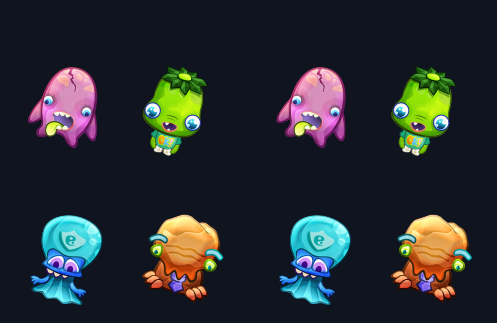
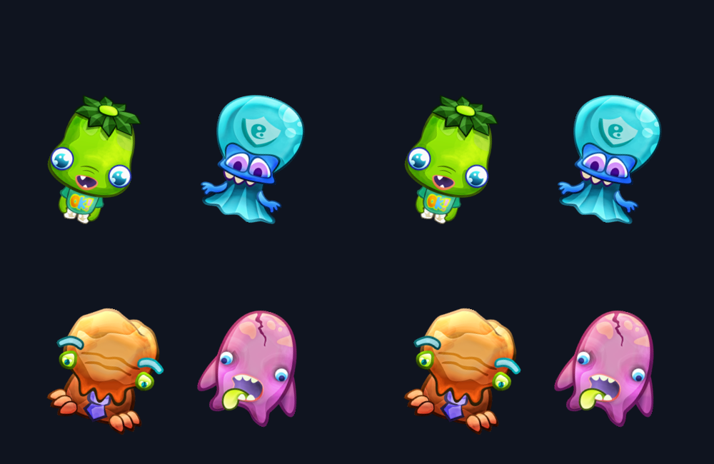

# Rotated atlas rendering validation

The screenshots were captured through the running engine MCP `eve_screenshot`
endpoint on GCC Debug / Vulkan Lavapipe. Xvfb supplied only the SDL display.
Left: ordinary atlas. Right: mixed clockwise-packed and ordinary frames.

The fixture uses real character artwork from the [PixiJS monsters atlas](https://raw.githubusercontent.com/pixijs/examples/gh-pages/examples/assets/spritesheet/monsters.json)
and its `monsters.png` sibling. The original has four non-square unrotated frames;
three were repacked clockwise by 90 degrees to form the mixed fixture. This is
controlled repacking of real atlas pixels, not a fresh TexturePacker CLI export.
Both rendered textures have one-pixel edge extrusion. The frame metadata adds
nonzero trim offsets `(13+i, 21-i)` and original canvas sizes `(w+40, h+50)`.
Both panels use anchor `(0.25, 0.75)` and sprite rotation 17 degrees.

The animation switches between two frames at 0.8 seconds per frame. The static
screenshot is also the first animation phase; the second phase is shown below.
157808 screen pixels changed between the captured animation phases. All three
captures were visually inspected for orientation, full silhouettes, trim alignment,
and pivot placement. Different character dimensions intentionally change the
silhouettes; this checks layout parity rather than artistic motion continuity.

[Pixel measurements](pixel-comparison.json) compare the two 500x650 panels:
static maximum channel difference 1/255; the second animation phase reaches
2/255 at one pixel. No performance benchmark was performed.

The engine was rebuilt with the minimal profile plus animation and model3d.
`test/animation_atlas_rotation.cpp` passed 59 assertions through Vulkan, including
asymmetric 3x2 pixels, mixed ordinary frames, repeated imports, original sizes,
trim offsets, anchor preservation and out-of-bounds rejection. The existing full
animation-domain executable failed to link unrelated editor/particles providers
in this profile. The new regression case (auto-discovered in the graphics domain)
was compiled using the generated object rule and linked alone using the generated
test link command; no full domain-suite pass is claimed.

`make check` passed, including 314 Python tests. Public function signatures,
ECS layouts, module dependencies and save formats were not changed. Import-time
normalization uses a padded grid and may consume more memory than offline packing.
JSON `pivot` is still ignored; explicitly assigned Sprite2D anchors are preserved.
