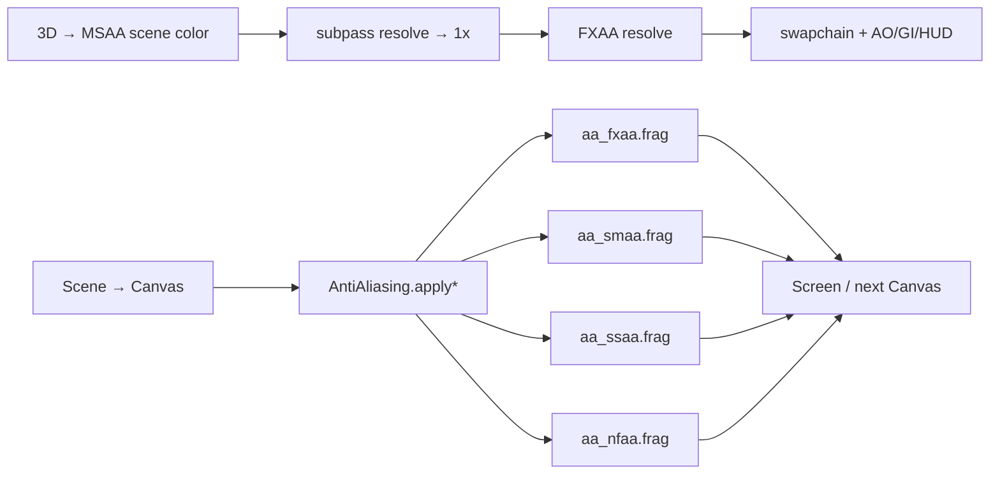

# 抗锯齿（Anti-Aliasing）设计

> 状态：图像空间 AA（FXAA / 单 Pass SMAA / SSAA / NFAA）、Vulkan 硬件 MSAA 与 TAA 原生路径已有实现；完整 SMAA LUT 与 TAA 质量验收仍有缺口（2026-11-11 源码核验）。
> API：`eve.Graphics().newAntiAliasing()` → `AntiAliasing`；`eve.Graphics().setMsaaSamples(n)` 控制硬件 MSAA。  
> 管线开关：`RenderControl` 特性 `"aa"`（默认开；3D 对 scene color 做 FXAA resolve）与 `"msaa"`（默认开；scene color pass 硬件多重采样）。

关联：[`模块设计.md`](./模块设计.md) §4 graphics、[`3D渲染管线.md`](./3D渲染管线.md)、现有 `Canvas` / `Shader` / `Volumetric` 后处理路径。

## 1. 目标

为 2D / 3D 离屏结果提供可切换的经典抗锯齿，并对 3D scene color pass 提供硬件 MSAA。

| 模式 | 技术 | 适用 |
|------|------|------|
| `fxaa` | FXAA 3.11 风格：亮度边搜索 + 亚像素混合 | 通用、低开销 |
| `smaa` | SMAA 启发的单 Pass 形态学 AA（适配单 `MainTex` 后处理） | 边缘质量优先 |
| `ssaa` | 超采样 Resolve（box / tent / Gaussian） | 先画到更大 Canvas 再下采样 |
| `nfaa` | Normal Filter AA：沿亮度梯度切向模糊 | 轻量滤波 |
| `taa` | 双 HDR history、jitter、深度重投影与物体运动修正 | 时间累积，需正确管理相机/物体历史 |
| `msaa` | Vulkan 硬件多重采样（2x / 4x / 8x）+ subpass resolve | 3D 模型 / 体素边缘最佳 |

完整多 Pass SMAA（edge+weight LUT）仍待实现。TAA 的历史缓冲、jitter、深度重投影和物体运动修正已接入 `AntiAliasing` / `RenderSystem3D`；镜头/尺寸变化的 history 失效逻辑存在，但仍需完整图像与跨后端验收。

## 2. 架构



上图表示默认 FXAA/MSAA 路径。TAA 使用独立的双 HDR history：RenderSystem3D 准备相机 jitter 与物体前帧信息，AntiAliasing 进行重投影/历史 resolve；分辨率变化或相机 cut 时丢弃 history，不能将普通单帧 `apply*` 等同于已正确提供完整时间输入。

- 3D scene pass 目标：MSAA color（Nx）+ resolve color（1x，采样给 FXAA）+ MSAA depth（Nx）。RenderPass 用 subpass resolve 自动把 Nx 结果写到 1x 采样纹理。
- 当 `"msaa"` 关闭或设备不支持时退回经典 2-attachment（1x color + 1x depth）scene pass。
- 所有画进 scene pass 的管线（内置 mesh3d / clustered / voxel、自定义 Mesh3D / hair shader）在采样数变化时按 `sceneColorRenderPass` 与对应 `rasterizationSamples` 重建。
- 与 `Volumetric` / `StylePass` 相同：`drawTexturedRectShader` + push constant uniforms + 嵌入 SPIR-V。

## 3. API

```squirrel
// 硬件 MSAA（3D scene color pass；0/1 关闭，2/4/8 按设备能力 clamp）
gfx.setMsaaSamples(4);
gfx.getMsaaSamples();           // 当前请求值（未 clamp）
rc.disable("msaa");             // RenderControl 特性开关，默认开

aa <- gfx.newAntiAliasing();
aa.setQuality("medium");   // low | medium | high
aa.setMode("fxaa");        // fxaa | smaa | ssaa | nfaa | taa

// 场景画到 sceneCanvas 后：
aa.applyCanvas(gfx, sceneCanvas);           // 写到当前绑定目标 / 屏幕
// 或
aa.applyCanvasTo(gfx, sceneCanvas, dest);

// SSAA：先按 suggestScale 建高分辨率 Canvas
aa.setMode("ssaa");
sw <- aa.resolutionFor(screenW);
sh <- aa.resolutionFor(screenH);
hi <- gfx.newCanvas(sw, sh);
// ... 渲染到 hi ...
aa.applyCanvasTo(gfx, hi, screenCanvas);
```

质量档会重置各模式默认参数（阈值、搜索步数、核半径、`ssaa.scale` 等）；仍可用 `setFloat` 覆盖当前模式参数。

## 4. 着色器与编译

| 文件 | 数组 |
|------|------|
| `aa_fxaa.frag` | `aa_fxaa_frag_spv.inc` |
| `aa_smaa.frag` | `aa_smaa_frag_spv.inc` |
| `aa_ssaa.frag` | `aa_ssaa_frag_spv.inc` |
| `aa_nfaa.frag` | `aa_nfaa_frag_spv.inc` |
| `aa_taa.frag` | `aa_taa_frag_spv.inc` |

```sh
python3 scripts/compile_graphics_aa_shaders.py   # 需要 PATH 上的 glslc
```

## 5. 后续

- [x] 3D 画到可采样 Color Target 后再自动套 FXAA（`RenderControl "aa"`）
- [x] Vulkan 硬件 MSAA（scene color pass sample count + subpass resolve，`RenderControl "msaa"` / `gfx.setMsaaSamples`）
- [ ] 多贴图 SMAA 1x（edge / blend weight + area/search LUT）
- [x] TAA 原生路径：双 HDR history、相机 jitter、深度重投影与物体运动修正；`AntiAliasing.cpp` 的 prepareTemporalJitter/resolveTemporal 与 `RenderSystem3D.cpp` 的相机/物体接线均已存在，`aa_taa_frag_spv.inc` 已入库。
- [ ] TAA 动态遮挡、镜头切换、分辨率/曝光变化与各后端的完整图像验收；本轮仅核验源码，不把历史缓冲存在等同于质量达标。

