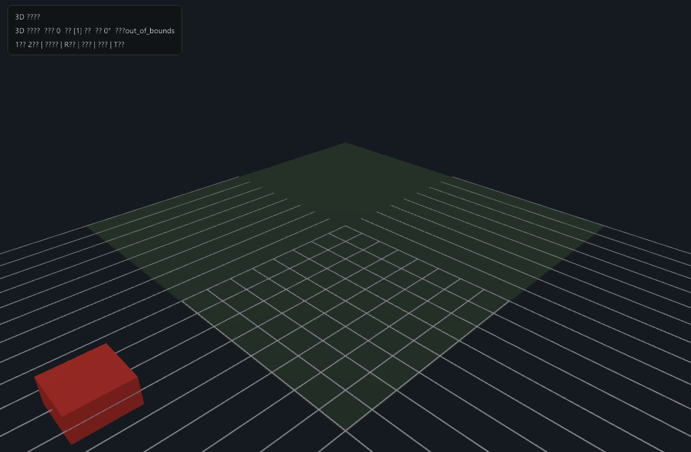
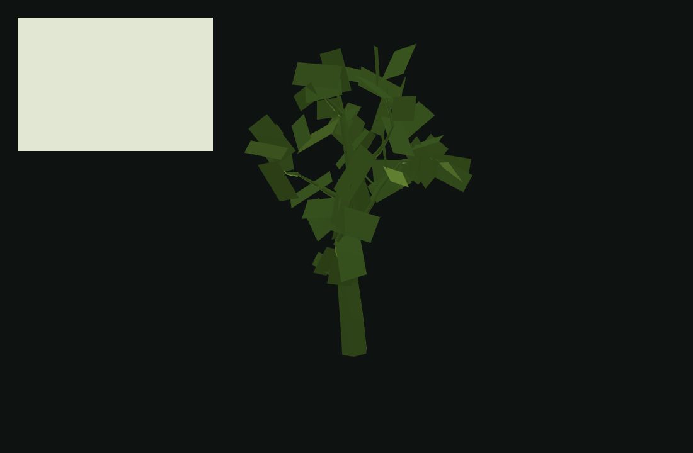
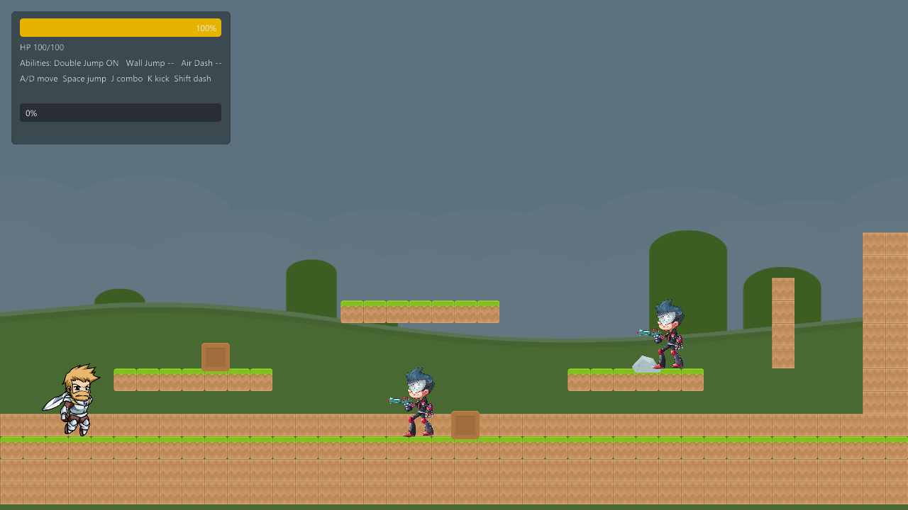
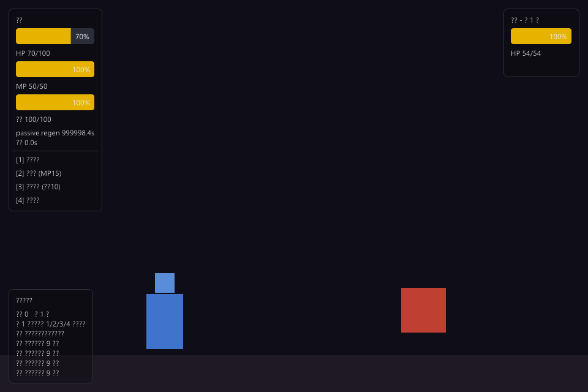

# Example Render Gallery

[中文](README.md) · [English example guide](../../../examples/README.en.md)

These existing screenshots were captured from EVEngine examples. The engine writes a presented swapchain frame through `gfx.saveFramePng()`, without an external screenshot tool or postprocessing. The source gallery records Windows captures on native GPU hardware. They illustrate the corresponding source examples, not a fresh test of every released SDK or platform.

## Reproduce a capture

From the repository root, using a compatible runtime:

```powershell
eve run examples/weather
./scripts/capture_example.ps1 -Example weather -Out docs/images/examples/weather.png -Frames 300
```

The capture script uses `scripts/capture_root.nut`, a wrapper reproducing the `load.nut` startup flow. Pass `-Eve` to select the executable. See the [example guide](../../../examples/README.en.md) for source/SDK version matching.

## Browse the examples

| Example | Frame | What it shows | Run |
| --- | --- | --- | --- |
| `basic` |  | 2D basics: tilemap, physics, particles and debug drawing | `eve run examples/basic` |
| `weather` |  | 3D weather: rain, snow, fog, storm atmosphere and orbit camera | `eve run examples/weather` |
| `waterfall-demo` |  | Flowing-water shader: waterfall, foam, turbulence and reflections | `eve run examples/waterfall-demo` |
| `building-3d` |  | 3D buildings and basic lighting | `eve run examples/building-3d` |
| `camera-controllers` |  | Orbit, follow and free-view camera controllers | `eve run examples/camera-controllers` |
| `sprite-stack` |  | 2.5D sprite stacks from procedural geometry slices | `eve run examples/sprite-stack` |
| `rock-generator` |  | Seeded procedural rocks, erosion/fracture and multiple LODs | `eve run examples/rock-generator` |
| `tree-generator` |  | Procedural trees, branch algorithms and foliage | `eve run examples/tree-generator` |
| `bush-generator` |  | Procedural bushes, leaf clusters/cards and branches | `eve run examples/bush-generator` |
| `roguelike-generator` |  | Seeded rooms and corridors, autotiling, decoration and objects | `eve run examples/roguelike-generator` |
| `hex-levels` |  | Hex-grid levels and tile rendering | `eve run examples/hex-levels` |
| `procgen` |  | Procedural mesh and texture recipes | `eve run examples/procgen` |
| `metroidvania` |  | 2D platform action, physics movement, combos, Spine and a boss fight | `eve run examples/metroidvania` |
| `rpg` |  | Dungeon survival: attributes, effects, status, skills and settlement | `eve run examples/rpg` |

More examples live in `examples/`. Editors, cards and dialogue examples depend on interaction that one frame cannot convey. The interactive voxel terrain/building example is covered by `scripts/smoke_examples.sh` in CI and is not pictured here.
