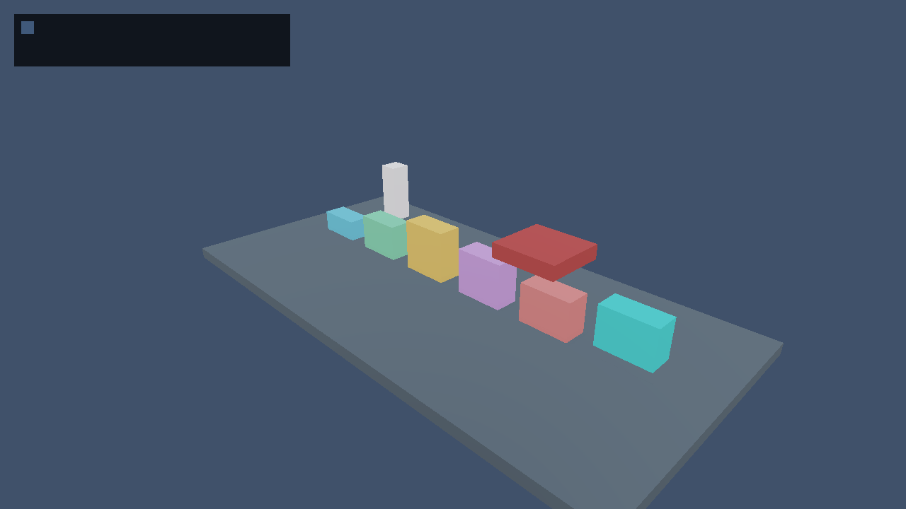
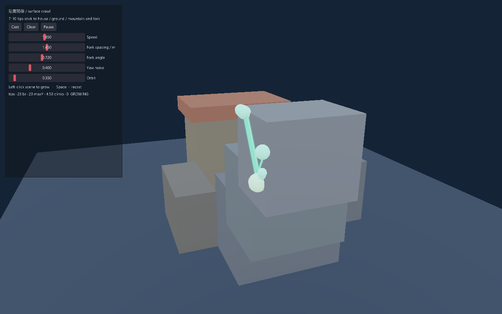
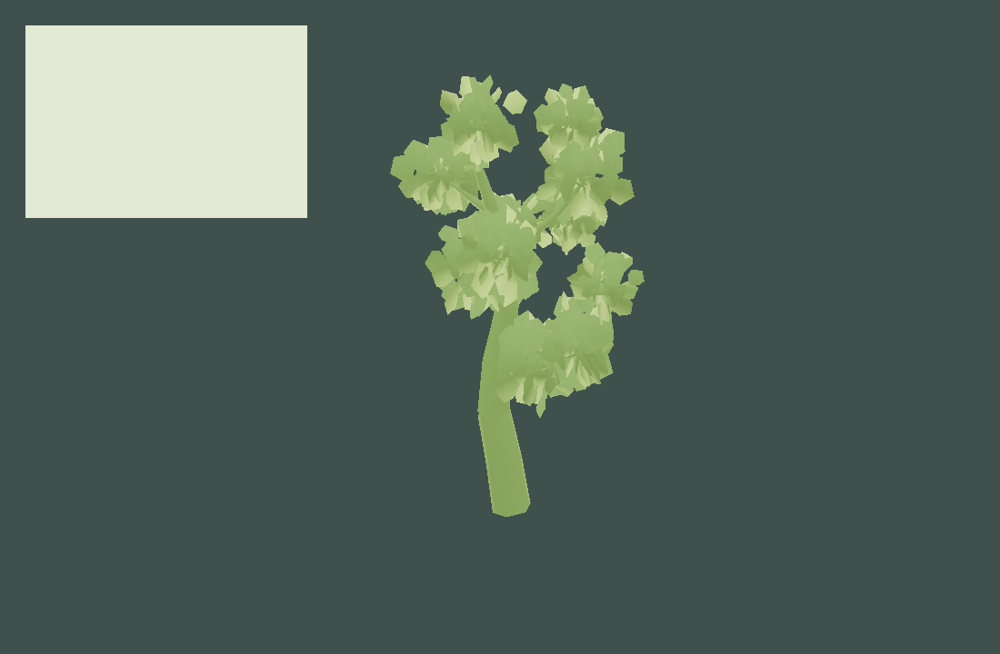
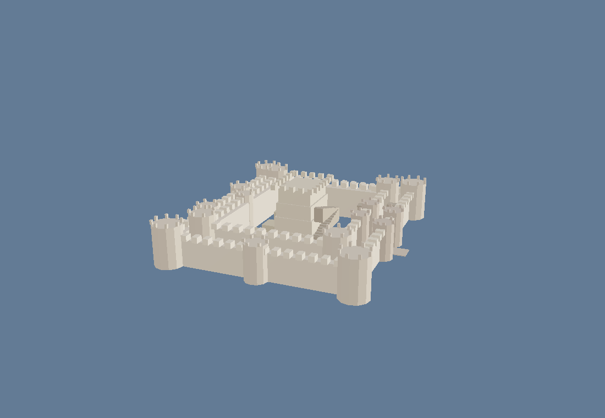
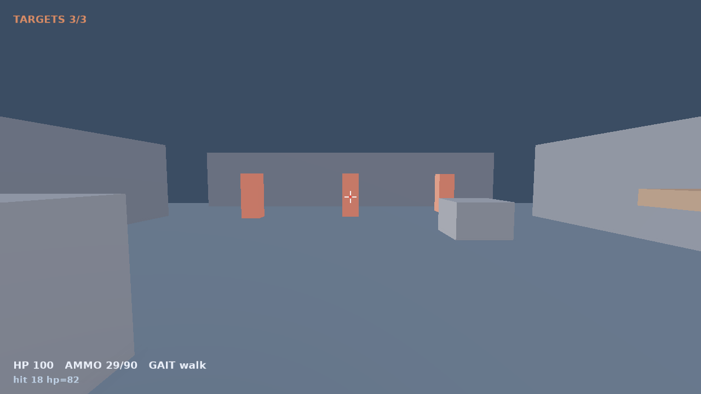
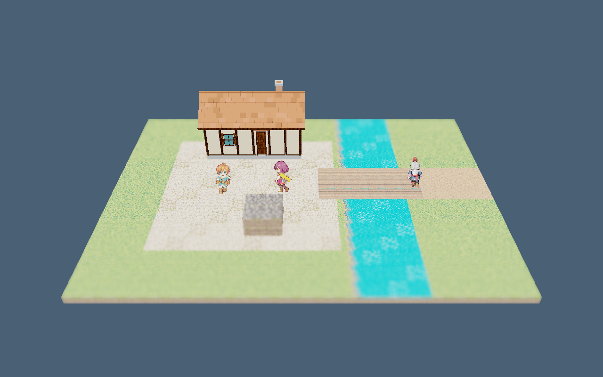
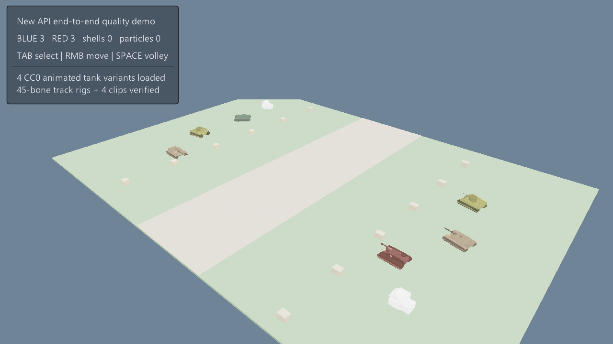
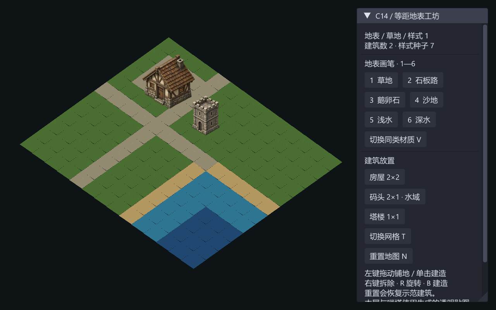
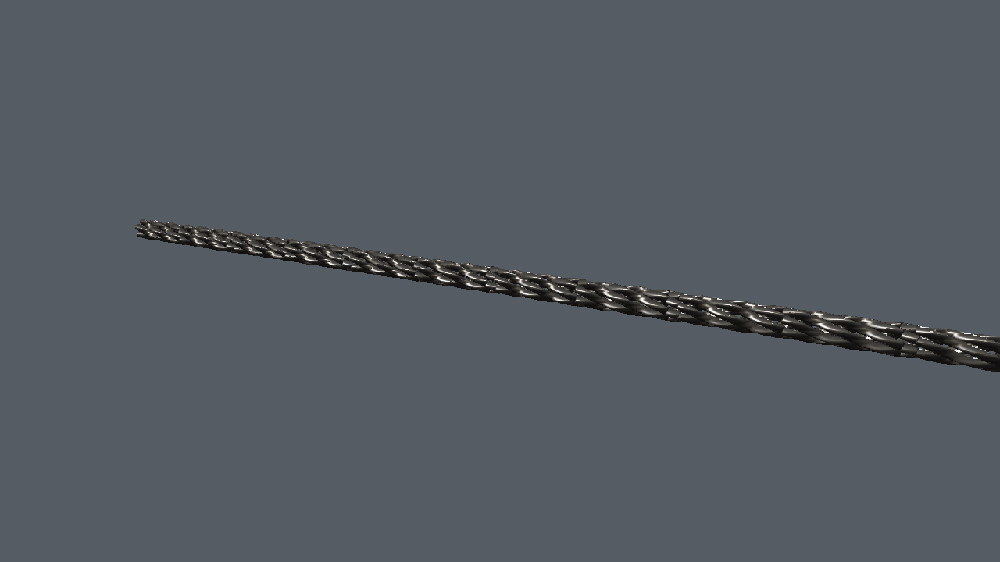
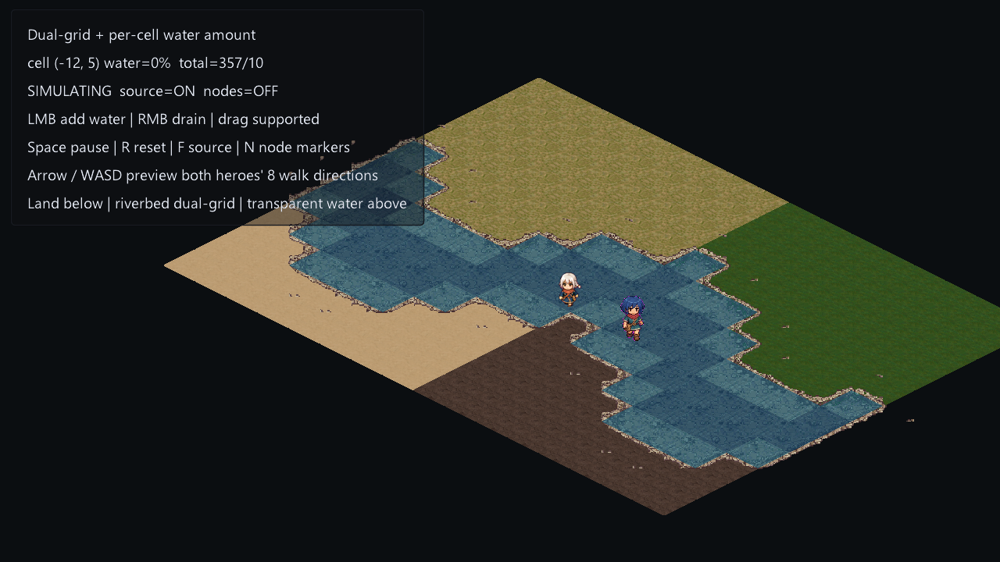

# 下一批十个待改善场景（2026-11-12）

使用当前工作区源码构建的引擎重新运行，10/10 获取有效帧并逐张检查；不是沿用旧失败或旧截图打分。以下按默认展示完成度与改善收益排序，排除上一批已经改善的十个示例。本轮只复查，不修改场景代码。

[截图、程序/DLL 指纹与启动脚本哈希](manifest.json)。主帧均为 120 帧，爬藤另补 480 帧；帧数不等于固定模拟时长。截图原样保留，没有后处理。

## 1. climbing-playground — 角色与演示目标不可读

默认只见彩色障碍块和细小标记；左上面板近乎空白，攀爬角色、动作和当前目标难辨。

改善方向：补可辨认角色、正常说明文字、选中障碍与接触点标识，分别展示起步/攀附/翻越状态。

## 2. surface-vine-growth — 效果仍像调试线

120 帧和 480 帧均以浅青线段与大端点球为主，附着对象是基础方块，缺少植物形态和场景质感。

改善方向：增加有粗细变化的茎干、分枝和叶片；调试球独立开关，补墙面材质及生长阶段对照。

[较晚生长阶段：480 帧](surface-vine-growth-late.png)

## 3. tree-generator — 树干树叶缺少材质区分

树干和树冠都偏浅黄绿，枝干层级与树冠体积弱；左上无说明的大色块抢走注意力。

改善方向：分离树皮和叶片色盘、改善叶簇分布与明暗，把纹理预览改成有标签且可关闭的面板。

## 4. castle-generator — 白模感强、环境缺失

城堡偏小且整体米白，城墙、塔楼和内堡难区分，缺少接地环境与门窗细节。

改善方向：补石材、屋顶和金属材质分区，完善门楼与城墙细节，加入地基、地形和接地阴影。

## 5. fps-arena — 关卡仍是基础几何占位

灰墙、灰地面和简单橙色靶柱构成主体，关卡地标、路径层次及武器轮廓不足。

改善方向：建立材质与灯光层次，补可辨认的掩体和地标、武器轮廓，并单独验证命中反馈。

## 6. hd2d-riverside — 河岸场景缺少环境组织

地图像孤立地板，直河渠和方形铺地割裂，植被稀少，房屋与人物缺少环境叙事。

改善方向：重做岸线过渡、桥头与路径连接，增加植被、小道具和远近景层次，控制水面亮度。

## 7. armored-command-3d — 地面与模型比例失衡

大块浅色地面占据画面，六辆坦克偏小，空白区域多；履带、炮塔和阵营识别不突出。

改善方向：调整交战构图，补地形、道路及掩体，增加战斗近景和总览切换，复核弹道与命中帧。

## 8. building-tilemap — 素材优于场景组合

房屋和塔楼本身已有细节，但地图只有两栋建筑和十字路，大片重复草地及方角水区显得未完成。

改善方向：用现有素材组成完整街区，补围栏、绿化、道路边缘和岸线，缩减初始控制面板对画面的占用。

## 9. cable-chain-rope — 取景裁切且缺少案例对照

默认钢缆横贯纯色背景并从右边出框，端点、支撑和尺度缺失；不能直观看到三种配方的差异。

改善方向：按包围盒适配相机，提供钢缆/铁链/麻绳三组对照及标注，加入端部固定件和局部近景。

## 10. dynamic-water-grid — 水陆场景仍像材质拼板

四块大面积地表围绕锯齿岸线拼接，缺少河岸环境；大块说明覆盖左上地图，水量变化不直观。

改善方向：重新组织岸线、地表过渡与装饰，收起帮助面板，用同机位低/中/高水量及节点开关对照。

本次没有完整测试交互、动画周期或性能。画面质量不足不等于相应功能失效；例如 FPS 的命中效果、坦克交战、攀爬动作仍需后续单独验证。
