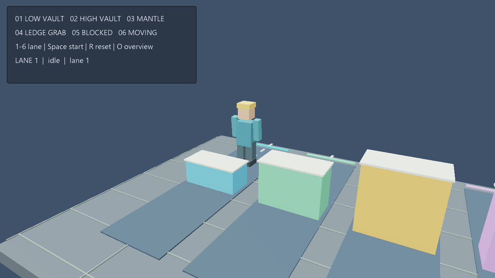
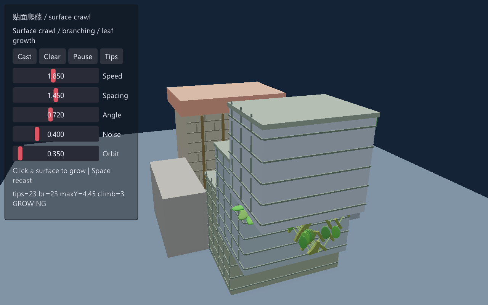
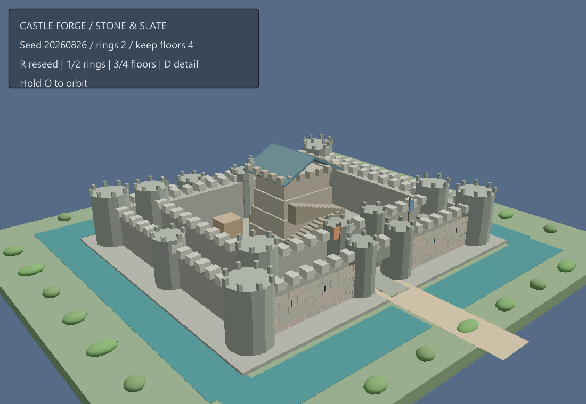
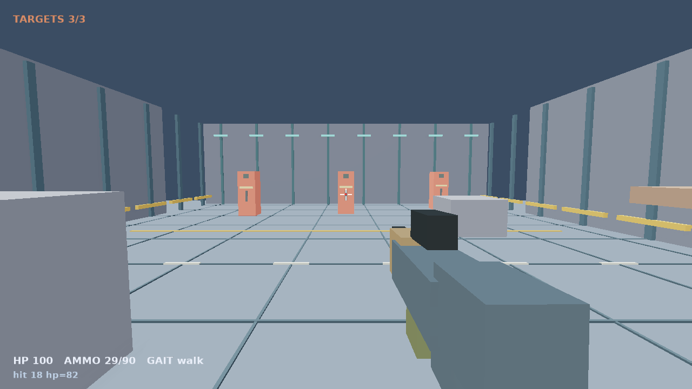
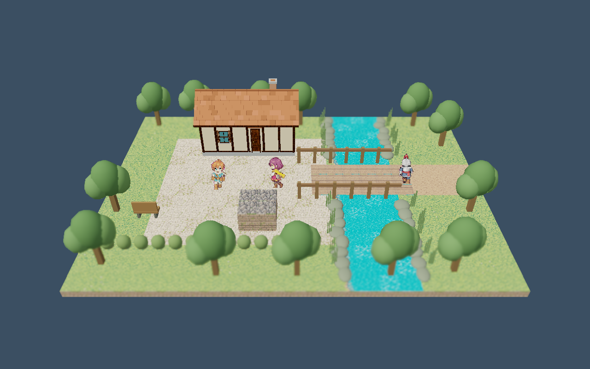
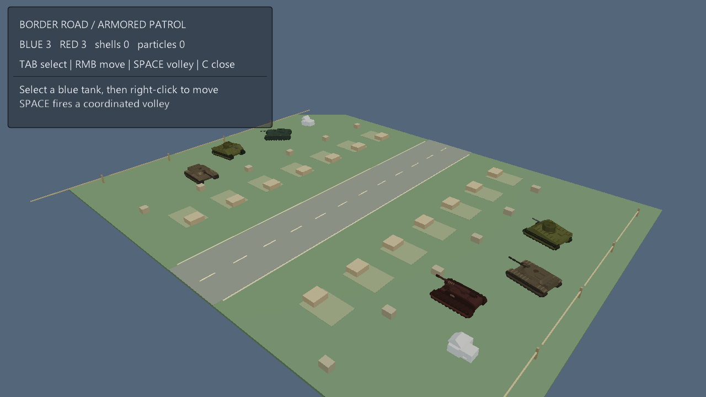
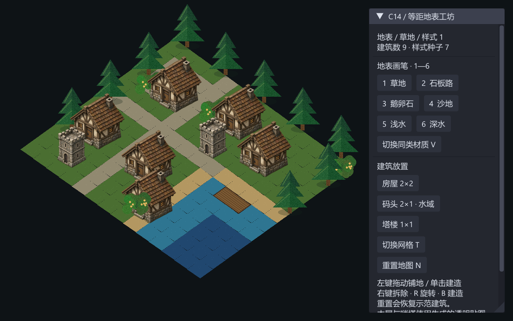
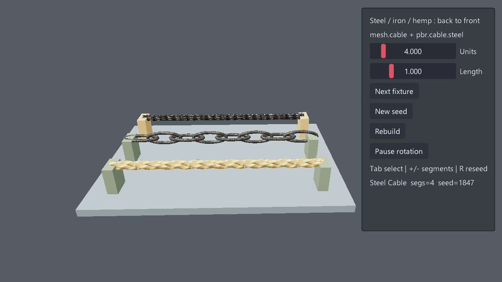
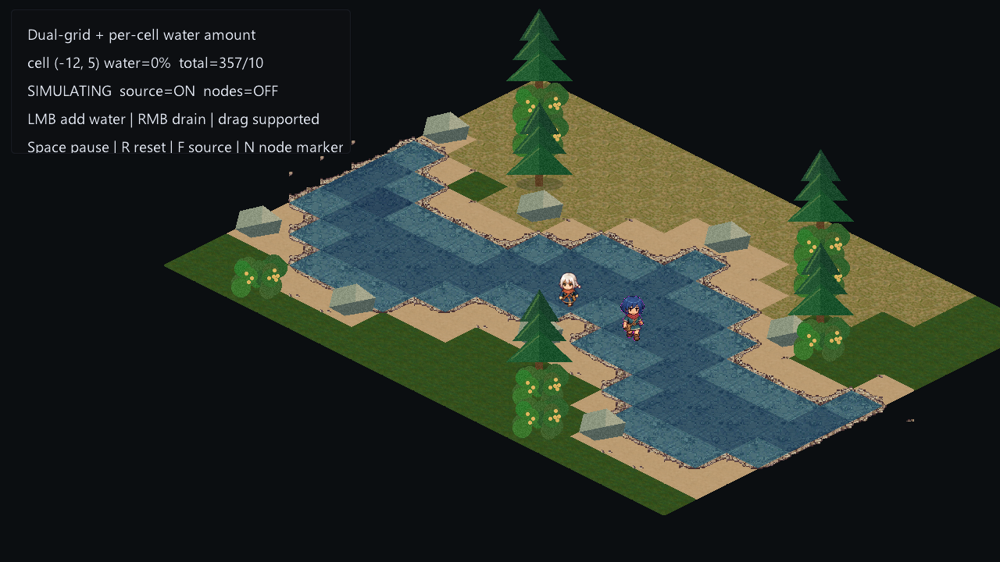

# 九个示例优化与实帧复查（2026-11-12）

按用户要求优化上一轮清单中除第 3 项以外的九个示例。`tree-generator` 未修改。当前源码重新构建 `eve` 后运行，九个默认场景与十二个状态帧均成功取得原始引擎 PNG，并另验证攀爬/移动平台完整结束。

[截图、启动预设、程序/DLL 指纹、资源哈希](manifest.json)。本轮属于示例层画面改善，未改动引擎公共 API、ECS 模型、模块边界或持久化格式，没有架构例外。前后图展示各自默认构图，部分镜头刻意调整；不作为同机位渲染算法指标。

## 1. climbing-playground

增加随权威 feet/phase 移动的分件角色、训练道标识、可读 HUD 和近景/总览切换；修正复位点超出探测范围、旧错误字段和移动平台升高后低位射线落空的场景配置。原模块净空、胶囊和拒绝检查保留。

[优化前](baseline/climbing-playground.png) · [当前实帧](climbing-playground.png)

状态复查：[climb-mantle](climb-mantle.png) · [climb-blocked](climb-blocked.png) · [climb-moving](climb-moving.png) · [climb-overview](climb-overview.png)

[翻越与移动平台完成后的状态](climb-completed.png)。参数预设调用正常动作入口，并经过原固定步进与 World3D；受阻轨道仍拒绝执行。

## 2. surface-vine-growth

根据原有贴面生长轨迹生成有粗细变化的茎干与叶片，显示缓存上限 900；端点与发光线可用 Tips 独立查看。补砌体/木构细节、可读控制面板，并从真实墙面射线命中开始默认生长。

[优化前](baseline/surface-vine-growth.png) · [当前实帧](surface-vine-growth.png)

状态复查：[vine-late](vine-late.png)

## 3. castle-generator

补石基、连续水道、入口桥面、石材砌块/箭窗、屋顶和旗帜；区分墙体、塔楼、内堡与石板屋面色盘，改善取景及参数反馈。保留种子、圈数、楼层、细节调整。

[优化前](baseline/castle-generator.png) · [当前实帧](castle-generator.png)

状态复查：[castle-tall](castle-tall.png)

## 4. fps-arena

补地面分缝、墙肋、导向标线、靶面识别和分件武器轮廓；武器跟随真实相机、ADS 和射击状态，靶面装饰随 CombatRuntime 存活状态显示。保留命中、弹药、步态与碰撞路径。

[优化前](baseline/fps-arena.png) · [当前实帧](fps-arena.png)

状态复查：[fps-ads](fps-ads.png)

## 5. hd2d-riverside

补河岸石块与芦苇、桥栏、树木、长椅和广场边缘装饰，调低曝光/景深/泛光；树木与长椅的同一 authored 位置也供行走阻挡使用，保留原角色移动、房屋生成和旋转观察。

[优化前](baseline/hd2d-riverside.png) · [当前实帧](hd2d-riverside.png)

## 6. armored-command-3d

提高坦克模型辨识度，收窄道路并补路标、边界、掩体和地面分区，校准曝光；C 可切换跟随选中坦克的近景，保留原 ECS 运动、骨骼、弹道与战斗。

[优化前](baseline/armored-command-3d.png) · [当前实帧](armored-command-3d.png)

状态复查：[armor-close](armor-close.png)

## 7. building-tilemap

默认由 2 栋扩为 9 个原生 PlacementWorld 建筑（含码头），补自制等距树丛装饰；装饰依据权威占用和地表隐藏，保留绘地、建造、拆除、旋转和重置。

[优化前](baseline/building-tilemap.png) · [当前实帧](building-tilemap.png)

状态复查：[building-reset](building-reset.png)

## 8. cable-chain-rope

钢缆/铁链/麻绳并排展示，补端部支撑与底座，按长度适配镜头；选中项高亮，修正面板位置、文本裁切和键盘改参数后的滑杆同步，保留种子、参数、切换和旋转。

[优化前](baseline/cable-chain-rope.png) · [当前实帧](cable-chain-rope.png)

状态复查：[fixtures-long](fixtures-long.png)

## 9. dynamic-water-grid

将四象限材质拼板改为沿实际河床的沙岸/草地分布，补自制等距岸石与树丛，收紧帮助面板。保留原权威水量数组、流动、增减水和双网格拓扑。

[优化前](baseline/dynamic-water-grid.png) · [当前实帧](dynamic-water-grid.png)

状态复查：[water-low](water-low.png) · [water-high](water-high.png)

## 验证范围

标准两秒 smoke 9/9 通过。状态预设覆盖攀爬起步、受阻拒绝、移动平台、总览、城堡楼层/圈数、晚期爬藤、ADS、坦克齐射与近景、建筑重置、长线缆、高低水量与节点。翻越与移动平台另跑至 completed。部分状态使用原 action 函数的启动预设，不冒充完整物理键鼠回放。

自制花园图集可分别运行两个示例的 `generate_garden.py` 重建；未使用外部新增素材。没有性能提升或跨平台最终验收声明。本报告记录本轮独立改动；提交与 CI 状态以对应 PR 为准。
