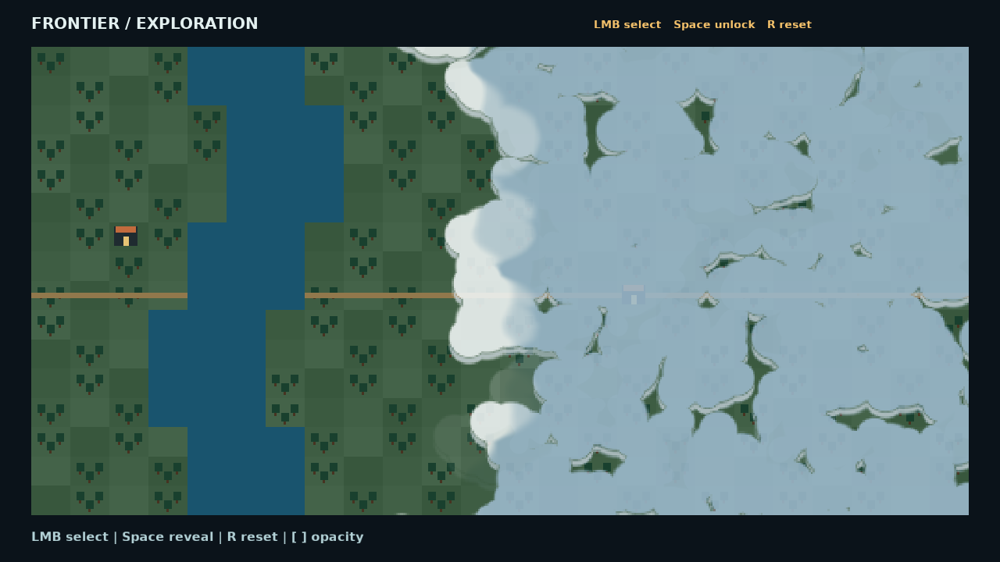
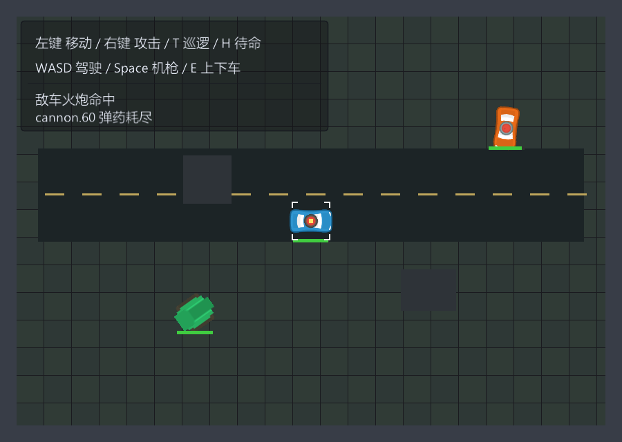
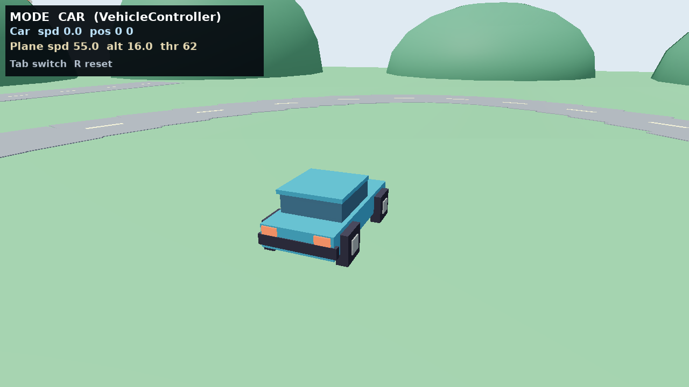
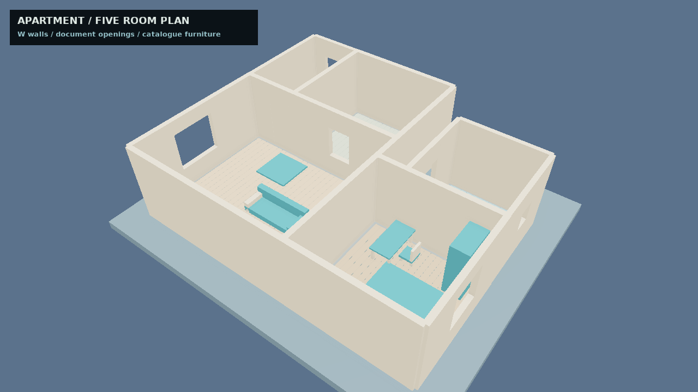
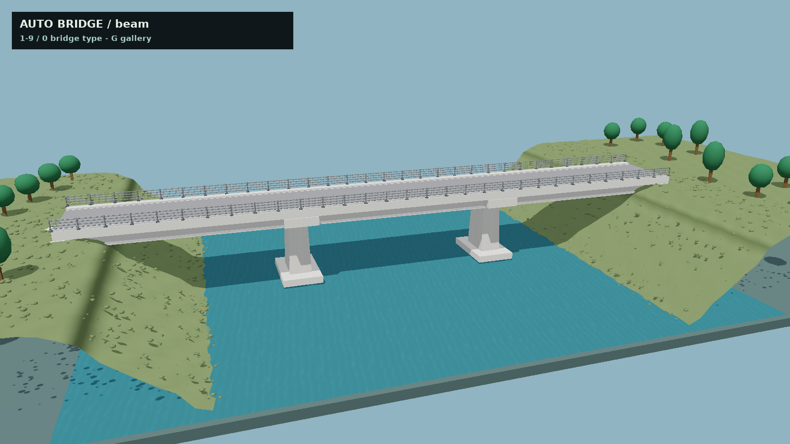
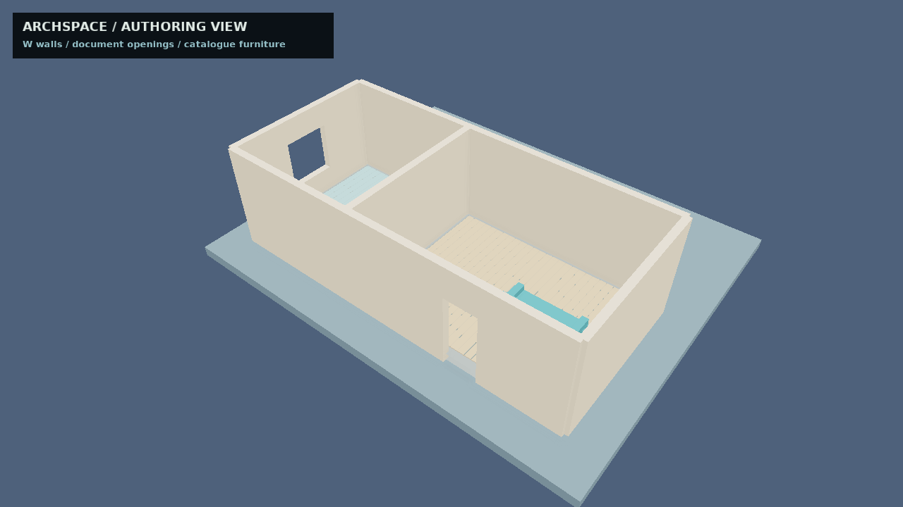
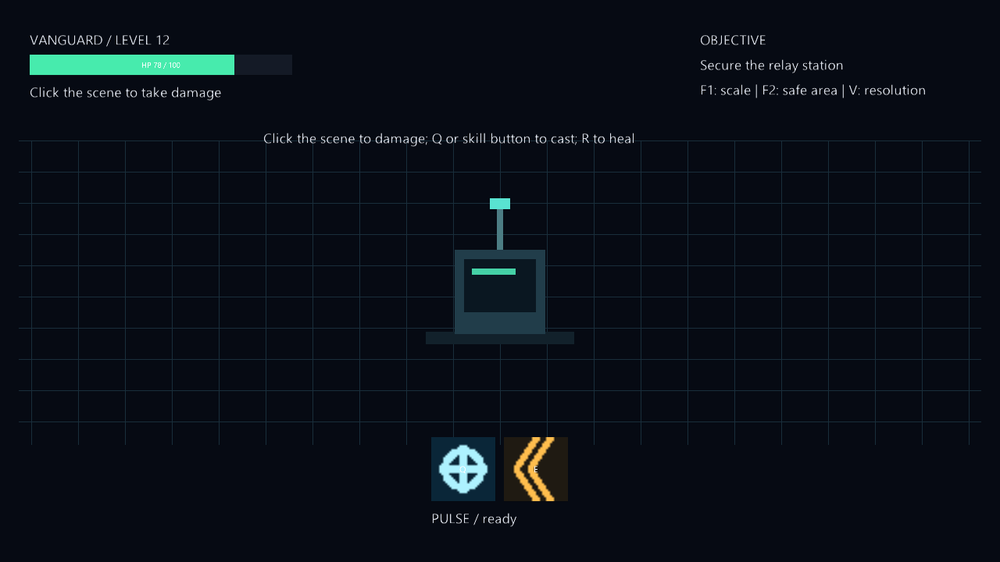
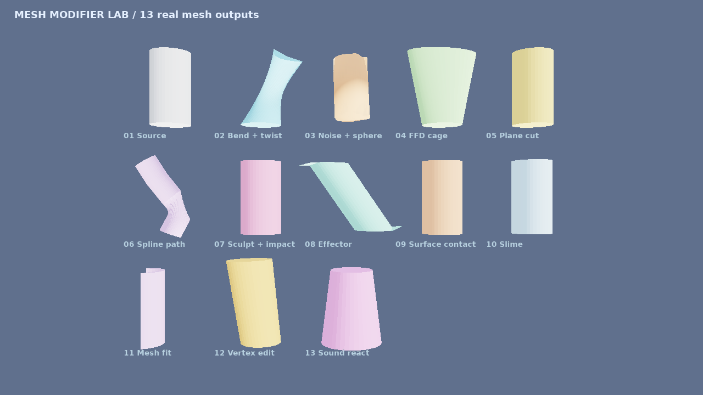
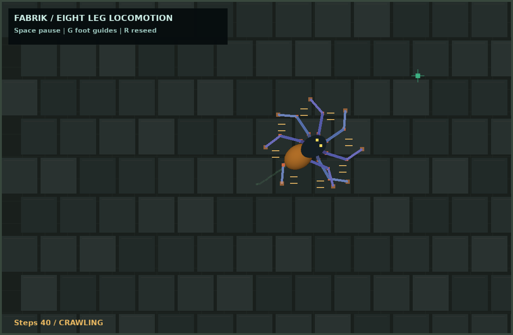

# 九个示例优化与实帧复查（2026-11-13）

本轮处理新清单中除 `cardgame` 外的九个示例；`cardgame` 按用户要求留给用户处理，`tree-generator` 继续暂缓。当前工作树源码重新构建引擎，九个默认场景及十一张状态图均由引擎 `gfx.saveFramePng` 原样保存。

[截图、预设、源码输入与 EXE/DLL 指纹](manifest.json)。前后图用于构图和内容比较，镜头有刻意调整；基线在本轮重建引擎前抓取，各自运行指纹均保留，不作为同二进制的渲染性能或算法对照。

## 1. map-fog

补充确定性策略地图：河流、林地、道路和聚落；迷雾仍由原 MapFog 与 RGBA 掩码驱动。增加选中边框、揭示状态和操作说明。

[优化前](baseline/map-fog.png) · [当前实帧](map-fog.png)

状态复查：[fog-selected](fog-selected.png) · [fog-revealing](fog-revealing.png) · [fog-revealed](fog-revealed.png)。

## 2. vehicle

收紧帮助面板并删除重复说明，事件日志限制为两条；训练场道路与铺地沿用原世界坐标，碰撞、载具、武器和 RTS 命令路径保留。

[优化前](baseline/vehicle.png) · [当前实帧](vehicle.png)

状态复查：[vehicle-patrol](vehicle-patrol.png)。

## 3. flight-vehicle-controllers

**后续修正：** 上一版方轮已替换为圆形轮胎与轮毂，补车速联动轮辐；[最新默认、近景与行驶实帧](../round-wheels/README.md)。本页下面的图片保留为该轮历史。

修复每帧同步覆盖部件偏移的问题，按车体/飞机姿态变换局部部件；补齐车轮、玻璃、灯组、机翼、尾翼与座舱，改善追踪镜头、连续道路和 HUD 对比度。

[优化前](baseline/flight-vehicle-controllers.png) · [当前实帧](flight-vehicle-controllers.png)

状态复查：[flight-plane](flight-plane.png)。

## 4. archspace-floorplan

保留 ArchSpace 文档烘焙、开口和目录家具；按完整几何块分材质，展开三角面法线以明确硬边，增加分区地板、板缝、展示底座和 W 墙体显隐。

[优化前](baseline/archspace-floorplan.png) · [当前实帧](archspace-floorplan.png)

状态复查：[floorplan-interior](floorplan-interior.png)。

## 5. automatic-bridge

保留十种真实桥型生成与语义材质分组；改善河水、岸坡材质、岸边树木和景观底座，调整镜头并标注当前桥型。

[优化前](baseline/automatic-bridge.png) · [当前实帧](automatic-bridge.png)

状态复查：[bridge-arch](bridge-arch.png) · [bridge-cable](bridge-cable.png)。

## 6. archspace-editor

保留文档创建、门窗开口和目录家具验证；固定可读视角，补地板、家具配色和底座，修正面法线；W 可隐藏整块墙体以检查室内。

[优化前](baseline/archspace-editor.png) · [当前实帧](archspace-editor.png)

状态复查：[editor-interior](editor-interior.png)。

## 7. hud-gallery

将 HUD 参考画布调整为 1280×720，放大资源与目标文本；增加脉冲/冲刺图标和训练中继站，保留血量尾条、冷却、输入穿透及分辨率切换。

[优化前](baseline/hud-gallery.png) · [当前实帧](hud-gallery.png)

状态复查：[hud-hit-cooldown](hud-hit-cooldown.png)。

## 8. mesh-modifier-lab

将十三个真实变形结果由细小横排改成三排展台，逐项标注名称，并保留原图编译、碰撞替换、雕刻、曲线路径和顶点编辑检查。

[优化前](baseline/mesh-modifier-lab.png) · [当前实帧](mesh-modifier-lab.png)

## 9. ik-spider

保留八足 FABRIK 与交替四足步态；增大骨段、添加随朝向旋转的身体分节、关节与落足标记、铺地和控制说明。地面装饰不参与碰撞，仍是平面步态示例。

[优化前](baseline/ik-spider.png) · [当前实帧](ik-spider.png)

状态复查：[spider-stride](spider-stride.png)。

## 验证与边界

当前源码 `eve` 构建通过；九个默认场景和十一张状态图全部成功，九个示例原生烟测通过。状态预设使用普通示例命令或文档化视图切换，没有使用 `eve_eval`；不将这些预设声称为物理键鼠端到端验证。

源码门禁：默认 `make check` 的 `origin/dev` 已前进到本分支之后，比较包含本轮未修改的旧 C++ 行，架构检查失败；以本批修改前 HEAD 为基线的同一完整门禁 `make check CI_BASE=HEAD` 已通过。两份日志均保留在本地 `build/p1-recheck/`，没有修改或跳过规则。

本轮不改变公共 API、ECS 模型、模块边界或持久化格式；没有架构例外。蜘蛛地面是装饰，未宣称新增避障或高度 IK；ArchSpace 继续展示现有目录家具，没有替换成离线模型。
