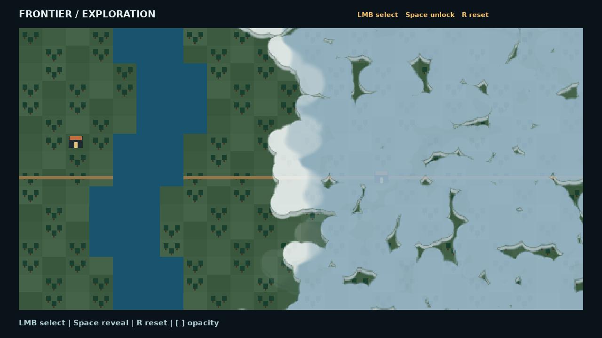
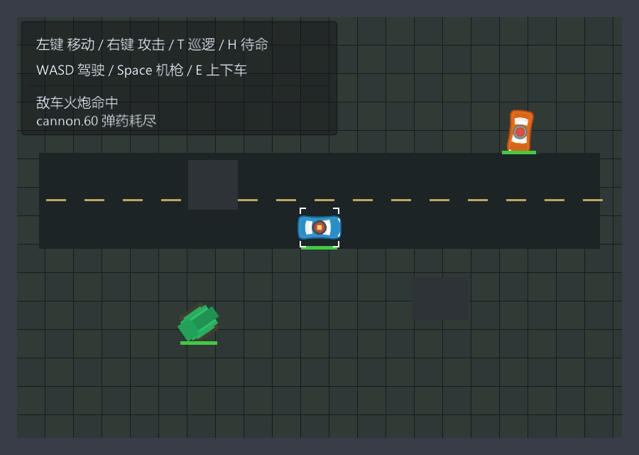
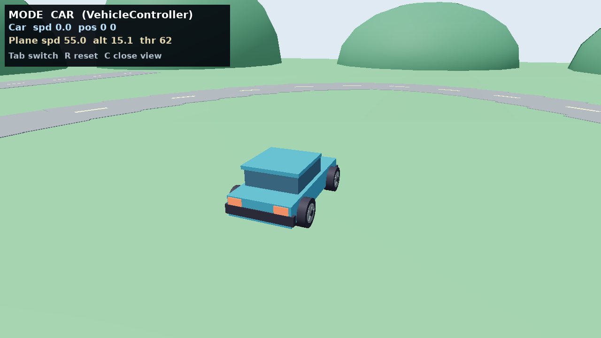
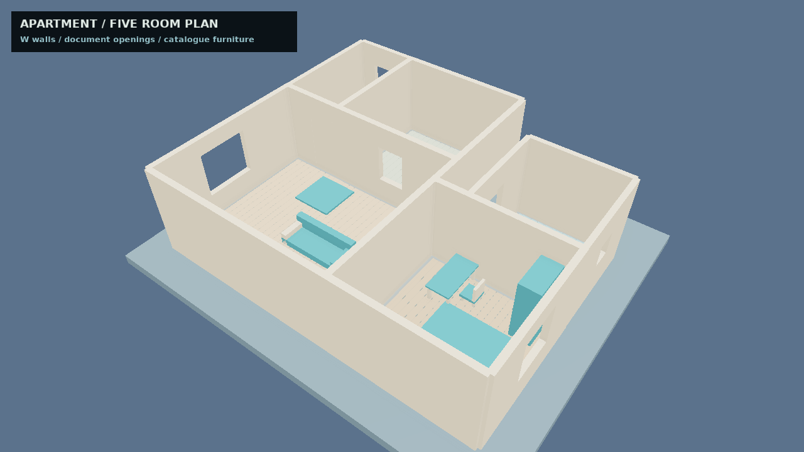
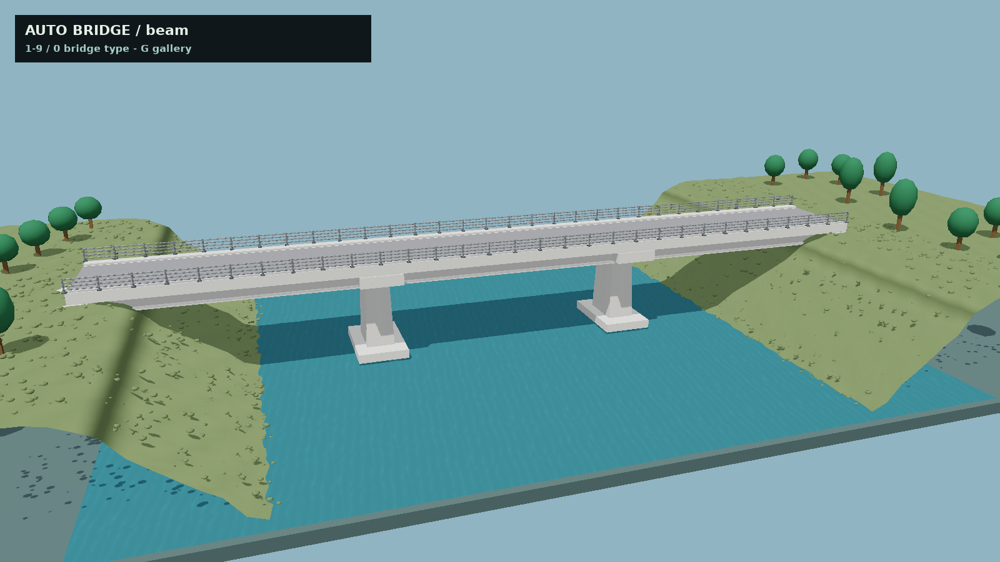
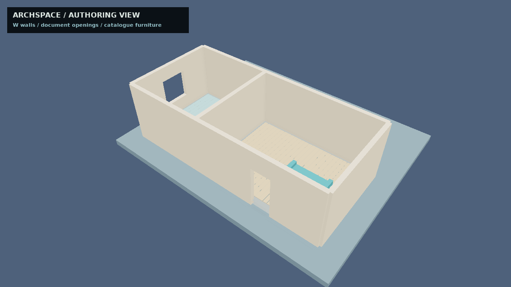
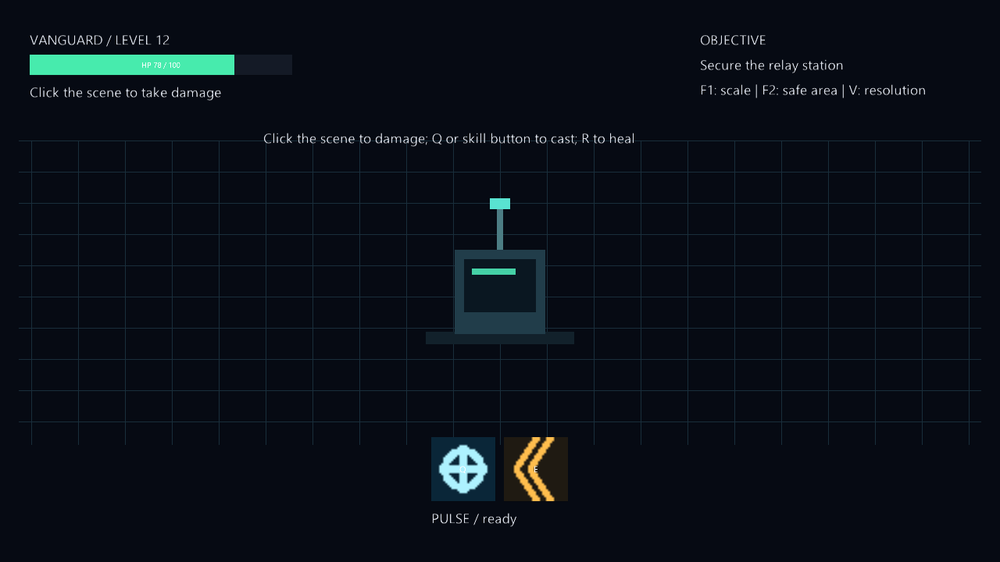
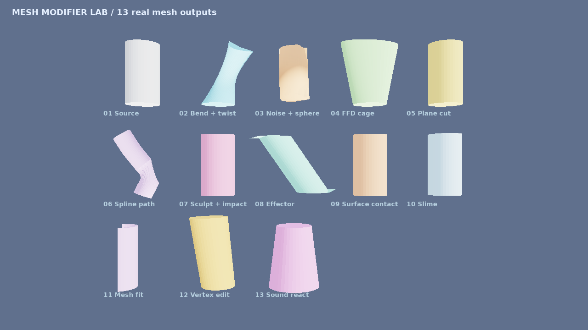
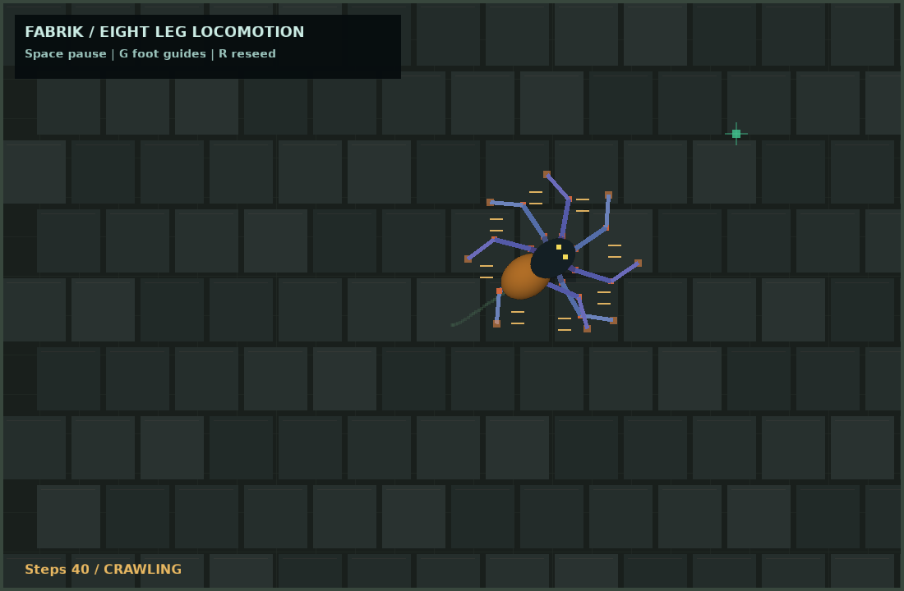

# PR 当前 dev 合入后的实帧复查

本批九个示例优化与圆形车轮修正合入最新 dev 后，重新构建当前源码引擎并重跑。九个默认场景、十三张关键状态帧全部成功，逐张复查；旧图片保留于 [九项优化记录](../nine-improved/README.md) 和 [圆形车轮修正](../round-wheels/README.md)。`cardgame` 未修改。

[源码输入、EXE/DLL、截图及预设指纹](manifest.json)。全部 PNG 为引擎自有 `gfx.saveFramePng` 原始输出，无后期处理。

构建、默认基线 `origin/dev` 的完整 `make check`、九项原生烟测通过。完整本地测试日志留在 `build/p1-recheck/remaining-pr-*`，未提交。旧记录中 `origin/dev` 前进造成的比较失败属于合入 dev 前的历史，本轮已按默认基线重新通过。

## 1. map-fog

[优化前](../nine-improved/baseline/map-fog.png) · [当前实帧](map-fog.png)

状态帧：[fog-selected](fog-selected.png) · [fog-revealing](fog-revealing.png) · [fog-revealed](fog-revealed.png)。

## 2. vehicle

[优化前](../nine-improved/baseline/vehicle.png) · [当前实帧](vehicle.png)

状态帧：[vehicle-patrol](vehicle-patrol.png)。

## 3. flight-vehicle-controllers

[优化前](../nine-improved/baseline/flight-vehicle-controllers.png) · [当前实帧](flight-vehicle-controllers.png)

状态帧：[flight-plane](flight-plane.png) · [wheel-close](wheel-close.png) · [wheel-driving](wheel-driving.png)。

## 4. archspace-floorplan

[优化前](../nine-improved/baseline/archspace-floorplan.png) · [当前实帧](archspace-floorplan.png)

状态帧：[floorplan-interior](floorplan-interior.png)。

## 5. automatic-bridge

[优化前](../nine-improved/baseline/automatic-bridge.png) · [当前实帧](automatic-bridge.png)

状态帧：[bridge-arch](bridge-arch.png) · [bridge-cable](bridge-cable.png)。

## 6. archspace-editor

[优化前](../nine-improved/baseline/archspace-editor.png) · [当前实帧](archspace-editor.png)

状态帧：[editor-interior](editor-interior.png)。

## 7. hud-gallery

[优化前](../nine-improved/baseline/hud-gallery.png) · [当前实帧](hud-gallery.png)

状态帧：[hud-hit-cooldown](hud-hit-cooldown.png)。

## 8. mesh-modifier-lab

[优化前](../nine-improved/baseline/mesh-modifier-lab.png) · [当前实帧](mesh-modifier-lab.png)

## 9. ik-spider

[优化前](../nine-improved/baseline/ik-spider.png) · [当前实帧](ik-spider.png)

状态帧：[spider-stride](spider-stride.png)。

## 验证边界

预设选择普通示例命令或视图；轮胎行驶预设通过 VehicleController.setDrive 传入油门，保留原固定步进、物理和权威姿态，没有直接改位置。没有使用 eve_eval，不声称预设等于物理键鼠验证。

本批只修改示例与截图文档，无引擎公共 API、ECS、模块边界和持久化格式变更，无架构例外。
