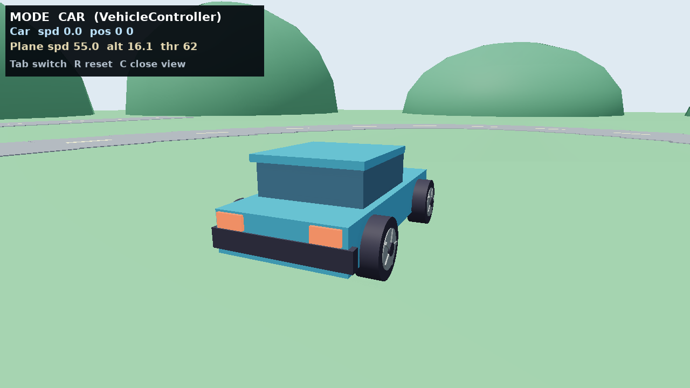

# flight-vehicle-controllers 圆形车轮复查

修正上一版仍使用方块轮胎的问题。四个轮胎改为 40 段圆柱体，包含圆形轮毂、中心盖和五辐条；轮辐以控制器的实际车速 / 轮胎半径积累转角。新增 C 近景切换。载具碰撞和固定步进动力学保持由原 VehicleController 与 Box2D 驱动。

[上一版方轮](before.png) · [当前默认帧](default.png) · [圆轮近景](close.png) · [行驶状态](driving.png) · [运行与源码指纹](manifest.json)

当前源码重新构建 eve，默认、近景与行驶三张实帧均成功。行驶预设通过 VehicleController.setDrive 提交油门，经过原固定步进与物理路径，实帧 HUD 显示非零车速与位置变化；不声称物理键鼠输入验证。引擎自有截图原样保存，无后期处理。原生烟测通过。

本轮无引擎公共 API、ECS、模块边界或持久化格式变化，无架构例外。源码质量完整门禁沿用本批之前已通过的记录；本次补充当前源码构建、目标示例烟测、布局和图片指纹检查。
