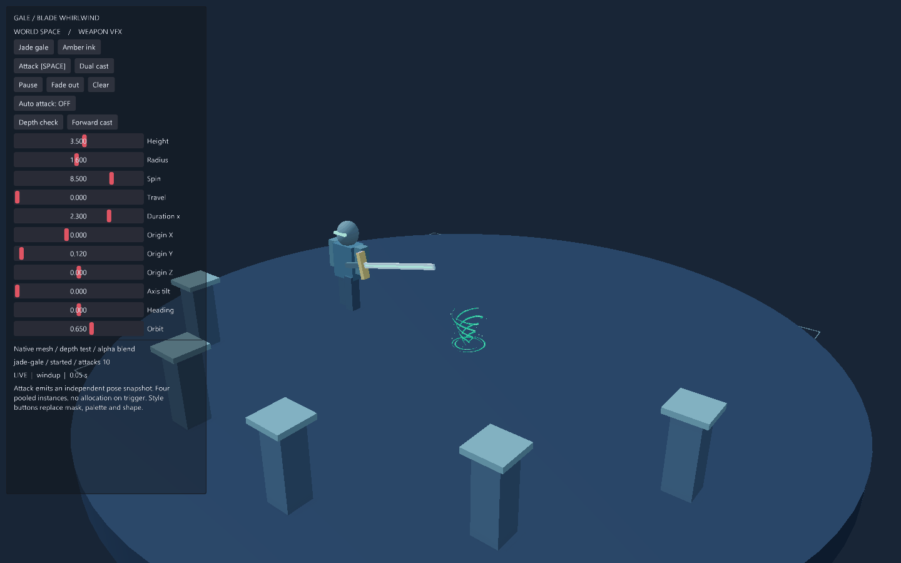

# GALE / 风格化剑刃旋风

世界空间武器表现示例。原生三维螺旋带、地面刀弧和碎片共用场景相机与深度测试，
Shader 使用可替换 RGBA 遮罩和双色调色板。`fx/` 是独立可复制的 EveScript 特效包；
原来的 `tornado-lab` 保留为体积龙卷风实验。

## 运行和操作

```sh
make run/win32-debug GAME=examples/blade-whirlwind
# Linux / macOS: use linux-debug / macosx-debug
```

也可用已有 SDK：`eve run examples/blade-whirlwind`。已包含 SPIR-V，运行无需 shader 编译器。
当前自定义 SPIR-V 材质需要 Vulkan；WebGPU 不受支持，不会静默换用其他效果。

- SPACE / Attack：挥剑并触发旋风。默认自动展示，可取消 Auto attack。
- Dual cast：同时触发两个独立实例，验证多发效果没有共享年龄或位置。
- Jade gale / Amber ink：替换轮廓曲线、笔触贴图、配色、旋转和生命周期默认值。
- Forward cast：演示倾斜轴线和向前运动；用 Axis tilt、Heading 继续调整。
- Depth check：切换前景实体遮挡柱，直接检查风刃是否被真实场景遮挡。
- Pause、Fade out、Clear：冻结模拟、柔和取消、立即结束。
- Height / Radius / Spin / Travel 实时修改选中样式的实例。
- Origin X/Y/Z、Axis tilt、Heading、Duration x 在下次攻击时复制到实例；修改不会让已发出的旋风跟随剑或跳到新发射点。
- Orbit 改变原生三维相机。所有几何和效果随相机一起正确投影。

## 在其他游戏复用

将整个 `fx/` 文件夹复制到游戏目录。模块通过 `loadfile(...)()` 返回接口，不向 root 注入帮助函数。
引擎的 `dofile` 不返回脚本值，因此这里使用 `loadfile`。

```squirrel
local whirlwind = loadfile("fx/whirlwind.nut")();
local definitions = loadfile("fx/styles.nut")();
// 在 eve_init 或资源准备阶段调用一次：会采样曲线、上传网格并准备材质。
local prepared = whirlwind.prepare(gfx, procgen, definitions[0], 4);
local effect = prepared.instance(0);

// 由游戏的攻击释放通知调用。attackId 在该实例内严格递增。
local status = effect.trigger(42,
    {x=2.0, y=0.1, z=1.0, dx=1.0, dy=0.25, dz=0.0}, 1.0);
if (status != "started") print("Whirlwind trigger: " + status + "\n");

// 每帧只调用一次；dt 来自 eve_update，不读取系统时钟。
prepared.advance(dt);
// 正常的 gfx.render3D() 会渲染效果，不需要额外全屏合成或 render() 调用。
```

示例中的普通输入、按钮和自动攻击调用同一个 `triggerAttack` → `Instance.trigger` 路径。
在正式武器系统中，从动作释放通知传入攻击 ID 和剑/发射器的当前 pose 即可。
包只负责表现，不发伤害、不定义命中窗口、不保存角色或武器指针；这些仍由现有 combat/action/weapon 系统拥有。

### 接口契约

- `prepare(gfx, procgen, definition, capacity)`：昂贵准备阶段，容量 1–8。返回 pool；不在攻击热路径调用。
- `pool.instance(index)`：借用 pool 中的固定实例。越界或已关闭时抛出编程错误。
- `instance.trigger(attackId, pose, durationScale)`：返回有限状态标签 `started`、`busy`、`duplicate`、`closed`。忙碌时不抢占，不消费新攻击 ID；重复或过期 ID 不重播。非法输入抛出错误，已有状态不改变。
- `instance.setPose(pose)`：复制世界空间 pose。调用方可在每帧提供武器挂点来做跟随；不保留原表引用。
- `instance.setControls(height,radius,spin,travel)`：廉价、整组验证后发布的控制。Travel 是沿局部 +Y 轴的世界单位/效果秒；修改速度不会回算已走距离或瞬移。
- `instance.cancel()`：进入消散，停止继续前进；起势期间取消保持当前透明度，不先闪亮。
- `instance.stop()`：立即隐藏，保留池分配以复用。
- `pool.advance(dt)` / `instance.advance(dt)`：二者选一种，不能同时更新同一实例。支持 0 冻结；负数、NaN、无穷或超过 3600 秒的输入被拒绝。跨越阶段的大 dt 会正确积分整个 active 区间。
- `getState()`：`idle → windup → active → fading → finished`，取消可直接转入 fading。`getAge()` 是受 durationScale 缩放的效果时间，结束时钳到终止点。`getPosition()` 返回独立世界位置快照。
- `close()`：终态且幂等；关闭后不能重播。先隐藏实体，再把 native 材质观察者替换为模块持有的惰性材质，允许原实例材质随后被 VM 回收。

所有方法都在游戏/渲染线程调用，不可跨线程使用。不调用外部回调，无锁和重入入口。
方向会归一化，零向量被拒绝，局部 +Y 对齐方向；roll 围绕轴的旋转由 Spin 管理。
运动和生命周期的唯一 owner 是实例，Renderables 是它的派生表现。

### 资源、曲线与生命周期

编辑 `fx/styles.nut` 即可更换参数及资源路径，新增定义后在示例准备阶段选择/准备该定义。
definition 使用 `schema="eve.example.whirlwind"`、`version=1`；未知字段、未知版本、缺失字段拒绝导入。
不自动迁移其他版本。输入会深复制，验证完成后才准备可见实体，不会部分发布一个新效果。

- `radiusCurve`：四个均匀高度控制点，由原生 Procgen Catmull-Rom 工具生成旋风轮廓。
- `scaleCurve`：四个均匀生命期控制点，同样经过原生曲线采样。准备时各缓存 65 点，播放阶段只做有界线性插值；负向过冲钳到 0，最大值 2。
- `blades`、`turns`、`ribbonWidth`、`segments`：生成风刃数量、螺旋圈数、厚度和网格精度；属于准备阶段设置。
- `mask`：RGBA 图像路径，读取 **alpha**，RGB 不参与配色。U 方向循环滚动；V 表示刀弧横截面。可直接换成自己的风纹、笔触、符文或切割遮罩。
- `color` / `edge`：0–1 RGB；Shader 明确适配当前 renderer 的显示曲线。替换 shader 时可自行管理风格与映射。
- `shader`：可替换片元 SPIR-V。使用引擎默认 mesh 顶点阶段和 binding=1 的遮罩；push constants 按 `time, scroll, color RGB, edge RGB` 的 8 个 float 排列。
- `seed`：只影响名为 debris 的确定性碎片分布，不使用或扰动游戏全局随机流。
- 持续时间为 `(windup + sustain + fade) × durationScale`；durationScale 为 0.1–5。它同时缩放动画和位移时间。

修改 Shader 后：

```sh
glslc fx/shaders/blade.frag -o fx/shaders/blade.frag.spv
```

每个实例使用独立材质与 Shader 参数，共享只读网格和遮罩。两套定义各准备两个实例，触发不创建实体、材质、贴图或网格。
原生 ECS 拥有 Renderable3D，Graphics 拥有上传的网格、Shader 和纹理；本包拥有 Squirrel 材质与实例状态。
原生 Renderable3D 当前没有脚本销毁接口：close 隐藏并解除活动材质观察，不声称立即释放原生实体或 GPU 缓存。
整个导出的 whirlwind 模块须保留到场景结束，以持有闭合实体使用的惰性材质。
关闭所有 pool 后再销毁/重置场景与 provider；场景 reset 后旧实例无效，重新 loadfile / prepare，不复用旧 wrapper。
示例 `eve_before_restart` 已关闭 pool，随后新 VM/场景重建资源。效果不序列化，不保留跨热重载 Link。

本例明确选用 Forward+ 透明几何路径。
透明材质开启深度测试、关闭深度写入，遮挡来自真实不透明场景；交叉透明风刃仍受通常的逐物体 alpha 排序限制，不宣称 OIT。
CPU 生命期与运动按注入 dt 确定，分帧比较容差 1e-4；跨 GPU Shader 结果允许浮点误差，不承诺位级一致。

## 验证

初始化执行真实原生实例的契约检查，成功输出 `WHIRLWIND_CONTRACTS_PASS`：
覆盖重复触发、忙碌、时间冻结、pose 复制、实例隔离、非法方向与负 dt 原子拒绝、取消、到期、分帧一致、改速不瞬移、复用、schema 和关闭。
`BLADE_WHIRLWIND_READY` 表示资源准备成功；不能仅凭该标记判断视觉正确，需检查实际引擎截图。

```sh
MIN_RUN_SECONDS=2 bash scripts/smoke_examples.sh blade-whirlwind
python3 scripts/check_examples.py
make check
```

要复现截图、双发、暂停、参数和遮挡检查，以 `--debug --mcp-port=7547` 启动本示例，再运行：

```sh
python3 examples/blade-whirlwind/tools/verify_runtime.py
```

验证工具只通过诊断接口设置 UI 参数模型，通过正常按钮事件触发攻击；不通过 eval 实现玩法。
输出在仓库 `output/blade-whirlwind/`，含引擎 PNG、连续动画 GIF 和 `validation.json`。需要 Pillow。
`tools/generate_masks.py` 可以重建两张例子自带的遮罩，不需要在运行时执行。

本次只增加游戏侧表现包和 example，没有新增引擎模块、ECS System、持久化格式、跨模块接口或隐式依赖；无需新 module-interface 目录项。
规则适用部分是唯一状态 owner、注入时间/确定性、操作状态、资源成本和生命周期；无架构规则例外。

## 引擎实录


