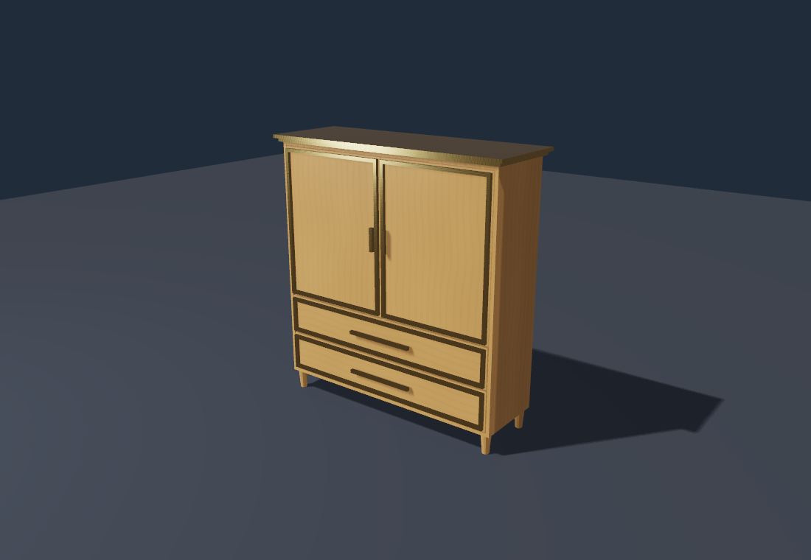
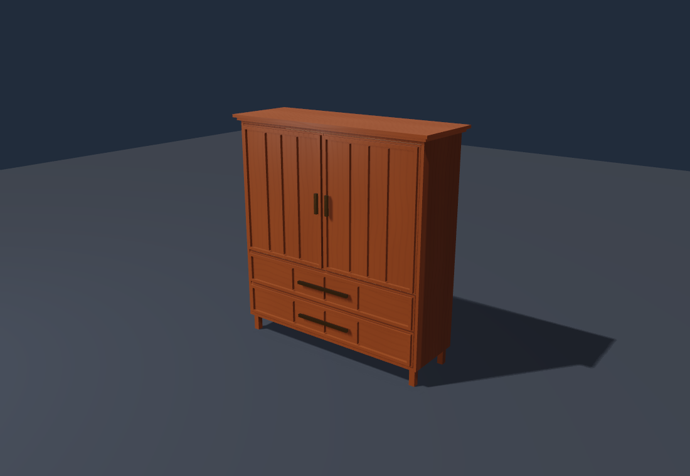
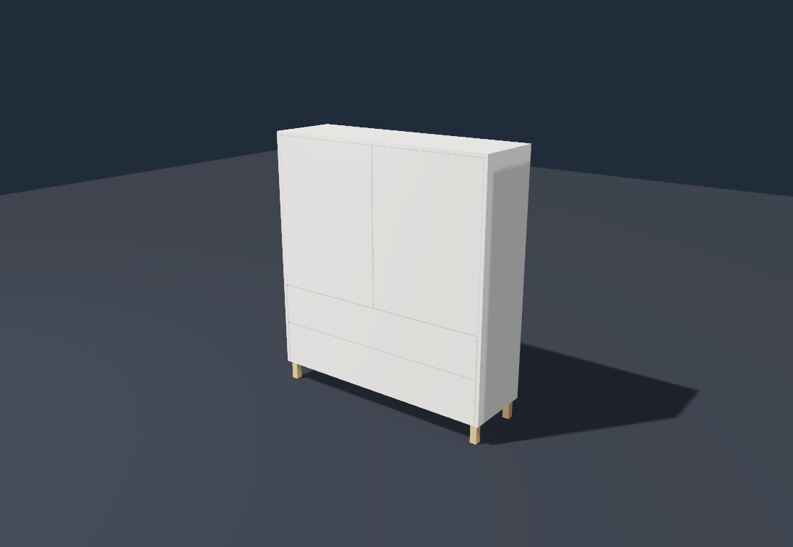
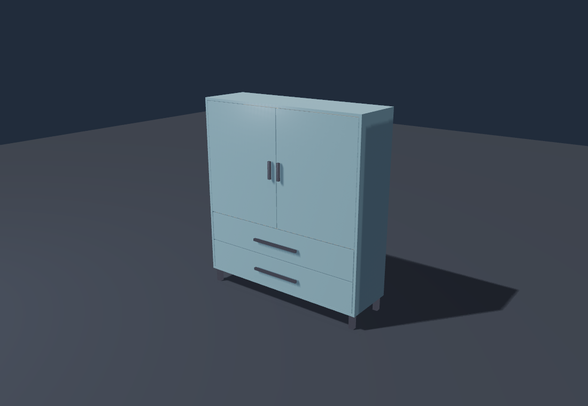

# 实际渲染参考（2026-11-13）

四张 PNG 均由 Vulkan/Lavapipe 运行时的 `gfx.saveFramePng` 保存已呈现帧，未作图像修改。
Xvfb 只提供 SDL 显示，没有截取其 framebuffer。

图像来自本功能开发时的基础提交 `0182af046d0e0d63d7478e5a444c0f87047136bf`：
使用该提交的缓存运行时，原生加载当前柜子生成器代码，运行同一示例及项目贴图。
它们是实际生成器/材质路径的参考，不是当前 PR 基于最新 dev 的完整重编译或跨平台证明。
同一机位展示门板、抽屉、柜脚、环境反射与实际投影；不宣称写实家具材质质量。

| 欧式 | 中式 |
|---|---|
|  |  |

| 简约 | 现代 |
|---|---|
|  |  |
