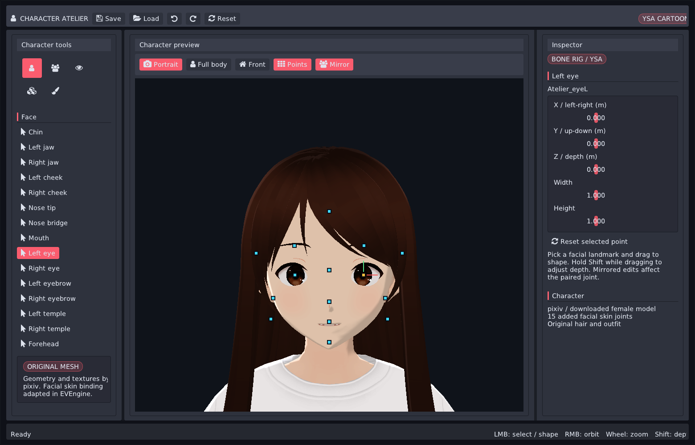

# Character Atelier / 骨骼捏脸编辑器

在 EVEngine 中编辑网上下载的 pixiv 女性角色：editor 控件、YSA 卡通材质、脸部关键点、
骨骼脸型与身体比例、六种常见姿势。人物网格、头发、服装和贴图来自原作者，未重新生成人物。

```sh
make run/linux-debug GAME=examples/character-atelier
# Windows:
make run/win32-debug GAME=examples/character-atelier
```

裁剪构建需要 `avatar`、`animation`、`model3d`、`stylize`、`ui`、`font` 及其依赖。
本次实际验证为 Linux Vulkan；其他后端未做运行验收。



## 操作

- 左侧工具箱选择 Face / Body / Expression / Pose / Surface。
- Face：点选面部标记或左侧关节。左键拖拽调整左右/上下，按 Shift 拖拽调整深度。
  右侧 Inspector 提供 XYZ 位移、宽度、长度。Mirror 开启时左右对应关节同步。
- Body：拖拽身体标记或操作 Inspector，调整身高、肩宽、腰围、胯宽、腿长、臂长、头部大小。
  衣服、身体、头发和表情共用同一骨架。双脚按最低脚踝位置贴地，全身相机随比例变化重新取景。
- Pose：放松站立、重心偏移、叉腰、挥手、思考、T-pose。
  Play 开启呼吸/挥手程序化动作；Pause 固定当前造型。它们是骨骼姿态预设，不是下载的动作捕捉片段。
- Surface：调整真实 `Stylize("ysa")` 网格材质的明暗分界、过渡和轮廓光。
- RMB 环绕，滚轮缩放；Portrait / Full body 切换相机；Points 显隐关键点。
- 工具栏图标提供 Save / Load / Undo / Redo / Reset。一次关键点 Down..Up 拖拽提交一条历史，
  Escape 取消。拖动期间的临时预览不进入存档。

UI 使用引擎的 AppFrame、DockArea、PanelFrame、SplitPane、Toolbar、Toolbox、Card、
SectionHeader、Badge、StatusBar 和 Font Awesome 图标。视口大小用于实时投影，不采用固定坐标热点。

## 模型与骨骼

原始模型、作者和授权见 [模型说明](assets/pixiv/README.md)。原始 `female.vrm` 保持下载时的字节不变。
`female-rig.glb` 是可重复生成的绑定适配版本。修改遵守原文件的 VRM Public License 1.0 设置。

```sh
python3 examples/character-atelier/prepare_rig.py  # 离线需要 NumPy；运行示例不需要 Python
```

适配器新增 15 个真正参与四权重 GPU 蒙皮的面部关节：下巴、左右下颌、左右面颊、鼻尖、鼻梁、
嘴部、左右眼睛、左右眉毛、左右太阳穴、额头。它不改变源 POSITION / NORMAL / UV / morph / 贴图数据。
局部衰减权重影响皮肤，眼球/眼白/眼线、眉毛、口腔采用对应关节以保持区域联动。
权重有限、非负、归一化，每顶点最多四个影响；生成时检查全部关节都有权重，并检查默认蒙皮重建误差。
`rig.json` 记录权重覆盖、控制点、原始文件 SHA-256 与误差。

原模型包含 VRMC 约束辅助关节。该示例将相关肩、袖子、手臂和腿部蒙皮影响重新绑定到对应 FK 人体关节，
保持默认几何不变，避免旋转手臂时衣袖仍停留在 T-pose。它没有宣称实现通用 VRMC_node_constraint 求解器。
衣服保留原始贴图、颜色因子、单双面与透明模式；逐材质验证贴图尺寸，避免静默使用空白纹理。
肩部 aim 与袖子及次级袖骨均跟随上臂；使用中性主光保持白衣原色。

运行时使用现有 `AnimSkeleton` / `AnimPose` / `AnimSkin` / `Model3D.createRenderable`：
每帧从绑定姿态计算身体比例、姿势和脸部关节，统一求 world matrix，再更新 GPU 骨骼调色板。
原作面部 morph 在骨骼蒙皮之前应用。没有另造一套角色模型、骨骼求解器或 YSA 替代渲染器。

## 状态和生命周期

`eve.AvatarAppearance()` 是外观数据的唯一权威：参数、姿势槽位、校验、快照和最多 64 步撤销。
`profile.nut` 定义 `pixiv-female-bones-v2`；不兼容的旧 `pixiv-female-v1` 存档会被拒绝。
原生快照 schema 仍为 `eve.appearance.state` v1；未知/越界参数和不匹配 profile 失败时保持旧状态。

控制点手势只保存瞬态预览和起始快照，释放后原子提交，取消后丢弃；Save 在当前帧输入处理完后保存提交状态。
相机、选中点、镜像开关、播放时间和 UI 布局是编辑器瞬态，不伪装成角色外观。
模型、骨架、姿态、skin、材质和 shader 由同一个脚本资源 owner 保活；Renderable3D 为 world-owned。
模块退出按引擎正常资源顺序释放，不跨线程更新；没有新增 ECS 系统、Link、公共 C++ API 或模块依赖边。
时间来自 `eve_update(dt)`，动作不调用随机源。暂停时相同外观和姿势的画面可重复；GPU 浮点按容差比较。

底层 Appearance 仍可用于其他有美术脸型 morph、装备槽位和适配服装的资产：

```squirrel
local module = eve.Avatar();
local appearance = eve.AvatarAppearance();
local r = appearance.configure(atelierDefinition());
if (!r.ok) throw r.status.summary;
r = appearance.apply({parameters={face_chin_y=-0.004}, selections={pose="wave"}});
if (!r.ok) throw r.status.summary;
```

## 验证

`verify.py` 启动实际引擎，通过 X11 XTest 发送真实鼠标事件，经 MCP 点击语义控件、检查状态并获取引擎自有截图。
它验证真实关键点拖拽、镜像、单次撤销、默认脸型恢复、脸部/身体蒙皮画面变化、六种姿势、动作播放、
存档恢复和非法输入原子拒绝。图片差分只作为变形证据，最终画面还需人工查看。

```sh
xvfb-run -a -s '-screen 0 1560x1000x24' python3 examples/character-atelier/verify.py \
    --engine build/linux-debug/src/engine/eve
```

证据写入忽略的 `verification/`；选定预览存入 `previews/`。Xvfb 只提供显示，不用于截图。
`test/avatar_appearance.cpp` 覆盖驱动、冲突、存档、历史和 morph 投影；源码门禁为 `make check`。

本次通过：16 张主流程截图、真实面部镜像拖拽与身体胯宽控制点拖拽、单次撤销（面部恢复像素差为 0）、
6 个姿势、挥手播放、服装 13 项原始材质贴图尺寸检查、存档恢复与非法输入原子拒绝。
另通过 12 秒示例 smoke、Python 静态检查、`make check`（313 项脚本测试）。
证据摘要见 `previews/verification.json`、`previews/material-audit.json` 和 `previews/body-input.json`。

## 工程参考与质量边界

参考 [Epic Mutable](https://www.unrealengine.com/news/the-mutable-sample-project-is-now-available)、
[MetaHuman Creator](https://dev.epicgames.com/documentation/metahuman/metahuman-creator-in-unreal-engine)
与 [参数化服装](https://dev.epicgames.com/documentation/metahuman/creating-parametric-clothing-for-metahuman)
的参数/资产分工，代码在 EVEngine 中实现。

这是基于现成人物的骨骼编辑参考。局部权重经过程序化衰减适配，仍需美术精修与组合纠正；
极端表情、极端比例与姿势的全部组合没有完成生产验收。没有新增布料模拟、任意服装自动适配、
头发碰撞、Groom 或换装资产。六个姿势不是完整走跑动作库；没有自动 LOD 或扫描级写实质量声明。
