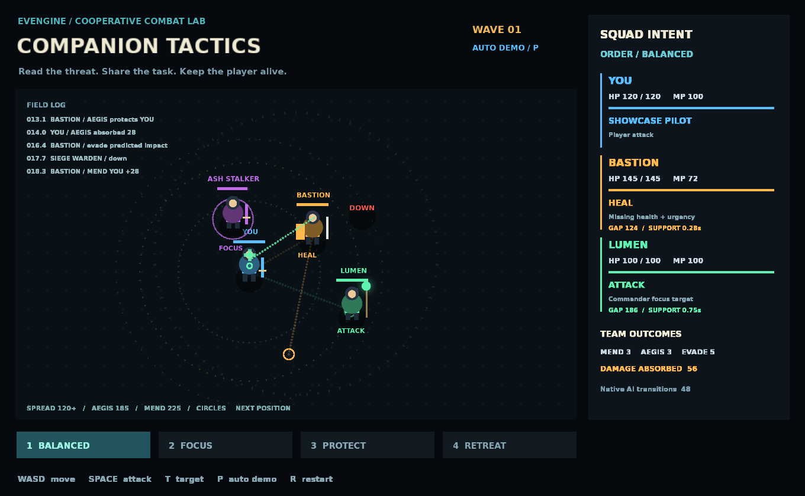

# Companion Tactics / 队友协作战术沙场



[查看实际引擎录制动图](../../docs/images/examples/companion-tactics.gif)

可运行的动作 RPG 队友 AI 设计验证：一名玩家、两名可自主治疗/保护/攻击/躲避的队友、两种会预告范围攻击的敌人。启动即自动演示，按 WASD 接管玩家。

```sh
eve run examples/companion-tactics
# 或使用仓库构建：
make run/win32-debug GAME=examples/companion-tactics
```

操作：WASD/方向键移动，Space 持续攻击选中目标，T 切换目标，P 切换自动演示，R 重开。
1 均衡，2 集火，3 保护，4 撤退。指令作用于队友；撤退期间玩家仍可攻击。
角色被击倒后停止行动，玩家倒地后按 R 重开。击败两名敌人后 3 秒进入下一波；玩家血量不会随波次重置。

- **Bastion**：护盾优先，也会应急治疗与远程攻击。
- **Lumen**：治疗优先，空闲时攻击；和 Bastion 共享治疗预约。
- **危险圈**：圈内扩张线表示落地时间；队友选择逃生落点并以实际位移躲避，没有自动无敌。
- **右侧面板**：实际原生 AI 状态、决策理由、血量/法力和效果统计。
- **左侧记录**：治疗、保护、吸收伤害、躲避、命令与击倒事件。
- **动态站位**：护盾队友与玩家保持约 120–185 像素、治疗队友约 120–225 像素的支援带，同时考虑队友间距和互助射程。攻击前也会调整站位，玩家移动时主动追赶；避险期间允许临时离开理想距离。
- **站位可视化**：小空心圆是下一站位点，玩家周围的圈是支援带；侧栏 `GAP` 显示实际距离，`SUPPORT` 显示支援 ETA，包含移动、施法及当前冷却/资源等待。

这是**示例级战术框架**。它运行原生 `NpcAiWorld` 的黑板和状态转换；游戏宿主统一拥有位置、生命、技能成本和效果结算。没有声称接通 `CombatRuntime`、正式网络同步、导航网格、复活、打断敌人施法或存档。详细边界及正式引擎接入方案见 [DESIGN.md](DESIGN.md)。

## 结构与扩展

- `planner.nut`：能力描述、效用评分、危险判断、逃生候选点。新增技能从 `CT_SKILLS` 和角色技能列表入手；新的效果类型需要宿主执行器支持。
- `positioning.nut`：支援距离、队友分散、预测走位、路径危险、支援 ETA、站位滞回。调整 `CT_POSITION` 可改变间距、射程余量与移动速度。
- `behavior.nut`：原生状态机的版本 1 定义，黑板 `intent` 驱动转换。
- `simulation.nut`：唯一战斗状态 owner、预约、施法提交、取消、固定步模拟。
- `presentation.nut`：引擎绘制；可独立替换美术，不参与模拟。
- `verification.nut`：隔离测试世界，复用实际模拟路径和原生 AI。
- `game.agent.json`：正式 Play Host 观察及命令，没有通用改血量入口。

## 可复现验证

```sh
eve run --debug --mcp-port=7543 examples/companion-tactics
python examples/companion-tactics/verify.py --port 7543 --output output/companion-tactics
MIN_RUN_SECONDS=2 RUN_SECONDS=8 bash scripts/smoke_examples.sh companion-tactics
python scripts/check_examples.py
```

`verify.py` 运行隔离契约测试，验证四种命令，采集引擎 readback 连续帧、观察 JSON 和 PNG；安装 Pillow 时额外生成 GIF。截图不依赖桌面捕获。测试覆盖预约互斥、治疗效果、护盾扣伤、取消无消耗、逃离危险圈、撤退、目标死亡清理、两次 60 秒模拟确定性以及 native generation handle 失效。

资源：圆形与辉光 PNG 是本例的解析几何图元；字体沿用仓库 `examples/tactics/assets/fonts/DejaVuSans-Bold.ttf`，归属 DejaVu/Bitstream，见 `assets/FONT-LICENSE.txt`。
