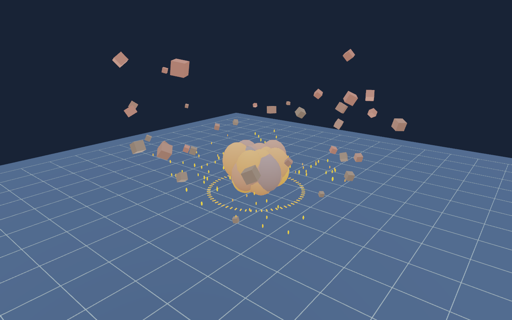

# IGNITION — 3D 爆炸物理实验场

夜间试爆场，含 36 个 Box3D 动态刚体、径向爆炸冲量、重力/地面碰撞/翻滚、程序化火球与上升烟团、100 个弹道火星、扩散冲击环和短暂镜头震动。

运行：`make run/win32-debug GAME=examples/explosion-lab`，或 `eve run examples/explosion-lab`。

空格重新引爆；每 8 秒自动循环。启动 1.2 秒后首次引爆。

这是风格化几何特效，烟雾为池化 3D 烟团，不是流体求解。所有资源启动时创建，无外部素材。物理以 120 Hz 固定步长更新，画面时间推进采用传入 dt；相同索引生成相同初始冲量，同平台重复演示允许浮点碰撞误差。

`main.nut` 保存场景与行为，`config.nut` 设置窗口。仅增加示例，不改变引擎 API、模块或持久化格式。

