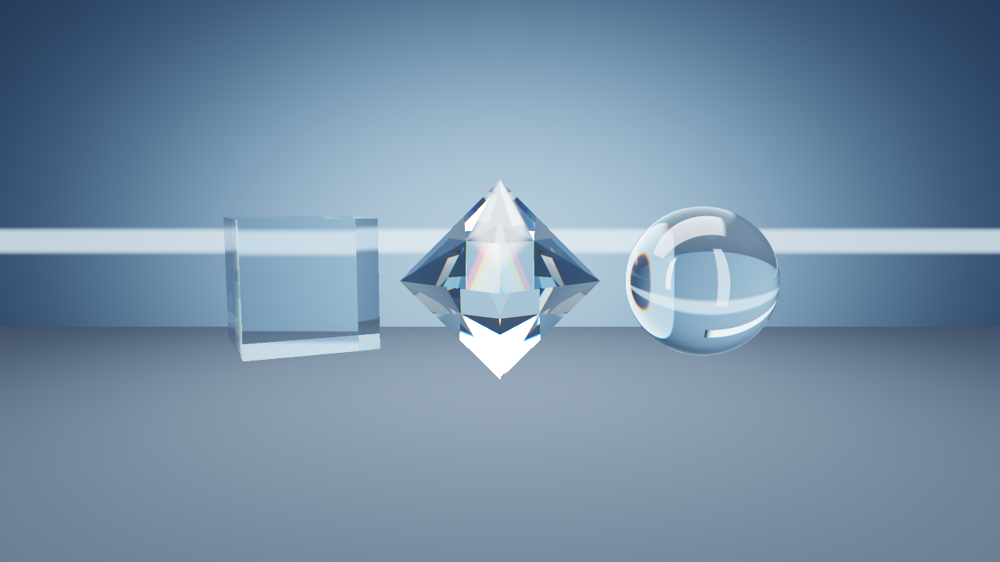

# Glass / Crystal 透明光学实验室



从左到右：水晶立方体、八面体水晶、水晶球。三者使用完全相同的介电材质算法和参数，
仅几何形状不同，便于观察形状对反射、折射及内部反射的影响。
通过 Mesh3D 自定义片元 shader 展示双界面 Snell 折射、介电 Fresnel、
Beer–Lambert 厚度吸收、最多十二次内部反射及 RGB 三波长色散近似。

## 运行

```sh
make run/linux-debug GAME=examples/glass-crystal
```

已编译的 `shaders/dielectric.frag.spv` 随示例提供。修改源码后重新编译：

```sh
glslc -o shaders/dielectric.frag.spv shaders/dielectric.frag
```

按键：1 普通玻璃折射率 1.52；2 高折射率 2.42；3 水折射率 1.333；
D 开关色散；C 开关吸收；A/S 调整视角；R 恢复默认。
Q/E 旋转前侧灯板；V 切换灯板尺寸；F 切换低粗糙度与更柔和的反射/透射；
Z/X 降低/提高相机曝光。
数值切换同时作用于三个形状；默认 IOR 1.52、吸收倍率 1.0、RGB 色散偏移 0.006。

## 光照与材质优化

- 四块有限尺寸 HDR 灯板：暖主光、冷补光、顶光、背光。灯板、墙和地面
  按最近交点选择，修复原先墙地面直接覆盖灯光的问题。摄影棚采用柔和渐变
  和单条宽带，避免密集棋盘经折射后产生的高频闪烁。
- 灯板有位置相关的视差与羽化边缘；直接相机射线隐藏灯板，反射/折射射线
  仍可看见它们。这是展示用途的射线可见性设置，不是完整物理光输运。
- shader 输出线性 HDR，曝光交给 Camera3D，ACES 与显示编码交给引擎，
  移除原先 shader 内额外的指数映射和 Gamma 编码。
- 吸收使用 `T = attenuationColor^(pathLength / attenuationDistance)`，
  默认线性 RGB `(0.82, 0.94, 0.98)`、距离 `3.0` 世界单位，另保留吸收倍率。
- 默认粗糙度 `0.06`，使用四方向确定性锥形环境滤波近似反射与透射模糊。
  这不是 GGX 微表面 BSDF，不提供严格的粗糙界面能量分布。
- 四条固定子像素主射线在线性空间平均，降低轮廓锯齿；内部反射上限从
  6 增至 12，降低低反射次数造成的暗块。采样与循环均有界，无时间随机噪声。
- `main.nut` 中的 `labKey/labFill/labTop/labBack`、`labLightSize`、
  `labLightAngle`、`labEnvironment`、`labAbsorptionColor`、
  `labAbsorptionDistance` 是共用调参入口。降低色散默认值，且蓝光 IOR 高于红光。

参考：[Three.js 物理材质](https://threejs.org/docs/pages/MeshPhysicalMaterial.html)、
[PBRT 粗糙介电模型](https://www.pbr-book.org/4ed/Reflection_Models/Rough_Dielectric_BSDF)、
[Blender 颜色管理](https://docs.blender.org/manual/en/5.0/render/color_management/displays_views.html)。
这些优化作用于本示例的解析摄影棚，使用引擎现有 HDR/曝光接口；未改动引擎全局灯光算法。

## graphics 实现阅读结论与示例范围

- `src/modules/graphics/Material.cpp` 定义透明分类、混合模式和深度写入状态；
  透明分类本身不会自动计算厚度和双界面折射。
- `src/modules/graphics/shaders/mesh3d.frag` 包含 PBR Fresnel 和反射计算；
  `PbrSurface.h` 有 IOR，但普通透明混合不能等同于体积透射。
- `src/modules/graphics/shaders/water.frag` 已有独立的场景颜色/深度采样、
  折射偏移及环境/探针反射路径，可作为后续通用玻璃材质整合的参考。

本示例是解析光学实验：使用一个 Mesh3D 平面生成射线，在 shader 内求立方体、球体、
凸八面体及摄影棚的交点。并未修改引擎默认材质，也未把普通场景网格
转换成通用透明材质。三个形状均在 shader 内计算，不是独立透明 draw。
不支持物体之间的互相反射/折射、焦散、任意网格厚度或完整的微表面粗糙透射。
RGB 色散为艺术近似，十二次反射后剩余能量截断。摄影棚反射不包含其它物体。

## 验证

GLSL 已通过 glslc 编译与 spirv-val 验证，示例已在软件 Vulkan + Xvfb 下运行并呈现真实帧。
`screenshot.png` 使用引擎 MCP `eve_screenshot` 捕获，非 Xvfb 桌面截图。
遵循 EveScript 绑定合同、显式检查 shader 加载 Result、提供配置和示例索引；
没有新增公共 API、跨模块状态或持久化数据格式，无规范例外。
已通过 MCP 输入路径执行灯光旋转、粗糙度、曝光、尺寸、折射率、色散、吸收及重置按键；
示例布局检查与 `git diff --check` 通过。四子像素及粗糙度多次环境采样增加像素成本，
尚未测量目标 GPU 性能；不是引擎级光照回归或完整平台测试。
