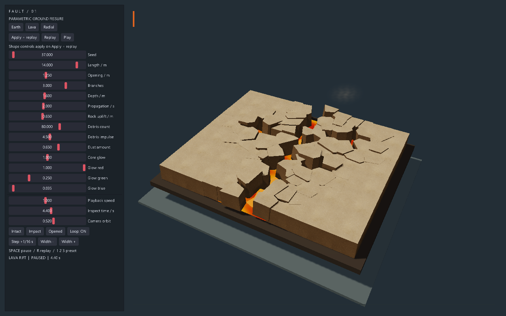
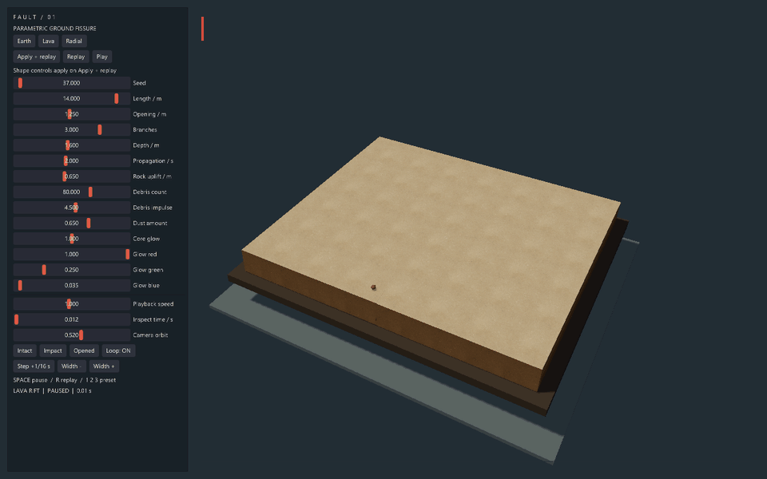
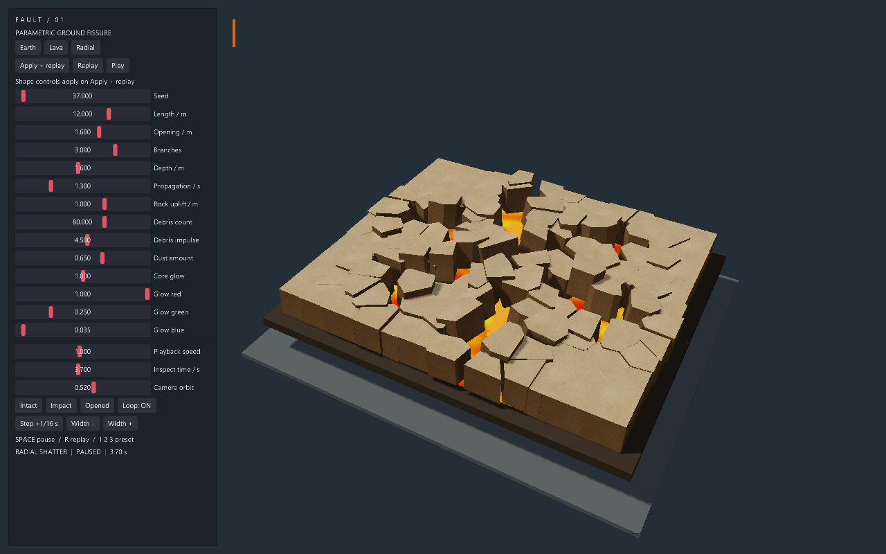

# FAULT / 参数化地裂

EVEngine 原生 EveScript 示例，120 个程序化 Voronoi 地表块、真实裂口侧壁、
分支传播、岩块抬升、确定性碎石弹道、透明扬尘和可关闭的裂底发光。

```sh
make run/win32-debug GAME=examples/ground-fissure
# Linux/macOS: replace win32-debug with linux-debug/macosx-debug.
# SDK:
eve run examples/ground-fissure
```

左侧面板提供 Earth（普通地裂）、Lava（熔岩裂谷）、Radial（放射破裂）预设。
修改形状/材质参数后点击 **Apply + replay**。单击 **Replay** 使用已应用的参数重播。
**Pause / Play** 暂停/继续，**Intact / Impact / Opened** 定位关键阶段。
**Inspect time** 可直接检查任意时刻，**Playback speed / Camera orbit** 实时生效。
**Loop** 控制循环。快捷键：空格暂停，R 重播，1/2/3 切换预设。
**Step +1/16 s** 暂停并前进 1/16 秒，便于逐帧检查和确定性截帧。
**Width - / Width +** 每次调整 0.25 米并立即应用重播。

`config.nut` 的 `fissure` 是默认参数的唯一入口；面板待应用值与已应用参数明确分开。
可调项包括种子、长度、开口宽度、分支数、深度、传播时间、抬升高度、碎石数、
抛射强度、扬尘量、发光强度与 RGB。种子/分支数/碎石数应用时取整。
参数范围由面板限制；模型为 18×16 米的有限地表补丁，不承诺在任意外部地形上挖洞。

## 实现约定

- `geometry.nut`：固定种子的 Voronoi 裁剪、分支路径、顶面/侧壁网格。
  相同种子的单次几何缓存由示例拥有；Apply 更新既有网格，不追加 ECS 实体。
- `main.nut`：120 地块、120 碎石、72 尘雾卡片、80 裂底段固定池。
  时间由 `eve_update(dt)` 注入，展示 dt 上限 0.1 秒，支持从绝对时间重建所有姿态。
  碎石是含重力的解析弹道视觉动画，没有刚体互撞或对游戏碰撞地形的修改。
- 地表、碎石分别使用独立的确定性随机流；重播不重新抽随机数。
  同一参数与时间的姿态可重复；不保证跨 GPU/平台像素逐位一致。
- 透明扬尘是软边纹理的 3D 卡片，非流体模拟。发光是无光照裂底颜色，
  不依赖 Bloom，不声称会照亮周围地面。
- 所有图形资源、实体、UI 在主/渲染线程创建与更新；没有异步回调持有借用指针。
  原生场景和图形提供者拥有资源并在退出时销毁；Apply/Replay 复用固定池。
  启动时生成网格，之后只有改变种子才重算 Voronoi。
- 未新增引擎公共 API、模块、持久化格式或 ECS System；没有架构规则例外。
  `game.agent.json` 使用引擎既有版本化协议，通过与 UI 相同处理器执行动作。

素材和制作参考见 [assets/NOTICE.md](assets/NOTICE.md)。纹理已打包，运行不联网。

## 验证

```sh
python3 scripts/check_examples.py
MIN_RUN_SECONDS=2 RUN_SECONDS=20 bash scripts/smoke_examples.sh ground-fissure
```

完成初始化的日志标记：`GROUND_FISSURE_READY`。
原生 Windows SHARED 构建直接启动时需把 `build/win32-debug` 加入 PATH，Makefile 自动处理。
验证用 MCP 启动参数：`--debug --mcp-port=7549`。
通过 `eve_play` 的 `observe/act/capture` 和 UI 自动化操作，不用 `eve_eval` 替代运行路径。

运行后可复现截图、交互检查、96 帧 GIF 和证据会话（验证工具需 Pillow）：

```sh
python3 -X utf8 examples/ground-fissure/verify_capture.py --port 7549 --output output/ground-fissure/evidence
```

Windows 上仓库 `smoke_examples.sh` 会按进程名结束 eve，勿与其他 eve 会话或录制同时运行。
本例控制面板中的 Replay 只重置展示时间，不调用引擎软重启。

已验证：三种预设、1.25 → 1.00 → 1.25 米宽度调整、UI 重播、暂停与固定时间步进；
同种子同时间场景区域截图像素差为零。96 张引擎读回帧的场景像素全部不同，
输出 960×600 GIF；原始截图 1280×800。20 秒 Windows 原生 smoke 通过，
示例布局和本目录 Python ruff 检查通过，运行时错误日志为空。
源码门禁使用根目录 `make check`；PR 在独立工作树中整理，不包含主工作区的其他修改。
完整验证记录见 [verification.json](verification.json)。截图/GIF 仅为证据，不参与运行。






