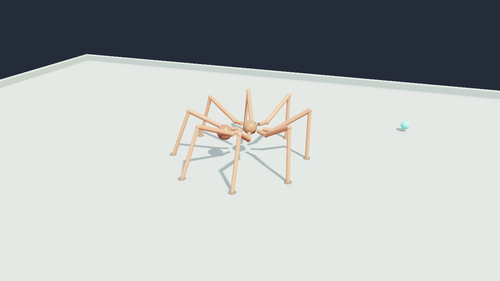

# IK Spider 3D — 自主爬行蜘蛛

2D 版 [`ik-spider`](../ik-spider/README.md) 的三维对应：用 `eve.IK()` 的
`Skeleton3D` + `Solver3D` FABRIK，在 **Y-up / XZ 地面**上驱动一只 **8 足蜘蛛**。
每条腿经世界坐标播种姿态 → `setPole`（上拱膝盖）→ `solveChain(hip, foot)`；
**画面是带光照 / 阴影的 `Renderable3D` 网格**（球 + Y 轴圆柱），不是 Primitive 调试线。

```sh
make run/linux-debug GAME=examples/ik-spider-3d
# Windows: make run/win32-debug GAME=examples/ik-spider-3d
# SDK:     eve run examples/ik-spider-3d
```

## 做法

1. **骨架**：根骨为身体；8 条腿各 3 节（hip → knee → foot）。建完后用 `getChild` 取 id。
2. **Y-up 姿态播种**：ik.hpp 的 3D yaw/pitch 局部基以 +Z 为优先「上」，不能直接当
   引擎 Y-up 的水平方位角用。每帧用世界坐标写 hip/knee/foot，再 `updateRotations()`，
   根骨朝向用 `setOrientation(cos θ, 0, sin θ)`（根上的 `setRotation` 在 orientation
   非零后会被忽略）。
3. **着地**：足尖目标 Y 钳在地面（抬步时才抬高）；解算后 tip / knee 再压回地面上。
4. **防穿模**：极向量在腿中段上方并外展；解算后把塌向身体的膝盖向外推。
5. **步态**：偶 / 奇组交替迈步（tetrapod）；航点游荡。
6. **渲染**：共享 `newMeshSphere` / `newMeshCylinder` / `newMeshCube`；圆柱沿骨段
   A→B 对齐本地 +Y；`Light3D` 投射阴影，地板 `receiveShadow`。

## 操作

| 输入 | 作用 |
| --- | --- |
| Space | 暂停 / 继续 |
| R | 按固定 seed 重建蜘蛛 |

启动打印 `IK_SPIDER3D_READY …`；爬行约 2.8s 后写出 `ik-spider-3d.png`。

## 文件

| 路径 | 说明 |
| --- | --- |
| `main.nut` | 相机、灯光、输入、截图 |
| `spider3d.nut` | 建骨、步态、世界坐标播种 + FABRIK+pole、网格同步 |
| `config.nut` | 1280×720 窗口 |

## 验证

```sh
python3 scripts/check_examples.py
MIN_RUN_SECONDS=2 RUN_SECONDS=6 bash scripts/smoke_examples.sh ik-spider-3d
```

引擎读回预览（约 2.8s 爬行后自动写出）：


