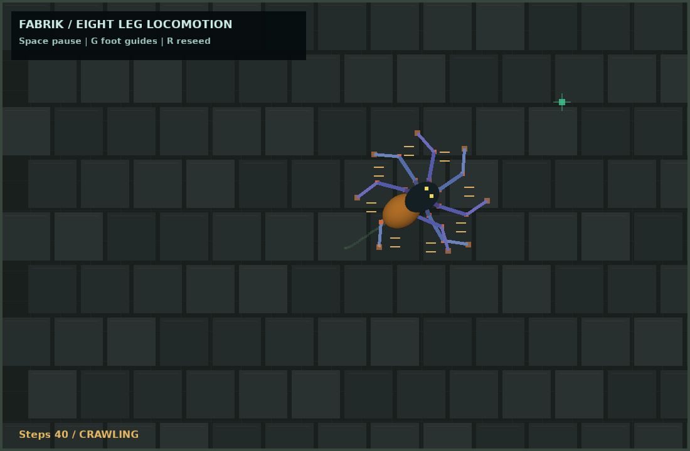

# IK Spider — 自主爬行蜘蛛

用引擎自带的 `eve.IK()`（`Skeleton2D` + `Solver2D` FABRIK）搭一只 **8 足蜘蛛**，
在 2D 顶视场景里自主游荡：身体朝向随机航点，足尖用交替四足步态（tetrapod）
落点 / 抬步，每条腿经 `solveChain(hip, foot)` 独立解算。

```sh
make run/linux-debug GAME=examples/ik-spider
# Windows: make run/win32-debug GAME=examples/ik-spider
# SDK:     eve run examples/ik-spider
```

## 做法

1. **骨架**：根骨为身体；8 条腿各 3 节（hip → knee → foot）。`createBone` 建完后用
   `getChild` 重新取 id（FABRIK 拓扑排序会重排）。
2. **约束**：髋 / 膝 / 踝设铰链角限，避免腿翻折。
3. **步态**：偶数组与奇数组交替迈步；一组腾空时另一组必须着地，保证至少四足支撑。
   足尖相对身体静止过远时触发一步，落点略超前以便推动身体。
4. **IK**：每帧把身体根位移 + 朝向写进骨架，再对每条腿
   `addTarget(foot, x, y)` → `solveChain(sk, hip, foot)`。
5. **导航**：在场地内随机换航点；急转弯时减速，让足部跟上。

未新增引擎公共 API；时间由 `eve_update(dt)` 注入。同 seed 下航点序列可复现。

## 操作

| 输入 | 作用 |
| --- | --- |
| Space | 暂停 / 继续 |
| G | 显示 / 隐藏航点十字 |
| R | 按固定 seed 重建蜘蛛 |

启动打印 `IK_SPIDER_READY …`；爬行约 1.5s 后写出 `ik-spider.png`。

## 文件

| 路径 | 说明 |
| --- | --- |
| `main.nut` | 场景、输入、拖影、截图 |
| `spider.nut` | 建骨、步态、FABRIK 求解、绘制 |
| `config.nut` | 1100×720 窗口 |

## 验证

```sh
python3 scripts/check_examples.py
MIN_RUN_SECONDS=2 RUN_SECONDS=6 bash scripts/smoke_examples.sh ik-spider
```

引擎读回预览（约 2.8s 爬行后自动写出）：



## 2026-11-13 画面复查

保留八足 FABRIK 与交替四足步态；增大骨段、添加随朝向旋转的身体分节、关节与落足标记、铺地和控制说明。地面装饰不参与碰撞，仍是平面步态示例。

[前后截图与运行验证](../../docs/images/examples/review-2026-11-13/nine-improved/README.md)。
