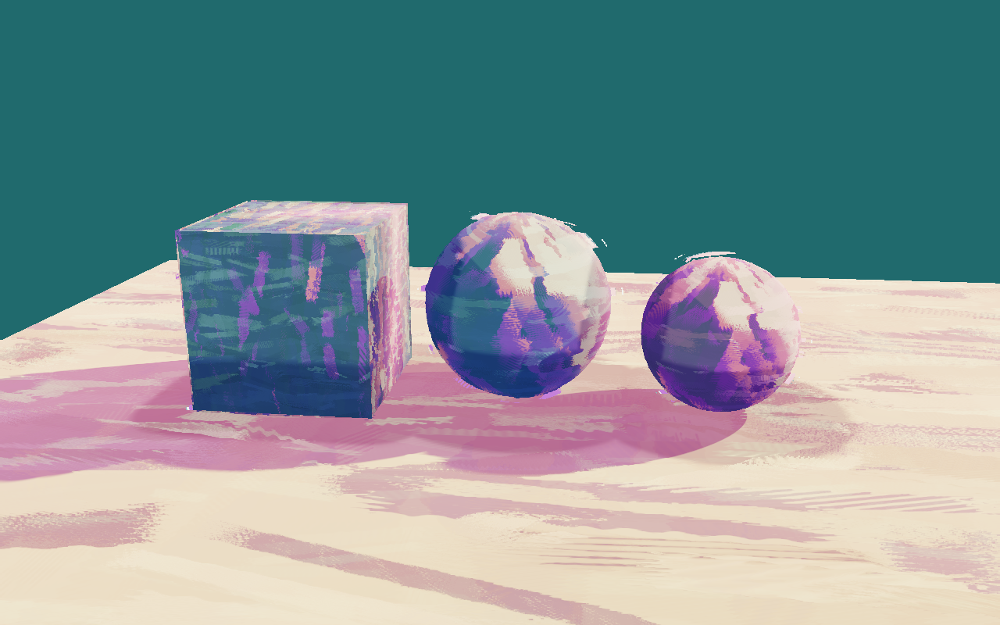

# Impasto paint — brush-shaped lighting and silhouettes

An independent `impasto` style following [Gabriel de Laubier's breakdown](https://cyn-prod.com/stylized-paint-shader-breakdown).
Existing paint/watercolor shaders and renderer defaults are unchanged.

Run `eve run examples/impasto-paint` or `make run/win32-debug GAME=examples/impasto-paint`.
The demo ships compiled shaders from the module's canonical GLSL, so an existing Vulkan
runtime can run it without rebuilding the entire engine. Shader loading uses Result
and fails visibly on missing/invalid assets. It does not select a substitute style.

A/D orbit, Space toggles automatic orbit, O toggles SDF AO/shadows, E toggles the
brush silhouette (solid erosion plus outer layers). Static camera and geometry make
captures repeatable. `config.impastoAO`, `impastoShadow`, `impastoEdges` and
`impastoYaw` and `impastoSolidErosion` provide independent startup settings for verification.

## What creates the look

- One packed data texture: RG stores strongly varied tangent-space brush normals,
  B stores stroke height/tone, A stores a separate fine brush mask. It is generated
  deterministically by `generate_brush.py` (seed 63821), not extracted from the article.
- Height offsets the brush sampling. The perturbed normal drives 0 / 0.25 / 1 lighting
  bands. Swizzled coordinates drive a separate cool/purple/coral/cream reflection ramp.
- Real analytic SDF distance queries produce AO (six normal samples) and directional
  visibility (up to 28 bounded march steps). The A mask erodes the resulting gradients;
  an empty/disabled field does not acquire fake occlusion from the brush texture.
- The solid uses smooth-normal Fresnel plus a curvature guard to erode its silhouette.
  Erosion is restricted to a maximum three-pixel screen-space contour strip, not the
  entire grazing region. The axis-aligned box uses its actual projected contour edges;
  creases between visible faces are preserved.
  A two-sided, front-face-masked expanded shell supplies a colored outer rim. Two more
  expanded shells have separate offsets and cutoffs for approximate outline strokes.
  The demo uses four renderables per object, rather than claiming one instanced draw.

## Shader/material contract

`stylize.newMeshShader(gfx,"impasto")` creates the built-in program after an engine
rebuild. `parameters.nut` and the demo SPIR-V are generated from the same C++ parameter
table and GLSL by `prepare.py`; there is no separately maintained parameter schema.
The albedo sampler of this new style is explicitly a **packed brush data texture** when
`packedBrush=1`; material tint supplies base color. `packedBrush=0` selects neutral
brush inputs. This does not change the sampler meaning of any existing style.

The 32 floats are introspectable through the existing StyleInstance API:

- `strokeScale`, `normalStrength`, `colorVariation`, `parallax`, `reflectionStrength`;
- `shadowR/G/B`, `rimStrength`, `rimErosion`, `packedBrush`;
- `layer`: 0 solid, 1 colored rim, 2/3 offset outline; `shellWidth`, `shellOffset`;
- `smoothNormalMode`: 0 mesh normals, 1 radial approximation for origin-centered test
  primitives, 2 decode baked smooth normals from vertex color RGB in [0,1]. Face
  normals remain independent for lighting. Author arbitrary sharp meshes with mode 2.
- `occlusionStrength` and `sdfShadowStrength` independently control AO and shadows;
  zero skips their distance-query loops. `occlusionRadius` controls AO range.
- `sdfFloorY`, `sdfSphereA{X,Y,Z,Size}`, `sdfSphereB{X,Y,Z,Size}`, `sdfBox{X,Y,Z,Size}`
  describe an infinite horizontal floor, two spheres and an axis-aligned cube. Zero
  size disables a solid. `sdfOwner` excludes the receiving primitive: 0 floor,
  1 sphere A, 2 sphere B, 3 box, 4 other geometry.

The caller owns scene transforms and must update these SDF inputs when geometry moves.
The demo is static and the fields exactly match its visible geometry; the floor top is
Y=0. This bounded primitive field is **not** UE's general mesh/global distance-field
system. Arbitrary imported mesh SDFs and their scene registry are outside this change.
These shaders are for static meshes; no skeletal deformation is implemented.

Graphics owns shaders/textures, the demo retains material and renderable references,
and creation/binding stays on the render thread. No new ECS system, cross-module
provider, persistent game format, or lifetime relationship is introduced. GPU numeric
parity is tolerance-based. Vulkan is exercised; WGSL follows the same equations but
has not been run here.

## Verification and regeneration

`python examples/impasto-paint/verify.py --eve <eve-path>` boots the same example in
six configurations, captures actual frames through engine MCP, checks independent
AO/silhouette/shadow/view differences, checks that the cube face interior stays unchanged, and writes screenshot hashes and measurements
under `build/impasto-verification/`. It does not edit gameplay through `eve_eval`.

`MIN_RUN_SECONDS=2 RUN_SECONDS=6 bash scripts/smoke_examples.sh impasto-paint`
checks the normal example. `python examples/impasto-paint/prepare.py` (requires glslc)
regenerates shipped demo shader assets/parameters. `python scripts/compile_stylize_shaders.py`
regenerates the engine's embedded SPIR-V; `python examples/impasto-paint/generate_brush.py`
regenerates the packed map (NumPy/Pillow required).

The example disables GBuffer/AO/GI/deferred passes locally to use the forward custom
shader path verified against this pre-existing runtime; it changes no renderer defaults.
The screenshots were verified with the existing local Vulkan runtime; complete platform
build/test coverage is checked by CI.
