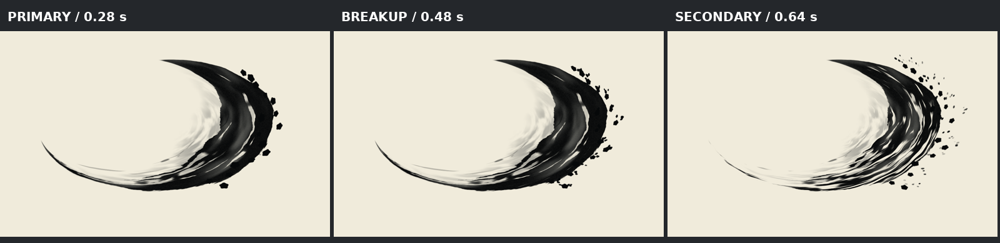
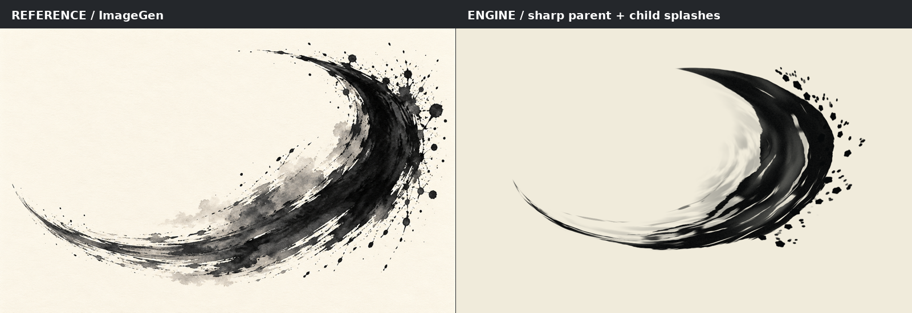

# 水墨武打特效 / Ink Combat

可运行的中国风攻击视觉示例：浓墨月牙刀光、沿挥砍方向展开的飞白、淡墨拖染，以及烘焙的父子墨滴飞溅。
使用现有 Graphics 自定义片元 shader，不改变引擎 API、ECS 或模块边界。


## 运行与操作

```sh
make run/macosx-debug GAME=examples/ink-combat
```

Linux / Windows 分别使用 `run/linux-debug` / `run/win32-debug`。

- `1` 横斩（默认），`2` 反斩，`3` 交叉连斩。
- `Space` 重播，`P` 暂停，`B` 深浅背景切换。
- 每 2.6 秒循环；交叉连斩的第二斩延迟 0.20 秒。

## 实现

主体以弧长控制落笔时钟（25–265 ms），低频压力和湿度控制大块浓淡。
11 条不同跨度、宽度和漂移的局部飞白保留浓墨连续性；短干笔擦痕强化方向。
笔迹从自身落笔时刻起计龄，尾部先于笔锋干裂消散。采用 straight alpha 混合。
时间仅来自 `eve_update(dt)`；脚本状态由主线程生命周期回调持有。
程序噪声固定于笔触坐标，不逐帧随机；跨 GPU 浮点哈希不保证逐像素一致。

飞溅采用 `assets/splash-flipbook.png`，由 `bake_splashes.py` 离线生成：

- 固定种子 73129，16 个主滴、81 个子滴，共 97 条轨迹。
- 主滴在飞行 130–220 ms 后从当前位置分裂；子滴继承速度并沿窄扇形加速。
- 主滴更大、存活更久，分裂后保留 78% 半径；子滴更小、更快，独立运动和淡出。
- 最大覆盖度合成防止新生半透明子滴擦除主滴。
- 40 帧 / 30 fps，8×5 图集，每格 384×384，整图 3072×1920。
- 裁剪范围 x=-0.20…1.65、y=-1.10…1.00，将像素集中到右侧飞溅区域。
- 最近动画帧播放避免时间混合重影；空间双线性过滤保留，图块 UV 限制至半像素内以免串色。
- 单斩一次图集采样，交叉斩两次；首尾透明，运行时不模拟子粒子、不每帧上传纹理。



## 重新生成

烘焙需要 Python 3 和 Pillow，编译 shader 需要 Vulkan SDK 的 `glslc`：

```sh
python3 examples/ink-combat/bake_splashes.py
glslc examples/ink-combat/shaders/combat.frag -o examples/ink-combat/shaders/combat.frag.spv
MIN_RUN_SECONDS=2 bash scripts/smoke_examples.sh ink-combat
```

图块像素尺寸由 shader 读取纹理尺寸推导；修改帧率、帧数、网格或裁剪范围时，
同步修改 shader 采样段的相应常量。脚本断言首尾透明、图集非空，重复生成可得到相同 SHA256。

## 参考与效果对比



参考图通过内置 ImageGen 生成；[完整提示词](reference/PROMPT.txt)保留。
参考图只作美术目标，不作为运行时贴图。对比仅等比缩放排版，没有重绘实帧。
`preview.png` 为 age=0.56 s 的引擎帧回读；`motion.gif` 以固定 40 ms 视觉时间步采样，
用于展示节奏，不代表性能基准或实时帧率。
当前笔迹比参考更平滑，未实现真实毛笔、纸纤维吸水或流体扩散。

方法调研（未复制第三方纹理或代码）：

- [Lydia Jara — INK BATTLE SLASH](https://lydiajara.artstation.com/projects/0lxwyw)：程序纹理、粒子、flipbook 与贴花组合。
- [Madono & Simo-Serra, PG 2023](https://esslab.jp/publications/MadonoPG2023.pdf)：真实笔触浓淡、洇染和混合；本例未实现论文神经模型。
- [Stroke Transfer, SIGGRAPH 2022](https://cg.it.aoyama.ac.jp/yonghao/sig22/abstsig22.html)：动画笔触空间一致性的研究参考。

## 成本、边界与验证

当前单个全屏 quad 仍有填充和主笔触计算成本；未做 GPU 时间测量。
PNG 约 156 KiB，RGBA8 解码约 22.5 MiB，文件压缩大小不等于显存成本。
动画位置按 30 fps 离散更新。生产接入可裁剪绘制包围矩形并按屏幕面积控制 overdraw。
本例仅为视觉展示：无武器骨骼挂点、伤害判定、3D 遮挡、运行时碰撞触发或 WebGPU shader。
深背景模式只略提亮墨色，不是完整场景光照适配。

本机已验证 shader 编译、确定性重复烘焙、ruff、示例布局及 6 秒冒烟。
macOS 自带 Bash 3.2 缺少 `mapfile`，本机冒烟使用临时兼容函数运行原检查器。
本机旧版二进制的 MCP 调试入口在 ImGui 面板崩溃，截图使用普通播放路径的引擎 `saveFramePng` 回读。
本次无公共接口、生命周期、持久协议或模块边界变更，无架构豁免。
