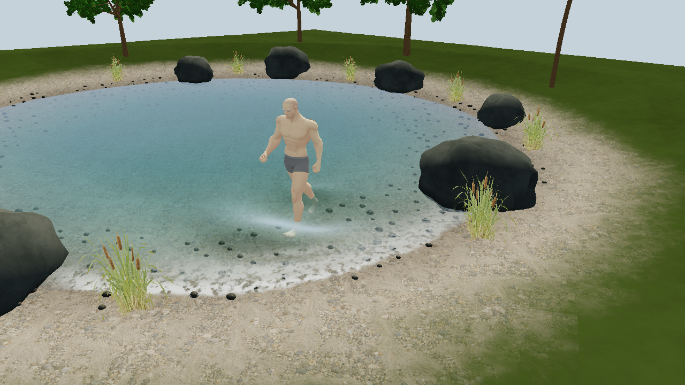

# Interactive Shallow Water



以脚步、碰撞体和点击扰动为重点的浅水池。128×128 浅水求解网格以固定
1/60 秒步长推进，网格位置和法线直接驱动水面；长波高度显示增益为 1.8。
水体使用深度吸收、折射、Fresnel 反射和局部高光。

人物复用 `character-motion-lab` 的 Quaternius CC0 男性基础模型和行走动作，
显式重定向后读取脚掌、踝和膝的动画位置。每条腿使用一个小腿胶囊体、
两个脚部球体；每个固定步根据各骨骼的世界位移计算碰撞体速度，
按浸水比例传递水平动量，并根据向下入水及水平扫过速度施加近似排水源。
转向和摆腿的局部速度也参与计算。实际落脚时另注入低强度径向扰动，
最大高度源 4 mm、径向速度 0.025 m/s，再按落脚向下速度缩放；
这层圆环由同一求解器传播、耗散，不叠加独立的着色器波包。
高度和法线来自浅水求解器，局部推水形成前方隆起、后方低水位和传播波。
静止浸水不会持续注入径向源；暂停冻结角色和求解器。
岸边泡沫由真实浅水流速、速度收敛和水面坡度共同触发，没有独立的循环拍岸波。
真实水深控制干湿边界，波可以减速上岸、退水并向池内反馈。

```sh
make run/win32-debug GAME=examples/interactive-shallow-water
```

- WASD 移动，鼠标左键在水面投下一个短暂入水再抬起的球形碰撞体。
- P 开关自动行走，V 切换跟随近景、俯视、全景和池岸近景。B 直接切换池岸近景与人物跟随。
- Space 暂停，R 重置，F 显示场数据，G 打印求解后端。
- C 显示腿脚碰撞体的橙色包围框；实际求解形状为胶囊体和球体。
- H 从岸边开始行走，B 查看岸线，便于观察脚边波传到岸坡后的反应。

引擎求解器支持 GPU/CPU 路径；本例选择 GPU 求解（不可用时显式回退 CPU），人物使用 GPU 蒙皮。
水面通过 `syncSurfaceMesh` 原生直传，避免顶点脚本数组的往返拷贝。碰撞体为单向运动学耦合，水不会反向改变人物动作；
原生求解器使用近似动量/排水源，并非三维不可压流体的实体边界求解。
椭圆岸线和渐深沙床通过同一 `pondBed` 生成物理床面，初始化使用 `setBed` +
`fillSurface`。CPU/GPU 求解使用静水重构处理变床高和干湿前沿；
显示网格围绕每格参考水深放大波幅，不会把水平静水变成斜水面。
`game.agent.json` 的 `shore` 提供近岸水深、流速、水位和湿润前沿，`shore-walk` 启动岸边行走。
岸边白沫是求解结果驱动的表现近似，尚未模拟三维翻卷、气泡和飞溅。
需要包含床面脚本接口的当前源码构建；旧 SDK 不包含 `setBed` / `fillSurface` 绑定。

[固定步长引擎动态帧序列](motion.gif) · [池岸近景实际帧](bank-preview.png)

## 资源与重建

`reference.png` 是 AI 生成的美术参考；`preview.png` 是引擎实际帧。
生成提示词见 [ART_DIRECTION.md](ART_DIRECTION.md)。芦苇使用透明抠图交叉卡片，
沙砾床使用生成的平铺材质，礁石使用程序材质；场景并未把参考图贴作背景。

在仓库根目录运行：

```sh
python scripts/generate_water_showcase_materials.py
python scripts/compile_water_showcase_shaders.py
```

第二条需要 Vulkan SDK 的 `glslc`。运行无需编译器，使用已提交 SPIR-V。
当前自定义着色器面向 Vulkan；其他图形后端尚未验证。
共享场景和 GLSL 的源文件位于 `stylized-water-shore`，生成器同步交互示例。
默认使用 forward 渲染，以避免 GBuffer 覆盖自定义地形/石头材质。

人物、树木和纹理来源与许可见 [CREDITS.md](CREDITS.md)。

场景保留模型、蒙皮、材质和探针所有者；关闭热重载，修改脚本后重新启动。

## 性能观察

`game.agent.json` 的 `performance` 观察项提供单调时钟测得的逐帧分项毫秒；
`sampledDeviation` 仅为人物附近五点的水位偏差，避免每帧遍历整个网格求最大值。
当前源码 Debug 构建的普通运行（关闭调试追踪）45 帧采样中位 16.75 ms，P95 17.64 ms，
原生水面同步中位 5.36 ms，求解 0.79 ms；
保留 128×128 网格、模型和岸边效果；这些数字是本机窗口测量，不代表跨设备性能保证。

本机验证采用 SHARED Debug 裁剪构建（minimal 加 fluids、animation、model3d、devtools、font），
匹配本机预编译依赖 `7e5f020cba1b`；仓库默认依赖 pin 的全新构建与其他平台尚未执行。
七项定向原生测试覆盖静水、干湿上岸/退水、非法输入原子性、显示增益、干地/空中碰撞体、
CPU/GPU 容差及原生同步桥；求解器是唯一水深/动量 owner，接口同步借用输入、检查 Result，
固定 1/60 秒推进；没有新增 ECS、Link 或持久格式，也没有架构规则例外。

数值方法参考 [Audusse 等人的静水重构](https://epubs.siam.org/doi/abs/10.1137/S1064827503431090)。
