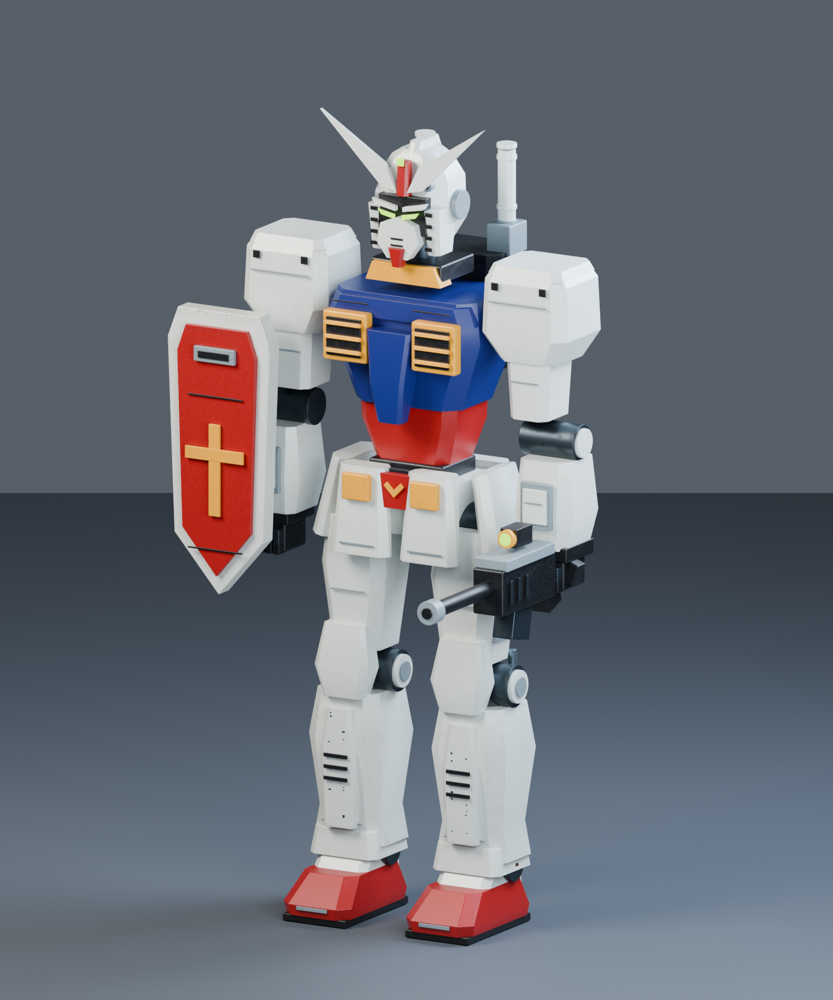
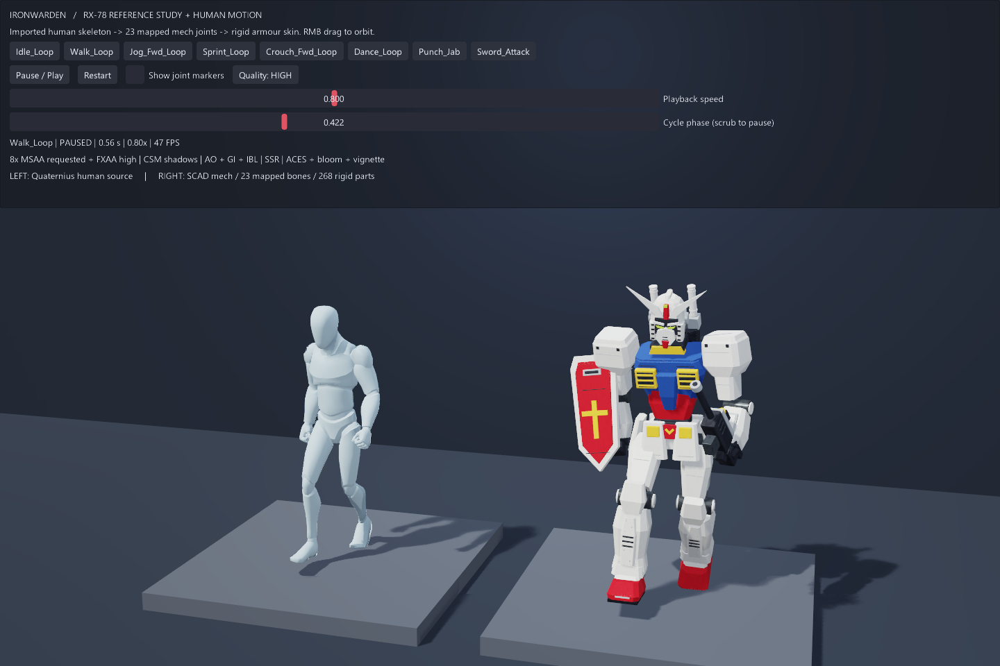
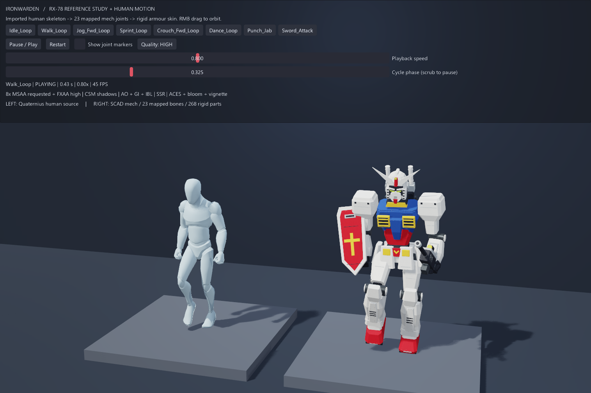

# Ironwarden / RX-78 风格机甲与人体动作重定向

将 SCAD 铁卫机甲做成可运行的动作观察台：左侧为导入的 Quaternius 人体源角色，右侧为
同一动作通过 `AnimRetargetProfile` 重定向后的机甲。模型、贴图、人体骨架和动作均随示例
离线提供，运行时不需要 Blender 或 OpenSCAD。

外形对照万代官方 RG RX-78-2 Ver.2.0 的正面、背面与头部参考图重建，
采用白蓝红黄配色、V 字头冠、双眼面罩、分层装甲、裙甲、长腿、十字盾、步枪和背包军刀。
参考来源与对照说明见 [REFERENCE.md](REFERENCE.md)。



```sh
make run/win32-debug GAME=examples/ironwarden-retarget
# 或包含 animation / model3d / graphics / ui 的 SDK
eve run examples/ironwarden-retarget
```

- 8 个动作：待机、走路、慢跑、冲刺、蹲走、舞蹈、出拳、挥剑。
- 动作切换使用 0.22 秒交叉淡化；所有动作循环，便于观察。
- Pause / Play、Restart、播放速度、相位拖动暂停定位。
- Show joint markers 显示人体和机甲的主要骨骼关节；控制面板下方按住右键拖动绕场景观察。
- Quality: HIGH / BASELINE 按钮用于同一场景的画质对照，默认 HIGH；状态栏显示运行 FPS。

## 实时渲染

场景使用 `gfx.render3D()` 的完整 HDR 渲染图，控制面板为独立 UI 叠加层。
旧的 `renderScene3DToCanvas()` 是预览路径，显式省略阴影、G-buffer 与 AO，已经从本例移除。

默认开启：

- 请求 8× MSAA（设备按支持范围限制采样数）与 high 质量 FXAA。
- 主光源的 CSM 级联阴影，台座和地面的真实接收阴影。
- G-buffer 驱动的屏幕空间 AO、半球间接光、过滤后的六面体工作室 IBL。
- 冷色补光、背部轮廓光、屏幕空间反射 SSR。
- ACES 色调映射、固定曝光、Karis-tent Bloom、轻微摄影暗角。

`rendering.nut` 集中管理渲染与照明；环境探针在启动时一次捕获和过滤发布，
所有相机、材质、探针和光源引用随 `ward` 场景状态共同持有，不逐帧重建资源。
为保留运动装甲细节，抗锯齿使用空间采样，TAA 保持关闭。UI 不经过场景后处理。



## 骨架与模型

`assets/ironwarden/ironwarden.scad` 保留 268 个可编辑零件与几何掉漆。
`design.py`、`build_model.py`、`scene.json`、66 张材质通道贴图也在同目录。
`ironwarden.glb` 为带 UV、材质和蒙皮的运行时模型，11 个材质网格，23 个目标骨骼。
原始毫米尺寸缩放到约 2.10 米；glTF 转为 Y-up。
造型、显式骨骼归属和人体关节标记统一在 `design.py`，`build_model.py` 从它生成 SCAD、
`scene.json` 和运行时零件计数。绑定工具读取同一份数据生成 GLB。
手工改 SCAD 不会自动同步 GLB，应修改 `design.py` 再重建。自定义装甲多面体共用同一份
顶点与面；SCAD 与 Blender 的最终边缘倒角略有不同。

人体骨架从 `AnimationLibrary.glb` 实际导入。构建工具读取源骨骼静止框架，为机甲建立
不同名称和比例的目标骨架；手臂转成 T 形绑定姿态。导出后恢复源 glTF 的骨骼轴约定，
同时重算目标逆绑定矩阵，避免 Blender 的骨骼显示轴转换改变重定向含义。
每个顶点只有一个权重为 1 的骨骼，装甲、武器和盾牌保持刚性；部件归属见 `rig.json`。

脚本从人体原始骨架导入 clip，再显式映射到 `IW_*` 目标骨骼，并启用 skeleton-space
旋转校正和自动骨盆位移比例。源和目标各有独立 player、pose、skin、clip；
所有所有者保留在 `ward` 场景状态中，只在引擎主线程按传入的 `dt` 更新，未添加新的
跨域生命周期或持久化协议。热重载关闭，修改脚本后重启。
运行时一次上传蒙皮权重，逐帧更新 GPU 骨骼矩阵调色板；CPU 蒙皮仅用于离线姿态验收。

基色、法线与金属度/粗糙度贴图嵌入 GLB；Height 和 Rust Mask 保留为独立制作通道。
白色装甲保留较干净的大面，掉漆沿边缘分布，锈蚀集中于踝部紧固件，深色关节带轻微油污。
示例材质显示基色、法线及材质级金属度/粗糙度，并参与完整场景的阴影、环境反射和后处理。
它没有宣称逐像素显示全部 ORM 通道或获得 Blender 渲染一致性。

## 重建与验证

修改源模型后，在 `assets/ironwarden/` 执行 `python build_model.py`（需要 NumPy、Pillow），
再使用自己的 Blender 安装执行：

```sh
blender --background --python examples/ironwarden-retarget/tools/build_rig.py
blender --background --python examples/ironwarden-retarget/tools/render_showcase.py
python examples/ironwarden-retarget/validate_assets.py
MIN_RUN_SECONDS=2 RUN_SECONDS=12 bash scripts/smoke_examples.sh ironwarden-retarget
```

资产哈希在重新生成后需显式更新 `assets/sha256.json`，避免静默接受意外素材变动。
确认重建符合预期后，可运行 `python examples/ironwarden-retarget/validate_assets.py --refresh-hashes`；
该命令先做结构校验，成功后才更新哈希。
`validate_assets.py` 验证哈希、GLB 自包含依赖、23 骨映射、268 零件归属、8 个动作和
所有顶点单骨骼权重。开发验证可通过引擎 MCP `eve_run_script` 执行
`dofile("smoke.nut");`：检查 8 动作 × 2 角色 × 5 相位的蒙皮顶点范围、非静止运动，
以及源/目标主要关节的 400 次世界旋转一致性。MCP 只用于验收，正常交互由 UI 驱动。
运行时每材质网格、每相位均匀抽样约 128 个顶点，避免长时间阻塞调试 VM；离线检查遍历全部顶点及权重。

此例复用现有公共接口，没有修改引擎 API、模块边界或持久化格式，没有架构规则例外。
这是 FK 动作重定向展示；未添加脚底 IK、武器交互约束或装甲碰撞求解，极端动作仍可能
穿插。液压件刚性跟随所属骨骼，未做双端约束伸缩。不是完整的机械运动学求解器。

人体动作许可和来源见 [素材说明](assets/quaternius/README.md)。



本机使用已有 Windows OBJECT 引擎构建验收，未重新编译引擎。离线素材校验、普通启动
12 秒 smoke、80 姿态 / 400 次关节旋转比较，以及 8 个动作按钮、
暂停、暂停时重播和继续播放均通过。GPU 实际帧见 `evidence/idle.png`、`walk.png`、
`dance.png`，机器可读记录见 `evidence/validation.json`。

完整渲染的运行时状态与同姿态开关对照见 `evidence/render-validation.json`；
抗锯齿、阴影和 AO 均进行了关闭单项后的引擎截图比较。
