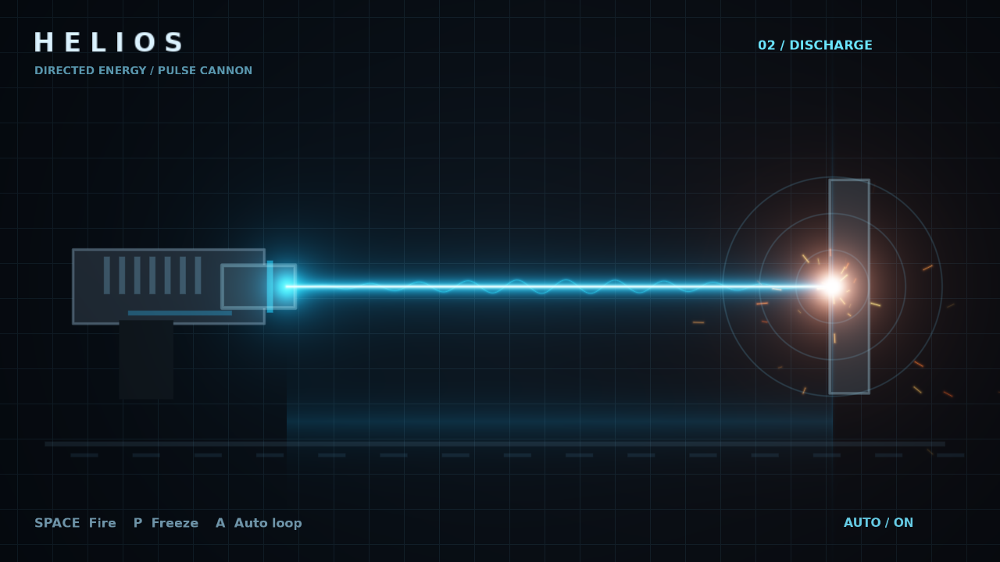

# HELIOS / 激光武器

原生 EVEngine 自定义片元着色器绘制的二维侧视激光武器特效：蓄能环、青白束芯、流动扰动、炮口辉光、命中等离子体、冲击环和确定性火花。无需外部美术素材。

运行：`make run/win32-debug GAME=examples/laser-weapon`，或 `eve run examples/laser-weapon`。

- Space：从蓄能开始手动发射，关闭自动循环。
- P：暂停/继续。
- A：切换自动循环。

周期为蓄能 0.9 秒、发射 1.3 秒、冷却 1.4 秒。所有动画使用 `eve_update(dt)` 注入的同一时钟，暂停时冻结。火花使用固定散列，不修改游戏随机数。此示例是屏幕空间视觉研究，不实现武器伤害、场景碰撞或三维遮挡。

着色器修改后运行：`glslc examples/laser-weapon/shaders/laser.frag -o examples/laser-weapon/shaders/laser.frag.spv`。

[完整发射周期动图](laser-weapon.gif)
