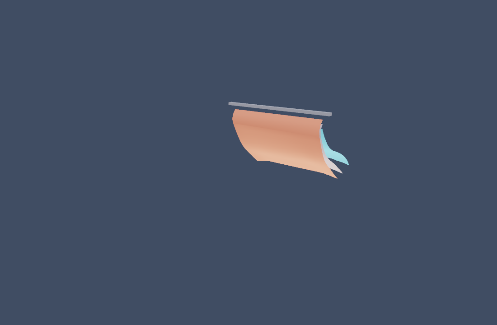

# GPU 多层布料

真实 Vulkan Compute 求解的三层布料，960 个模拟粒子，GPU 生成双面法线、颜色与顶点流，直接作为顶点缓冲绘制。`update` 和 `draw` 不回读坐标，不更新 CPU 顶点数组。

```sh
make run/linux-debug GAME=examples/layered-cloth-gpu
```

C 切换层间接触，W 切换风加速度，P 暂停，R 重置。固定步 1/60 秒、2 子步、8 次约束迭代；保留未追赶的余时。需要 Vulkan 与可用计算设备；不支持时明确报错，不退回 CPU。

当前是规则网格、多层连续点面/边边接触与摩擦原型；密集接触通过 GPU 统一缩放抑制过冲，CCD 有浮点容差和迭代上限，仍无持久接触流形、成衣导入或刚体双向耦合。风为统一加速度，CPU 版的完整空气动力模型尚未迁移。参考横杆是视觉标记，不是碰撞体。

[设计与验证](../../docs/dev/layered-cloth-gpu.md)



Linux Lavapipe 上由引擎 `eve_screenshot` 保存，未经后期处理；不能据此推断实体显卡性能。
