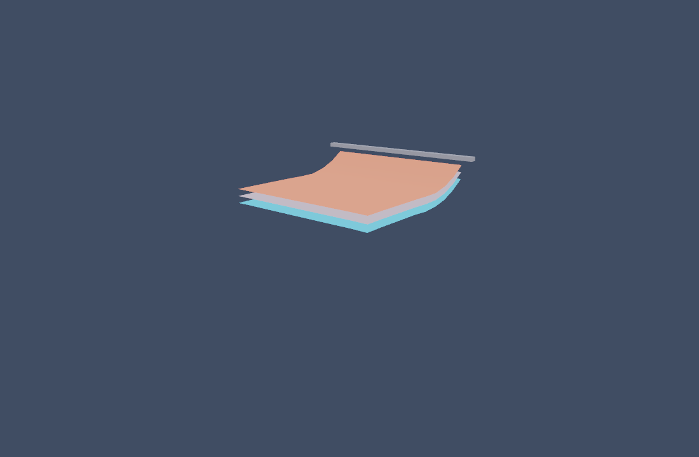

# 多层布料联合仿真

三层不同颜色的 10×10 布料，各自固定顶边，在重力和周期风作用下下垂。
按 C 切换层间碰撞，W 切换风，P 暂停，R 重置。接触投影次数每两秒输出到日志。

```sh
make run/linux-debug GAME=examples/layered-cloth
```

源码：`src/modules/physics/cloth/LayeredCloth3D.h`，实现复用
`Cloth3D.cpp` 的三角形最近特征查询。物理步长 1/120 秒，4 子步、3 耦合轮。
设计、参考工程和限制见 [调研与设计](../../docs/dev/layered-cloth-design.md)。

这是 CPU 离散接触原型，高速运动仍可能穿透；演示不包含角色服装导入或 GPU 求解。



截图由引擎 MCP 的 `eve_screenshot` 保存，未经后期处理；展示启动后的早期下垂状态，不能作为无穿透或帧率保证。灰色横杆是视觉参考，不是刚体碰撞体。
