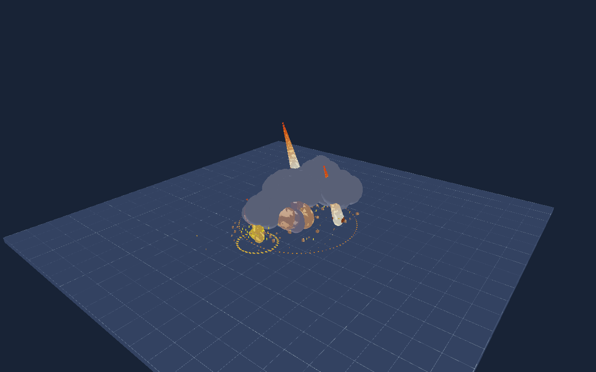

# 陨石雨 / Meteor rain

目标范围攻击特效：12 颗陨石在目标点周围半径 6 米的圆盘内随机落下，错峰撞击，各自带炽热拖尾、火球、上升烟尘、冲击环、火星和弹道碎块。橙色虚线圈表示下一次施放的目标范围。

运行：`make run/macosx-debug GAME=examples/meteor-impact`（Windows 使用 `run/win32-debug`），或 `eve run examples/meteor-impact`。

- **WASD**：移动目标范围。
- **空格**：清除当前一轮，向当前目标重新施放。
- 默认每 9 秒自动施放；移动目标不会改变已经生成的落点。

`main.nut` 顶部 `settings` 控制目标坐标 `targetX/targetZ`、半径 `radius`、数量 `count`、发射间隔 `interval`、下落时间 `fallTime`、循环周期 `repeatAfter`。数量在启动时决定池容量，修改后需重新启动；循环周期应留足最后一次撞击的消散时间。

每次施放快照目标，使用独立的 `rainSeed` 伪随机流；落点半径采用 `sqrt(u)*radius`，因此在圆盘面积内均匀分布。每一轮生成不同落点；重启后相同种子与输入产生相同序列。边界约束的是落点，爆炸火星可能扩散到圈外。本示例仅提供视觉表现，没有伤害判定。

资源启动时池化，无外部素材。所有动画使用传入 dt，单帧上限 0.05 秒，低帧率会减慢播放。碎块用解析重力弹道落地停留，烟尘为风格化几何烟团。

仅修改示例，不改变引擎公共 API、模块边界、ECS 或持久化格式。

已通过本机现有 macOS 引擎的 12 秒冒烟检查；以下为引擎 MCP 捕获的多落点攻击画面。

