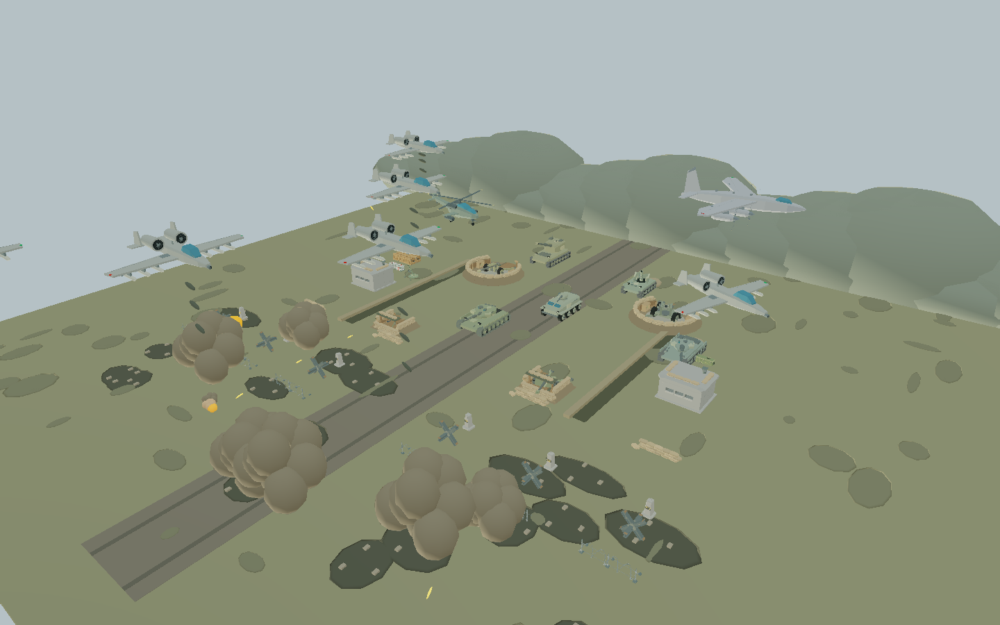
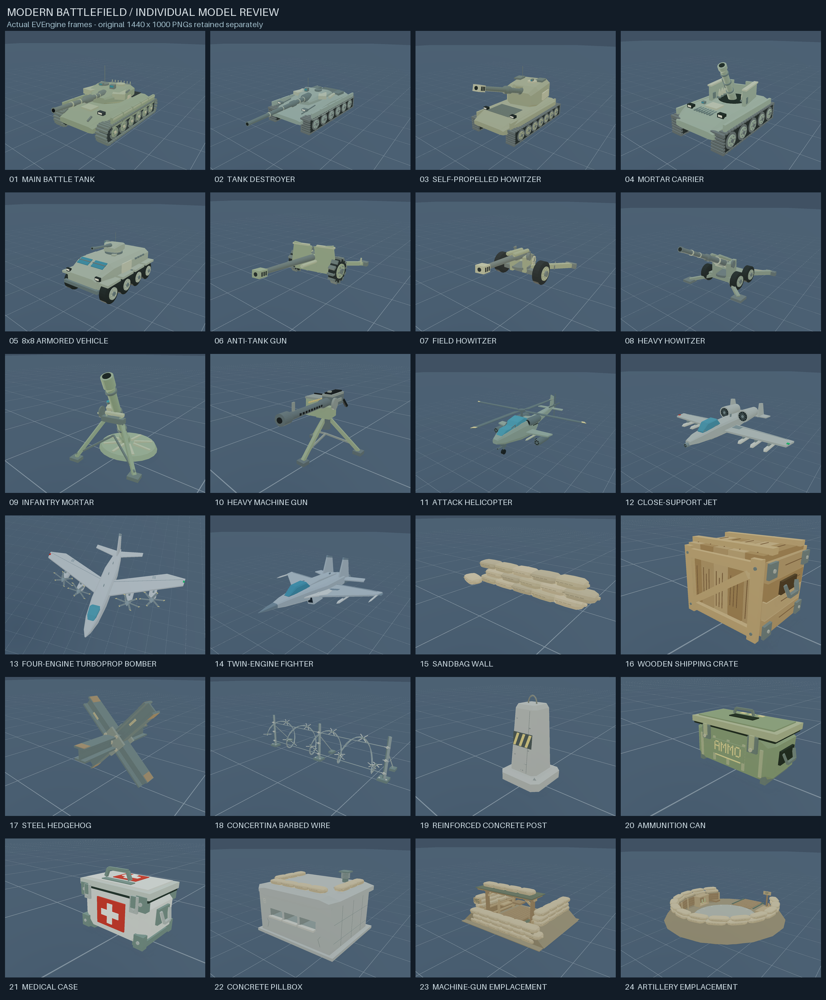
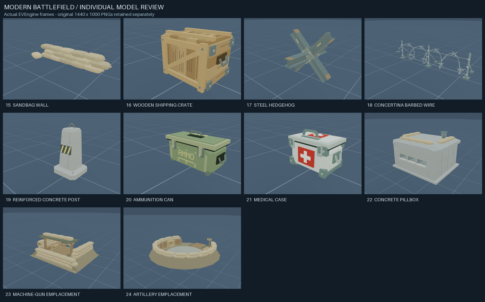

# Modern Battlefield / 现代陆空战场

可运行的三维动态战场示例，包含 24 类原创资源。全部工事、补给、武器、车辆和飞行器各自拥有
`models/<类型>.nut` 独立制作文件：使用截面放样车体/机身、多边形机翼、24/32 边圆管、
分段履带、轮毂螺栓、观察镜、格栅、挂载和发动机等结构。
几何体在创建时按材质与动画关节合并为网格；没有逐帧重建模型、外部下载或美术工具依赖。

```sh
eve run examples/modern-battlefield
# 源码构建也可运行：
make run/win32-debug GAME=examples/modern-battlefield
```

按键：`SPACE` 全炮齐射，`P` 暂停/继续模拟，`C` 开关环绕镜头，
`1` 战场总览，`2` 地面武器近景，`3` 空中编队。
启动时自动射击，无需操作即可观看；按键说明也会输出到控制台。

渲染脚本显式选择引擎支持的 `forwardPlus` 光照路径。本机默认 Hybrid 路径在
持续运行时触发 VMA `Allocation mapped too many times simultaneously` 断言；
最终脚本显式设置 ForwardPlus、不使用光照环境变量覆盖的 30 秒 smoke 通过。
示例使用简单不透明材质，无需延迟光照。

## 合成战场总览



[编队进入](screenshots/formation-entry.png) 与 [投弹通场](screenshots/formation-bombing.png)
来自引擎实际呈现帧，可对比装甲推进位置、飞机航向、炮塔角度及烟尘变化。
总览相机明确设置 0.1–350 米裁剪范围，完整容纳后方炮兵与空中巡航路线。
此场景关闭脚本热重载；修改后重新启动，避免模型与动画池在重载时丢失初始化状态。

截帧使用临时复制的同一份场景与模型，通过 MCP `eve_screenshot` 保存；
临时入口仅增加 Squirrel 标准 `setdebughook(null)` 以关闭逐行局部变量采样，
保留 MCP 与引擎帧读回，不使用 `eve_eval` 修改战场。

## 资源目录

- 工事与补给：`sandbags` 沙袋、`wooden-crate` 木箱、`hedgehog` 反坦克拒马、
  `barbed-wire` 螺旋铁丝网、`concrete-post` 混凝土桩、
  `ammunition-box` 弹药箱、`medical-box` 医疗箱。
- 建筑阵地：`bunker` 有射击口的地堡、`machine-gun-position` 机枪阵地、
  `artillery-position` 炮位阵地；阵地与其中武器可独立放置。
- 步兵/牵引火炮：`machine-gun` 机枪、`anti-tank-gun` 反坦克炮、
  `mortar` 迫击炮、`howitzer` 榴弹炮、`heavy-howitzer` 重型榴弹炮。
- 车辆：`tank` 坦克、`armored-car` 轮式装甲车、
  `self-propelled-artillery` 自行火炮、`self-propelled-mortar` 自行迫击炮、
  `tank-destroyer` 反坦克歼击车。
- 飞行器：`helicopter` 直升机、`attack-aircraft` 攻击机、
  `bomber` 轰炸机、`medium-fighter` 中型战斗机。
  攻击机为直翼双涡扇，进气口风扇独立转动；轰炸机为大翼展四发涡桨，
  四副六叶螺旋桨各有独立枢轴；战斗机为后掠翼双发双垂尾。
  直升机主旋翼绕 Y 轴、尾桨绕 X 轴独立旋转。

## 资源复用与动画约定

`initAssets()` 初始化共享网格，然后 `createBattlefieldModel(kind, x, y, z)` 创建独立实例。
实例持有所有 Renderable 引用；调用方在场景生命周期内保留实例。
`shape(...)` 可创建相同风格的附加地形/装饰。
单位为米，Y 向上、Z 向前，角度为弧度。

修改实例的 `x/y/z/yaw` 定位主体；`turret` 是相对主体的水平转角，
`elevation` 为炮管仰角，`recoil` 为炮管沿轴回退距离，`rotor` 为旋翼角度。
修改后调用 `poseAsset(instance)`，不会重新生成网格。
细化模型的 `rig.nodes` 保存主体、炮塔、炮管、主旋翼、尾桨及四个推进器枢轴，
`rig.parts` 保存按关节/材质合并后的 Mesh 与 Renderable；所有引用随实例存活。
`prop0` 至 `prop3` 的 `spin/phase` 可分别设置推进器速度比例和初相位。
关节使用引擎一致的 `Ry * Rx * Rz` 顺序组合；炮口世界坐标由炮管的最终变换求得，
射击闪光与弹丸从实际炮口生成。`createAsset` 保留为初版示例的兼容入口。
工事与补给也由相同的 `rig` 保存网格及位姿，几何体由各自独立的制作文件生成。

场景以 60 Hz 固定步长更新，单帧最多补算 0.1 秒；不使用随机数，
同样的步数与输入有相同脚本模拟状态，不声明跨平台逐位渲染一致。
装甲纵队沿中央突破口推进，40 秒后停驻 10 秒，随后沿原路倒车撤回，100 秒循环。
两座牵引炮位各自每 6 秒发射，初相位错开 3 秒；其他武器使用各自装填周期。
固定翼飞机沿 180 米直线航段掠过战场，在场外半圆转弯后返航；直升机采用独立的 126 米低速航线。
机头沿速度切线，直线段保持航向，转弯时平滑压坡并回正；各机型分开高度与航线方向。
炮塔扫描、炮管俯仰和后坐、主尾旋翼与推进器独立更新。
前沿每 1.15 秒产生一次脚本化来袭弹着，配合车辆尾部扬尘、焦黑弹坑与地形碎石。
10 类地面武器均自动射击；
预分配弹丸和爆点池演示枪口闪光、后坐、重力弹道、落地火光与持续 5.5 秒的上升烟尘。机枪弹着使用更小、更短的扬尘，避免遮蔽部队。
弹道参数为便于观看而压缩；弹丸仅检测地面，不包含单位命中、破坏、
伤害、寻路或真实弹道计算。模型为原创风格化几何资源，没有声称复刻具体真实装备型号或照片级材质。

所有创建、姿态更新和生命周期回调均在游戏主线程执行，不跨线程共享可变实例。
本示例不改动引擎公开 API、模块边界、ECS 或持久化格式。

## 检查

```sh
python3 scripts/check_examples.py
MIN_RUN_SECONDS=2 RUN_SECONDS=45 bash scripts/smoke_examples.sh modern-battlefield
```

可用 `eve run --debug --mcp-port=7543 examples/modern-battlefield` 接入 MCP；
通过 `eve_screenshot` 获取引擎呈现帧（第一次启用读回后需等待下一帧重试）。

最终脚本的普通模式 45 秒 smoke 通过（1 passed / 0 failed），
示例布局、architecture contracts 与 `git diff --check` 通过。

合成战场实测日志中，普通运行到 112 秒模拟时间：坦克从 Z=-4 推进至 Z=42，
停驻后倒车撤回，再次开始推进；主炮位按 0.8/3.8 秒起始、各自 6 秒周期交替射击。
炮塔、炮管和旋翼动画继续使用各自关节，未合并到车身或机身。

本次本机 `make check` 已运行：格式、模块分层、绑定覆盖和绑定元数据通过；
在测试清单阶段被仓库已有的 module test evidence 过期问题阻断。
独立运行的示例布局和 architecture contracts 检查通过。

## 授权

本目录原创程序化模型和脚本按仓库许可分发，不含第三方模型资源。


## 武器与飞行器逐件检查记录（2026-10-17）

每一件先独立制作，再启动独立的检视场景，调用引擎 `eve_screenshot`，
查看静态帧和运动后帧后才继续下一件。原始分辨率均为 1440×1000。
固定翼喷气机的机翼/尾翼是固定结构；旋转部件为直升机旋翼、轰炸机螺旋桨和攻击机进气风扇。
拼图仅缩小和排列真实帧，未生成或修改模型图像。



按实际制作顺序的检查结果：

1. [主战坦克模型](models/tank.nut)：楔形炮塔、六组负重轮、分段履带、侧裙甲、热护套；检查炮塔/炮管连接与转动。
   [静态帧](screenshots/tank.png) / [动画帧](screenshots/tank-articulated.png)。
2. [反坦克炮模型](models/anti-tank-gun.nut)：低炮盾、长炮管、分叉炮尾、轮毂、制退器；轮胎胎块朝向在检查后修正并重新截图。
   [静态帧](screenshots/anti-tank-gun.png) / [动画帧](screenshots/anti-tank-gun-articulated.png)。
3. [迫击炮模型](models/mortar.nut)：圆形加强底板、双脚架、调节轮、瞄具；检查高仰角炮管与支架的轮廓。
   [静态帧](screenshots/mortar.png) / [动画帧](screenshots/mortar-articulated.png)。
4. [榴弹炮模型](models/howitzer.nut)：开放摇架、双驻退筒、分叉炮尾、调节手轮；检查与反坦克炮的轮廓差异。
   [静态帧](screenshots/howitzer.png) / [动画帧](screenshots/howitzer-articulated.png)。
5. [重型榴弹炮模型](models/heavy-howitzer.nut)：四轮底盘、宽支腿、粗长炮身和较高仰角；检查支腿展开与炮身转动。
   [静态帧](screenshots/heavy-howitzer.png) / [动画帧](screenshots/heavy-howitzer-articulated.png)。
6. [自行火炮模型](models/self-propelled-artillery.nut)：七轮长底盘、高大后置炮塔、后驻锄和制退器；检查其高炮塔剪影。
   [静态帧](screenshots/self-propelled-artillery.png) / [动画帧](screenshots/self-propelled-artillery-articulated.png)。
7. [自行迫击炮模型](models/self-propelled-mortar.nut)：短底盘、敞口战斗舱、高仰角炮管和备弹架；检查与封闭炮塔车辆的差异。
   [静态帧](screenshots/self-propelled-mortar.png) / [动画帧](screenshots/self-propelled-mortar-articulated.png)。
8. [反坦克歼击车模型](models/tank-destroyer.nut)：低矮楔形车体、浅炮塔、超长无制退器炮管；检查炮口和炮塔转动后位置。
   [静态帧](screenshots/tank-destroyer.png) / [动画帧](screenshots/tank-destroyer-articulated.png)。
9. [装甲车模型](models/armored-car.nut)：8×8 轮式底盘、双风挡、乘员舱、后舱门和遥控炮塔；检查八轮与车体比例。
   [静态帧](screenshots/armored-car.png) / [动画帧](screenshots/armored-car-articulated.png)。
10. [机枪模型](models/machine-gun.nut)：三脚架、弹箱、弹链、散热孔、导轨和瞄具；检查俯仰/回转时整体连接。
    [静态帧](screenshots/machine-gun.png) / [动画帧](screenshots/machine-gun-articulated.png)。
11. [直升机模型](models/helicopter.nut)：阶梯座舱、双发动机、短翼挂载、尾梁、起落架；检查主旋翼与尾桨分别绕正确轴转动。
    [静态帧](screenshots/helicopter.png) / [动画帧](screenshots/helicopter-articulated.png)。
12. [攻击机模型](models/attack-aircraft.nut)：直翼、机背双涡扇、双垂尾、七管机炮、翼下挂载；进气口风扇增加独立转动后重新检查。
    [静态帧](screenshots/attack-aircraft.png) / [动画帧](screenshots/attack-aircraft-articulated.png)。
13. [轰炸机模型](models/bomber.nut)：大翼展、长机身、四发六叶桨；补充俯视帧检查四副桨各自围绕本地轴转动。
    [静态帧](screenshots/bomber.png) / [动画帧](screenshots/bomber-articulated.png) /
    [俯视帧](screenshots/bomber-top.png) / [俯视动画帧](screenshots/bomber-top-articulated.png)。
14. [中型战斗机模型](models/medium-fighter.nut)：尖雷达罩、后掠翼、边条翼、双进气口、双垂尾、双喷口和翼尖挂载；检查与攻击机/轰炸机的外形差异。
    [静态帧](screenshots/medium-fighter.png) / [后续帧](screenshots/medium-fighter-articulated.png)。

复现单件检视（`EVE` 可由环境配置，也可用 `--eve` 指定可执行文件）：

```sh
python tools/inspect_model.py tank --size 9 --height 1.6
python tools/inspect_model.py helicopter --size 12 --height 2.8 --air
python tools/inspect_model.py bomber --size 18 --height 2.6 --air --view top
python tools/contact_sheet.py
```

以上命令从本示例目录执行。工具把当前资源复制到自身 `.inspection-cache` 下的独立游戏目录，
在检视后终止自己启动的引擎进程并清理该临时目录。截图保留到 `screenshots/`，
运行日志也保存在那里但不进入版本控制。检视工具只使用公开 MCP 截帧，不执行 `eve_eval`。

本次最终版本：逐件原始帧检查完成，整场景 30 秒 smoke 通过；新增工具 ruff、
示例布局、architecture contracts 与 diff 空白检查通过。
仅修改示例内容与工具，没有修改引擎公开 API、ECS、模块边界或持久化格式；
保留固定步长、主线程生命周期与旧工厂入口，无架构规则例外。


## 工事与补给逐件检查记录（2026-10-17）

新增的 10 件模型同样按“制作一件 → 独立渲染 → 查看真实帧 → 修正 → 继续下一件”完成。
每件保留正反面两张引擎原始 PNG，炮位另补一张俯视图，共 21 张 1440×1000 原始帧。
没有修改此前武器与飞行器的独立动画；整场景仍通过同一个工厂创建这些资源。



1. [沙袋](models/sandbags.nut)：受压袋体、收紧的袋端、缝线、三层错缝及散放备用袋。
   首轮发现表面朝向错误，修正后重拍，检查袋体闭合与叠放连接。
   [正面](screenshots/sandbags.png) / [背面](screenshots/sandbags-rear.png)。
2. [木箱](models/wooden-crate.nut)：独立木板、板缝、加固斜撑、木纹刻线、角铁、钉头和侧把手。
   检查前后斜撑、箱盖与四角连接。
   [正面](screenshots/wooden-crate.png) / [背面](screenshots/wooden-crate-rear.png)。
3. [拒马](models/hedgehog.nut)：三根开口工字钢、中心连接板、铆钉、端部磨损色块。
   检查工字钢截面、交叉连接和落地端。
   [正面](screenshots/hedgehog.png) / [背面](screenshots/hedgehog-rear.png)。
4. [铁丝网](models/barbed-wire.nut)：四圈双绞钢丝、交叉倒刺、固定扣、立柱、拉线和底座螺栓。
   倒刺方向修正后重拍，检查正反面螺旋连续性与支撑连接。
   [正面](screenshots/barbed-wire.png) / [背面](screenshots/barbed-wire-rear.png)。
5. [混凝土桩](models/concrete-post.nut)：锥形倒角、底座、浇筑接缝、孔点、吊环和警示漆。
   修正漆带贴合角度、扩大镜头留白后重拍，确认吊环未被裁切。
   [正面](screenshots/concrete-post.png) / [背面](screenshots/concrete-post-rear.png)。
6. [弹药箱](models/ammunition-box.nut)：长条钢箱、冲压加强筋、密封圈、箱盖、铰链、锁扣和三处把手。
   黄色 AMMO 字样由网格构成；检查箱盖及侧后结构。
   [正面](screenshots/ammunition-box.png) / [背面](screenshots/ammunition-box-rear.png)。
7. [医疗箱](models/medical-box.nut)：浅色护角箱体、正面与顶面医疗标识、MED 背标、锁扣及提手。
   检查与弹药箱的比例、颜色和标识差异。
   [正面](screenshots/medical-box.png) / [背面](screenshots/medical-box-rear.png)。
8. [地堡](models/bunker.nut)：厚墙、倒角顶板、三处真实开口射孔、内室、屋顶沙袋、通风帽，
   后部含门扇、台阶和偏置防爆墙。背面另选角度重拍，确认通道没有完全被防爆墙遮挡。
   [正面](screenshots/bunker.png) / [后入口](screenshots/bunker-rear.png)。
9. [机枪阵地](models/machine-gun-position.nut)：紧凑木护壁、沙袋射击口、顶部防破片棚、木踏板、
   备弹架与接链盘。检查后给 MG 标牌补了背板，并修正一侧土坡表面朝向后重拍。
   [正面](screenshots/machine-gun-position.png) / [内部与后入口](screenshots/machine-gun-position-rear.png)。
10. [炮位阵地](models/artillery-position.nut)：宽环形土坡、木护壁、双层沙袋、带刻度中心平台、
    后部补给通道、排水条和左右备弹龛。修正土坡表面朝向，检查护坡连续性；
    用俯视图核对回转空间、出入口与两处备弹龛。
    [正面](screenshots/artillery-position.png) / [背面](screenshots/artillery-position-rear.png) /
    [俯视](screenshots/artillery-position-top.png)。

阵地与武器是独立资源。机枪阵地在原点保留射击位；炮位中央平台保留独立火炮的放置空间，
场景脚本在对应位置另行放置机枪、榴弹炮及重型榴弹炮。

复现本轮静态资源检视：

```sh
python tools/inspect_model.py sandbags --size 4.4 --height 0.4 --static
python tools/inspect_model.py wooden-crate --size 2.0 --height 0.55 --static
python tools/inspect_model.py bunker --size 7.8 --height 1.5 --static
python tools/inspect_model.py bunker --size 7.8 --height 1.4 --view rear --single
python tools/inspect_model.py artillery-position --size 11 --height 0.8 --static
python tools/inspect_model.py artillery-position --size 11 --height 0.7 --view top --single
python tools/contact_sheet.py
```

`--static` 在首帧后切换模型方向并捕获背面，避免为静态物件生成两张相同方向的检查帧；
`--view` 可指定额外方向，`--single` 只保存该方向的一张截图。
本轮整场景 45 秒 smoke 通过；单模型日志无脚本错误。
仅改变示例资源与检视工具，保留工厂入口、引擎接口、固定步长和主线程生命周期，无架构规则例外。

航线修正后重新通过 45 秒 smoke；引擎截帧：[直线通场](screenshots/flight-straight.png) / [后续飞行](screenshots/flight-return.png)。

## 编队突击

新增五架攻击机组成 V 字编队，总计九架飞行器。编队共享航路，保持横向间距与纵向梯次，
以 28 米/秒快速通场，每机依次释放三枚炸弹，随后继续直线飞离；在场外大半径转弯后循环。
炸弹继承载机前向速度，按固定步长受重力下落，接触地面才触发爆炸烟尘；没有伤害判定。
每轮每机仅投一次三弹短串，场外完成航路后重新装填。旋翼、风扇及机身倾斜继续独立更新。

实机截图：[编队进入](screenshots/formation-entry.png) / [投弹通场](screenshots/formation-bombing.png)。

编队版本验证：45 秒 smoke 通过；截帧会话记录 15 次投弹、15 次地面爆炸，未检出 frame error。
