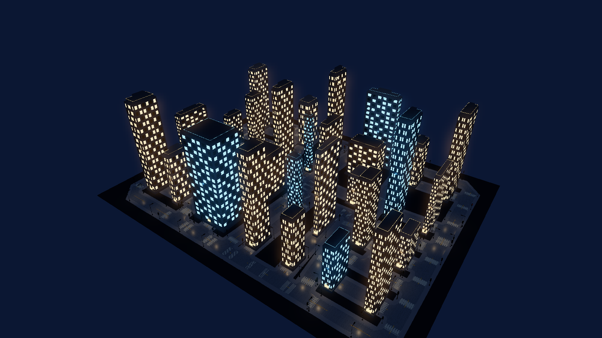

# Midnight District



A reproducible, procedural night-time city. Original OpenSCAD towers, window
batches, streetlights and traffic signals are included as source and baked OBJ.
OpenSCAD is only needed to rebuild the kit; running the example needs no downloads.

```sh
make run/win32-debug GAME=examples/night-city
# Or use a current SDK containing the road networkSnapshot recipe:
eve run examples/night-city
```

Keys: **1** architectural overview, **2** low approach, **3** plan view,
**O** orbit, **WASD** move horizontally, **Q/E** move down/up,
**L** toggle local lights to compare actual surface illumination with luminous meshes.
The scene starts with seed `20261017` in `main.nut`; changing it
regenerates parcels, streets and building heights together on the next launch.

The layout uses the existing `mesh.urban` / `urban.parcels` hierarchical
parcel/street co-generation and geometric optimization. The example recovers
centerlines from the flat urban recipe's leading street quads (guarded by their
height), merges coincident nodes and splits T junctions. It passes those authored
lines to **`mesh.roadNetwork` using the canonical schema-v1 `networkSnapshot`**.
The current road baker owns road sections, junctions, curbs, sidewalks and lane
markings, with explicit metric sampling. This requires a current engine build;
older SDKs that ignore `networkSnapshot` cannot display this city correctly.

Buildings only occupy rectangles checked cell-by-cell against their parcel id
and the generated street clearance envelope. Narrow parcels remain open rather
than intersecting roads. Their original SCAD kit includes plinths, structural
piers, floor bands, rooftop mechanical housings and bright/dark window groups.
Building dimensions and heights vary deterministically with the seed.

Lighting combines cool moonlight, warm spot streetlights and window/entrance spill
lights. Luminous meshes use a dedicated HDR emission shader with bloom. Actual scene lights
illuminate nearby surfaces; the selected foreground lights cast local shadows.
Window pixels themselves do not each allocate a shadow map. Clustered lighting
supports the streetlight population. Signal lenses cycle green/amber/red with an
all-red transition between the two approach groups; this is a visual signal
demonstration, with no vehicle traffic simulation.

Rebuild all ten original model batches (8/16-floor towers plus street furniture):

```sh
python examples/night-city/tools/bake.py --openscad /path/to/openscad
```

The bake script only converts OpenSCAD STL triangles to metre-scale Y-up OBJ,
preserving flat face normals. It does not replace SCAD geometry with Python models.

Rebuild the included emission SPIR-V with Vulkan SDK `glslc`:

```sh
glslc examples/night-city/assets/emission.vert -o examples/night-city/assets/emission.vert.spv
glslc examples/night-city/assets/emission.frag -o examples/night-city/assets/emission.frag.spv
```

Validation:

```sh
python scripts/check_examples.py
MIN_RUN_SECONDS=2 RUN_SECONDS=30 bash scripts/smoke_examples.sh night-city
```

The example prints `NIGHT_CITY_ROADS`, `NIGHT_CITY_BUILDINGS` and
`NIGHT_CITY_READY`. Engine-owned frame capture is used for visual verification.
All generation occurs during initialization; updates only animate signals/camera.
No public engine API, persistent format or module boundary is changed.
