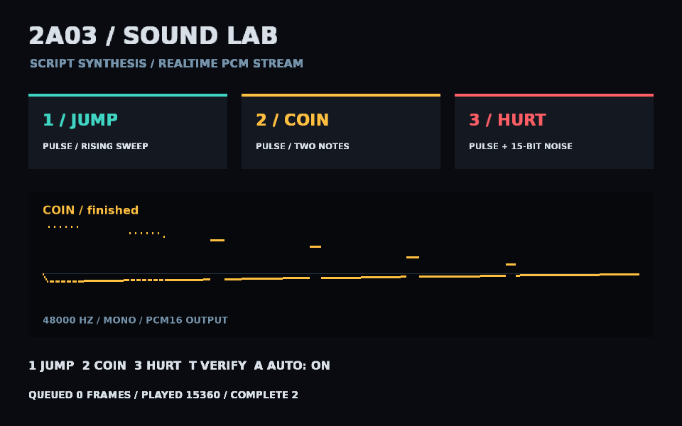

# Script-generated 2A03-style sound effects



Run with an engine built from this change:

```sh
make run/win32-debug GAME=examples/pcm-2a03
# Linux/macOS: substitute linux-debug or macosx-debug.
```

The lab automatically plays **jump, coin and hurt**, then repeats. Press **1/2/3**
to play an effect manually (interrupting the previous sound); **A** toggles auto.
**T** runs the synthesis contract tests. The window shows the generated waveform
and queued/played frame counts. Auto waits for complete drain before the next effect.
Master volume follows the normal Audio listener. Audio hardware must be available
for listening; CI can use OpenAL's null backend to verify the playback lifecycle.

`synth.nut` contains all sound generation: NTSC timer-quantized pulse pitch,
12.5/25/50-percent duty cycles, a stepped 4-bit decay envelope, rising/falling
sweeps and explicitly seeded 15-bit LFSR noise. These are original effects in a
2A03 style, not copied game samples or cycle-accurate APU emulation. The example
does not emulate registers, frame-counter/sweep hardware, DMC, analog filters or
the original nonlinear mixer. Pulse/noise references:
[NESdev pulse](https://www.nesdev.org/wiki/APU_Pulse) and
[NESdev noise](https://www.nesdev.org/wiki/APU_Noise).

The synthesis clock is an integer sample cursor at 48000 Hz, independent of render
dt. A fixed noise seed makes repeated generation identical in the same VM/build;
floating pulse calculations across platforms are tolerance-bounded, not a bit-exact
emulator/replay contract. No wall clock or global random generator enters synthesis.

## PCM API

```squirrel
local created = audio.newPcmStream(48000, 1);
if (!created.ok) throw created.status.summary;
local stream = created.value; // keep this reference while playing
local submitted = stream.submit([0.0, 0.2, -0.2, 0.0]);
if (!submitted.ok) throw submitted.status.summary;
local ended = stream.finishInput();
if (!ended.ok) throw ended.status.summary;
local started = stream.play();
if (!started.ok) throw started.status.summary;
```

The rate is 8000..192000 Hz; channels are 1 or 2. `submit` takes normalized finite
numbers in [-1,1], interleaved L,R for stereo, and converts them to signed PCM16.
One frame contains one sample per channel. A block must contain 1..4096 frames;
there are eight queued blocks, giving at most 32768 queued frames. Samples are
copied before returning; modifying the input array cannot change queued audio.

- All fallible operations return the common Result table. `submit.value` is the
  number of accepted frames. Invalid blocks are rejected whole, without clipping.
- `getInfo()` returns `phase`, `sampleRate`, `channels`, `availableBlocks`,
  `maxBlockFrames`, `queuedFrames`, `playedFrames`. Counts are updated by the
  normal engine Audio pump (also on submit/play); `playedFrames` counts completed
  blocks, not the partial playback offset. Getters do not do backend work.
- A full queue returns diagnostic code `conflict`; retain the unsubmitted block
  and retry after capacity becomes available. Do not advance synthesis twice.
- `play()` with no data enters `starved`. More input resumes automatically;
  the engine inserts no synthetic silence and retains no unbounded backlog.
- `pause()` preserves the queue. `play()` resumes. `finishInput()` closes input
  idempotently; after playback drains, phase becomes `finished`. Finishing does
  not implicitly start a paused/idle source.
- `reset()` stops/discards queued audio, clears counters and reopens input.
  `close()` permanently releases the stream and is idempotent. Audio teardown
  closes outstanding streams; script GC also releases streams. `audio.stopAll()`
  closes PCM streams. Closed handles report `closed`; mutations return a diagnostic.
- Use the VM/main thread for every operation/destruction. Engine frames pump
  playback automatically; do not run synthesis in an audio callback. Hot reload
  closes/recreates this transient stream; there is no persistent PCM schema.

This example generates at most two 1024-frame blocks per update and aims to keep
roughly 43 ms queued. A long frame can cause audible starvation; increase lookahead
for a production workload. A new trigger intentionally resets the reusable stream.
To overlap effects, use a bounded voice pool or mix several script voices into one
stream. No synthesis implementation or 2A03-specific API was added to C++.

## Verification

`PCM_EFFECT_DONE` records backend-completed frame counts. The first complete
three-effect cycle prints `PCM_2A03_PLAYBACK_PASS`; this proves queue drain and frame
accounting, not subjective listening quality. Smoke contract:

Pressing T runs `verification.nut`: all three effects must be bounded and
non-silent, identical with whole-effect vs 337-frame generation, and noise seeds
must affect the hurt waveform. Success prints `PCM_SYNTHESIS_PASS`. Instruction
tracing (`--debug`/MCP) makes per-sample script work much slower; use ordinary
`eve run` for listening and performance. The explicit verification can take
about a minute with local-variable tracing enabled.

```sh
MIN_RUN_SECONDS=2 RUN_SECONDS=8 bash scripts/smoke_examples.sh pcm-2a03
```

The native `audio.pcm.*` tests cover malformed input, bounded backpressure, stereo
frame accounting, pause/resume, starvation recovery, EOS, reset, script Result and
ownership behavior, and both stream/module destruction orders.

Font: DejaVu Sans Bold, bundled under [its license](assets/FONT-LICENSE.txt).

## Boundary and lifecycle review

This extends the existing audio module's script face; no module, ECS system,
Link, event protocol or persistent format is introduced. Native declarations,
bindings and this executable example are the contract; no parallel catalogue.
The existing main-thread Audio event-pump sink drives streams. The script is
the known producer of bounded blocks, with one stream owner and atomic admission;
direct typed calls fit this cardinality/frequency/atomicity without a capability
lookup or callback on the sample path. The new pump path is declared in
`HOT_PATH_GLOBS`. Stream state has one authoritative owner; Audio's weak reference
only permits pumping and teardown, and cannot extend resource lifetime.

Local evidence: Windows Debug SHARED build with the minimal profile plus audio,
font and devtools, four `audio.pcm.*` tests, ordinary-mode complete frame drains,
eight-second example smoke, synthesis verification and engine-owned capture.
This is a trimmed composition run, not an audio-provider-absent or cross-platform
claim. Existing optional providers and module dependencies were not changed.
