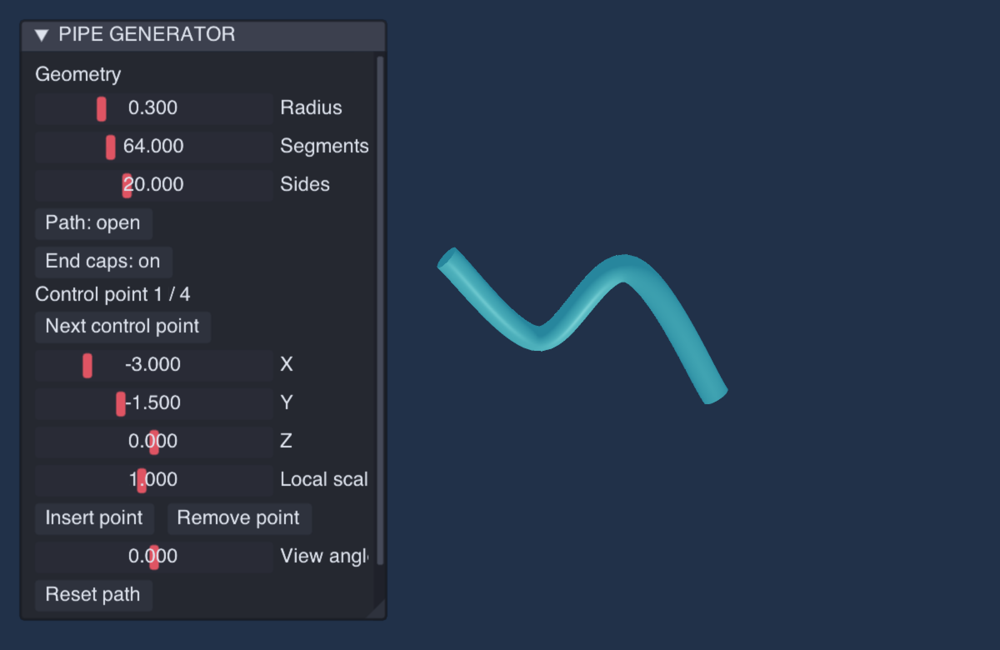

# 样条管道生成器

沿指定 Catmull-Rom 路径生成圆截面网格，无需源模型。

```sh
make run/macosx-debug GAME=examples/pipe-generator
```

其他平台替换 `macosx-debug` 即可。

- Radius 调节整体半径；Local scale 调节当前控制点的截面半径倍率。
- Next control point 选择控制点，X/Y/Z 修改坐标；Insert point 在下一段插入中点，Remove point 删除当前点。支持 3–16 个点；开放路径末端插入时在末点与首点之间取中点并追加。
- Path 切换开放或闭合，End caps 控制开放路径的实心封盖。
- Segments / Sides 调节纵向和径向精度；View angle 旋转预览。
- Reset path 恢复默认四点路径和局部倍率，保留全局网格设置。

参数停止变化 80ms 后自动生成。构建与上传成功后才替换预览；错误显示在面板，上一份网格保留。
此工具生成管道外表面，不生成有壁厚的内腔，也不处理自交、碰撞或自动布线。
控制点靠得过近或半径过大时可能自交。当前参数保留在运行会话中，不提供磁盘保存或模型导出。

实现仅使用现有 `SplinePath`、`mesh.splineTube`、`MeshModifierGraph`、UI 和 Renderable3D 接口。
在主线程更新阶段处理编辑、构建与发布；渲染阶段只绘制。没有新增公共 API、持久化格式、模块依赖或 ECS 系统。

验证：`python3 scripts/check_examples.py`；`MIN_RUN_SECONDS=2 bash scripts/smoke_examples.sh pipe-generator`。
成功生成日志为 `PIPE_GENERATOR_BUILT`；生成拒绝日志为 `PIPE_GENERATOR_REJECTED`。


