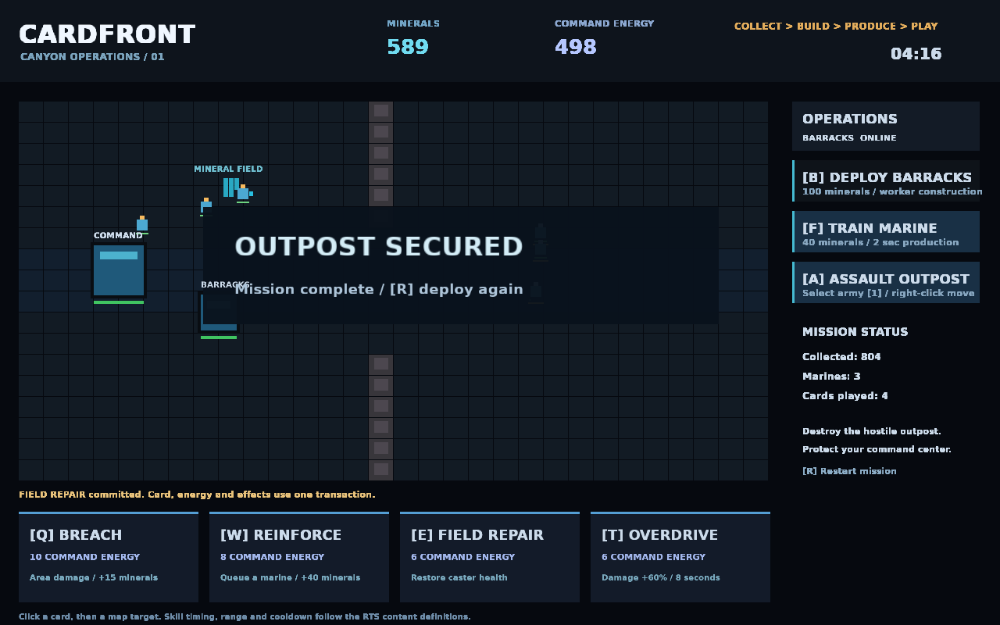

# Cardfront — collect, build, produce, play

A playable tactical mission combining canonical RTS simulation, EconomyLedger
and card transactions. Collect minerals, construct a barracks, train marines,
and use cards to secure the hostile outpost. Protect your command center.

```powershell
make run/win32-debug GAME=examples/rts-cardfront
```

Controls:

- **B** or Deploy Barracks: spend 100 collected minerals on worker construction.
- **F** or Train Marine: pay 40 minerals and start normal production.
- **1** selects your marines; right-click moves them; **A** attacks the outpost.
- **Q/W/E/T** play the card currently shown in that slot. BREACH targets the
  cursor and also costs 15 minerals; REINFORCE queues a marine and pays its
  production cost; FIELD REPAIR heals the caster; OVERDRIVE applies an RTS status.
- Click a card, then a map position to play it. Select a marine for skills.
- **R** restarts. Destroying the hostile command center wins; losing yours loses.

The native hand contains the actual cards. Successful plays remove the card
atomically; failed range/cooldown/resource checks preserve it. The deck is
deterministic and finite. `transaction.newAtomicBatch()` combines independently staged card and RTS
operations, merges their costs and pays the authoritative account once. This script never maintains a second balance,
health store, production timer or combat simulation.

`data/content.json` configures worker gathering, building costs, unit production,
weapons, cast times and statuses. `data/cards.json` configures the cards. `Card.stagePlay`, `RTS.stageAbility` and `RTS.stageProduction` contribute to the
existing transaction protocol. Neither gameplay module depends on the other.

`game.agent.json` exposes the same player actions and owning mission projection
to `eve_play`. Runtime validation uses those mapped actions and engine-owned
readback; it does not mutate the game through `eve_eval`.



See [validation evidence](VALIDATION.md) for the exercised gameplay and build configurations.
