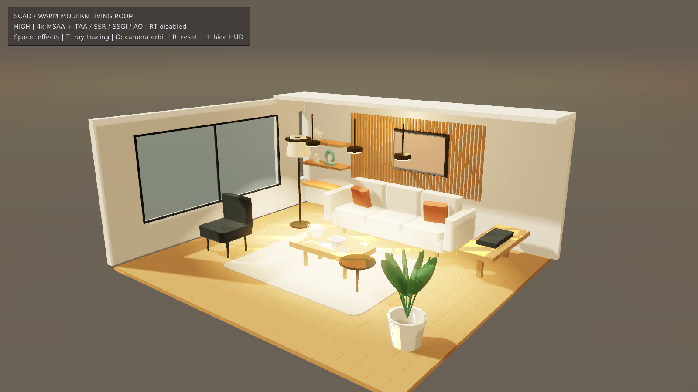

# SCAD 暖调现代客厅



原创 OpenSCAD 参数化室内示例：米色三人沙发、赤陶色靠垫、橡木拼接地板、圆角茶几、
黄铜边几、单椅、置物架、陶器、绿植、立体挂画、三盏吊灯、落地灯与顶部灯带，双片透明玻璃窗及深色金属窗框。
前面与右面开放，后部局部吊顶保留室内遮蔽，同时方便观察整个空间。
所有可见几何来自 `assets/living-room.scad`，无外部模型或贴图依赖。

## 运行

使用包含 `model3d` 和 `graphics_raytracing` 的 3D 引擎构建：

```sh
make run/linux-debug GAME=examples/scad-living-room
# Windows: make run/win32-debug GAME=examples/scad-living-room
```

也可进入本目录后执行 `../../build/linux-debug/src/engine/eve run`。
默认 1600×900。Space 比较后期效果开关，T 单独切换光追，O 开关缓慢环绕相机，R 复位，H 隐藏说明。
默认启用全部适合此场景的已实现光影效果：方向光 CSM、4 盏聚光灯 perspective 阴影、
暖色环境光、PBR、AO、SSGI（`rtgi`）、SSR、TAA、薄尘 froxel 体积光、时间过滤、
高质量后期与 Bloom。显式启用 4× MSAA 几何覆盖采样并叠加 TAA 时间累积；描边、贴花和室外天空不作为画质开关。
点光源 cube 阴影尚为引擎预留路径，因此顶部灯带提供无阴影补光。

启动时探测硬件 RT：可用时自动打开 `rtx` 反射并保留便携反射链；不可用时使用
TAA + SSR + SSGI，HUD 明确标注 `RT unavailable`。
当前引擎硬件 RT 是单次反射，命中颜色依赖当前屏幕场景颜色，不是完整路径追踪，
`rtgi` 也是屏幕空间 GI。17 个材质批次保持在当前 64 个可见不透明网格 RT 上限内。
灯具使用高亮 unlit 表面配合真实局部灯光与 Bloom，未模拟发光面路径追踪。

## SCAD 创作与重建

仓库附带 17 个烘焙 OBJ，普通运行不需要 OpenSCAD。重建需要 Python 3 和 OpenSCAD：

```sh
python3 examples/scad-living-room/tools/bake.py
python3 examples/scad-living-room/tools/bake.py --openscad /path/to/openscad
# 可选：同时通过引擎新增 SCAD 导入器生成并验证每个批次的原生 .eva
python3 examples/scad-living-room/tools/bake.py --eve /absolute/path/to/eve
```

从仓库根目录执行上述命令。每批次以 OpenSCAD `--hardwarnings` 编译、检查退出状态及
超时，再把三角网格从毫米 Z-up 转为米 Y-up `(x,z,-y)`，保留绕序。
SCAD 的 `color()` 不会经过 STL 保留，因此用 `part` 分批导出，运行时明确赋予 PBR 材质。
当前原生 `.eva/.evpack` 没有通用脚本加载器，故 EveScript 使用同源 OBJ + `Model3D`；
可选 `.eva` 用于原生资产工作流，不能直接传给 `Model3D`。
原生包的材质仍是导入器默认中性色，运行时配色集中在 `main.nut` 的 `roomLoad` 调用。
修改家具形状或尺寸后重建 OBJ；只调整灯光、颜色、粗糙度时修改脚本即可。

## 验证范围

已实际编译全部 SCAD 批次，并验证原生 SCAD → `.eva` 导入及包校验。
脚本另经 Squirrel 编译器语法检查（将 EveScript `persist` 声明降为 `local`）。
已补齐专用 3D 构建、Xvfb、Mesa llvmpipe 与 Vulkan 验证层，实际运行到呈现帧，
并通过引擎 MCP 获取 1600×900 截图。修复了导入 Material 覆盖渲染器配色、
OBJ 自动平滑法线造成地板变形观感的问题，导出器现在写入明确的面法线。
软件驱动虽然暴露 RT 扩展，但光追渲染无法在合理时间完成截图；截图使用
高质量便携光影链，关闭 RT，不能作为硬件光追验证或 GPU 性能证据。
默认仍请求 RT；仅在 CPU 预览时可在本目录创建空文件 `portable-preview.flag`，
启动时单独关闭 RT，或在支持交互的设备上按 T 切换。删除该文件恢复默认行为。

窗玻璃使用低粗糙度、淡蓝灰色透明材质，关闭深度写入和不透明投影，保留窗外光照。
只重建窗户：`python3 examples/scad-living-room/tools/bake.py --part glass --part window-frame`。

本版拉近了相机，增加画框保护玻璃、上层架的中空瓷瓶和中层架的青瓷环形艺术摆件。
茶几新增带中空壶身、壶嘴、把手及壶盖的玻璃茶壶和三个中空玻璃杯。
玻璃采用透明混合与低粗糙度高光，当前截图未验证真实折射或硬件光追。
运行日志 `SCAD_ROOM_READY` 明确报告 TAA / MSAA 开关，便于核查抗锯齿状态。
