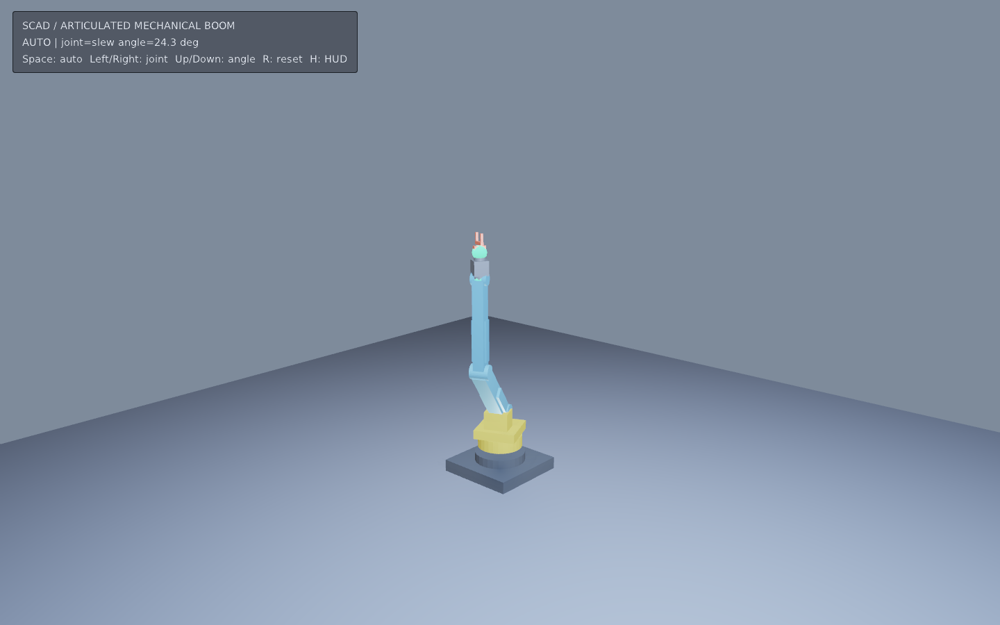

# SCAD 可旋转机械臂



原创 OpenSCAD 参数化机械图：六自由度检测臂（基座 → 回转 → 肩 → 肘 → 腕 → 工具），
每个部件单独导出并带 `eve.scad-rig/1` 关节树。运行时用 EveScript 正向运动学逐帧摆姿态，
适合制作可旋转的复杂机械模型与教学示意图。

## 运行

```sh
make run/linux-debug GAME=examples/scad-mechanical
# Windows: make run/win32-debug GAME=examples/scad-mechanical
```

默认 1440×900。Space 开关自动演示，←/→ 或 A/D 选择关节，↑/↓ 或 W/S 调节角度，
R 复位，H 隐藏 HUD。绿色球为关节枢轴，当前选中关节为橙色。

## SCAD 创作约定

权威数据在 `tools/design.py`：

1. 关节树：`parent`、父空间 `pivot`（毫米 / Z-up）、旋转 `axis`、角度限位（度）。
2. 每个 `part` 在自己的关节局部坐标系建模；`mechanism.scad` 用 `part = "..."` 门控几何。
3. `mechanism.rig.json` 是 `eve.scad-rig/1` 侧车，导入器会校验并作为 `.eva` 的 `rig` 入口保留。
4. 仓库附带 OBJ 批次，普通运行不需要 OpenSCAD。

重建：

```sh
python3 examples/scad-mechanical/tools/bake.py --from-design-only
python3 examples/scad-mechanical/tools/bake.py                  # 有 OpenSCAD 时验证 CSG 批次
python3 examples/scad-mechanical/tools/bake.py --eve /abs/path/to/eve
```

原生导入与普通 SCAD 相同；同目录的 `mechanism.rig.json` 会自动触发多部件编译：

```sh
eve asset import examples/scad-mechanical/assets/mechanism.scad --from scad \
  --openscad /path/to/openscad \
  --out mechanism.eva --package-id 018f6f22-2490-7ad2-bf58-4f1dbca31050 \
  --name mechanical.boom
```

静态 prefab 的场景节点位姿保持单位阵；关节角由脚本（或你自己的运行时装配）驱动。
当前没有通用 Asset 脚本加载器，因此本示例用同源 OBJ + `Model3D` 展示可旋转部件。

## 验证范围

- `tools/design.py` 生成 SCAD / rig / OBJ / 材质表。
- 有 OpenSCAD 时 `bake.py` 对每个 `part` 做 `--hardwarnings` 编译并覆盖 OBJ。
- 可选 `--eve` 走多部件 + ScadRig 原生导入并 `asset validate`。
- `scripts/check_examples.py` 与 `smoke_examples.sh` 覆盖本示例为可运行项目。
