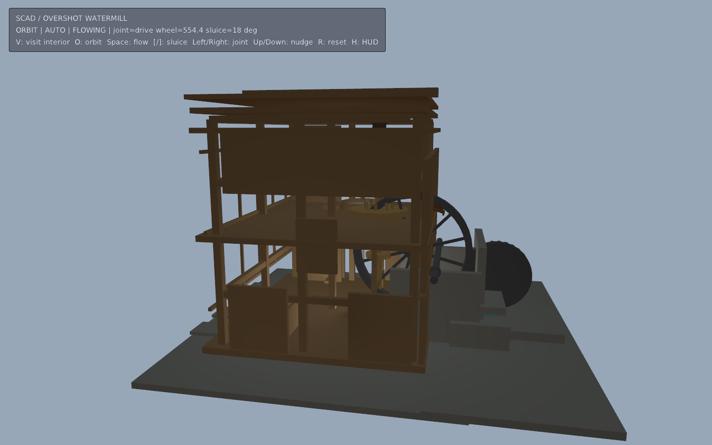
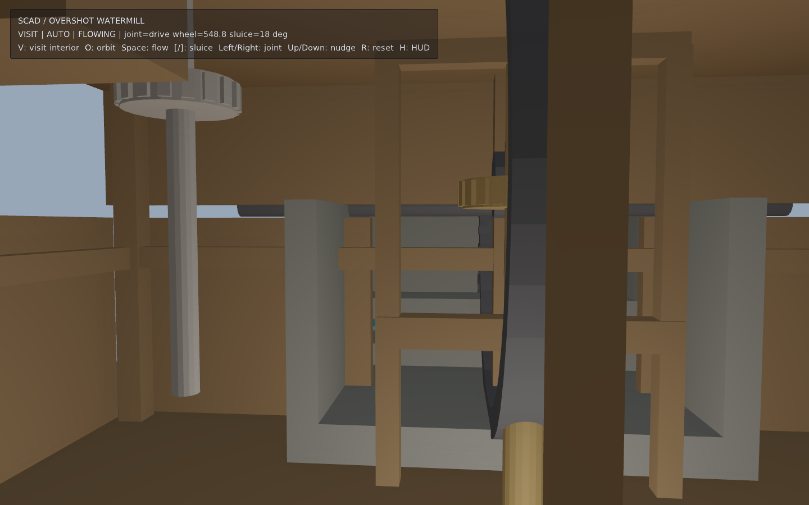

# SCAD 可旋转水车磨坊





原创 OpenSCAD 参数化水车磨坊：上射式水轮 → 水轴 / 坑轮 → 立轴 / 墙轮 / 大齿轮 / 冠轮 →
磨盘，另有可开合闸门与可参观的木构磨坊内部（地坪齿轮层、磨石层、顶层吊袋）。
每个部件单独导出并带 `eve.scad-rig/1` 关节树；运行时用 EveScript 正向运动学按齿轮比联动。

## 运行

```sh
make run/linux-debug GAME=examples/scad-watermill
# Windows: make run/win32-debug GAME=examples/scad-watermill
```

默认 1440×900。

- `V`：进入内部参观（WASD 移动，方向键 / QE 转向，Shift 加速；楼梯走廊自动爬升）
- `O`：外景环绕
- `Space`：开关水流驱动
- `[` / `]`：调节闸门开度（闸门关闭后水轮停转）
- ←/→ 或 A/D（环绕模式）：选择关节
- ↑/↓ 或 W/S（环绕模式）：手动盘车
- `R`：复位，`H`：HUD

绿色球为关节枢轴（参观模式自动隐藏）。

## SCAD 创作约定

权威数据在 `tools/design.py`：

1. 关节树：`parent`、父空间 `pivot`（毫米 / Z-up）、旋转 `axis`、角度限位（度）。
2. 每个 `part` 在自己的关节局部坐标系建模；`mill.scad` 用 `part = "..."` 门控几何。
3. `mill.rig.json` 是 `eve.scad-rig/1` 侧车；齿轮比写在 `ratios.nut`。
4. 仓库附带 OBJ 批次，普通运行不需要 OpenSCAD。

重建：

```sh
python3 examples/scad-watermill/tools/bake.py --from-design-only
python3 examples/scad-watermill/tools/bake.py                  # 有 OpenSCAD 时验证 CSG 批次
python3 examples/scad-watermill/tools/bake.py --eve /abs/path/to/eve
```

## 验证范围

- `tools/design.py` 生成 SCAD / rig / OBJ / 材质表 / 齿轮比。
- 有 OpenSCAD 时 `bake.py` 对每个 `part` 做 `--hardwarnings` 编译并覆盖 OBJ。
- `scripts/check_examples.py` 与 `smoke_examples.sh` 覆盖本示例为可运行项目。
