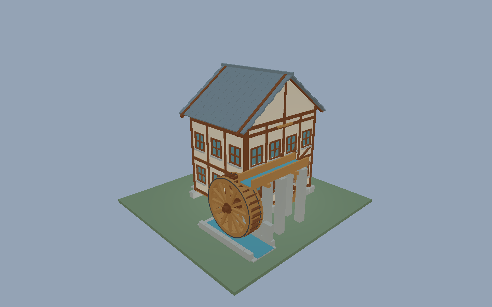
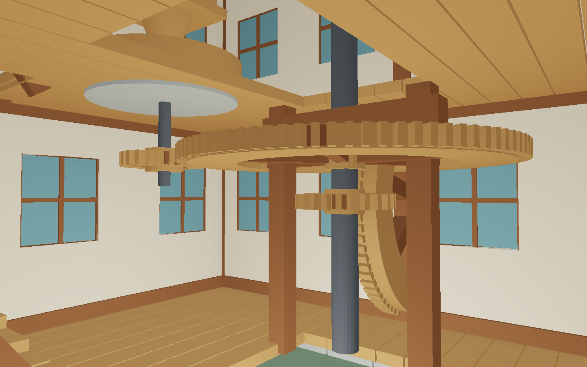

# SCAD 可旋转水车磨坊





原创 OpenSCAD 参数化水车磨坊：上射式水轮 → 水轴 / 坑轮 → 立轴 / 墙轮 / 大齿轮 / 冠轮 →
磨盘，另有可开合闸门与可参观的木构磨坊内部（地坪齿轮层、磨石层、顶层吊袋）。
每个部件单独导出并带 `eve.scad-rig/1` 关节树；运行时用 EveScript 正向运动学按齿轮比联动。

## 运行

```sh
make run/linux-debug GAME=examples/scad-watermill
# Windows: make run/win32-debug GAME=examples/scad-watermill
```

默认 1440×900。

- `V`：进入内部参观（WASD 移动，方向键 / QE 转向，Shift 加速；楼梯走廊自动爬升）
- `O`：外景环绕
- `Space`：开关水流驱动
- `[` / `]`：调节闸门开度（闸门关闭后水轮停转）
- ←/→ 或 A/D（环绕模式）：选择关节
- ↑/↓ 或 W/S（环绕模式）：手动盘车
- `R`：复位，`H`：HUD

绿色球为关节枢轴（参观模式自动隐藏）。

## SCAD 创作约定

权威数据在 `tools/design.py`：

1. 关节树：`parent`、父空间 `pivot`（毫米 / Z-up）、旋转 `axis`、角度限位（度）。
2. 每个 `part` 在自己的关节局部坐标系建模；`mill.scad` 用 `part = "..."` 门控几何。
3. `mill.rig.json` 是 `eve.scad-rig/1` 侧车；齿轮比写在 `ratios.nut`。
4. 仓库附带 OBJ 批次，普通运行不需要 OpenSCAD。

重建：

```sh
python3 examples/scad-watermill/tools/bake.py --from-design-only
python3 examples/scad-watermill/tools/bake.py                  # 有 OpenSCAD 时验证 CSG 批次
python3 examples/scad-watermill/tools/bake.py --eve /abs/path/to/eve
```

## 验证范围

- `tools/design.py` 生成 SCAD / rig / OBJ / 材质表 / 齿轮比。
- 有 OpenSCAD 时 `bake.py` 对每个 `part` 做 `--hardwarnings` 编译验证；保留 `design.py` 生成的带 MTL 材质分组的 OBJ，避免 STL 覆盖丢失材质。
- `scripts/check_examples.py` 与 `smoke_examples.sh` 覆盖本示例为可运行项目。

## 2026-11-11 模型重做与实帧

从 `tools/design.py` 重建：双侧厚木轮、30 组水斗、铁箍与木辐条；36° 双坡瓦顶、木骨泥墙、石基、水轮坑、架高引水槽及尾水道。内部补齐楼梯斜梁、料斗落料口，木齿轮、铁轴、石磨分别着色。

SCAD 与 OBJ 现在使用同一份几何；修复水轮偏离转轴 700 mm、坑轮偏离轴线及磨盘传动齿轮高度不一致的问题。七个关节的父子关系、枢轴和轴向不变，传动比仍为 80/24、96/24、2.2。水流驱动、闸门启停、手动盘车和正向运动学保留；手动盘车会暂停自动驱动，按 Space 恢复。

当前源码重新构建后采集并逐张检查：[外景](../../docs/images/examples/review-2026-11-11/watermill-walls/exterior.png) · [水轮近景](../../docs/images/examples/review-2026-11-11/watermill-walls/wheel.png) · [内部传动层](../../docs/images/examples/review-2026-11-11/watermill-walls/interior.png) · [磨盘层](../../docs/images/examples/review-2026-11-11/watermill-walls/stone-floor.png) · [默认运行视角](../../docs/images/examples/review-2026-11-11/watermill-walls/default.png)。取景预设只固定相机，传动保持运行。旧预览保留为历史资料。

几何测试 5 项通过，原生烟测通过；另在 200 帧运行中验证关闸停转、手动盘车、恢复自动驱动，以及全部传动比例与七个 FK 变换。截图与运行指纹见 [manifest](../../docs/images/examples/review-2026-11-11/watermill-walls/manifest.json)，质量门禁边界见 [截图文档](../../docs/images/examples/QUALITY_REVIEW.md)。本机未安装 OpenSCAD，因此未运行可选 CSG 编译。水面仍为示意模型，未新增水动力或齿面接触物理；这些验证不等于完整键鼠游览验收。

```sh
python3 -m unittest discover -s examples/scad-watermill/tools -p test_design.py
```

### 墙体复查修正

补齐三面墙板至梁柱和檐下，窗洞两侧、过梁、窗台与完整窗框相接；修复悬空玻璃、墙板之间无意留空、侧墙分格越过转角和山墙漏空。+Y 参观廊面保持开敞，区别于意外缺墙。新截图已替换本页展示，上一版截图与 manifest 单独保留。新增三面墙覆盖采样回归，5 项几何测试及原生 smoke 通过；本次未重复上一轮 200 帧传动探针或完整 make check。
