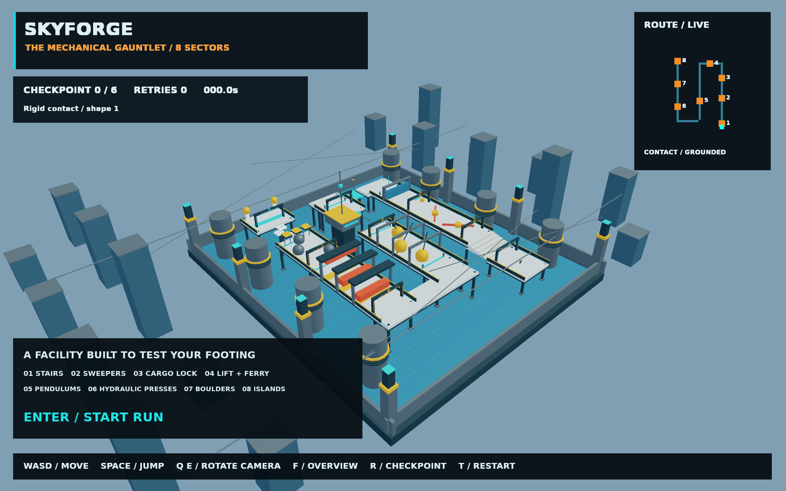

# SKYFORGE / 机械试炼场

约 100×110 米、三条折返赛道组成的完整 3D 高架闯关设施。八个机关区、六个顺序检查点和终点，配有第三人称相机、全场鸟瞰、实时路线图、时间和失败计数。全部场景由本地几何生成，不需要联网下载模型。

```sh
make run/macosx-debug GAME=examples/skyforge-trials
# Windows / Linux 使用对应 run/win32-debug / run/linux-debug
```

Enter 开始，WASD / 方向键按相机方向移动，Space 跳跃，Q/E 旋转相机，F 切换鸟瞰。R 返回最近检查点，T 完全重置。相机转向并不改变角色物理位置。



## 连续路线

1. **入口阶梯**：宽阔热身阶梯上升至第一层。角色为 1.8 米动态胶囊刚体。
2. **旋转扫杆**：两组运动学碰撞杆，观察旋转时机，跳过红色扫杆。
3. **货物锁**：将左侧琥珀色货箱向前推到青色压力板。只接受货箱进入的原生触发事件，玩家踩板不能开门；开启后保持锁存。门后激活第一个检查点。
4. **升降与摆渡**：向东转上升降台，升至二层后向南进入摆渡平台，越过断开的赛道。两类平台通过真实运动学刚体承载角色。
5. **摆锤走廊**：三组错相摆锤，选择横向空隙和通过时机。
6. **液压冲压厅**：南端连桥向东，再转北；三台压力机交替升降，从完全抬起的压头下通过。
7. **滚石巷**：三条动态钢球轨迹，不是插值动画球；球体参与真实碰撞和动量交换。
8. **悬空落脚点**：交错小岛跳跃到终点平台。必须顺序激活全部六个检查点并开启货物锁，终点才接受通关。

红色运动碰撞体与钢球接触即失败；跌入底部冷却盆也会回检查点。所有失败都在原生物理事件批次处理后重置玩家，不在求解器回调中变更世界。终点完整保留成绩，T 重开。

## 实现与生命周期

`main.nut` 管理入口；`course.nut` 生成场地和机关；`simulation.nut` 推进物理与玩法；`presentation.nut` 只读刚体绘制人物、环境、相机和 HUD。

主线程、固定 120 Hz，单帧累积上限 0.05 秒；统一注入模拟时间，无随机数。每个机关的目标姿态通过原生 `setTargetTransform` 驱动；角色速度控制读取真实支撑刚体速度，避免运动平台把玩家甩在原地。角色与箱球的双向碰撞仍由 World3D 解算。无跨平台位级确定性承诺。

单一 World3D 拥有本次会话的物理状态；`TrialRunner` 仅持有脚本实体身份及 native wrapper，显示位置为派生快照；没有新增 ECS System、公共 API 或跨模块 Link。重试原位恢复玩家，完整重置复用所有动态刚体；关闭热重载，退出后销毁整个会话，不提供持久化格式。没有架构规则例外。

`game.agent.json` 声明正常移动/跳跃、重试、开始和鸟瞰动作。`eve_play observe` 可读取检查点、位置、开门、平台承载与通关状态；禁止使用 eve_eval 传送过关。截图使用引擎 readback。

```sh
python3 scripts/check_examples.py
MIN_RUN_SECONDS=2 RUN_SECONDS=6 bash scripts/smoke_examples.sh skyforge-trials
```

字体为 DejaVu Sans，授权见 assets/fonts/NOTICE.txt。

## 已执行验证

使用本机 2026-10-29 的 macOS Debug 引擎构建，透过 `eve_play` 的正常移动、跳跃、等待与检查点重试，完成整条路线：六个顺序检查点、货物门开启、平台承载、终点 `phase=complete`。本次观察成绩为 150.3 秒、3 次失败，包含自动验证等待时间，不代表性能或竞速基准。未通过传送或修改关卡进度过关。

原生引擎证据会话 `agent.dev.1` 完成；本机临时证据为 `/tmp/skyforge-session.json`、`/tmp/skyforge-final-state.json`、`/tmp/skyforge-last.json` 与 `/tmp/skyforge-finish.png`。最后加宽了连接桥的转角重叠区，并把后两个复活位置移到滚石轨迹间隙；机关与通关规则保持相同。六秒运行烟测与示例布局检查通过。

提交 PR 前已同步最新 dev，并在独立虚拟环境补齐检查工具后通过完整 `make check CI_BASE=186715c0476b59d642effddea576689df1870915`（格式、依赖分层、绑定、架构、脚本 lint 和脚本测试）。本工作树未重新编译引擎，复用了本机现有构建；未改引擎 C++、模块接口或持久化协议。
