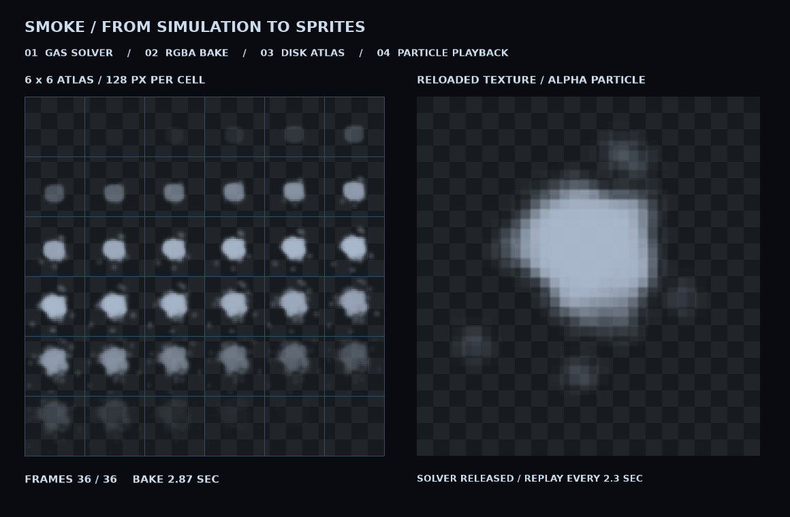

# Smoke Flipbook Baker

完全由 EVEngine 生成烟雾序列帧，无需 Blender、Houdini 或输入图片。

```sh
make run/win32-debug GAME=examples/smoke-flipbook
# 或任意包含 fluids / image / particles 模块的宿主 SDK：
eve run examples/smoke-flipbook
```

启动后自动完成：256 个 Gas 粒子初始化 -> 固定 54 Hz 模拟（每步 3 子步）-> 固定正交相机渲染 -> 36 张透明 RGBA 帧 -> 6x6 TGA 图集 -> 从磁盘重载 -> 18 FPS Alpha 粒子回放。左侧是图集，右侧烘焙时显示当前帧，完成后显示真正的粒子播放。每次启动重新烘焙，完成后释放模拟器和气体渲染器；回放只更新普通粒子。

图集每格 128x128，总计 768x768，行优先排列。生成物写到 `fs.getSaveDirectory()`（identity=`smoke-flipbook`），日志输出完整路径：

- `smoke-flipbook-v1.tga`：标准未压缩 32-bit TGA，左上角原点、BGRA 存储、8-bit Alpha。脚本 ImageData 未暴露 PNG 编码，所以使用原生支持的 TGA；不依赖外部图像生成或转换工具。
- `smoke-flipbook-v1.json`：schema=`eve.example.smoke-flipbook`、version=1，以及布局、帧率、尺寸、seed 和步长。此演示只输出该描述文件，不读取它；消费端应拒绝不支持的版本，忽略未知字段。

参数位于 `main.nut`：确定性的初始角度公式使用 seed=37；时间步不依赖窗口 dt。后端/平台之间只要求形态近似，不保证像素或浮点状态逐位一致。烟雾由现有屏幕空间厚度渲染器生成，没有体积自阴影；额外乘以 sin-squared 生命周期透明包络，让首尾透明，并在每格四周保留两像素透明保护带及八像素软过渡，避免相邻帧串色。完整序列 2 秒，粒子寿命 1.99 秒，避免 Flipbook 自动循环回第一帧，每 2.3 秒重新发射一个烟团。

所有模拟/图像/图形操作在主线程执行，没有跨帧借用原始指针或回调。烘焙每次 update 只处理一帧；最终写入是同步操作，小规模演示允许短暂卡顿。写入失败会报错，下一次启动重新生成完整文件。没有改动引擎 API、模块边界或持久化格式。

验证：

```sh
python3 scripts/check_examples.py
MIN_RUN_SECONDS=2 RUN_SECONDS=20 bash scripts/smoke_examples.sh smoke-flipbook
```

完成标记：`SMOKE_FLIPBOOK_READY frames=36 grid=6x6 fps=18 solver=released`。

`fonts/` 使用仓库已有 DejaVuSans-Bold，许可证见 `fonts/NOTICE.txt`。

实机证据：




`baked-atlas.png` 是验证时从引擎输出 TGA 无损转换的便览副本；`baked-smoke.gif` 从同一图集生成。它们不参与运行，运行时仍由引擎自行模拟、烘焙并读取 TGA。
