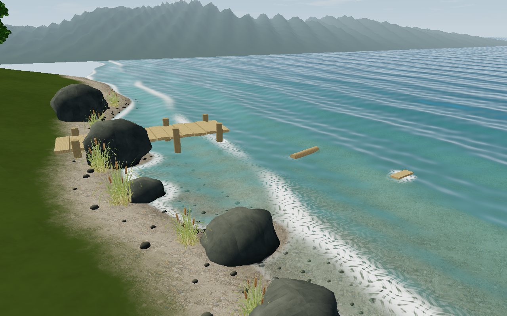

# Stylized Water Shore



以浅滩浪花为重点的持续运行场景：弯曲沙岸、湿礁石、芦苇、短木栈桥和漂木。
水面几何和碎泡沫共用波相位；岸线及礁石足迹限制浪花范围。
浪头、尾随泡沫和退水边缘使用同一动画时钟。
水中木桩、漂木和木板登记圆形、胶囊或矩形接触足迹：迎浪面随浪峰起泡，
背浪面留下逐渐消散的碎泡。漂浮物由同一波形在中心和两端采样，驱动起伏与倾斜。
接触图集仅在初始化上传一次，不逐帧重建网格或纹理；最多容纳 16 个木质物体。
这部分是波相位驱动的接触浪花表现，尚未求解绕桩流场或浮木的双向刚体浮力。岸边波幅约 0.1 米，
主波长约 3.14 米、向岸推进约 0.765 米/秒，远处保留约 55% 波幅；进入远处稀疏网格前关闭几何位移，保留完整波形的动态法线，按屏幕像素足迹过滤过细的波纹，不按几何衰减距离停止法线动画。
片元连续计算岸线、水深和礁石距离，避免顶点插值产生网格块。
折射用视图空间法线、双线性重建和最多 2 像素偏移，减少纹理跳变。
海床范围外逐渐关闭背景透射，避免把天空当成水底折射；泡沫恢复原有的细碎纹理及浪头、尾随泡沫配置。
动画采用约 739.2 秒的完整相位周期，计时循环连续，浮木与水面共用时钟。
渐深水色、沙砾床透射、湿石和太阳投影共同表现水陆过渡。

```sh
make run/win32-debug GAME=examples/stylized-water-shore
```

- V 切换岸边近景、俯视、木桩与浮木特写、全景；Space 同时暂停浪花和漂浮物。
- 1 完整材质，2 透射检查，3 反射检查，4 SSR 诊断。

默认近景使用 forward 自定义材质。4 档会启用 GBuffer，当前 SDK 会覆盖
部分不透明自定义材质，因此它是诊断视图。浪花是程序化浅滩表现，
没有流体冲岸、破碎卷浪或与石头碰撞的完整海洋动力学。

[岸边动态帧序列](motion.gif) · [木桩与浮木接触浪花](wood-contact.gif)

## 资源与重建

`reference.png` 是 AI 生成的美术参考；`preview.png` 是引擎实际帧。
生成提示词见 [ART_DIRECTION.md](ART_DIRECTION.md)。芦苇使用透明抠图交叉卡片，
沙砾床使用生成的平铺材质，礁石使用程序材质；场景并未把参考图贴作背景。

在仓库根目录运行：

```sh
python scripts/generate_water_showcase_materials.py
python scripts/compile_water_showcase_shaders.py
```

第二条需要 Vulkan SDK 的 `glslc`。运行无需编译器，使用已提交 SPIR-V。
当前自定义着色器面向 Vulkan；其他图形后端尚未验证。
共享场景和 GLSL 的源文件位于 `stylized-water-shore`，生成器同步交互示例。
默认使用 forward 渲染，以避免 GBuffer 覆盖自定义地形/石头材质。

人物、树木和纹理来源与许可见 [CREDITS.md](CREDITS.md)。

场景保留模型、蒙皮、材质和探针所有者；关闭热重载，修改脚本后重新启动。

## 长时间渲染检查

修复验证覆盖固定动画时间 600 秒、3600 秒、86400 秒的引擎实际帧，
以及相位周期两侧的帧对比和跨周期更新检查。这是时间跳转检查，
不代表连续运行了 24 小时；正常运行另做示例 smoke 与帧时间采样。
