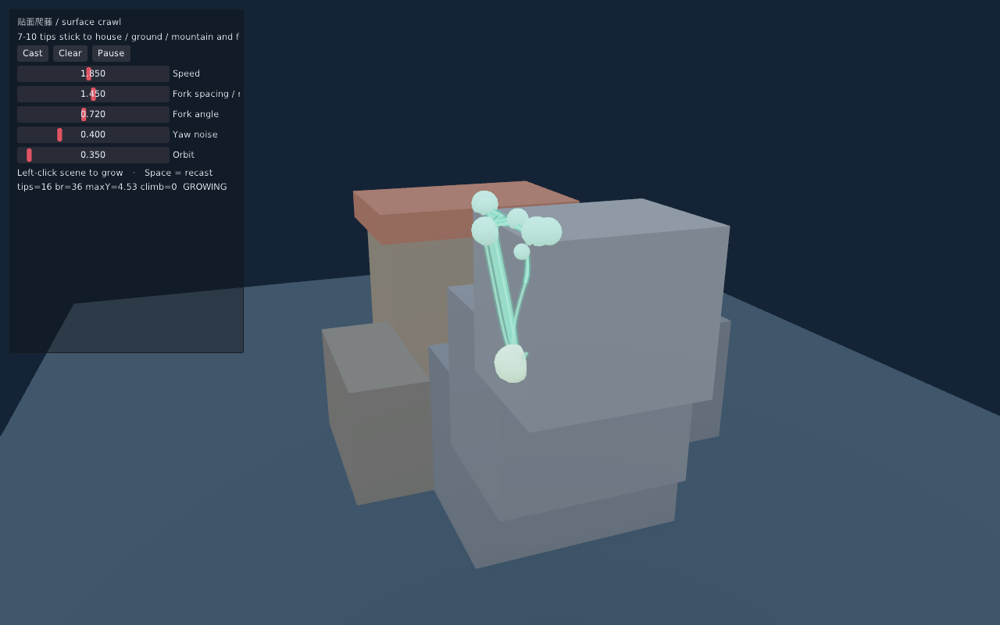

# 贴面爬藤 / Surface Vine Growth

科幻场景特效：在连接房屋与山脉的地面上，从一个爆发点射出 **7–10** 个爬行 tip
（脚本侧“粒子”），它们贴着周围模型表面前进，并在固定间距处以小扰动分出支叉，
形成疯狂生长的爬藤植物。

```sh
make run/linux-debug GAME=examples/surface-vine-growth
# Windows: make run/win32-debug GAME=examples/surface-vine-growth
# SDK:     eve run examples/surface-vine-growth
```

## 做法

1. **场景碰撞**：院子地面、房屋体块、山脉阶地各自有匹配的 `World3D` 静态盒。
2. **爆发**：从院子中心 sticky 到地面后，沿切平面均分 7–10 个 tip。
3. **贴面爬行**：前进方向投影到切平面；在地面上用同高度近场水平探测抓取墙面，
   命中后强制沿墙面向上偏置，再 stick / 边缘包绕。撞墙时切向退化会回退为“沿墙上爬”，
   避免贴地扫过墙脚。
4. **分叉**：tip 累计路程达到 `forkSpacing` 后，以 `forkAngle` 绕法线分出子 tip（深度上限 2）。
5. **表现**：每条枝干用双层 `PrimitivePolyline3D`（亮芯 + 外晕）实时 `setPolyline`；
   tip 用脉冲小球标出生长前端。状态栏 `maxY` / `climb` 用于确认已上墙。

未新增引擎公共 API / 模块；时间由 `eve_update(dt)` 注入，单帧 dt 上限 0.05 秒。
同一 seed 与施放序号下 tip 路径确定；不承诺跨 GPU 像素一致。

## 操作

| 输入 | 作用 |
| --- | --- |
| 左键点击场景 | 在命中表面动态爆发爬藤（墙面/地面/屋顶均可） |
| Space / Cast | 在上次点击点（或默认院子中心）重新施放 |
| Clear | 清除当前藤蔓 |
| Pause | 暂停 / 继续生长 |
| Speed / Fork spacing / Fork angle / Yaw noise | 调参（速度与扰动对当前簇即时生效） |
| Orbit | 环绕观察 |

成功标记：启动打印 `SURFACE_VINE_READY click-to-grow…`，点击/施放打印 `SURFACE_VINE_CAST … at=(x,y,z)`。

## 文件

| 路径 | 说明 |
| --- | --- |
| `main.nut` | 场景、物理盒、UI、折线同步、相机 |
| `vines.nut` | tip 爬行 / stick / 分叉仿真 |
| `config.nut` | 1280×800 窗口 |

## 验证

```sh
python3 scripts/check_examples.py
MIN_RUN_SECONDS=2 bash scripts/smoke_examples.sh surface-vine-growth
```

引擎读回预览（约 2.8s 生长后自动写出）：


