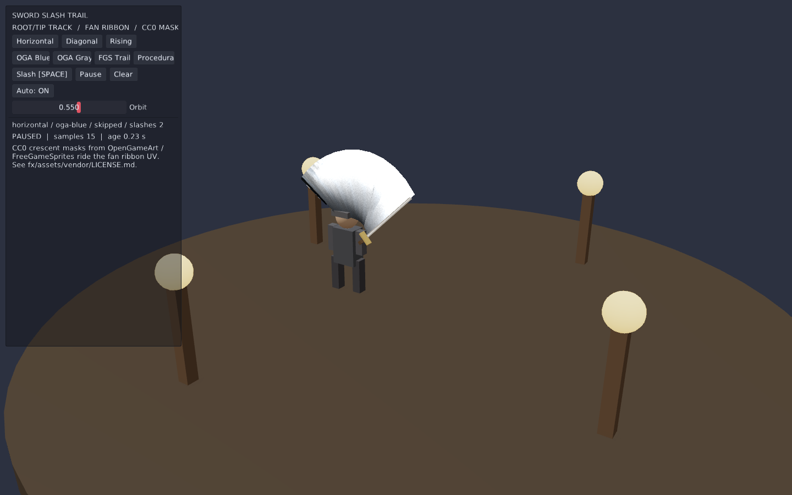
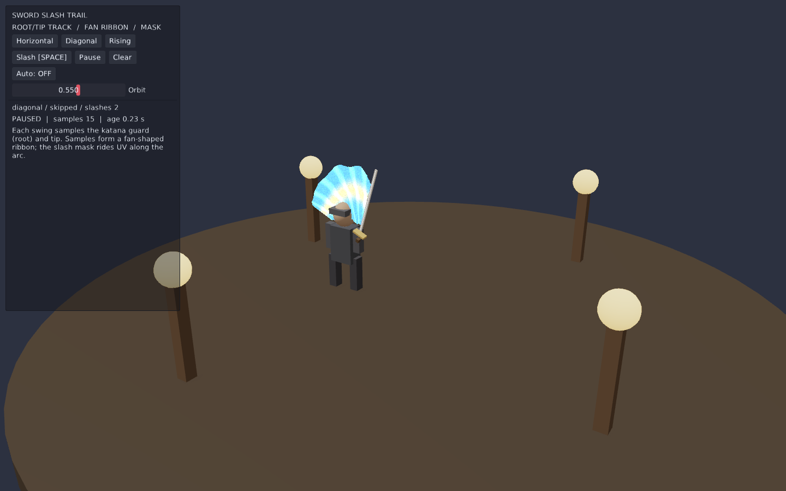
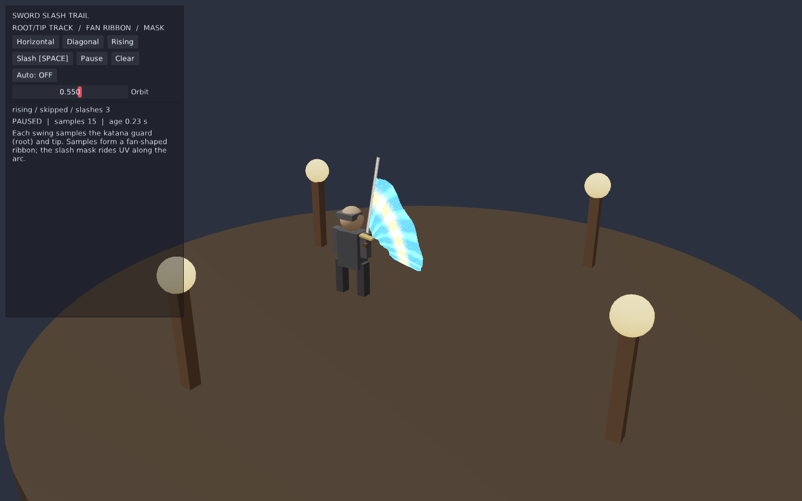

# 武士刀光拖影 / Sword Slash Trail

可运行示例：对挥刀刀刃做 **根/尖双端轨迹追踪**，拼成 **扇形弧面 Ribbon**，再贴上刀光遮罩纹理，形成动态拖影。

算法与引擎内 `stylize::TrailEmitter`（刀根/刀尖采样 → 三角形 Ribbon）一致，本例用 EveScript + 动态 Mesh 完整演示脚本侧接入，不改公共 API。



## 运行

```sh
make run/linux-debug GAME=examples/sword-slash-trail
# 或 win32-debug / macosx-debug
```

- UI：`Horizontal` / `Diagonal` / `Rising` 三种刀法
- `Space` 或 `Slash` 重斩，`Auto` 循环三种刀法
- `Pause` / `Clear` 冻结或清空拖影
- Orbit 滑条环绕观察扇形弧面

| 横斩 | 斜斩 | 上挑 |
|---|---|---|
|  |  |  |

## 制作方法

1. **轨迹追踪**  
   挥砍窗口内每帧取刀根（护手附近）与刀尖的世界坐标，写入采样环。  
   过滤过近点、寿命淘汰、瞬移断轨（避免瞬移三角面）——见 `fx/trail.nut`。

2. **扇形弧面**  
   相邻采样构成四边形：`(root_i, tip_i, tip_{i+1}, root_{i+1})`。  
   整段挥砍扫过的区域即扇形 Ribbon；`UV.x` 沿弧、`UV.y` 从根到尖。

3. **特效纹理**  
   默认使用网上的 **CC0** 月牙刀光贴图（OpenGameArt / FreeGameSprites），见
   `fx/assets/vendor/`。UI 可切换 OGA Blue / OGA Gray / FGS Trail / 程序化 TGA。
   自定义片元 `fx/shaders/slash.frag`（additive、双面、不写深度）采样 RGB+A。

```
刀尖  ●────────────────●  tip samples
      │████ 扇形弧面 ████│
刀根  ●────────────────●  root samples
           UV.x →
```

## 重新生成资源

```sh
python3 examples/sword-slash-trail/tools/generate_mask.py
glslc examples/sword-slash-trail/fx/shaders/slash.frag \
  -o examples/sword-slash-trail/fx/shaders/slash.frag.spv
MIN_RUN_SECONDS=2 bash scripts/smoke_examples.sh sword-slash-trail
```

遮罩无 Pillow 依赖（纯 Python 写 TGA）。换成任意软边白底透明条纹即可改风格。

## 与引擎能力的关系

| 层级 | 入口 |
|---|---|
| C++ / 技能配方 | `Stylize::createTrailEmitter` / `createSkillMeshEffect(WeaponSlash)` + `MeshEffectRenderer::submitTrail` |
| 脚本演示（本例） | `fx/trail.nut` 动态 `updateMeshVertices` + 自定义 mesh shader |
| 2D 点线拖尾 | `anim.newTrail()`（`AnimTrail`，非扇形贴图弧面） |

生产接入优先用 stylize 的 `TrailEmitter` + `slash` mesh 风格；本例说明几何与贴图契约，便于在无骨骼挂点时用程序化刀刃验证。

## 成本与边界

- 每帧重建 Ribbon：顶点 ≈ `2 × sampleCount`，默认上限 56 采样。  
- 时间只来自 `eve_update(dt)`；无墙钟、无随机。  
- 无伤害判定、无蒙皮挂点、无 WebGPU shader。  
- 本例不改公共接口、ECS 或模块边界。
