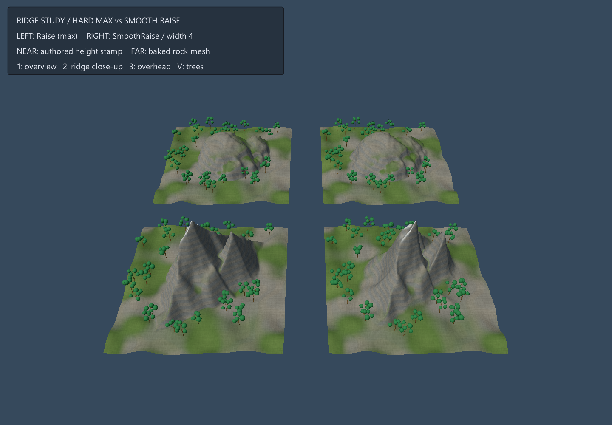

# 山体平滑融合：山脊、岩层与植被



四块独立 3D 地形，**左侧 Raise（max），右侧 SmoothRaise（宽度 4）**。
近排是手工构造的双山脊高度图，远排是实际 marching-cubes 岩体网格烘焙后叠放的两枚印章。
左右使用相同基础高度场、印章、位置、材质、灯光和植被候选点，只切换融合运算。

## 运行与查看

```sh
make run/win32-debug GAME=examples/terrain-smooth-mountain
make run/linux-debug GAME=examples/terrain-smooth-mountain
```

`1` 返回总览；`2` 查看山脊近景；`3` 查看俯视；`V` 显示/隐藏树木。
默认视图保留全部四面板，隐藏树木可检查未被植被遮住的融合边界。

## 本次改善（2026-11-11）

- 每面板提高为 129×129 高度采样、0.25 世界单位间距；用弯曲山脊、侧峰和低幅噪声取代单一圆顶。
- 独立示例材质按面板局部 UV、海拔和坡度计算岩石、碎石与草地；岩层倾斜、轻微扭曲，叠加细粒噪声和较暗层缝。高处缓坡少量积雪，左右材质坐标一致。
- 使用现有 `mesh.tree` 配方创建三份共享树网格、程序化树干/叶片色板。在最终融合后的高度场采样树根，只在高度 1–7.8、坡度平方不超过 0.48 的位置生长，并用固定噪声组织林斑。
- 树型、尺寸、朝向由局部候选坐标决定；左右同一个候选位置使用同一树型。融合改变坡度后，候选点可以被不同地剔除，所以两列树木数量不强行相等。

材质保持原始顶点位置，匹配引擎深度与阴影预通道；输出不透明线性色彩，由场景统一完成色调映射。
本例不修改共享地形材质，也不需要外部模型或下载纹理。

## 融合与验证

启动逐行打印 `MOUNTAIN_COMPARE`：检查左右高度样本存在实际差异，四角未受印章影响的高度保持一致。
本次运行：高度图行 9915 个不同样本、最大差约 0.999974；烘焙网格行 3541 个不同样本、最大差约 1.40897。
四面板树木分别为 29、30、30、28 棵，启动日志以 `MOUNTAIN_FOREST` 记录。

[整改前](../../docs/images/examples/review-2026-11-11/mountain-detail/before.png)
· [山脊近景](../../docs/images/examples/review-2026-11-11/mountain-detail/ridge-close.png)
· [俯视](../../docs/images/examples/review-2026-11-11/mountain-detail/overhead.png)
· [无植被总览](../../docs/images/examples/review-2026-11-11/mountain-detail/bare-overview.png)
· [无植被近景](../../docs/images/examples/review-2026-11-11/mountain-detail/bare-ridge.png)
· [运行程序、着色器与 PNG 指纹](../../docs/images/examples/review-2026-11-11/mountain-detail/manifest.json)

## 调整与边界

在 `placePair` 调整 `smoothWidth`、`edgeFade`、中心、尺寸与旋转。基础高度图和印章被两列复用；网格由融合后的高度构建，因此法线同步更新。
烘焙一次后复用 stamp/coverage，coverage 用作 globalMask，localMask 使用 one。
顶面烘焙不保留模型 UV、材质、洞穴或悬挑。本例没有物理世界；实际项目还需在编辑发布后重建碰撞。

示例 GLSL 与预编译 SPIR-V 位于 `shaders/`；修改后用 Vulkan SDK 的 `glslc` 重新生成对应 `.spv`：

```sh
glslc shaders/mountain.vert -o shaders/mountain.vert.spv
glslc shaders/mountain.frag -o shaders/mountain.frag.spv
```

帧检查使用 Windows Vulkan。未验证浏览器后端；预设取景不等同于逐键自动化验收。
