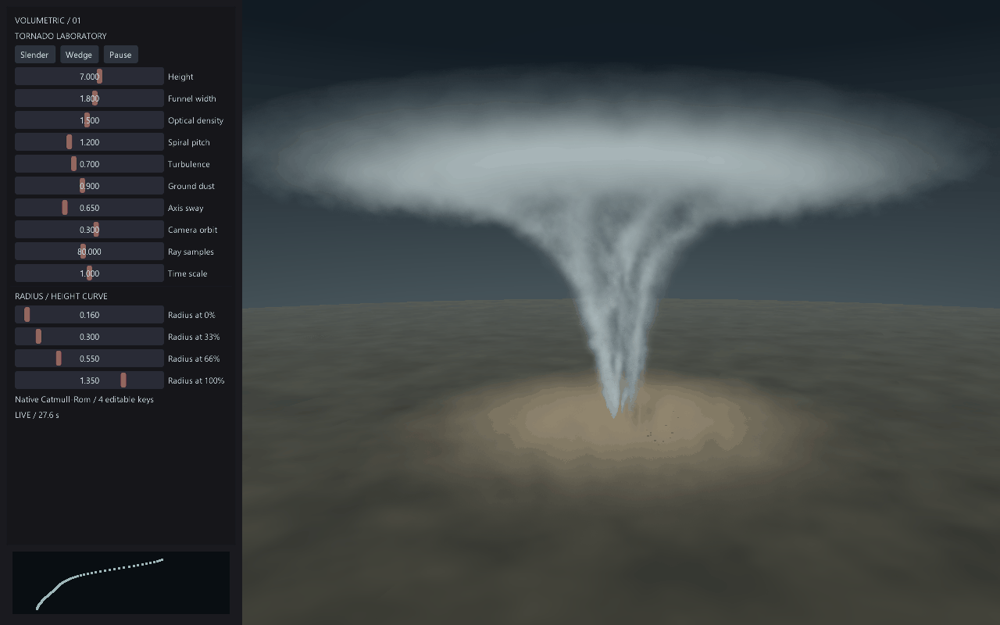

# Tornado Lab / 参数化龙卷风

原生 EveScript 示例：自定义 Vulkan GLSL 体积光线步进 + 原生粒子 VFX + Procgen Catmull-Rom 曲线。
没有外部图片依赖，`white.tga` 是驱动全屏材质的 1×1 白色纹理。效果全部实时生成。

## 运行

```sh
make run/win32-debug GAME=examples/tornado-lab
# Linux / macOS: replace win32-debug with linux-debug / macosx-debug
```

SDK 或已有引擎也可运行 `eve run examples/tornado-lab`。
已提交预编译 SPIR-V，运行无需安装 shader 编译器；本例的自定义 SPIR-V 路径需要 Vulkan，当前不支持 WebGPU。
修改 shader 后，在示例目录执行：

```sh
glslc shaders/tornado.frag -o shaders/tornado.frag.spv
```

## 调整

- 左侧滑条实时控制高度、宽度、光学密度、螺旋节距、湍流、地面扬尘、轴线摆动、相机环绕、采样数量和时间倍率。
- 四个 Radius 滑条是高度 0%、33%、66%、100% 的半径控制点。原生 Catmull-Rom 工具生成轮廓，底部青色曲线显示其形状。仅修改控制点时重采样，不在每帧重建曲线。
- Slender / Wedge 切换细漏斗 / 宽楔形轮廓；保留其他参数。Pause 冻结体积动画及粒子时间；时间倍率 0 同样可冻结。
- 自定义默认参数：编辑 `main.nut` 的 `knobs` 和 `radii` 后重启。运行时调整保留在当前会话，不自动写入磁盘。

## 实现与边界

`shaders/tornado.frag` 包含漏斗壳体、上部云冠和贴地尘雾，使用世界坐标噪声、螺旋流纹、Beer-Lambert 消光与一次偏移密度采样近似自遮蔽。
原生 `particles.newEmitter` 负责屏幕投影位置上的小型碎屑，固定随机种子，容量 180。它是前景表现层，不参与三维深度遮挡。
原生曲线输出八个半径样本供 GPU 分段插值，64 点预览显示曲线；GPU 轮廓因而是曲线的有界近似。
40–128 次 ray samples 是质量/开销旋钮，默认 80；每像素最坏固定 128 步，可提前终止。
本例使用 1280×800 固定画布，自定义射线相机；尚未接入场景深度、真实流体求解或物理风场。
所有动画使用引擎注入的 dt；相同时间和参数下 Shader 场确定，跨 GPU 浮点结果允许数值误差。
无引擎公共 API、模块边界、ECS、持久化格式或生命周期改动。

## 引擎实录


