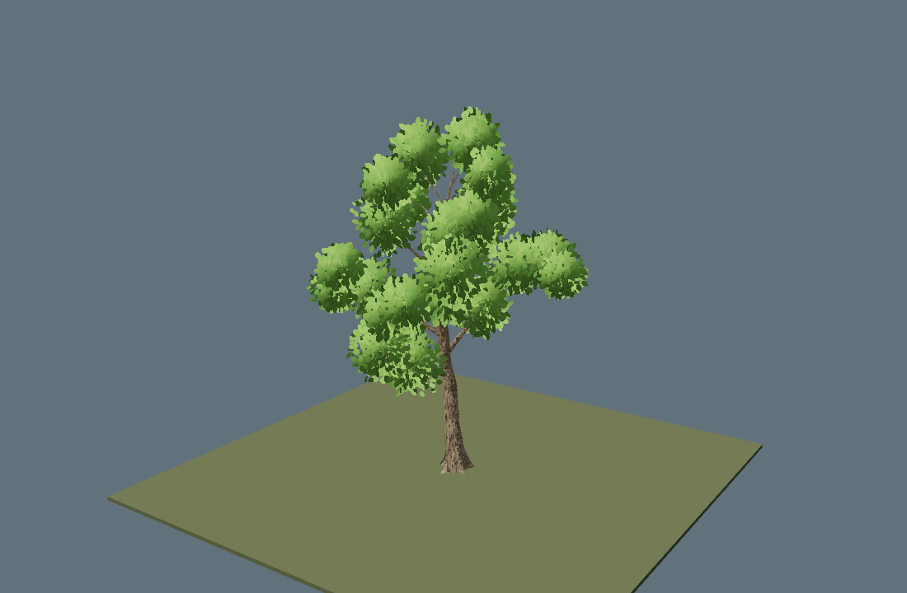
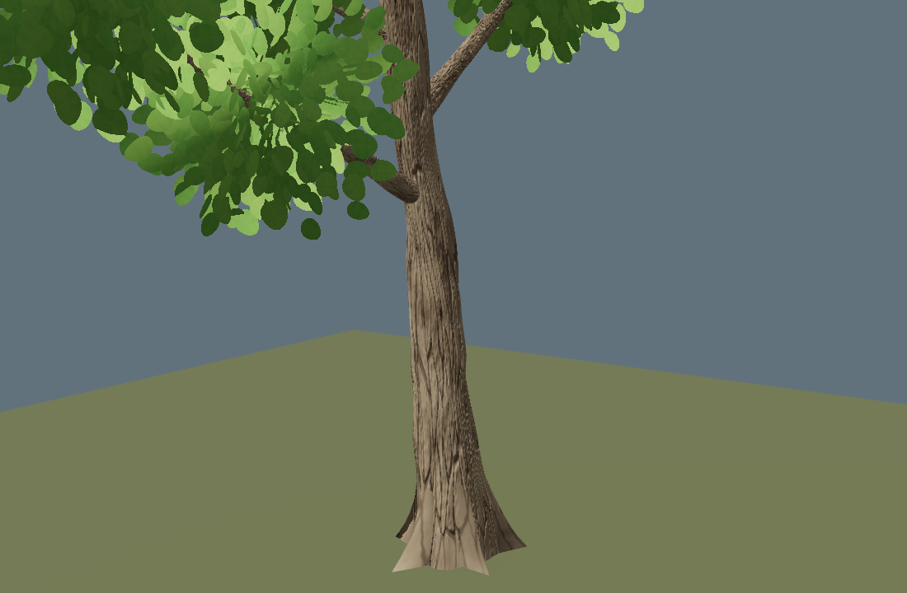
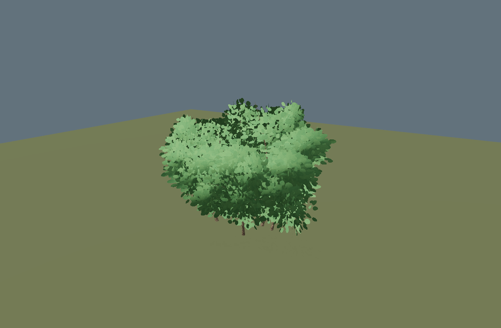
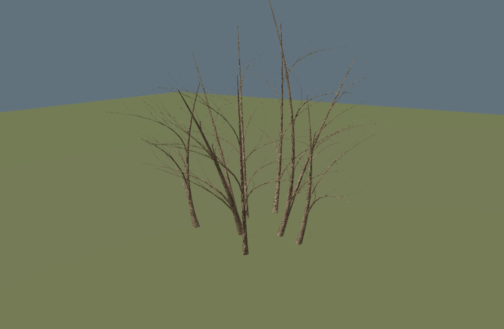

# Arbor Lab — 参数化树木与灌木

`mesh.tree` 是 EVEngine 的原生程序化网格配方。相同 seed 与参数会生成一致的网格，可通过
`procgen.buildMesh` 获取 CPU 数据，或通过 `procgen.generateMesh` 直接上传 GPU；两者都返回
Result 投影，必须检查 `ok` 后才能读取 `value`。

## 快速使用

```squirrel
local paramsResult = procgen.newParams();
if (!paramsResult.ok) throw paramsResult.status.summary;
local p = paramsResult.value;
p.setSeed(31415);
p.setString("style", "lowpoly");
p.setString("branchAlgorithm", "weberPenn");
p.setString("leafMode", "clusters");
p.setFloat("leafDensity", 0.75);

local meshResult = procgen.generateMesh("mesh.tree", p, gfx);
if (!meshResult.ok) throw meshResult.status.summary;
local mesh = meshResult.value;
```

`branchAlgorithm` 只能选择一种骨架算法：`weberPenn` 是默认值，规则稳定、生成较快；
`spaceColonization` 通过树冠吸引点迭代生长，轮廓更不规则。主干、枝条层级和叶片系统由两种算法共享。

## 叶片模式

- `clusters`（示例默认，推荐）：在每个结果枝的合适位置放一个"叶片丛"。丛是一个球体，由
  `clusterPlanes` 张绕 Y 轴分层旋转、各自带轻微倾斜和偏移的叶片平面组成；每张平面上的
  叶片中心由蓝噪声（Poisson-disk）采样得到，分布均匀，既不成团也不留空洞。叶片顶点法线取自
  丛球面，所以一堆平面卡片仍然按球体受光，树冠有体积感；叶片使用矩形卡片，同时输出正反两个绕向，开启背面
  剔除的管线也不会把它剔掉。纹理用圆润叶形与透明边距，材质使用 masked / alpha cutoff，
  避免矩形边框显形和透明混合排序。每叶四顶点，长宽比、倾角、大小与朝向按 seed 随机。
- `cards`：沿枝条随机撒独立叶片，实现最简，但容易看出成团和空洞。
- `canopy`：用椭球团块堆树冠，几何体最少，最"低多边形"。
- `none`：只输出枝干骨架。

叶片丛参数：

- `clusterSize`：丛半径占 `crownRadius` 的比例，默认 `0.30`。
- `clusterSeparation`：相邻丛心的最小间距（单位：丛半径），默认 `0.55`。调大→丛更少更大，
  调小→丛更多更碎。
- `clusterPlanes` / `clusterCaps`：叶片平面数（默认 `10`）与封住两极的近水平面数（默认 `2`）。
- `clusterTilt`：环形平面偏离竖直方向的最大倾角（度），默认 `26`。
- `clusterLeafScale`：丛内单片叶长相对 `leafSize` 的比例，默认 `0.85`。
- `clusterSpacing`：蓝噪声中心间距（单位：叶长），默认 `0.80`；`leafDensity` 在此基础上缩放。
- `clusterLeaves`：每张平面的叶片数上限，默认 `28`。若请求的间距会超出该上限，采样器会放大
  间距而不是截断，所以留下的叶片依然均匀。
- `clusterLimit`：单棵树的丛数上限，默认 `120`。

丛心按"随机顺序 + Poisson 排斥"从结果枝锚点中挑选：枝条越均匀地填满树冠，叶片丛就越均匀，
`clusterLimit` 则给出几何体量的硬上限。

## 通用参数

- `style`: `lowpoly` / `realistic`
- `leafMode`: `clusters` / `cards` / `canopy` / `none`
- `leafDensity`: `0..1`
- `height`, `trunkRadius`, `crownRadius`, `leafSize`
- `foliageStart`: 树冠起始高度比例，`0.1..0.9`
- `radialSegments`: 枝干横截面精度，`3..24`
- `curveSegments`: 主干/枝条弯曲分段数，`2..20`
- `trunkCurve`: 主干整体弯曲强度，`0..0.45`
- `branchCurve`: 枝条弯曲强度，`0..0.5`
- `curveBack`: S 形回弯，`-0.5..0.5`
- `tropism`: 向上生长趋势，`-0.5..0.8`
- `droop`: 枝梢下垂，`0..0.8`
- `branchLengthFalloff`: 随树冠高度增加的枝长衰减，`0..0.9`
- `branchRadiusFalloff`: 随树冠高度增加的枝径衰减，`0..0.9`
- `lowerLeafCoverage`: 下层老枝沿枝条分布叶片的概率，`0..1`
- `upperLeafCoverage`: 上层新梢沿枝条分布叶片的概率，`0..1`

## Weber–Penn 参数

- `branchLevels`: `1..5`
- `branchCount`: 每层主要分枝数量，`2..20`
- `branchAngle`, `branchAngleVariation`: 分枝角度与随机变化（度）
- `phyllotaxis`: 枝序旋转角（度），默认 `137.5`
- `apicalDominance`: 顶端优势，`0..1`

## 空间殖民参数

- `attractorCount`: 树冠吸引点数量，`12..1200`
- `colonizationIterations`: 最大迭代数，`4..160`
- `influenceRadius`, `killRadius`: 吸引范围与到达判定距离
- `growthStep`: 每轮枝梢生长步长
- `branchInertia`: 延续上一段方向的惯性，`0..4`
- `maxTurnAngle`: 相邻生长段允许的最大转角（度）
- `maxCumulativeAngle`: 枝条偏离初始生长轴的最大角度，用于阻止 U 形回卷
- `maxChildren`: 单个生长节点允许的最大子枝数，`1..4`

## 运行示例

```sh
make run/linux-debug GAME=examples/tree-generator
make run/win32-debug GAME=examples/tree-generator
```

快捷键：`1/2` 选择阔冠／窄冠树，`3/4` 选择丘形／圆形灌木；`R` 换 seed，
`A` 切换树的分枝算法，`L` 循环 clusters → cards → none，空格开关旋转，`B` 切换树干／灌木枝条近景，`N` 开关中尺度鼓包与树节（固定 seed、材质与采样精度）。
`[` / `]` 调节密度（0.45–1），`-` / `=` 调节叶长倍率（0.7–1.4），
`,` / `.` 调节冠幅倍率（0.8–1.2）。参数值输出到控制台，切换预设恢复默认参数。
`M` 开关树皮法线贴图，固定颜色、几何、seed 和视角比较。
默认静止，便于固定视角比较；相机按实际网格包围范围取景，避免树冠／宽灌木被裁切。

树木网格应在加载、换 seed 或修改参数时生成并缓存，不要每帧重新生成。

## 为什么原来的植物不真实

球面法线只改变光照方向，不会改变轮廓、叶片尺寸和枝条分布。原示例整株使用绿色 tint、
没有纹理，树皮也发绿。原定向光 Y 为负，但 mesh3d 把该向量作为朝向光源的方向，
导致树冠从下方受光；示例改为上方光源并增加地面参照。树的默认叶长为树高的 7.5%，比例偏大；灌木使用的是独立的
球块／平面卡片路径，不含树叶簇的球面法线转移。

另外，原来的几何叶片 UV 覆盖一格包含 8–16 片小叶子的透明卡片纹理。把它直接用于
一片卵形几何叶，再做 alpha cutoff，会把叶子切成碎片，而不是增加单叶细节。

现在 `tex.tree_atlas` 和 `tex.foliage` 提供 `leafLayout`：

| 网格模式 | 纹理 leafLayout | 材质 |
| --- | --- | --- |
| tree/bush `clusters` | `single` | masked，cutoff 约 0.4 |
| tree/bush `cards` | `cards`（默认，兼容原有调用） | masked，cutoff 约 0.4 |

`single` 的右侧是 2×3 个 UV 格，每格画一片圆润叶子，周围保留透明留白。
六格叶形按 seed 改变长宽、轻微旋转、弯曲和色差；轮廓由 alpha cutoff 裁出，矩形本身不显形。树皮条带保持原位；不要再给整株乘绿色。示例只在树皮区域使用法线贴图，叶片区域写入平坦法线，
保留叶簇的球面受光。

灌木新增 `leafMode="clusters"`：复用 `FoliageCluster`，先生成球形叶簇，再变换到
椭球叶团；法线经过逆转置与归一化。`blobs` 控制叶片区预算（1–96，默认 24），`lobeScale` 控制重叠程度，
`clusterPlanes`（1–24，默认 10）和 `clusterLeaves`（1–256，默认 48）限制几何预算。
`twigRadius` 控制主茎半径（至少 0.001，最多灌木宽度的 8%）；示例使用较细的木质茎。
叶密度为零时不生成叶片；没有枝条也没有叶片时返回空网格错误。

示例树叶默认长 0.16，灌木叶长 0.065；这些是宽叶植物的有限预设，不是任意参数组合
都具备植物学真实性的保证。较小叶片需要更高采样预算：减小叶长但保留过低的
`clusterLeaves` 上限，会导致冠层变稀，继续增加 leafDensity 也不能突破该预算。
每个 seed 都应检查正面、侧面、俯视的轮廓和枝叶连接；生成成功不代表视觉通过。

## 生成与边界约定

本次仅扩展 procgen 内部的网格／纹理配方选项，继续通过已有 Params、Result 与 GPU 上传
入口使用。未增加 C++ 公共函数、模块依赖、ECS 系统或持久格式。CPU 网格由调用方拥有；
示例在 VM 线程生成、检查结果后再替换 Renderable 资源，并保留当前 mesh/texture/material。
相同 seed 与参数在同一构建内重复生成一致；不承诺跨标准库的随机分布位级一致性。
本次没有新增裁剪能力声明，仍遵守 procgen 原有 core/render 边界。

## 树干表面

主干与 Weber–Penn 枝条使用连续环带扫掠，截面沿路径输运，共享相邻段的顶点与法线。
树皮 V 坐标沿整条枝干的弧长连续分布，不再每段从 0 重置到 1；圆周 UV 接缝有独立的
同位置、同法线顶点。两种骨架的枝干三角形都朝外，避免剔除外壁后看见内壁。

| 参数 | 默认值 | 范围与作用 |
| --- | --- | --- |
| `trunkTipRatio` | 0.10 | 0.03–0.4，主干末端与起始半径比 |
| `trunkTaper` | 0.85 | 0.5–2，半径沿长度的衰减曲线指数 |
| `rootFlare` | 0.70 | 0–1.5，根颈扩张与不对称根脊的强度 |
| `rootFlareHeight` | 0.10 | 0.03–0.25，根颈过渡长度占树高的比例 |
| `barkRelief` | 0.04 | 0–0.12，细尺度连续起伏占局部半径的比例 |
| `trunkNoise` | 0.18 | 0–0.35，中尺度不规则鼓包占局部半径的比例 |
| `trunkNoiseScale` | 3 | 1–8，鼓包波长，以基部半径为单位 |
| `trunkKnots` | 3 | 0–8，主干局部树节数量 |
| `trunkKnotStrength` | 0.35 | 0–0.6，树节凸起强度 |
| `surfaceSegments` | 64 | 8–192，表面轴向采样目标；不低于骨架分段数 |

Weber–Penn 子枝基部半径受父枝连接处的实际半径约束，基部有小幅枝领增厚。
鼓包使用圆周接缝连续的二维噪声，树节在随机位置产生局部环状凸起；细枝使用较弱鼓包。
表面随机数独立于骨架及叶簇序列，增加表面细节不改变分枝与叶片布局。
示例采用 96 个轴向采样、24 个圆周分段，并提高鼓包与树节强度以方便近景观察。
树皮采用纵向拉伸的 cellular 裂隙，叠加多尺度域扭曲、剥落和风化色差，替代等间隔正弦条纹。
同一 seed 的高度与颜色场一致，换 seed 会改变裂隙与色差分布。
`tex.tree_atlas` / `tex.foliage` 新增 `map`：默认 `albedo` 保持颜色图入口；`normal` 输出
RGB 切线空间法线；`surface` 输出 RG 法线 XY、B 遮蔽、A 光滑度，适用于已有
Renderable3D `setPackedNormalMask(true)` 路径。Material 路径使用 RGB `normal`，
不能直接把 packed surface 当作 RGB 法线。示例使用 Material + RGB 法线，粗糙度固定 0.88。
`barkNormalStrength` 范围 0–3，默认 1；示例使用 0.65。法线差分限制在树皮条带内，
圆周接缝包裹，不跨入叶片图集；叶片不受树皮法线扰动。示例使用 1024 图集与 24 个色阶。

这是可参数化的连续环带枝干外观改进，仍不是枝叉处焊接成单一流形的植物生长模型：
枝领与父干之间使用嵌入式相交，空间殖民的小枝仍按生长边分别发射圆台。
未增加持久格式、公共 C++ 签名或跨模块依赖；没有新增裁剪声明或架构例外。

## 灌木枝条结构

灌木使用分散在根丛范围内的多条基生主茎，沿连续曲线向外生长。侧枝从主茎的
采样位置出发，基部半径受连接处父枝半径约束；第三级细梢伸入叶团内部。树皮 UV
沿每条枝的弧长连续，截面接缝顶点同位置、同法线。枝干随机流与叶片随机流独立，
调整叶密度或叶长不会改变枝干。枝条交汇仍采用嵌入式相交，没有焊接枝叉。

| 参数 | 默认值 | 范围与作用 |
| --- | --- | --- |
| `twigs` | 4 | 0–16，基生主茎数；0 允许纯叶团 |
| `twigRadius` | 宽度 × 0.012 | 0.001–宽度 × 0.08，主茎基部半径 |
| `stemSpread` | 0.22 | 0.02–0.45，萌蘖根点分布半径占半宽的比例 |
| `branchingStart` | 0.14 | 0.08–0.55，侧枝起始位置占主茎曲线长度参数的比例 |
| `branchCurve` | 0.30 | 0–0.6，枝条离开父枝后弯曲的强度 |
| `branchRadiusFalloff` | 0.50 | 0.3–0.7，子枝与连接处父枝的半径比 |
| `branchCount` | 4 | 2–6，每条主茎的侧枝数上限，实际数量随机变化 |
| `foliageStart` | 0.10 | 0.05–0.5，叶片采样中心的最低高度占株高的比例 |
| `branchLevels` | 3 | 1–3，主茎、侧枝、细梢的层数 |
| `branchSegments` | 12 | 4–24，每条主茎的轴向精度，侧枝与细梢递减 |

紧凑丛生预设从低位开始分枝，侧枝长短及主茎高度不同，第三级细梢从侧枝不同位置发出。
`blobs` 控制叶片区预算，与枝干数量独立；改变它不会改变枝干。叶片区沿主茎上段、
侧枝和细梢连续采样，通过间距排斥减少重复堆叠。每个片区比旧叶球小，沿枝向拉长并相互
交叠，形成叶带和连续丛状外轮廓；不再只给枝端挂球，也不额外放无枝条支撑的顶部叶团。
示例采用 9 根主茎、最多 5 条侧枝、80 个片区、每平面最多 40 叶，限制生成预算。
`canopyNormalBlend`（0–0.8，默认 0.45）将局部椭球法线与整株冠层法线混合，
减少叶球各自受光的团块感；示例取 0.55。球面／椭球法线仍在每个小片区内转移；纯叶团模式（twigs=0）保持可用。
按 `L` 切到 `none` 可单独检查枝干，再按 `B` 观察近景。参数范围约束几何预算和
基本比例，不保证极端宽高比、粗细组合下的植物学真实性或无自交。

## 实际渲染截图

以下为 Vulkan/Lavapipe 下通过引擎 MCP 截取的示例画面，seed 为 31415。








